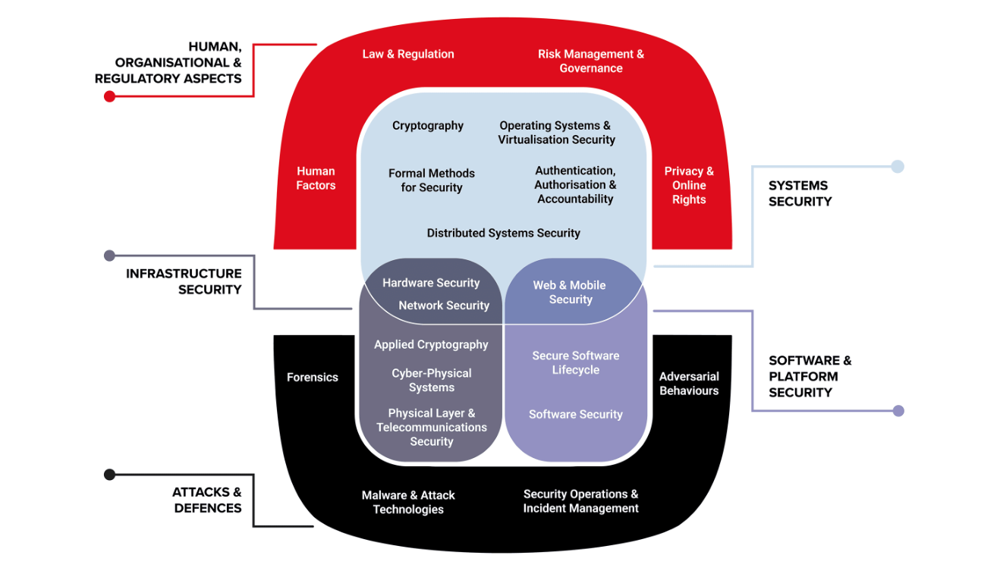

# Chapter 1: Introduction

**Authors:** Andrew Martin (University of Oxford), Awais Rashid (University of Bristol), Howard Chivers (University of York), Steve Schneider (University of Surrey), Emil Lupu (Imperial College London), George Danezis (University College London), Yulia Cherdantseva (Cardiff University)

::: info About this page
This chapter is from [CyBOK Version 1.2.0](https://www.cybok.org/), © Crown Copyright, The National
Cyber Security Centre 2026, licensed under the
[Open Government Licence](https://www.nationalarchives.gov.uk/doc/open-government-licence/).
It was converted from the [PDF](https://www.cybok.org/wp-content/uploads/CyBOK_v1.2.0.pdf) into
a web page so that it works with screen readers and other assistive technology. Each
abbreviation is spelled out in square brackets the first time it appears, and those meanings are
ours, not the book's. So are the names of links the book prints as a bare web address. The PDF
(Portable Document Format) is the original, so if the two disagree, the PDF wins.
:::

Cyber security is becoming an important element in curricula at all education levels. However, the foundational knowledge on which the field of cyber security is being developed is fragmented, and as a result, it can be difficult for both students and educators to map coherent paths of progression through the subject. By comparison, mature scientific disciplines like mathematics, physics, chemistry, and biology have established foundational knowledge and clear learning pathways. Within software engineering, the IEEE \[Institute of Electrical and Electronics Engineers\] Software Engineering Body of Knowledge \[<a href="#ref-5" aria-label="Reference 5">5</a>\] codifies key foundational knowledge on which a range of educational programmes may be built. There are a number of previous and current efforts on establishing skills frameworks, key topic areas, and curricular guidelines for cyber security. However, a consensus has not been reached on what the diverse community of researchers, educators, and practitioners sees as established foundational knowledge in cyber security.

The Cyber Security Body of Knowledge (CyBOK) aims to codify the foundational and generally recognised knowledge on cyber security. In the same fashion as SWEBOK \[Software Engineering Body of Knowledge\], CyBOK is meant to be a guide to the body of knowledge; the knowledge that it codifies already exists in literature such as textbooks, academic research articles, technical reports, white papers, and standards. Our focus is, therefore, on mapping established knowledge and not fully replicating everything that has ever been written on the subject. Educational programmes ranging from secondary and undergraduate education to postgraduate and continuing professional development programmes can then be developed on the basis of CyBOK.

This introduction sets out to place the 21 Knowledge Areas (KAs) of the CyBOK into a coherent overall framework. Each KA assumes a baseline agreement on the overall vocabulary, goals, and approaches to cyber security, and here we provide that common material which underpins the whole body of knowledege. We begin with an overview of cyber security as a topic, and some basic definitions, before introducing the knowledge areas. The KAs and their groupings into categories are, of course, not orthogonal and there are a number of dependencies across the KAs which are cross-referenced and also separately captured visually on the CyBOK web site ([cybok.org](https://www.cybok.org)). We then discuss how the knowledge in the KAs can be deployed to understand the means and objectives of cyber security, mitigate against failures and incidents, and manage risks.

Although we have necessarily divided the CyBOK into a number of discrete Knowledge Areas (KAs), it is clear that there are many inter-relationships among them. Those with professional responsibility for one area must typically have at least a moderate grasp of the adjacent topics; someone responsible for architecting a secure system must understand many. There are a number of *unifying principles* and crosscutting themes that underpin the development of systems that satisfy particular security properties. We conclude the introduction by discussing some of these.

## 1.1 Cyber Security Definition

The CyBOK Knowledge Areas assume a common vocabulary and core understanding of a number of topics central to the field. Whilst this *Body of Knowledge* is *descriptive* of existing knowledge (rather than seeking to innovate, or constrain), it is evident that use of widely-shared terminology in an established concept map is crucial to the development of the discipline as a whole. Since our main aim is to provide a *guide* to the Body of Knowledge, we will provide references to other definitions, rather than introducing our own.

*Cyber security* has become an encompassing term, as our working definition illustrates:

> **Definition:** ***Cyber security*** refers to the protection of information systems (hardware, software and associated infrastructure), the data on them, and the services they provide, from unauthorised access, harm or misuse. This includes harm caused intentionally by the operator of the system, or accidentally, as a result of failing to follow security procedures.
>
> *UK \[United Kingdom\] National Cyber Security Strategy 2016-2021 \[<a href="#ref-7" aria-label="Reference 7">7</a>\]*

This is a succinct definition but expresses the breadth of coverage within the topic. Many other definitions are in use, and a document from ENISA \[European Union Agency for Cybersecurity\] \[<a href="#ref-8" aria-label="Reference 8">8</a>\] surveys a number of these.

The consideration of human behaviours is a crucial element of such a definition—but arguably still missing is a mention of the impact on them from loss of information or reduced safety, or of how security and privacy breaches impact trust in connected systems and infrastructures. Moreover, security must be balanced with other risks and requirements—from a human factors perspective there is a need not to disrupt the primary task.

A large contributor to the notion of cyber security is *Information Security*, widely regarded as comprised of three main elements:

> **Definition:** ***Information security.*** Preservation of confidentiality, integrity and availability of information.
>
> In addition, other properties, such as authenticity, accountability, non-repudiation, and reliability can also be involved.
>
> *ISO \[International Organization for Standardization\] 27000 definition \[<a href="#ref-9" aria-label="Reference 9">9</a>\]*

For definitions of the subsidiary terms, the reader is referred to the ISO 27000 definitions \[<a href="#ref-9" aria-label="Reference 9">9</a>\].

Through the developing digital age other ‘securities’ have had prominence, including *Computer Security* and *Network Security*; related notions include *Information Assurance*, and *Systems Security* — perhaps within the context of *Systems Engineering* or *Security Engineering*. These terms are easily confused, and it seems that often one term is used when another is meant.

Many of those terms were subject to the criticism that they place an over-reliance on technical controls, and focus almost exclusively on *information*. Stretching them to relate to cyber-physical systems may be taking them too far: indeed, our working definition above privileges the notion of *information* (whilst also mentioning *services*) — whereas in the case of network-connected actuators, the pressing challenge is to prevent unwanted *physical actions*.

Moreover, in some accounts of the topic, cyberspace is best understood as a ‘place’ in which business is conducted, human communications take place, art is made and enjoyed, relationships are formed and developed, and so on. In this place, cyber crime, cyber terrorism, and cyber war may occur, having both ‘real’ and ‘virtual’ impacts. Taken as a whole, the CyBOK delineates a large range of topics which appear to be within the broad scope of *cyber security*, even if a succinct reduction of those into a short definition remains elusive. The full scope of CyBOK may serve as an extended definition of the topic—as summarised next.

<figure id="figure-1-1">

{width=659 height=378}

<figcaption>

Figure 1.1: The 21 Knowledge Areas (KAs) in the CyBOK Scope

</figcaption>
</figure>

::: details Text description of Figure 1.1

A layered diagram of the 21 Knowledge Areas. Two outer bands, one arching over the top and one curving under the bottom, surround an inner block made of three regions. Each region is labelled by a category name in capitals, set beside the diagram with a line pointing to its region.

**Human, Organisational & Regulatory Aspects** (the arch across the top and down both sides) holds four Knowledge Areas:

- Law & Regulation (top left)
- Risk Management & Governance (top right)
- Human Factors (left side)
- Privacy & Online Rights (right side)

**Attacks & Defences** (the curved band across the bottom and up both sides) holds four Knowledge Areas:

- Forensics (left side)
- Adversarial Behaviours (right side)
- Malware & Attack Technologies (bottom left)
- Security Operations & Incident Management (bottom right)

**Systems Security** (the large rounded block in the upper centre, inside the top arch) holds five Knowledge Areas:

- Cryptography
- Operating Systems & Virtualisation Security
- Formal Methods for Security
- Authentication, Authorisation & Accountability
- Distributed Systems Security

**Infrastructure Security** (the lower left part of the centre) holds five Knowledge Areas. The first two sit where this region overlaps the lower edge of Systems Security:

- Hardware Security
- Network Security
- Applied Cryptography
- Cyber-Physical Systems Security
- Physical Layer & Telecommunications Security

**Software & Platform Security** (the lower right part of the centre) holds three Knowledge Areas. The first sits where this region overlaps the lower edge of Systems Security:

- Web & Mobile Security
- Secure Software Lifecycle
- Software Security

The five categories contain 4, 4, 5, 5 and 3 Knowledge Areas, which makes 21 in all.

:::

## 1.2 CyBOK Knowledge Areas

The CyBOK is divided into 21 top-level Knowledge Areas (KAs), grouped into five broad categories, as shown in [Figure 1.1](#figure-1-1). Clearly, other possible categorisations of these KAs may be equally valid, and ultimately some of the structure is relatively arbitrary. The CyBOK Preface describes the process by which these KAs were identified and chosen.

Our categories are not entirely orthogonal. These are intended to capture knowledge relating to cyber security *per se*: in order to make sense of some of that knowledge, auxiliary and background knowledge is needed — whether in the design of hardware and software, or in diverse other fields, such as law.

<figure id="figure-1-2">

<figcaption>

Figure 1.2: Short descriptions of CyBOK Knowledge Areas

</figcaption>

| Category | Knowledge Area | Description |
| --- | --- | --- |
| Human, Organisational & Regulatory Aspects | Risk Management & Governance | Security management systems and organisational security controls, including standards, best practices, and approaches to risk assessment and mitigation. |
| Human, Organisational & Regulatory Aspects | Law & Regulation | International and national statutory and regulatory requirements, compliance obligations, and security ethics, including data protection and developing doctrines on cyber warfare. |
| Human, Organisational & Regulatory Aspects | Human Factors | Usable security, social & behavioural factors impacting security, security culture and awareness as well as the impact of security controls on user behaviours. |
| Human, Organisational & Regulatory Aspects | Privacy & Online Rights | Techniques for protecting personal information, including communications, applications, and inferences from databases and data processing. It also includes other systems supporting online rights touching on censorship and circumvention, covertness, electronic elections, and privacy in payment and identity systems. |
| Attacks & Defences | Malware & Attack Technologies | Technical details of exploits and distributed malicious systems, together with associated discovery and analysis approaches. |
| Attacks & Defences | Adversarial Behaviours | The motivations, behaviours, & methods used by attackers, including malware supply chains, attack vectors, and money transfers. |
| Attacks & Defences | Security Operations & Incident Management | The configuration, operation and maintenance of secure systems including the detection of and response to security incidents and the collection and use of threat intelligence. |
| Attacks & Defences | Forensics | The collection, analysis, & reporting of digital evidence in support of incidents or criminal events. |
| Systems Security | Cryptography | Core primitives of cryptography as presently practised & emerging algorithms, techniques for analysis of these, and the protocols that use them. |
| Systems Security | Operating Systems & Virtualisation Security | Operating systems protection mechanisms, implementing secure abstraction of hardware, and sharing of resources, including isolation in multiuser systems, secure virtualisation, and security in database systems. |
| Systems Security | Distributed Systems Security | Security mechanisms relating to larger-scale coordinated distributed systems, including aspects of secure consensus, time, event systems, peer-to-peer systems, clouds, multitenant data centres, & distributed ledgers. |
| Systems Security | Formal Methods for Security | Formal specification, modelling and reasoning about the security of systems, software and protocols, covering the fundamental approaches, techniques and tool support. |
| Systems Security | Authentication, Authorisation & Accountability | All aspects of identity management and authentication technologies, and architectures and tools to support authorisation and accountability in both isolated and distributed systems. |
| Software & Platform Security | Software Security | Known categories of programming errors resulting in security bugs, & techniques for avoiding these errors—both through coding practice and improved language design—and tools, techniques, and methods for detection of such errors in existing systems. |
| Software & Platform Security | Web & Mobile Security | Issues related to web applications and services distributed across devices and frameworks, including the diverse programming paradigms and protection models. |
| Software & Platform Security | Secure Software Lifecycle | The application and assessment of security software engineering techniques in the whole systems development lifecycle resulting in software that is secure by default. |
| Infrastructure Security | Applied Cryptography | The application of cryptographic algorithms, schemes, and protocols, including issues around implementation, key management, and their use within protocols and systems. |
| Infrastructure Security | Network Security | Security aspects of networking & telecommunication protocols, including the security of routing, network security elements, and specific cryptographic protocols used for network security. |
| Infrastructure Security | Hardware Security | Security in the design, implementation, & deployment of general-purpose and specialist hardware, including trusted computing technologies and sources of randomness. |
| Infrastructure Security | Cyber-Physical Systems Security | Security challenges in cyber-physical systems, such as the Internet of Things & industrial control systems, attacker models, safe-secure designs, and security of large-scale infrastructures. |
| Infrastructure Security | Physical Layer & Telecommunications Security | Security concerns and limitations of the physical layer including aspects of radio frequency encodings and transmission techniques, unintended radiation, and interference. |

</figure>

## 1.3 Deploying CyBOK knowledge to address security issues

### 1.3.1 Means and objectives of cyber security

Implicit in the definitions above is that cyber security entails protection *against* an *adversary* or, possibly, against some other physical or random process. The latter implies some overlap between the notions of *safety* and *security*, although it is arguably possible to have either without the other. Within the security domain, if our modelling accounts for malice, it will necessarily encompass accidents and random processes. Therefore, core to any consideration of security is the modelling of these adversaries: their motives for attack, the threats they pose and the capabilities they may utilise.

In considering those threats, cyber security is often expressed in terms of instituting a number of *controls* affecting people, process, and technology. Some of these will focus on the *prevention* of bad outcomes, whereas others are better approached through *detection* and *reaction*. Selection of those controls is generally approached through a process of Risk Management (see below, and the Risk Management & Governance Knowledge Area (Chapter 2)) — although increasing emphasis is placed on Human Factors (see the Human Factors Knowledge Area (Chapter 4)), noting the need to leverage humans as a lynchpin for improving cyber security cultures, as well as supporting them to protect their privacy online (see the Privacy & Online Rights Knowledge Area (Chapter 5)).

Equally, security requires an analysis of *vulnerabilities* within the system under consideration: a (hypothetical) system without vulnerabilities would be impervious to all threats; a highly vulnerable system placed in totally benign circumstances (no threats) would have no security incidents, either.

The intended use of security controls gives rise to its own questions about whether they are deployed appropriately, and whether they are effective: these belong to the domain of *security assurance*, which has processes and controls of its own. These will involve residual risk analysis (see below, and the Risk Management & Governance Knowledge Area (Chapter 2)) which includes an attempt to measure and quantify the presence of vulnerabilities.

### 1.3.2 Failures and Incidents

When adversaries achieve their goal (wholly or partially) — when attacks succeed — the collection of security controls may be said to have failed. Alternatively, we may say that insufficient or ineffective controls were in place. Operationally speaking, one or more failures may give rise to a security incident. Typically such incidents may be described in terms of the harm to which they give rise: according to our definition of cyber security, these typically amount to harm from theft or damage of information, devices, services, or networks. The cyber-physical domain (see the Cyber-Physical Systems Security Knowledge Area (Chapter 21)) gives rise to many additional potential harms—harms to humans may come from either information, or from unintended physical action, or from both.

A significant sub-discipline of operational security considers detection of security failures, and reactions to them (remediation where possible). The Security Operations & Incident Management Knowledge Area (Chapter 8) addresses the context; the Malware & Attack Technologies Knowledge Area (Chapter 6) deals with analysis of attack vectors while the Forensics Knowledge Area (Chapter 9) considers the technical details and processes for post-attack analysis in a robust and reliable manner.

A recurrent theme in security analysis is that it is not sufficient to define good security controls solely within a particular abstraction or frame of reference: it is necessary also to consider what may happen if an adversary chooses to ignore that abstraction or frame.

This arises, for example, in communication *side channels*, where an adversary may infer much from capturing radio frequency emissions from a cable, say, without needing to tap that cable physically. Similar eavesdropping effects have been observed against cryptography implemented on smartcards: simple analysis of the power consumption of the processor as it addresses each bit in turn can be sufficient to disclose the cryptographic key (see the Hardware Security Knowledge Area (Chapter 20) and the Software Security Knowledge Area (Chapter 15)). Appropriate use and handling of cryptographic keys is considered in the Applied Cryptography Knowledge Area (Chapter 18), with underlying theory considered in the Cryptography Knowledge Area (Chapter 10).

These problems occur at every level in the system design. In software, the *SQL \[Structured Query Language\] injection attack* arises (see Software Security and Web & Mobile Security Knowledge Areas) because a string of characters intended to be interpreted as a database entry is forced to become a database command. Files holding secrets written by one application may give up those secrets when read by another, or by a general-purpose debugger or dump program.

Mathematical theories of refinement (and software development contracts) explore the relationship of an ‘abstract’ expression of an algorithm and a more ‘concrete’ version which is implemented: but security properties proven of the one may not be true of the other (for example, reducing uncertainty can increase information content and lead to the leak of information such as a cryptographic key), so great care must be taken in the construction of the theories. ‘Black-box testing’ relies on the same notion and, since it cannot possibly test every input, may easily miss the particular combination of circumstances which — by accident or design — destroys the security of the program. Carefully-constructed mathematical theories and models for security aim to avoid these pitfalls and permit precise reasoning about security properties. Some of these are discussed in the Formal Methods for Security Knowledge Area (Chapter 13).

Operational security of a system may be predicated upon the operators following a particular procedure or avoiding particular dangerous circumstances: there is an assumption that if people are told in a professional context (not) to do something, then they will (not) do it. This is demonstrably false (see the Human Factors Knowledge Area (Chapter 4)).

These — and an endless array of other — security problems arise because it is necessary to think (and design systems) using abstractions. Not only can no individual comprehend every detail of the operation of a networked computing system (from the device physics upwards), even if they had the requisite knowledge they must work in abstractions in order to make progress and avoid being overwhelmed with detail. But, for the majority of security controls, the abstraction is no more than a thinking tool: and so the adversary is able to disregard it entirely.

Since abstractions are usually built in layers (and computing systems are usually explicitly designed in that way), this is sometimes known as the ‘layer below’ problem \[<a href="#ref-10" aria-label="Reference 10">10</a>\] because the adversary often attacks the layer below the one in which the abstraction defining the control sits (see, for example, the threats and attacks discussed in the Operating Systems & Virtualisation Security Knowledge Area (Chapter 11) and the Hardware Security Knowledge Area (Chapter 20)).

### 1.3.3 Risk

There is no limit in principle to the amount of effort or money that might be expended on security controls. In order to balance these with the available resources and the harms and opportunities that might arise from emerging threats to security, a common over-arching approach to security analysis is a process of Risk Assessment — and selection of controls, a process of Risk Management. These are explored in depth in the Risk Management & Governance Knowledge Area (Chapter 2).

As with any process of risk management, a key calculation relates to expected impact, being calculated from some estimate of likelihood of events that may lead to impact, and an estimate of the impact arising from those events. The likelihood has two elements: the presence of *vulnerabilities* (known or unknown—the latter not always being capable of being mitigated), and the nature of the *threat*. The management response to the risk assessment may take many forms, including additional controls to reduce the impact or likelihood of a threat, accepting the risk, or transferring/sharing it with a third party (e.g., insurance), or in some cases deciding not to proceed because all of these outcomes are unacceptable.

Security management encompasses all the management and security actions necessary to maintain the security of a system during its lifetime. Important in this context, but outside of the scope of the CyBOK, are quality management practices. Such practices are long-established in industry, essentially requiring that all work follows documented processes, and that the processes provide metrics which are, in turn, reviewed and used to correct processes that are not fit for purpose (‘nonconformities’).

The analogy between quality management and security is not perfect because the threat environment is not static; however, the trend is for security management standards such as ISO/IEC 27001 to embody standard quality management processes which are then specialised for security. The primary specialisation is the periodic use of risk management (see the Risk Management & Governance Knowledge Area (Chapter 2)), which must also take account of the changing threat environment. It is necessary to supplement periodic risk management with continuous measures of the effectiveness of the security processes. For example, system patching and maintenance can be continuously reviewed via vulnerability scanning. Logs relating to failed access attempts, user lock-outs or password resets can provide indicators of the usability of security features.

The functions within a security management system can be grouped into Physical, Personnel, Information Systems and Incident Management and are a mixture of standard IT \[information technology\] system management functions and those that are specific to cyber security.

Physical security includes physical protection of the system, including access control, asset management and the handling and protection of data storage media. These aspects are outside the scope of the CyBOK.

Personnel security is concerned with a wide range of security usability and behaviour shaping, including education and training (see the Human Factors Knowledge Area (Chapter 4)). It also includes formal human-resource management elements such as the selection and vetting of staff, terms and conditions of acceptable usage for IT systems (see the Law & Regulation Knowledge Area (Chapter 3)) and disciplinary sanctions for security breaches.

Information system management includes access management (see the Authentication, Authorisation & Accountability Knowledge Area (Chapter 14)) and system logging (see the Security Operations & Incident Management Knowledge Area (Chapter 8)). The audit function is divided into security monitoring (see the Security Operations & Incident Management Knowledge Area (Chapter 8)) and other IT functions, such as volumetric review for system provisioning. Management of the information system also involves standard IT functions such as backup and recovery, and the management of supplier relationships.

Incident management functions (see the Security Operations & Incident Management Knowledge Area (Chapter 8)) are specific to cyber security and include security monitoring, incident detection and response.

## 1.4 Principles

Sound thinking and good practice in security has been codified by a number of authors. The principles they describe touch many different KAs, and taken together help to develop a holistic approach to the design, development, and deployment of secure systems.

### 1.4.1 Saltzer and Schroeder Principles

The earliest collected design principles for engineering security controls were enumerated by Saltzer and Schroeder in 1975 \[<a href="#ref-11" aria-label="Reference 11">11</a>\]. These were proposed in the context of engineering secure multi-user operating systems supporting confidentiality properties for use in government and military organisations. This motivation does bias them in some ways, however they have also stood the test of time in being applicable to the design of security controls much more broadly.

The eight principles they enumerate are as follows:

- *Economy of mechanism.* The design of security controls should remain as simple as possible, to ensure high assurance. Simpler designs are easier to reason about formally or informally, to argue correctness. Further, simpler designs have simpler implementations that are easier to manually audit or verify for high assurance. This principle underlies the notion of Trusted Computing Base (TCB) — namely the collection of all software and hardware components on which a security mechanism or policy relies. It implies that the TCB of a system should remain small to ensure that it maintains the security properties expected.
- *Fail-safe defaults.* Security controls need to define and enable operations that can positively be identified as being in accordance with a security policy, and reject all others. In particular, Saltzer and Schroeder warn against mechanisms that determine access by attempting to identify and reject malicious behaviour. Malicious behaviour, as it is under the control of the adversary and will therefore adapt, is difficult to enumerate and identify exhaustively. As a result basing controls on exclusion of detected violation, rather than inclusion of known good behaviour, is error prone. It is notable that some modern security controls violate this principle including signature based anti-virus software and intrusion detection.
- *Complete mediation.* All operations on all objects in a system should be checked to ensure that they are in accordance with the security policy. Such checks would usually involve ensuring that the subject that initiated the operation is authorised to perform it, presuming a robust mechanism for authentication. However, modern security controls may not base checks on the identity of such a subject but other considerations, such as holding a ‘capability’.
- *Open design.* The security of the control must not rely on the secrecy of how it operates, but only on well specified secrets or passwords. This principle underpins cyber security as a field of open study: it allows scholars, engineers, auditors, and regulators to examine how security controls operate to ensure their correctness, or identify flaws, without undermining their security. The opposite approach, often called ‘security by obscurity’, is fragile as it restricts who may audit a security control, and is ineffective against insider threats or controls that can be reverse engineered.
- *Separation of privilege.* Security controls that rely on multiple subjects to authorise an operation, provide higher assurance than those relying on a single subject. This principle is embodied in traditional banking systems, and carries forward to cyber security controls. However, while it is usually the case that increasing the number of authorities involved in authorising an operation increases assurance around integrity properties, it usually also decreases assurance around availability properties. The principle also has limits, relating to over diluting responsibility leading to a ‘tragedy of the security commons’ in which no authority has incentives to invest in security assuming the others will.
- *Least privilege.* Subjects and the operations they perform in a system should be performed using the fewest possible privileges. For example, if an operation needs to only read some information, it should not also be granted the privileges to write or delete this information. Granting the minimum set of privileges ensures that, if the subject is corrupt or software incorrect, the damage they may do to the security properties of the system is diminished. Defining security architectures heavily relies on this principle, and consists of separating large systems into components, each with the least privileges possible — to ensure that partial compromises cannot affect, or have a minimal effect on, the overall security properties of a whole system.
- *Least common mechanism.* It is preferable to minimise sharing of resources and system mechanisms between different parties. This principle is heavily influenced by the context of engineering secure multi-user systems. In such systems common mechanisms (such as shared memory, disk, CPU \[Central Processing Unit\], etc.) are vectors for potential leaks of confidential information from one user to the other, as well as potential interference from one user into the operations of another. Its extreme realisation sees systems that must not interfere with each other being ‘air-gapped’. Yet, the principle has limits when it comes to using shared infrastructures (such as the Internet), or shared computing resources (such as multi-user operating systems, that naturally share CPUs and other resources).
- *Psychological acceptability.* The security control should be naturally usable so that users ‘routinely and automatically’ apply the protection. Saltzer and Schroeder, specifically state that ‘to the extent that the user’s mental image of his protection goals matches the mechanisms he must use, mistakes will be minimised’. This principle is the basis for the Human Factors Knowledge Area (Chapter 4).

Saltzer and Schroeder also provide two further principles, but warn that those are only imperfectly applicable to cyber security controls:

- *Work factor.* Good security controls require more resources to circumvent than those available to the adversary. In some cases, such as the cost of brute forcing a key, the work factor may be computed and designers can be assured that adversaries cannot be sufficiently endowed to try them all. For other controls, however, this work factor is harder to compute accurately. For example, it is hard to estimate the cost of a corrupt insider, or the cost of finding a bug in software. The costs are reducing with advances in LLMs \[Large Language Model\] and agentic AI \[Artificial Intelligence\].
- *Compromise recording.* It is sometimes suggested that reliable records or logs, that allow detection of a compromise, may be used instead of controls that prevent a compromise. Most systems do log security events, and security operations heavily rely on such reliable logs to detect intrusions. The relative merits — and costs — of the two approaches are highly context-dependent.

Those principles in turn draw on much older precedents such as Kerckhoff’s principles relating to cryptographic systems \[<a href="#ref-12" aria-label="Reference 12">12</a>\]. Kerchoff highlights that cryptographic systems must be practically secure, without requiring the secrecy of how they operate (open design). He also highlights that keys should be short and memorable, the equipment must be easy to use, and applicable to telecommunications — all of which relate to the psychological acceptability of the designs.

### 1.4.2 NIST Principles

More contemporary principles in systems design are enumerated by NIST \[National Institute of Standards and Technology\]\[<a href="#ref-13" aria-label="Reference 13">13</a>, Appendix F\]. They incorporate and extend the principles from Saltzer and Schroeder. They are categorised into three broad families relating to: ‘Security Architecture and Design’ (i.e., organisation, structure and interfaces); ‘Security Capability and Intrinsic Behaviours’ (i.e., what the protections are about); and ‘Life Cycle Security’ (i.e., those related to process and management). As such those principles specifically refer to security architecture, specific controls, as well as engineering process management.

A number of the NIST principles map directly to those by Saltzer and Schroeder, such as Least Common Mechanism, Efficiently Mediated Access, Minimised Sharing, Minimised Security Elements, Reduced Complexity, Least Privilege, Secure Defaults and Predicate Permission, and Acceptable Security.

Notably, new principles deal with the increased complexity of modern computing systems and emphasise clean modular design, i.e. with Clear Abstraction, Modularity and Layering, Partially Ordered Dependencies, and Secure Evolvability. Other principles recognise that not all components in a secure system may operate at the same level of assurance, and call for those to benefit from a Hierarchical Trust structure, in which the security failure of some components does not endanger all properties in the system. The principle of Inverse Modification Threshold states that those components that are the most critical to security, should also be the most protected against unauthorised modification or tampering. Hierarchical protection states that least critical security components need not be protected from more critical ones.

The NIST framework also recognises that modern systems are interconnected, and provides principles of how to secure them. These should be networked using Trusted Communication Channels. They should enjoy Secure Distributed Composition, meaning that if two systems that enforce the same policy are composed, their composition should also at least enforce the same policy. Finally, the principle of Self-Reliant Trustworthiness states that a secure system should remain secure even if disconnected from other remote components.

The NIST principles expand on what types of security mechanisms are acceptable for real-world systems. In particular the principles of Economic Security, Performance Security, Human Factored Security, and Acceptable Security state that security controls should not be overly expensive, overly degrade performance, or be unusable or otherwise unacceptable to users. This is a recognition that security controls support functional properties of systems and are not a goal in themselves.

Besides principles, NIST also outlines three key security architecture strategies. The Reference Monitor Concept is an abstract control that is sufficient to enforce the security properties of a system. Defence in Depth describes a security architecture composed on multiple overlapping controls. Isolation is a strategy by which different components are physically or logically separated to minimise interference or information leakage.

Both NIST and Saltzer & Schroeder highlight that principles provide guidance only, and need to be applied with skill to specific problems at hand to design secure architectures and controls. Deviation from a principle does not automatically lead to any problems, but such deviations need to be identified to ensure that any issues that may arise have been mitigated appropriately.

### 1.4.3 Latent Design Conditions

As more and more cyber-physical systems are connected to other systems and the Internet, the inherent complexity emerging from such large-scale connectivity and the safety critical nature of some of the cyber-physical systems means other principles also become highly relevant. One such principle is that of *Latent Design Conditions* from research in the safety-critical systems domain by James Reason \[<a href="#ref-14" aria-label="Reference 14">14</a>\]. In the context of cyber security, latent design conditions arise from past decisions about a system (or systems). They often remain hidden (or unconsidered) and only come to the fore when certain events or settings align — in the case of cyber-physical systems security vulnerabilities being exposed as they become connected to other systems or the Internet. Reason refers to this as the Swiss Cheese model where different holes in the slices align. These issues are discussed further in the Human Factors Knowledge Area (Chapter 4). The key point to note is that we can no longer just consider information loss as a potential consequence of cyber security breaches — but must also consider safety implications. Furthermore, security by design is not always a possibility and, as legacy systems become connected to other networked environments, one must consider the latent (insecure) design conditions that may be manifested and how to mitigate their impact.

### 1.4.4 The Precautionary Principle

As the participatory data economy leads to a range of innovative products and services, there are also growing concerns about privacy and potential misuse of data as has been highlighted by recent cases of interference in democratic processes. As such the *Precautionary Principle* — reflecting on the potential harmful effect of design choices before technological innovations are put into large-scale deployment — also becomes relevant. Designers must consider the security and privacy implications of their choices from conception, through to modelling, implementation, maintenance, evolution and also decommissioning of large-scale connected systems and infrastructures on which society increasingly relies. *Function creep* as the system evolves over its lifetime and its impact on the society-at-large must also be considered \[<a href="#ref-15" aria-label="Reference 15">15</a>\].

## 1.5 Crosscutting Themes

A number of topics and themes recur across various KAs — implicitly or explicitly — and provide a context or unification of ideas across those KAs which cuts across the structure chosen for the CyBOK. These are an important part of the body of knowledge, and so we document here the most substantial of them.

### 1.5.1 Security Architecture and Lifecycle

The word ‘architecture’ is used at all levels of detail within a system; here we are concerned with the high-level design of a system from a security perspective, in particular how the primary security controls are motivated and positioned within the system. This, in turn, is bound up with an understanding of the *systems* lifecycle, from conception to decommissioning. Within this, the secure *software* lifecycle is crucial (the subject of the Secure Software Lifecycle Knowledge Area).

The fundamental design decision is how a system is compartmentalised — how users, data, and services are organised to ensure that the highest risk potential interactions are protected by the simplest and most self-contained security mechanisms (see Section 1.4). For example, a network may be divided into front-office/back-office compartments by a network router or firewall that permits no inward connections from the front to the back. Such a mechanism is simpler and more robust than one that uses access controls to separate the two functions in a shared network.

The first step is to review the proposed use of the system. The business processes to be supported should identify the interactions between the users, data or services in the system. Potential high risk interactions between users (see the Adversarial Behaviours Knowledge Area (Chapter 7) and data should then be identified with an outline risk assessment (see the Risk Management & Governance Knowledge Area (Chapter 2)) which will also need to take account of external requirements such as compliance (see the Law & Regulation Knowledge Area (Chapter 3)) and contractual obligations. If users with a legitimate need to access specific data items also pose a high risk to those items, or if any user has unconstrained authority to effect an undesired security outcome, the business process itself must be revised. Often such cases require a ‘two person’ rule, for example, counter-authorisation for payments.

The next step is to group users and data into broad categories using role-access requirements, together with formal data classification and user clearance. Such categories are potential system compartments, for example, Internet users and public data, or engineers and design data. Compartments should ensure that the highest risk user-data interactions cross compartment boundaries, and that common user-data interactions do not. Such compartments are usually enforced with network partitioning controls (see the Network Security Knowledge Area (Chapter 19)). Detailed design is then required within compartments, with the first steps being to focus on concrete user roles, data design and access controls (see the Authentication, Authorisation & Accountability Knowledge Area (Chapter 14)), with more detailed risk assessments being conducted as the design matures.

Systems benefit from a uniform approach to security infrastructure, for example, the management of keys and network protocols (see the Network Security Knowledge Area (Chapter 19)), resource management and coordination (see the Distributed Systems Security Knowledge Area (Chapter 12)), roles (see the Authentication, Authorisation & Accountability Knowledge Area (Chapter 14)), user access (see the Human Factors Knowledge Area (Chapter 4)), and intrusion detection (see the Security Operations & Incident Management Knowledge Area (Chapter 8)). CyBOK provides important foundation knowledge in these areas, but neither this nor risk assessment are sufficient to motivate the detailed implementation of infrastructure; they need to be complemented by current good practice. In some industries best practice is mandated (e.g., the Payment Card Industries). In other cases it may be available from open sources (e.g., OWASP \[Open Web Application Security Project\][^1-1]) or as a result of corporate benchmarking.

Orthogonal to these concerns are a number of topics which relate to the context of the system development and operation. It is increasingly clear that a code of conduct, as prescribed by many professional bodies, offers a valuable framework for system designers and those who explore weaknesses and vulnerabilities within such systems. Initiatives around responsible research and innovation are gaining ground. The discovery of vulnerabilities necessitates a disclosure policy — and the parameters of responsible disclosure have prompted much debate, together with the role of this in a security equities process.

These broad consideration of architecture and lifecycle have been captured within the notions of ‘security by design’, and ‘secure by default’[^1-2]. The former term is often applied to detailed practices in software engineering, such as input checking, to avoid buffer overflows and the like (see the Secure Software Lifecycle Knowledge Area (Chapter 17)). More generally, consideration of security throughout the lifecycle, including in the default configuration ‘out of the box’ (although not much software is delivered in boxes these days), demonstrably leads to less insecurity in deployed systems.

### 1.5.2 Supply Chain Security

Supply chain security is a critical socio-technical challenge arising from the growing attack surface, which often lies outside the direct control of an organisation. Major recent supply chain incidents, including the SolarWinds Orion compromise, the Log4j vulnerability, and the XZ Utils backdoor, have underscored the criticality of build-pipeline integrity, reshaped thinking about open-source governance and maintainer trust models, and demonstrated how an attack on a widely used third-party component can cascade across many organisations.

Supply chain security has expanded from supplier assurance into an interdisciplinary field encompassing software supply chains, open-source ecosystems, cloud dependencies, and regulatory compliance. Reflecting this trend, this crosscutting theme is addressed across multiple CyBOK KAs. The Secure Software Lifecycle Knowledge Area (Chapter 17) discusses software supply chain security in detail, while the Risk Management & Governance Knowledge Area (Chapter 2) emphasises supply chain resilience as an essential component of business continuity planning. The Law & Regulation Knowledge Area (Chapter 3) examines contractual enforcement of supply chain standards as one mechanism for encouraging upstream due diligence: negotiating such clauses can serve both as a due-diligence technique and as a means of surfacing vulnerabilities, though vulnerability disclosure across multi-tiered suppliers remains a delicate problem. In industrial environments, these compromises directly threaten physical processes, bridging the gap between security and operational safety.

More recently, the rapid integration of AI and generative coding tools has introduced new supply chain risks. AI tools and agents now enter the development process in a variety of roles that remain to be fully explored, including as code-writing assistants, as code reviewers, as embedded AI models integrated directly into software products and services, and as

[^1-1]: [the OWASP website](https://www.owasp.org)

[^1-2]: A related notion is ‘privacy by design’ (see the Privacy & Online Rights Knowledge Area (Chapter 5)).

## References

- \[5\] H. Washizaki, Ed., *[Guide to the Software Engineering Body of Knowledge (SWEBOK Guide), Version 4.0a](https://www.computer.org/education/bodies-of-knowledge/software-engineering/v4)*. IEEE Computer Society, 2026.
- \[7\] HM Government, UK, “[National cyber security strategy 2016–2021](https://www.gov.uk/government/publications/national-cyber-security-strategy-2016-to-2021),” 2016.
- \[8\] ETSI/CEN/CENELEC Cybersecurity Coordination Group (CSCG) and ENISA, “[Definition of Cybersecurity gaps and overlaps in standardisation](https://www.enisa.europa.eu/publications/definition-of-cybersecurity),” ENISA, Report, Dec. 2015.
- \[9\] ISO/IEC, “Information technology – security techniques – information security management systems – overview and vocabulary,” ISO/IEC, – 27000:2018, 2018.
- \[10\] D. Gollmann, *Computer Security*, 3rd ed. Wiley, 2011.
- \[11\] J. H. Saltzer and M. D. Schroeder, “[The protection of information in computer systems](https://doi.org/10.1109/PROC.1975.9939),” *Proceedings of the IEEE*, vol. 63, no. 9, pp. 1278–1308, 1975.
- \[12\] A. Kerckhoffs, “La cryptographie militaire,” *Journal des sciences militaires*, vol. 9, 1883.
- \[13\] R. Ross, M. McEvilley, and J. C. Oren, “[Systems security engineering: Considerations for a multidisciplinary approach in the engineering of trustworthy secure systems](https://doi.org/10.6028/NIST.SP.800-160v1),” NIST, Tech. Rep. NIST.SP.800-160 Volume 1, Nov. 2016.
- \[14\] J. Reason, *The human contribution: unsafe acts, accidents and heroic recoveries*. CRC Press, 2008.
- \[15\] W. Pieters and A. van Cleeff, “[The precautionary principle in a world of digital dependencies](https://doi.org/10.1109/MC.2009.203),” *Computer*, vol. 42, no. 6, pp. 50–56, 2009.
