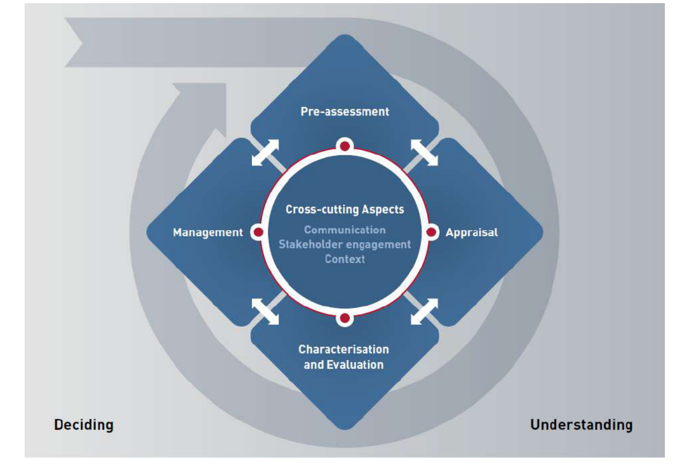
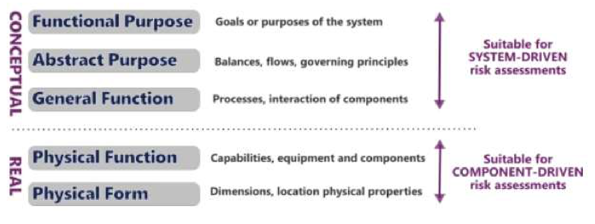
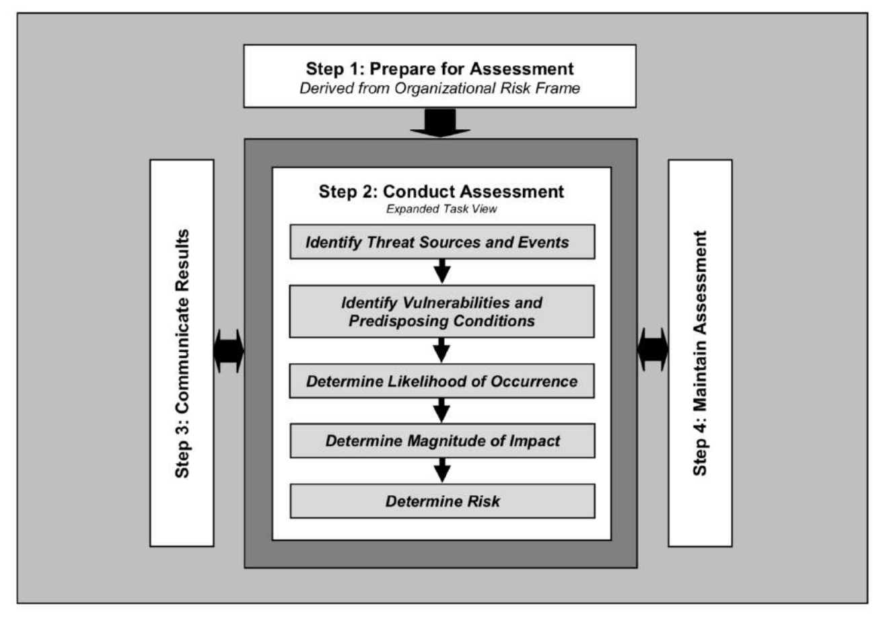
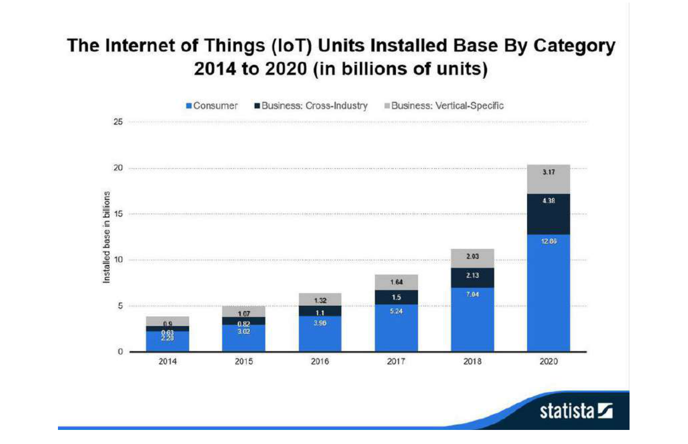
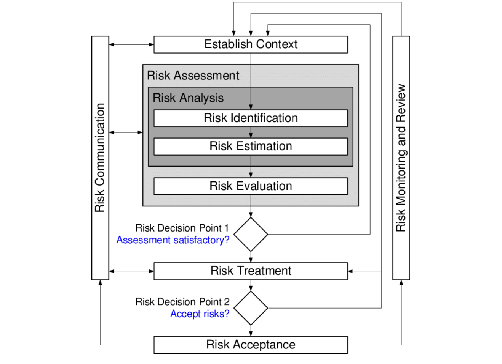

# Chapter 2: Risk Management & Governance

**Authors:** Pete Burnap (Cardiff University)

::: info About this page
This chapter is from [CyBOK Version 1.2.0](https://www.cybok.org/), © Crown Copyright, The National
Cyber Security Centre 2026, licensed under the
[Open Government Licence](https://www.nationalarchives.gov.uk/doc/open-government-licence/).
It was converted from the [PDF](https://www.cybok.org/wp-content/uploads/CyBOK_v1.2.0.pdf) into
a web page so that it works with screen readers and other assistive technology. Each
abbreviation is spelled out in square brackets the first time it appears, and those meanings are
ours, not the book's. So are the names of links the book prints as a bare web address. The PDF
(Portable Document Format) is the original, so if the two disagree, the PDF wins.
:::

## 2.1 Introduction

This Knowledge Area will explain the fundamental principles of cyber risk assessment and management and their role in risk governance, expanding on these to cover the knowledge required to gain a working understanding of the topic and its sub-areas. We begin by discussing the relationship between everyday risk and why this is important in today’s interconnected digital world. We explain why, as humans, we need effective risk assessment and management principles to support the capture and communication of factors that may impact our values. We then move on to describe different perspectives on cyber risk assessment – from individual assets, to whole-system goals and objectives. We unpick some of the major risk assessment methods and highlight their main uses and limitations, as well as providing pointers to more detailed information.

Security metrics are an ongoing topic of debate in the risk assessment and management domain: which system features to measure for risk, how to measure risk, and why measure risk at all? These questions are framed in the context of existing literature on this topic. This links into risk governance, which explains why effective governance is important to uphold cyber security and some of the social and cultural factors that are essential to consider when developing governance frameworks. Almost all systems still include a human element of control, which must be considered from the outset. Finally, even with well defined and executed risk assessment and management plans, it is still possible that a risk will turn into reality. In such cases, incident response is required. We discuss the importance of incident response and its link to the risk governance process.

## 2.2 What is risk?

\[<a href="#ref-19" aria-label="References 19–21">19–21</a>\]

Risk is at the heart of everyday life. From a child making a decision to jump out of a tree to an investment decision by the CEO \[Chief Executive Officer\] of a multi-billion dollar company, we all make decisions that potentially impact us as individuals, and impact our broader social networks and surroundings. Defining risk is, therefore, a highly philosophical and contentious matter. Seminal works by Slovic \[<a href="#ref-20" aria-label="Reference 20">20</a>\] and Renn \[<a href="#ref-19" aria-label="Reference 19">19</a>\] on risk perception capture the broad-reaching issues surrounding this debate, and provide a working definition that abstracts the question to allow us to engage with the topic of risk on a socio-technical level. Renn’s working definition of risk is *the possibility that human actions or events lead to consequences that have an impact on what humans value*. This fundamentally grounds risk in human value, which applies to both the child and CEO examples. It also applies to cyber security contexts in a world where people and technology are intrinsically linked. The failure of one to support the success of the other can lead to social, economic and technical disaster. The working definition of *impact on values* raises a further question of how to define the value and capture indicators that can be used to measure and manage the risk. Renn defines three basic abstract elements required for this: outcomes that have an impact on what humans value, possibility of occurrence (uncertainty), and a formula to combine both elements. These elements are at the core of most *risk assessment methods*. Such methods aim to provide a structured approach to capturing the entities of value and the likelihood of unwanted outcomes affecting the entities, while also bearing in mind that even something with very low probability may be realised and may have significant impact on a value. We, therefore, use Renn’s working definition of risk for discussion in this KA \[Knowledge Area\] in the context of cyber risk.

A key challenge with risk assessment and management is making assumptions explicit and finding the balance between subjective risk perceptions and objective evidence. *Risk assessment* is, therefore, a process of collating observations and perceptions of the world that can be justified by logical reasoning or comparisons with actual outcomes \[<a href="#ref-21" aria-label="Reference 21">21</a>\]. *Risk management*, on the other hand, is the process of developing and evaluating options to address the risks in a manner that is agreeable to people whose values may be impacted, bearing in mind agreement on how to address risk may involve a spectrum of (in)tolerance – from acceptance to rejection. *Risk Governance* is an overarching set of ongoing processes and principles that aims to ensure an awareness and education of the risks faced when certain actions occur, and to instil a sense of responsibility and accountability to all involved in managing it. It underpins collective decision-making and encompasses both risk assessment and management, including consideration of the legal, social, organisational and economic contexts in which risk is evaluated \[<a href="#ref-21" aria-label="Reference 21">21</a>\]. This Knowledge Area explores all these topics and provides insights into risk assessment, management and governance from a cyber security science perspective that is accessible to individuals, SMEs \[Small and Medium-sized Enterprise\] and large organisations alike.

## 2.3 Why is risk assessment and management important?

\[<a href="#ref-20" aria-label="References 20–23">20–23</a>\]

Risk assessment involves three core components \[<a href="#ref-21" aria-label="Reference 21">21</a>\]: (i) identification and, if possible, estimation of hazard; (ii) assessment of exposure and/or vulnerability; and (iii) estimation of risk, combining the likelihood and severity. Identification relates to the establishment of events and subsequent outcomes, while estimation is related to the relative strength of the outcome. Exposure relates to the aspects of a system open to threat actors (e.g., people, devices, databases), while vulnerability relates to the attributes of these aspects that could be targeted (e.g., susceptibility to deception, hardware flaws, software exploits). Risk estimation can be quantitative (e.g., probabilistic) or qualitative (e.g., scenario-based) and captures the expected impact of outcomes. The fundamental concept of risk assessment is to use analytic and structured processes to capture information, perceptions and evidence relating what is at stake, the potential for desirable and undesirable events, and a measure of the likely outcomes and impact. Without any of this information we have no basis from which to understand our exposure to threats nor devise a plan to manage them. An often overlooked part of the risk assessment process is *concern assessment*. This stems from public risk perception literature but is also important for cyber security risk assessment as we will discuss later in the document. In addition to the more evidential, scientific aspects of risk, concern assessment includes wider stakeholder perceptions of: hazards, repercussions of risk effects, fear and dread, personal or institutional control over risk management and trust in the risk managers.

The risk management process involves reviewing the information collected as part of the risk (and concern) assessments. This information forms the basis of decisions leading to three outcomes for each perceived risk \[<a href="#ref-21" aria-label="Reference 21">21</a>\]:

- *Intolerable:* the aspect of the system at risk needs to be abandoned or replaced, or if not possible, vulnerabilities need to be reduced and exposure limited.
- *Tolerable:* risks have been reduced with reasonable and appropriate methods to a level as low as reasonably possible (ALARP) \[<a href="#ref-24" aria-label="Reference 24">24</a>\] or as low as reasonably allowable (ALARA). A range of choices may include mitigating, sharing, or transferring risk \[<a href="#ref-25" aria-label="Reference 25">25</a>\], selection of which will depend on the risk managers’ (and more general company) appetite for taking risks.
- *Acceptable:* risk reduction is not necessary and can proceed without intervention. Furthermore, risk can also be used to pursue opportunities (also known as ‘upside risk’), thus the outcome may be to accept and embrace the risk rather than reduce it. Hillson discusses this perspective in further detail \[<a href="#ref-22" aria-label="Reference 22">22</a>\].

Deciding which to select will be dependent on a number of factors, for example (as suggested in ISO \[International Organization for Standardization\] 31000:2018 \[<a href="#ref-26" aria-label="Reference 26">26</a>\]), tangible and intangible uncertainty, consequences of risk realisation (good or bad), appetite for risk, organisational capacity to handle risk etc.

Beyond this decision framework Renn defines four types of risk that require different risk management plans \[<a href="#ref-21" aria-label="Reference 21">21</a>\]. These include:

- *Routine risks:* these follow a fairly normal decision-making process for management. Statistics and relevant data are provided, desirable outcomes and limits of acceptability are defined, and risk reduction measures are implemented and enforced. Renn gives examples of car accidents and safety devices.
- *Complex risks:* where risks are less clear cut, there may be a need to include a broader set of evidence and consider a comparative approach such as cost-benefit analysis or cost-effectiveness. Scientific dissent such as drug treatment effects or climate change are examples of this.
- *Uncertain risks:* where a lack of predictability exists, factors such as reversibility, persistence and ubiquity become useful considerations. A precautionary approach should be taken with a continual and managed approach to system development whereby negative side effects can be contained and rolled-back. Resilience to uncertain outcomes is key here.
- *Ambiguous risks:* where broader stakeholders, such as operational staff or civil society, interpret risk differently (e.g., different viewpoints exist or lack of agreement on management controls), risk management needs to address the causes for the differing views. Renn uses the example of genetically modified foods where well-being concerns conflict with sustainability options. In this instance, risk management must enable participatory decision-making, with discursive measures aiming to reduce the ambiguity to a number of manageable options that can be further assessed and evaluated.

Management options, therefore, include a risk-based management approach (risk-benefit analysis or comparative options), a resilience-based approach (where it is accepted that risk will likely remain but needs to be contained, e.g. using ALARA/ALARP principles), or a discourse-based approach (including risk communication and conflict resolution to deal with ambiguities). Without effective consideration of the acceptability of risk and an appropriate risk reduction plan, it is likely that the response to adverse outcomes will be disorganised, ineffective, and likely lead to further spreading of undesirable outcomes.

Effective risk management through structured assessment methods is particularly important because, although our working definition of risk is grounded in consequences of interest to people, we (as a society) are not very good at assessing this risk. Slovic’s article on risk perception highlights that perceptions related to *dread risk* (e.g., nuclear accidents) are ranked highest risk by lay people, but much lower by domain experts who understand the evidence relating to safety limitations and controls for such systems. Expert risk ranking tends to follow expected or recorded undesirable outcomes such as deaths, while lay people are influenced more by their intuitive judgment (a nuclear accident could impact my whole family). There is, therefore, a mismatch between perceived vs. actual risk. As people we tend to exaggerate *dread-related* but rare risks (e.g., nuclear incidents and terrorist attacks) but downplay common ones (e.g., street crime and accidents in the home) – even though the latter kill far more people.

This is also why concern assessment is important in the risk management process alongside risk assessment. Schneier’s book *Beyond Fear* \[<a href="#ref-23" aria-label="Reference 23">23</a>\] notes that we have a natural sense of safety in our own environment and a heightened sense of risk outside of this. For instance, we feel safe walking down a street next to our house but on edge when arriving in a new city. As a society, we rarely study statistics when making decisions; they are based on perceptions of exposure to threat, our perceived control over threats, and their possible impact. Risk assessment helps us capture quantitative and qualitative aspects of the world that enable us to put a realistic estimate of how certain we can be that adverse events will come to pass, and how they will impact on what we value most. This applies to us personally as individuals, and as groups of people with a common aim – saving the planet, running a business, or educating children. We need to capture our goals, understand what could lead to the failure to achieve them, and put processes in place to align realistic measures to reduce harms inflicted upon our objectives.

When done well, risk assessment and management enables decision makers, who are responsible, to ensure that the system operates to achieve the desired goals as defined by its stakeholders. It can also ensure the system is not manipulated (intentionally or otherwise) to produce undesired outcomes, as well as having processes in place that minimise the impact should undesirable outcomes occur. Risk assessment and management is also about presenting information in a transparent, understandable and easily interpreted way to different audiences, so that accountable stakeholders are aware of the risks, how they are being managed, who is responsible for managing them, and are in agreement on what is the acceptable limit of risk exposure. This is absolutely crucial to successfully managing risk because, if the risks are not presented clearly to decision makers (be they technical, social, economic or otherwise), the impact of not managing them will be overlooked, and the system will remain exposed. Likewise, if the purpose of risk management is not made clear to the people at the operational level, alongside their own responsibilities and accountability for risk impacts, they will not buy in to the risk management plan and the system will remain exposed. More broadly, if wider stakeholder concerns (e.g., civil society) are not heard or there is lack of confidence in the risk management plan, there could be widespread rejection of the planned system being proposed.

As important as it is to convey risks clearly to stakeholders, it is equally as important to stress that risks cannot always be removed. There is likely to be some residual risk to the things we value, so discussions must be held between decision makers and those who are involved with the operations of a system. Ultimately, decision makers, who will be held to account for failure to manage risk, will determine the level of risk tolerance – whether risk is accepted, avoided, mitigated, shared, or transferred. However, it is possible that wider stakeholders, such as those involved with system operations, may have differing views on how to manage risk, given they are likely to have different values they are trying to protect. For some, saving money will be key. For others, reputation is the main focus. For people working within the system it may be speed of process or ease of carrying out daily tasks. The purpose of risk assessment and management is to communicate these values and ensure decisions are taken to minimise the risks to an agreed set of values by managing them appropriately, while maximising ‘buy in’ to the risk management process. In the broader health and safety risk context, this concept relates to the notion of ALARP (as low as reasonably practicable) \[<a href="#ref-24" aria-label="Reference 24">24</a>\] – being able to demonstrate that significant efforts and computation have been made to calculate the balance between risk acceptance and mitigation, in the favour of security and safety. Again it is important to highlight here that concern assessment is an important part of risk assessment to ensure the risk assessment policy (the agreed approach to risk assessment) is informed by those responsible for, and impacted by risk, and those who are required to act in a way that upholds the management plan day-to-day. Crucially, it must be recognised that the impact of single events can often extend beyond direct harms and spread far wider into supply chains. As Slovic puts it, the results of an event act like ripples from a stone dropped into a pond, first directly within the company or system in which it occurred, and then into sub-systems and interdependent companies and components \[<a href="#ref-20" aria-label="Reference 20">20</a>\].

One of the major drivers for risk assessment and management is to demonstrate compliance. This can be a result of the need to have audited compliance approval from international standards bodies in order to gain commercial contracts; to comply with legal or regulatory demands (e.g., in Europe the Network and Information Systems (NIS) directive \[<a href="#ref-27" aria-label="Reference 27">27</a>\] mandates that operators of essential services (such as critical national infrastructure) follow a set of 14 goal-oriented principles \[<a href="#ref-28" aria-label="Reference 28">28</a>\]); or to improve the marketability of a company through perceived improvements in public trust if certification is obtained. This can sometimes lead to ‘tick-box’ risk assessment whereby the outcome is less focused on managing the risk, and more about achieving compliance. This can result in a false sense of security and leave the organisation exposed to risks. This bring us back to Renn’s working definition of risk. These examples focus on managing risk of failing compliance with various policy positions, and as a result, they may neglect the broader focus on impact on values held by wider organisational, societal or economic stakeholders. The context and scope of risk management must take this broader outcomes-view in order to be a useful and valuable exercise that improves preparedness and resilience to adverse outcomes.

Based on these factors, risk assessment and management is most certainly a process not a product. It is something that, when done well, has the potential to significantly improve the resilience of a system. When done badly (or not at all) it can lead to confusion, reputational damage, and serious impact on system functionality. It is a process that is sometimes perceived to be unimportant before one needs it, but critical for business continuity in a time of crisis. Throughout the process of risk assessment we must remain aware that risk perception varies significantly based on a variety of factors, and that despite objective evidence, it will not change. To use an example from \[<a href="#ref-20" aria-label="Reference 20">20</a>\], providing evidence that the annual risk from living next to a nuclear power plant is equivalent to the risk of riding an extra 3 miles in an automobile, does not necessarily reduce the perception of risk given the differences surrounding the general perception of the different scenarios. Intuitively, communication and a respect for qualitative and quantitative measures of risk assessment are core to its practice. Both measures exhibit ambiguity (e.g., \[<a href="#ref-29" aria-label="Reference 29">29</a>\]) and often we lack quality data on risk so evidence only goes so far. There will always be a need for subjective human judgment to determine relevance and management plans \[<a href="#ref-30" aria-label="Reference 30">30</a>\], which in itself comes with its own limitations such as lack of expert knowledge and cognitive bias \[<a href="#ref-31" aria-label="Reference 31">31</a>\].

## 2.4 What is cyber risk assessment and management?

\[<a href="#ref-32" aria-label="Reference 32">32</a>\]

The introductory sections have made the case for risk assessment and management more generally, but the main focus of this document is to frame risk assessment and management in a cyber security context. Digital technology is becoming evermore pervasive and underpins almost every facet of our daily lives. With the growth of the Internet of Things, connected devices are expected to reach levels of more than 50 billion by 2022 \[<a href="#ref-33" aria-label="Reference 33">33</a>\]. Further, human decision-based tasks such as driving and decision-making are being replaced by automated technologies, and the digital infrastructures that we are increasingly reliant upon can be disrupted indiscriminately as a result of, for example, ransomware \[<a href="#ref-34" aria-label="Reference 34">34</a>\]. Cyber security risk assessment and management is, therefore, a fundamental special case that everyone living and working within the digital domain should understand and be a participant in it.

There are a number of global standards that aim to formalise and provide a common framework for cyber risk assessment and management, and, in this section, we will study some of them. We will begin with high level definitions of some of the foremost positions on risk. The United Kingdom was ranked first in the 2018 Global Cybersecurity Index (GCI) \[<a href="#ref-35" aria-label="Reference 35">35</a>\], a scientifically grounded review of the cyber security commitment and situation at a global country-by-country level. The review covers five pillars: (i) legal, (ii) technical, (iii) organisational, (iv) capacity building, and (v) cooperation – and then aggregates them into an overall score. As the lead nation in the GCI, the technical authority for cyber security, the UK \[United Kingdom\] National Cyber Security Centre (NCSC) has published guidance on risk management \[<a href="#ref-32" aria-label="Reference 32">32</a>\]. Importantly, the NCSC is clear that there is no one-size-fits-all for risk assessment and management. Indeed conducting risk assessment and management as a tick-box exercise produces a false sense of security, which potentially increases the Vulnerability of the people impacted by risk because they are not properly prepared. Cyber security is such a rapidly evolving domain that we must accept that we cannot be fully cyber secure. However, we can increase our preparedness. The Potomac Institute for Policy Studies provides a framework for studying cyber readiness along with a country-specific profile for a range of nations (inc. USA \[United States of America\], India, South Africa, France, UK) and an associated cyber readiness index \[<a href="#ref-36" aria-label="Reference 36">36</a>\].

## 2.5 Risk governance

> See the Human Factors Knowledge Area (Chapter 4) and \[<a href="#ref-37" aria-label="References 37–46">37–46</a>\]

### 2.5.1 What is risk governance and why is it essential?

Risk assessment and developing mitigation principles to manage risk is only likely to be effective where a coordinated and well communicated governance policy is put in place within the system being managed. Millstone et al. \[<a href="#ref-37" aria-label="Reference 37">37</a>\] proposed three governance models:

- *Technocratic:* where policy is directly informed by science and evidence from domain expertise.
- *Decisionistic:* where risk evaluation and policy are developed using inputs beyond science alone. For instance, incorporating social and economic drivers.
- *Transparent (inclusive):* where context for risk assessment is considered from the outset with input from science, politics, economics and civil society. This develops a model of ‘pre-assessment’ – that includes the views of wider stakeholders – that shapes risk assessment and subsequent management policy.

None are correct or incorrect. There is a fine balance between the knowledge and findings of scientific experts, and perceptions of the lay public. While the technocratic approach may seem logical to some risk owners who work on the basis of reasoning using evidence, it is absolutely crucial for effective risk governance to include the wider stakeholder view. Rohrmann and Renn’s work on risk perception highlights some key reasons for this \[<a href="#ref-38" aria-label="Reference 38">38</a>\]. They identify four elements that influence the perception of risk:

- intuitive judgment associated with probabilities and damages;
- contextual factors surrounding the perceived characteristics of the risk (e.g., familiarity) and the risk situation (e.g., personal control);
- semantic associations linked to the risk source, people associated with the risk, and circumstances of the risk-taking situation;
- trust and credibility of the actors involved in the risk debate.

These factors are not particularly scientific, structured or evidence-based but, as noted by Fischoff et al. \[<a href="#ref-39" aria-label="Reference 39">39</a>\], such forms of defining probabilities are countered by the strength of belief people have about the likelihood of an undesirable event impacting their own values. Ultimately, from a governance perspective, the more inclusive and transparent the policy development, the more likely the support and buy-in from the wider stakeholder group – including lay people as well as operational staff – for the risk management policies and principles.

There are several elements that are key to successful risk governance. Like much of the risk assessment process, there is no one-size solution for all endeavours. However, a major principle is ensuring that the governance activity (see below) is tightly coupled with everyday activity and decision-making. Cyber risk is as important as health and safety, financial processes, and human resources. These activities are now well established in decision-making. For instance, when hiring staff, the HR process is at the forefront of the recruiter’s activity. When travelling overseas, employees will always consult the financial constraints and processes for travel. Cyber security should be thought of in the same way – a clear set of processes that reduce the risk of harm to individuals and the business. Everyone involved in the daily running of the system in question must understand that, for security to be effective, it must be part of everyday operational culture. The cyber risk governance approach is key to this cultural adoption.

### 2.5.2 The human factor and risk communication

Sasse and Flechais \[<a href="#ref-40" aria-label="Reference 40">40</a>\] identified human factors that can impact security governance, including people: having problems using security tools correctly; not understanding the importance of data, software, and systems for their organisation; not believing that the assets are at risk (i.e., that they would be attacked); or not understanding that their behaviour puts the system at risk. This highlights that *risk cannot be mitigated with technology alone*, and that *concern assessment* is important. If risk perception is such that there is a widely held view that people do not believe their assets will be attacked (as noted by \[<a href="#ref-40" aria-label="Reference 40">40</a>\]), despite statistics showing cyber security breaches are on the rise year-on-year, then there is likely to be a problem with the cyber security culture in the organisation. Educating people within an organisation is vital to ensuring cultural adoption of the principles defined in the risk management plan and associated security governance policy. People will generally follow the path of least resistance to get a job done, or seek the path of highest reward. As Sasse and Flechais note, people fail to follow the required security behaviour for one of two reasons: (1) they are unable to behave as required (one example being that it is not technically possible to do so; another being that the security procedures and policies available to them are large, difficult to digest, or unclear) , (2) they do not want to behave in the way required (an example of this may be that they find it easier to work around the proposed low-risk but time consuming policy; another being that they disagree with the proposed policy).

Weirich and Sasse studied compliance with password rules as an example of compliance with security policy \[<a href="#ref-41" aria-label="Reference 41">41</a>\] and found that a lack of compliance was associated with people not believing that they were personally at risk and or that they would be held accountable for failure to follow security rules. There is thus a need to ensure a sense of responsibility and process for accountability, should there be a breach of policy. This must, of course, be mindful of legal and ethical implications, as well as the cultural issues around breaching rules, which is a balancing act. Risk communication, therefore, plays an important role in governance \[<a href="#ref-42" aria-label="Reference 42">42</a>\] \[<a href="#ref-19" aria-label="Reference 19">19</a>\] including aspects, such as:

- *Education:* particularly around risk awareness and day-to-day handling of risks, including risk and concern assessment and management;
- *Training and inducement of behaviour change:* taking the awareness provided by education and changing internal practices and processes to adhere to security policy;
- *Creation of confidence:* both around organisational risk management and key individuals – develop trust over time, and maintain this through strong performance and handling of risks.
- *Involvement:* particularly in the risk decision-making process – giving stakeholders an opportunity to take part in risk and concern assessment and partake in conflict resolution.

Finally, leading by example is of paramount importance in the risk communication process. People are likely to be resentful if it appears that senior management are not abiding by the same risk management rules and principles. Visible senior engagement in an important cultural aspect of risk communication.

### 2.5.3 Security culture and awareness

Dekker’s principles on *Just Culture* \[<a href="#ref-43" aria-label="Reference 43">43</a>\] aim to balance accountability with learning in the context of security. He proposes the need to change the way in which we think about accountability so that it becomes compatible with learning and improving the security posture of an organisation. It is important that people feel able to report issues and concerns, particularly if they think they may be at fault. Accountability needs to be intrinsically linked to *helping the organisation*, without concern of being stigmatised and penalised. There is often an issue where those responsible for security governance have limited awareness and understanding of what it means to practise it in the operational world. In these cases there needs to be an awareness that there is possibly no clear right or wrong, and that poorly thought-out processes and practices are likely to have been behind the security breach, as opposed to malicious human behaviour. If this is the case, these need to be addressed and the person at fault needs to feel supported by their peers and free of anxiety. One suggestion Dekker makes is to have an independent team to handle security breach reports so people do not have to go through their line manager. If people are aware of the pathways and outcomes following security breaches it will reduce anxiety about what will happen and, therefore, lead to a more open security culture.

Given that security awareness and education is such an important factor in effective governance, Jaquith \[<a href="#ref-44" aria-label="Reference 44">44</a>\] links security awareness with security metrics through a range of questions that may be considered as useful pointers for improving security culture:

- Are employees acknowledging their security responsibilities as users of information systems? (Metric: % new employees completing security awareness training).
- Are employees receiving training at intervals consistent with company policies? (Metric: % existing employees completing refresher training per policy).
- Do security staff members possess sufficient skills and professional certifications? (Metric: % security staff with professional security certifications).
- Are security staff members acquiring new skills at rates consistent with management objectives? (Metrics: # security skill mastered, average per employee and per security team member, fulfillment rate of target external security training workshops and classroom seminars).
- Are security awareness and training efforts leading to measurable results? (Metrics: By business unit or office, correlation of password strength with the elapsed time since training classes; by business unit or office, correlation of tailgating rate with training latency).

Metrics may be a crude way to capture adherence to security policy, but when linked to questions that are related to the initial risk assessment, they can provide an objective and measurable way to continually monitor and report on the security of a system to the decision makers, as well as those responsible for its governance in an understandable and meaningful way. However, it is worth noting the complexity of metrics here with the use of the term ‘acknowledging’ in the first bullet point. It does not necessarily mean the person will acknowledge their responsibilities merely by completing awareness training. This reinforces the points already made about the importance of human factors and security culture, and the following section on enacting security policy.

<figure id="figure-2-1">

{width=659 height=451}

<figcaption>

Figure 2.1: Risk Governance Framework from IRGC \[International Risk Governance Council\] - taken from \[<a href="#ref-45" aria-label="Reference 45">45</a>\]

</figcaption>
</figure>

::: details Text description of Figure 2.1

A diagram with a square of four diamond-shaped phases arranged around a central circle. A broad grey curved arrow loops around the outside of the diamonds, starting as a banner at the top left and curving down the right side and around the bottom to the left side. The word "Deciding" sits at the bottom left of the diagram and "Understanding" at the bottom right.

The four phases, one per diamond, are:

- Pre-assessment (top)
- Appraisal (right)
- Characterisation and Evaluation (bottom)
- Management (left)

Each pair of neighbouring diamonds is joined by a double-headed arrow at the corners, so all four phases link to their neighbours in both directions.

The central circle is labelled **Cross-cutting Aspects**. It lists three aspects:

- Communication
- Stakeholder engagement
- Context

Each of the four diamonds touches the circle at a marked point.

:::

### 2.5.4 Enacting Security Policy

Overall, effective cyber risk governance will be underpinned by a clear and enactable security policy. This section focuses on the elements of risk assessment and management that are relevant to achieving this. From the initial phase of the risk assessment there should be a clear focus on the purpose and scope of the risk assessment exercise. During this phase, for more complex systems or whole system security, there should be a focus on identifying the objectives and goals of the system. These should be achievable with clear links from objectives to the processes that underpin them. Risks should be articulated as clear statements that capture the interdependencies between the vulnerabilities, threats, likelihoods and outcomes (e.g., causes and effects) that comprise the risk. Risk management decisions will be taken to mitigate threats identified for these processes, and these should be linked to the security policy, which will clearly articulate the required actions and activities taken (and by whom), often along with a clear timeline, to mitigate the risks. This should also include what is expected to happen as a consequence of this risk becoming a reality.

Presentation of risk assessment information in this context is important. Often heat maps and risk matrices are used to visualise the risks. However, research has identified limitations in the concept of combining multiple risk measurements (such as likelihood and impact) into a single matrix and heat map \[<a href="#ref-47" aria-label="Reference 47">47</a>\]. Attention should, therefore, be paid to the purpose of the visualisation and the accuracy of the evidence it represents for the goal of developing security policy decisions.

Human factors (see the Human Factors Knowledge Area (Chapter 4)), and security culture are fundamental to the enactment of the security policy. As discussed, people fail to follow the required security behaviour because they are unable to behave as required, or they do not want to behave in the way required \[<a href="#ref-40" aria-label="Reference 40">40</a>\]. A set of rules dictating how security risk management should operate will almost certainly fail unless the necessary actions are seen as linked to broader organisational governance, and therefore security policy, in the same way HR and finance policy requires. People must be enabled to operate in a secure way and not be the subject of a blame culture when things fail. It is highly likely that there will be security breaches, but the majority of these will not be intentional. Therefore, the security policy must be reflective and reactive to issues, responding to the *Just Culture* agenda and creating a policy of accountability for learning, and using mistakes to refine the security policy and underpinning processes – not blame and penalise people.

Security education should be a formal part of all employees’ continual professional development, with reinforced messaging around why cyber security is important to the organisation, and the employee’s role and duties within this. Principles of risk communication are an important aspect of the human factor in security education. We have discussed the need for credible and trustworthy narratives and stakeholder engagement in the risk management process. There are additional principles to consider such as early and frequent communication, tailoring the message to the audience, pretesting the message and considering existing risk perceptions that should be part of the planning around security education. Extensive discussion of such risk communication principles that are particularly relevant for messaging regarding risk can be found in \[<a href="#ref-46" aria-label="Reference 46">46</a>\].

Part of the final risk assessment and management outcomes should be a list of accepted risks with associated owners who have oversight for the organisational goals and assets underpinning the processes at risk. These individuals should be tightly coupled with review activity and should be clearly identifiable as responsible and accountable for risk management.

[Figure 2.1](#figure-2-1) summarises the core elements of the risk governance process as discussed so far. This model from the International Risk Governance Council (IRGC) \[<a href="#ref-45" aria-label="Reference 45">45</a>\], which is heavily inspired by Renn’s work \[<a href="#ref-21" aria-label="Reference 21">21</a>\], highlights that risk communication sits at the heart of the governance process and draws on problem framing, risk and concern assessment, risk evaluation, and risk management. The governance process is iterative, always seeking awareness of new problems and evolving threats, and continually reflecting on best practice to manage new risks.

## 2.6 Risk assessment and management principles

\[<a href="#ref-27" aria-label="Reference 27">27</a>, <a href="#ref-32" aria-label="Reference 32">32</a>, <a href="#ref-44" aria-label="Reference 44">44</a>, <a href="#ref-45" aria-label="Reference 45">45</a>, <a href="#ref-48" aria-label="References 48–54">48–54</a>\]

### 2.6.1 Component vs. Systems Perspectives

The UK NCSC guidance \[<a href="#ref-32" aria-label="Reference 32">32</a>\] breaks down risk management into *Component-driven risk management*, which focuses on technical components, and the threats and vulnerabilities they face (also known as bottom up); and *System-driven risk management*, which analyses systems as a whole (also known as top down). A major difference between the two is that component-driven approaches tend to focus on the specific risk to an individual component (e.g., hardware, software, data, staff), while system-driven approaches focus more on the goals of an entire system – requiring the definition of a higher level purpose and subsequent understanding of sub-systems and how various parts interact.

Rasmussen’s work \[<a href="#ref-48" aria-label="Reference 48">48</a>\] enables us to consider a hierarchy of abstraction and show how systems-driven and component-driven risk assessment techniques are complementary. As illustrated in [Figure 2.2](#figure-2-2), the goals and purposes of the system can be considered at the higher level. Notably, this includes a focus on dependencies between sub-goals and also what the system must not do (pre-defined failure states). These are important to design into the system and, if omitted, lead to having to retrofit cyber security into a system that has already been deployed. The lower levels then consider capabilities and functionality needed to achieve the overarching goals. At this level component-driven risk assessments of real-world artefacts (e.g., hardware, software, data, staff) consider how these may be impacted by adverse actions or events.

<figure id="figure-2-2">

{width=659 height=249}

<figcaption>

Figure 2.2: Jens Rasmussen’s Hierarchy

</figcaption>
</figure>

::: details Text description of Figure 2.2

A stacked list of five levels, each with a short description to its right. A dotted line splits the stack into a **Conceptual** group (top three levels, labelled "CONCEPTUAL" down the left edge) and a **Real** group (bottom two levels, labelled "REAL" down the left edge). On the far right, a double-headed vertical arrow spans each group and carries a label.

Conceptual group:

| Level | Description |
| --- | --- |
| Functional Purpose | Goals or purposes of the system |
| Abstract Purpose | Balances, flows, governing principles |
| General Function | Processes, interaction of components |

The arrow beside these three levels is labelled "Suitable for SYSTEM-DRIVEN risk assessments".

Real group:

| Level | Description |
| --- | --- |
| Physical Function | Capabilities, equipment and components |
| Physical Form | Dimensions, location physical properties |

The arrow beside these two levels is labelled "Suitable for COMPONENT-DRIVEN risk assessments".

:::

System-driven approaches can help to better understand the complexity between sub-components and their components. These may include people, technology, and organisational processes for which the interactions and dependencies are non-trivial. Taking such an approach (which may perhaps prove more resource intensive than component based approaches, due to identification of inter-dependencies) is only necessary where complexity actually exists. If interactions and dependencies are clear and the system is less complex (e.g., a simple office-based IT \[information technology\] infrastructure) then a component-driven approach may be more appropriate.

The NCSC guidance provides a summary table (reproduced here as [Figure 2.3](#figure-2-3)) that is helpful in guiding the selection of component-driven or system-driven methods based on the kind of risk management problem being addressed. The major differentiator is that the component view is individual asset-based, where complexity is well-understood and expected functionality is clear. The system view supports an analysis of risk in situations of greater complexity, before physical function is agreed and implemented, and to support discussions by key stakeholders on what the system should and should not do. These discussions are crucial in finding the balance between component-level and system-level failure and how best to manage the risk. Component-risk is likely to be more important to operational employees who need the component to be functioning in order for their part of a bigger system to perform (e.g., staff, data, devices). Systems-level risk is likely to be more important to higher-level managers who have a vested interest in the strategic direction of the system. For them a component further down the value/supply chain may not be perceived to be important, while for the operational employee it’s the number one risk. The challenge is to work with both perspectives to develop a representation of risk and an associated risk management policy enacted by all parties.

<figure id="figure-2-3">

<figcaption>

Figure 2.3: Guidelines for mapping risk management problem types to component or system driven methods

</figcaption>

| Method type | Good For |
| --- | --- |
| Component-driven methods | • Analysing the risks faced by individual technical components. • Deconstructing less complex systems, with well-understood connections between component parts. • Working at levels of abstraction where a system’s physical function has already been agreed amongst stakeholders. |
| System-driven methods | • Exploring security breaches which emerge out of the complex interaction of many parts of your system. • Establishing system security requirements before you have decided on the system’s exact physical design. • Bringing together multiple stakeholders’ views of what a system should and should not do (e.g., safety, security, legal views). • Analysing security breaches which cannot be tracked back to a single point of failure. |

</figure>

### 2.6.2 Elements of Risk

While it is useful to avoid creating a universal definition of risk, to support inclusivity of different views and perspectives, it is important to have agreed definitions of the concepts that underpin risk assessment and management. This ensures a common language throughout the process and avoids talking at cross purposes. There are four concepts that are core to a risk assessment in most models – vulnerability, threat, likelihood and impact.

A *Vulnerability* is something open to attack or misuse that could lead to an undesirable outcome. If the vulnerability were to be exploited it could lead to an impact on a process or system. Vulnerabilities can be diverse and include technology (e.g., a software interface being vulnerable to invalid input), people (e.g., a business is vulnerable to a lack of human resources), legal (e.g., databases being vulnerable and linked to large legal fines if data is mishandled and exposed) etc. This is a non-exhaustive list, but highlights that vulnerabilities are socio-technical.

A *Threat* is an individual, event, or action that has the capability to exploit a vulnerability. Threats are also socio-technical and could include hackers, disgruntled or poorly trained employees, poorly designed software, a poorly articulated or understood operational process etc. To give a concrete example that differentiates vulnerabilities from threats – a software interface has a vulnerability in that malicious input could cause the software to behave in an undesirable manner (e.g., delete tables from a database on the system), while the threat is an action or event that exploits the vulnerability (e.g., the hacker who introduces the malicious input to the system).

*Likelihood* represents a measure capturing the degree of possibility that a threat will exploit a vulnerability, and therefore produce an undesirable outcome affecting the values at the core of the system. This can be a qualitative indicator (e.g., low, medium, high), or a quantitative value (e.g., a scale of 1-10 or a percentage).

*Impact* is the result of a threat exploiting a vulnerability, which has a negative effect on the success of the objectives for which we are assessing the risk. From a systems view this could be the failure to manufacture a new product on time, while from a component view it could be the failure of a specific manufacturing production component.

### 2.6.3 Risk assessment and management methods

The purpose of capturing these four elements of risk is for use in dialogue that aims to represent how best to determine the exposure of a system to cyber risk, and how to manage it. There are a range of methods, some of which have been established as international standards and guidelines, that provide a structured means to transform vulnerability, threat, likelihood and impact into a ranked list in order to be able to prioritise and treat them. While each method has its own particular approach to risk assessment and management, there are some features common to a number of the most widely used methods that are useful for framing risk assessment and management activities, which can be mapped back to Renn’s seminal work on risk governance \[<a href="#ref-21" aria-label="Reference 21">21</a>\] as discussed in earlier sections. The International Risk Governance Council (IRGC) capture these in its risk governance framework (developed by an expert group chaired by Renn), summarised in [Figure 2.1](#figure-2-1), which includes four core areas and crosscutting components. *Pre-assessment* includes the framing of risk, identification of relevant actors and stakeholders, and captures perspectives on risk. *Appraisal* includes the assessment of causes and consequences of risk (including risk concern), developing a knowledge base of risks and mitigation options (e.g., preventing, sharing etc). *Characterisation* involves a decision process, making a judgment about the significance and tolerance of the risks. *Appraisal* and *Characterisation* forms the basis of the implementation of Renn’s three core components of risk assessment \[<a href="#ref-21" aria-label="Reference 21">21</a>\]. *Management* processes include deciding on the risk management plan and how to implement it, including risk tolerance (accepting, avoiding, mitigating, sharing, transferring). Cutting across all four is *communication, engagement and context setting* through open and inclusive dialogue.

The US \[United States\] Government NIST \[National Institute of Standards and Technology\] \[<a href="#ref-49" aria-label="Reference 49">49</a>\] guidelines capture the vulnerability, threats, likelihood and impact elements inside the *prepare (pre-assessment), conduct (appraisal and characterise), communicate (cross-cutting), maintain (management)* cycle (see [Figure 2.4](#figure-2-4)). A step-by-step detailed guide can be found in the full document, but we summarise the actions here.

<figure id="figure-2-4">

{width=659 height=467}

<figcaption>

Figure 2.4: NIST SP-800-30 Risk Assessment Process

</figcaption>
</figure>

::: details Text description of Figure 2.4

A box diagram with four steps. Step 1 sits at the top, Step 2 in the centre, Step 3 on the left and Step 4 on the right.

- **Step 1: Prepare for Assessment**, with the note "Derived from Organizational Risk Frame". A thick arrow points down from Step 1 into Step 2.
- **Step 2: Conduct Assessment**, with the note "Expanded Task View". It holds five tasks, joined by downward arrows so they run in this order:
  1. Identify Threat Sources and Events
  2. Identify Vulnerabilities and Predisposing Conditions
  3. Determine Likelihood of Occurrence
  4. Determine Magnitude of Impact
  5. Determine Risk
- **Step 3: Communicate Results**, a tall box on the left of Step 2, joined to it by a double-headed arrow.
- **Step 4: Maintain Assessment**, a tall box on the right of Step 2, joined to it by a double-headed arrow.

:::

**Prepare** involves identifying the *purpose* (e.g., establishing a baseline of risk or identifying vulnerabilities, threats, likelihood and impact) and *scope* (e.g., what parts of a system/organisation are to be included in the risk assessment?; what decisions are the results informing?). It also involves defining *assumptions* and *constraints* on elements such as resources required and predisposing conditions that need to inform the risk assessment. The *assessment approach* and tolerances for risk are also defined at this stage along with identifying *sources of information* relating to threats, vulnerabilities and impact.

**Conduct** is the phase where threats, vulnerabilities, likelihood and impact are identified. There are a range of ways that this can be conducted, and this will vary depending on the nature of the system being risk assessed and the results of the *prepare* stage. NIST has a very specific set of tasks to be performed. These may not be relevant to all systems, but there are some useful tasks that generalise across multiple system perspectives, including identifying: threat sources and adversary capability, intent and targets; threat events and relevance to the system in question; vulnerabilities and predisposing conditions; likelihood that the threats identified will exploit the vulnerabilities; and the impacts and affected assets. Note that the ordering of actions in the NIST approach puts threat identification before vulnerabilities, which presupposes that all threats can be identified and mapped to vulnerabilities. It is worth highlighting that risk assessment must also be effective in situations where threats are less obvious or yet to be mainstream (e.g., IoT \[Internet of Things\] Botnets) and, therefore, some organisations that are particularly ingrained in digital adoption may also wish to consider conducting a vulnerability assessment independently or prior to the identification of likely threats to avoid making assumptions on what or who the threats actors may be.

**Communicate** is one of the most important phases, and one often overlooked. Conducting the risk assessment gives one the data to be able to inform actions that will improve the security of the system. However, it is crucial this is communicated using an appropriate method. Executive boards will expect and need information to be presented in a different way to operational team members, and general organisational staff will need educating and guiding in an entirely different way. The results and evidence of the risk assessment must be communicated in a manner accessible to each stakeholder and in a way that is likely to engage them in risk management planning and execution.

<figure id="figure-2-5">

{width=659 height=426}

<figcaption>

Figure 2.5: IoT Devices Use Figures: Source: \[<a href="#ref-33" aria-label="Reference 33">33</a>\]

</figcaption>
</figure>

::: details Text description of Figure 2.5

A stacked bar chart from Statista titled "The Internet of Things (IoT) Units Installed Base By Category 2014 to 2020 (in billions of units)". The vertical axis is labelled "Installed base in billions" and runs from 0 to 25 in steps of 5. The horizontal axis has six bars, for 2014, 2015, 2016, 2017, 2018 and 2020 (there is no bar for 2019). Each bar stacks three categories, from the bottom: Consumer, Business: Cross-Industry and Business: Vertical-Specific. Each value below is in billions of units.

| Year | Consumer | Business: Cross-Industry | Business: Vertical-Specific |
| --- | --- | --- | --- |
| 2014 | 2.28 | 0.63 | 0.9 |
| 2015 | 3.02 | 0.82 | 1.07 |
| 2016 | 3.96 | 1.1 | 1.32 |
| 2017 | 5.24 | 1.5 | 1.64 |
| 2018 | 7.04 | 2.13 | 2.03 |
| 2020 | 12.86 | 4.38 | 3.17 |

The totals rise from about 3.8 billion in 2014 to about 20.4 billion in 2020. The Statista logo sits at the bottom right. (The small 2014 and 2015 values are hard to read in the original, so they are given to the best reading.)

:::

**Maintain** is an ongoing phase that is essential to continually update the risk assessment in the light of changes to the system environment and configuration. Security postures change regularly in digital environments. For instance, [Figure 2.5](#figure-2-5) shows the volume of IoT units installed from 2014 to 2020 with a rapid increase in adoption of 2.63 million across the business sector between 2014 and 2018. By 2020 this is projected to grow by a further 3.39 million. This kind of rapid integration of devices into corporate IT systems is likely to change the exposure to risk and, therefore, the scope would need to be refined, new risk assessments carried out, and action taken and communicated to all stakeholders to ensure that the new risk is managed. This scenario indicates that (i) risk assessment maintenance must be *proactive* and undertaken much more regularly than an annual basis, and (ii) conducting risk assessment for compliance purposes (possibly only once a year) will leave the organisation wide open to new technological threats unless the *maintain* phase is taken seriously. Risk factors should be identified for ongoing monitoring (e.g., changes in technology use within the system), frequency of risk factor monitoring should be agreed, and change-triggered reviews should revisit and refine the scope, purpose and assumptions of the risk assessment—remembering to communicate the results each time new risks are identified.

The international standard ISO/IEC 27005 for risk management \[<a href="#ref-50" aria-label="Reference 50">50</a>\] contains analogous activities to the NIST guidance (see [Figure 2.6](#figure-2-6)). It includes an *Establish Context* phase, which is broadly aimed at achieving the outcomes of the *Prepare* phase of NIST and the IRGC *Pre-assessment* phase. The *Risk Assessment* phase is multi-layered, with *identification, estimation, evaluation* stages. This aligns with the IRGC’s appraisal and *characterisation* phases. ISO 27005 also has *Risk Communication* and *Risk Monitoring and Review* phases, which relate broadly to the aims of the NIST *Communicate* and *Maintain* phases, and IRGC’s crosscutting communication, context and engagement phases. ISO/IEC 27005 has additional elements that explicitly capture risk management decision processes but it is not prescriptive on how to implement them. The inclusion of the *treatment and acceptance* phases linked to communication and review capture some of the fundamental management aspects, offering the choice of treatment or acceptance as part of the assessment process. This aspect of the ISO/IEC 27005 approach is analogous to the risk response element of the NIST-SP800-39 guidance on risk management \[<a href="#ref-25" aria-label="Reference 25">25</a>\], where the risk response options include acceptance, avoidance, mitigation, or sharing/transfer. The take-away message from this comparison is that, while the risk assessment methods may differ at the risk assessment phase (depending on the type of system being analysed and the scope of the study), the preparation, communication, and continual monitoring phases are must-haves in both widely-used international guidelines, as are the important decisions around risk tolerance. ISO/IEC 27005 is less prescriptive than NIST so offers the option to include a range of assessment and management approaches within the overall process.

<figure id="figure-2-6">

{width=659 height=479}

<figcaption>

Figure 2.6: ISO/IEC 27005 Process - taken from \[<a href="#ref-55" aria-label="Reference 55">55</a>\]

</figcaption>
</figure>

::: details Text description of Figure 2.6

A flowchart with a main column of steps running top to bottom, a tall box labelled "Risk Communication" down the left side and a tall box labelled "Risk Monitoring and Review" down the right side.

Main column, in order, with a downward arrow between each item:

1. **Establish Context**
2. **Risk Assessment** (a grey group box) containing:
   - **Risk Analysis** (a darker box inside it) containing, in order, **Risk Identification** and then **Risk Estimation**
   - **Risk Evaluation**, which follows Risk Analysis
3. **Risk Decision Point 1**, a diamond with the question "Assessment satisfactory?"
4. **Risk Treatment**
5. **Risk Decision Point 2**, a diamond with the question "Accept risks?"
6. **Risk Acceptance**

Branches and loops:

- From Decision Point 1, a line leaves the right of the diamond and returns to the top of the diagram, ending in an arrow into Establish Context (the answer "no" is not printed). The main flow continues down to Risk Treatment.
- From Decision Point 2, a line leaves the right of the diamond and loops back up to the top, ending in an arrow into Establish Context, and another branch of it goes into the right side of Risk Treatment.
- From Risk Acceptance, one line goes left and up to an arrow into the bottom of Risk Communication, and one goes right and up to an arrow into the bottom of Risk Monitoring and Review.
- From the top of Risk Monitoring and Review, a line goes up and over to an arrow into Establish Context.
- Risk Communication has double-headed arrows to Establish Context, to Risk Assessment and to Risk Treatment.

:::

A list of commonly used component-driven cyber risk management frameworks can be found at \[<a href="#ref-51" aria-label="Reference 51">51</a>\]. The list also includes a brief description, an overview of how they work, who should use it, and an indication of cost and prerequisites. While not wishing to reproduce the whole list here, we provide an overview for the purposes of comparison.

- ISO/IEC 27005:2018 is an international standard set of guidelines for information risk management. It does not prescribe a specific risk assessment technique but does have a component-driven focus and requires vulnerabilities, threats and impact to be specified.
- NIST SP800-30/39 are the US Government’s preferred risk assessment/management methods and are mandated for US government agencies. They have a strong regulatory focus, which may not be relevant for countries other than the US, but they have a clear set of guiding steps to support the whole risk assessment and management process from establishing context to risk tolerance, and effective controls, including determining likelihood of impact. They are freely available and consistent with ISO standards (which are not free but are low cost).
- The Information Security Forum (ISF) produced the IRAM 2 risk management methodology that uses a number of phases to identify, evaluate and treat risks using the vulnerability, threats and impact measures. It is provided to (paid up) members of the ISF and requires information risk management expertise to use it effectively, which may come at additional cost.
- FAIR, initially developed by Jones \[<a href="#ref-56" aria-label="Reference 56">56</a>\] and subsequently collaboratively developed with the Open Group into OpenFAIR \[<a href="#ref-57" aria-label="Reference 57">57</a>\], proposes a taxonomy of risk factors and a framework for combining them. Threat surface can be considered very broad and there is a clear focus on loss event frequency, threat capability, control strength and loss magnitude. It also breaks financial loss factors into multiple levels and supports a scenario model to build comparable loss profiles.
- Octave Allegro is oriented towards operational risk and security practices rather than technology. Qualitative risk assessment is linked with organisational goals. Real-world scenarios are used to identify risks through threat and impact analysis. The risks are then prioritised and mitigation is planned. The approach is designed for workshop style risk assessment and could be performed in-house possibly resulting in a lower cost than a consultant-led risk assessment.
- STRIDE is a failure-oriented threat modelling approach focusing on six core areas: spoofing (faking identity), tampering (unauthorised modification), repudiation (denying actions), information disclosure (data leakage), denial of service (slowing down or disabling a system), and elevation of privilege (having unauthorised control of the system). The approach considers threat targets (including what an attacker may do), mitigation strategy, and mitigation technique. Threats can be considered for multiple interactions on the same threat target in the system and can include people, process and technology. Shostack presents STRIDE as part of a four-stage framework in his book \[<a href="#ref-54" aria-label="Reference 54">54</a>\] – model the system, find threats, address threats, validate. Threat modelling, of course, cannot guarantee that all failures can be predicted, but the iterative process supports continual assessment of evolving threats if time and resources allow.
- Attack Trees \[<a href="#ref-58" aria-label="Reference 58">58</a>\] formulate an overall goal based on the objectives of an attacker (the root node), and develop sub-nodes relating to actions that would lead to the successful compromise of components within a system. Like STRIDE, attack trees are required to be iterative, continually considering pruning the tree and checking for completeness. Attack libraries such as Common Vulnerabilities and Exposuress (CVEs) and Open Web Application Security Project (OWASP) can be used to augment internal knowledge of evolving threats and attacks.

Using and extending the analysis developed in \[<a href="#ref-59" aria-label="Reference 59">59</a>\] and \[<a href="#ref-51" aria-label="Reference 51">51</a>\], we provide a comparison table below to enable selection based on the organisational and technical differences for each of these methods (see [Table 2.1](#table-2-1)). While core principles of risk based around vulnerability, threat and impact exist across all methods, there are individual attributes (we refer to as strengths) of each method, as well as resource and reporting differences, that may make them a better fit to an organisation depending on what the risk stakeholders require as evidence of exposure.

<figure id="table-2-1">

<figcaption>

Table 2.1: Risk assessment and management methods differences

</figcaption>

| Method | Methodology | Assessment Team and Cost | Information Gathering and Reporting |
| --- | --- | --- | --- |
| ISO/IEC 27005:2018 | Covers people, process and technology. Not prescriptive in assessment and management method (i.e. other methods in this list could be used to manage risk) but covers threats, vulnerabilities, and impacts. Intended to target higher level management and decision makers. Clear focus on people - internal and external  *Strength*: Socio-technical | Aims to include a range of relevant backgrounds in the assessment (covering people, process and tech) and applicable across varying sizes of organisation. Typically externally led due to size and complexity in large organisations, which comes at a cost in addition to the cost of purchasing the documentation. Smaller organisations with less complexity can also follow the principles in-house. | Questionnaire, interviews, document review, process observation. Documentation covers all security controls |
| NIST SP800-30/39 | Focused on technical risk management of IT systems with a prescriptive approach. Includes threats, vulnerabilities, likelihood and impact - along with control monitoring and compliance verification. People not considered as a core organisational asset.  *Strength*: Technology-driven | Includes roles and should be usable by organisations of all sizes (albeit it is very US focused). Free to access. | Questionnaire, interviews, document reviews. Checklist reports for operational, management and technical security |
| ISF | Broad business impact assessment, practitioner led. Threat, vulnerability and impact based  *Strength*: Business impact-driven | Only available to members at cost and requires a team with expertise in risk assessment | Information required on impact of losses. Reports on business impact, threat assessment, vulnerability assessment, security requirements evaluation and control selection |
| FAIR | Taxonomy-based - loss events, threat capability, control strength and loss magnitude. Scenario driven with very well defined measures on economic impact. People are part of the method, both internal business and external threat actors  *Strength*: Economic impact-driven | Well-defined method could be used by a small internal team. OpenFAIR standard available via the Open Group | Information sources may vary depending who hold the necessary information. Reports on financial loss magnitudes |
| Octave Allegro | Covers people, technology and physical security. Identifies core IT staff. Self-directed methods intended for internal use, including qualitative management and evaluation workshops linked to identification of organisational goals and related assets. Followed by threat identification and mitigation. Qualitative risks (e.g. reputation, productivity) have relative impact scores (low, medium, high multiplied by categorical risk score) to support prioritisation  *Strength*: Qualitative goal-oriented focus | Collaborative assessment team from within and across business including management, staff and IT. Free to access. Documentation states it is targeted at organisations with 300+ employees | Workshops and questionnaires. Baseline reports profile of practices, threat profile, and vulnerabilities |
| STRIDE | Threat assessment method. Can include people, technology and physical security. Well documented and clear approach based on threats, mitigation (including tolerance levels for risk), and mitigation including who signs off on risk.  *Strength*: Threat-driven | Small threat modelling team from within and across business including management and IT. Free to access | Threat workshops. Graphical threat models and tables capturing STRIDE analysis for systems elements and interactions. |
| Attack Trees | Similar threat assessment to STRIDE, but more attack-specific, focusing on key details of attack methods.  *Strength*: Attack-driven | Small attack modelling team from within the business with a technical focus. Openly accessible method | Attack modelling workshops. Attack trees and quantitative measures of likelihood of attack with associated impact. |

</figure>

A list of commonly used system-driven cyber risk management methods can be found at \[<a href="#ref-52" aria-label="Reference 52">52</a>\]. Below we provide an overview and identify the attributes that can act as differentiators based on the core focus of each method. These all focus on system-level risk and, as such, may require significant human resource effort depending on the size of the organisation. The main objective of these methods is to capture interactions and interdependent aspects of the system and thus requires extensive engagement with process owners and seeking the ‘right’ people with knowledge of sub-systems.

- *Systems-Theoretic Accident Model and Process (STAMP)* is an ensemble of methods used for modelling causation of accidents and hazards, developed at MIT \[<a href="#ref-60" aria-label="Reference 60">60</a>\]. Initially focused on safety as a dynamic control problem including direct and indirect causality, it has also been applied to cyber security (e.g., STPA-Sec) and has a focus on socio-technical aspects of risk. The method uses a feedback loop with a controller and a controlled process linked via actuation and feedback. It is based on systems thinking and involves: identification of system purpose, unacceptable losses, hazards, and constraints; development of a hierarchical control structure; identification of unsafe control actions; and the analysis of causal scenarios that lead to these unsafe control actions. This can be supplemented by a timeline or sequence of events. *Strength*: Causality – helps identify risks emerging from subsystem interactions.
- *The Open Group Architectural Framework (TOGAF)* \[<a href="#ref-61" aria-label="Reference 61">61</a>\] is an enterprise architecture standard that supports component-driven and system-driven approaches to manage risk. The concept of an enterprise in this context encompasses all the business activities and capabilities, information, and technology that make up the entire infrastructure and governance activities of the enterprise. If this extends into partners, suppliers, and customers, as well as internal business units, then the model can also encompass this aspect. Risk assessment in TOGAF is based on a qualitative approach combining effect and frequency labels to produce an overall impact assessment. Risk assessment and mitigation worksheets are then maintained as governance artefacts \[<a href="#ref-62" aria-label="Reference 62">62</a>\]. *Strength*: Linked to structured architectural representation of the enterprise.
- *Dependency Modelling*. The Open Group also developed the Open Dependency Modelling (O-DM) Framework for Goal-oriented risk modelling in a top-down method \[<a href="#ref-63" aria-label="Reference 63">63</a>\]. This method begins by asking ‘What is the overall goal of the system or enterprise?’ (e.g., continual manufacturing operations), then asks a further question ‘What does this goal depend on to be successful?’ (e.g., functioning machinery, operational staff, supply of materials). The method then iterates the questions until a tree of dependencies is created. Goals are abstract so not dependent on actual processes, and allow a connectionist view of an enterprise, its suppliers, and customers to be developed. Recent work has developed tools to support the capturing of dependencies in a workshop setting and apply quantitative probabilities to goals, underpinning Bayesian analysis and modelling cascading failure \[<a href="#ref-64" aria-label="Reference 64">64</a>\]. *Strength*: Capturing interdependencies between abstract goals that sit above, and are linked to, actual business processes.
- *SABSA* \[<a href="#ref-65" aria-label="Reference 65">65</a>\] is another architecture-based approach. It includes four phases. The first phase identifies the risk associated with achieving objectives so mitigation plans can be identified. The output then feeds into the design phase that determines the security management processes and how they will be used. The third phase implements, deploys and tests the management processes by the operations teams. The final phase relates to management and measurement, which collects security information and reports to the governance stakeholders. The method is enacted by decomposing business processes at different architectural layers, from high-level capabilities (context and concept) down to logical and physical aspects, technology components and activities. Risk is addressed at every layer in a top-down approach to managing risk through activities in all layers, and filtering security requirements from top to bottom to ensure cyber risk is considered throughout. Cutting through all layers is a focus on assets (what), motivation (why), process (how), people (who), location (where) and time (when). *Strength*: Matrix-structured layered approach linked to business model (could sit within TOGAF).

### 2.6.4 Vulnerability management

A key outcome of the risk assessment and management exercise will be the identification of vulnerabilities. As we discussed in the *maintain* phase of risk management in the previous section, risk assessment needs to be proactive in the context of an ever-changing technology landscape, and include ongoing monitoring and management processes.

A particularly important aspect of this is vulnerability management, which is generally undertaken with a focus on software. New software vulnerabilities are discovered and reported all the time, with vendors often releasing *patches* \- fixes for software vulnerabilities - once a month.

It is an often-discussed concern that around one in three cyber breaches occur due to vulnerabilities for which a patch was available, but had not been applied. Closing the loop between the issuance of patches, and their application within a digital infrastructure, is therefore ideally achieved in as little time as possible. Applying patches once a week, or even once a month (per Microsoft’s ‘Patch Tuesday’) significantly reduces the likelihood of the vulnerability being exploited.

Understanding where the latest vulnerabilities lie in software is potentially a time-intensive task, and one that SMEs in particular may not prioritise. However, a number of automated tools exist for this. They scan the network, gathering information about services and software that are running (in the same way an attacker might), and can produce reports on which assets are vulnerable (e.g software version numbers). Of course, these should be treated with caution (they have been known to create false positives), and run only with specific access-controlled user accounts to avoid attackers using them for insider knowledge.

Individuals or groups responsible for risk governance should meet regularly to triage these reports, deciding priorities and timelines for fixing vulnerabilities (i.e. patching or re-configuring). If fixes are not implemented, then the reason for this should be justified, documented, and approved by the relevant owner of the risk to which this vulnerability pertains. Prioritisation might include factors such as the impact of the vulnerability being exploited – financially, or a cascading impact on other aspects of a system; the visibility of the vulnerability (i.e., is it Internet-facing and therefore an open target for attackers?); or the ease with which an automated vulnerability exploit could be deployed into the system (e.g., via an email attachment).

Cost and availability of skilled resource to be able to fix issues is also likely to be a consideration, and these need to be weighed up as a business decision alongside the prioritised fixes – ensuring all vulnerability management decisions are ratified and documented.

### 2.6.5 Risk assessment and management in cyber-physical systems and operational technology

We start with a note on security vs. safety. While traditional IT security (e.g., corporate desktop computers, devices and servers) may generally take a risk assessment perspective focused on minimising access (confidentiality), modification (integrity) and downtime (availability) within components and systems, the world of cyber-physical systems and Operational Technology (OT) typically has a greater focus on *safety*. These components and systems, also known as Industrial Control Systems (ICSs) underpin Critical National Infrastructure (CNI) such as energy provision, transportation, and water treatment. They also underpin complex manufacturing systems where processes are too heavy-duty, monotonous, or dangerous for human involvement. As a result, OT risks will more often involve a safety or reliability context due to the nature of failure impacting worker and general public safety and livelihood by having a direct impact in the physical world. This is perhaps a prime case for the use of systems-driven methods over component-driven, as the former support the abstraction away from components to high-level objectives (e.g., avoiding death, complying with regulation). Taking this view can bridge the security and safety perspective and support discussion on how to best mitigate risk with shared system-level objectives in mind.

Efforts to continually monitor and control OT remotely have led to increasing convergence of OT with IT, linking the business (and its associated risks) to its safety critical systems. Technology such as Supervisory Control and Data Acquisition (SCADA) provides capability to continually monitor and control OT but must be suitably designed to prevent risks from IT impacting OT. In Europe the Network and Information Systems (NIS) directive \[<a href="#ref-27" aria-label="Reference 27">27</a>\] mandates that operators of essential services (such as CNI) follow a set of 14 goal-oriented principles \[<a href="#ref-28" aria-label="Reference 28">28</a>\], focused on outcomes broadly based around risk assessment, cyber defence, detection and minimising impact. Safety critical systems have a history of significant global impacts when failure occurs in the control systems (e.g., Chernobyl, Fukushima), and the addition of connectivity to this environment has the potential to further increase the threat surface, introducing the additional risk elements of global politics and highly-resourced attackers (e.g., Stuxnet, BlackEnergy). Recent additions to this debate include the uptake and adoption of IoT devices, including, for example, smart tools on manufacturing shop-floors. These are a more recent example of an interface to safety critical systems that could offer a window for attackers to breach systems security. IoT security is in its infancy and the approach to risk management is yet to be completely understood.

The cyber security of cyber-physical systems, including vulnerabilities, attacks and countermeasures is beyond the scope of this KA and is discussed in detail in the Cyber-Physical Systems Security Knowledge Area (Chapter 21). However, there is an important point to note around vulnerability management. Referring back to the previous Section on the topic, we noted that the continual identification of vulnerabilities is a crucial part of the risk governance process. We discussed the use of automated tools to support this potentially time intensive task. However, operational technology is particularly susceptible to adverse impact from automated scans. For instance, active scanning of legacy devices can disrupt their operations (e.g. impacting real-time properties or putting devices into stop mode) – rendering the device useless. Consideration for legacy systems when scanning for vulnerabilities is an important point to remember in the context of cyber-physical systems.

### 2.6.6 Security Metrics

Security metrics is a long-standing area of contention within the risk community as there is debate over the value of measuring security. It is often difficult to quantify – with confidence – how *secure* an organisation is, or could be. Qualitative representations such as *low, medium, high* or *red, amber, green* are typically used in the absence of trusted quantitative data, but there is often a concern that such values are subjective and mean different things to different stakeholders. Open questions include: what features of a system should be measured for risk?, how to measure risk?, and why measure risk at all? Some metrics may be related to risk levels, some to system performance, and others related to service provision or reliability. Jaquith provides some useful pointers on what constitutes *good* and *bad* metrics to help select appropriate measures \[<a href="#ref-44" aria-label="Reference 44">44</a>\].

Good metrics should be:

- Consistently measured, without subjective criteria.
- Cheap to gather, preferably in an automated way.
- Expressed as a cardinal number or percentage, not with qualitative labels like "high", "medium", and "low".
- Expressed using at least one unit of measure, such as "defects", "hours", or "dollars".
- Contextually specific and relevant enough to decision-makers that they can take action. If the response to a metric is a shrug of the shoulders and "so what?", it is not worth gathering. \[<a href="#ref-44" aria-label="Reference 44">44</a>\]

Bad metrics:

- Are inconsistently measured, usually because they rely on subjective judgments that vary from person to person.
- Cannot be gathered cheaply, as is typical of labour-intensive surveys and one-off spreadsheets.
- Do not express results with cardinal numbers and units of measure. Instead, they rely on qualitative high/medium/low ratings, traffic lights, and letter grades. \[<a href="#ref-44" aria-label="Reference 44">44</a>\]

More extensive discussions of options to select metrics, along with case studies can be found in Jaquith’s book \[<a href="#ref-44" aria-label="Reference 44">44</a>\].

The work of Herrmann \[<a href="#ref-53" aria-label="Reference 53">53</a>\] provides a more pragmatic view based on regulatory compliance, resilience and return on investment. There are examples of metrics that could provide utility in domains such as healthcare, privacy and national security. The perspective on metrics is grounded in the understanding that we cannot be completely secure, so measuring *actual* security against *necessary* security is arguably a defensible approach, and the metrics described are tailored towards measuring the effectiveness of vulnerability management. Essentially, is it possible to quantify whether the risk management plan and associated controls are fit for purpose based on the threats identified, and do the metrics provide evidence that these controls are appropriate? Furthermore, are the controls put in place likely to add more value in the savings they produce than the cost of their implementation? This point is particularly pertinent in the current era of artificial intelligence technology being marketed widely at an international level to protect digital infrastructure. With a large price tag there is a question mark over an evidence-based understanding of the actual added-value of such security mechanisms and the cost-effectiveness of such solutions in the light of potential savings.

Jones and Ashenden \[<a href="#ref-66" aria-label="Reference 66">66</a>\] take an actor-oriented approach to security metrics, providing a range of scenarios where threats are ranked based on a mixed qualitative and quantitative method. For instance, nation state threats are based on metrics such as population, literacy and cultural factors; terrorist groups on technical expertise, level of education and history of activity; and pressure groups are ranked on spread of membership, number of activists, and funding. The framework provides a perspective on how to capture measures that ground threat metrics in information that can support discursive, intelligence-led and culturally-grounded risk assessment. However, the approach of "thinking like an attacker" or profiling the adversary has been reported to fail even at nation-state level (with a lot of investment and intelligence). In an article with President Obama on the complications and failures of risk management in the state of Libya, he notes that the US analytical teams underestimated the attacker profile (particularly socio-cultural aspects), which led to failure in risk management \[<a href="#ref-67" aria-label="Reference 67">67</a>\]. Assuming knowledge of the adversary can be very risky, but metrics to profile possible threats and attacks (while explicitly accepting our limitations in knowledge) can be used as part of a threat modelling approach such as STRIDE \[<a href="#ref-54" aria-label="Reference 54">54</a>\] or Attack Trees \[<a href="#ref-58" aria-label="Reference 58">58</a>\]. Shostack (the author of \[<a href="#ref-54" aria-label="Reference 54">54</a>\]) discusses the limitations of attacker profiling in a blog post \[<a href="#ref-68" aria-label="Reference 68">68</a>\].

While quantitative metrics framed in this way appear preferable to qualitative metrics, it is not always a trivial process to collect consistently measured data, either manually or automated. This brings us back to the point around communication and agreeing common language in the risk assessment phase. While metrics may be limited in their accessibility and consistent collection, agreeing the upper and lower bounds, or specific meaning of qualitative labels also provides a degree of value to measuring the security of a system through well-defined links between threats and their relationship to vulnerabilities and impact.

## 2.7 Business continuity: incident response and recovery planning

See the Security Operations & Incident Management Knowledge Area (Chapter 8) and \[<a href="#ref-69" aria-label="Reference 69">69</a>\]

Ultimately, despite all best efforts of accountable individuals or boards within a company who have understood and managed the risk they face, it is likely that at some point cyber security defences will be breached. An essential part of the risk assessment, management and governance process includes consideration and planning of the process of managing incidents and rapidly responding to cyber attacks. The aim is to understand the impact on the system and minimise it, develop and implement a remediation plan, and use this understanding to improve defences to better protect against successful exploitation of vulnerabilities in future (feedback loop). This is still a nascent area of cyber security maturity. Organisations typically prefer to keep information about cyber security breaches anonymous to prevent reputational damage and cover up lapses in security. However, it is likely that other organisations, including competitors will succumb to the same fate in the future, and could benefit from prior knowledge of the incident that occurred. At a broad scale, this is something that needs to be addressed, especially given the offensive side of cyber security will communicate and collaborate to share intelligence about opportunities and vulnerabilities for exploiting systems. Certain industries such as financial and pharmaceutical sectors have arrangements for sharing such intelligence but it is yet to become commonplace for all types of organisations. Large public consortia such as Cyber Defence Alliance Limited (CDA), Cyber Information Sharing Partnership (CISP), and the Open Web Application Security Project (OWASP) are all aiming to support the community in sharing and providing access to intelligence on the latest threats to cyber security. For more detailed information on incident management see the Security Operations & Incident Management Knowledge Area (Chapter 8).

ISO/IEC 27035-1:2016 \[<a href="#ref-69" aria-label="Reference 69">69</a>\] is an international standard defining principles for incident management. It expands on the aforementioned ISO/IEC 27005 model and includes steps for incident response, including:

- *Plan and Prepare:* including the definition of an incident management policy and establishing a team to deal with incidents.
- *Detection and Reporting:* observing, monitoring detecting and reporting of security incidents.
- *Assessment and Decision:* determining the presence (or otherwise) and associated severity of the incident and taking decisive action on steps to handle it.
- *Response:* this may include forensic analysis, system patching, or containment and remediation of the incident.
- *Learning:* a key part of incident management is learning – making improvements to the system defences to reduce the likelihood of future breaches.

The NCSC also provides ten steps to help guide the incident management process \[<a href="#ref-70" aria-label="Reference 70">70</a>\] which, broadly speaking, relate the to the Plan, Detect, Assess, Respond and Learn phases of ISO/IEC 27035. In summary, the steps include:

- *Establish incident response capability:* including funding and resources, either in-house or externally to manage incidents. This should include reporting incidents and managing any regulatory expectations.
- *Training:* ensuring that necessary expertise is in place to manage incidents (e.g., forensic response and understanding of reporting expectations).
- *Roles:* assign duties to individuals to handle incidents and empower them to respond to incidents in line with a clear action plan – and make sure this person is well known to people who may be likely to identify an incident.
- *Recovery:* particularly for data and critical applications, make sure a backup is physically separated from the system – and test the ability to restore from backup.
- *Test:* play out scenarios to test out the recovery plans; these should be refined based on practical and timely restoration under different attack scenarios.
- *Report:* ensure that information is shared with the appropriate personnel internally to improve risk management and security controls, plus externally to ensure legal or regulatory requirements are met.
- *Gather evidence:* forensic response may be crucial following an incident – the preservation of evidence could be critical to legal proceedings or, at a minimum, understanding the events that led to the breach.
- *Develop:* take note of the actions taken as part of the incident response. What worked and what did not? Where could the process be improved? As well as defences, the response plan may also benefit from refinement. Security is an ever-evolving issue and requires continual reflection. Security policies, training, and communication may all help reduce the impact of future breaches.
- *Awareness:* continue to remind employees of their responsibilities and accountability regarding cyber security – remind them of how to report incidents and what to look out for. Vigilance is key whether it involves reporting suspicious behaviour or a known personal error that has led to a breach.
- *Report:* Cyber crime must be reported to relevant law enforcement agencies.

As a final word on business continuity we highlight the significance of supply chains. Incident management approaches along with systems-level risk assessment methods are designed to enable the capture of risks relating to interactions and interdependent aspects of the system, which, of course, can and should include supply chains, but will only do so if due attention is given this aspect of risk. Cyber security of supply chains risk, while nascent as a topic with regards to risk assessment and governance \[<a href="#ref-71" aria-label="Reference 71">71</a>\]\[<a href="#ref-72" aria-label="Reference 72">72</a>\], is an important issue.

## 2.8 Conclusion

We have explained the fundamental concepts of risk, using a working definition of *the possibility that human actions or events may lead to consequences that have an impact on what humans value*, and placed this in the context of cyber risk management and governance. Using academic foundations that have been widely adopted in international practice, we have explained the links between pre-assessment and context setting, risk and concern assessment, characterisation and evaluation, management, and governance. Risk governance is the overarching set of ongoing processes and principles that underpin collective decision-making and encompasses both risk assessment and management, including consideration of the legal, social, organisational and economic contexts in which risk is evaluated. We have defined some of the core terminology used as part of the structured processes that capture information, perceptions and evidence relating to what is at stake, the potential for desirable and undesirable events, and measures of likely outcomes and impact – whether they be qualitative or quantitative.

A major aspect of risk is human perception and tolerance of risk and we have framed these in the extant literature to argue their significance in risk governance aligned with varying types of risk – routine, complex, uncertain and ambiguous. We have particularly drawn on factors that influence the perception of risk and discussed how these link to the human factors of cyber security in the context of security culture. Training, behaviour change, creation of confidence and trust, and stakeholder involvement in the risk governance process have been highlighted as crucial success factors. This is based on well-established literature that people’s intuition and bias will often outweigh evidence about risk likelihood if they believe the management of the risk is not trustworthy, does not apply to them, or is beyond their control. We need people to buy into risk governance rather than impose it upon them. Accordingly, we introduced the concept of balancing accountability with learning, proposing that failures in the risk governance process should lead to feedback and improvement where individuals that may have breached risk management policies should feel able to bring this to the attention of risk managers without fear of stigmatisation.

We differentiated between system-level risk management that analyses the risk of a system as a whole and considers inter-dependencies between sub-systems; and component-level risk management that focuses on risk to individual elements. A number of well-established risk management methods from the systems and component perspectives were analysed with core strengths of each highlighted and some insights into how the methods function, the resources (human and economic) required, and information gathering/reporting requirements. While the core principles of risk – based around vulnerability, threat and impact – exist across all methods, there are individual attributes (we referred to as strengths) of each method that may make them a better fit to an organisation depending on what the risk stakeholders require as evidence of exposure. We reflected briefly on the context of safety in risk assessment for operational technology, which also included the growth of IoT and the need to consider additional directives for critical national infrastructure risk.

Measuring security and the limitations of metrics were discussed in the context of possible options for security metrics, as well as differing views in the community on the benefits and limitations of metricised risk. Finally, we linked to incident response and recovery, which should provide a feedback loop to risk management planning within the risk governance process. Even with the best laid plans, it is likely a breach of cyber security defences will occur at some point and, in addition to the cultural aspects of learning and improvements of staff, we highlighted a number of key steps from international standards that are required to be considered as part of the governance process.

Risk governance is a cyclical and iterative process, and not something that can be performed once. The crosscutting aspects of communication, stakeholder engagement and context bind the risk assessment and management processes and are core to the continual reflection and review of risk governance practices. Incidents, when they occur, must inform risk management policy to improve cyber security in future – and we must accept that we will likely never be completely secure. In line with this, human factors and security culture must respond to the ever changing need to manage cyber risk, enabling and instilling continual professional development through education and *Just Culture* where lessons can be learned and governance methods improved.

## Cross-reference of Topics vs Reference Material

| Section | Cites |
| --- | --- |
| 2.2 What is risk? | \[<a href="#ref-19" aria-label="References 19–21">19–21</a>\] |
| 2.3 Why is risk assessment and management important? | \[<a href="#ref-20" aria-label="References 20–23">20–23</a>\] |
| 2.4 What is cyber risk assessment and management? | \[<a href="#ref-32" aria-label="Reference 32">32</a>\] |
| 2.5 Risk governance | |
| 2.5.1 What is risk governance and why is it essential? | \[<a href="#ref-37" aria-label="References 37–39">37–39</a>\] |
| 2.5.2 The human factor and risk communication | \[<a href="#ref-40" aria-label="References 40–42">40–42</a>\] |
| 2.5.3 Security culture and awareness | Human Factors Knowledge Area (Chapter 4) and \[<a href="#ref-43" aria-label="Reference 43">43</a>, <a href="#ref-44" aria-label="Reference 44">44</a>\] |
| 2.5.4 Enacting Security Policy | Human Factors Knowledge Area (Chapter 4) and \[<a href="#ref-45" aria-label="Reference 45">45</a>, <a href="#ref-46" aria-label="Reference 46">46</a>\] |
| 2.6 Risk assessment and management principles | |
| 2.6.1 Component vs. Systems Perspectives | \[<a href="#ref-32" aria-label="Reference 32">32</a>, <a href="#ref-48" aria-label="Reference 48">48</a>\] |
| 2.6.2 Elements of Risk | |
| 2.6.3 Risk assessment and management methods | \[<a href="#ref-45" aria-label="Reference 45">45</a>, <a href="#ref-49" aria-label="References 49–52">49–52</a>, <a href="#ref-54" aria-label="Reference 54">54</a>\] |
| 2.6.5 Risk assessment and management in cyber-physical systems and operational technology | \[<a href="#ref-27" aria-label="Reference 27">27</a>\] |
| 2.6.6 Security Metrics | \[<a href="#ref-44" aria-label="Reference 44">44</a>, <a href="#ref-53" aria-label="Reference 53">53</a>\] |
| 2.7 Business continuity: incident response and recovery planning | Security Operations & Incident Management Knowledge Area (Chapter 8) and \[<a href="#ref-69" aria-label="Reference 69">69</a>\] |

## References

- \[19\] O. Renn, “[The role of risk perception for risk management](http://www.sciencedirect.com/science/article/pii/S0951832097001191),” *Reliability Engineering & System Safety*, vol. 59, no. 1, pp. 49 – 62, 1998, risk Perception Versus Risk Analysis.
- \[20\] P. Slovic, “[Perception of risk](https://science.sciencemag.org/content/236/4799/280),” *Science*, vol. 236, no. 4799, pp. 280–285, 1987.
- \[21\] O. Renn, *Risk Governance: Coping With Uncertainty in a Complex World*. Routledge, 2008.
- \[22\] D. Hillson, “[Extending the risk process to manage opportunities](http://www.sciencedirect.com/science/article/pii/S0263786301000746),” *International Journal of Project Management*, vol. 20, no. 3, pp. 235 – 240, 2002.
- \[23\] B. Schneier, *Beyond Fear: Thinking Sensibly About Security in an Uncertain World*. Berlin, Heidelberg: Springer-Verlag, 2003.
- \[24\] “[ALARP “at a glance"](https://webarchive.nationalarchives.gov.uk/ukgwa/20190102161623/http://www.hse.gov.uk/risk/theory/alarpglance.htm),” accessed: 2019-06-13.>
- \[25\] NIST, “[NIST special publication 800-39 - managing information security risk](https://nvlpubs.nist.gov/nistpubs/Legacy/SP/nistspecialpublication800-39.pdf),” accessed: 2019-04-15.
- \[26\] “[ISO.IEC 31000:2018 - risk management - guidelines](https://www.iso.org/obp/ui#iso:std:iso:31000:ed-2:v1:en),” ISO, 2018, accessed: 2019-09-06.
- \[27\] “[Directive (eu) 2016/1148 of the european parliament and of the council of 6 july 2016 concerning measures for a high common level of security of network and information systems across the union](https://eur-lex.europa.eu/eli/dir/2016/1148/oj),” *Official Journal of the European Union*, vol. L 194/1, 2016, accessed: 2019-04-15.
- \[28\] NCSC, “[NIS directive principles](https://webarchive.nationalarchives.gov.uk/ukgwa/20190301164345/https://www.ncsc.gov.uk/guidance/table-view-principles-and-related-guidance),” accessed: 2019-04-15.>
- \[29\] W. Brun and K. H. Teigen, “[Verbal probabilities: Ambiguous, context-dependent, or both?](http://www.sciencedirect.com/science/article/pii/0749597888900362)” *Organizational Behavior and Human Decision Processes*, vol. 41, no. 3, pp. 390 – 404, 1988.
- \[30\] P. Slovic, B. Fischhoff, and S. Lichtenstein, *[Rating the Risks](https://doi.org/10.1007/978-1-4899-2168-0_17)*. Boston, MA: Springer US, 1981, pp. 193–217.
- \[31\] A. O’Hagan, C. E. Buck, A. Daneshkhah, J. R. Eiser, P. H. Garthwaite, D. J. Jenkinson, J. E. Oakley, and T. Rakow, *[Uncertain Judgements: Eliciting Expert Probabilities](http://oro.open.ac.uk/17948/)*. Chichester: John Wiley, 2006.
- \[32\] NCSC, “[Risk management guidance](https://www.ncsc.gov.uk/collection/risk-management-collection?curPage=/collection/risk-management-collection/essential-topics/introduction-risk-management-cyber-security-guidance),” accessed: 2019-04-15.
- \[33\] S. Liu, “[The internet of things (IoT)\* units installed base by category from 2014 to 2020 (in billions)](https://www.statista.com/statistics/370350/internet-of-things-installed-base-by-category),” Statista, Tech. Rep., 01 2002.
- \[34\] Cyber Security Policy, “[UK government report - securing cyber resilience in health and care: October 2018 update](https://www.gov.uk/government/publications/securing-cyber-resilience-in-health-and-care-october-2018-update),” accessed: 2019-04-15.
- \[35\] “[Global cybersecurity index](https://www.itu.int/en/ITU-D/Cybersecurity/Pages/global-cybersecurity-index.aspx),” ITU, accessed: 2019-04-15.
- \[36\] M. Hathaway, C. Demchak, J. Kerben, J. McArdle, and F. Spidalieri, “[Cyber readiness index](https://www.potomacinstitute.org/about/centers/past-centers/cyber-readiness-index),” 2015, accessed: 2026-08-10.
- \[37\] E. Millstone, P. Van Zwanenberg, C. Marris, L. Levidow, and H. Torgersen, “Science in trade disputes related to potential risks: comparative case studies.” *IPTS technical report series EUR 21301 EN, European Commission Joint Research Centre / IPTS Institute for Prospective Technological Studies, Brussels/Luxembourg*, 01 2004.
- \[38\] B. Rohrmann and O. Renn, “Risk perception research - an introduction,” *Cross-Cultural Risk Perception: A Survey of Empirical Studies*, pp. 11–54, 01 2000.
- \[39\] B. Fischhoff, S. Lichtenstein, P. Slovic, S. Derby, and R. Keeney, *Acceptable risk*. Cambridge University Press, New York, NY, 1981.
- \[40\] A. Sasse and I. Flechais, *Usable Security: Why Do We Need It? How Do We Get It? In: Cranor, LF and Garfinkel, S, (eds.) Security and Usability: Designing secure systems that people can use.* Sebastopol, US: O’Reilly, 2005.
- \[41\] D. Weirich and M. A. Sasse, “[Pretty good persuasion: a first step towards effective password security in the real world](https://doi.org/10.1145/508171.508195),” in *Proceedings of the New Security Paradigms Workshop 2001, Cloudcroft, New Mexico, USA, September 10-13, 2001*, V. Raskin, S. J. Greenwald, B. Timmerman, and D. M. Kienzle, Eds. ACM, 2001, pp. 137–143.
- \[42\] W. Leiss, “OECD guidance document for risk communication for chemical risk management,” 01 2002.
- \[43\] S. Dekker, *Just culture: Balancing safety and accountability, 2nd edition*. CRC Press, 01 2012.
- \[44\] A. Jaquith, *Security Metrics: Replacing Fear, Uncertainty, and Doubt*. Pearson Education, 01 2007.
- \[45\] IRGC, “[Introduction to the IRGC risk governance framework, revised version. Lausanne: EPFL international risk governance center](https://irgc.org/wp-content/uploads/2018/09/IRGC.-2017.-An-introduction-to-the-IRGC-Risk-Governance-Framework.-Revised-version..pdf),” 01 2017.
- \[46\] R. E. Lundgren and A. H. McMakin, *[Principles of Risk Communication](https://ieeexplore.ieee.org/document/6582032)*. IEEE, 2013.
- \[47\] L. Cox, “What’s wrong with risk matrices?” *Risk analysis : an official publication of the Society for Risk Analysis*, vol. 28, pp. 497–512, 05 2008.
- \[48\] J. Rasmussen, “[Skills, rules, and knowledge; signals, signs, and symbols, and other distinctions in human performance models](https://doi.org/10.1109/TSMC.1983.6313160),” *IEEE Trans. Syst. Man Cybern.*, vol. 13, no. 3, pp. 257–266, 1983.
- \[49\] Joint Task Force Transformation Initiative, “Security and privacy controls for federal information systems and organizations,” National Institute of Standards and Technology, Tech. Rep. Special Publication 800-53, Revision 4, 2014.
- \[50\] “[ISO.IEC 27005:2018 information technology – security techniques – information security risk management](https://www.iso.org/standard/75281.html),” ISO, 2018, accessed: 2019-04-15.
- \[51\] NCSC, “[Component-driven risk assessment](https://www.ncsc.gov.uk/collection/risk-management-collection?curPage=/collection/risk-management-collection/component-system-driven-approaches/understanding-component-driven-risk-management),” accessed: 2019-04-15.
- \[52\] ——, “[System-driven risk assessment](https://www.ncsc.gov.uk/collection/risk-management-collection?curPage=/collection/risk-management-collection/component-system-driven-approaches/understanding-system-driven-risk-management),” accessed: 2019-04-15.
- \[53\] D. S. Herrmann, *Complete Guide to Security and Privacy Metrics: Measuring Regulatory Compliance, Operational Resilience, and ROI*, 1st ed. Boston, MA, USA: Auerbach Publications, 2007.
- \[54\] A. Shostack, *Threat Modeling: Designing for Security*, 1st ed. Wiley Publishing, 2014.
- \[55\] S. Rass, “On game-theoretic risk management (part three) - modeling and applications,” 2017.
- \[56\] J. Jones, *An Introduction to Factor Analysis of Information Risk (FAIR)*. Risk Management Insight, 2005.
- \[57\] J. Hietala, “[What is open fair?](https://blog.opengroup.org/2017/01/24/what-is-open-fair/)” 2017, accessed: 2019-06-13.
- \[58\] B. Schneier, “Attack trees,” *Dr. Dobb’s journal*, vol. 24, no. 12, pp. 21–29, 1999.
- \[59\] “[Risk assesment method comparison](https://sisa.ai/resource/cyberpedia/comparison-between-iso-27005-octave-nist-sp-800-30-sisa-blog),” 2022, accessed: 2026-08-10.
- \[60\] N. Leveson, *Engineering a safer world: Systems thinking applied to safety*. MIT press, 2011.
- \[61\] “[TOGAF](https://www.opengroup.org/togaf),” accessed: 2019-04-15.
- \[62\] Open Group, “[TOGAF - risk assessment](https://pubs.opengroup.org/architecture/togaf9-doc/arch/chap27.html),” accessed: 2019-06-13.
- \[63\] “[Dependency modeling](https://publications.opengroup.org/c133),” 2012, accessed: 2019-04-15.
- \[64\] P. Burnap, Y. Cherdantseva, A. Blyth, P. Eden, K. Jones, H. Soulsby, and K. Stoddart, “[Determining and sharing risk data in distributed interdependent systems](https://doi.org/10.1109/MC.2017.108),” *Computer*, vol. 50, no. 4, pp. 72–79, 2017.
- \[65\] “[SABSA](https://sabsa.org/),” accessed: 2019-04-15.
- \[66\] A. Jones and D. Ashenden, *[Risk Management for Computer Security - Protecting Your Network and Information Assets](https://dl.acm.org/doi/10.5555/1200486)*. Elsevier, 2005.
- \[67\] T. Atlantic, “[The Obama doctrine](https://www.theatlantic.com/magazine/archive/2016/04/the-obama-doctrine/471525/),” accessed: 2019-06-13.
- \[68\] A. Shostack, “[“Think like an attacker" is an opt-in mistake](https://adam.shostack.org/blog/2016/04/think-like-an-attacker-is-an-opt-in-mistake/),” accessed: 2019-06-13.
- \[69\] “[ISO.IEC 27035 - information security incident management](https://www.iso.org/standard/62071.html?browse=tc),” ISO, 2016, accessed: 2019-04-15.
- \[70\] NCSC, “[10 steps to incident management](https://www.ncsc.gov.uk/collection/10-steps-to-cyber-security?curPage=/collection/10-steps-to-cyber-security/the-10-steps/incident-management),” accessed: 2019-04-15.
- \[71\] Y. Hou, J. M. Such, and A. Rashid, “[Understanding security requirements for industrial control system supply chains](https://doi.org/10.1109/SEsCPS.2019.00016),” in *Proceedings of the 5th International Workshop on Software Engineering for Smart Cyber-Physical Systems, SEsCPS@ICSE 2019, Montreal, QC, Canada, May 28, 2019*, T. Bures, B. R. Schmerl, J. S. Fitzgerald, and D. Weyns, Eds. IEEE / ACM, 2019, pp. 50–53.
- \[72\] B. A. Sabbagh and S. Kowalski, “[A socio-technical framework for threat modeling a software supply chain](https://doi.org/10.1109/MSP.2015.72),” *IEEE Secur. Priv.*, vol. 13, no. 4, pp. 30–39, 2015.
