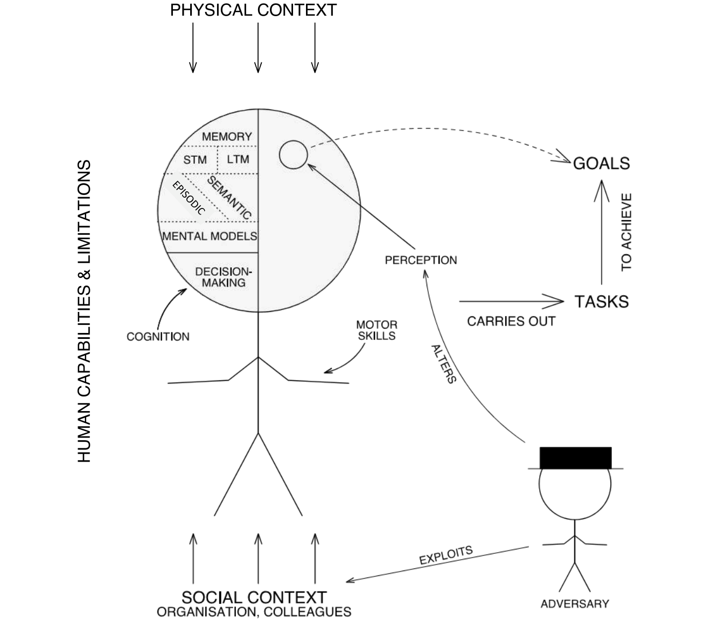
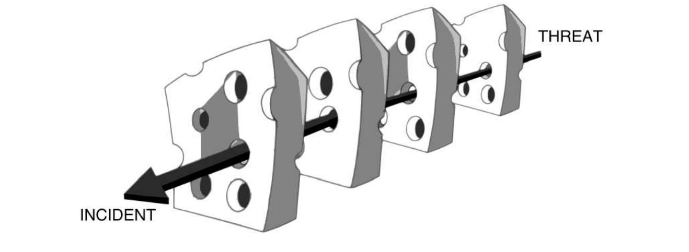
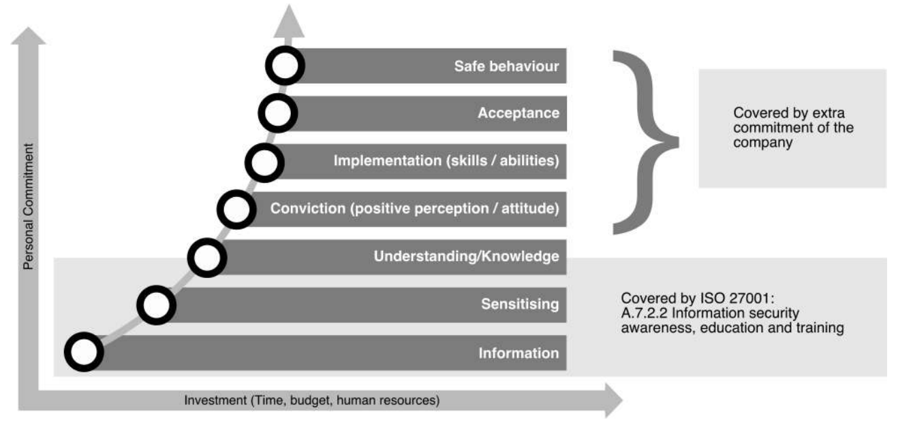
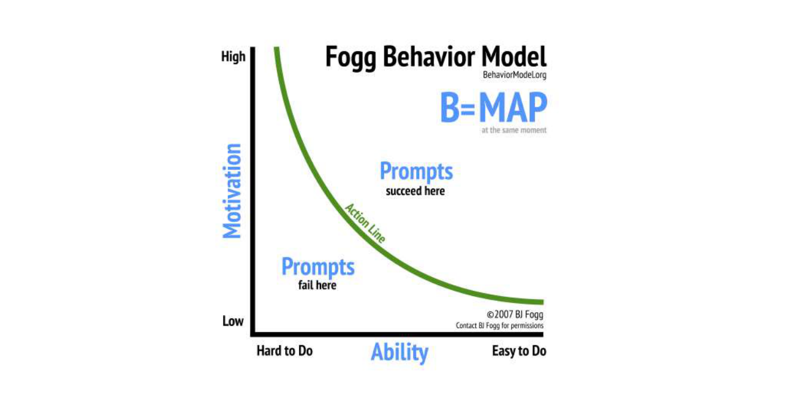

# Chapter 4: Human Factors

**Authors:** M. Angela Sasse (Ruhr Universität Bochum &), University College London, Awais Rashid (University of Bristol)

::: info About this page
This chapter is from [CyBOK Version 1.2.0](https://www.cybok.org/), © Crown Copyright, The National
Cyber Security Centre 2026, licensed under the
[Open Government Licence](https://www.nationalarchives.gov.uk/doc/open-government-licence/).
It was converted from the [PDF](https://www.cybok.org/wp-content/uploads/CyBOK_v1.2.0.pdf) into
a web page so that it works with screen readers and other assistive technology. Each
abbreviation is spelled out in square brackets the first time it appears, and those meanings are
ours, not the book's. So are the names of links the book prints as a bare web address. The PDF
(Portable Document Format) is the original, so if the two disagree, the PDF wins.
:::

## 4.1 Introduction: Understanding human behaviour in security

In their foundational 1975 paper, *The Protection of Information in Computer Systems*, Jerome Saltzer and Michael Schroeder established ten principles for designing security \[<a href="#ref-11" aria-label="Reference 11">11</a>\]. Three of those principles are rooted in the knowledge of behavioural sciences:

- *Psychology:* the security mechanism must be ‘psychologically acceptable’ to the humans who have to apply it;
- *Human Factors and Economics:* each individual user, and the organisation as a whole, should have to deal with as few distinct security mechanisms as possible;
- *Crime Science and Economics:* the effort required to beat a security measure should exceed the resources and potential rewards for the attacker.

Nearly 100 years before Schroeder & Saltzer, the founding father of cryptography, Auguste Kerckhoffs formulated six principles for operating a secure communication system, with a key focus on human factors: Three of those were *“it must be easy to use and must neither require stress of mind nor the knowledge of a long series of rules”*.

Both of these foundational texts recognised that security measures cannot be effective if humans are neither willing nor able to use them. A good example is email encryption. We have had tools for encrypting email for over 20 years. Yet today, less than 0.1% of emails sent are end-to-end encrypted. This outcome was predictable since Whitten & Tygar found in 1999 that even well-motivated and trained people could not use email encryption correctly \[<a href="#ref-341" aria-label="Reference 341">341</a>\]. This situation has not yet changed substantially—although recent research offers insights into the means to do so \[<a href="#ref-342" aria-label="References 342–344">342–344</a>\].

Over the past 20 years, there has been a growing body of research into the underlying causes of security failures and the role of human factors. The insight that has emerged is that security measures are not adopted because humans are treated as components whose behaviour can be specified through security policies, and controlled through security mechanisms and sanctions. But the fault does not lie primarily with the users, as suggested by the oft-used phrase that humans are the ‘weakest link’, but in ignoring the requirements that Kerckhoffs and Schroeder & Saltzer so clearly identified: that security needs to be usable and acceptable to be effective. An example of this is the case of password policies. Adams & Sasse showed that password policies and mechanisms agreed upon by security experts did not work at all in practice and, consequently, were routinely bypassed by employees \[<a href="#ref-345" aria-label="Reference 345">345</a>\]. Naiakshina et al. showed that not only end-users have trouble with passwords but developers do as well. Developers need to be explicitly prompted to include security and, even when this is done, they often include outdated and faulty security mechanisms \[<a href="#ref-346" aria-label="Reference 346">346</a>, <a href="#ref-347" aria-label="Reference 347">347</a>\].

The aim of this CyBOK \[Cyber Security Body of Knowledge\] Knowledge Area is to provide a foundational understanding of the role of human factors in cyber security. One key aspect of this is how to design security that is usable and acceptable to a range of human actors, for instance, end-users, administrators and developers. This knowledge area also introduces a broader organisational and societal perspective on security that has emerged over the past decade: the importance of trust and collaboration for effective cyber security, which can only be achieved by engaging stakeholders and negotiating security solutions that meet their needs \[<a href="#ref-348" aria-label="Reference 348">348</a>\]. This requires a set of skills that have traditionally not been part of the training provided for security experts and practitioners. This knowledge area aims to capture the knowledge to change that.

<figure id="figure-4-1">

{width=659 height=587}

<figcaption>

Figure 4.1: Human behaviour in context, showing internal factors and contextual ones that influence behaviour.

</figcaption>
</figure>

::: details Text description of Figure 4.1

A line drawing of a person, with a circle for the head and labelled arrows around it. All labels are in capitals.

The head is a circle split by a vertical line. The left half holds the cognitive parts, from top to bottom: "MEMORY", which is split into "STM \[Short Term Memory\]" and "LTM \[Long Term Memory\]" (short-term and long-term memory) and then into "EPISODIC" and "SEMANTIC"; then "MENTAL MODELS"; then "DECISION-MAKING". An arrow labelled "COGNITION" points at the left half. The right half holds a small circle. A text running up the left side of the figure reads "HUMAN CAPABILITIES & LIMITATIONS". An arrow labelled "MOTOR SKILLS" points at the figure's arms.

Influences on the person:

- "PHYSICAL CONTEXT" is at the top, with three arrows pointing down at the head.
- "SOCIAL CONTEXT" with the sub-label "ORGANISATION, COLLEAGUES" is at the bottom, with three arrows pointing up at the legs.

Flow to the right of the person:

1. "PERCEPTION" has an arrow to the small circle in the head.
2. A dashed arrow runs from that small circle to "GOALS".
3. An arrow labelled "CARRIES OUT" points from the person to "TASKS".
4. An arrow labelled "TO ACHIEVE" points up from "TASKS" to "GOALS".

At the bottom right is a second stick figure in a flat-topped hat, labelled "ADVERSARY". An arrow labelled "ALTERS" runs from the adversary to "PERCEPTION", and an arrow labelled "EXPLOITS" runs from the adversary to "SOCIAL CONTEXT".

:::

This knowledge area is organised ([Figure 4.1](#figure-4-1)) in a *starting on the inside, working outwards* manner: starting with the individual and internal factors that drive human behaviour (capabilities and limitations, mental models), moving onto aspects of the broader context in which interaction with security takes place. We will then consider the other immediate factors that have an impact: the behaviour of others around us, and especially how they handle security risks, users’ emotional stances towards the organisation and how security behaviour can be successfully managed through design and a range of group and organisational factors. Note that human factors and usability in a security context can be distinguished from other contexts by the presence of adversaries or risk. As shown in [Figure 4.1](#figure-4-1), the adversary may actively work to alter users’ perceptions of the system’s capabilities and boundaries as well as exploiting the specifics of social and organisational contexts (e.g., security policies, working practices, decision-making hierarchies) to impact security. Studying usable security through an active attacker model \[<a href="#ref-349" aria-label="Reference 349">349</a>, <a href="#ref-350" aria-label="Reference 350">350</a>\] and raising users’ awareness about security issues by incorporating such models, e.g. anti-phishing simulations \[<a href="#ref-351" aria-label="Reference 351">351</a>, <a href="#ref-352" aria-label="Reference 352">352</a>\], is an on-going area of study. These mechanisms offer some protection, but require user time and effort. Therefore, as we discuss later, the total security workload needs to be monitored so that productivity is not reduced and workarounds induced. Furthermore, they have implications in terms of users’ trust in the organisation and completion of the primary (non-security) task at hand – the design of any such interventions or campaigns needs to consider and address these risks \[<a href="#ref-352" aria-label="Reference 352">352</a>\].

Note that we do not discuss the specifics of adversarial behaviours, as these are the subject of the Adversarial Behaviours Knowledge Area (Chapter 7). However, we will touch on any relevant elements where they relate to usability and human factors, for example, security awareness, training and anti-phishing. Usability considerations are equally important with regards to privacy controls and technologies. This discussion formulates part of the Privacy & Online Rights Knowledge Area (Chapter 5) and hence is not considered here any further.

## 4.2 Usable security – the basics

\[<a href="#ref-353" aria-label="Reference 353">353</a>, <a href="#ref-354" aria-label="Reference 354">354</a>\]

When users do not behave as specified by security policies, most security practitioners think that the users are at fault: that they ‘just don’t understand the risks’ or ‘are just too lazy’. But research has shown that non-compliance, which we now refer to as ‘rule-bending’, is caused by people facing a stark choice between doing what is right by security, and reducing their productivity. Most choose productivity over security, because that is what the organisation also does.

A typical response to such rule-bending is security awareness and education, that is, *‘fitting the human to the task’.* But Human Factors research established decades ago that, when we take all of the costs and the resulting performance into account, *‘fitting the task to the human’* is more efficient. There is a role for security awareness and training (Section 4.4) but it should be thought of as one of the options but not the first resort. It cannot help humans to cope with security tasks that are impossible, error-inducing, or drain too many individual and organisational resources \[<a href="#ref-355" aria-label="Reference 355">355</a>\]. As the UK \[United Kingdom\]’s National Cyber Security Centre (NCSC) policy puts it:

> ‘The way to make security that works is to make security that works for people[^4-1]’

In other words, security has to be usable. The ISO \[International Organization for Standardization\] defines usability (ISO 9241–11:2018) as

> ‘The effectiveness, efficiency and satisfaction with which specified users achieve specified goals in particular environments.’

And the criteria by which usability is assessed are:

1. *effectiveness:* the accuracy and completeness with which specified users can achieve specified goals in particular environments;
2. *efficiency:* the resources expended in relation to the accuracy and completeness of the goals achieved;
3. *satisfaction:* the comfort and acceptability of the work system to its users and other people affected by its use.

We can immediately observe that these criteria align with the principles articulated by Kerckhoffs and Saltzer & Schroeder’s. But how to deliver this in practice?

### 4.2.1 Fitting the task to the human

From a practical point of view, making security tasks fit or usable means establishing a fit with four key elements \[<a href="#ref-354" aria-label="Reference 354">354</a>\]:

1. the capabilities and limitations of the target users;
2. the goals those users have, and the tasks they carry out to achieve them;
3. the physical and social context of use; and
4. the capabilities and limitations of the device on which the security mechanism is used.

We now examine each of these in turn, and how they apply to designing a usable security mechanism.

**4.2.1.1 General human capabilities and limitations**

There are general capabilities and limitations – physical and mental – that apply to most humans. Giving humans a task that exceeds their capabilities means we set them up to fail. When the demand they face is borderline, most humans make an effort to meet it. But this will come at a significant cost, which may ultimately prove to be unsustainable.

With general computing devices today, the physical capability that can be exceeded by security tasks is most likely the ability to detect signals: many security systems provide status messages, reminders or warnings. Humans can only focus their attention primarily on one task at any one time. That focus will be on their main activities, and many security mechanisms demand more time and attention than users can afford \[<a href="#ref-353" aria-label="Reference 353">353</a>\]. This means that changes in passive security indicators are often not noticed, in particular if they are on the edges of the screen. Asking users to check these indicators is setting them up to fail—even if they consciously try to do it, their focus will be drawn back to the main task. If security indicators need to be attended to, they should to be put in front of the person, and require a response. This will work, but only for infrequent and reliable indicators (see Alarm fatigue).

**Alarm fatigue** The brain stops paying attention to signals it has classified as irrelevant. They are filtered out before they reach the conscious processing level (Section 4.2.1.2). It means humans do not perform well on tasks where they have to screen for rare anomalies (e.g., in baggage screening and some forms of Closed Circuit Television (CCTV) monitoring). We need technology support and processes such as job rotation to get good performance. Alarm fatigue is a related phenomenon. Once alarms have been classified as unreliable, people stop paying attention to them. How high a false alarm rate (with which people can work) depends on the risk, the frequency at which false alarms occur, and the demands of the other tasks they have to complete. But even with a 10% false alarm rate, one can expect alarm fatigue. Once people start to dismiss alarms, it is hard to get them to take them seriously again. Moreover, once they dismiss one type of security warning as false, similar-looking or sounding ones will also be dismissed. Many security warnings today have far too high a false alarm rate and are thus dismissed. SSL \[Secure Sockets Layer\] certificate warnings, for instance, have a false-positive rate of 50% or more. So, it is not surprising that people ignore them, particularly if no secure alternative for completing the task is offered at the same time. Rob Reeder, when working at Microsoft, coined the handy acronym NEAT: warnings should be Necessary, Explained, Actionable, and Tested \[<a href="#ref-356" aria-label="Reference 356">356</a>\]. Add to that ‘and have a false alarm rate of 10% or less’ and one may have a chance of security warnings being effective.

A key mental capability is memory. There are several types of memory. The first distinction is between Short Term Memory (STM) and Long Term Memory (LTM). When one tries to memorise an item, it needs to go round the STM loop a few times before it is transferred into the LTM. STM is what is, for instance, used for one-time passwords, such as numeric codes displayed by tokens or displayed on another device.

**STM and One-Time Passwords (OTPs)** The use of one-time PINs \[Personal Identification Number\] or passwords (OTPs) in security has increased as Two-Factor Authentication (2FA) has become more common. We focus our attention on the number displayed and repeat it to ourselves (mentally or aloud). Then we turn our attention to the entry field, retrieve the item from the STM loop, and repeat it to ourselves while entering it. What is important to note is that this works for most people for strings of up to 6 characters, that is, a 6-digit number, because we can break them into 2 bits of 3 characters each. Codes that are longer overload the STM loop. People have to start looking forwards and backwards between the display to read the characters and enter them. This increases both the entry time and the likelihood of error. And mixing alpha-numeric characters also impacts performance.

Whether a user will be able to recall what is stored in LTM depends on how embedded it is: items retrieved frequently are well embedded, those that are not will fade over time. That means we can expect problems with infrequently used items that require unaided recall (aided recall, e.g., recognising one’s own images in a set of images, is easier). LTM is divided into two distinct areas: general knowledge is stored in Semantic Memory (LTM-SM), whereas items connected to one’s personal history are stored in Episodic Memory (LTM-EM): autobiographical memory. Items stored in LTM-SM fade faster than those in LTM-EM because, in the latter case, one stores not just the item, but the images and emotions connected to them.

**LTM and passwords** LTM-SM is divided into areas in which similar items are stored. When one tries to retrieve an item, the section in which it is stored is activated, and the items in the section compete to be retrieved – with those that have been retrieved most frequently ‘coming to mind’ first. This *interference effect* is quite powerful and disruptive, particularly because items one does not need any more (such as old passwords) keep lingering and compete with those that need to be recalled. Thus, managing a multitude of the same type of credentials is impossible, especially if several of them are used infrequently. People need coping strategies, be it writing them down, using a password manager or one-time credentials. We can agree that 123456 or P@SSword are not secure. But, since most users now have dozens of passwords, the insistence on *strong* passwords has created a humanly impossible task. Most people struggle if they have more than 2–3 passwords or PINs – and the longer and stronger they are, the more they will struggle. The NCSC Password Guidance [^4-a1], therefore, recommends several ways of supporting people in managing large numbers of unique passwords: switching to 2FA solutions and/or password managers, and if it is not possible to do either, not expiring strong passwords on a regular basis. If a password has to be expired (e.g., because it has been compromised), a little time investment during the day the password has been changed can help. People can brute-force the old password out by repeating the new password around ten times immediately, and repeating that process three or four times at hourly intervals.

One important security criterion for knowledge-based authentication is that a credential should be difficult to guess. Due to human physical and mental characteristics, the selection of credentials is, however, often biased towards the familiar, or those that can be more easily distinguished from others.

1. With passwords, people try to pick ones that are easier to recall, e.g., those that have meaning for them such as memorable names or dates.
2. When users have to choose images as credentials, they prefer strong colours and shapes over more diffuse ones \[<a href="#ref-357" aria-label="Reference 357">357</a>\].
3. When these are pictures of humans, they will pick pictures of ‘more attractive’ people and those from their own ethnic background \[<a href="#ref-358" aria-label="Reference 358">358</a>\].
4. When the credential is a particular location within a picture, people prefer features that stand out \[<a href="#ref-359" aria-label="Reference 359">359</a>\].
5. With location-based systems, people pick memorable locations, for example, when choosing locations for a 4-digit PIN on a $5 \times 5$ number grid, they go for connected locations, anchored on an edge or corner of the grid \[<a href="#ref-360" aria-label="Reference 360">360</a>\].
6. The order of the elements of a credential is predictable, because there is a strong cultural preference, e.g., people who speak languages that read left-to-right will choose that order \[<a href="#ref-360" aria-label="Reference 360">360</a>\].
7. With finger swipe passwords on Android phones, people pick from a very limited number of shapes \[<a href="#ref-361" aria-label="Reference 361">361</a>\].

These human biases reduce the diversity (number of different passwords) in a password database, and increase the likelihood of an attacker guessing a password. To counteract this, security policies have barred *too obvious* choices. Whilst not allowing very obvious choices such as ‘password’ as a password and ‘0000’ as a PIN is prudent, having too many restrictions increases the workload associated with the password creation task (see Section 4.2.1.2). For instance, a password checker that rejects 5+passwords in a row as *too weak* will put users under considerable stress and most likely towards re-using a password.

Similarly, password strength meters are often used to guide and influence the user’s password choices. For instance, Ur et al. \[<a href="#ref-362" aria-label="Reference 362">362</a>\] discussed the impact of various password meter designs on users’ choice of passwords, as well as highlighting the increased workload for users and the frustration faced by them when faced with more stringent password meters. A recent work by Golla and Dürmuth \[<a href="#ref-363" aria-label="Reference 363">363</a>\] investigated the accuracy of 45 password strength meters including several deployed in practice, as well as academic proposals. Their work shows a degree of variation in terms of accuracy and, more critically, that this has not significantly improved over five years. So, even if we are to disregard the additional workload on users (not that we should), these approaches do not always have the level of accuracy required to effectively implement password policies. These considerations must be borne in mind when deploying solutions to *enforce* security policies.

Sometimes, the question is raised as to whether there is training to help users cope with recalling security credentials. Memory athletes use specific exercises to enhance memory performance. The writer Joshua Foer details in his bestseller *Moonwalking with Einstein* \[<a href="#ref-364" aria-label="Reference 364">364</a>\] that it requires a serious initial time investment (several months full-time) but also continuing training (at least 30 minutes a day), plus the time required to recall and enter the passwords (which in itself people find too much \[<a href="#ref-365" aria-label="Reference 365">365</a>\]).

We have, so far, discussed the capabilities and limitations that apply to most people. But, specific user groups will have additional needs that should inform the selection or configuration of security mechanism or processes. For instance, children and older citizens can have capabilities and limitations (e.g., motor skills) that differ from working age adults. People with larger fingers struggle to hit small targets accurately, such as the small keys on a soft keyboard. Cultural values and norms need to be considered. The physical and mental conditions of users also need to be taken into account. Not all users are able to operate equipment with their hands, read from screens, or hear audio. Conditions such as colour blindness affect sizeable numbers of people, so images used for graphical authentication need to be checked. Certain audio or video effects can harm users with conditions such as autism or epilepsy.

***CAPTCHAs*** Some work on Completely Automated Public Turing test to tell Computers and Humans Aparts (CAPTCHAs) has investigated supporting users with sensory impairments, e.g., \[<a href="#ref-366" aria-label="Reference 366">366</a>\]. However, one needs to bear in mind that CAPTCHAs add more effort for the legitimate user, impeding the achievement of the intended goal, i.e., access. The usability limitations of these mechanisms that aim to ‘verify’ legitimate human users – and their contribution to security fatigue – must be considered \[<a href="#ref-367" aria-label="Reference 367">367</a>, <a href="#ref-368" aria-label="Reference 368">368</a>\].

**4.2.1.2 Goals and tasks**

Human behaviour is essentially goal-driven. People perform tasks to achieve goals, at work: ‘I want to get this quotation to our customer today’, or in their personal life: ‘I want to get the best utility deal for us’. To achieve these goals, people complete a series of tasks. To prepare a quotation, these would include working out the materials required and their cost, the person-hours required and their cost, the relevant fees, taxes etc. If a task has several steps or units, it can be decomposed into sub-tasks. For instance, working out the person-hours required on a job can be broken down into the following tasks:

1. identify all the worksteps that need to be completed,
2. work out what type of employee is required to complete each task,
3. how long each specific type of employee needs to spend on which task,
4. what preparations each type of employee may need to make.

These tasks are called primary or *production tasks* in human factors terminology, and designing the technology tools so people can complete these tasks effectively and efficiently is the most fundamental aspect of usability. To ensure people can complete tasks effectively, technology (and security) designers need to know the requirements for the tasks they perform:

**Production and enabling tasks** Production tasks are what people consider ‘their job’, and in many jobs, they may have spent years studying or training for them. At an organisational level, the production tasks performed by many individuals in an organisation add up to business processes that produce the goods or services. Anything that stops these processes or slows them down will cause the organisation significant problems. When we talk about ‘*resilience*’ of an organisation, it is about the ability to keep those business processes going to produce the output. As well as production tasks, an organisation has tasks that do not directly contribute to business processes, but have been added to protect its ability to keep going in the long term: safety and, indeed, security are key enabling tasks. Some organisations get away with not supporting these enabling activities for a period of time and this explains the *grudge* with which some individuals and organisations view security. The fact that safety or security measures do not immediately contribute to the output and the bottom line explains why it is a grudge sale, particularly when individuals or organisations feel under pressure.

1. What output has to be produced so the goal is achieved? The task has to be completed effectively, e.g., if the quotation is not correct or not sent to the customer in time, the task is not completed effectively.
2. Are there constraints on time and resources? Business processes may set an upper limit on the time tasks can take, or the resources they can draw upon, such as, access to information or services for which the organisation has to pay.
3. Is the task performed frequently (several times a day) or infrequently (once a month)? The execution of tasks people perform frequently becomes ‘automatic’, whereas new or infrequently performed tasks are completed in a conscious, step-by-step manner (see Section 4.2.1.4). For frequently performed tasks, the design should optimise for speed and reduce physical effort (which could lead to fatigue). For infrequent tasks, the design should try to reduce mental effort by guiding the users and minimising how much they have to remember.

People focus on the production task, and enabling tasks are often experienced as an unwelcome interruption or distraction. To stay with our authentication example[^4-2]: an employee has to authenticate with a password to a database to find out the hourly rate of a particular specialist that the business charges. If she does this frequently, and can remember the password, it may only take a few seconds for her to recall and enter it. But if she has just returned from a vacation, cannot remember it and it takes 20 minutes to get through to a help desk to have it reset, and then she has to think up and memorise a new password – all before she can get to the database – the security task has suddenly become a massive disruption, and perhaps the effective completion of the production task is now under threat.

And note how one seemingly quick task of ‘authenticate’ (with 2 subtasks of ‘recall password’ and ‘type password’) has now spawned two further authentication tasks: ‘recover password’ and ‘create password’, both with multiple steps each.

Most workarounds to security mechanisms, such as, writing passwords down or sharing them, happen because people try to ensure effective production task completion (to protect business productivity). For instance, people often keep their own copies of documents that should be in an access-controlled repository, or clear-text copies of documents that should be encrypted, because they fear not being able to access them when they need them. Or when the repeated effort and disruption resulting from having to enter a password to unlock a screen gets too much, they install mouse-jiggling software to stop the screen locking and having to enter their password \[<a href="#ref-365" aria-label="Reference 365">365</a>\]. Even if a user knows the password well, the seconds it takes add up if it needs to be done dozens of times a day.

Therefore, to avoid security tasks being bypassed, we must design them to fit into primary tasks. We can achieve a good fit in a number of ways:

- Automating security, for instance, using implicit authentication to recognise authorised users, instead of requiring them to enter passwords many times over.
- If explicit human action is necessary in a security task, we should minimise the workload and the disruption to the primary task.
- Designing processes that trigger security mechanisms such as authentication only when necessary (see, for example, \[<a href="#ref-369" aria-label="Reference 369">369</a>\]).
- Design systems that are *secure by default*[^4-3] so that they do not push the load of security configurations and management on to the users.

Workload can be physical (typing a password) or cognitive (remembering a password). Humans generally try to be efficient and keep both their physical and mental workload as low as possible. But, given a choice, most people will take an extra physical over extra mental workload, especially if the physical task is routine and can be done ‘on autopilot’ (See Section 4.3). Mental workload quickly becomes too much, especially if adjacent tasks require the same mental capability, such as memory.

Therefore, in order to design a security task that fits well, we need to know the production tasks, and consider the mental and physical workload. Before selecting a security measure, security specialists must carry out a workload audit:

1. What is the workload associated with the primary and secondary (security) task?
2. Are there performance constraints in the primary task (e.g., the time in which it has to be completed)?
3. Are there resource constraints (mental or physical capability, or external ones such as limited access to paid services)?
4. What is the impact of failing to complete the security task?

**Workload measurement** How can we measure the workload associated with a security task? A simple proxy is the time: how long does it take to complete the security task? Considering this before implementing a new policy or security measure would be an improvement on the status quo, whereby the impact of a policy or measure is only considered once it is causing problems. Once we know how long it takes, we need to determine if and where it disrupts primary activity. The assessment of whether the impact on the primary task is acceptable can be carried out informally, for instance, with experienced staff and line managers who know the production task well. A more formal assessment can be carried out analytically using the Goals, Operators, Methods (GOMS) method or empirically using the NASA \[National Aeronautics and Space Administration\] Task Load Index (TLX).

As we have already discussed, people are hardwired to protect their productivity. They have a built-in awareness of how much time and effort they are spending on non-productive tasks, and an idea of how much non-productive activity is reasonable. They have what Beautement et al. called a *Compliance Budget* \[<a href="#ref-370" aria-label="Reference 370">370</a>\]. As the day progresses and enabling tasks add up, the likelihood that they will seem *too much* and be bypassed increases. Furnell & Thompson coined the term *security fatigue* \[<a href="#ref-371" aria-label="Reference 371">371</a>\] and the uphill battle to turn security from a grudge sale into a positive quality (Section 4.2.1.3) can be attributed to this.

Security is not the only enabling task employees face. Others include: safety, sustainability, diversity training, various regulatory regimes and so on, leading to *Compliance Fatigue*. Beautement et al. \[<a href="#ref-370" aria-label="Reference 370">370</a>\], recommend that security specialists have an open and honest discussion with line managers and business leaders about the time and budget available for enabling activities, and how much of it is available for security versus other enabling functions. Once that is known, the workload of the security tasks can be calculated and priorities identified – which security behaviours really matter for the key risks a particular group of employees face – and security tasks streamlined. Making security mechanisms smarter and less ‘all or nothing’ can also help reduce compliance fatigue. For instance, allowing authentication with an old password, or having ‘break the glass’ policies that allow but flag access by users who do not have permission reduces the likelihood of task disruption. And if users know they have access to efficient security recovery and support services, it will reduce the need for workarounds.

**4.2.1.3 Interaction Context**

**Contextual Inquiry** In modern work organisations, staff can work in many parts of the world, and in many different physical and social environments. It can be quite a challenge for a security expert to identify all the factors that could impact security and usability. Many usability professionals follow an approach called Contextual Inquiry \[<a href="#ref-372" aria-label="Reference 372">372</a>\]:

> ‘The core premise of Contextual Inquiry is very simple: go to the user, watch them do the activities you care about, and talk with them about what they’re doing right then.’

Contextual Inquiry uses a mixture of observation and interview to identify the primary tasks people are carrying out, and what makes them do this well.

Both the physical surroundings and the social environment in which people have to perform security tasks affect performance and security. Most working age people now interact with technology *on the move* more frequently than *at the desk* traditional working environments. This change in the context of use affects a number of security mechanisms, not least of being overheard when on the phone – the case of former CIA \[Central Intelligence Agency\] Director Michael Hayden being overheard giving an off-the-record interview on board a train being a particularly spectacular one[^4-4]. The risk of being overheard is now addressed in many corporate training packages, but several security mechanisms are still in use that are vulnerable to being overheard, e.g., security questions such as date of birth, mother’s maiden name. Using partial credentials only and entry via keypad increases security but also accentuates the mental and physical workload at the same time. Some attackers can also try to glean credentials via shoulder-surfing or hidden cameras. Overall, the use of a One-Time Password (OTP) as part of a 2FA solution could offer protection *and* better usability.

The usability of security mechanisms can be affected by the following physical characteristics:

1. *Light:* In bright light, displays can be hard to see, which can affect graphical authentication in particular. Biometric systems such as iris and face recognition rely on input from cameras. Bright light can lead to glare, which means the images captured are not good enough to process.
2. *Noise* will most obviously interfere with the performance of voice recognition systems. But high levels of noise also impact human performance in general due to increased stress and, in turn, increased likelihood of error. Unexpected loud noises trigger a human startle response, which diverts attention away from the task.
3. *Ambient temperature* can affect the performance of both technology and humans. Fingerprint sensors can stop working when it is cold, and humans are slower at pointing and selecting. They may also need to wear protective clothing such as gloves that make physical operations of touchscreens impossible or difficult. Similarly, too hot an environment can lead to discomfort and sweat can interfere with sensors.
4. *Pollution* can impact equipment operated outdoors. This is a particularly concern for fingerprint sensors and touchscreens. The lipids left behind combine with the particles and the resulting dark grease can clog sensors or leave a clearly visible pattern on the touchscreen.

The social context in which people find themselves strongly influences behaviour though *values*: shared beliefs about what is important and worthwhile, and *norms*: rules and expectations about actual behaviour. If the expected security behaviour is in conflict with day-to-day behavioural norms, we can expect problems. For instance, if an organisation values customer satisfaction, and employees are told to be friendly towards customers at all times, a security policy that requires staff to treat any customer enquiry as a potential attempt to extract information will not fit. Understanding the reasons underpinning non-compliance with security policies can shed light on these conflicts between security requirements and the primary task \[<a href="#ref-373" aria-label="Reference 373">373</a>\]. Trust is another key norm. Humans do not like to feel distrusted – and it has been shown that communicating distrust to employees encourages bad behaviour, rather than prevent it \[<a href="#ref-374" aria-label="Reference 374">374</a>\].

Other aspects need to be considered in order to understand how security beliefs, norms and coping strategies are shaped. For instance, users often get their knowledge from their wider social networks and these are also a source of support and help when they face usability challenges \[<a href="#ref-375" aria-label="Reference 375">375</a>, <a href="#ref-376" aria-label="Reference 376">376</a>\].

**4.2.1.4 Capabilities and limitations of the device**

We have already discussed that the physical characteristics of a device may make interaction with security mechanisms difficult in certain circumstances. Some characteristics of the device can result in security mechanisms becoming difficult to use in any circumstance. Entering long and complex passwords on soft keyboards on a mobile phone takes far longer and is more error-prone than on a regular keyboard \[<a href="#ref-377" aria-label="Reference 377">377</a>\]. And while with frequent use on a keyboard, most people can become quite proficient at entering a complex password, performance does not improve when humans hit a basic limitation. What is particularly worrying from a security point of view is that (without colluding) a user population starts to converge on a small number of passwords that are easiest to enter with the minimum amount of toggles, which makes guessing a valid password easier for attackers \[<a href="#ref-378" aria-label="Reference 378">378</a>\].

Whilst 2FA has security benefits and reduces the need for strong passwords, not all 2FA solutions are usable by default. Many users find widely used 2FA tokens such as Digipass difficult. They appreciate the fact it fits into their wallet, but it is ultimately ‘too fiddly’ \[<a href="#ref-379" aria-label="Reference 379">379</a>\]. Also, over half of online banking users have accounts with more than one financial services provider. The fact that even those that use 2FA implement it differently (which token is used when it has to be used, and how the different elements of authentication are referred to (passphrase, passcode, key phrase) causes confusion for the users. Similarly, different implementations of Chip and PIN create slightly different variations in the task that catches users out, leading to human error (Section 4.3).

With increasing numbers of new devices appearing, from smart watches to home devices, and even smaller screen sizes and implicit interactions between users and devices through a variety of sensors and actuators, considering the ergonomics of security interactions \[<a href="#ref-380" aria-label="Reference 380">380</a>\] is ever more important. The risks arising from Bring Your Own Device (BYOD) cultures are discussed in the Risk Management & Governance Knowledge Area (Chapter 2).

## 4.3 Human Error {#_4-3-human-error}

\[<a href="#ref-14" aria-label="Reference 14">14</a>, <a href="#ref-381" aria-label="Reference 381">381</a>\]

In over 30 years of research into accidents and safety, the psychologist James Reason worked out that virtually all mistakes people make are predictable \[<a href="#ref-14" aria-label="Reference 14">14</a>\]. They occur as a result of *latent failures* (organisation and local workplace conditions) and *active failures* (errors and violations by humans) in combination to allow the accident to occur. [Figure 4.2](#figure-4-2) shows Reason’s ‘Swiss Cheese’ model adapted for security. A security incident occurs because the threat finds its way through a series of vulnerabilities in the organisation’s defences. A person may be the one who pushed the wrong button or clicked on the link and caused the incident. However, several other failures preceded this, leading to that person being put in a position where making what appeared to be the right choice turned out to be the wrong one.

***Latent usability failures in systems-of-systems*** One can also not assume that all systems are designed from scratch with usable security considerations in mind. Most often systems are, in fact, systems-of-systems (SoS), derived from composing otherwise independent systems that come together to orchestrate a particular service or task. Integration problems in SoS have been studied, e.g., \[<a href="#ref-382" aria-label="Reference 382">382</a>\] and one must consider the latent failures that arise due to the decisions made during integration. Poor usability and task fatigue represents a sufficient risk to the security of the SoS to warrant upfront investment in order to avoid latent failures.

<figure id="figure-4-2">

{width=659 height=241}

<figcaption>

Figure 4.2: Security Version of Reason’s ‘Swiss Cheese’ model. Holes are latent & active failures. When a threat finds one in successive layers then the threat succeeds. ‘Cheese slices’ are defences provided by security policies & mechanisms.

</figcaption>
</figure>

::: details Text description of Figure 4.2

A drawing of four slices of Swiss cheese standing in a row, each with several holes. They are the defence layers of the model. A thick black arrow runs through one hole in each slice in turn. The arrow starts at the back right, labelled "THREAT", passes through all four slices, and ends with its head at the front left, labelled "INCIDENT". The holes are the latent and active failures named in the caption. The threat succeeds only when it finds a hole in every successive layer.

:::

The work of Reason and his fellow safety researchers \[<a href="#ref-383" aria-label="Reference 383">383</a>, <a href="#ref-384" aria-label="Reference 384">384</a>\] led to organisations being held responsible for fixing upstream safety issues as they are discovered, rather than waiting for an accident to happen. The concept of a *near miss* describes a situation where safety issues become apparent, but an accident is avoided at the last minute. In most industries that are subject to safety regulations, there is an obligation to report near-misses and investigate any failure as soon as it is discovered – with a requirement to address the root causes identified through the investigation so that future failures are mitigated.

Applied to security, an employee not following a security procedure constitutes an active failure and should be investigated and fixed. If the investigation shows that the conflicting demands of production task and security lead the employee to disregard security, the conflict is an underlying latent failure that the organisation needs to address. Often security non-compliance is ignored until an incident occurs. Unlike security, safety does not have active adversaries with whom to contend. But many improvements could be made to current security practices by applying safety concepts (as discussed in Section 4.2.1.2).

As already mentioned in Section 4.2.1.2, tasks that people carry out frequently become *automatic*, whereas tasks they are doing for the first time or very infrequently are carried out in a conscious, step-by-step manner. The psychologist Daniel Kahneman, 2002 Nobel prize laureate in economics for his work on human biases in decision-making, described the two areas, System 1 and 2, and the way they work as, *Thinking Fast and Slow* \[<a href="#ref-385" aria-label="Reference 385">385</a>\]. One very important insight is that the majority of activities people undertake are carried out in System 1 mode, and this is what makes us efficient. If people carried out most of their activities in System 2 mode, they would not get much done. Exhortations to ‘Take Five’[^4-5] every time before clicking on a link are unrealistic when people get dozens of work emails with embedded links. Furthermore, if without clicking on that link or giving personal information, there is no way of completing the primary task, productivity comes under serious threat. Unspecific advice such as ‘just stop and think’ rarely works because just stopping people in their tracks and without supporting them achieving their goals securely is not helpful. In addition, considering the workload of security measures, security experts need to consider the further impact that following their advice has on people’s ability to complete their primary tasks, as well as the impact on the effectiveness of general communication between organisation and employees. The use of Domain-based Message Authentication Reporting and Conformance (DMARC), for instance, should enable employees to distinguish genuine internal communications from potential phishing attempts. The use of DMARC to provide a reliable indication of ‘safe’ senders can reduce the number of emails about which users have to be cautious. Even better, the provision of ultra-secure browsing technology, which is now available, means that clicking on links has no adverse technical consequences, so user education and training can focus on explaining social engineering and manipulation techniques.

When tackling complex problems, humans often have to combine both fast and slow processes, and there is an in-between *mixed-mode*, where task execution is not fully automatic: some of the behaviours are automatic, but one needs to stop and consciously work out which behaviour to select. Productivity costs aside, security experts suggesting people should ‘stop and think’ assume that ‘slow mode’ equals ‘safe mode’. For instance, using slow mode can also lead to overthinking, to rationalising or explaining away evidence, to bringing irrelevant concerns to bear, focusing on the wrong goals (e.g., production goals), and to wasting large amounts of time and energy. In fact, each of these modes of operation comes with its own type of human error ([Table 4.1](#table-4-1)).

<figure id="table-4-1">

<figcaption>

Table 4.1: Automatic, mixed mode and conscious workspace (based on \[<a href="#ref-14" aria-label="Reference 14">14</a>\])

</figcaption>

| Mode | Type of error | Cause | Security Example |
| --- | --- | --- | --- |
| **Automatic mode (fast)** | Slips and lapses | Recognition failure; Memory failure; Attention failure | “I forgot to check for the padlock before I entered my credit card details.” |
| **Mixed mode** | Mistake I | Human chooses incorrect response | “I did not check for the padlock because websites on my iPhone are safe.” |
| **Conscious mode (slow)** | Mistake II | Human does not know correct response | “I did not know to check for the padlock before entering my credit card details.” |

</figure>

Even in conscious mode, people try to be efficient, resorting to ‘the closest thing they know’, that is, they are most likely to choose behaviours they use frequently, or those that seem most similar to the situation they encounter. Attackers exploit this by creating very similar-looking websites, or incorporating security messages into their phishing emails.

Reason identifies four types of latent failures that are more likely to cause people to make errors.

1. Individual factors include fatigue (as discussed in Section 4.2.1.2), but also inexperience and a risk-taking attitude.
2. Human Factors include the limitations of memory (as discussed in Section 4.2.1.1) but also common habits and widely shared assumptions.
3. Task factors include time pressure, high workload and multiple tasks, but monotony and boredom are equally error-inducing because people shift their attention to diversions. Uncertainty about roles, responsibilities and rules also lead to incorrect choices.
4. Work environment factors include interruptions to tasks (as discussed in Section 4.2.1.2) and poor equipment and information. People are also particularly prone to error when rules and procedures change.

Task and work environment factors are clearly the responsibility of the organisation. There should be regular reviews of how well policies are followed. If they are not, the underpinning causes must be identified and addressed. The causes of near misses, mistakes that happened but did not lead to an incident, should be similarly used to identify and change the underlying causes. We also need to develop a better understanding of how humans respond when under stress conditions, e.g., in real-time when faced with an unfolding attack.

> ***‘Never issue a security policy that can’t be followed’*** **(Or: General MacArthur,** ***shadow security*** **and** ***security hygiene*****)** The famous WWII \[World War II\] military leader General Douglas MacArthur coined the phrase *‘never give an order that can’t be obeyed.*’ He recognised the corrosive impact of a single order that cannot be followed in reality—it undermines the credibility of all orders and the superiors who issue them and seeds uncertainty and doubt. It is the same with security policies: when employees encounter security policies that are impossible to follow or are clearly not effective, it provides a justification for doubting all security policies. That is why *security hygiene* is essential. When policies are not being followed, security professionals must investigate, in a non-confrontational manner, why and if it is because they are impossible or too onerous to follow and re-design the solution. Kirlappos et al. pointed out that in most cases, employees do not show blatant disregard for security, but try to manage the risk they understand in the best way know how, what they call *shadow security* \[<a href="#ref-373" aria-label="Reference 373">373</a>\]. Their

‘amateur’ security solutions may not be entirely effective from a security perspective, but since they are ‘workable’, asking ‘how could we make that secure’ is a good starting point for finding an effective solution that fits in with how people work.

## 4.4 Cyber security awareness and education {#_4-4-cyber-security-awareness-and-education}

\[<a href="#ref-386" aria-label="Reference 386">386</a>, <a href="#ref-387" aria-label="Reference 387">387</a>\]

Security practitioners often respond with security awareness, education and training measures when people do not follow security policies. But, in Section 4.3 we established that *security hygiene* must come first: if people keep being told that the risk is really serious and they must follow policy, but cannot do so in practice, they develop resentment and a negative attitude towards security and the organisation (which is counter-productive).

In practice, the three terms: awareness, education and training, are often used interchangeably but are different elements that build on each other:

**Security Awareness.** The purpose of security awareness is to catch people’s attention and convince them security is worth the engagement. Given that many organisations face *compliance* and *security fatigue*, to quote Cormac Herley: *More Is Not The Answer* \[<a href="#ref-353" aria-label="Reference 353">353</a>\]: aiming a lot of communications will backfire. We need to capture people’s attention, and get them to realise that (a) cyber security is relevant to them, that is, the risks are real and could affect them, and (b) there are steps they can take to reduce the risk and that they are capable of taking those steps. Crafting effective awareness messages is not an easy task for security professionals. Working with the communications specialists in an organisation can, therefore, help. They not only know how to craft messages that catch people’s attention, but know how to reach different audiences via the different channels available to them, and integrate them into the overall set of communications to avoid message fatigue.

**Security education.** Once people are willing to learn more about cyber security, we can provide information about risks and what they can do to protect themselves against them. Most people currently have very incomplete and often incorrect mental models (see Section 4.4.2) on cyber risks. Transforming them into more accurate ones provides a basis on which to build cyber security skills. However, it is hard to ascertain whether the education leads to more accurate mental models or at least the ones that security professionals expect people to possess. This divergence must be borne in mind. For instance, Nicholson et al. \[<a href="#ref-388" aria-label="Reference 388">388</a>\] introduce the *Cybersurvival task* as a means to understand such divergence between security experts and employees in order to inform the design of security education programmes.

**Security Training.** Training helps people to acquire skills, e.g., how to use a particular security mechanism correctly, how to recognise and respond to a social engineering attack. In addition to showing people how to do something, we need to support the acquisition of skills by letting them practise the skills in a setting where they can ‘experiment’ with security decision-making and reflect on their perceptions and biases \[<a href="#ref-389" aria-label="Reference 389">389</a>\]. Parts of skill acquisition can be supported online, but, like all learning, it is much more likely to be successful when taking place in the context of a social community \[<a href="#ref-390" aria-label="Reference 390">390</a>\].

A common misunderstanding is that if people complete the three steps above and know what to do, they will change their behaviour. But knowing what to do and how to do it is not enough. As we discussed in Section 4.3, human activity is 90% automatic, driven by routines or habits stored in the long-term workspace. The new security behaviour needs to be embedded there but its place is occupied by an existing behaviour (similar to an old password). The adage that *‘old habits die hard’* accurately describes the fact that until we manage to push the old behaviour out and the new behaviour becomes automatic, all our awareness, education and training efforts may not yield the changes in behaviour we are seeking. This is a challenging undertaking. Since productive activity needs to carry on while we change security behaviour (Section 4.2), we can only target 1–2 behaviours at a time, and embark on changing the next 1–2 only once these have become genuinely embedded. Nor should one conflate security awareness and education with security culture (cf. Risk Management & Governance Knowledge Area (Chapter 2)). These can be one element in developing a security culture but are not in themselves representatives of an effective security culture.

The RISCS \[Research Institute in Sociotechnical Cyber Security\] White Paper *‘Awareness is only the first step*’ \[<a href="#ref-386" aria-label="Reference 386">386</a>\], presents a model of support ([Figure 4.3](#figure-4-3) that organisations need to provide to achieve security behavioural change. It shows that the three steps we have discussed so far are only the first steps, and that a further four steps are required to achieve behavioural change. To support these additional steps, we can draw on a new generation of learning resources that have evolved. And such steps require investment from organisations - in terms of strategy, time, planning and resources.

<figure id="figure-4-3">

{width=659 height=321}

<figcaption>

Figure 4.3: Behaviour change model from RISCS White Paper \[<a href="#ref-386" aria-label="Reference 386">386</a>\]

</figcaption>
</figure>

::: details Text description of Figure 4.3

A staircase diagram of seven horizontal bars stacked from bottom to top, with a curved line of circles rising along their left ends. The vertical axis is labelled "Personal Commitment" and the horizontal axis is labelled "Investment (Time, budget, human resources)". Both axes have arrows at their ends.

The stages, from the bottom (lowest commitment) to the top:

1. Information
2. Sensitising
3. Understanding/Knowledge
4. Conviction (positive perception / attitude)
5. Implementation (skills / abilities)
6. Acceptance
7. Safe behaviour

Two notes mark groups of stages:

- A light band behind the bottom three stages (Information, Sensitising, Understanding/Knowledge) carries the text "Covered by ISO 27001: A.7.2.2 Information security awareness, education and training".
- A curly brace beside the top four stages (Conviction, Implementation, Acceptance, Safe behaviour) points to a box that reads "Covered by extra commitment of the company".

:::

### 4.4.1 New approaches to support security awareness and behaviour change

Simulations and games are increasingly being used, both to make security awareness more attractive, and to help with more complex educational measures and behavioural change.

Anti-phishing simulations designed to teach employees not to click on suspicious links are probably the most widely used in organisations today. Their popularity stems from the fact that they provide the ability to measure the impact of interventions, and they tend to show a decrease in click rates in the short term. The argument is that the experience of having been phished is a ‘teachable moment’ that captures the employees’ attention and persuades them to work their way through the education being offered. However, Fogg, who first introduced the concept of ‘trigger moments’ (referred to as Prompts in the most recent Fogg Behaviour Model, cf. [Figure 4.4](#figure-4-4)) is very clear that they will only lead to behaviour change if the person has a sufficient level of motivation to engage with the training provided, and the ability to apply the skills being taught. Joinson argues that certain emotional and contextual triggers employed by social engineering attackers are so targeted and powerful (for instance, a notification purporting to have information about traffic or public transport disruptions shortly before the end of the working day) that they cannot be prevented by training \[<a href="#ref-391" aria-label="Reference 391">391</a>\].

From a human factor perspective, anti-phishing simulations can be problematic: 1) because employees may perceive this as being attacked by their own organisation, which reduces trust \[<a href="#ref-381" aria-label="Reference 381">381</a>\] and 2) they may lead employees to become so reluctant to click on links that they do not act on genuine emails that may be important. These factors need to be carefully considered in the design of any such simulations \[<a href="#ref-352" aria-label="Reference 352">352</a>\]. Furthermore, as we discussed above, the use of mechanisms such as DMARC can reduce the number of suspicious emails on which users need to focus, enabling education and training to be geared towards explaining social engineering and manipulation techniques.

<figure id="figure-4-4">

{width=659 height=335}

<figcaption>

Figure 4.4: Fogg Behaviour Model has three factors: motivation, ability and triggers ([the Fogg Behavior Model website](https://behaviormodel.org))

</figcaption>
</figure>

::: details Text description of Figure 4.4

A line graph titled "Fogg Behavior Model" (BehaviorModel.org), with the formula "B=MAP" and the note "at the same moment" beneath it. The vertical axis is labelled "Motivation" and runs from "Low" at the bottom to "High" at the top. The horizontal axis is labelled "Ability" and runs from "Hard to Do" on the left to "Easy to Do" on the right.

A green curve, labelled "Action Line", falls steeply from the top left and flattens towards the bottom right. It divides the graph in two:

- Above and to the right of the curve is the text "Prompts succeed here".
- Below and to the left of the curve is the text "Prompts fail here".

A credit in the bottom right corner reads "©2007 BJ Fogg, Contact BJ Fogg for permissions".

:::

***Security awareness games*** Capture The Flag (CTF) games are designed to raise awareness of vulnerabilities, and how they can be exploited. The idea is that by seeing how they can use the vulnerabilities to attack a system, defenders learn to not incorporate them in their own systems. However, the focus is on training those charged with securing the organisation and not the wider set of users and employees. There are tabletop card games aimed at providing security awareness to a wider user base within organisations, e.g., Ctrl-Alt-Hack \[<a href="#ref-392" aria-label="Reference 392">392</a>\], dox3d![^4-a2] and others are specifically targeted towards ICT \[Information and Communication Technologies\] specialists and developers, e.g., Microsoft’s Elevation of Privilege[^4-b1]. There are also board games designed to be played by work groups to raise awareness of cyber security threats and the complexity of cyber risk decision-making, e.g., Decisions and Disruptions \[<a href="#ref-389" aria-label="Reference 389">389</a>\]. All of these games have the potential advantage of offering a social learning experience if played in a group context. But, if they are provided as one-off exercises, they are unlikely to have a lasting effect. Overall, games and simulations have the potential to offer engaging new elements that can be deployed at different stages of the behaviour change model (see [Figure 4.3](#figure-4-3)) but they need to be part of a planned behaviour transformation programme, not one-shot interventions.

### 4.4.2 Mental models of cyber risks and defences

Much of the knowledge in the long-term workspace is organised in the form of mental models, mental analogues of devices with which people interact. They can range in detail from structural models (like blueprints) that experts have, to task-action models that enable non-experts to operate a device competently. A person with a task-action model of operation can drive a car, but only an expert with a structural model can diagnose faults and repair them. Clearly, we cannot expect non-security experts to understand all cyber risks in detail.

Wash argues that inadequate mental models of security make users vulnerable against intelligent adversaries:

> ‘These users believe that their current behavior doesn’t really make them vulnerable, so they don’t need to go to any extra effort.’ \[<a href="#ref-387" aria-label="Reference 387">387</a>\]

Understanding users’ mental models can provide insights into how users perceive particular security information, e.g. alerts \[<a href="#ref-393" aria-label="Reference 393">393</a>\] or specific tasks they have to undertake, e.g. deletion \[<a href="#ref-375" aria-label="Reference 375">375</a>\]. The question is: which models would be helpful? There are example mental models in the literature, for instance, physical security models, medical models, criminal models, warfare models and market models \[<a href="#ref-394" aria-label="Reference 394">394</a>\], which may provide a basis to communicate complex security issues to users. Perceptions of risk are also relevant in this regard. These, along with responsibility, are covered in the Risk Management & Governance Knowledge Area (Chapter 2) so are not discussed further here.

## 4.5 Positive Security

\[<a href="#ref-395" aria-label="Reference 395">395</a>\]

What is the goal of cyber security? When asked, most people’s first response is along the lines of preventing cyber attacks or at least reducing the risk of attacks succeeding, or losses being too high. As Florencio et al. pointed out, vendors and those who want organisations to take security more seriously resort to a ‘Fear Uncertainty and Doubt (FUD) sale’ – creating fears of attacks and their consequences, Uncertainty about consequences and Doubt about organisations’ ability to defend themselves – thus boosting the cyber security market and the sale of products \[<a href="#ref-395" aria-label="Reference 395">395</a>\].

> ‘FUD provides a steady stream of factoids (e.g., raw number of malware samples, activity on underground markets, or the number of users who will hand over their password for a bar of chocolate) the effect of which is to persuade us that things are bad and constantly getting worse.’

Security practitioners today complain that most individuals and businesses do not take cyber risks seriously. The problem is that fear sales are not a good basis for security decision-making: when the resulting investment in security turns out not to be effective, decision-makers become skeptical about the benefits of cyber security. This, in turn, encourages the other side to ramp up the FUD, leading to a spiral of fear and grudging investment in security.

In order to defend from novel threats, companies need more than passive adherence – employees wanting to defend the organisation, and understanding and agreeing with the responsibilities they have been assigned in the defence. To achieve that, we must make security a proposition that is credible, so that people want to buy into it. Positive security offers more than protecting things we care about from negative consequences (‘*freedom from’*). It enables us to engage in activities we value, and have experiences we cherish (‘*freedom to’*) \[<a href="#ref-396" aria-label="Reference 396">396</a>, <a href="#ref-397" aria-label="Reference 397">397</a>\]. Roe argues that a positive conception of security will open ideas for new policy options and interventions, and encourage individuals or groups to become more involved in decision-making about security, and being part of delivering it \[<a href="#ref-397" aria-label="Reference 397">397</a>\].

Another key aspect of positive security is the language we use in connection with it. As a first step, we must stop the practice of demonising people who are unwilling or unable to follow security advice: calling these people ‘The Weakest Link’ implicitly blames them for not being able to make sense of, or comply with, security.

## 4.6 Stakeholder Engagement

\[<a href="#ref-370" aria-label="Reference 370">370</a>, <a href="#ref-398" aria-label="Reference 398">398</a>, <a href="#ref-399" aria-label="Reference 399">399</a>\]

### 4.6.1 Employees

From the research on human behaviour in cyber security over the past decade, one very clear theme has emerged: the importance of engaging in finding ways of making security work for employees. Communication and leadership are important in this regard. However, these aspects and others pertaining to organisational cultures are discussed in the Risk Management & Governance Knowledge Area (Chapter 2). Here, we focus on employees rather than organisational leadership and aspects, such as strategic board-level leadership of cyber security.

Lizzie Coles-Kemp and colleagues have developed an approach that takes employee involvement in improving security a step further. They use projective techniques (e.g., drawings and collages) to build representations of daily activity, and ground the discussion of security in these. Case studies \[<a href="#ref-348" aria-label="Reference 348">348</a>, <a href="#ref-373" aria-label="Reference 373">373</a>\] show how this helps to identify the root causes of insecure behaviour that the organisation sees as undesirable, in many cases badly designed security (echoing the results of Beautement et al. \[<a href="#ref-370" aria-label="Reference 370">370</a>\]), but also more fundamental failings *of* the organisation to support the business and its individual tasks.

Creative security engagements (first mentioned by Dunphy et al. \[<a href="#ref-400" aria-label="Reference 400">400</a>\]) encourage participants (employees in the company context or consumers or citizens in wider engagement) to reflect on:

- their environment,
- the emotions they feel,
- the constraints they experience,
- the pressures they are under,
- the actions and tasks they perform when generating and sharing information.

One particular technique for creative engagements using Lego for the physical modelling of information security threats was developed by the EU \[European Union\] Trespass Project[^4-6]. This type of physical modelling bridges the gap between the typical diagrams (flow-charts and Unified Modelling Language (UML) diagrams, for example) with which security practitioners commonly work, and the everyday practices of the consumers who are affected by security design. Heath, Hall & Coles-Kemp \[<a href="#ref-401" aria-label="Reference 401">401</a>\] reported a successful case study of this method to model security for a home banking application, which identified areas where human intervention and support needed to be provided to make security work overall.

These studies provide examples of different ways of engaging with employees, consumers and citizens on security. They are part of a growing trend in research (cf. work on Productive Security \[<a href="#ref-402" aria-label="Reference 402">402</a>\]), moving away from the mechanistic approach of looking for traits within individuals that are conducive to the desired security behaviour, or trying to change behaviour by addressing or tweaking those traits. The fundamental focus of these approaches is about changing the design of security to align with user and organisational tasks to reduce workload and increase productivity for an organisation. The fact that it also leads to a more positive perception of security is a valuable side-effect.

### 4.6.2 Software developers and usable security

Zurko & Simon pointed out that unusable security affects not only general employees who may not have specific computing or security education but also those who have significant technical skills, such as developers and system administrators \[<a href="#ref-403" aria-label="Reference 403">403</a>\]. They also face increasing workloads and complexity, and make mistakes because the libraries and application programming interfaces (APIs) they draw on are not usable. Arguably, errors that these *technical* users make generally have a more significant impact than mistakes made by general employees, e.g., the Heartbleed vulnerability.

**Developers and password security** We noted above the usability issues of password and other authentication systems that have been studied extensively for end-users, highlighting problems and informing design decisions for better policies and motivating research into alternatives. However, end-users are not the only ones who have usability problems with passwords. The developers who are tasked with writing the code through which the passwords are stored must do so securely. Yet, history has shown that this complex task often fails due to human error with catastrophic results. If developers forget to ‘hash and salt’ a password database, this can lead to millions of end-user passwords being compromised. Naiakshina et al. \[<a href="#ref-346" aria-label="Reference 346">346</a>, <a href="#ref-347" aria-label="Reference 347">347</a>\] conducted a randomised control trial with computer science students, as well as freelance developers, and found that, similar to end-users, developers also suffer from task-focus and they see security as a secondary task. None of the student participants, and only a small number of freelance developers, implemented any kind of security unless explicitly prompted to do so. Interestingly, of those participants who did implement some security measures, the students did better than the freelance developers, who on the whole used more outdated and incorrect cryptographic mechanisms to store their passwords.

A number of studies, e.g., Enck et al. \[<a href="#ref-404" aria-label="Reference 404">404</a>\] and Fahl et al. \[<a href="#ref-398" aria-label="Reference 398">398</a>\] have highlighted the extent to which vulnerabilities manifest in modern eco-systems centred on app development. It was notable that, of the 96 developers who were contacted by Fahl et al., a large number were willing to provide information, but only 13 were interviewed because their companies refused permission for them to do so. From the interviews, Fahl et al. found that developers had little to no security training and were under extreme pressure to complete the app quickly—and that was the reason for the mistakes that led to vulnerabilities.

Acar et al. \[<a href="#ref-405" aria-label="Reference 405">405</a>\] have studied the impact of online social networks, such as StackOverflow, on the security of code that developers produce. Two thirds of the developers who used StackOverflow or a textbook managed to produce a functionally correct solution within the allocated time, whereas only 40% of those using official documentation did. In terms of the security tasks, the results were reversed. Those using official documentation produced the most secure code and those using the StackOverflow the least. A traditional security response to this result would be ‘use of StackOverflow should be forbidden.’ But clearly, the productivity price developers and their organisations would pay would be a hefty one. For instance, recent work \[<a href="#ref-406" aria-label="Reference 406">406</a>\] has shown that developers utilise such forums to exchange information and offer mutual support for security problem-solving. That is not to say that such advice is always effective (as noted above) but the forums do provide a community of practice in which developers can share their problems and seek help. Banning such forums outright without replacing them with relevant support would, therefore, not address the crux of why developers seek such support.

The usability challenges of cryptographic APIs and their documentation have been highlighted by Arzt et al. \[<a href="#ref-407" aria-label="Reference 407">407</a>\] and Nadi et al. \[<a href="#ref-408" aria-label="Reference 408">408</a>\], and tools proposed to support developers in their usage \[<a href="#ref-409" aria-label="Reference 409">409</a>\]. Recently, tools have also been proposed to improve the usability of static analysis, e.g. \[<a href="#ref-410" aria-label="Reference 410">410</a>\]. Green and Smith have synthesised insights from the existing body of research into a set of ten principles to make application programming interfaces for security and cryptography libraries more usable for developers \[<a href="#ref-399" aria-label="Reference 399">399</a>\]. Patnaik et al. \[<a href="#ref-411" aria-label="Reference 411">411</a>\] identify four *usability smells* that indicate that cryptographic APIs may not be fully addressing such principles, offering insights to library developers on the key areas on which to focus in order to improve the usability of their libraries.

The disconnect between developers and users also needs to be considered. Caputo et al. \[<a href="#ref-412" aria-label="Reference 412">412</a>\] highlighted that developers did not understand the impact of the lack of usability on individual performance and wellbeing, organisational productivity, or the effectiveness of security. They recommend that management must ensure that developers experience the results of the lack of security and usability directly – by having to deal with help desk calls, the impact of losses – and engage more. Recent work has provided insights into the role of strong organisational security cultures on developers’ mindsets with regards to security \[<a href="#ref-413" aria-label="Reference 413">413</a>\] and how experts improve their security practices \[<a href="#ref-414" aria-label="Reference 414">414</a>\].

## 4.7 Conclusion

Humans and technologies do not exist in isolation. Humans conceive new technologies, design and implement them, and are also their users and maintainers. Cyber security is no different. Human behaviours shape cyber security (e.g., responses to phishing campaigns lead to anti-phishing filters or new security training). Equally, the design of cyber security (humans design those filters or training mechanisms) impacts people’s interactions with systems and the security mechanisms designed into those systems (e.g., impedence to primary tasks or increased workload arising from security tasks). We must consider this symbiotic relationship throughout the conception, design, implementation, maintenance, evolution – and let’s not forget, decommissioning – of cyber security mechanisms. Human factors must play a central role as, after all, the purpose of cyber security is to protect people, their data, information and safety. We must – as far as possible – fit the task to the human and not the human to the task.

## Cross-reference of Topics vs Reference Material

| Section | \[<a href="#ref-353" aria-label="Reference 353">353</a>\] | \[<a href="#ref-354" aria-label="Reference 354">354</a>\] | \[<a href="#ref-14" aria-label="Reference 14">14</a>\] | \[<a href="#ref-381" aria-label="Reference 381">381</a>\] | \[<a href="#ref-386" aria-label="Reference 386">386</a>\] | \[<a href="#ref-387" aria-label="Reference 387">387</a>\] | \[<a href="#ref-395" aria-label="Reference 395">395</a>\] | \[<a href="#ref-370" aria-label="Reference 370">370</a>\] | \[<a href="#ref-398" aria-label="Reference 398">398</a>\] | \[<a href="#ref-399" aria-label="Reference 399">399</a>\] |
| --- | --- | --- | --- | --- | --- | --- | --- | --- | --- | --- |
| 4.2 Usable security – the basics | c4.2 | c4.2 | | | | | | | | |
| 4.2.1 Fitting the task to the human | | | | | | | | | | |
| 4.3 Human Error | | | c4.3 | c4.3 | | | | | | |
| 4.4 Cyber security awareness and education | | | | | c4.4 | c4.4 | | | | |
| 4.5 Positive Security | | | | | | | c4.5 | | | |
| 4.6 Stakeholder Engagement | | | | | | | | c4.6 | c4.6 | c4.6 |

[^4-1]: [NCSC: People are the strongest link](https://www.ncsc.gov.uk/information/people-strongest-link)

[^4-a1]: [NCSC: Password Guidance](https://www.ncsc.gov.uk/guidance/password-guidance-simplifying-your-approach)

[^4-2]: We could equally consider other examples, for instance, *access control* where the user perspective is: ‘I need to share information X with person Y’ whereas access control policies take the approach: ‘deny all and then enable specific access’.

[^4-3]: [NCSC: Secure by Default](https://www.ncsc.gov.uk/information/secure-default)

[^4-4]: [The Guardian: Former spy chief overheard on Acela](https://www.theguardian.com/world/2013/oct/24/former-spy-chief-overheard-acela-twitter)

[^4-5]: [Take Five to Stop Fraud](https://takefive-stopfraud.org.uk/)

[^4-a2]: [d0x3d!](https://d0x3d.com/)

[^4-b1]: [Microsoft: Elevation of Privilege card game](https://www.microsoft.com/en-us/SDL/adopt/eop.aspx)

[^4-6]: [the TREsPASS project website](https://www.trespass-project.eu/)

## References

- \[11\] J. H. Saltzer and M. D. Schroeder, “[The protection of information in computer systems](https://doi.org/10.1109/PROC.1975.9939),” *Proceedings of the IEEE*, vol. 63, no. 9, pp. 1278–1308, 1975.
- \[14\] J. Reason, *The human contribution: unsafe acts, accidents and heroic recoveries*. CRC Press, 2008.
- \[341\] A. Whitten and J. D. Tygar, “[Why johnny can’t encrypt: A usability evaluation of PGP 5.0](https://www.usenix.org/conference/8th-usenix-security-symposium/why-johnny-cant-encrypt-usability-evaluation-pgp-50),” in *Proceedings of the 8th USENIX Security Symposium, Washington, DC, USA, August 23-26, 1999*, G. W. Treese, Ed. USENIX Association, 1999.
- \[342\] S. Ruoti, J. Andersen, S. Heidbrink, M. O’Neill, E. Vaziripour, J. Wu, D. Zappala, and K. E. Seamons, “["we’re on the same page": A usability study of secure email using pairs of novice users](https://doi.org/10.1145/2858036.2858400),” in *Proceedings of the 2016 CHI Conference on Human Factors in Computing Systems, San Jose, CA, USA, May 7-12, 2016*, J. Kaye, A. Druin, C. Lampe, D. Morris, and J. P. Hourcade, Eds. ACM, 2016, pp. 4298–4308.
- \[343\] S. Ruoti, J. Andersen, T. Hendershot, D. Zappala, and K. E. Seamons, “[Private webmail 2.0: Simple and easy-to-use secure email](https://doi.org/10.1145/2984511.2984580),” in *Proceedings of the 29th Annual Symposium on User Interface Software and Technology, UIST 2016, Tokyo, Japan, October 16-19, 2016*, J. Rekimoto, T. Igarashi, J. O. Wobbrock, and D. Avrahami, Eds. ACM, 2016, pp. 461–472.
- \[344\] S. Ruoti, J. Andersen, T. Monson, D. Zappala, and K. E. Seamons, “[A comparative usability study of key management in secure email](https://www.usenix.org/conference/soups2018/presentation/ruoti),” in *Fourteenth Symposium on Usable Privacy and Security, SOUPS 2018, Baltimore, MD, USA, August 12-14, 2018*, M. E. Zurko and H. R. Lipford, Eds. USENIX Association, 2018, pp. 375–394.
- \[345\] A. Adams and M. A. Sasse, “[Users are not the enemy](https://doi.org/10.1145/322796.322806),” *Commun. ACM*, vol. 42, no. 12, pp. 40–46, 1999.
- \[346\] A. Naiakshina, A. Danilova, E. Gerlitz, E. von Zezschwitz, and M. Smith, “["if you want, I can store the encrypted password": A password-storage field study with freelance developers](https://doi.org/10.1145/3290605.3300370),” in *Proceedings of the 2019 CHI Conference on Human Factors in Computing Systems, CHI 2019, Glasgow, Scotland, UK, May 04-09, 2019*, S. A. Brewster, G. Fitzpatrick, A. L. Cox, and V. Kostakos, Eds. ACM, 2019, p. 140.
- \[347\] A. Naiakshina, A. Danilova, C. Tiefenau, M. Herzog, S. Dechand, and M. Smith, “[Why do developers get password storage wrong?: A qualitative usability study](https://doi.org/10.1145/3133956.3134082),” in *Proceedings of the 2017 ACM SIGSAC Conference on Computer and Communications Security, CCS 2017, Dallas, TX, USA, October 30 - November 03, 2017*, B. Thuraisingham, D. Evans, T. Malkin, and D. Xu, Eds. ACM, 2017, pp. 311–328.
- \[348\] D. M. Ashenden, L. Coles-Kemp, and K. O’Hara, “Why should I?: Cybersecurity, the security of the state and the insecurity of the citizen,” *Politics & Governance*, vol. 6, no. 2, pp. 41–48, 2018.
- \[349\] S. E. Schechter, R. Dhamija, A. Ozment, and I. Fischer, “[The emperor’s new security indicators](https://doi.org/10.1109/SP.2007.35),” in *2007 IEEE Symposium on Security and Privacy (S&P 2007), 20-23 May 2007, Oakland, California, USA*. IEEE Computer Society, 2007, pp. 51–65.
- \[350\] M. E. Zurko, C. Kaufman, K. Spanbauer, and C. Bassett, “[Did you ever have to make up your mind? what notes users do when faced with A security decision](https://doi.org/10.1109/CSAC.2002.1176309),” in *18th Annual Computer Security Applications Conference (ACSAC 2002), 9-13 December 2002, Las Vegas, NV, USA*. IEEE Computer Society, 2002, pp. 371–381.
- \[351\] S. Egelman, L. F. Cranor, and J. I. Hong, “[You’ve been warned: an empirical study of the effectiveness of web browser phishing warnings](https://doi.org/10.1145/1357054.1357219),” in *Proceedings of the 2008 Conference on Human Factors in Computing Systems, CHI 2008, 2008, Florence, Italy, April 5-10, 2008*, M. Czerwinski, A. M. Lund, and D. S. Tan, Eds. ACM, 2008, pp. 1065–1074.
- \[352\] P. Kumaraguru, S. Sheng, A. Acquisti, L. F. Cranor, and J. I. Hong, “[Teaching johnny not to fall for phish](https://doi.org/10.1145/1754393.1754396),” *ACM Trans. Internet Techn.*, vol. 10, no. 2, pp. 7:1–7:31, 2010.
- \[353\] C. Herley, “[More is not the answer](https://doi.org/10.1109/MSP.2013.134),” *IEEE Secur. Priv.*, vol. 12, no. 1, pp. 14–19, 2014.
- \[354\] M. A. Sasse, S. Brostoff, and D. Weirich, “Transforming the ‘weakest link’—a human/computer interaction approach to usable and effective security,” *BT Technology Journal*, vol. 19, no. 3, pp. 122–131, 2001.
- \[355\] S. L. Pfleeger, M. A. Sasse, and A. Furnham, “From weakest link to security hero: Transforming staff security behavior,” *Journal of Homeland Security and Emergency Management*, vol. 11, no. 4, pp. 489–510, 2014.
- \[356\] R. Reeder, E. C. Kowalczyk, and A. Shostack, “Helping engineers design NEAT security warnings,” in *Proceedings of the Symposium On Usable Privacy and Security (SOUPS), Pittsburgh, PA*, 2011.
- \[357\] R. Biddle, S. Chiasson, and P. C. van Oorschot, “[Graphical passwords: Learning from the first twelve years](https://doi.org/10.1145/2333112.2333114),” *ACM Comput. Surv.*, vol. 44, no. 4, pp. 19:1–19:41, 2012.
- \[358\] F. Monrose and M. K. Reiter, “Graphical passwords,” *Security and Usability*, pp. 147–164, 2005.
- \[359\] S. Chiasson, A. Forget, R. Biddle, and P. C. van Oorschot, “[Influencing users towards better passwords: persuasive cued click-points](https://dl.acm.org/citation.cfm?id=1531531),” in *Proceedings of the 22nd British HCI Group Annual Conference on HCI 2008: People and Computers XXII: Culture, Creativity, Interaction - Volume 1, BCS HCI 2008, Liverpool, United Kingdom, 1-5 September 2008*, D. England, Ed. BCS, 2008, pp. 121–130.
- \[360\] R. Jhawar, P. Inglesant, N. T. Courtois, and M. A. Sasse, “[Make mine a quadruple: Strengthening the security of graphical one-time PIN authentication](https://doi.org/10.1109/ICNSS.2011.6059963),” in *5th International Conference on Network and System Security, NSS 2011, Milan, Italy, September 6-8, 2011*, P. Samarati, S. Foresti, J. Hu, and G. Livraga, Eds. IEEE, 2011, pp. 81–88.
- \[361\] S. Uellenbeck, M. Dürmuth, C. Wolf, and T. Holz, “[Quantifying the security of graphical passwords: the case of android unlock patterns](https://doi.org/10.1145/2508859.2516700),” in *2013 ACM SIGSAC Conference on Computer and Communications Security, CCS’13, Berlin, Germany, November 4-8, 2013*, A. Sadeghi, V. D. Gligor, and M. Yung, Eds. ACM, 2013, pp. 161–172.
- \[362\] B. Ur, P. G. Kelley, S. Komanduri, J. Lee, M. Maass, M. L. Mazurek, T. Passaro, R. Shay, T. Vidas, L. Bauer, N. Christin, and L. F. Cranor, “[How does your password measure up? the effect of strength meters on password creation](https://www.usenix.org/conference/usenixsecurity12/technical-sessions/presentation/ur),” in *Proceedings of the 21th USENIX Security Symposium, Bellevue, WA, USA, August 8-10, 2012*, T. Kohno, Ed. USENIX Association, 2012, pp. 65–80.
- \[363\] M. Golla and M. Dürmuth, “[On the accuracy of password strength meters](https://doi.org/10.1145/3243734.3243769),” in *Proceedings of the 2018 ACM SIGSAC Conference on Computer and Communications Security, CCS 2018, Toronto, ON, Canada, October 15-19, 2018*, D. Lie, M. Mannan, M. Backes, and X. Wang, Eds. ACM, 2018, pp. 1567–1582.
- \[364\] J. Foer, *Moonwalking with Einstein: The Art and Science of Remembering Everything*. Penguin Books, 2012.
- \[365\] M. Steves, D. Chisnell, A. Sasse, K. Krol, M. Theofanos, and H. Wald, “Report: Authentication diary study,” National Institute of Standards and Technology, Tech. Rep., 2014.
- \[366\] G. Sauer, J. Lazar, H. Hochheiser, and J. Feng, “[Towards A universally usable human interaction proof: Evaluation of task completion strategies](https://doi.org/10.1145/1786774.1786776),” *ACM Trans. Access. Comput.*, vol. 2, no. 4, pp. 15:1–15:32, 2010.
- \[367\] E. Bursztein, A. Moscicki, C. Fabry, S. Bethard, J. C. Mitchell, and D. Jurafsky, “[Easy does it: more usable captchas](https://doi.org/10.1145/2556288.2557322),” in *CHI Conference on Human Factors in Computing Systems, CHI’14, Toronto, ON, Canada - April 26 - May 01, 2014*, M. Jones, P. A. Palanque, A. Schmidt, and T. Grossman, Eds. ACM, 2014, pp. 2637–2646.
- \[368\] C. Fidas, A. G. Voyiatzis, and N. M. Avouris, “[On the necessity of user-friendly CAPTCHA](https://doi.org/10.1145/1978942.1979325),” in *Proceedings of the International Conference on Human Factors in Computing Systems, CHI 2011, Vancouver, BC, Canada, May 7-12, 2011*, D. S. Tan, S. Amershi, B. Begole, W. A. Kellogg, and M. Tungare, Eds. ACM, 2011, pp. 2623–2626.
- \[369\] O. Riva, C. Qin, K. Strauss, and D. Lymberopoulos, “[Progressive authentication: Deciding when to authenticate on mobile phones](https://www.usenix.org/conference/usenixsecurity12/technical-sessions/presentation/riva),” in *Proceedings of the 21th USENIX Security Symposium, Bellevue, WA, USA, August 8-10, 2012*, T. Kohno, Ed. USENIX Association, 2012, pp. 301–316.
- \[370\] A. Beautement, M. A. Sasse, and M. Wonham, “The compliance budget: managing security behaviour in organisations,” in *Proceedings of the 2008 New Security Paradigms Workshop*. ACM, 2009, pp. 47–58.
- \[371\] S. Furnell and K.-L. Thomson, “Recognising and addressing ‘security fatigue’,” *Computer Fraud & Security*, vol. 2009, no. 11, pp. 7–11, 2009.
- \[372\] K. Holtzblatt and H. Beyer, *Contextual design: Design for life*. Morgan Kaufmann, 2016.
- \[373\] I. Kirlappos, S. E. Parkin, and M. A. Sasse, “["shadow security" as a tool for the learning organization](https://doi.org/10.1145/2738210.2738216),” *SIGCAS Comput. Soc.*, vol. 45, no. 1, pp. 29–37, 2015.
- \[374\] B. E. Litzky, K. A. Eddleston, and D. L. Kidder, “The good, the bad, and the misguided: How managers inadvertently encourage deviant behaviors,” *Academy of Management Perspectives*, vol. 20, no. 1, pp. 91–103, 2006.
- \[375\] K. M. Ramokapane, A. Rashid, and J. M. Such, “["i feel stupid I can’t delete...": A study of users’ cloud deletion practices and coping strategies](https://www.usenix.org/conference/soups2017/technical-sessions/presentation/ramokapane),” in *Thirteenth Symposium on Usable Privacy and Security, SOUPS 2017, Santa Clara, CA, USA, July 12-14, 2017*. USENIX Association, 2017, pp. 241–256.
- \[376\] K. M. Ramokapane, A. C. Mazeli, and A. Rashid, “[Skip, skip, skip, accept!!!: A study on the usability of smartphone manufacturer provided default features and user privacy](https://doi.org/10.2478/popets-2019-0027),” *Proc. Priv. Enhancing Technol.*, vol. 2019, no. 2, pp. 209–227, 2019.
- \[377\] K. Greene, J. M. Franklin, and J. M. Kelsey, “Tap on, tap off: onscreen keyboards and mobile password entry,” NIST, Tech. Rep., 2015.
- \[378\] W. Melicher, D. Kurilova, S. M. Segreti, P. Kalvani, R. Shay, B. Ur, L. Bauer, N. Christin, L. F. Cranor, and M. L. Mazurek, “[Usability and security of text passwords on mobile devices](https://doi.org/10.1145/2858036.2858384),” in *Proceedings of the 2016 CHI Conference on Human Factors in Computing Systems, San Jose, CA, USA, May 7-12, 2016*, J. Kaye, A. Druin, C. Lampe, D. Morris, and J. P. Hourcade, Eds. ACM, 2016, pp. 527–539.
- \[379\] K. Krol, E. Philippou, E. D. Cristofaro, and M. A. Sasse, “["they brought in the horrible key ring thing!" analysing the usability of two-factor authentication in UK online banking](http://arxiv.org/abs/1501.04434),” *CoRR*, vol. abs/1501.04434, 2015.
- \[380\] B. Craggs and A. Rashid, “[Smart cyber-physical systems: Beyond usable security to security ergonomics by design](https://doi.org/10.1109/SEsCPS.2017.5),” in *3rd IEEE/ACM International Workshop on Software Engineering for Smart Cyber-Physical Systems, SEsCPS@ICSE 2017, Buenos Aires, Argentina, May 21, 2017*. IEEE, 2017, pp. 22–25.
- \[381\] I. Kirlappos and M. A. Sasse, “[Security education against phishing: A modest proposal for a major rethink](https://doi.org/10.1109/MSP.2011.179),” *IEEE Secur. Priv.*, vol. 10, no. 2, pp. 24–32, 2012.
- \[382\] S. A. Naqvi, R. Chitchyan, S. Zschaler, A. Rashid, and M. Südholt, “[Cross-document dependency analysis for system-of-system integration](https://doi.org/10.1007/978-3-642-12566-9_11),” in *Foundations of Computer Software. Future Trends and Techniques for Development, 15th Monterey Workshop 2008, Budapest, Hungary, September 24-26, 2008, Revised Selected Papers*, ser. Lecture Notes in Computer Science, C. Choppy and O. Sokolsky, Eds. Springer, 2008, pp. 201–226.
- \[383\] E. Hollnagel, “Is safety a subject for science?” *Safety Science*, vol. 67, pp. 21–24, 2014.
- \[384\] C. Perrow, “Organizing to reduce the vulnerabilities of complexity,” *Journal of Contingencies and Crisis Management*, vol. 7, no. 3, pp. 150–155, 1999.
- \[385\] D. Kahneman, *Thinking, Fast and Slow*. Penguin Books, 2012.
- \[386\] M. Beyer, S. Ahmed, K. Doelemann, S. Arnell, S. Parkin, A. Sasse, and N. Passingham, “Awareness is only the first step,” Hewlett Packard Enterprise, Tech. Rep., 2015.
- \[387\] R. Wash, “[Folk models of home computer security](https://doi.org/10.1145/1837110.1837125),” in *Proceedings of the Sixth Symposium on Usable Privacy and Security, SOUPS 2010, Redmond, Washington, USA, July 14-16, 2010*, ser. ACM International Conference Proceeding Series, L. F. Cranor, Ed. ACM, 2010.
- \[388\] J. Nicholson, L. M. Coventry, and P. Briggs, “[Introducing the cybersurvival task: Assessing and addressing staff beliefs about effective cyber protection](https://www.usenix.org/conference/soups2018/presentation/nicholson),” in *Fourteenth Symposium on Usable Privacy and Security, SOUPS 2018, Baltimore, MD, USA, August 12-14, 2018*, M. E. Zurko and H. R. Lipford, Eds. USENIX Association, 2018, pp. 443–457.
- \[389\] S. Frey, A. Rashid, P. Anthonysamy, M. Pinto-Albuquerque, and S. A. Naqvi, “The good, the bad and the ugly: A study of security decisions in a cyber-physical systems game,” *IEEE Transactions on Software Engineering*, vol. 45, no. 5, pp. 521–536, 2017.
- \[390\] E. Wenger, *Communities of practice: Learning, meaning, and identity*. Cambridge university press, 1999.
- \[391\] A. Joinson and L. Piwek, “Technology and the formation of socially positive behaviours,” *Beyond Behaviour Change: Key Issues, Interdisciplinary Approaches and Future Directions*, vol. 157, 2016.
- \[392\] T. Denning, A. Lerner, A. Shostack, and T. Kohno, “[Control-alt-hack: the design and evaluation of a card game for computer security awareness and education](https://doi.org/10.1145/2508859.2516753),” in *2013 ACM SIGSAC Conference on Computer and Communications Security, CCS’13, Berlin, Germany, November 4-8, 2013*, A. Sadeghi, V. D. Gligor, and M. Yung, Eds. ACM, 2013, pp. 915–928.
- \[393\] C. Bravo-Lillo, L. F. Cranor, J. S. Downs, and S. Komanduri, “[Bridging the gap in computer security warnings: A mental model approach](https://doi.org/10.1109/MSP.2010.198),” *IEEE Secur. Priv.*, vol. 9, no. 2, pp. 18–26, 2011.
- \[394\] L. J. Camp, “[Mental models of privacy and security](https://doi.org/10.1109/MTS.2009.934142),” *IEEE Technol. Soc. Mag.*, vol. 28, no. 3, pp. 37–46, 2009.
- \[395\] D. Florêncio, C. Herley, and A. Shostack, “[FUD: a plea for intolerance](https://doi.org/10.1145/2602323),” *Commun. ACM*, vol. 57, no. 6, pp. 31–33, 2014.
- \[396\] B. McSweeney and M. Bill, *Security, identity and interests: a sociology of international relations*. Cambridge University Press, 1999, vol. 69.
- \[397\] P. Roe, “The ‘value’ of positive security,” *Review of International Studies*, vol. 34, no. 4, pp. 777–794, 2008.
- \[398\] S. Fahl, M. Harbach, T. Muders, M. Smith, L. Baumgärtner, and B. Freisleben, “[Why eve and mallory love android: an analysis of android SSL (in)security](https://doi.org/10.1145/2382196.2382205),” in *the ACM Conference on Computer and Communications Security, CCS’12, Raleigh, NC, USA, October 16-18, 2012*, T. Yu, G. Danezis, and V. D. Gligor, Eds. ACM, 2012, pp. 50–61.
- \[399\] M. Green and M. Smith, “[Developers are not the enemy!: The need for usable security apis](https://doi.org/10.1109/MSP.2016.111),” *IEEE Secur. Priv.*, vol. 14, no. 5, pp. 40–46, 2016.
- \[400\] P. Dunphy, J. Vines, L. Coles-Kemp, R. Clarke, V. Vlachokyriakos, P. C. Wright, J. C. McCarthy, and P. Olivier, “[Understanding the experience-centeredness of privacy and security technologies](https://doi.org/10.1145/2683467.2683475),” in *Proceedings of the 2014 workshop on New Security Paradigms Workshop, Victoria, BC, Canada, September 15-18, 2014*, K. Beznosov, A. Somayaji, T. Longstaff, and P. C. van Oorschot, Eds. ACM, 2014, pp. 83–94.
- \[401\] C. P. Heath, P. A. Hall, and L. Coles-Kemp, “Holding on to dissensus: Participatory interactions in security design,” *Strategic Design Research Journal*, vol. 11, no. 2, pp. 65–78, 2018.
- \[402\] A. Beautement, I. Becker, S. Parkin, K. Krol, and M. A. Sasse, “[Productive security: A scalable methodology for analysing employee security behaviours](https://www.usenix.org/conference/soups2016/technical-sessions/presentation/beautement),” in *Twelfth Symposium on Usable Privacy and Security, SOUPS 2016, Denver, CO, USA, June 22-24, 2016*. USENIX Association, 2016, pp. 253–270.
- \[403\] M. E. Zurko and R. T. Simon, “[User-centered security](https://doi.org/10.1145/304851.304859),” in *Proceedings of the 1996 Workshop on New Security Paradigms, Lake Arrowhead, CA, USA, September 17-20, 1996*, T. Haigh and H. H. Hosmer, Eds. ACM, 1996, pp. 27–33.
- \[404\] W. Enck, D. Octeau, P. D. McDaniel, and S. Chaudhuri, “[A study of android application security](http://static.usenix.org/events/sec11/tech/full_papers/Enck.pdf),” in *20th USENIX Security Symposium, San Francisco, CA, USA, August 8-12, 2011, Proceedings*. USENIX Association, 2011.
- \[405\] Y. Acar, M. Backes, S. Fahl, D. Kim, M. L. Mazurek, and C. Stransky, “[You get where you’re looking for: The impact of information sources on code security](https://doi.org/10.1109/SP.2016.25),” in *IEEE Symposium on Security and Privacy, SP 2016, San Jose, CA, USA, May 22-26, 2016*. IEEE Computer Society, 2016, pp. 289–305.
- \[406\] T. Lopez, T. T. Tun, A. K. Bandara, M. Levine, B. Nuseibeh, and H. Sharp, “[An anatomy of security conversations in stack overflow](https://doi.org/10.1109/ICSE-SEIS.2019.00012),” in *Proceedings of the 41st International Conference on Software Engineering: Software Engineering in Society, ICSE 2019, Montreal, QC, Canada, May 25-31, 2019*, R. Kazman and L. Pasquale, Eds. ACM, 2019, pp. 31–40.
- \[407\] S. Arzt, S. Nadi, K. Ali, E. Bodden, S. Erdweg, and M. Mezini, “[Towards secure integration of cryptographic software](https://doi.org/10.1145/2814228.2814229),” in *2015 ACM International Symposium on New Ideas, New Paradigms, and Reflections on Programming and Software, Onward! 2015, Pittsburgh, PA, USA, October 25-30, 2015*, G. C. Murphy and G. L. S. Jr., Eds. ACM, 2015, pp. 1–13.
- \[408\] S. Nadi, S. Krüger, M. Mezini, and E. Bodden, “[Jumping through hoops: why do java developers struggle with cryptography apis?](https://doi.org/10.1145/2884781.2884790)” in *Proceedings of the 38th International Conference on Software Engineering, ICSE 2016, Austin, TX, USA, May 14-22, 2016*, L. K. Dillon, W. Visser, and L. A. Williams, Eds. ACM, 2016, pp. 935–946.
- \[409\] S. Krüger, S. Nadi, M. Reif, K. Ali, M. Mezini, E. Bodden, F. Göpfert, F. Günther, C. Weinert, D. Demmler, and R. Kamath, “[Cognicrypt: supporting developers in using cryptography](https://doi.org/10.1109/ASE.2017.8115707),” in *Proceedings of the 32nd IEEE/ACM International Conference on Automated Software Engineering, ASE 2017, Urbana, IL, USA, October 30 - November 03, 2017*, G. Rosu, M. D. Penta, and T. N. Nguyen, Eds. IEEE Computer Society, 2017, pp. 931–936.
- \[410\] L. N. Q. Do, K. Ali, B. Livshits, E. Bodden, J. Smith, and E. R. Murphy-Hill, “[Just-in-time static analysis](https://doi.org/10.1145/3092703.3092705),” in *Proceedings of the 26th ACM SIGSOFT International Symposium on Software Testing and Analysis, Santa Barbara, CA, USA, July 10 - 14, 2017*, T. Bultan and K. Sen, Eds. ACM, 2017, pp. 307–317.
- \[411\] N. Patnaik, J. Hallett, and A. Rashid, “[Usability smells: An analysis of developers’ struggle with crypto libraries](https://www.usenix.org/conference/soups2019/presentation/patnaik),” in *Fifteenth Symposium on Usable Privacy and Security, SOUPS 2019, Santa Clara, CA, USA, August 11-13, 2019*, H. R. Lipford, Ed. USENIX Association, 2019.
- \[412\] D. D. Caputo, S. L. Pfleeger, M. A. Sasse, P. Ammann, J. Offutt, and L. Deng, “[Barriers to usable security? three organizational case studies](https://doi.org/10.1109/MSP.2016.95),” *IEEE Secur. Priv.*, vol. 14, no. 5, pp. 22–32, 2016.
- \[413\] J. M. Haney, M. Theofanos, Y. Acar, and S. S. Prettyman, “["we make it a big deal in the company": Security mindsets in organizations that develop cryptographic products](https://www.usenix.org/conference/soups2018/presentation/haney-mindsets),” in *Fourteenth Symposium on Usable Privacy and Security, SOUPS 2018, Baltimore, MD, USA, August 12-14, 2018*, M. E. Zurko and H. R. Lipford, Eds. USENIX Association, 2018, pp. 357–373.
- \[414\] R. Stevens, D. Votipka, E. M. Redmiles, C. Ahern, P. Sweeney, and M. L. Mazurek, “[The battle for new york: A case study of applied digital threat modeling at the enterprise level](https://www.usenix.org/conference/usenixsecurity18/presentation/stevens),” in *27th USENIX Security Symposium, USENIX Security 2018, Baltimore, MD, USA, August 15-17, 2018*, W. Enck and A. P. Felt, Eds. USENIX Association, 2018, pp. 621–637.
