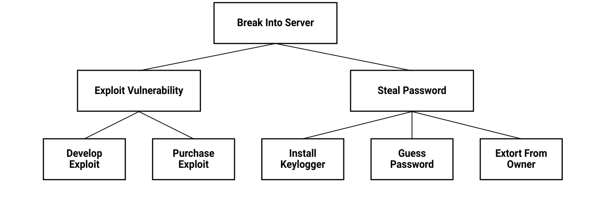

# Chapter 7: Adversarial Behaviours

**Authors:** Gianluca Stringhini (Boston University)

::: info About this page
This chapter is from [CyBOK Version 1.2.0](https://www.cybok.org/), © Crown Copyright, The National
Cyber Security Centre 2026, licensed under the
[Open Government Licence](https://www.nationalarchives.gov.uk/doc/open-government-licence/).
It was converted from the [PDF](https://www.cybok.org/wp-content/uploads/CyBOK_v1.2.0.pdf) into
a web page so that it works with screen readers and other assistive technology. Each
abbreviation is spelled out in square brackets the first time it appears, and those meanings are
ours, not the book's. So are the names of links the book prints as a bare web address. The PDF
(Portable Document Format) is the original, so if the two disagree, the PDF wins.
:::

## Introduction

The technological advancements witnessed by our society in recent decades have brought improvements in our quality of life, but they have also created a number of opportunities for attackers to cause harm. Before the Internet revolution, most crime and malicious activity generally required a victim and a perpetrator to come into physical contact, and this limited the reach that malicious parties had. Technology has removed the need for physical contact to perform many types of crime, and now attackers can reach victims anywhere in the world, as long as they are connected to the Internet. This has revolutionised the characteristics of crime and warfare, allowing operations that would not have been possible before.

In this document, we provide an overview of the malicious operations that are happening on the Internet today. We first provide a taxonomy of malicious activities based on the attacker’s motivations and capabilities, and then move on to the technological and human elements that adversaries require to run a successful operation. We then discuss a number of frameworks that have been proposed to model malicious operations. Since adversarial behaviours are not a purely technical topic, we draw from research in a number of fields (computer science, criminology, war studies). While doing this, we discuss how these frameworks can be used by researchers and practitioners to develop effective mitigations against malicious online operations.

## 7.1 A Characterisation of Adversaries

\[<a href="#ref-688" aria-label="Reference 688">688</a>\]\[<a href="#ref-689" aria-label="Reference 689">689</a>\]\[<a href="#ref-690" aria-label="Reference 690">690</a>, <a href="#ref-691" aria-label="Reference 691">691</a>\]\[<a href="#ref-692" aria-label="References 692–694">692–694</a>\]\[<a href="#ref-695" aria-label="Reference 695">695</a>\]\[<a href="#ref-696" aria-label="Reference 696">696</a>, <a href="#ref-697" aria-label="Reference 697">697</a>\]

In this section, we present a characterisation of adversaries who perform malicious actions. This characterisation is based on their motivation (e.g., financial, political etc.). Although alternative characterisations and taxonomies exist (e.g., from the field of psychology \[<a href="#ref-698" aria-label="Reference 698">698</a>\]), we feel that the one presented here works best to illustrate known attackers’ capabilities and the tools that are needed to set up a successful malicious operation, such as a financial malware enterprise. This characterisation also follows the evolution that cybercrime has followed in recent decades, from an ad-hoc operation carried out by a single offender to a commoditised ecosystem where various specialised actors operate together in an organised fashion \[<a href="#ref-699" aria-label="Reference 699">699</a>, <a href="#ref-700" aria-label="Reference 700">700</a>\]. The characterisation presented in this section is driven by case studies and prominent examples covered in the research literature, and as such is not meant to be complete. For example, we do not focus on accidental offenders (e.g., inadvertent insider threats), or on criminal operations for which rigorous academic literature is lacking (e.g., attacks on financial institutions or supply chain attacks). However, we believe that the set of crimes and malicious activities presented is comprehensive enough to draw a representative picture of the adversarial behaviours that are occurring in the wild at the time of writing. We begin by defining two types of cyber offences as they have been defined in the literature, cyber-enabled and cyber-dependent crimes, and we continue by presenting different types of malicious activities that have been covered by researchers.

### Cyber-enabled and cyber-dependent crimes

One of the main effects that the Internet has had on malicious activity has been to increase the reach of existing crimes, in terms of the ease of reaching victims, effectively removing the need for physical proximity between the victim and the offender. In the literature, these crimes are often referred to as *cyber-enabled* \[<a href="#ref-688" aria-label="Reference 688">688</a>\].

According to Clough \[<a href="#ref-89" aria-label="Reference 89">89</a>\], criminals have five main incentives to move their operations online:

1. Using the Internet, it is easier to find and contact victims. Email lists are sold on underground markets \[<a href="#ref-701" aria-label="Reference 701">701</a>\], while online social networks have search functionalities embedded in them, allowing criminals to easily identify potential victims \[<a href="#ref-702" aria-label="Reference 702">702</a>, <a href="#ref-703" aria-label="Reference 703">703</a>\].
2. By using the Internet, criminal operations can be run more cheaply. Sending emails is free, while scammers previously had to pay postage to reach their victims. This also allows criminals to increase the scale of their operations to sizes that were previously unthinkable.
3. Compared to their physical counterparts, the Internet allows crimes to be performed faster. For example, emails can reach victims in a matter of seconds, without having to wait for physical letters to be delivered.
4. Using the Internet, it is easier to operate across international boundaries, reaching victims located in other countries. In this setting, often the only limitation is language, with criminals only targeting victims who speak a language that they are familiar with (e.g., people in English-speaking countries) \[<a href="#ref-704" aria-label="Reference 704">704</a>\].
5. By operating over the Internet, it is more difficult for criminals to get caught. This is mainly due to the transnational nature of cybercrime, and the fact that the problem of harmonising the appropriate laws of different countries is far from being solved \[<a href="#ref-705" aria-label="Reference 705">705</a>\]. In addition, research shows that online crime is often under reported, both because victims do not know whom to report it to (given that the offender might be located in another country), as well as the fact that they believe that they are unlikely to get their money back \[<a href="#ref-706" aria-label="Reference 706">706</a>\].

*Cyber-dependent* crimes, on the other hand, are crimes that can only be committed with the use of computers or technology devices \[<a href="#ref-688" aria-label="Reference 688">688</a>\]. Although the final goal of this type of crime often has parallels in the physical world (e.g., extortion, identity theft, financial fraud), the Internet and technology generally enable criminals to give a new shape to these crimes, making them large-scale organised endeavours able to reach hundreds of thousands, if not millions, of victims.

In the rest of this section we analyse a number of cyber-enabled and cyber-dependent criminal schemes in detail.

### Interpersonal offenders

The first category that we are going to analyse is that of *interpersonal crimes*. These crimes include targeted violence and harassment, directed at either close connections (e.g., family members) or strangers. While these crimes have always existed, the Internet has made the reach of harassers and criminals much longer, effectively removing the need for physical contact for the offence to be committed. As such, these crimes fall into the cyber-enabled category. In the rest of this section, we provide an overview of these adversarial behaviours.

**Cyberbullying.** Willard \[<a href="#ref-689" aria-label="Reference 689">689</a>\] defines cyberbullying as ‘sending or posting harmful material or engaging in other forms of social aggression using the Internet or other digital technologies’. While not always illegal[^7-1], cyberbullying often occupies a grey area between what is considered a harmful act and a criminal offence \[<a href="#ref-707" aria-label="Reference 707">707</a>\]. This practice has become a serious problem for young people, who are often targeted by their peers not only in real life, but also on online platforms \[<a href="#ref-708" aria-label="Reference 708">708</a>\]. While the practice of bullying is nothing new, the Internet has changed the dynamics of these harassment practices significantly. What used to be a harmful practice limited to school hours now can be perpetrated at any time, effectively exposing victims to non-stop harassment \[<a href="#ref-709" aria-label="Reference 709">709</a>\].

One aspect that makes cyberbullying different from traditional, physical harassment is that people online can be anonymous, and do not have their name or face attached to the abusive activity that they are carrying out \[<a href="#ref-710" aria-label="Reference 710">710</a>, <a href="#ref-711" aria-label="Reference 711">711</a>\]. Researchers found that interacting with people online creates a *disinhibition* effect wherby personal traits are accentuated (i.e., negative people become meaner and positive people become nicer) \[<a href="#ref-712" aria-label="Reference 712">712</a>\]. This disinhibition effect can have the effect of making some people more likely to engage in abusive activity than they would do in the offline world \[<a href="#ref-711" aria-label="Reference 711">711</a>\]. Another aspect that contributes to disinhibition is the fact that online content distributed on certain platforms (e.g., snapchat, 4chan) is ephemeral, in the sense that it is deleted after a certain period of time \[<a href="#ref-713" aria-label="Reference 713">713</a>\]. As such, harassers feel that their actions have no adverse consequences since there will be no hard evidence of it in the future.

**Doxing.** Another type of online harassment is the practice of *doxing*, an attack where the victim’s private information is publicly released online \[<a href="#ref-714" aria-label="Reference 714">714</a>\]. This operation is usually part of a larger harassment campaign, where the release of sensitive information is used as a way of embarrassing the victim or facilitating further harassment, even in the physical world (for example, by releasing information at the workplace or the home address of the victim).

The practice of doxing has become increasingly popular in recent years as a way of polarising online discussion and silencing people. A prominent example is the `#GamerGate` controversy, where women activists were often attacked and had their personal information posted online \[<a href="#ref-715" aria-label="Reference 715">715</a>\]. Doxing has been a primary vehicle for coordinated hate attacks run by polarised online communities such as 4chan’s Politically Incorrect board (/pol/) \[<a href="#ref-713" aria-label="Reference 713">713</a>\]. As part of these attacks, anonymous users post information about their targets online (e.g., social media pages, phone numbers, physical addresses), and then invite other people to carry out loosely coordinated attacks (called *raids*) against those people. These attacks usually consist of hate speech and other abusive language.

While prominent in the online harassment space, the practice of doxing is also used by other offenders. For example, it is one of the techniques used by hacktivist groups such as Anonymous to put their targets on notice. We will discuss the other techniques used by hacktivists, together with their motivations, later in this section.

**Cyberstalking.** Another harmful activity that has been facilitated by the Internet is stalking. Cyberstalking is the practice of using electronic means to stalk another person \[<a href="#ref-716" aria-label="Reference 716">716</a>, <a href="#ref-717" aria-label="Reference 717">717</a>\]. Broadly speaking, we can identify two types of cyberstalkers: those who use the information that they find online to help them stalk their victim in real life (e.g., monitoring social media to know their whereabouts), and those who use the means offered by online services to stalk their victim purely online. Further, the stalkers who operate online are divided into those who act purely passively, without any interaction with the victim, and those who perform interactions, for example, by sending their messages on a social network platform \[<a href="#ref-718" aria-label="Reference 718">718</a>\]. To counter cyberstalking, legislation has recently been introduced in many countries, including the 2012 Protections of Freedoms act in the UK \[United Kingdom\] and the 2000 Violence Against Women Act in the US \[United States\].

**Sextortion.** An emerging crime that has risen to relevance is *sextortion*, where a criminal lures victims to perform sexual acts in front of a camera (e.g., a webcam in a chatroom), records those acts, and later asks for a monetary payment in order not to release the footage \[<a href="#ref-719" aria-label="Reference 719">719</a>\]. Sextortion is becoming such a relevant threat that crime prevention agencies such as the National Crime Agency (NCA) in the UK are launching dedicated awareness campaigns against it.[^7-2]

**Child predation.** Another crime that is facilitated by the Internet is child predation \[<a href="#ref-720" aria-label="Reference 720">720</a>\]. Online services are a fertile ground for criminals to find victims, whether on chats, online social networks, or online gaming platforms. The offender will then groom their victims to either perform physical or online abuse \[720\]. Compared to the corresponding offline offence, online sexual predation has two main differences: first, the victim and the perpetrator almost never know each other in real life. Second, the victim demographics are more skewed towards adolescents than young children, because the age at which kids start going online is slightly higher \[<a href="#ref-721" aria-label="Reference 721">721</a>\]. Offenders use a range of tactics, including pretending to be young people and children in order to groom their victims \[<a href="#ref-722" aria-label="Reference 722">722</a>\] and research has shown the potential vulnerability of children of all ages to such online identity deception \[<a href="#ref-723" aria-label="Reference 723">723</a>\].

Other offenders do not interact with children directly, but download and share child pornography on the Internet. In such cases hands-on abusers often know their victims and disseminate child abuse material to these “users” of such material. This has been facilitated by peer-to-peer sharing platforms \[<a href="#ref-724" aria-label="Reference 724">724</a>, <a href="#ref-725" aria-label="Reference 725">725</a>\] as well as anonymising technologies such as Tor \[<a href="#ref-726" aria-label="Reference 726">726</a>\]. The challenges of identifying originators of new child abuse material (and the deceptive tactics used by offenders, e.g., specialised vocabulary for filenames to thwart investigations) in such peer-to-peer networks have also been studied \[<a href="#ref-725" aria-label="Reference 725">725</a>\].

### Cyber-enabled organized criminals

In this section, we focus on cyber-enabled crimes that are carried out by career criminals. In particular, we provide two prominent examples of cyber-enabled crimes that have received significant attention by the research community: *advance fee fraud* and *drug dealing*. These crimes are not usually carried out by single offenders, but rather by multiple criminals who act together in small organisations \[<a href="#ref-727" aria-label="Reference 727">727</a>\] or in actual structured criminal organisations \[<a href="#ref-728" aria-label="Reference 728">728</a>\]. We acknowledge that other crimes exist that have seen increased reach because of technology. However, these crimes have yet to be studied in depth by the research community and, therefore, we decided to focus on the one which the research community has a better understanding of.

**Advance fee fraud.** In this type of scam, the victim is promised a reward (financial or otherwise), but in order to obtain it has to first pay a small fee to the fraudster. After the payment takes place, the victim often does not hear from the scammer again, while sometimes the relationship lasts for long periods of time and the victim is repeatedly defrauded of large sums of money \[<a href="#ref-729" aria-label="Reference 729">729</a>\].

The archetypal example of advance fee fraud comprises so-called 419 scams \[<a href="#ref-690" aria-label="Reference 690">690</a>\]. Named after the section of the Nigerian Criminal Code dealing with fraud, these scams became popular in the 1980s, when victims would receive physical letters from an alleged Nigerian prince, looking to transfer large amounts of money outside of the country. To initiate the process, the victim is required to transfer a small amount of money to the fraudster (e.g., to cover legal fees). As it can be imagined, the Internet allowed this type of fraud to flourish, by enabling criminals to instantly reach a large number of potential victims.

Another example of advanced fee fraud is consumer fraud perpetrated on classifieds websites such as Craigslist \[<a href="#ref-730" aria-label="Reference 730">730</a>\]. As part of this fraud, victims respond to a classified advertisement for a desirable item (e.g., a used car or a rental property) which has much better conditions (such as a lower price) than similar posts. The fraudster responds that they will need a small upfront payment to deliver the goods. After receiving it, the victim will not hear from the fraudster again.

A final example of advanced fee fraud is the online romance fraud. Taking place on online dating sites, this type of fraud usually consists in criminals posing as attractive individuals looking to start a relationship with the victim. Unlike the 419 scam, these online relationships often last for months before the fraudster demands money, for example, to help their family or to open a business \[<a href="#ref-727" aria-label="Reference 727">727</a>\]. By that time, the victim, who is likely emotionally involved with the persona impersonated by the criminal, is likely to comply. Previous research reported that victims of this crime can lose between £50 and £240,000 \[<a href="#ref-729" aria-label="Reference 729">729</a>\]. Unlike other types of advanced fee fraud, however, the psychological damage of losing the fictional relation can be much greater than the financial one.

A common element of every type of advanced fee fraud is the need for criminals to build an enticing narrative that will lure victims into paying the fraudulent fee. To this end, criminals often target specific demographics and impersonate specific personas. For example, previous research showed that romance fraudsters often pretend to be members of the military stationed abroad \[<a href="#ref-731" aria-label="Reference 731">731</a>\]. By doing so, the fraudsters can build a credible narrative as to why they cannot meet the victim in person, and they can build an emotional connection with the victim, which will increase the chances of their falling for the scam. Often, fraudsters pretend to be widowed middle-aged men who target widowed women in the same demographic, in an attempt to establish an emotional connection with their victim \[<a href="#ref-727" aria-label="Reference 727">727</a>\]. In other cases, fraudsters employ psychological tricks to win their victims over, such as applying time pressure or remarking that they specifically selected the victim because of their high moral characters \[<a href="#ref-690" aria-label="Reference 690">690</a>\].

More cynically, Herley argues that fraudsters are incentivised to build the most absurd narratives possible, to make sure that only those who are gullible enough to believe them will reply, and that these people will be the most likely to fall for the scam \[<a href="#ref-732" aria-label="Reference 732">732</a>\]. His argument is that responding to the first boilerplate message is expensive for the fraudster, while sending the first copy to as many victims as they wish is free. For this reason, it is in their interest to rule out those who are not likely to fall for the scam as soon as possible.

**Drug dealing.** Another category of crimes for which the Internet has offered opportunities is the drug trade. Thanks to anonymising technologies such as Tor \[<a href="#ref-507" aria-label="Reference 507">507</a>\] and cryptocurrencies \[<a href="#ref-733" aria-label="Reference 733">733</a>\], online marketplaces have emerged where drug users can purchase illicit substances and have them delivered directly to their home. Research has shown that this business is thriving, despite the instability of these marketplaces, which are often taken down by law enforcement \[<a href="#ref-691" aria-label="Reference 691">691</a>, <a href="#ref-734" aria-label="Reference 734">734</a>\]. Online drug markets provide an interesting paradigm switch for drug users, because they remove the need for the buyer to interact with criminals in a physical and potentially unsafe setting. Recent work has shown, however, that the inception of the online drug market has not changed the worldwide drug trade ecosystem: the big players who produce and dispatch drugs remain broadly unchanged, while what has changed is the ‘last mile’ in the delivery (i.e., how local dealers and drug users get in touch and do business) \[<a href="#ref-728" aria-label="Reference 728">728</a>\].

### Cyber-dependent organized criminals

In this section, we describe crimes that have a financial goal and are carried out using complex technical infrastructures (e.g., botnets \[<a href="#ref-735" aria-label="Reference 735">735</a>\]). Unlike the cyber-enabled crimes described in the previous section, where the criminal is essentially replicating a physical criminal operation and using the Internet to enhance his/her reach, in the case of cyber-dependent crimes criminals have to set up complex technological infrastructures to achieve their goals. The complexity of these operations has prompted a compartmentalisation in the criminal ecosystem, where each malicious actor specialises in a specific part of a cybercriminal operation (e.g., infecting computers with malware or performing money laundering) and works together towards achieving a common goal. In this section, we provide some examples of cyber-dependent crimes that have been studied by the research literature in recent years. Then, in Section 7.2, we cover in detail the various elements that criminals need to put in place to make their operations successful.

**Email spam.** Email spam has been a major nuisance for Internet users for the past two decades, but it has also been at the forefront of very successful criminal operations, who have managed to monetise the sale of counterfeit goods and pharmaceuticals by reaching billions of potential customers through malicious messages \[<a href="#ref-736" aria-label="Reference 736">736</a>\]. Email spam is defined as *unsolicited bulk email*; this definition highlights the two main elements of the problem: the fact that the messages received by victims are unsolicited (i.e., they were not requested in the first place), and that they are sent in bulk to reach as many victims as possible.

Although the very first spam email was recorded in 1978 \[<a href="#ref-737" aria-label="Reference 737">737</a>\], email spam rose to prominence in the 1990s, when criminals set up small operations, not dissimilar from the advance-fee fraud ones described in the previous section \[<a href="#ref-738" aria-label="Reference 738">738</a>\]. The goal of these operations was to sell goods online, which could span from diet supplements to Nazi memorabilia \[738\]. At this stage, relying on their own expertise and on the help of a small number of associates, criminals would carry out all the activities required to set up a successful spam operation: (i) harvesting email addresses to send the malicious messages to, (ii) authoring the email content, (iii) sending the spam emails in bulk, (iv) processing the orders from people who wanted to purchase the advertised items, (v) reacting to raids by law enforcement (e.g., the seizure of an email server). Although they were still rudimentary compared to the spam operations that came during the next decade, these criminal endeavours prompted the development of legislation to regulate unsolicited bulk emails, such as the Directive on Privacy and Electronic Communications in the EU \[European Union\],[^7-3] the Privacy and Electronic Communications Regulations in the UK[^7-4] and the CAN-SPAM Act in the US.[^7-5] These pieces of legislation helped prosecute some of those early-day spammers. In 2004, America Online (AOL) won a court case against Davis Wolfgang Hawke, who was selling Nazi gadgets through spam emails. Hawke was sentenced to pay a 12.8M USD \[United States dollars\] fine.

The technical advancements of the early 2000s, and in particular the development of botnets, networks of compromised computers controlled by the same cybercriminal \[<a href="#ref-735" aria-label="Reference 735">735</a>\], gave unprecedented opportunities to criminals who want to engage in email spam today. Email spam is not a one-person operation anymore, rather it is supported by thriving criminal ecosystems. Spammers can rent botnets from criminals who are specialised in infecting computers with malware \[<a href="#ref-701" aria-label="Reference 701">701</a>\], purchase lists of target email addresses from specialised actors \[<a href="#ref-739" aria-label="Reference 739">739</a>\] and sign up to an affiliate programme \[<a href="#ref-740" aria-label="Reference 740">740</a>, <a href="#ref-741" aria-label="Reference 741">741</a>\], which will provide the spammer with a way of advertising, as well as taking care of shipments and payments.

The arms race connected to spam mitigation has been going on since the 1990s, with a number of mitigations being proposed \[<a href="#ref-742" aria-label="Reference 742">742</a>\]. Currently, anti-spam techniques ensure that the vast majority of malicious emails will never reach their victims’ mailboxes. To solve this issue, criminals have to send tens of billions of emails \[<a href="#ref-701" aria-label="Reference 701">701</a>\] to keep their operations profitable. Another issue is that, out of the victims reached by those spam emails that make it through, only a small fraction will purchase the advertised goods and turn a profit for the criminals. Researchers performed a case study for the Storm botnet \[<a href="#ref-692" aria-label="Reference 692">692</a>\], showing that out of 469 million spam emails sent by the botnet, only 0.01% reach their targets. Of these, only 0.005% of the users click on the links contained in the emails, while an even lower number ends up purchasing items - only 28 users in total out of the 469 million reached, or 0.0004% of the total. Despite this steep drop, McCoy et al. showed that popular spam affiliate programmes were able to make up to 85 million USD of revenue over a three-year period \[<a href="#ref-740" aria-label="Reference 740">740</a>\]. They also showed that key to this success are returning customers. In fact, spam emails need to reach an interested customer only once, and this person can later keep purchasing on the site without having to worry about spam filters.

**Phishing.** A particular type of spam is phishing, where criminals send emails that pretend to be from genuine services (e.g., online banking, social network websites) \[<a href="#ref-693" aria-label="Reference 693">693</a>\]. These emails typically lure users into handing out their usernames and passwords to these services by presenting them with a believable email asking them to visit the website (e.g., to retrieve their latest account statement). By clicking on the link in the email, users are directed to a website displaying fake but realistic login pages. Once they have input their credentials, the criminals gain access to them and they will be able to later log in to those services on behalf of the users, potentially making money directly or selling the credentials on the black market.

For the criminal, a key component to the success of phishing pages is setting up web pages that resemble the original ones as much as possible. To facilitate this task, specialised cybercriminals develop and sell so-called *phishing kits* \[<a href="#ref-743" aria-label="Reference 743">743</a>\], programmes that can be installed on a server and will produce an appropriately-looking web page for many popular services. These kits typically also provide functionalities to make it easier for the criminal to collect and keep track of the stolen credentials \[743\]. Another element needed by criminals to host these pages is servers under their control. Similar to spam, criminals, researchers, and practitioners are involved in an arms race to identify and blacklist phishing Web pages \[<a href="#ref-744" aria-label="Reference 744">744</a>\], therefore it does not make economic sense for criminals to set up their own servers. Rather, criminals often host these websites on compromised servers, for which they do not have to pay \[<a href="#ref-745" aria-label="Reference 745">745</a>\].

After stealing a large number of credentials, criminals can either exploit these accounts themselves or sell the usernames and passwords on the black market. Previous research has shown that often these criminals log into the accounts themselves and spend time evaluating their value, for example, by looking for financial information in webmail accounts.\[<a href="#ref-704" aria-label="Reference 704">704</a>, <a href="#ref-746" aria-label="Reference 746">746</a>\].

**Financial malware.** Another popular criminal operation is financial malware. In this setting, criminals aim to install malware on their victims’ computers and steal financial credentials such as credit card numbers and online banking usernames and passwords. This trend started with the Zeus malware, which criminals could purchase on the black market and use to set up their operations \[<a href="#ref-747" aria-label="Reference 747">747</a>\]. Once installed on a victim computer, Zeus would wait for the user to visit a website on a pre-configured list of interesting ones that the criminal could specify. It would then record usernames and passwords as the user typed them in, and send them to the command and control server set up by the criminal.

A more sophisticated information stealing botnet was Torpig \[<a href="#ref-694" aria-label="Reference 694">694</a>\]. Unlike Zeus, Torpig used a botnet-as-a-service model, where a single specialised criminal was responsible for hosting the botnet infrastructure, while other criminals could run their campaigns to infect victim computers, pay a fee to use the torpig infrastructure and later retrieve the stolen credentials. Researchers showed that, in 2009, the Torpig botnet was able to steal 8,310 unique bank account credentials and 1,660 unique credit card numbers over a ten-day period. \[694\].

To monetise their operations, cybercriminals can sell the stolen financial information on dedicated underground forums \[<a href="#ref-748" aria-label="Reference 748">748</a>\]. The price that criminals can ask for these credentials varies based on the type of records that they were able to steal. For example, on the underground market there are two types of credit card records that are traded: *dumpz*, which contain the information that allows a criminal to clone a credit card (i.e., card number, expiration date, security code), and *fullz*, which also contain the billing address associated with the card. Fullz are worth more money on the black market, because they allow miscreants to purchase items online.

A related type of crime that is becoming more popular is card skimming \[<a href="#ref-749" aria-label="Reference 749">749</a>\]. In this cyber-enabled crime, criminals install devices on ATM \[Automated Teller Machine.\] machines which collect details of the cards inserted into the machines by unwitting users. The criminal can then collect the devices to retrieve the stolen financial credentials. While this type of crime is serious, it is also a good example of the limitations of physical crime compared to their online counterparts: the need for physical action by the criminal limits the scale of the operation, while financial malware operations can affect much higher numbers of victims. For example, the Torpig malware was installed on over 100,000 computers \[<a href="#ref-694" aria-label="Reference 694">694</a>\].

Note that malware is not always needed to perform financial fraud. In some cases, *insider threats* within financial organisations could act maliciously and defraud both their institutions and their customers \[<a href="#ref-750" aria-label="Reference 750">750</a>, <a href="#ref-751" aria-label="Reference 751">751</a>\]. In other cases, financial information such as credit card numbers could be stolen by exploiting a vulnerability in an online system (e.g., by dumping the database of an online store) \[<a href="#ref-752" aria-label="Reference 752">752</a>\]. In other cases, stolen SWIFT \[Society for Worldwide Interbank Financial Telecommunication\] credential of banks can be used to perform large fraudulent money transfers \[<a href="#ref-753" aria-label="Reference 753">753</a>\]

**Click fraud.** Web advertisements are the main way the Web is monetised. A Web administrator can decide to host advertisements on his/her website, and whenever visitors view them or click on them they receive a small fee from an advertiser. To mediate this interaction, specialised services known as *ad exchanges* have emerged. Because of their easy monetisation, Web advertisements are ripe for fraud. In particular, criminals can host advertisements on their own websites and then generate ‘fake’ clicks (e.g., by using bots). This results in an ad exchange paying criminals for ad impressions that were not ‘genuine,’ eventually defrauding the advertiser.

Once again, criminals are involved in an arms race with ad exchanges, who are interested in keeping fraud on their services minimal. To help criminals generate large numbers of clicks and remain under the radar by gaining access from large numbers of IP \[Internet Protocol\] addresses, so-called *click fraud* botnets have emerged. An example is Zeroaccess \[<a href="#ref-754" aria-label="Reference 754">754</a>\], which was active in 2013. On an infected machine, this malware would act like a regular user, browsing websites and clicking on advertisements that its owner chose. Researchers showed that this botnet was responsible for losses to the advertising industry of approximately 100,000 USD per day \[754\].

**Unauthorised cryptocurrency mining.** With the increasing popularity of cryptocurrencies, a new opportunity has opened up for criminals: using infected computers to mine currency. In 2014, Huang et al.revealed this threat, showing that botnets were used to mine Bitcoin \[<a href="#ref-755" aria-label="Reference 755">755</a>\]. While revealing this new monetisation for malware, the authors also concluded that these operations did not appear to be making much money, totaling at most 900 USD a day.

A more recent study, however, showed that cryptocurrency mining by botnets could be much more rewarding than previously thought. Pastrana and Suarez-Tangil showed that by mining Monero and using a number of techniques to increase their chances of mining currency (e.g., using mining pools) criminals could make up to 18 million USD over a two-year period. \[<a href="#ref-756" aria-label="Reference 756">756</a>\].

Another emerging trend in cybercrime comprises leveraging Web browsers to mine cryptocurrencies. Instead of installing malware on victim computers and using them for mining, miscreants add scripts to webpages and have their visitors mine cryptocurrencies. This type of malicious activity is called *cryptojacking*. Although using these scripts is not necessarily illegal (i.e., Web administrators can legitimately install them on their webpages in a similar way to advertisements), criminals have been caught adding them to compromised websites on multiple occasions. Konoth et al. showed that a malicious campaign can make GBP \[pounds sterling\] 31,000 over a week \[<a href="#ref-757" aria-label="Reference 757">757</a>\], while Rüth et al. \[<a href="#ref-758" aria-label="Reference 758">758</a>\] showed that 1.18% of the mined blocks in the Monero blockchain can be attributed to `Coinhive`, the most popular cryptojacking library.

**Ransomware.** The newest trend in malware is *Ransomware*. As part of this operation, criminals infect their victim systems with malware which encrypts the user’s personal files (e.g., documents) and sends the encryption key to the criminal, who then asks for a ransom in exchange for giving the user access to their data again \[<a href="#ref-759" aria-label="Reference 759">759</a>\]. The idea of malicious software that uses public key cryptography to hold the victim’s data hostage is not new, and it was theorised by Yung in 1996 already \[<a href="#ref-760" aria-label="Reference 760">760</a>\]. In 20 years, however, the technological advancements on the malware delivery end have made it possible to reach large numbers of victims, and the introduction of anonymous payment methods such as Bitcoin has made it safer for criminals to collect these payments.

Ransomware is, at the time of writing, the gold standard for cybercriminals. This type of malware operation has solved the monetisation problems that were so important in other types of cybercriminal schemes: the criminal does not have to convince the victim to purchase a good, like in the case of email spam, or to fall for a fraud, like in the case of phishing. In addition, the victim is highly incentivised to pay the ransom, because the probability that the criminals have encrypted files that the user will need (and for which they have no backup copy) is high. In fact, recent research was able to trace 16 million USD in payments on the Bitcoin blockchain that can be attributed to ransomware campaigns \[<a href="#ref-662" aria-label="Reference 662">662</a>\].

Although the most sophisticated ransomware campaigns involve encrypting the victim’s files, Kharraz et al. showed that it is not uncommon for malware authors to use other techniques to lock the victim out of his/her computer \[<a href="#ref-761" aria-label="Reference 761">761</a>\]. These techniques include setting up a password-protected bootloader and not giving the password to the user unless he/she pays. While these techniques are likely to yield a profit for the criminal, they are also easier to mitigate, as the victim’s files are safe on the computer and a simple clean up of the malware (and restoring the original master boot record) can fix the problem.

**Denial of service.** A feature that all Internet-connected devices have is network connectivity. A criminal can leverage the bandwidth of an infected device to perform a Distributed Denial of Service (DDoS) attack against a target. Criminals can simply use the bandwidth generated by the botnet, or leverage *amplification attacks* (i.e., network traffic generated by misconfigured network devices, or devices with poor default settings) to enhance the power of their DDoS attacks \[<a href="#ref-661" aria-label="Reference 661">661</a>\].

The criminals can then set up services where they offer DDoS for hire. These services are appealing for example to unscrupulous actors who want their business competitors to go offline or to online gamersonline gaming who want to knock their opponents off the Internet to win the game \[<a href="#ref-762" aria-label="Reference 762">762</a>\]. To hide the illicit nature of their business, these services often advertise themselves as ‘stress testers’, services that a Web administrator can use to test how their Web applications perform under stress \[762\]. In reality, however, these services do not check whether the customer purchasing a DDoS attack is actually the same person who owns the target domain.

### Hacktivists

While criminals driven by profit are a big threat, not all adversaries are driven by money. In particular, we define the act of computer crime motivated by a political goal as *hacktivism* \[<a href="#ref-695" aria-label="Reference 695">695</a>\]. These crimes can take various forms, from denial of service attacks \[695\] to compromising computer systems with the goal of releasing sensitive information to the public \[<a href="#ref-763" aria-label="Reference 763">763</a>\]. There is an ongoing debate among scholars on whether actions by hacktivists fall under political activism (e.g., civil disobedience) or cyber terrorism \[<a href="#ref-764" aria-label="Reference 764">764</a>\]. Holt et al. studied cyber attacks carried out by far left groups in the US and found that there was an increase in online attacks during periods that observed a decrease in physical violence from those same groups \[<a href="#ref-765" aria-label="Reference 765">765</a>\].

**Denial of service.** The practice of hacktivism started in the 1990s with *netstrikes* \[<a href="#ref-766" aria-label="Reference 766">766</a>\]. As part of this practice, Internet users would connect to target the websites simultaneously to deplete their resources and make them unresponsive. This was often done to protest against actions and policies by government agencies and corporations. Twenty years later, with the increased sophistication offered by technology, hacktivist groups such as Anonymous \[<a href="#ref-767" aria-label="Reference 767">767</a>\] took the idea of netstrikes and made it bigger in size. This collective became popular for launching denial of service attacks against organisations that were guilty of performing actions that did not match their moral stance, such as governments linked to the repression of the Arab Spring, credit card companies who would not make donations to entities such as Wikileaks or radical religious organisations.

To perform their attacks, Anonymous would ask its sympathisers to install a computer program, called Low Orbit Ion Cannon (LOIC), which would act as a bot in a botnet: their controller would use the computer’s bandwidth to carry out a denial of service attack against a chosen target. The difference with traditional botnets (and the ones used to carry out DDoS attacks in particular) is that the user is accepted to be part of it by installing the LOIC program, and suffered law enforcement action as a consequence.

**Data leaks.** Another trend that we have been observing in recent years in the area of hacktivism is the release of stolen documents into the public domain, for example, to raise awareness about secret surveillance programs by governments \[<a href="#ref-768" aria-label="Reference 768">768</a>\]. A prominent example of an organisation that performs these data leaks is Wikileaks \[<a href="#ref-763" aria-label="Reference 763">763</a>\]. Similar techniques have also been used by Anonymous (e.g., about the identity of 1,000 Ku Klux Klan members).

**Web Defacements.** The last trend that is typical of politically-motivated actors is *Web defacement* \[<a href="#ref-769" aria-label="Reference 769">769</a>\]. As part of this activity, miscreants exploit vulnerabilities (ranging from weak passwords to software vulnerabilities) in the websites of organisations they disagree with, and use them to change the home page of the website to a politically-charged one. An example of an organisation that is prominently using Web defacements to spread their message is the Syrian Electronic Army \[<a href="#ref-770" aria-label="Reference 770">770</a>\], a group of hackers close to the Assad regime. Although popular with criminals with a political agenda, Web defacement is not just their prerogative. In fact, Maimon et al. showed that this is a popular way for early career cybercriminals to prove their worth \[<a href="#ref-771" aria-label="Reference 771">771</a>\].

### State actors

Another type of malicious actor involved in adversarial behaviours online comprises nation states. In the past few years, we have observed an escalation in the use of computer attacks by state actors to achieve their goals. Broadly speaking, this type of attack differs from those performed by financially motivated cybercriminals for two reasons:

1. Commodity cybercrime needs to gather as many victims as possible to maximise their profits. For instance, criminals setting up a botnet to steal financial information from their victims will want to reach the highest possible number of victims to improve their revenue. This means that the cybercriminal’s attacks need to be either generic or diversified enough to cover a large population of devices (e.g., by using exploit kits, as explained in Section 7.2). In a state-sponsored attack, on the other hand, there is no need to make money, and usually the victim is well defined (e.g., a specific organisation or a person of interest). In this setting, the attack can be tailored to the victim; this increases the chances of success, because of the time that can be spent designing the attack and the fact that the attack will be unique (e.g., by using a zero day attack \[<a href="#ref-772" aria-label="Reference 772">772</a>\]), and it will be unlikely that existing protection software will catch it.
2. Because of the need to make money, traditional cybercriminals need their attacks to be fast. This is not the case for state-sponsored attacks, where the reward for achieving its goal (e.g., stealing sensitive information from a government) makes it acceptable to wait for long periods of time before finalising the attack.

State-sponsored attacks fall broadly into three categories, depending on the purpose of the attack: sabotage, espionage, and disinformation. In the following, we describe these three types of attacks in more detail.

**Sabotage.** Modern critical infrastructure can be disrupted by electronic means. Research has shown that it is not uncommon for critical facilities such as power plants to have some sort of network connectivity between the computers controlling the machinery and the ones connected to the Internet \[<a href="#ref-773" aria-label="Reference 773">773</a>\]. In the case of a state adversary, even having network security appliances to guard the boundary between the two networks is not enough, since, as we said, attacks can be so sophisticated and tailored that off-the shelf solutions fail to detect them \[<a href="#ref-696" aria-label="Reference 696">696</a>\]. Once a piece of malware manages to get into the control network, it could make the machinery malfunction and potentially destroy it. Even when there is a physical separation between the control network and the wider Internet, attacks are still possible when we are faced with adversaries with virtually unlimited resources \[696\].

A prominent example is the Stuxnet worm \[<a href="#ref-696" aria-label="Reference 696">696</a>, <a href="#ref-774" aria-label="Reference 774">774</a>\], a sophisticated attack performed against the Nathanz nuclear enrichment facility in Iran in 2010. Allegedly, the malware was introduced into the facility by first infecting the laptop of one of the consultants who was maintaining the machinery. Once the malware was in the right environment, it identified the pieces of equipment that it was designed to target and sabotaged the enrichment experiments, making the centrifuges spin out of control. To date, Stuxnet is a textbook example of the lengths to which state-sponsored attackers can go to achieve their objectives, and of the sophistication that their attacks can achieve.

Sabotage is not always linked to state actors. Major incidents have been caused by disgruntled employees of companies who acted as insider threats, like in the case of the Maroochy Water Services \[<a href="#ref-775" aria-label="Reference 775">775</a>\]. In this incident an insider whose employment had not been confirmed decided to get revenge on the company by spilling sewage, causing major environmental damage \[775\].

**Espionage.** Another goal that state-sponsored actors have for their attacks is spying on opponents and prominent adversaries. Research has shown that state actors make prominent use of spearphishing (i.e., targeted phishing) to lure activists and companies into installing malware that is later used to spy on them \[<a href="#ref-704" aria-label="Reference 704">704</a>, <a href="#ref-776" aria-label="Reference 776">776</a>\]. In other cases, state actors infect sensitive systems (e.g., servers in large corporations), with the goal of stealing sensitive information \[<a href="#ref-777" aria-label="Reference 777">777</a>\]. The security industry has dubbed these long-standing, sophisticated attacks *Advanced Persistent Threats*.

**Disinformation.** In the past two years evidence has emerged that state-sponsored actors have been involved in spreading disinformation on social media \[<a href="#ref-697" aria-label="Reference 697">697</a>, <a href="#ref-778" aria-label="References 778–780">778–780</a>\]. This has been done through *troll* accounts that acted to polarise online discussion on sensitive topics \[<a href="#ref-781" aria-label="Reference 781">781</a>\]. While social networks such as Twitter have made data about accounts related to state-sponsored disinformation publicly available \[<a href="#ref-697" aria-label="Reference 697">697</a>, <a href="#ref-778" aria-label="Reference 778">778</a>\], rigorous evidence is still missing on how these operations are carried out on the backend. For example, the extent in which the accounts involved in disinformation are controlled by human operators as opposed to bots is not clear.

## 7.2 The Elements of a Malicious Operation {#_7-2-the-elements-of-a-malicious-operation}

\[<a href="#ref-782" aria-label="Reference 782">782</a>\]\[<a href="#ref-783" aria-label="Reference 783">783</a>\]\[<a href="#ref-784" aria-label="Reference 784">784</a>\]\[<a href="#ref-785" aria-label="Reference 785">785</a>, <a href="#ref-786" aria-label="Reference 786">786</a>\]\[<a href="#ref-700" aria-label="Reference 700">700</a>\]\[<a href="#ref-787" aria-label="Reference 787">787</a>, <a href="#ref-788" aria-label="Reference 788">788</a>\]

As we showed in Section 7.1, malicious operations can use rather complex infrastructures, particularly in the case of organised crime, which is mostly motivated by two facts. First, the criminal needs these operations to be as cost effective as possible (and consequently make the highest possible profit). Second, multiple actors (law enforcement, security companies, the users themselves) are constantly attempting to take down these malicious operations, and the criminal has, therefore, a need to make them resilient to these takedown attempts. To ensure that the criminals’ needs are met in this scenario, in recent years we have witnessed a *specialisation* in the cybercriminal ecosystem, where different actors specialise in a specific element required for the operation to succeed; the miscreants then trade these services with each other on the black market. In this section, we provide an overview of the elements required for a cyber-dependent organised criminal operation to succeed, as described in Section 7.1. Many of the elements discussed, however, also apply to the other types of adversarial behaviours described in that section.

### Affiliate Programmes

The main goal of organised crime is to make money from their operations. This requires not only a well-oiled technical infrastructure to make sure that their botnets operate properly but, perhaps more importantly, a working method to collect payments from victims (or from sponsors, in the case of DoS \[Denial of Service\]), while making sure that all the actors involved in the operation get paid.

In the cybercriminal world, this is typically done through *affiliate programmes*. An affiliate programme is a scheme where main organisation provides a ‘brand’ and all the means required to carry out orders, shipments and payments. Affiliates can join the program, direct traffic to the platform, and get a cut of the sales that they are responsible for. Although this scheme exists for legitimate businesses (e.g., Amazon has an affiliate programme), it has been particularly successful for cybercriminal operations. The main difference between legitimate and criminal affiliate programmes is that the second category of operations typically deals with products that are considered illegal in most jurisdictions (e.g., counterfeit pharmaceuticals, gambling, counterfeit designer products) and they typically endorse criminal promotion techniques (e.g., the use of malware or black hat search engine optimisation).

Affiliate programmes are popular in the cybercriminal world because they mean affiliates do not have to set up their operations from start to finish, but rather focus on attracting traffic, for example by setting up botnets and sending email spam advertising the affiliate marketplace. The first successful examples of affiliate programmes for cybercrime were centred around email spam, and were advertising counterfeit pharmaceuticals \[<a href="#ref-736" aria-label="Reference 736">736</a>, <a href="#ref-740" aria-label="Reference 740">740</a>, <a href="#ref-741" aria-label="Reference 741">741</a>\]. However, affiliate programmes are present in most types of cyber-dependent crime, an example being the Cryptowall ransomware operation.[^7-6]

In addition to providing the monetisation necessary for cybercriminal operations, affiliate programmes also act as facilitators for criminals to get in contact and trade the services that are needed for the operation to succeed. This is typically done by setting up a forum where affiliates can trade their services \[<a href="#ref-701" aria-label="Reference 701">701</a>, <a href="#ref-740" aria-label="Reference 740">740</a>\]. Gaining access to these forums typically requires vetting by the affiliate programme administrators.

### Infection vectors

As discussed earlier, the first step required by criminals to perform a malicious activity is often infecting their victims with malware. To this end, the criminals need to first expose their potential victims to the malicious content, and then have them install it on their machines (through either deception or by exploiting a software vulnerability in their system). In the following, we survey three popular methods on delivering malware to victim computers. Note that, while other infection vectors are possible, such as physical access to a network or hijacking a wireless network, to date we are not aware of any large-scale compromise involving these infection vectors, and therefore we do not focus on them.

**Malicious attachments.** Possibly the oldest method of delivering malware is attaching malicious software to spam emails, disguising it as useful content that the user might want to open. This spreading technique was made popular by email worms in the early 2000s, such as the ‘I love you’ worm \[<a href="#ref-789" aria-label="Reference 789">789</a>\], but it is still a popular way of delivering malware to victims \[<a href="#ref-701" aria-label="Reference 701">701</a>\]. In the commoditised economy described previously, it is often the case that a criminal who wants to spread a malware infection pays another criminal who already has control of a botnet to deliver the payloads \[<a href="#ref-694" aria-label="Reference 694">694</a>\]. To be successful, the content used for this infection vector needs to convince the user to click on the attachment and install it. To this end, criminals often use deception techniques to make the content look interesting and appealing, similar to the techniques discussed for phishing \[<a href="#ref-693" aria-label="Reference 693">693</a>\]. This deception falls into the area of social engineering \[<a href="#ref-790" aria-label="Reference 790">790</a>\].

**Black hat search engine optimisation.** Search Engine Optimization (SEO) is a popular practice whereby webmasters optimise their content so that it is better indexed by search engines and appears among the first hits for relevant searches. Cybercriminals are also interested in having their malicious Web pages appear high in search results, because this increases the chances that potential victims will find them and click on them. To accomplish this, specialised criminals offer black hat SEO services. As a result of these services, malicious websites are pushed high up in search engine rankings for keywords that are unrelated to the website \[<a href="#ref-791" aria-label="Reference 791">791</a>\]. This happens particularly often in proximity with popular events (e.g., sports and political events), because people will be more likely to search for keywords related to the event. To achieve effective black hat SEO, cybercriminals compromise vulnerable websites and use them to promote their customers’ webpages (e.g., by adding invisible links and text pointing to the target webpage).

**Drive-by download attacks.** Although deceptively luring users into installing malware works, having an automated method that does not require human interaction is more advantageous for cybercriminals. To this end, cybercriminals have perfected so-called *drive-by download* attacks \[<a href="#ref-783" aria-label="Reference 783">783</a>\]. As part of one of these attacks, the victim visits a webpage under the control of the criminal (e.g., encountered through black hat SEO). The webpage contains malicious JavaScript code that will attempt to exploit a vulnerability in the user’s Web browser or in one of its plugins. If successful, the Web browser will be instructed to automatically download and install the malware.

To host their malicious scripts, cybercriminals often compromise legitimate websites \[<a href="#ref-792" aria-label="Reference 792">792</a>\]. An alternative trend is purchasing Web advertisement space and serving the malicious content as part of the ad, in a practice known as *malvertisement* \[<a href="#ref-793" aria-label="Reference 793">793</a>\].

**Compromising of Internet-connected devices.** As more devices get connected to the Internet (e.g., Internet of Things (IoT) devices), an additional opportunity provided to attackers is scanning the Internet for devices that present known vulnerabilities and exploit them to build large botnets. A prominent example of this was the Mirai botnet \[<a href="#ref-658" aria-label="Reference 658">658</a>\].

### Infrastructure

Another important element that criminals need for their operations to succeed is where to host their infrastructure. This is important for both affiliate programmes (e.g., where to host fraudulent shopping websites) as well as for botnet operations. Law enforcement and Internet Service Providers (ISPs) are continuously monitoring servers for evidence of malicious activity \[<a href="#ref-784" aria-label="Reference 784">784</a>\], and will take them down if this activity can be confirmed, which would put the criminal operation in jeopardy.

**Bulletproof hosting service providers.** To maximise the chances of their operations being long-lived, cybercriminals resort to using so-called *bulletproof hosting service providers* \[<a href="#ref-736" aria-label="Reference 736">736</a>, <a href="#ref-794" aria-label="Reference 794">794</a>\]. These providers are well known not to comply with law enforcement takedown requests. This is made possible by either being located in countries with lax cybercrime legislation, or by the service provider operators actively bribing local law enforcement \[<a href="#ref-736" aria-label="Reference 736">736</a>\]. Bulletproof hosting service providers typically charge their customers more money than a regular ISP would. As such, they become a hotspot of illicit activity, since malicious users congregate there because of their guarantees, but legitimate users have no incentive to use them. Despite providing higher guarantees for cybercriminals, bulletproof hosting service providers are not invincible to takedown efforts. In particular, ISPs need to be connected to each other to be able to route traffic, and an ISP that is uniquely hosting malicious content could be disconnected by the other providers without many consequences for legitimate Internet traffic \[736\].

**Command and control infrastructure.** A botnet requires a command and control (C&C) infrastructure that infected computers can be instructed to connect to, receive orders and report on progress in the malicious operation. Originally, botnets would use a single command and control server, although this would be a single point of failure. Even assuming that the server was hosted by a bulletproof hosting provider, and could not therefore be taken down, the fact that the server had a unique IP address meant that it could easily be blacklisted by security companies.

To mitigate this problem, cybercriminals came up with C&C infrastructures that are redundant and more difficult to take down. An example is the *multi-tier* botnet infrastructure, where bots are instructed to connect to an intermediary C&C server, which is then responsible for relaying the information to and from a central control server \[<a href="#ref-795" aria-label="Reference 795">795</a>\]. This infrastructure makes the botnet more resilient, because even if some of the relays are taken down, the central C&C is still operational and additional relays can be added. In addition, the infected computers never see the IP address of the central C&C server, making it more difficult to locate and take down. A variation of this model is *peer-to-peer* botnets, where infected computers with particularly good connectivity and public IP addresses are ‘elected’ to act as relays \[<a href="#ref-796" aria-label="Reference 796">796</a>\]. This infrastructure increases the flexibility that the criminal has and reduces the cost of the operation, because the criminal does not have to spend money to install relays. However, the botnet infrastructure becomes vulnerable to infiltration, whereby researchers can create fake bots, be elected as relays and are thus suddenly able to monitor and modify the traffic coming from the central C&C \[<a href="#ref-692" aria-label="Reference 692">692</a>\].

Additional techniques used by cybercriminals to make their control infrastructure more resilient are *Fast Flux* \[<a href="#ref-683" aria-label="Reference 683">683</a>\], where criminals use multiple servers associated with the C&C infrastructure and rotate them quickly to make takedowns more difficult, and *Domain Flux* \[<a href="#ref-797" aria-label="Reference 797">797</a>\], in which the domain name associated to the C&C server is also rotated quickly. Both methods are effective in making the operation more resilient, but they also make the operation more expensive for the criminal to run (i.e., they have to purchase more servers and domain names).

### Specialised services

In this section, we describe specialised services that help criminals to set up their operations. In addition to these dedicated malicious services, others that have a legitimate use (e.g., VPNs \[Virtual Private Network\], Tor) are also misused by criminals, for example hosting drug market websites on the Dark Net \[<a href="#ref-734" aria-label="Reference 734">734</a>, <a href="#ref-798" aria-label="Reference 798">798</a>\].

**Exploit kits.** In the previous section, we saw that drive-by download attacks are a powerful weapon that a cybercriminal can use to infect computers with malware without any human interaction. The problem with effectively performing these attacks, however, is that they require an exploit to a software vulnerability in the victim’s system. Since cybercriminals want to infect as many victims as possible, it is challenging to find an exploit that can work on the systems of the majority of potential victims. In addition to this issue, exploits do not age well, since software vendors routinely patch the vulnerabilities that they know about. A cybercriminal performing a sustained drive-by download operation, therefore, would need to continuously collate exploits to multiple vulnerabilities, a task that is unfeasible, especially when the criminal also has to run other parts of the business (e.g., the monetisation part). Once a victim visits the exploit kit’s webpage, this tool first fingerprints the victim’s system, looking for a potential vulnerability to be exploited. It then delivers the exploit to the victim. If successful, the victim’s computer is instructed to download the malware of the customer’s choice.

These issues have created an opportunity for specialised criminals to provide services for the rest of the community. This has led to the creation of *exploit kits* \[<a href="#ref-785" aria-label="Reference 785">785</a>\], which are tools that collect a large number of vulnerabilities and are sold on the black market for other criminals to use. An exploit kit is typically accessible as a Web application. Customers can point their victims towards it by compromising websites or using malicious advertisements.

**Pay-per-install services.** Infecting victim computers and maintaining a botnet is a complex task, and research has shown that malware operators who attempt to do so without the proper expertise struggle to make profits \[<a href="#ref-799" aria-label="Reference 799">799</a>\]. To solve this issue and satisfy the demand for stable botnets, a new criminal service has emerged called Pay Per Install service (PPI) services \[<a href="#ref-786" aria-label="Reference 786">786</a>\]. PPI operators are proficient in setting up a botnet and having it run properly. Other criminals can then pay the PPI operator to install malware on the infected computers on their behalf. PPI services typically offer a good level of choice granularity to their customers, who not only choose how many infections they want to install, but also their geographical location (with bots in developed countries costing more than infections in developing ones \[786\]).

An advantage of using PPI services is that they make their customers’ cybercriminal operations more resilient: if their malware stops working, for example, because law enforcement has taken down the C&C servers that it uses, the criminal can resume operations by asking the PPI operator to install an updated version of their malware on the victim machines. For this reason, this *malware symbiosis* between PPI services and other botnets is very common in the criminal ecosystem (see, for example, the symbiosis between Pushdo and Cutwail \[<a href="#ref-701" aria-label="Reference 701">701</a>\], and between Mebroot and Torpig \[<a href="#ref-694" aria-label="Reference 694">694</a>\]).

### Human services

In this section, we discuss the auxiliary services that are needed for an end-to-end cybercriminal operation to succeed. Although these elements are not usually thought to be part of cybercrime, they are as important to the success of a cybercriminal operation as the more technical elements.

**CAPTCHA \[Completely Automated Public Turing test to tell Computers and Humans Apart\] solving services.** In some cases, cybercriminals need to set up accounts on online services to initiate their operations (e.g., a spam operation running on social networks \[<a href="#ref-702" aria-label="Reference 702">702</a>, <a href="#ref-703" aria-label="Reference 703">703</a>\]). To protect themselves against large-scale automated account creation, however, online services widely use CAPTCHAs, which are notoriously difficult for automated programs to solve. To solve this problem faced by cybercriminals, new CAPTCHA solving services have been established \[<a href="#ref-800" aria-label="Reference 800">800</a>\]. These services take advantage of crowdsourced workers. Once the CAPTCHA solving customer encounters a CAPTCHA, this is forwarded by the service to one of these workers, who will solve it. This way, the customer can proceed and create the account on the online service.

In other cases, online services require whoever has created an online account to receive a code texted to a phone number and issue that code back to the service. To overcome this issue, cybercriminals can use services that automate this type of interaction \[<a href="#ref-700" aria-label="Reference 700">700</a>\].

**Fake accounts.** Since creating fake accounts is time consuming and requires the use of auxiliary services such as CAPTCHA solvers, cybercriminals have started specialising in the creation of fake accounts on multiple online services, and selling them on the black market \[<a href="#ref-801" aria-label="Reference 801">801</a>\]. Accounts on different services can have different prices, depending on the ease of creating new accounts on the platform and on how aggressively the service suspends suspected fake accounts.

A problem with newly purchased fake accounts is that they do not have an established ‘repuation’ on the social network, thus reducing their credibility to potential victims and their reach in spreading malicious messages. This can be mitigated by using ‘reputation boosting’ services, which help to build a network of contacts for accounts that otherwise would not have any. Examples of these are services offering fake likes on Facebook \[<a href="#ref-802" aria-label="Reference 802">802</a>\] and luring compromised accounts into following the service’s customers on Twitter \[<a href="#ref-803" aria-label="Reference 803">803</a>\].

**Content generation.** In some cases, cybercriminals need to set up fake content to send to their victims, whether this is for spam emails, fake websites used for black hat SEO or online social network sites. To generate this content, the criminals can recruit workers on underground forums \[<a href="#ref-804" aria-label="Reference 804">804</a>\].

**Money mules.** The main goal of many cybercriminal operations is to make money from their victims. However, extracting money from an operation is not easy. In the case of bank fraud, for example, even if the criminals obtain access to the victim’s bank account, they still need to transfer money to accounts under their control without being detected and apprehended.

To facilitate these monetisation operations, criminals take advantage of *money mules* \[<a href="#ref-805" aria-label="Reference 805">805</a>\]. These are people who are recruited by criminals to perform money laundering operations and make it more difficult for law enforcement to track the money obtained from an illicit operation. In a money mule scheme, the criminal recruits a person to act as a mule and sends them money by using traceable means (e.g., a check or a wire transfer). The mule is then instructed to transfer the money to an account under the criminal’s control by using untraceable means (e.g., Western Union). The mule is also told that they can keep a percentage of the amount as a payment. Since these untraceable transactions need to be carried out in person by the mule, they constitute a weak point in the monetisation operation, meaning that law enforcement could identify and arrest the mule before the money is transferred. In fact, even if stolen money is never mentioned, the mule is participating in money laundering when he/she accepts this job.

An alternative way of monetising malicious operations, which is used in the case of stolen credit cards, is *reshipping mules* \[<a href="#ref-752" aria-label="Reference 752">752</a>\]. In these operations, criminal agencies recruit unsuspecting users advertising a ‘shipping agent’ job. Then other criminals can recruit the services of these agencies, and purchase expensive items using stolen credit cards (e.g., electronics, designer goods), while sending them to the mule’s home address. The mule is then instructed to open the packages and reship the goods to a foreign address, where they will be sold on the black market.

### Payment methods

As criminals need to have money transferred to them, they can use a number of different payment methods, each carrying a different level of risk and being more or less familiar to the victims.

**Credit card processors.** Most transactions online are performed by credit cards. To collect as many customers as possible, cybercriminals tend to accept credit card payments too. McCoy et al. showed that 95% spam affiliate programmes between 2007 and 2012 accepted credit card payments \[<a href="#ref-740" aria-label="Reference 740">740</a>\], and that DDoS services that did not accept credit cards suffered with regard to the numbers of customers that they were able to attract \[<a href="#ref-762" aria-label="Reference 762">762</a>\]. Credit card processors keep track of the chargebacks that a company has on its accounts, and too many complaints from customers usually result in the company’s accounts being terminated. For this reason, many cybercriminal operations offer ‘customer support’ to their victims, offering refunds if they are not satisfied with their purchases \[<a href="#ref-787" aria-label="Reference 787">787</a>\].

A challenge that cybercriminals face is finding banks that are willing to process their payments. Typically, these banks would charge them higher transaction fees (10-20%) to cover the risk of dealing with criminal operations \[<a href="#ref-740" aria-label="Reference 740">740</a>\]. Despite these increased fees, it is not guaranteed that the criminal operation will be safe: similar to what happens with bulletproof hosting ISPs, banks need to maintain good relations with their peers, otherwise they will be disconnected from the financial network \[<a href="#ref-782" aria-label="Reference 782">782</a>\].

**Paypal.** Another payment method that is familiar to users is Paypal. For this reason, Paypal is often accepted by criminals offering illicit services. While user friendly, criminals face the issue that the platform is centralised, and Paypal can keep track of fraudulent payments and terminate the accounts that are found to be in breach of the terms of service \[<a href="#ref-791" aria-label="Reference 791">791</a>\].

**Western Union and other ‘untraceable’ payments.** Other forms of payment offer more anonymity for cybercriminals, and are less risky as well as being not as well regulated. Examples are money exchanges (e.g., Western Union, Money Gram) or pre-paid vouchers (Money Park). These are often used by criminals to transfer funds \[<a href="#ref-806" aria-label="Reference 806">806</a>\]. To cash the money, these services only require a unique code and an identification document. Depending on the country where the criminal is located, however, the ID \[identifier\] requirement might not be very rigorous.

Historically other ‘anonymous’ payment methods have existed such as Liberty Reserve, Web Money and eGold \[<a href="#ref-700" aria-label="Reference 700">700</a>\]. These virtual currencies allowed criminals to easily make payments as they took advantage of the loose regulations in their country of origin (e.g., Liberty Reserve

> 15

<figure id="figure-7-1">

{width=659 height=217}

<figcaption>

Figure 7.1: Example of an attack tree describing the action of breaking into a server.

</figcaption>
</figure>

::: details Text description of Figure 7.1

A tree diagram with the root at the top and lines running down to child boxes. There are three levels.

- **Break Into Server** (root)
  - **Exploit Vulnerability**
    - **Develop Exploit**
    - **Purchase Exploit**
  - **Steal Password**
    - **Install Keylogger**
    - **Guess Password**
    - **Extort From Owner**

:::

was based in Costa Rica). After crackdowns on these payment methods by law enforcement, criminals moved to other payment methods.

**Cryptocurrencies.** At the time of writing, probably the safest form of payment for cybercriminals is cryptocurrencies. These payments have become popular for multiple types of cybercriminal operations, from ransomware \[<a href="#ref-761" aria-label="Reference 761">761</a>\] to drug market payments \[<a href="#ref-691" aria-label="Reference 691">691</a>\]. While research has shown that customers are reluctant to use services that only accept cryptocurrencies \[<a href="#ref-762" aria-label="Reference 762">762</a>\], this type of payment still works when victims have no choice (e.g., in the case of ransomware) or are very motivated (e.g., in the case of drug markets).

While more anonymous than other payment methods, research has shown that payments made in Bitcoin can be traced \[<a href="#ref-788" aria-label="Reference 788">788</a>\]. In addition, often cryptocurrencies need to be converted into real money by criminals, and the money ceases to be anonymous at that point. Additional concerns arise from the risks involved in making payments on cryptocurrency exchanges. Moore et al. showed that it is not uncommon for Bitcoin exchanges to suffer breaches that result in losses of currency \[<a href="#ref-807" aria-label="Reference 807">807</a>\]. Exit scams, where an exchange vanishes with all the currency stored in it, are also a problem \[<a href="#ref-808" aria-label="Reference 808">808</a>\].

## 7.3 Models to Understand Malicious Operations

\[<a href="#ref-58" aria-label="Reference 58">58</a>\]\[<a href="#ref-809" aria-label="Reference 809">809</a>\]\[<a href="#ref-810" aria-label="References 810–812">810–812</a>\]\[<a href="#ref-700" aria-label="Reference 700">700</a>\]\[<a href="#ref-813" aria-label="Reference 813">813</a>\]

As shown in the previous sections, malicious operations can be quite complex and entail multiple technical elements and multiple actors. It is, therefore, necessary for defenders to have the appropriate means to understand these operations, so that they can develop the best countermeasures. In the following, we survey a number of models that have been proposed to model malicious operations. These models come from a number of research areas, including computer security, criminology and war studies. Note that for space reasons we cannot discuss all the techniques that have been proposed in the literature to model attacks. For a more comprehensive list, we point the reader to \[<a href="#ref-814" aria-label="Reference 814">814</a>\].

### Attack trees

The first way to model attacks against computer systems involve *attack trees* \[<a href="#ref-58" aria-label="Reference 58">58</a>\]. Attack trees provide a formalised way of visualising a system’s security during an attack. In an attack tree, the root node is the goal of the attack, and its child nodes are the ways an attacker can achieve that goal. Going down the tree, each node becomes a sub-goal that is needed for the attack to succeed, and its children are possible ways to achieve it.

[Figure 7.1](#figure-7-1) represents an example of an attack tree. In this example, the attackers aim to compromise a server. To do this, they have two choices: they can either exploit a vulnerability or they can obtain the password to the root account and log in using normal means. To exploit a vulnerability, they can either develop the exploit themselves or purchase an already existing one, perhaps through an exploit kit. If the attackers decide to use the account’s password to log into the server, they first need to obtain it. To do this, they can either install malware on the server administrator’s computer to log the password as they input it (i.e., a keylogger), guess the password using a list of commonly used ones or perform a bruteforce attack, and finally extort the password from the owner. The attack graph could then be further refined with the possible ways the attacker could perform these actions (e.g., extorting the password by blackmailing the owner, by kidnapping them etc.).

Attack trees allow two types of nodes, ‘*or*’ nodes and ‘*and*’ nodes. ‘Or’ nodes represent the different ways attackers can achieve a goal (i.e., the children of any node in [Figure 7.1](#figure-7-1)). ‘And’ nodes, on the other hand, represent the different steps that all need to be completed to achieve the goal. Once the tree has been created, security analysts can annotate it to assess the system’s risk to the attack, for example, by marking the various attack strategies as feasible or unfeasible, by assigning likelihood scores to them or by estimating the cost for an attacker to perform a certain action. The scores can then be propagated along the tree following specific rules \[<a href="#ref-58" aria-label="Reference 58">58</a>\] to assess the overall feasibility and likelihood of the attack.

Another model that is related to attack trees is *attack graphs* \[<a href="#ref-815" aria-label="Reference 815">815</a>\]. While attack trees are limited to single targets, attack graphs allow to model attack actors, vectors, vulnerabilities, and assets. Another useful model to understand network attacks are *attack nets* \[<a href="#ref-816" aria-label="Reference 816">816</a>\].

### Kill chains

Another useful tool that can be used to model and understand attacks is *kill chains*. In the military context, a kill chain is a model that identifies the various phases involved in an attack.[^7-7] In the computer world, Hutchins et al. developed a *Cyber Kill Chain* \[<a href="#ref-809" aria-label="Reference 809">809</a>\] that models the different steps involved in a malicious operation conducted against computer systems. In their model, Hutchins et al. identify seven phases. The model is designed for operations where the attacker identifies, compromises and later exploits a computer system, and, therefore, not all the phases apply to all the adversarial behaviours discussed in this document. The seven phases are the following:

1. **Reconnaissance**, when attackers identify possible targets. This phase could comprise an attacker scanning the network looking for vulnerable servers or a spammer purchasing a list of victim email addresses on the black market.
2. **Weaponisation**, when an attacker prepares the attack payload for use. This could consist in developing a software exploit against a newly identified vulnerability or crafting an advance-fee-fraud email.
3. **Delivery**, when the attacker transmits the payload to its victim. This could consist in setting up a malicious webserver, purchasing advertisement space to perform a malvertising attack or sending an email containing a malicious attachment.
4. **Exploitation**, when the target’s vulnerability is exploited. This phase could entail a drive-by download attack, or the victim being lured into clicking on a malicious attachment through deception.
5. **Installation**, when malicious software is downloaded, thus allowing the attacker to benefit from the victim machine. In their paper, Hutchins et al. considered an attacker wanting to maintain constant access to the victim computer, using a type of malware known as a Remote Access Trojan (RAT) \[<a href="#ref-817" aria-label="Reference 817">817</a>\].
6. **Command and control**, when the attacker establishes a C&C infrastructure and a communication protocol to control the infected computer.
7. **Actions on objectives**, when the infection is monetised. This could entail stealing sensitive information from the victim computer, encrypting the victim’s data with ransomware, mining cryptocurrencies, etc.

For each of the seven steps, Hutchins et al. identified strategies to disrupt the malicious operations, following five possible goals (Detect, Deny, Disrupt, Degrade, Deceive). Examples of these techniques include patching vulnerabilities, setting up intrusion detection systems on the network or deceiving the attacker by setting up honeypots \[<a href="#ref-818" aria-label="Reference 818">818</a>\].

Similar kill chains have been proposed by other researchers over the years. An example is the one proposed by Gu et al. to model botnet infections \[<a href="#ref-664" aria-label="Reference 664">664</a>\]. In this model, the authors identify five phases where an infection is separated: an inbound scan (similar to phase one in the previously described model), an inbound infection (similar to phase four from the previous model), an ‘egg’ download (analogous to phase five), a C&C phase (the same as phase six), and an outbound scan. At the time of developing this model, botnets were mostly acting as computer worms \[<a href="#ref-819" aria-label="Reference 819">819</a>\], scanning for vulnerable computers, infecting them, and using them to propagate further. While this model correctly depicted early botnets, it ceased to map reality when botmasters started using other methods to install their malware and monetise their infections. Nowadays, worms are almost extinct, with the exception of the infamous WannaCry malware \[<a href="#ref-820" aria-label="Reference 820">820</a>\]. This example shows that it is difficult to develop models of attacker behaviour that are resilient to changes in the modus operandi of attackers.

### Environmental criminology

While cybercrime is a relatively new threat, physical crime has been studied by scholars for decades. It is, therefore, interesting to investigate whether this established body of knowledge can be applied to better understand and mitigate the emerging threat of online crime. Environmental criminology, in particular, is a branch of criminology that focuses on criminal patterns in relation to the space where they are committed and to the activities of the actors involved (victims, perpetrators, and guardians) \[<a href="#ref-810" aria-label="Reference 810">810</a>\]. A particular challenge that arises when we attempt to apply environmental criminology theory to cybercrime is that the concept of ‘place’ on the Internet is not as well defined as in the real world. In the following, we briefly review the key concepts of environmental criminology, and provide some examples of how they could be applied to mitigating Internet crime.

**Routine activity theory.** *Routine activity theory* is a commonly used concept in environmental criminology, postulating that the occurrence of crime is mostly influenced by an immediate opportunity for one to commit a crime \[<a href="#ref-821" aria-label="Reference 821">821</a>\]. In particular, routine activity theory states that for a crime to happen, three components need to converge: (i) a motivated offender, (ii) a suitable target and (iii) the absence of a capable guardian.

These concepts could be useful for better modelling malicious activity online. For example, research has shown that botnet activity reaches a peak during daytime, when most vulnerable computers are switched on and the victims are using them, while it drops significantly overnight \[<a href="#ref-694" aria-label="Reference 694">694</a>\]. In routine activity theory terms, this can be translated to the fact that when more potential victims are online, the opportunity for criminals to infect them increases and this results in an increase in botnet activity.

**Rational choice theory.** *Rational choice theory* aims to provide a model as to why offenders make rational choices to commit crime \[<a href="#ref-822" aria-label="Reference 822">822</a>\]. In the case of cybercrime, this model could be useful for understanding the reaction of criminals to mitigation as a rational choice, and help to model the implementation issues introduced by situational crime prevention such as displacement. For example, when a bulletproof hosting provider is taken down by law enforcement, what factors play a part in the criminal’s choice of the next provider?

**Pattern theory of crime.** Another theory, called the *pattern theory of crime*, allows researchers to identify various places that are related to crime. These places are likely to attract offenders (crime *attractors*), they generate crime by the availability of crime opportunities (crime *generators*) and they enable crime by the absence of place managers (crime *enablers*).

Although defining places in cyberspace is not as straightforward as in physical space, thinking in terms of pattern theory can help identify locations that are hotspots for cybercrime, whether they are particularly appealing targets, such as corporations storing sensitive data (attractors), poorly configured systems that are easier to compromise (generators) or online services with poor hygiene that do not react promptly to spam/malware posted on their platforms (enablers). Identifying these hotspots can then be used to design appropriate countermeasures against the malicious activity (e.g., to whom to direct education campaigns).

**Situational crime prevention.** Situational crime prevention comprises a set of theories and techniques that aim to reduce crime by reducing the opportunities for crime \[<a href="#ref-823" aria-label="Reference 823">823</a>\]. The ideas behind situational crime prevention are based on three main concepts, which also apply to cybercrime:

- Crime is much more likely to happen in certain places (*hotspots*). This idea applies to the context of cybercrime. As we have seen, criminals tend to concentrate their malicious servers in bulletproof hosting service providers, which provide them with guarantees that their operations can continue for long periods of time. At the opposite end of the spectrum, regarding victims, criminals tend to target computers with vulnerable software configurations, which also constitute hotspots in this acception.
- Crime is concentrated in particular ‘hot products’. This also applies to cybercrime, with miscreants focusing on whichever operations yield the highest profits (i.e., at the time of writing, ransomware).
- Repeat victims are more likely to experience crime compared to other people. In the context of cybercrime, the same concept applies. A vulnerable computer that is not patched is likely to be compromised again \[<a href="#ref-819" aria-label="Reference 819">819</a>\]. Similarly, in the case of advance fee fraud, victims are likely to repeatedly fall for the fraud, because the narrative used by the criminals particularly resonates with them \[<a href="#ref-729" aria-label="Reference 729">729</a>\]. In addition to the natural predisposition of victims to fall for similar scams again, criminals actively seek to contact past victims of fraud, by compiling so-called *suckers lists* and sharing them with each other \[<a href="#ref-824" aria-label="Reference 824">824</a>\].

To reduce the opportunities for crime, situational crime prevention proposes five categories of mitigations. In the following, we list them along with some examples of mitigations against cybercrime that have been proposed in the computer science literature and that can be grouped into these categories:

- **Increase the effort of crime.** Mitigations here include deploying firewalls and setting up automated updates for software installed on computers.
- **Increase the risk of crime.** Mitigations here include reducing payment anonymity (e.g., requesting an ID when someone cashes money from Western Union).
- **Reduce rewards.** Mitigations here include blocking supicious payments or parcels, or penalising malicious search results.
- **Reduce provocations.** Examples here include applying peer pressure to rogue ISPs and banks.
- **Remove excuses.** Typical mitigations in this category include running education campaigns or setting up automated redirects to divert victims who would have viewed malicious content, explain to them what happened and urge them to secure their systems.

An interesting aspect of the situational crime prevention framework is that it identifies, for each mitigation, the *implementation issues* that arise when putting the mitigation in place \[<a href="#ref-823" aria-label="Reference 823">823</a>\]. In the case of cybercrime, the two implementation issues that are most relevant are *adaptation* and *displacement*.

Adaptation embodies the fact that criminals will actively attempt to circumvent any mitigation by making their operation stealthier or more sophisticated. This is a typical arms race that can be observed in computer security research. When researchers started compiling blacklists of IP addresses known to belong to C&C servers, criminals reacted by developing Fast Flux. When making payments through traditional means became more difficult due to increased vetting, criminals moved on to cryptocurrencies. Considering adaptation is important when designing mitigations against cybercrime. In particular, effective mitigations are those which the criminal cannot easily react to, or where adaptation comes at a financial price (e.g., a reduction in revenue).

Displacement represents the fact that once mitigations are put in place, criminals can simply move their operations elsewhere. While in the physical world how far criminals can travel is dictated by practical constraints, on the Internet moving from one ‘place’ to another is virtually free. Examples of displacement include criminals starting to register DNS \[Domain Name System\] domains with another registrar after their preferred one increased the domain price to curb misuse \[<a href="#ref-825" aria-label="Reference 825">825</a>\], or a multitude of drug markets opening to fill the gap left by Silk Road’s takedown \[<a href="#ref-691" aria-label="Reference 691">691</a>\]. Displacement effects are important when planning action against cybercrime. Generally speaking, a mitigation should make it difficult for criminals to move elsewhere. Conversely, a mitigating action that simply displaces a cybercriminal operation without affecting its effectiveness is probably not worth pursuing.

Researchers have applied Situational Crime Prevention to a number of computer crimes, including organisational data breaches \[<a href="#ref-811" aria-label="Reference 811">811</a>\] and the mitigation of software vulnerabilities \[<a href="#ref-812" aria-label="Reference 812">812</a>\]. Following the discussion in this section, however, this framework could be applied to any criminal activity that happens online.

**Crime scripting.** Another useful technique that can aid the analysis of malicious activities on the Internet from the field of criminology is crime scripting \[<a href="#ref-826" aria-label="Reference 826">826</a>\]. As part of this technique, researchers extrapolate the sequence of steps performed by an adversary to commit their offences. For example, in a romance scam, fraudsters create a fake account on a dating profile, the identify a suitable victim, go through a grooming phase, followed by the actual fraud when the scammer asks their victim for money. Dissecting the various steps of an offence can be useful to better understand it and to identify potential interventions. Crime scripting is somewhat related to kill chains, although the two techniques were developed in completely independent areas.

### Modelling the underground economy as a flow of capital

As discussed in Section 7.1, many malicious operations are performed by criminals with the goal of making money from their victims. For this reason, following the flow of money is a useful way to better understand malicious operations, and in particular identify bottlenecks that could be leveraged to develop mitigations against them and stop criminals \[<a href="#ref-782" aria-label="Reference 782">782</a>, <a href="#ref-827" aria-label="Reference 827">827</a>\].

Thomas et al. presented a model that is designed to keep track of a money flow within a cybercriminal operation \[<a href="#ref-700" aria-label="Reference 700">700</a>\]. As part of this model, they introduced two elements that are needed for a cybercrime operation to run: *profit centres*, through which victims transfer new capital into the criminal operation, and *support centres*, which can facilitate the criminal operation by providing several services for a fee. Money is introduced into the ecosystem through profit centres, and is then consumed by the various actors involved in it, who provide tools and services for each other. As an example, in an email spam operation, the profit centre would be victims purchasing counterfeit pharmaceuticals from an affiliate programme, while all the services needed by the spammers to operate (e.g., bulletproof hosting providers to host the C&C servers, pay-per-install services to deliver the malware, content generation services to create the spam content) are support centres. This model provides an interesting conceptualisation of how money flows into the cybercriminal ecosystem and how wealth is divided between the different actors there. By cross-referencing it with real world data, it can also help to form an idea of the profit that each criminal is making, and of the revenue of the operation.

Another interesting aspect of tracing the cash flow of cybercriminal operations is that at some point the criminals will want to cash out, which will be done using traditional payment methods (see Section 7.2). Since these interactions happen in the physical world, it is easier for law enforcement to trace them and potentially apprehend the criminals \[<a href="#ref-827" aria-label="Reference 827">827</a>\].

### Attack attribution

When talking about malicious activities, attribution is important. Law enforcement is interested in understanding what criminals are behind a certain operation, and in particular attributing apparently unrelated cybercriminal operations to the same actors could help build a legal case against them. In similar fashion, governments are interested in identifying the culprits behind the attacks that they receive. In particular, they are interested in finding which nation states (i.e., countries) are behind these attacks.

Attribution, however, is a controversial topic in cyberspace. As we discussed previously, the concept of ‘place’ is relative for computer attacks, and attackers can easily route their network connections through proxies or compromised machines in third countries, thus hiding their actual location. It is reasonable to assume that the same actors will follow a similar *modus operandi* in their attacks, and in particular will use the same software exploits to break into their victims’ systems. These exploits and code artefacts could be used to identify state-sponsored groups or other attackers (See the Malware & Attack Technologies Knowledge Area (Section 6.5.2), for more details). Unfortunately, this approach has two main drawbacks. The first is that the commodisation of cybercrime services has enabled attackers to use exploit kits, which contain a large number of exploits and, therefore, increase the likelihood of an attack happening. While advantageous for attackers, this trend means that the exploits used become a less significant signal for identifying attackers, especially those who do not have the sophistication to exploit vulnerabilities in house (e.g., cyber-enabled cybercriminals). The exception to this trend is state-sponsored actors, who unlike traditional criminals usually have very specific targets. For this reason, they can tailor their attacks more carefully, and even develop new exploits to hit a specific victim. Most importantly, they often develop exploits for vulnerabilities that are not publicly known, also known as *zero days attacks* \[<a href="#ref-772" aria-label="Reference 772">772</a>\]. Being unique to an actor, they could be used to identify who is behind a specific attack. An issue here is that, once an exploit is used, it could be intercepted by the victim (or anyone on the network) and later used against another target affected by the same vulnerability. This would actively mislead attribution. Recent leaks have shown that the CIA \[Central Intelligence Agency\] has been actively collecting exploits used by other nation states and adding them to their arsenal, thus allowing them to make it look like another country was behind any given computer attack.[^7-8]

Rid et al. proposed a framework to systematise the attribution efforts of cyberattacks \[<a href="#ref-813" aria-label="Reference 813">813</a>\]. Within this framework, they identified three layers of analysis that are needed to correctly perform attribution: tactical, operational and strategic. The tactical component consists of understanding the technical aspects that composed the attack (the *how*), the operational component consists of understanding the attack’s high-level characteristics architecture and the type of attacker that we are dealing with (the *what*), while the strategic component deals with understanding the motivation behind the attack (the *why*).

While this framework was developed with state-sponsored attacks in mind, it could be used to attribute other types of malicious activity. For example, to attribute an online hate attack orchestrated by 4chan’s Politically Incorrect Board \[<a href="#ref-713" aria-label="Reference 713">713</a>\], one could trace the hate messages reaching the victim (*how*), observe the personal information of the victim on the board (*what*) and analyse the discussion about the victim to understand the motivation behind the attack (*why*).

## Conclusion

In this document, we presented an overview of the adversarial behaviours that exist on the Internet at the time of writing. We surveyed various types of malicious operations, depending on the attacker’s motivations and capabilities, and analysed the components that are required to set up successful malicious operations. Finally, we described a number of modelling techniques from a variety of fields (computer science, criminology, war studies) that can help researchers and practitioners to better model these operations. We argued that having good models is of fundamental importance to developing effective mitigations that are difficult to circumvent.

## Cross Reference of Topics vs Reference Material

| Sections | Cites |
| --- | --- |
| 7.1 A Characterisation of Adversaries | |
| Cyber-enabled and cyber-dependent crimes | \[<a href="#ref-688" aria-label="Reference 688">688</a>\] |
| Interpersonal offenders | \[<a href="#ref-689" aria-label="Reference 689">689</a>, <a href="#ref-714" aria-label="Reference 714">714</a>, <a href="#ref-717" aria-label="Reference 717">717</a>, <a href="#ref-719" aria-label="Reference 719">719</a>, <a href="#ref-720" aria-label="Reference 720">720</a>\] |
| Cyber-enabled organised criminals | \[<a href="#ref-690" aria-label="Reference 690">690</a>, <a href="#ref-691" aria-label="Reference 691">691</a>, <a href="#ref-729" aria-label="Reference 729">729</a>\] |
| Cyber-dependent organised criminals | \[<a href="#ref-692" aria-label="References 692–694">692–694</a>, <a href="#ref-754" aria-label="Reference 754">754</a>, <a href="#ref-755" aria-label="Reference 755">755</a>, <a href="#ref-761" aria-label="Reference 761">761</a>, <a href="#ref-762" aria-label="Reference 762">762</a>\] |
| Hacktivists | \[<a href="#ref-695" aria-label="Reference 695">695</a>, <a href="#ref-704" aria-label="Reference 704">704</a>, <a href="#ref-769" aria-label="Reference 769">769</a>\] |
| State actors | \[<a href="#ref-696" aria-label="Reference 696">696</a>, <a href="#ref-697" aria-label="Reference 697">697</a>, <a href="#ref-776" aria-label="Reference 776">776</a>, <a href="#ref-779" aria-label="Reference 779">779</a>\] |
| 7.2 The Elements of a Malicious Operation | |
| Affiliate programmes | \[<a href="#ref-741" aria-label="Reference 741">741</a>, <a href="#ref-782" aria-label="Reference 782">782</a>\] |
| Infection vectors | \[<a href="#ref-701" aria-label="Reference 701">701</a>, <a href="#ref-783" aria-label="Reference 783">783</a>\] |
| Infrastructure | \[<a href="#ref-683" aria-label="Reference 683">683</a>, <a href="#ref-784" aria-label="Reference 784">784</a>, <a href="#ref-796" aria-label="Reference 796">796</a>\] |
| Specialised services | \[<a href="#ref-785" aria-label="Reference 785">785</a>, <a href="#ref-786" aria-label="Reference 786">786</a>\] |
| Human services | \[<a href="#ref-752" aria-label="Reference 752">752</a>, <a href="#ref-800" aria-label="Reference 800">800</a>, <a href="#ref-801" aria-label="Reference 801">801</a>, <a href="#ref-805" aria-label="Reference 805">805</a>\] |
| Payment methods | \[<a href="#ref-740" aria-label="Reference 740">740</a>, <a href="#ref-787" aria-label="Reference 787">787</a>, <a href="#ref-788" aria-label="Reference 788">788</a>\] |
| 7.3 Models to Understand Malicious Operations | |
| Attack trees | \[<a href="#ref-58" aria-label="Reference 58">58</a>\] |
| Environmental criminology | \[<a href="#ref-810" aria-label="References 810–812">810–812</a>\] |
| Modelling the underground economy as a flow of capital | \[<a href="#ref-700" aria-label="Reference 700">700</a>\] |
| Attack attribution | \[<a href="#ref-813" aria-label="Reference 813">813</a>\] |

[^7-1]: While there is no definition of cyberbullying in UK law, some forms of it can be prosecuted under the Protection from Harassment Act 1997.

[^7-2]: [National Crime Agency: Sextortion](https://www.nationalcrimeagency.gov.uk/what-we-do/crime-threats/kidnap-and-extortion/sextortion)

[^7-3]: [Directive 2002/58/EC on privacy and electronic communications](https://eur-lex.europa.eu/legal-content/EN/ALL/?uri=celex%3A32002L0058)

[^7-4]: [Privacy and Electronic Communications (EC Directive) Regulations 2003 on Wikipedia](https://en.wikipedia.org/wiki/Privacy_and_Electronic_Communications_(EC_Directive)_Regulations_2003)

[^7-5]: [CAN-SPAM Act of 2003 on Wikipedia](https://en.wikipedia.org/wiki/CAN-SPAM_Act_of_2003)

[^7-6]: [Secureworks: CryptoWall Ransomware](https://www.secureworks.com/research/cryptowall-ransomware)

[^7-7]: [Kill chain on Wikipedia](https://en.wikipedia.org/wiki/Kill_chain)

[^7-8]: [Vault 7 on Wikipedia](https://en.wikipedia.org/wiki/Vault_7)

## References

- \[58\] B. Schneier, “Attack trees,” *Dr. Dobb’s journal*, vol. 24, no. 12, pp. 21–29, 1999.
- \[89\] J. Clough, *Principles of Cybercrime*, 2nd ed. Cambridge University Press, 2015.
- \[507\] R. Dingledine, N. Mathewson, and P. F. Syverson, “[Tor: The second-generation onion router](http://www.usenix.org/publications/library/proceedings/sec04/tech/dingledine.html),” in *Proceedings of the 13th USENIX Security Symposium, August 9-13, 2004, San Diego, CA, USA*, M. Blaze, Ed. USENIX, 2004, pp. 303–320.
- \[658\] M. Antonakakis, T. April, M. D. Bailey, M. Bernhard, E. Bursztein, J. Cochran, Z. Durumeric, J. A. Halderman, L. Invernizzi, M. Kallitsis, D. Kumar, C. Lever, Z. Ma, J. Mason, D. Menscher, C. Seaman, N. Sullivan, K. Thomas, and Y. Zhou, “[Understanding the mirai botnet](https://www.usenix.org/conference/usenixsecurity17/technical-sessions/presentation/antonakakis),” in *26th USENIX Security Symposium, USENIX Security 2017, Vancouver, BC, Canada, August 16-18, 2017*, E. Kirda and T. Ristenpart, Eds. USENIX Association, 2017, pp. 1093–1110.
- \[661\] C. Rossow, “[Amplification hell: Revisiting network protocols for ddos abuse](https://www.ndss-symposium.org/ndss2014/amplification-hell-revisiting-network-protocols-ddos-abuse),” in *21st Annual Network and Distributed System Security Symposium, NDSS 2014, San Diego, California, USA, February 23-26, 2014*. The Internet Society, 2014.
- \[662\] D. Y. Huang, M. M. Aliapoulios, V. G. Li, L. Invernizzi, E. Bursztein, K. McRoberts, J. Levin, K. Levchenko, A. C. Snoeren, and D. McCoy, “[Tracking ransomware end-to-end](https://doi.org/10.1109/SP.2018.00047),” in *2018 IEEE Symposium on Security and Privacy, SP 2018, Proceedings, 21-23 May 2018, San Francisco, California, USA*. IEEE Computer Society, 2018, pp. 618–631.
- \[664\] G. Gu, P. A. Porras, V. Yegneswaran, M. W. Fong, and W. Lee, “[Bothunter: Detecting malware infection through ids-driven dialog correlation](https://www.usenix.org/conference/16th-usenix-security-symposium/bothunter-detecting-malware-infection-through-ids-driven),” in *Proceedings of the 16th USENIX Security Symposium, Boston, MA, USA, August 6-10, 2007*, N. Provos, Ed. USENIX Association, 2007.
- \[683\] T. Holz, C. Gorecki, K. Rieck, and F. C. Freiling, “[Measuring and detecting fast-flux service networks](https://www.ndss-symposium.org/ndss2008/measuring-and-detecting-fast-flux-service-networks/),” in *Proceedings of the Network and Distributed System Security Symposium, NDSS 2008, San Diego, California, USA, 10th February - 13th February 2008*. The Internet Society, 2008.
- \[688\] M. McGuire and S. Dowling, “Cyber crime: A review of the evidence,” *Summary of Key Findings and Implications. Home Office Research Report*, vol. 75, 2013.
- \[689\] N. E. Willard, *Cyberbullying and cyberthreats: Responding to the challenge of online social aggression, threats, and distress*. Research Press, 2007.
- \[690\] H. Glickman, “The Nigerian “419” advance fee scams: prank or peril?” *Canadian Journal of African Studies/La Revue Canadienne Des ÉTudes Africaines*, vol. 39, no. 3, pp. 460–489, 2005.
- \[691\] N. Christin, “[Traveling the silk road: a measurement analysis of a large anonymous online marketplace](https://doi.org/10.1145/2488388.2488408),” in *22nd International World Wide Web Conference, WWW ’13, Rio de Janeiro, Brazil, May 13-17, 2013*, D. Schwabe, V. A. F. Almeida, H. Glaser, R. Baeza-Yates, and S. B. Moon, Eds. International World Wide Web Conferences Steering Committee / ACM, 2013, pp. 213–224.
- \[692\] C. Kanich, C. Kreibich, K. Levchenko, B. Enright, G. M. Voelker, V. Paxson, and S. Savage, “[Spamalytics: an empirical analysis of spam marketing conversion](https://doi.org/10.1145/1455770.1455774),” in *Proceedings of the 2008 ACM Conference on Computer and Communications Security, CCS 2008, Alexandria, Virginia, USA, October 27-31, 2008*, P. Ning, P. F. Syverson, and S. Jha, Eds. ACM, 2008, pp. 3–14.
- \[693\] R. Dhamija, J. D. Tygar, and M. A. Hearst, “[Why phishing works](https://doi.org/10.1145/1124772.1124861),” in *Proceedings of the 2006 Conference on Human Factors in Computing Systems, CHI 2006, Montréal, Québec, Canada, April 22-27, 2006*, R. E. Grinter, T. Rodden, P. M. Aoki, E. Cutrell, R. Jeffries, and G. M. Olson, Eds. ACM, 2006, pp. 581–590.
- \[694\] B. Stone-Gross, M. Cova, L. Cavallaro, B. Gilbert, M. Szydlowski, R. A. Kemmerer, C. Kruegel, and G. Vigna, “[Your botnet is my botnet: analysis of a botnet takeover](https://doi.org/10.1145/1653662.1653738),” in *Proceedings of the 2009 ACM Conference on Computer and Communications Security, CCS 2009, Chicago, Illinois, USA, November 9-13, 2009*, E. Al-Shaer, S. Jha, and A. D. Keromytis, Eds. ACM, 2009, pp. 635–647.
- \[695\] T. Jordan and P. Taylor, *Hacktivism and cyberwars: Rebels with a cause?* Routledge, 2004.
- \[696\] K. Zetter, *Countdown to Zero Day: Stuxnet and the launch of the world’s first digital weapon*. Broadway books, 2014.
- \[697\] S. Zannettou, T. Caulfield, W. Setzer, M. Sirivianos, G. Stringhini, and J. Blackburn, “[Who let the trolls out? towards understanding state-sponsored trolls](http://arxiv.org/abs/1811.03130),” *CoRR*, vol. abs/1811.03130, 2018.
- \[698\] M. Kjaerland, “A classification of computer security incidents based on reported attack data,” *Journal of Investigative Psychology and Offender Profiling*, vol. 2, no. 2, pp. 105–120, 2005.
- \[699\] R. Leukfeldt, E. Kleemans, and W. Stol, “A typology of cybercriminal networks: from low-tech all-rounders to high-tech specialists,” *Crime, Law, and Social Change*, pp. 21–37, 2017.
- \[700\] K. Thomas, D. Y. Huang, D. Y. Wang, E. Bursztein, C. Grier, T. Holt, C. Kruegel, D. McCoy, S. Savage, and G. Vigna, “[Framing dependencies introduced by underground commoditization](http://www.econinfosec.org/archive/weis2015/papers/WEIS_2015_thomas.pdf),” in *14th Annual Workshop on the Economics of Information Security, WEIS 2015, Delft, The Netherlands, 22-23 June, 2015*, 2015.
- \[701\] B. Stone-Gross, T. Holz, G. Stringhini, and G. Vigna, “[The underground economy of spam: A botmaster’s perspective of coordinating large-scale spam campaigns](https://www.usenix.org/conference/leet11/underground-economy-spam-botmasters-perspective-coordinating-large-scale-spam),” in *4th USENIX Workshop on Large-Scale Exploits and Emergent Threats, LEET ’11, Boston, MA, USA, March 29, 2011*, C. Kruegel, Ed. USENIX Association, 2011.
- \[702\] C. Grier, K. Thomas, V. Paxson, and C. M. Zhang, “[@spam: the underground on 140 characters or less](https://doi.org/10.1145/1866307.1866311),” in *Proceedings of the 17th ACM Conference on Computer and Communications Security, CCS 2010, Chicago, Illinois, USA, October 4-8, 2010*, E. Al-Shaer, A. D. Keromytis, and V. Shmatikov, Eds. ACM, 2010, pp. 27–37.
- \[703\] G. Stringhini, C. Kruegel, and G. Vigna, “[Detecting spammers on social networks](https://doi.org/10.1145/1920261.1920263),” in *Twenty-Sixth Annual Computer Security Applications Conference, ACSAC 2010, Austin, Texas, USA, 6-10 December 2010*, C. Gates, M. Franz, and J. P. McDermott, Eds. ACM, 2010, pp. 1–9.
- \[704\] E. Bursztein, B. Benko, D. Margolis, T. Pietraszek, A. Archer, A. Aquino, A. Pitsillidis, and S. Savage, “[Handcrafted fraud and extortion: Manual account hijacking in the wild](https://doi.org/10.1145/2663716.2663749),” in *Proceedings of the 2014 Internet Measurement Conference, IMC 2014, Vancouver, BC, Canada, November 5-7, 2014*, C. Williamson, A. Akella, and N. Taft, Eds. ACM, 2014, pp. 347–358.
- \[705\] J. Clough, “A world of difference: The budapest convention of cybercrime and the challenges of harmonisation,” *Monash UL Rev.*, vol. 40, p. 698, 2014.
- \[706\] C. Kershaw, S. Nicholas, and A. Walker, “Crime in England and Wales 2007/08: Findings from the british crime survey and police recorded crime,” *Home Office Statistical Bulletin*, vol. 7, no. 8, 2008.
- \[707\] Y. Jewkes, *Handbook of Internet Crime*. Routledge, 2010, ch. Public Policing and Internet Crime.
- \[708\] D. Chatzakou, N. Kourtellis, J. Blackburn, E. D. Cristofaro, G. Stringhini, and A. Vakali, “[Mean birds: Detecting aggression and bullying on twitter](https://doi.org/10.1145/3091478.3091487),” in *Proceedings of the 2017 ACM on Web Science Conference, WebSci 2017, Troy, NY, USA, June 25 - 28, 2017*, P. Fox, D. L. McGuinness, L. Poirier, P. Boldi, and K. Kinder-Kurlanda, Eds. ACM, 2017, pp. 13–22.
- \[709\] R. Slonje and P. K. Smith, “Cyberbullying: Another main type of bullying?” *Scandinavian Journal of Psychology*, vol. 49, no. 2, pp. 147–154, 2008.
- \[710\] R. M. Kowalski and S. P. Limber, “Electronic bullying among middle school students,” *Journal of Adolescent Health*, vol. 41, no. 6, pp. S22–S30, 2007.
- \[711\] J. Suler, “[The online disinhibition effect](https://doi.org/10.1089/1094931041291295),” *Cyberpsychology Behav. Soc. Netw.*, vol. 7, no. 3, pp. 321–326, 2004.
- \[712\] A. N. Joinson, “Disinhibition and the internet,” in *Psychology and the Internet*. Elsevier, 2007, pp. 75–92.
- \[713\] G. E. Hine, J. Onaolapo, E. D. Cristofaro, N. Kourtellis, I. Leontiadis, R. Samaras, G. Stringhini, and J. Blackburn, “[Kek, cucks, and god emperor trump: A measurement study of 4chan’s politically incorrect forum and its effects on the web](https://aaai.org/ocs/index.php/ICWSM/ICWSM17/paper/view/15670),” in *Proceedings of the Eleventh International Conference on Web and Social Media, ICWSM 2017, Montréal, Québec, Canada, May 15-18, 2017*. AAAI Press, 2017, pp. 92–101.
- \[714\] P. Snyder, P. Doerfler, C. Kanich, and D. McCoy, “[Fifteen minutes of unwanted fame: detecting and characterizing doxing](https://doi.org/10.1145/3131365.3131385),” in *Proceedings of the 2017 Internet Measurement Conference, IMC 2017, London, United Kingdom, November 1-3, 2017*, S. Uhlig and O. Maennel, Eds. ACM, 2017, pp. 432–444.
- \[715\] D. Chatzakou, N. Kourtellis, J. Blackburn, E. D. Cristofaro, G. Stringhini, and A. Vakali, “[Hate is not binary: Studying abusive behavior of #gamergate on twitter](https://doi.org/10.1145/3078714.3078721),” in *Proceedings of the 28th ACM Conference on Hypertext and Social Media, HT 2017, Prague, Czech Republic, July 4-7, 2017*, P. Dolog, P. Vojtás, F. Bonchi, and D. Helic, Eds. ACM, 2017, pp. 65–74.
- \[716\] D. Freed, J. Palmer, D. E. Minchala, K. Levy, T. Ristenpart, and N. Dell, “[Digital technologies and intimate partner violence: A qualitative analysis with multiple stakeholders](https://doi.org/10.1145/3134681),” *Proc. ACM Hum. Comput. Interact.*, vol. 1, no. CSCW, pp. 46:1–46:22, 2017.
- \[717\] ——, “["a stalker’s paradise": How intimate partner abusers exploit technology](https://doi.org/10.1145/3173574.3174241),” in *Proceedings of the 2018 CHI Conference on Human Factors in Computing Systems, CHI 2018, Montreal, QC, Canada, April 21-26, 2018*, R. L. Mandryk, M. Hancock, M. Perry, and A. L. Cox, Eds. ACM, 2018, p. 667.
- \[718\] A. Mishra and D. Mishra, “Cyber stalking: a challenge for web security,” in *Cyber Warfare and Cyber Terrorism*. IGI Global, 2007, pp. 216–226.
- \[719\] B. Wittes, C. Poplin, Q. Jurecic, and C. Spera, “[Sextortion: Cybersecurity, teenagers, and remote sexual assault](https://www.brookings.edu/wp-content/uploads/2016/05/sextortion1-1.pdf),” *Center for Technology Innovation at Brookings*, vol. 16, 2016.
- \[720\] H. Whittle, C. Hamilton-Giachritsis, A. Beech, and G. Collings, “A review of online grooming: Characteristics and concerns,” *Aggression and Violent Behavior*, vol. 18, no. 1, pp. 62–70, 2013.
- \[721\] J. Wolak, D. Finkelhor, and K. J. Mitchell, “[Is talking online to unknown people always risky? distinguishing online interaction styles in a national sample of youth internet users](https://doi.org/10.1089/cpb.2007.0044),” *Cyberpsychology Behav. Soc. Netw.*, vol. 11, no. 3, pp. 340–343, 2008.
- \[722\] A. Rashid, P. Greehwood, and J. Walkerdine, “Technological solutions to offending,” in *Understanding and preventing online sexual exploitation of children*. Routledge, 2013, pp. 244–259.
- \[723\] C. May-Chahal, C. Mason, A. Rashid, J. Walkerdine, P. Rayson, and P. Greenwood, “Safeguarding cyborg childhoods: Incorporating the on/offline behaviour of children into everyday social work practices,” *British Journal of Social Work*, vol. 44, no. 3, pp. 596–614, 2012.
- \[724\] M. Latapy, C. Magnien, and R. Fournier, “[Quantifying paedophile activity in a large P2P system](https://doi.org/10.1016/j.ipm.2012.02.008),” *Inf. Process. Manag.*, vol. 49, no. 1, pp. 248–263, 2013.
- \[725\] C. Peersman, C. Schulze, A. Rashid, M. Brennan, and C. Fischer, “[icop: Live forensics to reveal previously unknown criminal media on P2P networks](https://doi.org/10.1016/j.diin.2016.07.002),” *Digit. Investig.*, vol. 18, pp. 50–64, 2016.
- \[726\] C. Guitton, “[A review of the available content on tor hidden services: The case against further development](https://doi.org/10.1016/j.chb.2013.07.031),” *Comput. Hum. Behav.*, vol. 29, no. 6, pp. 2805–2815, 2013.
- \[727\] J. Huang, G. Stringhini, and P. Yong, “[Quit playing games with my heart: Understanding online dating scams](https://doi.org/10.1007/978-3-319-20550-2_12),” in *Detection of Intrusions and Malware, and Vulnerability Assessment - 12th International Conference, DIMVA 2015, Milan, Italy, July 9-10, 2015, Proceedings*, ser. Lecture Notes in Computer Science, M. Almgren, V. Gulisano, and F. Maggi, Eds. Springer, 2015, pp. 216–236.
- \[728\] M. Dittus, J. Wright, and M. Graham, “[Platform criminalism: The ’last-mile’ geography of the darknet market supply chain](https://doi.org/10.1145/3178876.3186094),” in *Proceedings of the 2018 World Wide Web Conference on World Wide Web, WWW 2018, Lyon, France, April 23-27, 2018*, P. Champin, F. Gandon, M. Lalmas, and P. G. Ipeirotis, Eds. ACM, 2018, pp. 277–286.
- \[729\] M. T. Whitty and T. Buchanan, “[The online romance scam: A serious cybercrime](https://doi.org/10.1089/cyber.2011.0352),” *Cyberpsychology Behav. Soc. Netw.*, vol. 15, no. 3, pp. 181–183, 2012.
- \[730\] Y. Park, D. McCoy, and E. Shi, “[Understanding craigslist rental scams](https://doi.org/10.1007/978-3-662-54970-4_1),” in *Financial Cryptography and Data Security - 20th International Conference, FC 2016, Christ Church, Barbados, February 22-26, 2016, Revised Selected Papers*, ser. Lecture Notes in Computer Science, J. Grossklags and B. Preneel, Eds. Springer, 2016, pp. 3–21.
- \[731\] M. Edwards, G. Suarez-Tangil, C. Peersman, G. Stringhini, A. Rashid, and M. Whitty, “The geography of online dating fraud,” in *Workshop on Technology and Consumer Protection*. IEEE, 2018.
- \[732\] C. Herley, “[Why do nigerian scammers say they are from nigeria?](https://www.microsoft.com/en-us/research/wp-content/uploads/2016/02/WhyFromNigeria.pdf)” in *11th Annual Workshop on the Economics of Information Security, WEIS 2012, Berlin, Germany, 25-26 June, 2012*, 2012.
- \[733\] S. Nakamoto, “Bitcoin: a peer-to-peer electronic cash system,” online, 2008.
- \[734\] K. Soska and N. Christin, “[Measuring the longitudinal evolution of the online anonymous marketplace ecosystem](https://www.usenix.org/conference/usenixsecurity15/technical-sessions/presentation/soska),” in *24th USENIX Security Symposium, USENIX Security 15, Washington, D.C., USA, August 12-14, 2015*, J. Jung and T. Holz, Eds. USENIX Association, 2015, pp. 33–48.
- \[735\] M. A. Rajab, J. Zarfoss, F. Monrose, and A. Terzis, “[A multifaceted approach to understanding the botnet phenomenon](https://doi.org/10.1145/1177080.1177086),” in *Proceedings of the 6th ACM SIGCOMM Internet Measurement Conference, IMC 2006, Rio de Janeriro, Brazil, October 25-27, 2006*, J. M. Almeida, V. A. F. Almeida, and P. Barford, Eds. ACM, 2006, pp. 41–52.
- \[736\] B. Krebs, *Spam nation: The inside story of organized cybercrime-from global epidemic to your front door*. Sourcebooks, Inc., 2014.
- \[737\] S. Hinde, “[Spam: the evolution of a nuisance](https://doi.org/10.1016/S0167-4048(03)00603-5),” *Comput. Secur.*, vol. 22, no. 6, pp. 474–478, 2003.
- \[738\] B. S. McWilliams, *Spam kings: the real story behind the high-rolling hucksters pushing porn, pills, and%\*@)# enlargements*. " O’Reilly Media, Inc.", 2014.
- \[739\] G. Stringhini, O. Hohlfeld, C. Kruegel, and G. Vigna, “[The harvester, the botmaster, and the spammer: on the relations between the different actors in the spam landscape](https://doi.org/10.1145/2590296.2590302),” in *9th ACM Symposium on Information, Computer and Communications Security, ASIA CCS ’14, Kyoto, Japan - June 03 - 06, 2014*, S. Moriai, T. Jaeger, and K. Sakurai, Eds. ACM, 2014, pp. 353–364.
- \[740\] D. McCoy, A. Pitsillidis, G. Jordan, N. Weaver, C. Kreibich, B. Krebs, G. M. Voelker, S. Savage, and K. Levchenko, “[Pharmaleaks: Understanding the business of online pharmaceutical affiliate programs](https://www.usenix.org/conference/usenixsecurity12/technical-sessions/presentation/mccoy),” in *Proceedings of the 21th USENIX Security Symposium, Bellevue, WA, USA, August 8-10, 2012*, T. Kohno, Ed. USENIX Association, 2012, pp. 1–16.
- \[741\] D. Samosseiko, “The Partnerka—What is it, and why should you care,” in *Proc. of Virus Bulletin Conference*, 2009.
- \[742\] N. Spirin and J. Han, “Survey on web spam detection: principles and algorithms,” *Acm Sigkdd Explorations Newsletter*, vol. 13, no. 2, pp. 50–64, 2012.
- \[743\] X. Han, N. Kheir, and D. Balzarotti, “[Phisheye: Live monitoring of sandboxed phishing kits](https://doi.org/10.1145/2976749.2978330),” in *Proceedings of the 2016 ACM SIGSAC Conference on Computer and Communications Security, Vienna, Austria, October 24-28, 2016*, E. R. Weippl, S. Katzenbeisser, C. Kruegel, A. C. Myers, and S. Halevi, Eds. ACM, 2016, pp. 1402–1413.
- \[744\] T. Moore and R. Clayton, “[Examining the impact of website take-down on phishing](https://doi.org/10.1145/1299015.1299016),” in *Proceedings of the Anti-Phishing Working Groups 2nd Annual eCrime Researchers Summit 2007, Pittsburgh, Pennsylvania, USA, October 4-5, 2007*, ser. ACM International Conference Proceeding Series, L. F. Cranor, Ed. ACM, 2007, pp. 1–13.
- \[745\] ——, “[Evil searching: Compromise and recompromise of internet hosts for phishing](https://doi.org/10.1007/978-3-642-03549-4_16),” in *Financial Cryptography and Data Security, 13th International Conference, FC 2009, Accra Beach, Barbados, February 23-26, 2009. Revised Selected Papers*, ser. Lecture Notes in Computer Science, R. Dingledine and P. Golle, Eds. Springer, 2009, pp. 256–272.
- \[746\] J. Onaolapo, E. Mariconti, and G. Stringhini, “[What happens after you are pwnd: Understanding the use of leaked webmail credentials in the wild](http://dl.acm.org/citation.cfm?id=2987475),” in *Proceedings of the 2016 ACM on Internet Measurement Conference, IMC 2016, Santa Monica, CA, USA, November 14-16, 2016*, P. Gill, J. S. Heidemann, J. W. Byers, and R. Govindan, Eds. ACM, 2016, pp. 65–79.
- \[747\] H. Binsalleeh, T. C. Ormerod, A. Boukhtouta, P. Sinha, A. M. Youssef, M. Debbabi, and L. Wang, “[On the analysis of the zeus botnet crimeware toolkit](https://doi.org/10.1109/PST.2010.5593240),” in *Eighth Annual Conference on Privacy, Security and Trust, PST 2010, August 17-19, 2010, Ottawa, Ontario, Canada*. IEEE, 2010, pp. 31–38.
- \[748\] A. Haslebacher, J. Onaolapo, and G. Stringhini, “[All your cards are belong to us: Understanding online carding forums](https://doi.org/10.1109/ECRIME.2017.7945053),” in *2017 APWG Symposium on Electronic Crime Research, eCrime 2017, Phoenix, AZ, USA, April 25-27, 2017*. IEEE, 2017, pp. 41–51.
- \[749\] N. Scaife, C. Peeters, and P. Traynor, “[Fear the reaper: Characterization and fast detection of card skimmers](https://www.usenix.org/conference/usenixsecurity18/presentation/scaife),” in *27th USENIX Security Symposium, USENIX Security 2018, Baltimore, MD, USA, August 15-17, 2018*, W. Enck and A. P. Felt, Eds. USENIX Association, 2018, pp. 1–14.
- \[750\] M. McCormick, “[Data theft: A prototypical insider threat](https://doi.org/10.1007/978-0-387-77322-3_4),” in *Insider Attack and Cyber Security - Beyond the Hacker*, ser. Advances in Information Security, S. J. Stolfo, S. M. Bellovin, A. D. Keromytis, S. Hershkop, S. W. Smith, and S. Sinclair, Eds. Springer, 2008, pp. 53–68.
- \[751\] J. R. C. Nurse, O. Buckley, P. A. Legg, M. Goldsmith, S. Creese, G. R. T. Wright, and M. T. Whitty, “[Understanding insider threat: A framework for characterising attacks](https://doi.org/10.1109/SPW.2014.38),” in *\35. IEEE Security and Privacy Workshops, SPW 2014, San Jose, CA, USA, May 17-18, 2014*. IEEE Computer Society, 2014, pp. 214–228.
- \[752\] S. Hao, K. Borgolte, N. Nikiforakis, G. Stringhini, M. Egele, M. Eubanks, B. Krebs, and G. Vigna, “[Drops for stuff: An analysis of reshipping mule scams](https://doi.org/10.1145/2810103.2813620),” in *Proceedings of the 22nd ACM SIGSAC Conference on Computer and Communications Security, Denver, CO, USA, October 12-16, 2015*, I. Ray, N. Li, and C. Kruegel, Eds. ACM, 2015, pp. 1081–1092.
- \[753\] A. Bouveret, *Cyber Risk for the Financial Sector: A Framework for Quantitative Assessment*. International Monetary Fund, 2018.
- \[754\] P. Pearce, V. Dave, C. Grier, K. Levchenko, S. Guha, D. McCoy, V. Paxson, S. Savage, and G. M. Voelker, “[Characterizing large-scale click fraud in zeroaccess](https://doi.org/10.1145/2660267.2660369),” in *Proceedings of the 2014 ACM SIGSAC Conference on Computer and Communications Security, Scottsdale, AZ, USA, November 3-7, 2014*, G. Ahn, M. Yung, and N. Li, Eds. ACM, 2014, pp. 141–152.
- \[755\] D. Y. Huang, H. Dharmdasani, S. Meiklejohn, V. Dave, C. Grier, D. McCoy, S. Savage, N. Weaver, A. C. Snoeren, and K. Levchenko, “[Botcoin: Monetizing stolen cycles](https://www.ndss-symposium.org/ndss2014/botcoin-monetizing-stolen-cycles),” in *21st Annual Network and Distributed System Security Symposium, NDSS 2014, San Diego, California, USA, February 23-26, 2014*. The Internet Society, 2014.
- \[756\] S. Pastrana and G. Suarez-Tangil, “[A first look at the crypto-mining malware ecosystem: A decade of unrestricted wealth](http://arxiv.org/abs/1901.00846),” *CoRR*, vol. abs/1901.00846, 2019.
- \[757\] R. K. Konoth, E. Vineti, V. Moonsamy, M. Lindorfer, C. Kruegel, H. Bos, and G. Vigna, “[Minesweeper: An in-depth look into drive-by cryptocurrency mining and its defense](https://doi.org/10.1145/3243734.3243858),” in *Proceedings of the 2018 ACM SIGSAC Conference on Computer and Communications Security, CCS 2018, Toronto, ON, Canada, October 15-19, 2018*, D. Lie, M. Mannan, M. Backes, and X. Wang, Eds. ACM, 2018, pp. 1714–1730.
- \[758\] J. Rüth, T. Zimmermann, K. Wolsing, and O. Hohlfeld, “[Digging into browser-based crypto mining](https://dl.acm.org/citation.cfm?id=3278539),” in *Proceedings of the Internet Measurement Conference 2018, IMC 2018, Boston, MA, USA, October 31 - November 02, 2018*. ACM, 2018, pp. 70–76.
- \[759\] G. O’Gorman and G. McDonald, *Ransomware: A growing menace*. Symantec Corporation, 2012.
- \[760\] A. L. Young and M. Yung, “[Cryptovirology: the birth, neglect, and explosion of ransomware](https://doi.org/10.1145/3097347),” *Commun. ACM*, vol. 60, no. 7, pp. 24–26, 2017.
- \[761\] A. Kharraz, W. K. Robertson, D. Balzarotti, L. Bilge, and E. Kirda, “[Cutting the gordian knot: A look under the hood of ransomware attacks](https://doi.org/10.1007/978-3-319-20550-2_1),” in *Detection of Intrusions and Malware, and Vulnerability Assessment - 12th International Conference, DIMVA 2015, Milan, Italy, July 9-10, 2015, Proceedings*, ser. Lecture Notes in Computer Science, M. Almgren, V. Gulisano, and F. Maggi, Eds. Springer, 2015, pp. 3–24.
- \[762\] M. Karami, Y. Park, and D. McCoy, “[Stress testing the booters: Understanding and undermining the business of ddos services](https://doi.org/10.1145/2872427.2883004),” in *Proceedings of the 25th International Conference on World Wide Web, WWW 2016, Montreal, Canada, April 11 - 15, 2016*, J. Bourdeau, J. Hendler, R. Nkambou, I. Horrocks, and B. Y. Zhao, Eds. ACM, 2016, pp. 1033–1043.
- \[763\] B. Brevini, A. Hintz, and P. McCurdy, *Beyond WikiLeaks: implications for the future of communications, journalism and society*. Springer, 2013.
- \[764\] M. Conway, “Cyberterrorism: Hype and reality,” *Information Warfare: Separating Hype From Reality*, pp. 73–93, 2007.
- \[765\] T. J. Holt, M. Stonhouse, J. Freilich, and S. M. Chermak, “Examining ideologically motivated cyberattacks performed by far-left groups,” *Terrorism and Political Violence*, vol. 0, pp. 1–22, 2019.
- \[766\] S. Milan, *Routledge Companion to Alternative and Community Media*. London: Routledge, 2015, ch. Hactivism as a radical media practice.
- \[767\] L. Goode, “Anonymous and the political ethos of hacktivism,” *Popular Communication*, vol. 13, no. 1, pp. 74–86, 2015.
- \[768\] G. Greenwald, *No place to hide: Edward Snowden, the NSA, and the US surveillance state*. Macmillan, 2014.
- \[769\] H.-j. Woo, Y. Kim, and J. Dominick, “Hackers: Militants or merry pranksters? A content analysis of defaced web pages,” *Media Psychology*, vol. 6, no. 1, pp. 63–82, 2004.
- \[770\] A. K. Al-Rawi, “Cyber warriors in the middle east: The case of the syrian electronic army,” *Public Relations Review*, vol. 40, no. 3, pp. 420–428, 2014.
- \[771\] D. Maimon, A. Fukuda, S. Hinton, O. Babko-Malaya, and R. Cathey, “[On the relevance of social media platforms in predicting the volume and patterns of web defacement attacks](https://doi.org/10.1109/BigData.2017.8258513),” in *2017 IEEE International Conference on Big Data (IEEE BigData 2017), Boston, MA, USA, December 11-14, 2017*, J. Nie, Z. Obradovic, T. Suzumura, R. Ghosh, R. Nambiar, C. Wang, H. Zang, R. Baeza-Yates, X. Hu, J. Kepner, A. Cuzzocrea, J. Tang, and M. Toyoda, Eds. IEEE Computer Society, 2017, pp. 4668–4673.
- \[772\] L. Bilge and T. Dumitras, “[Before we knew it: an empirical study of zero-day attacks in the real world](https://doi.org/10.1145/2382196.2382284),” in *the ACM Conference on Computer and Communications Security, CCS’12, Raleigh, NC, USA, October 16-18, 2012*, T. Yu, G. Danezis, and V. D. Gligor, Eds. ACM, 2012, pp. 833–844.
- \[773\] M. B. Line, A. Zand, G. Stringhini, and R. A. Kemmerer, “[Targeted attacks against industrial control systems: Is the power industry prepared?](https://doi.org/10.1145/2667190.2667192)” in *Proceedings of the 2nd Workshop on Smart Energy Grid Security, SEGS@CCS 2014, Scottsdale, AZ, USA, November 7, 2014*, K. Kursawe and B. Defend, Eds. ACM, 2014, pp. 13–22.
- \[774\] R. Langner, “[Stuxnet: Dissecting a cyberwarfare weapon](https://doi.org/10.1109/MSP.2011.67),” *IEEE Secur. Priv.*, vol. 9, no. 3, pp. 49–51, 2011.
- \[775\] J. Slay and M. Miller, “[Lessons learned from the maroochy water breach](https://doi.org/10.1007/978-0-387-75462-8_6),” in *Critical Infrastructure Protection, Post-Proceedings of the First Annual IFIP Working Group 11.10 International Conference on Critical Infrastructure Protection, Dartmouth College, Hanover, New Hampshire, USA, March 19-21, 2007*, ser. IFIP, E. Goetz and S. Shenoi, Eds. Springer, 2007, pp. 73–82.
- \[776\] S. L. Blond, A. Uritesc, C. Gilbert, Z. L. Chua, P. Saxena, and E. Kirda, “[A look at targeted attacks through the lense of an NGO](https://www.usenix.org/conference/usenixsecurity14/technical-sessions/presentation/le-blond),” in *Proceedings of the 23rd USENIX Security Symposium, San Diego, CA, USA, August 20-22, 2014*, K. Fu and J. Jung, Eds. USENIX Association, 2014, pp. 543–558.
- \[777\] D. Alperovitch *et al.*, *Revealed: operation shady RAT*. McAfee, 2011, vol. 3.
- \[778\] A. Badawy, E. Ferrara, and K. Lerman, “[Analyzing the digital traces of political manipulation: The 2016 russian interference twitter campaign](https://doi.org/10.1109/ASONAM.2018.8508646),” in *IEEE/ACM 2018 International Conference on Advances in Social Networks Analysis and Mining, ASONAM 2018, Barcelona, Spain, August 28-31, 2018*, U. Brandes, C. Reddy, and A. Tagarelli, Eds. IEEE Computer Society, 2018, pp. 258–265.
- \[779\] K. Starbird, A. Arif, T. Wilson, K. V. Koevering, K. Yefimova, and D. Scarnecchia, “[Ecosystem or echo-system? exploring content sharing across alternative media domains](https://aaai.org/ocs/index.php/ICWSM/ICWSM18/paper/view/17836),” in *Proceedings of the Twelfth International Conference on Web and Social Media, ICWSM 2018, Stanford, California, USA, June 25-28, 2018*. AAAI Press, 2018, pp. 365–374.
- \[780\] S. Zannettou, T. Caulfield, E. D. Cristofaro, M. Sirivianos, G. Stringhini, and J. Blackburn, “[Disinformation warfare: Understanding state-sponsored trolls on twitter and their influence on the web](https://doi.org/10.1145/3308560.3316495),” in *Companion of The 2019 World Wide Web Conference, WWW 2019, San Francisco, CA, USA, May 13-17, 2019*, S. Amer-Yahia, M. Mahdian, A. Goel, G. Houben, K. Lerman, J. J. McAuley, R. Baeza-Yates, and L. Zia, Eds. ACM, 2019, pp. 218–226.
- \[781\] S. Zannettou, M. Sirivianos, J. Blackburn, and N. Kourtellis, “[The web of false information: Rumors, fake news, hoaxes, clickbait, and various other shenanigans](https://doi.org/10.1145/3309699),” *ACM J. Data Inf. Qual.*, vol. 11, no. 3, pp. 10:1–10:37, 2019.
- \[782\] K. Levchenko, A. Pitsillidis, N. Chachra, B. Enright, M. Félegyházi, C. Grier, T. Halvorson, C. Kanich, C. Kreibich, H. Liu, D. McCoy, N. Weaver, V. Paxson, G. M. Voelker, and S. Savage, “[Click trajectories: End-to-end analysis of the spam value chain](https://doi.org/10.1109/SP.2011.24),” in *32nd IEEE Symposium on Security and Privacy, SP 2011, 22-25 May 2011, Berkeley, California, USA*. IEEE Computer Society, 2011, pp. 431–446.
- \[783\] N. Provos, D. McNamee, P. Mavrommatis, K. Wang, and N. Modadugu, “[The ghost in the browser: Analysis of web-based malware](https://www.usenix.org/conference/hotbots-07/ghost-browser-analysis-web-based-malware),” in *First Workshop on Hot Topics in Understanding Botnets, HotBots’07, Cambridge, MA, USA, April 10, 2007*, N. Provos, Ed. USENIX Association, 2007.
- \[784\] B. Stone-Gross, C. Kruegel, K. C. Almeroth, A. Moser, and E. Kirda, “[FIRE: finding rogue networks](https://doi.org/10.1109/ACSAC.2009.29),” in *Twenty-Fifth Annual Computer Security Applications Conference, ACSAC 2009, Honolulu, Hawaii, USA, 7-11 December 2009*. IEEE Computer Society, 2009, pp. 231–240.
- \[785\] C. Grier, L. Ballard, J. Caballero, N. Chachra, C. J. Dietrich, K. Levchenko, P. Mavrommatis, D. McCoy, A. Nappa, A. Pitsillidis, N. Provos, M. Z. Rafique, M. A. Rajab, C. Rossow, K. Thomas, V. Paxson, S. Savage, and G. M. Voelker, “[Manufacturing compromise: the emergence of exploit-as-a-service](https://doi.org/10.1145/2382196.2382283),” in *the ACM Conference on Computer and Communications Security, CCS’12, Raleigh, NC, USA, October 16-18, 2012*, T. Yu, G. Danezis, and V. D. Gligor, Eds. ACM, 2012, pp. 821–832.
- \[786\] J. Caballero, C. Grier, C. Kreibich, and V. Paxson, “[Measuring pay-per-install: The commoditization of malware distribution](http://static.usenix.org/events/sec11/tech/full_papers/Caballero.pdf),” in *20th USENIX Security Symposium, San Francisco, CA, USA, August 8-12, 2011, Proceedings*. USENIX Association, 2011.
- \[787\] B. Stone-Gross, R. Abman, R. A. Kemmerer, C. Kruegel, D. G. Steigerwald, and G. Vigna, “The underground economy of fake antivirus software,” in *Workshop on the Economics of Information Security and Privacy (WEIS)*. Springer, 2013, pp. 55–78.
- \[788\] S. Meiklejohn, M. Pomarole, G. Jordan, K. Levchenko, D. McCoy, G. M. Voelker, and S. Savage, “[A fistful of bitcoins: characterizing payments among men with no names](https://doi.org/10.1145/2504730.2504747),” in *Proceedings of the 2013 Internet Measurement Conference, IMC 2013, Barcelona, Spain, October 23-25, 2013*, K. Papagiannaki, P. K. Gummadi, and C. Partridge, Eds. ACM, 2013, pp. 127–140.
- \[789\] P. Knight, “ILOVEYOU: viruses, paranoia, and the environment of risk,” *The Sociological Review*, vol. 48, no. S2, pp. 17–30, 2000.
- \[790\] K. Krombholz, H. Hobel, M. Huber, and E. R. Weippl, “[Advanced social engineering attacks](https://doi.org/10.1016/j.jisa.2014.09.005),” *J. Inf. Secur. Appl.*, vol. 22, pp. 113–122, 2015.
- \[791\] D. Y. Wang, M. F. Der, M. Karami, L. K. Saul, D. McCoy, S. Savage, and G. M. Voelker, “[Search + seizure: The effectiveness of interventions on SEO campaigns](https://doi.org/10.1145/2663716.2663738),” in *Proceedings of the 2014 Internet Measurement Conference, IMC 2014, Vancouver, BC, Canada, November 5-7, 2014*, C. Williamson, A. Akella, and N. Taft, Eds. ACM, 2014, pp. 359–372.
- \[792\] M. Cova, C. Krügel, and G. Vigna, “[Detection and analysis of drive-by-download attacks and malicious javascript code](https://doi.org/10.1145/1772690.1772720),” in *Proceedings of the 19th International Conference on World Wide Web, WWW 2010, Raleigh, North Carolina, USA, April 26-30, 2010*, M. Rappa, P. Jones, J. Freire, and S. Chakrabarti, Eds. ACM, 2010, pp. 281–290.
- \[793\] A. Zarras, A. Kapravelos, G. Stringhini, T. Holz, C. Kruegel, and G. Vigna, “[The dark alleys of madison avenue: Understanding malicious advertisements](https://doi.org/10.1145/2663716.2663719),” in *Proceedings of the 2014 Internet Measurement Conference, IMC 2014, Vancouver, BC, Canada, November 5-7, 2014*, C. Williamson, A. Akella, and N. Taft, Eds. ACM, 2014, pp. 373–380.
- \[794\] M. Konte, R. Perdisci, and N. Feamster, “[Aswatch: An AS reputation system to expose bulletproof hosting ases](https://doi.org/10.1145/2785956.2787494),” in *Proceedings of the 2015 ACM Conference on Special Interest Group on Data Communication, SIGCOMM 2015, London, United Kingdom, August 17-21, 2015*, S. Uhlig, O. Maennel, B. Karp, and J. Padhye, Eds. ACM, 2015, pp. 625–638.
- \[795\] C. Y. Cho, J. Caballero, C. Grier, V. Paxson, and D. Song, “[Insights from the inside: A view of botnet management from infiltration](https://www.usenix.org/conference/leet-10/insights-inside-view-botnet-management-infiltration),” in *3rd USENIX Workshop on Large-Scale Exploits and Emergent Threats, LEET ’10, San Jose, CA, USA, April 27, 2010*, M. D. Bailey, Ed. USENIX Association, 2010.
- \[796\] C. Kreibich, C. Kanich, K. Levchenko, B. Enright, G. M. Voelker, V. Paxson, and S. Savage, “[Spamcraft: An inside look at spam campaign orchestration](https://www.usenix.org/conference/leet-09/spamcraft-inside-look-spam-campaign-orchestration),” in *2nd USENIX Workshop on Large-Scale Exploits and Emergent Threats, LEET ’09, Boston, MA, USA, April 21, 2009*, W. Lee, Ed. USENIX Association, 2009.
- \[797\] S. Yadav, A. K. K. Reddy, A. L. N. Reddy, and S. Ranjan, “[Detecting algorithmically generated domain-flux attacks with DNS traffic analysis](https://doi.org/10.1109/TNET.2012.2184552),” *IEEE/ACM Trans. Netw.*, vol. 20, no. 5, pp. 1663–1677, 2012.
- \[798\] J. Lusthaus, *Industry of Anonymity: Inside the Business of Cybercrime*. Harvard University Press, 2018.
- \[799\] J. Iedemska, G. Stringhini, R. A. Kemmerer, C. Kruegel, and G. Vigna, “[The tricks of the trade: What makes spam campaigns successful?](https://doi.org/10.1109/SPW.2014.21)” in *\35. IEEE Security and Privacy Workshops, SPW 2014, San Jose, CA, USA, May 17-18, 2014*. IEEE Computer Society, 2014, pp. 77–83.
- \[800\] M. Motoyama, K. Levchenko, C. Kanich, D. McCoy, G. M. Voelker, and S. Savage, “[Re: Captchas-understanding captcha-solving services in an economic context](http://www.usenix.org/events/sec10/tech/full_papers/Motoyama.pdf),” in *19th USENIX Security Symposium, Washington, DC, USA, August 11-13, 2010, Proceedings*. USENIX Association, 2010, pp. 435–462.
- \[801\] K. Thomas, D. McCoy, C. Grier, A. Kolcz, and V. Paxson, “[Trafficking fraudulent accounts: The role of the underground market in twitter spam and abuse](https://www.usenix.org/conference/usenixsecurity13/technical-sessions/paper/thomas),” in *Proceedings of the 22th USENIX Security Symposium, Washington, DC, USA, August 14-16, 2013*, S. T. King, Ed. USENIX Association, 2013, pp. 195–210.
- \[802\] E. D. Cristofaro, A. Friedman, G. Jourjon, M. A. Kâafar, and M. Z. Shafiq, “[Paying for likes?: Understanding facebook like fraud using honeypots](https://doi.org/10.1145/2663716.2663729),” in *Proceedings of the 2014 Internet Measurement Conference, IMC 2014, Vancouver, BC, Canada, November 5-7, 2014*, C. Williamson, A. Akella, and N. Taft, Eds. ACM, 2014, pp. 129–136.
- \[803\] G. Stringhini, G. Wang, M. Egele, C. Kruegel, G. Vigna, H. Zheng, and B. Y. Zhao, “[Follow the green: growth and dynamics in twitter follower markets](https://doi.org/10.1145/2504730.2504731),” in *Proceedings of the 2013 Internet Measurement Conference, IMC 2013, Barcelona, Spain, October 23-25, 2013*, K. Papagiannaki, P. K. Gummadi, and C. Partridge, Eds. ACM, 2013, pp. 163–176.
- \[804\] M. Motoyama, D. McCoy, K. Levchenko, S. Savage, and G. M. Voelker, “[Dirty jobs: The role of freelance labor in web service abuse](http://static.usenix.org/events/sec11/tech/full_papers/Motoyama.pdf),” in *20th USENIX Security Symposium, San Francisco, CA, USA, August 8-12, 2011, Proceedings*. USENIX Association, 2011.
- \[805\] D. Florêncio and C. Herley, “[Phishing and money mules](https://doi.org/10.1109/WIFS.2010.5711465),” in *2010 IEEE International Workshop on Information Forensics and Security, WIFS 2010, Seattle, WA, USA, December 12-15, 2010*. IEEE, 2010, pp. 1–5.
- \[806\] R. J. Anderson, C. Barton, R. Böhme, R. Clayton, M. J. G. van Eeten, M. Levi, T. Moore, and S. Savage, “[Measuring the cost of cybercrime](https://doi.org/10.1007/978-3-642-39498-0_12),” in *The Economics of Information Security and Privacy*, R. Böhme, Ed. Springer, 2013, pp. 265–300.
- \[807\] T. Moore and N. Christin, “[Beware the middleman: Empirical analysis of bitcoin-exchange risk](https://doi.org/10.1007/978-3-642-39884-1_3),” in *Financial Cryptography and Data Security - 17th International Conference, FC 2013, Okinawa, Japan, April 1-5, 2013, Revised Selected Papers*, ser. Lecture Notes in Computer Science, A. Sadeghi, Ed. Springer, 2013, pp. 25–33.
- \[808\] K. Moeller, R. Munksgaard, and J. Demant, “Flow my FE the vendor said: Exploring violent and fraudulent resource exchanges on cryptomarkets for illicit drugs,” *American Behavioral Scientist*, vol. 61, no. 11, pp. 1427–1450, 2017.
- \[809\] E. M. Hutchins, M. J. Cloppert, and R. M. Amin, “Intelligence-driven computer network defense informed by analysis of adversary campaigns and intrusion kill chains,” *Leading Issues in Information Warfare & Security Research*, vol. 1, no. 1, p. 80, 2011.
- \[810\] P. J. Brantingham, P. L. Brantingham *et al.*, *Environmental criminology*. Sage Publications Beverly Hills, CA, 1981.
- \[811\] D. N. Khey and V. A. Sainato, “Examining the correlates and spatial distribution of organizational data breaches in the United States,” *Security Journal*, vol. 26, no. 4, pp. 367–382, 2013.
- \[812\] S. Hinduja and B. Kooi, “Curtailing cyber and information security vulnerabilities through situational crime prevention,” *Security Journal*, vol. 26, no. 4, pp. 383–402, 2013.
- \[813\] T. Rid and B. Buchanan, “Attributing cyber attacks,” *Journal of Strategic Studies*, vol. 38, no. 1-2, pp. 4–37, 2015.
- \[814\] A. PAdmos, “[Security resources](https://github.com/arnepadmos/resources/tree/master/methodologies/model),” 2017.
- \[815\] C. A. Phillips and L. P. Swiler, “[A graph-based system for network-vulnerability analysis](https://doi.org/10.1145/310889.310919),” in *Proceedings of the 1998 Workshop on New Security Paradigms, Charlottsville, VA, USA, September 22-25, 1998*, B. Blakley, D. M. Kienzle, M. E. Zurko, and S. J. Greenwald, Eds. ACM, 1998, pp. 71–79.
- \[816\] J. P. McDermott, “[Attack net penetration testing](https://doi.org/10.1145/366173.366183),” in *Proceedings of the 2000 Workshop on New Security Paradigms, Ballycotton, Co. Cork, Ireland, September 18-21, 2000*, M. E. Zurko and S. J. Greenwald, Eds. ACM, 2000, pp. 15–21.
- \[817\] B. Farinholt, M. Rezaeirad, P. Pearce, H. Dharmdasani, H. Yin, S. L. Blond, D. McCoy, and K. Levchenko, “[To catch a ratter: Monitoring the behavior of amateur darkcomet RAT operators in the wild](https://doi.org/10.1109/SP.2017.48),” in *2017 IEEE Symposium on Security and Privacy, SP 2017, San Jose, CA, USA, May 22-26, 2017*. IEEE Computer Society, 2017, pp. 770–787.
- \[818\] B. Cheswick, “An evening with Berferd in which a cracker is lured, endured, and studied,” in *USENIX Security Symposium*, 1992, pp. 20–24.
- \[819\] D. Moore, C. Shannon, and K. C. Claffy, “[Code-red: a case study on the spread and victims of an internet worm](https://doi.org/10.1145/637201.637244),” in *Proceedings of the 2nd ACM SIGCOMM Internet Measurement Workshop, IMW 2002, Marseille, France, November 6-8, 2002*. ACM, 2002, pp. 273–284.
- \[820\] A. Dwyer, “The NHS cyber-attack: A look at the complex environmental conditions of WannaCry,” *RAD Magazine*, vol. 44, 2018.
- \[821\] L. E. Cohen and M. Felson, “Social change and crime rate trends: A routine activity approach (1979),” in *Classics in Environmental Criminology*. CRC Press, 2016, pp. 203–232.
- \[822\] R. V. Clarke and D. B. Cornish, “Modeling offenders’ decisions: A framework for research and policy,” *Crime and Justice*, vol. 6, pp. 147–185, 1985.
- \[823\] R. V. G. Clarke, *Situational crime prevention*. Criminal Justice Press Monsey, NY, 1997.
- \[824\] M. R. Albert, “E-buyer beware: why online auction fraud should be regulated,” *American Business Law Journal*, vol. 39, no. 4, pp. 575–644, 2002.
- \[825\] H. Liu, K. Levchenko, M. Félegyházi, C. Kreibich, G. Maier, G. M. Voelker, and S. Savage, “[On the effects of registrar-level intervention](https://www.usenix.org/conference/leet11/effects-registrar-level-intervention),” in *4th USENIX Workshop on Large-Scale Exploits and Emergent Threats, LEET ’11, Boston, MA, USA, March 29, 2011*, C. Kruegel, Ed. USENIX Association, 2011.
- \[826\] D. B. Cornish, “The procedural analysis of offending and its relevance for situational prevention,” *Crime Prevention Studies*, vol. 3, pp. 151–196, 1994.
- \[827\] R. Wortley, A. Sidebottom, N. Tilley, and G. Laycock, *Routledge Handbook of Crime Science*. Routledge, 2018.
