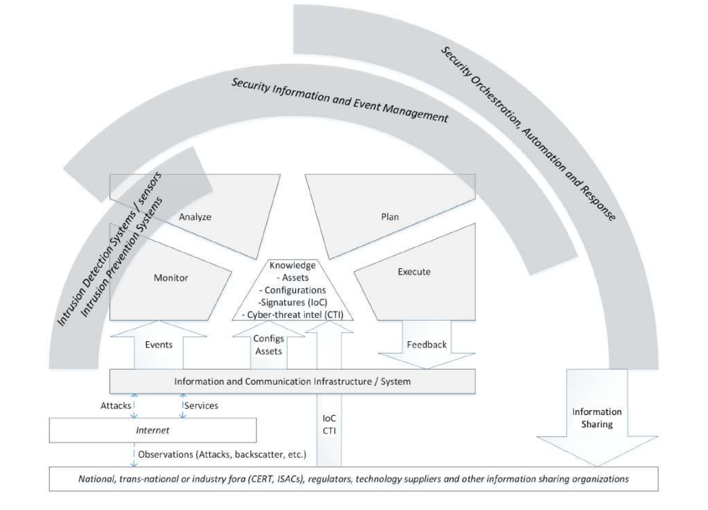
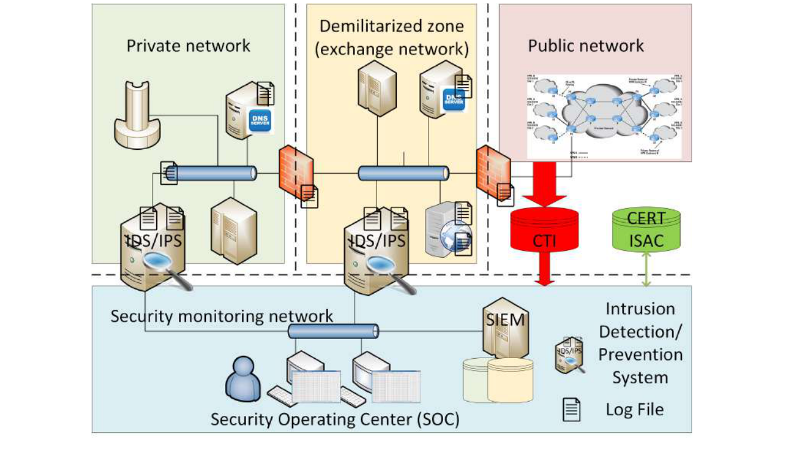
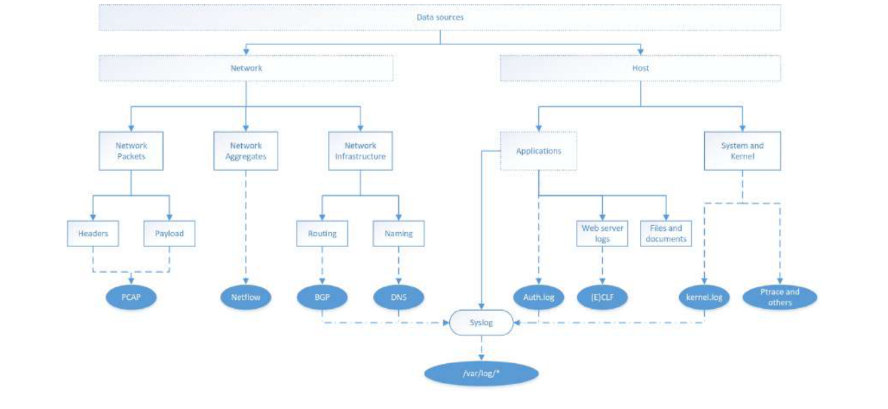
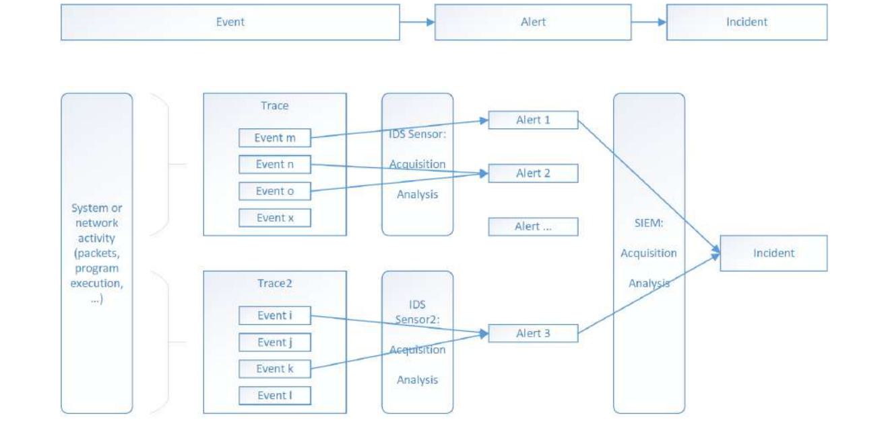
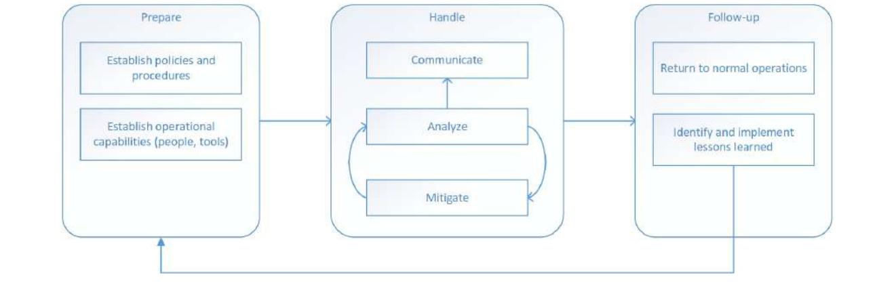

# Chapter 8: Security Operations & Incident Management

**Authors:** Hervé Debar (Telecom SudParis)

::: info About this page
This chapter is from [CyBOK Version 1.2.0](https://www.cybok.org/), © Crown Copyright, The National
Cyber Security Centre 2026, licensed under the
[Open Government Licence](https://www.nationalarchives.gov.uk/doc/open-government-licence/).
It was converted from the [PDF](https://www.cybok.org/wp-content/uploads/CyBOK_v1.2.0.pdf) into
a web page so that it works with screen readers and other assistive technology. Each
abbreviation is spelled out in square brackets the first time it appears, and those meanings are
ours, not the book's. So are the names of links the book prints as a bare web address. The PDF
(Portable Document Format) is the original, so if the two disagree, the PDF wins.
:::

## Introduction

The roots of Security Operations and Incident Management (SOIM) can be traced to the original report by James Anderson \[<a href="#ref-828" aria-label="Reference 828">828</a>\] in 1981. This report theorises that full protection of the information and communication infrastructure is impossible. From a technical perspective, it would require complete and ubiquitous control and certification, which would block or limit usefulness and usability. From an economic perspective, the cost of protection measures and the loss related to limited use effectively require an equilibrium between openness and protection, generally in favour of openness. From there on, the report promotes the use of detection techniques to complement protection. The next ten years saw the development of the original theory of intrusion detection by Denning \[<a href="#ref-829" aria-label="Reference 829">829</a>\], which still forms the theoretical basis of most of the work detailed in this KA \[Knowledge Area\].

Security Operations and Incident Management can be seen as an application and automation of the *Monitor Analyze Plan Execute-Knowledge* (MAPE-K) autonomic computing loop to cybersecurity \[<a href="#ref-830" aria-label="Reference 830">830</a>\], even if this loop was defined later than the initial developments of SOIM. Autonomic computing aims to adapt ICT \[Information and Communication Technologies\] systems to changing operating conditions. The loop, described in figure 8.1, is driven by events that provide information about the current behaviour of the system. The various sequential steps of the loop analyse the event stream (trace) to provide *feedback* to the system, changing its behaviour according to observations and policies, enabling automatic adaptation to best provide service for users. The developments of SOIM have increased in automation and complexity over the years, as a result of our increasing reliance on the proper service delivery of the ICT infrastructure. These developments have slowly covered most of the spectrum of the MAPE-K loop.

After nearly 40 years of research and development, the Security Operations and Incident Management domain has reached a sufficient maturity to be deployed in many environments. While early adopters were mainly located in ICT-intensive sectors such as telecoms and banking, it is finding its place in sectors that are increasingly embracing or converting to digital technologies. Yet, research is still very active in addressing the many remaining challenges. With respect to detection, new emerging environments driven by new technologies and services are requiring the acquisition and analysis of new data streams. The tools, techniques and processes available today for detecting and mitigating threats also regularly fail to prevent successful attackers from penetrating and compromising ICT infrastructures, without regular users noticing. Extremely large-scale events also occur at regular intervals, and there is a definite need for progress in terms of reaction to attacks.

The Security Operations and Incident Management knowledge area description starts by introducing some of the vocabulary, processes and architecture in section 8.1. It then follows the loop concepts, discussing detection at the sensor level, both looking at data sources (*Monitor*, section 8.2) and detection algorithms (*Analyze*, section 8.3). It then discusses Security Information and Event Management, instantiating *Analyze* from a more global perspective than sensors, *Plan* in section 8.4 and examples of *Execute*. Using the *Security Orchestration, Automation and Response* (SOAR) concept, it further develops the modern aspects of the *Plan* and *Execute* activities in section 8.5. Of course, all these activities are built upon a *Knowledge* base. Several knowledge components are described in section 8.6. The KA concludes with human factors in section 8.7.

## Content

## 8.1 Fundamental concepts {#_8-1-fundamental-concepts}

\[<a href="#ref-829" aria-label="Reference 829">829</a>, <a href="#ref-831" aria-label="Reference 831">831</a>\]

The SOIM domain assumes that the workflow of the MAPE-K loop is implemented in technical components, deployed in an ICT infrastructure. Section 8.1.1 establishes a few fundamental vocabulary references in the SOIM domain, and section 8.1.2 describes the deployment of these concepts in a generic ICT infrastructure.

### 8.1.1 Workflows and vocabulary

[Figure 8.1](#figure-8-1) adapts the generic MAPE-K loop to SOIM. In addition to the ICT system being protected and monitored to detect attacks, two major actors influence the evolution of the loop; the Internet as a whole and the regulatory context in which the ICT system provides services. The Internet is the source of both service requests and threats, but also of intelligence about these threats. Regulatory bodies such as national agencies, and industry bodies provide additional threat and detection information and request information sharing.

<figure id="figure-8-1">

{width=659 height=474}

<figcaption>

Figure 8.1: MAPE-K Autonomic computing loop instantiated to SOIM

</figcaption>
</figure>

::: details Text description of Figure 8.1

A layout diagram. Five loop stages sit in the middle, three curved bands arch over them, and boxes and arrows below connect the loop to the system, the Internet and information sharing organisations.

**Loop stages.** Monitor, Analyze, Plan and Execute are arranged as a loop in that order (Monitor at lower left, Analyze at upper left, Plan at upper right, Execute at lower right). Below them, a central box labelled Knowledge sits between Monitor and Execute and lists:

- Assets
- Configurations
- Signatures (IoC)
- Cyber-threat intel (CTI)

**Curved bands over the loop**, from inner to outer:

- "Intrusion Detection Systems / sensors" and "Intrusion Prevention Systems" (a short band covering Monitor and part of Analyze).
- "Security Information and Event Management" (a wider band covering Analyze and Plan).
- "Security Orchestration, Automation and Response" (the outermost band, covering Plan and Execute and reaching down the right side).

**Flows below the loop.** A wide box reads "Information and Communication Infrastructure / System".

- An upward arrow labelled "Events" goes from the Information and Communication Infrastructure / System box to Monitor.
- An upward arrow labelled "Configs Assets" goes from that box to Knowledge.
- A downward arrow labelled "Feedback" goes from Execute to that box.
- Two-way thin arrows connect that box to a box labelled "Internet" (in italics). The arrow labelled "Attacks" points from the Internet to the system, and the one labelled "Services" points from the system to the Internet.
- A dashed arrow labelled "Observations (Attacks, backscatter, etc.)" goes from the Internet down to the bottom box.
- The bottom box reads, in italics, "National, trans-national or industry fora (CERT, ISACs \[Information Sharing and Analysis Center\]), regulators, technology suppliers and other information sharing organizations".
- An upward arrow labelled "IoC CTI" goes from that bottom box to Knowledge, passing behind the system box.
- A large downward arrow labelled "Information Sharing" goes from the Security Orchestration, Automation and Response band to the bottom box.

:::

[Figure 8.1](#figure-8-1) illustrates the positions of the components that carry out the SOIM workflows, using three partial loops. The innermost one, *Intrusion Detection Systems* (IDS), was the subject of the earliest work, covering monitoring and detection. The second one, *Security Information and Event Management* (SIEM) platforms, extended detection and started covering response planning and execution. More recently, *Security Orchestration, Automation and Response* (SOAR) platforms have driven further analytics and responses, enabling more advanced and global responses to cyberthreats. The knowledge base used in SOIM has gradually expanded over the years, as more intelligence has become necessary to detect and mitigate attacks. The key difference between knowledge and events is time. Events are produced and consumed, while knowledge is more stable.

The *Monitor* activity is essentially covered by IDSes. The various data sources included within the scope of monitoring are described in section 8.2.

The *Analyse* activity, also covered by IDSes, aims to determine whether some of the information acquired constitutes evidence of a potential attack. From 1990 to 2000, many research projects developed advanced Intrusion Detection System prototypes. As a result, the first network-based IDS was commercialised in 1996, automating the first part of the MAPE-K loop. However, section 8.3 illustrates that the constraints associated with real-time event processing and limited coverage require additional tools. This is the objective of the second loop, SIEM platforms.

Technology has evolved to a point where IDSes have been transformed into Intrusion Prevention Systems (IDPS) \[<a href="#ref-832" aria-label="Reference 832">832</a>\]. This is elaborated further in section 8.5.1. The text of the KA will use IDPS from now on, except when the concept is focusing on detection, where IDS will remain.

*Plan* activity is essentially the realm of SIEM platforms. The deployment of these IDS sensors created the need to manage operationally large volumes of alerts, which led to the development of these SIEM platforms. They provide both additional analysis and initial planning to respond to attacks. These large-scale, complex and expensive platforms are now consolidated in the *Security Operating Center* (SOC), providing both technological and human resources. We are now deploying the second generation of these SIEM platforms to accommodate increasingly large volumes of diverse data, and to provide additional processing capabilities.

*Execute* activity started being implemented in SIEM platforms mostly through manual processes. Security orchestrators or dedicated components are now enabling partial automation of feedback to the ICT infrastructure, although this activity is less mature than the others.

The first three (*Monitor*, *Analyse*, *Plan*) activities are now fully or partially automated. Automation is absolutely necessary to handle the huge amounts of event data generated by modern ICT systems, and to describe the huge body of knowledge related to cyberattacks. They all rely on a large body of knowledge, covering, for example, the configuration of a monitored system, or detection signatures of many types and forms. New trends are also emerging, for example, *Cyber-Threat Intelligence* (CTI) (section 8.6.3), to better understand and defend against cyberattacks. This is the topic of *Security Orchestration, Automation and Response* (SOAR), which aims to support better responses to threat, as well as more global information exchange. The SOAR acronym describes an increasingly required set of functionalities extending SOIM coverage for risk and incident management.

### 8.1.2 Architectural principles

Cybersecurity does not function in a vacuum. The Security Operations and Incident Management domain assumes that there is an ICT system to be protected. Thus, an SOIM deployment assumes a few general architectural principles on which tools and processes can be deployed. These concepts are described in figure 8.2.

<figure id="figure-8-2">

{width=659 height=382}

<figcaption>

Figure 8.2: Simplified deployment of SOIM technologies in an ICT infrastructure

</figcaption>
</figure>

::: details Text description of Figure 8.2

A deployment diagram with four labelled zones. Three zones sit side by side on top, separated by dashed vertical lines, and a fourth wide zone lies below them, separated by a dashed horizontal line. The abbreviation SOIM (security operations and incident management) is from the caption. Two firewalls and several network buses connect the top zones.

**Private network** (left zone): a server with a DNS \[Domain Name System\] SERVER badge and a document icon, a tall pillar-shaped device, a second server, and a network bus. An IDS/IPS (intrusion detection/prevention system) sensor with two log file icons sits on the boundary with the security monitoring network, below the bus.

**Demilitarized zone (exchange network)** (middle zone): two servers (one with a DNS SERVER badge and a document icon), a web server icon with log file icons, a network bus, and an IDS/IPS sensor on the boundary with the security monitoring network. A firewall joins the private network's bus to the demilitarized zone's bus.

**Public network** (right zone): a picture of a wide area network cloud with routers and links. A second firewall joins the demilitarized zone's bus to the public network.

**Between the zones and the monitoring network** (right side): a red cylinder labelled "CTI" (cyber-threat intelligence) receives a thick red arrow from the public network and passes a thick red arrow down into the security monitoring network. A green cylinder labelled "CERT ISAC" has a two-way green arrow to the security monitoring network.

**Security monitoring network** (bottom zone, labelled "Security monitoring network"): a network bus connects the two IDS/IPS sensors above to a "Security Operating Center (SOC)", drawn as a person at two workstations, and to a server labelled "SIEM" (security information and event management) with two database cylinders.

**Legend** (bottom right): the small sensor icon is "Intrusion Detection/ Prevention System" and the small document icon is "Log File".

:::

An Information System, connected (or not) to the Internet, is subject to attacks. Not all these attacks can be blocked by protection mechanisms such as firewalls. Best practices recommend defining zones of different sensitivities, to control the data exchange. This frequently and minimally takes the form of a Demilitarised Zone (DMZ) located between the inside private network and the outside Internet, to serve as communication termination, exchange and increased scrutiny through monitoring. To detect threats that are not blocked by protection mechanisms, operators deploy Intrusion Prevention Systems (IDPS). IDPS sensors can use system (section 8.2.5 ) or application log files (section 8.2.4), depicted as pages in figure 2. They can also be deployed at the network level (section 8.2.1), depicted as the two larger pieces of equipment with magnifiers.

The SOIM infrastructure is shown at the bottom of figure 8.2. The sensors often have at least two network attachments, an invisible one in the monitored Information System network for collecting and analysing data, and a regular one in a protected specific SOIM network infrastructure, where the SIEM is installed and receives the alerts. Analysts monitor consoles to receive alerts, assess their impact and deploy the appropriate mitigation actions. Sensor management might either use this secondary network attachement as a maintenance channel for software and signature updates, or use yet another mechanism such as a virtual private network to carry out the sensor maintenance.

The SOIM domain also implies processes, which are defined by the Chief Information Security Officer and followed by analysts. The first process is related to alert processing, where the operator, with the help of decision support techniques provided by the SIEM, will decide to ignore the alert, react to it following procedures, or escalate the alert to skilled analysts for further analysis, diagnosis and decision. The second process is the deployment and maintenance of sensors, deciding on where to locate them, what to capture and how to maintain continuous monitoring. The third process is reporting, particularly crucial for managed services, where the functioning of the SIEM and SOC are analysed for improvement.

The Security Orchestration, Automation and Response components are included through the *Cyber-Threat Intelligence* (CTI, red) and *Information Sharing and Analysis Center* (ISAC, green) disks, representing the added benefit for the management platform to obtain information from external, relevant sources and to leverage this information to increase their detection efficiency (section 8.3) and impact assessment (section 8.5). While both interfaces provide information to a SOC, this information is of a fundamentally different nature. CERT and ISAC entities are trusted organisations, sometimes enabling sectoral information exchange, often established and governed by regulations. CTI is a much more fuzzy area, including open source intelligence as well as dedicated information feeds provided by commercial companies.

## 8.2 Monitor: data sources {#_8-2-monitor-data-sources}

\[<a href="#ref-829" aria-label="Reference 829">829</a>, <a href="#ref-833" aria-label="Reference 833">833</a>\]

The detection issue is relatively simple; from a continuous stream of data, the objective is to detect localised attempts to compromise ICT infrastructures in real time. This is achieved first by collecting information about the operation of these ICT infrastructures from traces with many different origins.

<figure id="figure-8-3">

{width=659 height=303}

<figcaption>

Figure 8.3: Data sources landscape

</figcaption>
</figure>

::: details Text description of Figure 8.3

A tree diagram. Solid arrows run from parents to children. Dashed arrows run from a source to the data format it produces. Dash-dotted arrows lead into Syslog.

**Solid tree:**

- Data sources
  - Network
    - Network Packets
      - Headers
      - Payload
    - Network Aggregates
    - Network Infrastructure
      - Routing
      - Naming
  - Host
    - Applications
      - Web server logs
      - Files and documents
    - System and Kernel

**Dashed links to data formats** (shown as ovals):

- Headers and Payload both lead to PCAP.
- Network Aggregates leads to Netflow.
- Routing leads to BGP \[Border Gateway Protocol\].
- Naming leads to DNS.
- Applications leads to Auth.log (a dashed link from the Applications branch).
- Web server logs leads to (E)CLF \[Common Log Format\].
- System and Kernel leads to kernel.log and to "Ptrace and others".

**Syslog.** A solid arrow from Applications leads directly to a rounded box labelled "Syslog". Dash-dotted arrows lead into Syslog from BGP, DNS, Auth.log and kernel.log. A dashed arrow leads from Syslog to an oval labelled "/var/log/*".

:::

[Figure 8.3](#figure-8-3) provides a simplified conceptual view of possible data sources. The rectangles describe concepts. The ovals describe concrete implementations of these data sources. The rounded rectangles describe an actual format, syslog, documented and standardised, which plays a specific role. Since it is a standardised protocol and format, it also supports log feeds provided by networking equipment, operating systems and applications.

[Figure 8.3](#figure-8-3) is by no means complete. Many data sources have been considered over the years, depending on the requirements of the use case and the detection algorithms.

Data sources broadly describe either host behaviours reporting on operating systems or applications, or network behaviours reporting communication patterns.

Data sources are event streams, traces of activity that represent the services accessed by the users of an Information System. Data sources are inputs to sensors, which produce alerts as outputs. Alerts represent information of interest from a security perspective. In the general case, an event or a stream of events, acquired by a sensor, generates an alert that synthesises the security issue found by the sensor. Alerts are covered in section 8.4.1.

The move to external resources such as cloud providers or Internet Service Providers may limit the availability of some of the data sources, for practical reasons such as volume, or due to privacy constraints and entanglement of multiple customer data in the same trace. It is also possible that traces from hosted environments might be compromised or be made available without the knowledge or authorisation of the customer.

### 8.2.1 Network traffic

Network data have become the de-facto standard for collecting input data for intrusion detection purposes, because of the overall reliance on networks and the ease of use of standard formats. While the capture of packets is the most prevalent format, the scientific literature has also used other information sources for security. Network information is sometimes not available internally and it may be necessary to rely on Internet Service Providers, for example, to identify attackers’ addresses and routes.

The most prevalent type of network traffic data is the full packet capture, exemplified by the libpcap library and the tcpdump and wireshark applications. The pcap library has been ported to many environments, and is widely available as open source, hence its success. Numerous datasets have been made available or exchanged privately as pcaps, for almost as long as intrusion detection research has existed and needs to be evaluated. While packet capture is widely used, it does not mean that this information is stored in sensors. Storing pcaps require an enormous amount of storage, hence pcap files are often reserved for research datasets or forensics purposes. Network-based sensors may offer the capability to store a few packets along with an alert when a detection occurs, generally the packet that triggered the detection and a few ones belonging to the same context (TCP, etc.) that appeared quickly afterwards. This capability is generally limited to misuse detection.

The pcap library requires the availability of a network interface that can be placed in so-called *promiscuous* mode, meaning that the interface will retrieve all packets from the network, even the ones that are not addressed to it. Also, there is no need to bind an IP \[Internet Protocol\] address to the network interface to capture traffic. In fact, this is a recommended practice, to avoid interference. This means that, in general, packet capture can occur silently and is undetectable. Despite its popularity, there are a few issues with the pcap format that need to be considered when manipulating it.

**Volume** Pcap files tend to be extremely large for any practical operational use. This often limits capture to the investigation. Sensors generally analyse network traffic on the fly but do not record actual packets.

**Packet size** The default configuration of the library acquires only the beginning (headers) of an IP packet. This means that a packet trace might be limited to only header information. An incomplete or missing packet payload strongly limits detection.

**Segmentation and fragmentation** Information circulated on the network is recorded on a per-packet basis. This implies that the receiving software must reconstruct the application-level data stream. Beginnings or ends of communications might be missing.

**Timestamps** Network packet headers do not include any timestamp. This is added by the capturing software and relies on an external clock.

**MAC \[Media Access Control\] layer interpretation** Capturing the MAC layer is possible, but requires a specific configuration. Interpreting of MAC layer information requires knowledge of the configuration of the network segment to which the collection network interface is attached. Capturing the MAC layer is required in order to detect attacks such as ARP \[Address Resolution Protocol\] poisoning. For certain types of industrial control networks which run directly on top of the Ethernet layer, capturing traffic requires adding a node and may break real-time assumptions.

**Application layer interpretation** The most crucial aspect of pcap analysis for cybersecurity is analysing the application layer. IP packets are relatively autonomous bits of data. Reliable transports, such as TCP, have inherent dynamics that need to be taken into account when analysing the data, such as the existence of a connection or not. At the application layer, inside the TCP/IP payload, information might be inconsistent with the headers, or require an understanding of application logic, which is often hard to acquire, understand and reproduce.

**Encryption** Encrypted traffic, and particularly TLS \[Transport Layer Security\], is widespread. TLS ensures both the authentication of the server to the client, and the confidentiality of the exchange over the network. For monitoring, the issue is the second aspect, the impossibility to analyse the payload of packets. The classic approach to this problem is to put an additional dedicated box close to the application server (web, mail, etc.), often named the *Hardware Security Module* (HSM). The HSM is responsible for establishing the TLS session before the application server provides any content. This moves the load of establishing the TLS session outside of the application server. TLS-protected traffic is encrypted and decrypted at the HSM, and flows in clear to the server. This enables network-based IDPSes and WAFs \[Web Application Firewall\] to analyse the traffic.

Due to changing requirements, new network protocols have been introduced to support the Internet of Things (IoT). Low-power communication protocols such as LORA \[Long Range\] have limitations in both packet size and the number of the packets that can be transmitted per day. These communication protocols are used mostly today as data harvesting on a large scale. Thus, IDPSes will need information about the context of the communication to provide useful detection. Isosynchronous protocols in use such as PROfiNET IRT \[isochronous real-time\] have stringent requirements in terms of communication cycle time and determinism. These protocols are typically used in manufacturing environments. As they mostly rely on hubs for communication, inserting a network-based sensor may seem easy. However, the strict timing requirements of such protocols require careful validation that the IDPS does not alter these requirements. Also, this necessitates the deployment of a second communication channel for the IDPS to send alerts to a SIEM, which may be costly, technically difficult and may introduce additional vulnerabilities to the system.

### 8.2.2 Network aggregates: Netflow

The sheer size of packet captures has created the need to obtain a synthetic view of network activity. This has created the need for a synthetic aggregated view of traffic at a relatively low layer. Network aggregates are mechanisms for counting packets sharing certain characteristics, such as source, destination, protocol or interface. These counts are performed by network equipment as packets cross their interfaces.

Netflow \[<a href="#ref-834" aria-label="Reference 834">834</a>, <a href="#ref-835" aria-label="Reference 835">835</a>\] is a widely used network monitoring tool used for detecting and visualising security incidents in networks \[<a href="#ref-836" aria-label="Reference 836">836</a>, <a href="#ref-837" aria-label="Reference 837">837</a>\]. In brief, this protocol records counters of packet headers flowing through router network interfaces. Initially developed by Cisco, it has been standardised as IPFix, RFC \[Request For Comments\] 7011.

As Netflow was developed by network equipment providers, it is extremely well integrated in networks, and widely used for network management tasks. It is standardised, and even though the commercial names differ, similar information is collected by the manufacturers supporting the technology. Its strongest uses are certainly visualising network communications and relationships, \[<a href="#ref-836" aria-label="Reference 836">836</a>\] and highlighting communication patterns. Visual analytics provide a user-friendly way of understanding anomalies and their impact. Hence, Netflow is also widely used for cybersecurity tasks.

Netflow, however, may suffer from performance degradation, both in terms of computation and storage. Handling packets to compute Netflow counters requires access to routers CPU (central or on interface boards). This significantly reduces the performance of network equipment. Newer routers are now able to generate netflow records at the hardware layer, thus limiting the performance impact. Another alternative is to span or tap a network interface and to generate the netflow records independentely of the routing equipment.

Originally, to limit the CPU performance impact, operators often deploy Netflow in sampling mode, where only one in every several thousand packets is analysed. Thus, the view recorded by Netflow might be extremely limited and may completely miss events that do not reach the scale of the sampling. Except for large-scale Denial of Service events, it is thus difficult to rely on sampled Netflow alone for security.

### 8.2.3 Network infrastructure information

The networking infrastructure relies on many protocols for proper communication. Two of its main components, the naming and the routing infrastructure, are also of significant interest for both attacks and detection. Reporting on routing or naming operations requires direct access to a view of the infrastructure. Operators who participate in routing and naming usually rely on syslog to collect information.

**8.2.3.1 Naming**

The *Domain Name System* (DNS) is one of the most crucial services on the Internet. It resolves domain names, meaningful bits of text, to IP addresses required for network communications but which are difficult to remember. In addition, naming is required for the *Transport Layer Security* (TLS, RFC 8446) protocol and certain HTTP \[Hypertext Transfer Protocol\] mechanisms such as virtual hosting.

Despite its importance, DNS has been the subject of many vulnerabilities and attacks. The main problem with DNS is its lack of authentication in its basic form. An attacker can thus steal a domain through fake DNS messages or responses. The deployment of DNSSEC \[DNS Security Extensions\] offers an authenticated response to DNS queries that will provide users with evidence of domain name ownership.

The DNS protocol is also a natural DDoS \[Distributed Denial of Service\] amplifier, as it is possible for an attacker to mimic the IP address of a victim in a DNS request, thus causing the DNS server to send unsolicited traffic to the victim \[<a href="#ref-838" aria-label="Reference 838">838</a>, <a href="#ref-839" aria-label="Reference 839">839</a>\]. Unfortunately, the current move to DNSSEC is unlikely to be able to help \[<a href="#ref-840" aria-label="Reference 840">840</a>, <a href="#ref-841" aria-label="Reference 841">841</a>\].

Another issue related to DNS is the detection of botnet activity. Once a malware has infected a computer, it needs to communicate with the C&C \[Command and Control\] server to receive orders and carry out the requested activity. While it is not the only C&C communication channel used by bot herders, DNS is attractive as a communication channel for attackers because it is one of the few protocols that is highly likely to go through firewalls, and whose payload will be unaltered. In order for this to work, attackers need to set up, and defenders need to detect malicious domains \[<a href="#ref-842" aria-label="Reference 842">842</a>\]. The most common defence mechanism is DNS domain name blacklists, but its efficiency is hard to evaluate \[<a href="#ref-843" aria-label="Reference 843">843</a>\]. This blacklist defence mechanism can also be extended to other C&C channels.

Note that DNS is not the only protocol to be prone to DDoS amplification attacks. NTP \[Network Time Protocol\] is also a frequent culprit \[<a href="#ref-844" aria-label="Reference 844">844</a>\]. More information about DDoS attacks can be found in \[<a href="#ref-845" aria-label="Reference 845">845</a>\].

**8.2.3.2 Routing**

Another related source of information for attacks is routing information. Incidents in the border gateway protocol routing infrastructure have been studied for some time \[<a href="#ref-846" aria-label="Reference 846">846</a>, <a href="#ref-847" aria-label="Reference 847">847</a>\], but many of the recorded incidents are due to human error. There are recorded instances of malicious BGP hijacks \[<a href="#ref-848" aria-label="Reference 848">848</a>, <a href="#ref-849" aria-label="Reference 849">849</a>\], but the effort required by attackers to carry out these attacks seems, at this point in time, not be worth the gain.

### 8.2.4 Application logs: web server logs and files

Higher up the computing stack, application logs provide an event stream that documents the activity of a specific application. The main advantage of application logs over system logs is their similarity to reality and the precision and accuracy of the information proposed. These logs were initially created for debugging and system management purposes, so they are textual and intelligible.

Applications can share log files through the syslog infrastructure (section 8.2.6). For example, the *auth.log* log file will store user connection information regardless of the mechanism used (pam, ssh, etc.).

**8.2.4.1 Web server logs**

A frequent source of information is provided by web server and proxy logs, known as the *Common Log Format* (CLF) and *Extended Common Log Format* (ECLF). This format is a de-facto standard provided by the Apache web server and others. While it is very similar to Syslog, there are no standards documents normalising the format. At this stage, the W3C \[World Wide Web Consortium\] standard for logging remains a draft document. This format is extremely simple and easy to read. It provides information about the request (the resource that the client is trying to obtain) and the response of the server, as a code. Thus, it has been widely used in Intrusion Detection Systems over the years. The main issue with the format is the lack of information about the server, since the log file is local to the machine generating the log.

As server logs are written once the request has been served by the server, the attack has already occurred when the sensor receives the log information. Thus, this information source does not satisfy the requirements of *Intrusion Detection and Prevention System*s (IDPS), which need to be hooked as interceptors to act on the data stream (packet stream, instruction stream), to block the request or modify its content.

**8.2.4.2 Files and documents**

Another source of application-level information that is particularly interesting and can be found both in transit (in networks) or at rest (in systems) comprises the documents produced by some of these applications. The introduction of rich document formats such as PDF \[Portable Document Format\], Flash or office suites, not to mention the rich HTML \[Hypertext Markup Language\] format used in mail exchanges today, has created a wealth of opportunity for attackers to include malware. Exchanged over the web or via email, they constitute another trace of exchange that can reveal malicious code embedded in these documents, such as macros or javascript.

Parsing information in documents, both simple ones such as TLS certificates or complex ones such as PDF, is complex and provides attackers with a wealth of opportunity to create different interpretations of the same document, leading to vulnerabilities and malware. At the same time, it should be acknowledged that the rich document formats are here to stay and that rich (and thus complex) specifications such as HTML5 \[HyperText Markup Language 5\] need to be well written so that they can be unambiguously interpreted, thus leaving less room for attackers in the specification itself.

Using documents as a data source is increasingly required for malware detection.

### 8.2.5 System and kernel logs

The earliest ‘intrusion detection’ paper by Denning \[<a href="#ref-829" aria-label="Reference 829">829</a>\] already included in the model the generation of an audit trail by the system being monitored. Operating systems generally provide logs for debugging and accounting purposes. These logs were exploited in early designs such as Haystack. However, Denning has already stated that most system logs are insufficient for intrusion detection, as they lack the required precision. For example, the Unix accounting system records only the first eight characters, without a path, of any command launched by a user. This makes it impossible to differentiate commands with identical names at different locations, or long command names.

Another trend pursued by intrusion detection researchers and operating system designers was the creation of a specific audit trail to generate a trace of privileged user activity, as required by the *Orange Book*. This led to the development of more precise host-based IDS such as STIDE \[Sequence Time-Delay Embedding\] and eXpert-BSM. These specific system traces are acquired through the interception of system calls, which represent the transition between regular program execution and request to protected kernel resources. This is typically implemented using a dedicated audit trail, as specified in the *Orange book*, or kernel/processor debugging accesses such as ptrace for Linux. However, the complexity of the specification led to divergences in the implementation of the audit trail by the different operating system vendors. It also imposed such a performance penalty to program execution that it became impossible to operate ICT systems with the audit trail being activated. It therefore became of little use and was quietly removed from most operating systems. This factor has prevented the emergence of a standard system audit trail, even in certified operating systems.

Kernel logs now focus on monitoring the internal operations of an operating system, close to the hardware. They have also greatly diversified, targeting a broad range of devices. They have been integrated in the commercial world under the term ‘endpoint protection’, which has become a generalised term for antivirus engines. This addresses the general problem of protecting not only the system but also the applications, such as the browser or the mail client, which not only exchange data but also execute untrusted code provided by external sources. They rely on dedicated interceptors that capture only the activity that they are interested in analysing. This solves the main issue of this data source, a very fine granularity that ensures everything is captured, but makes analysis and detection very difficult, as it is hard to link the assembly code being executed on the processor with programs and information that a user or analyst can easily understand and react to. Malware is the subject of the Malware & Attack Technologies Knowledge Area (Chapter 6), and in the context of SOIM malware detection engines and endpoint protection tools are considered sensors.

Other logs provide higher level information, such as a report of the boot process on Unix machines, or on the main kernel activity. These logs often rely on a Syslog infrastructure, as described in section 8.2.6.

### 8.2.6 Syslog

As already mentioned in this section several times, Syslog provides a generic logging infrastructure that constitutes an extremely efficient data source for many uses.

The initial source for these logs is the Syslog protocol, introduced in BSD \[Berkeley Software Distribution\] Unix, retro-specified from existing implementations by RFC 3164.The current specification of Syslog is provided by RFC 5424.This new specification introduces several improvements over the original implementation.

A Syslog entry is a timestamped text message coming from an identified source. It contains the following information in this order:

**Timestamp** The date and time of the event creation, usually in text format with a resolution up to the second.

**Hostname** The name of the equipment generating the log. It might be a fully qualified name or an IP address, or the *localhost* for the local machine. Using IP addresses in private ranges or localhost may induce errors when consolidating logs.

**Process** The name of the process (program) generating the log.

**Priority** The priority (category and severity, computed according to a standard formula) of the log. In practice, it is often summed up according to severity on a scale of 0 (system panic and crash) to 7 (debugging information).

**PID \[process identifier\]** The process ID \[identifier\] of the process generating the log.

**Message** An ASCII \[American Standard Code for Information Interchange\] 7-bit message qualifying the information, provided by the developer of the application.

Syslog also uses the notion of facility to categorise and orient logs. This information is aggregated in different files, usually in the `/var/log/` directory in Unix systems.

Syslog is also a protocol, running on UDP/513. This facilitates transmission, as UDP \[User Datagram Protocol\] can be resilient to difficult network conditions and lose a few messages without losing the capability. However, using UDP often requires the segmentation to be limited, thus a suggested limit of a Syslog message’s size is often around a thousand bytes. Many systems include a standard programming interface to implement calls to Syslog in applications.

As a text message, Syslog is extremely useful. Many, if not most, heavy SOC implementations rely on Syslog to centralise both events and alerts. This use of Syslog is covered in section 8.4.1.

## 8.3 Analyse: analysis methods

\[<a href="#ref-829" aria-label="Reference 829">829</a>, <a href="#ref-831" aria-label="Reference 831">831</a>, <a href="#ref-833" aria-label="Reference 833">833</a>, <a href="#ref-850" aria-label="Reference 850">850</a>\]

Collected traces are analysed according to different strategies that aim to separate ‘good’ events from those that indicate attacks. The fundamental work of Denning \[<a href="#ref-829" aria-label="Reference 829">829</a>\] already defined the two families of data analysis techniques that have been researched, developed and commercialised over the years. Misuse detection, detailed first, aims to characterise malicious behaviours present in the traces in order to send an alert when the set of malicious behaviour events is recognised in the traces. Conversely, anomaly detection aims to characterise ‘normal’ behaviour, and sends an alert when events in traces are not associated with normal behaviours. In both cases, a large number of algorithms have been described in the scientific literature. A few of these algorithms have been applied both to misuse and anomaly detection.

In SOIM processes, and as shown in figure 8.1, analysis is performed by two components, the sensors and the SIEM platform. [Figure 8.4](#figure-8-4) refines this process. The monitored Information System generates traces representative of activity, as log files or through dedicated IDPS appliances or software (shown as looking-glass-boxes and files in figure 8.2). One or several events in each trace may trigger the generation of an alert by a sensor. Several of these alerts, possibly coming from several sensors, may be assembled by the SIEM in incidents that need to be handled by operators.

In this section, the KA addresses the transformation of events in alerts, that may characterise malicious activity. In section 8.4, the KA addresses the transformation of alerts in incidents.

<figure id="figure-8-4">

{width=659 height=326}

<figcaption>

Figure 8.4: Analysis: from event to alert to incident

</figcaption>
</figure>

::: details Text description of Figure 8.4

A flow diagram in two parts.

**Top strip.** Three boxes in a row, joined by arrows left to right: Event, then Alert, then Incident.

**Main diagram**, read left to right:

- A tall box reads "System or network activity (packets, program execution, ...)". Two brackets lead from it to two traces.
- Box "Trace" holds Event m, Event n, Event o and Event x. Box "Trace2" holds Event i, Event j, Event k and Event l.
- A box "IDS Sensor: Acquisition Analysis" reads from Trace. A box "IDS Sensor2: Acquisition Analysis" reads from Trace2.
- Event m leads to Alert 1. Event n and Event o both lead to Alert 2. A further box reads "Alert ..." with no arrows. Event i and Event k both lead to Alert 3. (Events x, j and l have no arrows.)
- A tall box "SIEM: Acquisition Analysis" combines the alerts. Alert 1 and Alert 3 each have an arrow to a box labelled "Incident" at the far right. Alert 2 has no arrow to the Incident.

:::

### 8.3.1 Misuse detection {#_8-3-1-misuse-detection}

Misuse detection leverages the vast body of knowledge characterising malicious code and the vulnerabilities that this malicious code exploits. Software vulnerabilities, particularly in the Common Vulnerabilities and Exposures (CVE) nomenclature, are particularly relevant for this approach, but misuse detection has a broader reach. A misuse Intrusion Detection System seeks evidence of known malicious events in the trace, and alerts when they are found, informing the analyst about the specifics of the vulnerability exploited and its impact.

The earliest Intrusion Prevention Systems in this area are antivirus engines, which capture execution traces such as system calls, library calls or assembly, identify known malicious patterns using so-called *signatures* that describe these malicious codes, and quarantine the associated container. The IDPS thus seeks exploits, very specific instances of malicious codes represented as bitstrings.

Modern malicious code has evolved complex mechanisms to avoid detection, and modern anti-malware tools have become extremely complex in response, in order to create more efficient representations of exploits and vulnerabilities. More recently, researchers have proposed more generic signatures, to attempt to capture malicious behaviour more generally \[<a href="#ref-833" aria-label="Reference 833">833</a>\]. Also, the emergence of sandboxes and tainting \[<a href="#ref-851" aria-label="Reference 851">851</a>, <a href="#ref-852" aria-label="Reference 852">852</a>\] has enabled newer detection and protection methods that can detect malware despite obfuscation and polymorphism. The risks of generic signatures are, of course increased false positives and increased difficulty in understanding the precise attack.

Another branch of system analysis is UNIX system analysis, exemplified by the Haystack and NIDES \[Next-generation Intrusion Detection Expert System\] prototypes. These prototypes aimed to create high-level audit trails for analysis. The canonisation aspect of the data had a significant impact on detection performance, and the current state of the art is focusing on assembly and binary language analysis for detection.

From a network perspective, an IDPS seeks evidence of malicious activity in multiple forms. The malicious code can be found in the packets’ payloads. Malicious code can also exhibit specific network activity related to command and control, access to known addresses or to known services. The best known network-based misuse Intrusion Detection System is probably Snort \[<a href="#ref-853" aria-label="Reference 853">853</a>\]. Snort’s signature language is simple and was a de-facto standard for describing attack patterns, before being superseded by YARA. The initial version relied only on string matching, which made it sensitive to false positives \[<a href="#ref-854" aria-label="Reference 854">854</a>\]. The Suricata IDS, using the same signature language but newer implementation technologies \[<a href="#ref-855" aria-label="Reference 855">855</a>\], is also being used in research and operations.

The key advantage of misuse detection is the ability to document the cause of the alert, from a security perspective. This helps the analyst decide how to further process the alert, particularly its relevance and its impact on the monitored system. The key difficulty of misuse detection is the process of creating signatures, which requires time, expertise and access to the proper vulnerability information. Frequent signature updates are required, mostly to take into account a rapidly evolving threat environment, but also to take into account errors in the initial signature, or new Indicators of Compromise which were not initially detected.

### 8.3.2 Anomaly detection

Anomaly detection is a fundamental tool for detecting of cyber attacks, due to the fact that any knowledge about the attacks cannot be comprehensive enough to offer coverage. Anomaly detection is a domain where not only research has been extremely active, but there are several thousand patents that have been granted on the topic.

The key advantage of anomaly detection is its independence from the knowledge of specific vulnerabilities. This theoretically enables the detection of 0-day attacks, provided that these attacks effectively show up as deviations in the traces. Also, these methods are often computationally fast, which enables them to keep pace with the increasing volume of traces to be processed.

However, pure statistical methods highlight anomalies that are hard to understand and qualify for analysts. The lack of precise diagnosis, and of a clear link to security (instead of an anomaly related to another cause) requires an in-depth understanding of both the monitored system and the detection process, which is hard to combine. Thus, anomaly detection, while heavily marketed, must be operated with caution as a first line of detection, because it requires strong domain knowledge to transform a diagnosed anomaly into actionable defence. Applied to alert streams, which are richer in information, anomaly detection is often more successful in SIEMs and is implemented in newer SIEM platforms such as the Elasticsearch-Kibana-Logstash stack or commercial tools such as Splunk.

Anomaly detection was included in Denning’s model \[<a href="#ref-829" aria-label="Reference 829">829</a>\] from the start, and has consistently been developed over the years \[<a href="#ref-850" aria-label="Reference 850">850</a>, <a href="#ref-856" aria-label="Reference 856">856</a>, <a href="#ref-857" aria-label="Reference 857">857</a>\]. As the difficulty of creating attack signatures became more significant, IDPS vendors also included these models in their products.

**8.3.2.1 Models**

Anomaly detection relies on the definition of a model against which the current observations of the trace are evaluated. Very early researchers proposed behaviour models to detect deviations from the norm. However, the statistical models developed in early IDS prototypes such as Haystack and NIDES were not accurate enough to detect skilled attackers. Therefore, more complex models have been developed over the years.

In network anomaly detection, the model must first define whether it will look at multiple data points or compare a single data point to the model. A data point could be a packet, or a complete connection. Models can also correlate between connections to detect more complex attacks spanning multiple packets. An example of this kind of behaviour is the correlation between web traffic and DNS traffic. When using regular browsers, the user is likely to perform a DNS request before accessing a website; an anomaly could manifest itself if the web request directly addresses the website through its IP address. Of course, in this case caching phenomena must be taken into account.

Another interesting aspect of network anomaly detection is the definition of the technique. Unsupervised techniques look at outliers, creating clusters out of the data and using a distance to determine outliers that cannot be covered in clusters. In this technique, the selection of features, that become the coordinates for each data point, is critical. Feature combinations must effectively differentiate between normal behaviours and attacks. Frequent methods for creating clusters and measuring distance include k-nearest neighbors or the Mahalanobis distance. Supervised anomaly detection techniques use labelled features to create optimal clusters. Support Vector Machines or C4.5 are frequently used for this task.

Graph-based models represent the structure of the network and of the communication paths. They enable a representation of network behaviour that highlights changes in communication patterns. These techniques also offer attractive vizualisation capabilities, that enable operators to weight the exchanges between various parts of their networks, to identify anomalous communication patterns, and then to dig further in to qualify the anomaly as security relevant or not.

The choice of an anomaly model is extremely important. In fact, many publications related to anomaly detection are made in thematic venues such as statistics, signal processing or information fusion, outside of the cybersecurity domain. This field of study is thus extremely rich and fundamentally multi-disciplinary.

**8.3.2.2 Specification versus learning**

A prevalent form of anomaly detection is specification-based detection. An attack is considered to be a breach of the specification of a system. The key issue in this approach is to obtain a specification that can be reliably recognised in the traces. This approach was initially developed for network-based IDPS, such as Bro \[<a href="#ref-643" aria-label="Reference 643">643</a>\], which was developed at around the same time as Snort, but follows a radically different approach. Bro is built up as a stack of protocol analysers, checking at each layer the coherence of the captured information with the standards, in this case the RFCs.

Further development of specification-based detection is expected in industrial control networks \[<a href="#ref-858" aria-label="Reference 858">858</a>\], where specifications are much more precise and enable the detection of perturbations. In these networks, the behaviour is much better specified, because of the underlying control loop of the physical process that is piloted by networked controllers. This also creates additional regularity that can be picked up by anomaly detection algorithms. Also, the system specifications are more accurate.

Alternatively, supervised learning is used to create models when ground truth is available, or unsupervised learning to let models self organise. In both cases, it is frequently necessary to select a threshold that will separate data points considered normal from those considered outside of the model. The application of machine learning techniques for detection is further developed in section 8.3.4.

**8.3.2.3 Adherence to use cases**

An important point on anomaly detection is its adherence to a use case, possibly even a specific deployment. Network anomaly detection has been broadly applied to TCP/IP networks initially, and has over the years focused on new applications, covering ad-hoc networks, sensor networks and, more recently, industrial control systems \[<a href="#ref-858" aria-label="Reference 858">858</a>\]. Malware anomaly detection has also evolved from personal computers to web malware to Android malware today \[<a href="#ref-859" aria-label="Reference 859">859</a>\].

This adherence to a use case is important for creating the model, validation and testing. It requires that from the start, operators understand the behaviour of their systems and have sufficient business domain knowledge to understand why and how anomalies manifest themselves, and what their significance is with respect to cybersecurity. Specific care must be taken to associate the detection of anomalies with as much domain knowledge as is possible to diagnose and qualify the anomaly. Equipment roles imply different behaviour models, and thus different qualifications for anomalies.

This adherence to use cases also prevents the definition and qualification of generic behaviour models. Therefore, operators deploying anomaly detection systems must prepare for a period of testing and qualification. It is also likely that new systems, new services, or upgrades to existing systems or services, will perturb existing models and require re-qualification.

### 8.3.3 Blended misuse and anomaly detection

In practice, it is very hard to separate anomaly detection and misuse detection, as they are often intertwined in current sensors. For example, it is extremely useful to pre-filter input data before applying misuse detection. The pre-filtering performed on a packet stream follows the TCP/IP specification, for example. When a network-based misuse-detection sensor such as Snort \[<a href="#ref-853" aria-label="Reference 853">853</a>\], Suricata \[<a href="#ref-855" aria-label="Reference 855">855</a>\] or Bro \[<a href="#ref-643" aria-label="Reference 643">643</a>\] processes a packet stream, it verifies that the packet headers are correct before applying more complex detection processes such as signatures. This not only increases efficiency but also prevents false positives when a signature pattern is found in the wrong traffic context \[<a href="#ref-854" aria-label="Reference 854">854</a>\], for example, when a packet circulates over the network but the TCP session has not been established.

A similar approach can be applied to IDSes using application logs \[<a href="#ref-860" aria-label="Reference 860">860</a>, <a href="#ref-861" aria-label="Reference 861">861</a>\]. This approach organises both misuse and anomaly detection in order to leverage the strengths of both approaches and limit their drawbacks. It also leverages the specifications of the application protocol to understand not only the syntax of the trace but also its semantic, in order to propose a better diagnosis.

### 8.3.4 Machine learning

Another, more subtle, way of mixing anomaly and misuse detection is using machine learning techniques, and particularly supervised learning, which requires ground truth. Machine learning basically associates an output class with a characteristics vector presented at the input. If the machine learning algorithm requires a definition of the different classes to which it assigns the input, then the definition of the output classes (for example, normal and attack) in itself enables mixing anomaly and misuse detection.

Machine learning, in many forms, has been applied to anomaly detection, and particularly in the network domain to the infamous Lincoln Lab/KDD dataset \[<a href="#ref-862" aria-label="Reference 862">862</a>\]. There are so many research papers presenting the use of support vector machines, C4.5, random forest, that one can only reference the best survey published so far by Chandola et al. \[<a href="#ref-850" aria-label="Reference 850">850</a>\]. There has also been a lot of work looking at Internet traffic classification \[<a href="#ref-863" aria-label="Reference 863">863</a>\]. Another study looks at the aspect of pre-processing network traces for anomaly detection \[<a href="#ref-856" aria-label="Reference 856">856</a>\]. This is a crucial operation, as shown by the failure of the KDD \[Knowledge Discovery and Data Mining\] dataset, as it may either remove artefacts that are necessary for detection, or introduce new ones that create false positives, as discussed in section 8.3.5.

On the system and application side, there has been a lot of work on using machine learning for malware detection, both at the system call level \[<a href="#ref-864" aria-label="Reference 864">864</a>\], at file system \[<a href="#ref-865" aria-label="Reference 865">865</a>\] or for PDF files \[<a href="#ref-866" aria-label="Reference 866">866</a>, <a href="#ref-867" aria-label="Reference 867">867</a>\]. Gandotra \[<a href="#ref-868" aria-label="Reference 868">868</a>\] lists many relevant approaches of applying machine-learning techniques to malware analysis, principally looking at whether they rely on static analysis (the file) or on dynamic analysis (the behaviour). Also, the recent development of the smartphone ecosystem \[<a href="#ref-869" aria-label="Reference 869">869</a>\], Android and its rich ecosystem of applications, with the associated malicious code, has created significant interest in Android malware detection.

Looking further afield, there is increasing interest in using machine learning and artificial intelligence for cybersecurity, as shown by the DARPA \[Defence Advanced Research Projects Agency\] Cyber Grand Challenge. One can expect equal interest from attackers and thus the emergence of adversarial machine learning where, as shown for the specifics of Neural Networks, attackers can introduce irrelevant information to escape detection or to make it harder.

### 8.3.5 Testing and validating intrusion detection systems

One of the key issues for Intrusion Detection System designers is testing and validating their tools. This issue has been around for a long time in the research community, as exposed by an early paper on the topic by McHugh \[<a href="#ref-862" aria-label="Reference 862">862</a>\].

The detection problem is a classification task. The evaluation of an IDS therefore compares the output of the detector with the ground truth known to the evaluator, but not to the detector. *True Negatives (*$TN$*)* are normal events that exist in the trace and should not be reported in alerts by the detector. *True Positives (*$TP$*)* are attack events that should be reported in alerts by the detector. As detectors are not perfect, there are two undesirable measures that quantify the performance of a detector. *False positives (*$FP$*)*, also known as false alerts or type $I$ errors, are defined as an attack that does not exist in the trace, but is reported by the IDS. *False negatives (*$FN$*)*, also known as miss or type $II$ errors, are defined as an attack that exists in the trace, but has not been detected by the IDS.

The first issue is to define the criteria for detection. In misuse detection (section 8.3.1), the IDS developer must define a set of attacks that he wants to detect and create the set of signatures that will detect them. The issue with testing is then to create traces that will trigger signatures on behaviours that are considered normal ($FP$), or to launch attacks in a way that compromises the system but is not recognised by the IDS ($FN$).

In anomaly detection (section 8.3.2), the IDS developer must define normal behaviours. As most anomaly detectors use machine learning approaches, this means that the developer must obtain one or several datasets of significant size, possibly labelled. These datasets should, for some or all of them, include attack data. The detector is then trained on part of the datasets, and its performance evaluated on the others. For parametric and learning algorithms, several trials should be performed to obtain an average performance. Determining $FP$ and $FN$ also relies on the availability of reliable ground truths associated with the datasets.

Generating datasets, as already mentioned, is very difficult. The most commonly used one, the Lincoln Lab/KDD dataset, suffers from several of such issues which are good examples \[<a href="#ref-870" aria-label="Reference 870">870</a>\]. For example, the process by which the attack and normal traffic were generated (manual versus simulations) created obvious differences in the packet’s *Time To Live* (TTL) and session duration. These features, which are not normally distinguishable in operations, tend to be picked up by learning algorithms, inducing a significant bias in the process with respect to $TP$. Another example is the lack of distinguishing features in the SNMP \[Simple Network Management Protocol\] traffic, which leads to large $FN$ rates.

The second issue is how to determine and present the actual success criteria of an IDS. From the raw $TP, FP, TN, FN$ values, detectors are often evaluated on two metrics, *Precision* and *Recall*. Precision (equation 8.1) measures the fraction of real alerts in all alerts. This, in short, measures the usefulness of the alerts.

$Precision = TP/(TP + FP)$ (8.1)

Recall (equation 8.2) measures the fraction of real alerts over all the relevant information present in the ground truth. Thus, recall evaluates the completeness of the detection. An unavailable or incomplete ground truth may limit its usefulness.

$Recall = TP/(TP + FN)$ (8.2)

Several other metrics are reported in the literature, but these two must be considered the minimum information provided for evaluation. Another relevant aspect of evaluation is the fact that detection algorithms require the operator to select the parameter, such as thresholds or numbers of clusters. Setting these parameters strongly influences the performance of the sensors. Thus, it is a good practice to evaluate the performance of a detection algorithm using *Receiver Operating Characteristic* (ROC) curves to explicitly present the relationship and trade-off between $FP$ and $FN$. A gain in one direction often decreases the performance of the other.

Depending on the detector and definition, the actual values computed during the evaluation of the detector may vary. For example, it might be sufficient for a detector to find and report one attack event in the trace to consider it a $TP$, even if the attack consists of many events. Conversely, another evaluator may require the IDS to highlight all the malicious events in a given attack to consider it a $TP$. Again, the experimental validation process should be extremely detailed and peer-reviewed to ensure that it does not contain any obvious errors.

Another issue is the operational qualification of the IDS. Albin \[<a href="#ref-855" aria-label="Reference 855">855</a>\] compares Snort and Suricata, both on synthetic and on real traffic. Synthetic traffic provides the evaluator with access to the ground truth, thus enabling him to effectively compute $FN$ and $FP$. When testing on real traffic, the evaluator may be able to approximate the $FP$ better because real traffic artefacts are always likely to trigger cases that the IDS has not encountered during validation. This process, however, does not support evaluating $FN$. As evaluation is the basis for certification, it is no surprise that Intrusion Detection Systems are generally not certified at any security level.

### 8.3.6 The base-rate fallacy {#_8-3-6-the-base-rate-fallacy}

One of the fundamental problems of intrusion detection is the *base-rate fallacy* formalised by Axelsson \[<a href="#ref-831" aria-label="Reference 831">831</a>\]. The problem stems from the fact that there is a large asymmetry between the number of malicious events and the number of benign events in the trace.

The general hypothesis followed by Axelsson is that there are few attacks per day. This may not be true anymore, but an ICT system flooded with attacks is also unrealistic, unless we are concerned with Denial of Service. Also, in the case of DDoS, malicious packets far outnumber normal traffic, so the asymmetry is reversed, but still exists. In Axelsson’s case, it comes from Bayes’ theorem that the probability of detecting an actual attack is proportional to the false alarm rate $FP$.

In essence, the base-rate fallacy must be addressed by IDS sensors that rely on processing large amounts of data, which is typically the case for machine-learning-based anomaly detection.

While this may sound like a theoretical issue, it has crucial implications with respect to human operators in front of a SIEM console, who have to deal with thousands of alerts, most of which are ‘false’. There is thus a significant risk of missing an important alert and thus an incident. This risk is even higher in MSSP \[Managed Security Services Provider\] settings, where operators have a limited amount of time to process alerts. The usual process for solving this is to limit the detection to the most relevant elements. For example, it is not necessary to look for attacks against a windows server when the monitored server is running the Linux operating system. This tuning of the detection range can happen either before detection, by removing irrelevant signatures in the IDS, or after the fact in the SIEM by entering the proper correlation rules. The detection tuning approach has, however, encountered limitations in recent years, because cloud platforms are more dynamic and likely to host a variety of operating systems and applications at any given point in time. It then becomes harder to ensure proper coverage of the detection.

### 8.3.7 Contribution of SIEM to analysis and detection

From the Analyse perspective, a SIEM aims to provide further information about malicious activity reported by sensors.

Due to the event volume and real-time nature of the detection performed by IDS sensors, these sensors usually look at a single information source in a specific location of the ICT infrastructure. Therefore, it is difficult for them to detect large-scale or distributed attacks. Therefore, the centralisation of alerts, which is the initial central characteristic of SIEM platforms, as described in section 8.4.1, enables additional detection algorithms that may indicate attacks or anomalies that have not been significantly indicated by sensors, but whose properties when aggregated are significant.

## 8.4 Plan: security information and event management

\[<a href="#ref-871" aria-label="Reference 871">871</a>\]

security information and event management form the core of the contribution to the *Plan* activity of the MAPE-K loop, the bottom (blue) part of figure 8.2, and the left-hand part of figure 8.4 (transforming alerts in incidents). It should be considered a decision support system and, as such, covers the Analyse and Plan activities. From a Plan perspective, the SIEM platform aims to define the set of actions that can be performed to block an attack or mitigate its effects.

The fundamentals of Security Information and Event Management can be traced back to December 1998, at a meeting organised by DARPA. The original goal was to enable a comparison of the performances of the various intrusion detection research projects that DARPA was funding, and this delivered several works, the Lincoln Labs/KDD dataset \[<a href="#ref-872" aria-label="Reference 872">872</a>\], the critique by McHugh \[<a href="#ref-862" aria-label="Reference 862">862</a>\] and, much later on, the three requests for comment that formalised the SIEM domain, the requirements (RFC 4766 \[<a href="#ref-873" aria-label="Reference 873">873</a>\]), the alert message format *Intrusion Detection Message Exchange Format* (IDMEF) (RFC 4765 \[<a href="#ref-874" aria-label="Reference 874">874</a>\]) and the *Intrusion Detection eXchange Protocol* (IDXP) (RFC 4767 \[<a href="#ref-875" aria-label="Reference 875">875</a>\]).

### 8.4.1 Data collection

The first objective of a SIEM platform is to collect and centralise information coming from multiple sensors into a single environment. Several issues need to be addressed to make this happen.

First of all, there must be a communication channel between the sensors providing the alerts and the SIEM platform. This communication channel must be strongly protected, because sensitive information may be included in the alerts. It must also be properly sized so that there is sufficient bandwidth to carry the required information. As sensors often have limited storage capabilities, the availability of the link is essential.

Secondly, the SIEM must be able to interpret the information provided by the sensors in a coherent manner. Given the wide range of available data sources and detection methods, this requires a lot of work to match the information from the alerts with the SIEM internal data formats. The general approach of a SIEM platform is to define a single data structure for the alerts, often a single database table. This means that the database contains many columns, but that inserting an alert often results in sparse filling of the columns.

Data collection is generally handled by the SIEM platform, benefiting from hooks from the sensors. SIEM platform vendors generally define their own connectors and formats, handling both the issue of transport security and of data import at the same time.

Classically, communicating an alert message requires the definition of three layers:

**Schema** The schema defines the structure of messages and the type and semantic of the attributes. It also includes the definition or use of dictionaries. Many alert schemas, for example, rely on CVE to document attacks.

**Encoding** The encoding defines how the messages and attributes are encoded to form a bitstring. Examples of textual format include Syslog, JSON \[JavaScript Object Notation\] XML \[Extensible Markup Language\] or YAML \[YAML Ain't Markup Language\]. Examples of binary formats include BER \[Basic Encoding Rules\], CER \[Canonical Encoding Rules\] or BSON \[Binary JSON\]. Textual formats are usually easier to process because they can be read directly by humans. Binary formats are more compact, which eases storage and transport.

**Transport protocol** The transport protocol describes how the alert bitstring is moved from one place to another. Examples of transport protocols include Syslog, IDXP, HTTP or AMQP \[Advanced Message Queuing Protocol\]. Transport protocols typically take care of the access control, confidentiality, compression and reliability of the communication.

[Table 8.1](#table-8-1) provides a factual analysis of frequently used alert message formats. The first two, CEF \[Common Event Format\] and LEEF \[Log Event Enhanced Format\], are proprietary formats of commercial SIEM vendors, but whose specification is at least partially open for analysis. The next two formats (CIM \[Common Information Model\] and CADF \[Cloud Auditing Data Federation\]) have been specified by the DMTF \[Distributed Management Task Force\], but not specifically for cybersecurity purposes. Nevertheless, they have been used to convey alerts. The last two have been specifically designed with the purpose of standardising the transmission of events or alerts. The text in *italics* indicates that the specification does not force a specific technology. However, when the specification, although generic, includes a proposal, this text is in *(brackets)*.

<figure id="table-8-1">

<figcaption>

Table 8.1: Formats characteristics summary

</figcaption>

| Format | Owner | Transport | Encoding | Structure | Number of attributes (keys) |
| --- | --- | --- | --- | --- | --- |
| CEF | HP/Arcsight | Syslog | Key/value | Flat | 117 |
| LEEF | IBM/QRadar | Syslog | Key/value | Flat | 50 |
| CIM | DMTF | *Any* | *(XML)* | UML \[Unified Modelling Language\] | 58 |
| CADF | The Open Group, DMTF, (NetIQ) | *Any* | *(JSON)* | Classes with common attributes | 48 |
| CEE \[Common Event Expression\] | MITRE | *(Syslog)* | JSON, XML | Structured: CEE event model, CEE profile | 56 |
| IDMEF | IETF \[Internet Engineering Task Force\] | IDXP | XML | UML | 166 |

</figure>

The flexibility of textual encodings enables large-scale deployment, and as such is the only one presented in table 8.1.

**Syslog (RFC 5424)** is the de-facto standard for SIEM platforms alert acquisition, as it is widely available, easy to understand and parse, and quite reliable. When using UDP, there is no transport-layer security. There is no guarantee of message integrity or delivery. Yet, in practice, it is very successful and scalable. Its drawback is the limitation of its schema (timestamp, origin and ASCII text string) and the size of the message (practically limited to 1000 bytes). Syslog is widely used by network operators or for large systems such as the Olympic Games.

**CEF** The *Common Event Format* is the proprietary exchange format of the Arcsight SIEM platform. It is oriented towards the expression of security relevant events and includes the essential information required to describe them. This format is representative of the flat structures used in SIEM platform databases. While it has a large number of attributes, some are not sufficiently documented for use.

**LEEF** The *Log Event Enhanced Format* is the proprietary exchange format of the QRadar SIEM platform. It focuses on network security events, and as such is not as rich as CEF.

**CIM** The *Common Information Model* is a standard of the *Distributed Management Task Force* (DMTF). It is widely used for managing distributed systems. As it is very generic, its expressiveness for cybersecurity events is limited.

**XDAS/CADF** The *Cloud Auditing Data Federation* is still being developed, initially as XDAS \[Distributed Audit Service\], and discussions are ongoing with DMTF to include it in CADF. It focuses on system events and cloud environments.

**CEE** The *Common Event Expression* was initiated by the MITRE corporation as a standard format for log files in computer systems. It was developed in collaboration between US \[United States\] governmental entities and SIEM vendors. It clearly separates the message format (CEE event Model or Profile), encoding (CEE Log Syntax) and transport (CEE Log Transport). Unfortunately, the work on CEE has stopped.

**IDMEF** The *Intrusion Detection Message Exchange Format* \[<a href="#ref-874" aria-label="Reference 874">874</a>\] is an informational document from the IETF. It does not specify a standard, and as such its adoption by the industry has been very limited. It is seen as complex, and in fact the specification is large in size. The IDMEF specification attempts to be very precise and unambiguous, which is shown in the number of attributes, the largest of all the considered formats. This difference in expressiveness is probably even greater, as the use of dictionaries (enumerated types) in the IDMEF UML design further increases its ability to represent information. Its attempt to be exhaustive has also made some of the data structures obsolete over time. The choice of XML messages also creates a significant burden in transport, particularly as the IDXP transport protocol, based on BEEP \[Blocks Extensible Exchange Protocol\], has not been widely deployed.

The broad scope of the available specifications demonstrates that at this stage, there is no consensus between SIEM vendors and sensor vendors to agree on what an alert should contain. While many of the specifications are accessible to sensor vendors, SIEM platform vendors provide the connectors and take charge of translating the sensor information into their own formats, at the risk of missing information or misinterpreting the content. The issue of conveying alerts remains an issue in the lower layers, while the standards related to incident information exchange, such as MILE \[Managed Lightweight Incident Exchange\] IODEF (RFC 7970), have been much more successful \[<a href="#ref-876" aria-label="Reference 876">876</a>\].

### 8.4.2 Alert correlation

*Alert correlation* \[<a href="#ref-877" aria-label="Reference 877">877</a>, <a href="#ref-878" aria-label="Reference 878">878</a>\], aims to make sense of the alert stream received by the SIEM platform. The correlation has several objectives;

1. to reduce the number of alerts that the analyst has to process by grouping alerts together,
2. to add contextual elements to enable more accurate and faster analysis of the group of alerts,
3. to add alerts to ongoing higher-level planning and mitigation elements so that they are handled properly, and
4. to discard alerts that are considered false positives and do not require further processing.

To meet these objectives, alert correlation can take several forms:

**Correlation between alerts** The first kind of alert correlation aims to group together alerts from one or several sensors that correspond to the same threat. IDPS sensors tend to have a narrow view of the data stream. If events occur repeatedly in the trace, for example, when a malware propagates, multiple alerts will be reported to the SIEM. Grouping alerts that correspond to the same phenomenon helps the analyst to recognise it and to judge its importance.

**Correlation between alerts and the environment** Another important source of knowledge is related to the context of the detection, the environment in which the sensors are located. Information about the environment comes from many sources, the two most interesting ones being network inventory and vulnerability scans. These two sources identify active assets and the risks they are potentially subject to. This type of correlation is particularly interesting as it provides the analyst with information about the impact the alerts are having.

**Correlation between alerts and external sources** Recently, situational awareness has started to provide information about attackers and their motivations \[<a href="#ref-879" aria-label="Reference 879">879</a>\]. This again provides additional information about the paths that an attacker might follow, and helps the analyst proactively to decide to block the attacker’s progress, instead of reacting after the event.

**Incident and information exchange** Another relevant trend is information exchange. Through regulatory pressure, critical infrastructure operators are required to inform authorities when they are the victims of cybersecurity breaches. This has been the case for banks and credit unions for a long time. Sharing information about breaches helps others in the same domain, or using similar technologies, to protect themselves proactively.

The initial approach to alert correlation was based on rules. Rule-based correlation explicitly describes logical relationships between alerts, or rules to infer such relationships \[<a href="#ref-878" aria-label="Reference 878">878</a>, <a href="#ref-880" aria-label="References 880–882">880–882</a>\]. A variety of languages and techniques have been used over the years by the research community, leading to exhaustive and formal models. This led to the development of the first generation of SIEM platforms, which combined strongly structured, high-performance SQL \[Structured Query Language\] databases with logic engines interpreting rules. This first generation encountered two issues, performance as the volume of alerts increased, and the difficulty of creating and maintaining the rule base. SQL databases incur a significant performance penalty for indexing. This is good for querying, whereas SIEM platforms are insert-intensive tools.

Despite performance increase and database tuning, a second generation of SIEM platforms has been developed, leveraging less-structured database technologies such as NoSQL \[not only SQL\]. This big data, or data-intensive approach started quite early on using counters \[<a href="#ref-877" aria-label="Reference 877">877</a>\], statistical models \[<a href="#ref-883" aria-label="Reference 883">883</a>\] or other techniques \[<a href="#ref-836" aria-label="Reference 836">836</a>, <a href="#ref-884" aria-label="Reference 884">884</a>\]. Technologically, this approach is implemented through log aggregation and summarising queries, as can be done with the well-known ElasticSearch-Kibana-Logstash (ELK) stack. This data-oriented approach has become very common today, as it is able to cope with large volumes of incoming unstructured information. It remains to be seen whether the lack of relational structure does not introduce inconsistencies and naming confusion, impacting analysts’ ability to diagnose and mitigate threats, and whether the focus on volume does not prevent handling rare attack phenomena such as APTs \[Advanced Persistent Threat\].

### 8.4.3 Security operations and benchmarking

The activity of a SOC needs to be measured, for several reasons. First, a SOC is the combination of technology platforms, information, processes and skilled personnel. Thus, it is difficult to identify where a specific SOC is performing well, and which areas should be improved. As SOCs are sometimes outsourced to MSSPs, the security service level agreement must be negotiated between the customer and the service provider, and verified by the customer. The customer may also be subject to regulations, which must be satisfied by the service provider as part of its contract. It is thus necessary to measure the activity of a SOC in a way that enables measurement, comparison between industries and to the state of the art, and to decide which areas of activity should be improved.

The *Information Security Indicators* (ISI) Industry Specification Group at ETSI \[European Telecommunications Standards Institute\] develops indicators to this effect. These indicators are the product of a consensus approach, where several industry leaders (Thales, Airbus), users (banks, telcos) and technology providers (ESI Group, Bertin) have defined and tested these indicators jointly. The approach is Europe-wide, as the ETSI ISI group is supported by members from France, Germany and Italy, as well as the network of R2GS chapters in Europe (in addition to the countries in ETSI ISI, the UK \[United Kingdom\], Luxembourg, Belgium, the Netherlands). In the end, these indicators should enable a comparative measurement of SOC performance, and a general measurement of the resistance of any given organisation to threats, cyber, physical or organisational.

The ISI specification is freely available from ETSI, and reference information charts are available from several sources. The main difficulty of this approach is the ability to automatically produce the indicators, or at least a subset of them, as some indicators are of a very high level.

## 8.5 Execute: Mitigation and countermeasures

\[<a href="#ref-885" aria-label="Reference 885">885</a>\]

For a long time, the SOIM community has focused on detection and analysis, both from a research and operational deployment aspect. There is a clear reluctance to automate the last part of the loop of figure 8.1, as system and network operators fear losing control over complex environments, although there are many reasons why it has become important to include automated mitigation in scope. This is an extremely important area, as exemplified by the *Respond* and *Recover* topics of the NIST \[National Institute of Standards and Technology\] cybersecurity framework.

### 8.5.1 Intrusion prevention systems

IDPS sensors have been rapidly extended to include *Execute* capabilities to respond to attacks. IDPS has the additional capability to act on the monitored stream upon detection. This requires the ability to act as a gateway or proxy through which all exchanges will be analysed, in order to reach a benign or malicious decision. Once a malicious decision has been reached, additional actions can be applied to the data stream, such as blocking, terminating or altering a data stream. Of course, the additional action relies heavily on the reliability of the detection, which is why common practice limits actions to a subset of the signatures of a misuse-based sensor.

Actions executed by the sensors are linked directly to the result of detection. As such, the *Plan* phase is performed through static configuration, and the response to an attack is thus independent of the context during which the attack occurs.

The initial deployment of network-based IDS sensors was based on passive devices, unable to act on the network. The response was thus carried out by sending reconfiguration actions to a firewall located upstream or downstream from the sensor, through out-of-band dedicated communications. This mechanism induced significant delays in responding, as the first few packets of the attack were accepted before the rule was put in place. There were also undesirable side effects to dynamically changing the configuration of a firewall, such as losing connexion tracking. Also, system operators are extremely attentive about maintaining stable firewall configurations, as an essential part of SRE \[Site Reliability Engineering\].

Given the need to respond in real time to well-identified attacks, modern network-based IDPSes are positioned inline in the network, to couple detection and firewalling. If malicious activity is detected by the sensor, the packet is immediately dropped or rejected, or the connection is terminated. The advantage of this solution is that attacks are handled at line rate, as soon as they occur. Of course, $FP$ and $FN$ of the detection mechanism will have a direct impact on the efficiency of the IDPS, denying service to legitimate users or letting attacks go through undetected. The main drawback of the IDPS is the action in the packet layer. This creates side effects that may leak information to an attacker. It also requires a device to be put into the network that has the ability to break the connection, injecting another point of failure into the ICT infrastructure.

Specialised examples of IDPS technology include *session border controllers* (SBC) or *Web Application Firewalls* (WAF). In the example of a WAF, the implementation could take the form of an external device acting as a proxy (and/or reverse proxy) or be implemented as an intercepting module in a web server.

More recently, inline IDPSes have been given the ability to modify the payloads of packets, under the term of ‘virtual patching’. The result is that the server receives innocuous content instead of the content, and that the response sent back to the attacker indicates that the attack has failed. The main advantage of this approach is that it does not require breaking the flow, as do application-layer sensors such as WAF or SBC.

### 8.5.2 Denial-of-service

The most obvious area where automated network-based mitigation is required is *Denial of Service* (DoS), and particularly large-scale *Distributed Denial of Service* (DDoS) attacks. DDoS attacks have grown continuously in terms of volume and the number of sources involved, from 300 Gbps in 2013 to 680 Gbps (the Krebs-on-security incident) and 1 Tbps (the Mirai/OVH incident). The Arbor Networks survey of 2016 stated that half of the responding cloud infrastructure providers suffered from a loss of connectivity, which had a fundamental impact on their businesses. The emergence of attacks compromising Internet of Things (IoT) infrastructures and using them for DDoS, such as Mirai, helped reach new attack volume records, although the average DDoS attacks remain relatively small at 500 Mbps. \[<a href="#ref-886" aria-label="Reference 886">886</a>\] and \[<a href="#ref-887" aria-label="Reference 887">887</a>\] provide surveys and taxonomies of DDoS attacks and defences. There has also been more recent work, particularly on amplification attacks \[<a href="#ref-845" aria-label="Reference 845">845</a>\], which abuse protocols such as DNS \[<a href="#ref-841" aria-label="Reference 841">841</a>\] and NTP \[<a href="#ref-844" aria-label="Reference 844">844</a>\] to create large volumes of traffic with low bandwidth requirements.

DDoS attacks are large-scale phenomena which affect many components and operators in Internet infrastructures, from Autonomous System (AS) operators to cloud providers to service providers. Attacks on certain services also have a large-scale impact. For example, the DDoS attack on DynDNS impacted the availability of well-known services such as Netflix, Spotify, Twitter etc. The move to cloud infrastructures obviously means that these cascading effects will continue.

Given their scale and impact, DDoS attacks are prime targets for automated remediation. This has led to the emergence of dedicated DDoS mitigation service operators in cloud mode. These service operators offer load management services, such as adding new servers to face the flow, redirecting traffic to other services, or selectively decreasing traffic.

Classic techniques for decreasing traffic include blacklisting, for example, with IP ingress filtering, or at the application level using TCP Syn cookies to ensure legitimate TCP session establishment. This helps resist DDoS attacks, although one has to acknowledge that these services will be unable to prevent or fight very large-scale attacks.

At the core network, MPLS \[Multiprotocol Label Switching\] provides an interesting option to mitigate DDoS attacks \[<a href="#ref-888" aria-label="Reference 888">888</a>\], as it enables bandwidth reservation and bandwidth usage control, to ensure that the legitimate traffic receives sufficient bandwidth and that potentially malicious traffic is got rid of. At the edge, the deployment of *Software Defined Networking* (SDN) as the fundamental network control technique for cloud centres permits flexibility of the network configuration and control, and enables collaboration between Internet service providers and cloud infrastructure operators to mitigate DDoS attacks \[<a href="#ref-889" aria-label="Reference 889">889</a>\].

Beyond networking access (which is at this time the biggest threat), DoS attacks may also target computing resources, storage, or power. The emergence of the Internet of Things, and the increasing requirement of connecting low-cost, battery-operated objects to the Internet might increase the DoS attack surface in the future.

### 8.5.3 SIEM platforms and countermeasures

The contribution of SIEM platforms to the MAPE-K Execute activity today is limited; once plans have been defined and validated by analysts, other functions such as change-control ticketing systems take over to ensure that the deployed actions are appropriate and do not adversely impact business activity.

Internally in SOCs, analysts use ticketing systems to follow up on the progress of incident resolution and escalate issues to more skilled or specialised analysts when needed. Ticketing systems can also serve for incident post-mortem analysis, to evaluate and improve SOC processes.

SOC analysts also interact with ticketing platforms to push change requests to other teams, in charge of network or system management. This can even extend to security functions, for example, if the organisation has a dedicated firewall management platform. The fact that this remains mostly a manual activity introduces a significant delay in threat mitigation. It also relies on system or network operators on the other side of the ticketing system to understand the requested change and effectively implement it. However, this delay is often seen as necessary to deal with potential false positives, and to assess the effective impact on business activities, as elaborated in the following section.

### 8.5.4 SOAR: Impact and risk assessment

Risk assessment in cybersecurity mainly focused in the past on protecting ICT assets, machines, network equipment and links. Risk assessment methodologies focus on determining assets, analysing their vulnerabilities, and modelling cascading effects. Attack trees, informally described by Schneier \[<a href="#ref-58" aria-label="Reference 58">58</a>\] and formally defined by Mauw \[<a href="#ref-890" aria-label="Reference 890">890</a>\], are now implemented as attack graphs in software tools \[<a href="#ref-891" aria-label="Reference 891">891</a>\]. They enable a network or system security officer to model the ICT environment and the associated vulnerabilities, to determine the paths an attacker might follow to compromise interesting targets. These more complex attack graphs enable a quantification of the likelihood that an attacker will propagate in an Information System, of the damage, and of the possible protection measures that could block the attack.

From a business perspective, attack graphs and vulnerability management technologies enable risk management and compliance with regulations. As the impact of cyber-attacks increases, and potentially becomes a threat to human life or business continuity, regulators impose protection and detection measures to ensure that cyber-risk is properly managed in organisations. While there are many possible protection techniques available, from identification and authentication to filtering and firewalling, the complexity and interconnectivity of complex ICT infrastructures makes it unfeasible, either technically or economically, to protect them against all possible threats. As such, cybersecurity becomes an economic trade-off between deploying protection measures, assuming the risk, and insuring it. Cyber-insurance has been difficult but there is an increasing interest in the economics of cybersecurity, which might support the development of cyber-insurance models \[<a href="#ref-892" aria-label="Reference 892">892</a>\].

Another aspect of attack graphs is their use for countermeasures. Work on countermeasures has focused on technical assets, as they can be activated to block threats. This means adding or modifying firewall rules to block unwanted traffic, disabling or removing privileges of user accounts, preventing unauthorised or suspected machines of connecting to the network or the Information System, or shutting down a service or machine. However, the deployment of countermeasures requires an impact assessment, not only at the asset level but also at the business level. The heavy reliance of business missions on technical ICT assets means that these firewall rules or blocked accounts may have a detrimental effect on an organisation’s business. This detrimental effect might even be worse than suffering an attack, at least for some time. New models for impact assessment must take into account not only the ICT asset fabric but also the business services that they support to determine their criticality and the cost of altering their behaviour \[<a href="#ref-893" aria-label="Reference 893">893</a>\].

One cannot emphasise enough, as in section 8.5.3, the importance of the processes and workflows associated with the set of tools implemented for SOAR. This, for example, implies that there is a clear understanding of responsibilities in the SOC, a chain of validation when countermeasures are deployed, and an effective verification that the mitigation is efficient and has stopped the attack or its effects.

### 8.5.5 Site reliability engineering

Another relevant aspect of threat protection and mitigation is that ICT environments have to prepare for incident management and mitigation. As is required for safety engineering, operators have to define and deploy procedures such as activity continuity planning to ensure that they will continue to operate even when faced with certain threats \[<a href="#ref-894" aria-label="Reference 894">894</a>\]. This means that operators must deploy and operate sensors up to a certain level of efficiency. They must also deploy and operate protection tools such as firewall or authentication systems that might impact the performance and usual behaviour of their systems. Also, all of this new equipment will require manpower for monitoring and maintenance.

A recent significant change to SRE is an extension of scope. Much, if not all, of the equipment used in any organisation will include digital technology and will require maintenance. Many devices powering physical access control or building management will be interconnected with and accessible through the ICT infrastructure. As such, they will be subject to similar, if not identical, attacks as the ICT infrastructure. New maintenance models should be developed and adapted to include these IoT devices in the reliability engineering process. The *Network and Information Systems* (NIS) European Union directive requires that all devices should be patched to remove vulnerabilities. Remote maintenance will become a requirement for many objects, large and small. Depending on their computing abilities, storing and communicating security elements, these maintenance processes will be difficult to develop and put into place \[<a href="#ref-895" aria-label="Reference 895">895</a>\]. However, there are many systems, for example, in the transportation or health domains, where the move to digital technology must include software maintenance that is timely and secure.

This is driving increased convergence between reliability, safety and cybersecurity. SRE teams in cyber-physical environments thus need to operate systems, monitoring them for failures and attacks, in order to ensure continuous operation. SRE is thus also increasingly applied in pure IT \[information technology\] environments such as cloud computing platforms, which must be robust against accidental failures such as power.

## 8.6 Knowledge: Intelligence and analytics

\[<a href="#ref-871" aria-label="Reference 871">871</a>, <a href="#ref-885" aria-label="Reference 885">885</a>\]

Intelligence and analytics focus on two specific components, as shown in figure8.2, CTI and CERTs. The CTI platform (section 8.6.3) replaces and includes honeypots to provide a comprehensive view of malicious activity that may impact an organisation. CERTs and ISACs are regulatory bodies with which an organisation can obtain additional information, such as the industry-specific indicator of compromise, or best practice for incident detection and handling.

### 8.6.1 Cybersecurity knowledge managment

As described in section 8.4, SIEM platforms are the main technical tool supporting analysts to defend Information Systems and networks. The earliest attempt at managing cybersecurity-related knowledge is vulnerability information sharing, formalised as CERT advisories first and now managed through the *Common Vulnerabilities and Exposures* (CVE) dictionary, the *Common Vulnerability Scoring System* (CVSS) and databases such as the NIST National Vulnerability Database. However, the performance of these platforms relies heavily on the information made available to the analysts manning them. Understanding attackers has been a long-standing area of research, but there have been many recent advances in the state of the art on understanding attack processes and motivations, and on providing analysts with better information to make appropriate decisions.

CVE provides a way to reference specific vulnerabilities attached to specific versions of products. This information is very useful for IDS signatures, because they clearly identify the targeted product. However, they are insufficient for more global processing, hence higher level classifications have been defined.

The *Common Vulnerability Scoring System* (CVSS) provides a standard way to rate the impact of vulnerabilities by providing a synthetic numerical score that is easy to comprehend. Each vulnerability is assigned a score according to six base metrics that reflect the intrinsic characteristics of a vulnerability, and in particular the ease with which the vulnerability can be leveraged by an attacker to impact confidentiality, integrity and availability. This base metric is modulated by three temporal metrics that indicate whether exploits (increasing the risk) or patches (decreasing the risks) are available; these three temporal metrics evolve over time, as more information becomes available. Finally, four temporal metrics measure the specific exposure of an organisation. Each CVE entry is usually qualified by a CVSS score.

The *Common Weakness Enumeration* (CWE) dictionary provides a higher level structure on top of the CVE dictionary, to qualify further the kind of software weaknesses involved in the vulnerability. It serves as an additional description of the CVE entry, to identify weaknesses that appear in multiple software tools, and to identify common mitigation and prevention strategies. The structure of the CWE is relatively complex, and identifying commonalities accross vulnerabilities is sometimes difficult. CWE references are frequently found in CERT advisories.

The *Common Attack Pattern Enumeration and Classification* (CAPEC) and *Adversarial Tactics, Techniques & Common Knowledge* (ATT&CK) frameworks provide two additional views focusing on attacker activities. CAPEC references multiple CWE entries focusing on common attributes and techniques used by attackers. Examples include SQL injection or cross-site request forgery. More recently, ATT&CK has been formalising operational information about attackers, to develop threat models and operational procedures for defending networks.

It is important to note that the performance of SIEM and SOAR relies on accurate and complete information being present in the knowledge base. As such, this information must be maintained, and the appropriate links to other system or network management functions should be established to this effect.

### 8.6.2 Honeypots and honeynets

Honeypots are a relatively old technology, as exemplified in Stoll’s book \[<a href="#ref-307" aria-label="Reference 307">307</a>\]. They were popularised by the *Honeynet Project* and Spitzner’s book \[<a href="#ref-896" aria-label="Reference 896">896</a>\]. The community commonly defines a honeypot as *an Information System resource whose value lies in unauthorised or illicit use of that resource.* More concretely, a honeypot is a machine (a honeynet is a set of machines) which is offered as bait to attackers. As such, honeypots use ‘free’ resources in an Information System or network to provide realistic-looking services for the outside world. In normal use, these machines should never be accessed by legitimate users, thus any interaction is deemed to be related to malicious use. By monitoring the attackers’ use of the honeypot, researchers hope to obtain relevant information about attack processes and new malicious code, and to leverage this information for attack detection and mitigation.

There are several categories of honeypots. Initially, honeypots were very simple tools, alerting on the connection to a given port with a given IP address. However, as attackers and malware evolved, they became able to detect interactions that are different from the service that should be offered by the platform to which they are connected. Honeypot and honeynet technologies have thus developed in a fairly sophisticated manner in large-scale, complex infrastructures. They have given rise to attacker analytics, from observations to statistical analysis, to what is now identified as the *Indicator Of Compromise* (IoC), organised pieces of evidence that an attacker is trying to compromise an Information System or network.

The main hypothesis behind honeypots is that attackers will actively seek victims, while regular users will only use resources that are publicly and officially advertised through configuration, routing and naming. This was probably true during the main period of Internet-scanning worms such as Slammer. However, attackers have other means of silently gathering information about their targets, for example, through search engines. The scanning is thus done by legitimate, or at least known actors, but it provides no information about the attackers. Also, there is a significant amount of background noise activity on the Internet \[<a href="#ref-897" aria-label="Reference 897">897</a>\]. Thus, the main premise of honeypots, that there are no false positives because all activity is malicious, cannot be guaranteed.

The information collected by honeypots is provided entirely by the attackers, and they are also developing techniques to understand whether they are running in controlled environments or not. If they detect a controlled environment such as a virtual machine, they will stop interactions. While cloud computing has generalised the use of virtualisation, there are other tell-tale signs that indicate control and monitoring. Today’s best use of honeypots is probably within sensitive data, in the form of fake email addresses and fake rows or columns in databases.

### 8.6.3 Cyber-threat intelligence

Honeypots have shown that it is useful to observe malicious activity, to capture malware and to detect new threats before they can spread widely. Since the peak of the honeypot period, researchers have started looking at attack mechanisms and trends from a wider perspective \[<a href="#ref-898" aria-label="Reference 898">898</a>\], but maintaining the objective of both looking at Internet-wide malicious activity \[<a href="#ref-899" aria-label="Reference 899">899</a>, <a href="#ref-900" aria-label="Reference 900">900</a>\] and at malware analysis \[<a href="#ref-901" aria-label="Reference 901">901</a>, <a href="#ref-902" aria-label="Reference 902">902</a>\].

In addition to honeypots, cyber-threat intelligence has included the dimension of information sharing, as increasingly required by national authorities. Information sharing is both the outcome of data analytics \[<a href="#ref-903" aria-label="Reference 903">903</a>\] and is extremely useful for defenders to better understand the risks and possibilities for protection and mitigation. As such, it is as much a human process \[<a href="#ref-904" aria-label="Reference 904">904</a>\] as platforms and tools, such as the open source Malware Information Sharing Platform (MISP) \[<a href="#ref-905" aria-label="Reference 905">905</a>\], also included in TheHive project.

Another important topic is the definition of IoCs \[<a href="#ref-885" aria-label="Reference 885">885</a>\], which is a more general term than signatures. Signatures, as is generally understood, are pieces of evidence of an ongoing attack. IoCs generalise the concept in two ways. First, they indicate evidence of an attack being prepared or of the evidence that remains after a system has been compromised by an attacker. IoCs are defined for sharing, hence their inclusion in standards such as RFC 7970, the *Incident Object Description Exchange Format* (IODEF) version 2 and the Structured Thread Information eXchange (STIX).

While early signature sharing attempts used the Snort signature language, the YARA language has been quite widely adopted and is, for example, the support of the *YARA Signature Exchange Group*, a non-commercial indicator of compromise exchange platform.

In order to support and regulate information sharing, the authorities have also promoted the creation of *Information Sharing and Analysis Centers* (ISAC). These ISACs are both regional (in the U.S., in Europe, etc.) and sectoral (for energy, transportation, banking, etc.). The objective is to facilitate information sharing between persons with similar organisations and objectives. It also brings the economic dimension to cybersecurity, analysing the benefits of information sharing for organisations for better efficiency.

### 8.6.4 Situational awareness

*Situational Awareness* is a complex subject, which has been the subject of research both from a technical and a social sciences standpoint. Early work focused on users operating complex systems, for example, pilots in aircrafts \[<a href="#ref-906" aria-label="Reference 906">906</a>\], defining situational awareness as a cognitive process, *the perception of the elements in the environment within a volume of time and space, the comprehension of their meaning and the projection of their status in the near future*. This work was considered foundational for a lot of the later work in CyberSA \[Cyber-Situational Awareness\] and a 2014 survey paper by Franke and Brynielsson \[<a href="#ref-871" aria-label="Reference 871">871</a>\] promoted this definition by Endsley \[<a href="#ref-906" aria-label="Reference 906">906</a>\]. In the context of cyberattacks and the digital society, this definition implies that CyberSA implies the *awareness of any kind of suspicious or interesting activity taking place in cyberspace* \[<a href="#ref-871" aria-label="Reference 871">871</a>\].

Beyond technology \[<a href="#ref-907" aria-label="Reference 907">907</a>\], cyber-situational awareness has seen broad contributions from the social sciences. It has also been widely studied in military circles \[<a href="#ref-908" aria-label="Reference 908">908</a>\]. Several of the aforementioned contributions also use machine-learning techniques. When analysing the performance of cyber-responders (SOC operators and analysts) Tadda \[<a href="#ref-907" aria-label="Reference 907">907</a>\] already uses existing SIEMs and Intrusion Detection Systems as the technical platform for implementing cyber-situational awareness.

The SIEM world is undergoing profound changes through regulation and the impact of cyberattacks. From a regulation perspective, critical infrastructure operators are required to embed detection and mitigation capabilities. This represents the instantiation of the European NIS directive in national law. ENISA \[European Union Agency for Cybersecurity\] regularly provides information about cyber-incidents, particularly procedures for detection and management. The most recent report on a cyber-incident simulation in June 2017 indicated that progress is still required in CyberSA, but that cooperation is increasing and that information sharing is of the utmost importance for appropriate decision-making.

## 8.7 Human factors: Incident management {#_8-7-human-factors-incident-management}

\[<a href="#ref-885" aria-label="Reference 885">885</a>\]

In the current state of affairs, it remains clear that complete protection is both technically unfeasible and economically undesirable. Hence, systems will be compromised, and it is likely that attacks will bring them down, having a significant impact. There have been, for example, several instances of businesses shutting down for days due to ransomware attacks, such as Wannacry. Beyond ensuring business continuity, technical and regulatory obligations require that investigations are undertaken, following a cybersecurity compromise. This is a mandatory step in restoring an ICT system to a reliable state. This step is where, beyond tools and processes, the human aspects are key, particularly education, training and exercising.

[Figure 8.5](#figure-8-5) presents a simplified incident management process inspired from NIST SP80061 \[<a href="#ref-909" aria-label="Reference 909">909</a>\], a definition of challenges by Ahmad et al. \[<a href="#ref-910" aria-label="Reference 910">910</a>\] and a survey by Tondel et al. \[<a href="#ref-911" aria-label="Reference 911">911</a>\]. It defines three broad activities that an organisation must carry out, *prepare* itself for incidents, *handle* incidents when they occur, and *follow up* on incidents when they are closed.

<figure id="figure-8-5">

{width=659 height=215}

<figcaption>

Figure 8.5: incident management lifecycle

</figcaption>
</figure>

::: details Text description of Figure 8.5

A flow diagram with three rounded panels side by side, joined by arrows left to right.

- **Prepare** contains two boxes: "Establish policies and procedures" and "Establish operational capabilities (people, tools)".
- An arrow leads from Prepare to Handle.
- **Handle** contains three boxes: "Communicate" (top), "Analyze" (middle) and "Mitigate" (bottom). An arrow points up from Analyze to Communicate. Curved arrows between Analyze and Mitigate run in both directions, forming a cycle.
- An arrow leads from Handle to Follow-up.
- **Follow-up** contains two boxes: "Return to normal operations" and "Identify and implement lessons learned".
- A line leaves "Identify and implement lessons learned", runs down and back along the bottom of the figure, and ends with an arrow pointing up into the Prepare panel.

:::

While the incident management topic comes at the end of the KA, it leverages all the capabilities and tools that have been described in the previous sections. It is also necessary to highlight that there is a required balance between prevention and response \[<a href="#ref-912" aria-label="Reference 912">912</a>\]. Full prevention has been demonstrated to be unfeasible, for ease of use and cost reasons on one hand, and because attackers have ways and imagination beyond what system designers envisage on the other hand. Therefore, devoting resources to prevention versus response is highly organisation-specific, but it is an important exercise that must be carried out carefully because of the consequences it has for an organisation. On one hand, prevention will increase the operational costs of an organisation. On the other hand, relying only on response may lead to fatal consequences where the organisation would not be able to recover from an incident. Also, responding properly to incidents incurs costs that should not be ignored. Risk assessment is thus an integral part of incident management.

### 8.7.1 Prepare: Incident management planning

As shown in figure 8.5, the first step in incident management is to put in place the appropriate processes and capabilities before an incident occurs. This is, in fact, a legal requirement for all critical infrastructure operators, and is established by regulations such as the EU \[European Union\] Network and Information Systems (NIS) directive.

Establishing policies and procedures relies on the structure of the organisation and the sector to which it belongs. Policies must involve higher level management, in order to properly define the scope and the organisational structure that is devoted to incident management, as well as performance and reporting procedures. Policies must include formalised response plans that provide a roadmap for implementing the incident response capability, based on risk assessment methods. Plans should be refined in procedures, in order to define standard operating procedures that can be quickly followed by responders to concretely define the actions that need to be taken when specific situations occur. All of these policies, plans and procedures are organisation and sector-dependent, and will be affected by different regulations. As an example, financial organisations have to take into account the *Basel II* and *Sarbanes-Oxley* regulations in their incident management procedures, to properly implement reporting to regulators.

An important part of this preparation activity is related to communication in many forms. First of all, regulations now generally require that incidents are reported to the authorities, either a national CERT hosted by a national cybersecurity agency, law enforcement agencies, or a sectoral organisation such as an ISAC. It is also important beforehand to establish trusted communication channels with technology and service providers such as software vendors and Internet service providers. Similar channels should be set up between peers such as CISOs \[Chief Information Security Officer\], to facilitate sharing of early warnings and best practices. Transnational organisers and facilitators of exchanges include the Computer Security Incident Response Teams (TF-CSIRT), the Forum of Incident Response and Security Teams (FIRST) and the European Union Agency for Cybersecurity (ENISA).

Another constituency comprises customers, media and the general public. Organisations should be ready to communicate when cyber-security incidents affect customers, or when they become largely visible. For example, the European *General Data Protection Regulation* (GDPR) establishes the need to report to users in case of information leakage. Therefore, we expect that the requirements of GDPR compliance will have an impact on cyber-security, as organisations realise that they have to protect and monitor their systems to comply with this regulation.

Finally, preparation also includes the establishment of a team, usually a CSIRT \[Computer Security Incident Response Team\]. This includes practical considerations such as the decision to handle incidents internally or to subcontract, fully or partially, the tasks to qualified MSSPs, the choice of a centralised or distributed organisation for incident response, and the reporting chain. Choosing between a centralised or a distributed structure is guided by the structure of the organisation. A distributed structure enables better proximity (geographical as well as functional) between the incident responders and the business units. However, it may increase the required coordination efforts and cost.

Incident response is very much a person-intensive task, which is related to crisis management. It requires the ability to work under pressure, both internally (to prevent the incident from propagating or blocking the organisation) and externally (to deal with management, regulatory or media pressure). There is thus a need for qualified personnel to practise incident response exercises, as is done in the military, for example. It also requires continuous training in order to keep up with the most recent threats. The integration of key people with the relevant communities such as ISACs or CERTs also helps information sharing and ensures that best practices are exchanged within the right community.

### 8.7.2 Handle: Actual incident response

As shown in figure 8.5, handling incidents requires three different activities, analysis, mitigation and communication.

Analysis is related to incident investigation, to understand the extent of the compromise and of the damage to the systems, particularly data. If data have been lost or altered, the damage might be extremely significant. Therefore, the investigation must assess what exactly was compromised, and what was not, as well as the time the compromise occurred. This is extremely difficult, due to the duration of certain attacks (months), the stealthy techniques attackers deploy to remain hidden (erasing logs or systems, encrypting communications), and the difficulty of freezing and interacting with systems (attackers detecting interaction may take very destructive action) and gathering evidence.

Mitigation is related to the deployment of emergency measures that can contain the incident and limit its impact. Mitigation must first limit the damage that is brought to systems, such as information erasure or disclosure, that an attacker could trigger if he is discovered. It must also ensure that attackers do not propagate to other systems. Containment may include blocking network accesses in certain perimeters, or shutting down services, systems or communications. Containment may unfortunately have an adverse impact on desirable functions. For example, cutting network access prevents attackers from communicating with compromised systems, but also makes patching them or backing them up more difficult.

It is common that mitigation measures reveal additional information about the attacker, its methods and targets. Hence, figure 8.5 includes a closed loop between analysis and mitigation, to emphasise the fact that analysis and mitigation should be understood as feeding each other.

As already mentioned in section 8.7.1, communication is an integral part of incident handling. Once the extent of the damage has been established, it is necessary to alert the authorities and comply with regulations as needed.

### 8.7.3 Follow-up: post-incident activities

The final step in an incident response is to verify that the full extent of the compromise has been realised and to clean up the system. Restoring a system is also connected to reliability engineering, as system integrators must plan and system operators must maintain for restoration in the case of compromise.

Another important aspect of post-incident activities is to measure the performance of the team and the procedures, in order to improve them. This is often difficult, and Ahmad et al. \[<a href="#ref-910" aria-label="Reference 910">910</a>\] pointed out several factors related to this difficulty. First, this means sacrificing short-term goals (handling current incidents and returning to normal operations) to improve long-term behaviour (e.g., faster and/or more accurate mitigation). Another aspect of follow-up that should be taken into account is the impact of the incident. While major incidents generally lead to post-mortem analysis and changes in policy, low-impact incidents may be left out of the follow-up procedure. However, it is often the case that these low-impact incidents take up a major part of the resources devoted to incident management and they should be explored as well.

Communication is also an important aspect of follow-up. Lessons learned from incidents should impact incident training, to ensure that responders are up to date with attacker methods. It should also enable information sharing with peers, so that best practices are propagated to the community as a whole, to learn from incidents beyond the ones affecting each organisation.

Another related subject is attack attribution \[<a href="#ref-813" aria-label="Reference 813">813</a>\]. The objective is to understand where and why the attack came from, and in particular the motivations of the attacker. This will help restore the system to a working state and prevent later compromise.

Some of the work on attribution has focused on malware analysis, to provide technical evidence of the source of the attack. The objective is to find in the malware code evidence of its roots, such as code reuse or comments that may explain the motivations of the author. This enables the definition of malware families, which then may help define more generic IoCs to detect the propagation of malicious code even if the exact variant is not known. Malware authors do use many techniques to make this difficult, as explained in section 8.3.1.

Other works on attribution observe network activity to extract commonalities. Groups of attackers may share Command and Control (C&C) infrastructures, thus attacks may come from the same IP addresses or use the same domain names. They might reuse services, thus using similar-looking URLs \[Uniform Resource Locator\] or commands.

However, attribution is very expensive, particularly if the objective is to use forensics techniques to support legal action. At this point in time, forensics and attribution remain an extremely specific field and are not included in Security Operations and Incident Management, because they require expertise, tools and time beyond what SIEM analysts manning consoles can provide.

Legal action using the information gathered through forensics techniques is discussed in the Forensics Knowledge Area (Chapter 9).

## 8.8 Conclusion

The Security Operations and Incident Management domain includes many topics. From a technical standpoint, SOIM requires the ability to observe the activity of an Information System or network, by collecting traces that are representative of this activity. It then requires the ability to analyse these traces in real time, or almost real time, to detect malicious events included in these traces, and to send out alerts related to these events. The definition of a malicious event depends on the analysis technique and on the data source used to perform the detection. Once an attack is detected, it must be reported and analysed on a SIEM platform, to assess the impact of the attack and to determine the potential remedial actions that can be applied to block the attack or mitigate its effects.

From an operational standpoint, SOIM is very much a process, and the definition of this process requires strong management. It relies on people to perform many of the tasks, from configuring the detectors to analysing the alerts to deciding on remediations. Therefore, skilled analysts are one of the cornerstones of Security Operations and Incident Management. Another key aspect is planning, as all the tools and personnel must be in place before anything can happen. Finally, SOIM is expensive, requiring both complex tools and skilled, round-the-clock personnel to man them. However, the heavy reliance of our society on digital tools, as well as the regulatory context, require that these tools and processes are put in place everywhere.

## Cross-reference of Topics vs Reference Material

| Section | \[<a href="#ref-831" aria-label="Reference 831">831</a>\] | \[<a href="#ref-850" aria-label="Reference 850">850</a>\] | \[<a href="#ref-829" aria-label="Reference 829">829</a>\] | \[<a href="#ref-833" aria-label="Reference 833">833</a>\] | \[<a href="#ref-871" aria-label="Reference 871">871</a>\] | \[<a href="#ref-885" aria-label="Reference 885">885</a>\] |
| --- | --- | --- | --- | --- | --- | --- |
| 8.1 Fundamental concepts | X | | X | | | |
| 8.2 Monitor: data sources | | | X | X | | |
| 8.3 Analyse: analysis methods | X | X | X | X | | |
| 8.4 Plan: security information and event management | | | | | X | |
| 8.5 Execute: Mitigation and countermeasures | | | | | | X |
| 8.6 Knowledge: Intelligence and analytics | | | | | X | X |
| 8.7 Human factors: Incident management | | | | | | X |

## References

- \[58\] B. Schneier, “Attack trees,” *Dr. Dobb’s journal*, vol. 24, no. 12, pp. 21–29, 1999.
- \[307\] C. Stoll, *The Cuckoo’s Egg: Tracking a Spy Through the Maze of Computer Espionage*. Doubleday, 1989.
- \[643\] V. Paxson, “[Bro: a system for detecting network intruders in real-time](https://doi.org/10.1016/S1389-1286(99)00112-7),” *Comput. Networks*, vol. 31, no. 23-24, pp. 2435–2463, 1999.
- \[813\] T. Rid and B. Buchanan, “Attributing cyber attacks,” *Journal of Strategic Studies*, vol. 38, no. 1-2, pp. 4–37, 2015.
- \[828\] J. P. Anderson *et al.*, “Computer security threat monitoring and surveillance,” Technical report, James P. Anderson Company, Fort Washington, Pennsylvania, Tech. Rep., 1980.
- \[829\] D. E. Denning, “[An intrusion-detection model](https://doi.org/10.1109/TSE.1987.232894),” *IEEE Trans. Software Eng.*, vol. 13, no. 2, pp. 222–232, 1987.
- \[830\] M. C. Huebscher and J. A. McCann, “[A survey of autonomic computing - degrees, models, and applications](https://doi.org/10.1145/1380584.1380585),” *ACM Comput. Surv.*, vol. 40, no. 3, pp. 7:1–7:28, 2008.
- \[831\] S. Axelsson, “[The base-rate fallacy and the difficulty of intrusion detection](https://doi.org/10.1145/357830.357849),” *ACM Trans. Inf. Syst. Secur.*, vol. 3, no. 3, pp. 186–205, 2000.
- \[832\] A. Patel, M. Taghavi, K. Bakhtiyari, and J. C. Júnior, “[An intrusion detection and prevention system in cloud computing: A systematic review](https://doi.org/10.1016/j.jnca.2012.08.007),” *J. Netw. Comput. Appl.*, vol. 36, no. 1, pp. 25–41, 2013.
- \[833\] M. Egele, T. Scholte, E. Kirda, and C. Kruegel, “[A survey on automated dynamic malware-analysis techniques and tools](https://doi.org/10.1145/2089125.2089126),” *ACM Comput. Surv.*, vol. 44, no. 2, pp. 6:1–6:42, 2012.
- \[834\] R. Sommer and A. Feldmann, “[Netflow: information loss or win?](https://doi.org/10.1145/637201.637226)” in *Proceedings of the 2nd ACM SIGCOMM Internet Measurement Workshop, IMW 2002, Marseille, France, November 6-8, 2002*. ACM, 2002, pp. 173–174.
- \[835\] R. Hofstede, P. Celeda, B. Trammell, I. Drago, R. Sadre, A. Sperotto, and A. Pras, “[Flow monitoring explained: From packet capture to data analysis with netflow and IPFIX](https://doi.org/10.1109/COMST.2014.2321898),” *IEEE Commun. Surv. Tutorials*, vol. 16, no. 4, pp. 2037–2064, 2014.
- \[836\] X. Yin, W. Yurcik, M. Treaster, Y. Li, and K. Lakkaraju, “[Visflowconnect: netflow visualizations of link relationships for security situational awareness](https://doi.org/10.1145/1029208.1029214),” in *1st ACM Workshop on Visualization and Data Mining for Computer Security, VizSEC/DMSEC 2004, Washington, DC, USA, October 29, 2004*, C. E. Brodley, P. Chan, R. Lippmann, and W. Yurcik, Eds. ACM, 2004, pp. 26–34.
- \[837\] M. F. Umer, M. Sher, and Y. Bi, “[Flow-based intrusion detection: Techniques and challenges](https://doi.org/10.1016/j.cose.2017.05.009),” *Comput. Secur.*, vol. 70, pp. 238–254, 2017.
- \[838\] T. Deshpande, P. Katsaros, S. Basagiannis, and S. A. Smolka, “[Formal analysis of the DNS bandwidth amplification attack and its countermeasures using probabilistic model checking](https://doi.org/10.1109/HASE.2011.57),” in *13th IEEE International Symposium on High-Assurance Systems Engineering, HASE 2011, Boca Raton, FL, USA, November 10-12, 2011*, T. M. Khoshgoftaar, Ed. IEEE Computer Society, 2011, pp. 360–367.
- \[839\] M. Anagnostopoulos, G. Kambourakis, P. Kopanos, G. Louloudakis, and S. Gritzalis, “[DNS amplification attack revisited](https://doi.org/10.1016/j.cose.2013.10.001),” *Comput. Secur.*, vol. 39, pp. 475–485, 2013.
- \[840\] A. Herzberg and H. Schulmann, “[DNS authentication as a service: preventing amplification attacks](https://doi.org/10.1145/2664243.2664281),” in *Proceedings of the 30th Annual Computer Security Applications Conference, ACSAC 2014, New Orleans, LA, USA, December 8-12, 2014*, C. N. P. Jr., A. Hahn, K. R. B. Butler, and M. Sherr, Eds. ACM, 2014, pp. 356–365.
- \[841\] R. van Rijswijk-Deij, A. Sperotto, and A. Pras, “[DNSSEC and its potential for ddos attacks: a comprehensive measurement study](https://doi.org/10.1145/2663716.2663731),” in *Proceedings of the 2014 Internet Measurement Conference, IMC 2014, Vancouver, BC, Canada, November 5-7, 2014*, C. Williamson, A. Akella, and N. Taft, Eds. ACM, 2014, pp. 449–460.
- \[842\] L. Bilge, S. Sen, D. Balzarotti, E. Kirda, and C. Kruegel, “[Exposure: A passive DNS analysis service to detect and report malicious domains](https://doi.org/10.1145/2584679),” *ACM Trans. Inf. Syst. Secur.*, vol. 16, no. 4, pp. 1–28, 2014.
- \[843\] A. Ramachandran, D. Dagon, and N. Feamster, “[Can dns-based blacklists keep up with bots?](http://www.ceas.cc/2006/listabs.html#14.pdf)” in *CEAS 2006 - The Third Conference on Email and Anti-Spam, July 27-28, 2006, Mountain View, California, USA*, 2006.
- \[844\] J. Czyz, M. G. Kallitsis, M. Gharaibeh, C. Papadopoulos, M. D. Bailey, and M. Karir, “[Taming the 800 pound gorilla: The rise and decline of NTP ddos attacks](https://doi.org/10.1145/2663716.2663717),” in *Proceedings of the 2014 Internet Measurement Conference, IMC 2014, Vancouver, BC, Canada, November 5-7, 2014*, C. Williamson, A. Akella, and N. Taft, Eds. ACM, 2014, pp. 435–448.
- \[845\] M. Kührer, T. Hupperich, C. Rossow, and T. Holz, “[Exit from hell? reducing the impact of amplification ddos attacks](https://www.usenix.org/conference/usenixsecurity14/technical-sessions/presentation/kuhrer),” in *Proceedings of the 23rd USENIX Security Symposium, San Diego, CA, USA, August 20-22, 2014*, K. Fu and J. Jung, Eds. USENIX Association, 2014, pp. 111–125.
- \[846\] N. Feamster, J. Jung, and H. Balakrishnan, “An empirical study of bogon route advertisements,” *ACM SIGCOMM Computer Communication Review*, vol. 35, no. 1, pp. 63–70, 2005.
- \[847\] A. Ramachandran and N. Feamster, “[Understanding the network-level behavior of spammers](https://doi.org/10.1145/1159913.1159947),” in *Proceedings of the ACM SIGCOMM 2006 Conference on Applications, Technologies, Architectures, and Protocols for Computer Communications, Pisa, Italy, September 11-15, 2006*, L. Rizzo, T. E. Anderson, and N. McKeown, Eds. ACM, 2006, pp. 291–302.
- \[848\] E. W. Biersack, Q. Jacquemart, F. Fischer, J. Fuchs, O. Thonnard, G. Theodoridis, D. Tzovaras, and P. Vervier, “[Visual analytics for BGP monitoring and prefix hijacking identification](https://doi.org/10.1109/MNET.2012.6375891),” *IEEE Netw.*, vol. 26, no. 6, pp. 33–39, 2012.
- \[849\] J. Schlamp, R. Holz, Q. Jacquemart, G. Carle, and E. W. Biersack, “[HEAP: reliable assessment of BGP hijacking attacks](https://doi.org/10.1109/JSAC.2016.2558978),” *IEEE J. Sel. Areas Commun.*, vol. 34, no. 6, pp. 1849–1861, 2016.
- \[850\] V. Chandola, A. Banerjee, and V. Kumar, “[Anomaly detection: A survey](https://doi.org/10.1145/1541880.1541882),” *ACM Comput. Surv.*, vol. 41, no. 3, pp. 15:1–15:58, 2009.
- \[851\] G. Portokalidis, A. Slowinska, and H. Bos, “[Argos: an emulator for fingerprinting zero-day attacks for advertised honeypots with automatic signature generation](https://doi.org/10.1145/1217935.1217938),” in *Proceedings of the 2006 EuroSys Conference, Leuven, Belgium, April 18-21, 2006*, Y. Berbers and W. Zwaenepoel, Eds. ACM, 2006, pp. 15–27.
- \[852\] X. Chen, H. Bos, and C. Giuffrida, “[Codearmor: Virtualizing the code space to counter disclosure attacks](https://doi.org/10.1109/EuroSP.2017.17),” in *2017 IEEE European Symposium on Security and Privacy, EuroS&P 2017, Paris, France, April 26-28, 2017*. IEEE, 2017, pp. 514–529.
- \[853\] M. Roesch, “[Snort: Lightweight intrusion detection for networks](http://www.usenix.org/publications/library/proceedings/lisa99/roesch.html),” in *Proceedings of the 13th Conference on Systems Administration (LISA-99), Seattle, WA, USA, November 7-12, 1999*, D. W. Parter, Ed. USENIX, 1999, pp. 229–238.
- \[854\] S. Patton, W. Yurcik, and D. Doss, “An achilles’ heel in signature-based ids: Squealing false positives in snort,” in *Proceedings of RAID*, vol. 2001. Citeseer, 2001.
- \[855\] E. Albin and N. C. Rowe, “[A realistic experimental comparison of the suricata and snort intrusion-detection systems](https://doi.org/10.1109/WAINA.2012.29),” in *26th International Conference on Advanced Information Networking and Applications Workshops, WAINA 2012, Fukuoka, Japan, March 26-29, 2012*, L. Barolli, T. Enokido, F. Xhafa, and M. Takizawa, Eds. IEEE Computer Society, 2012, pp. 122–127.
- \[856\] J. J. Davis and A. J. Clark, “[Data preprocessing for anomaly based network intrusion detection: A review](https://doi.org/10.1016/j.cose.2011.05.008),” *Comput. Secur.*, vol. 30, no. 6-7, pp. 353–375, 2011.
- \[857\] M. H. Bhuyan, D. K. Bhattacharyya, and J. K. Kalita, “[Network anomaly detection: Methods, systems and tools](https://doi.org/10.1109/SURV.2013.052213.00046),” *IEEE Commun. Surv. Tutorials*, vol. 16, no. 1, pp. 303–336, 2014.
- \[858\] T. Cruz, L. Rosa, J. Proença, L. A. Maglaras, M. Aubigny, L. Lev, J. Jiang, and P. Simões, “[A cybersecurity detection framework for supervisory control and data acquisition systems](https://doi.org/10.1109/TII.2016.2599841),” *IEEE Trans. Ind. Informatics*, vol. 12, no. 6, pp. 2236–2246, 2016.
- \[859\] G. Dini, F. Martinelli, A. Saracino, and D. Sgandurra, “[MADAM: A multi-level anomaly detector for android malware](https://doi.org/10.1007/978-3-642-33704-8_21),” in *Computer Network Security - 6th International Conference on Mathematical Methods, Models and Architectures for Computer Network Security, MMM-ACNS 2012, St. Petersburg, Russia, October 17-19, 2012. Proceedings*, ser. Lecture Notes in Computer Science, I. V. Kotenko and V. A. Skormin, Eds. Springer, 2012, pp. 240–253.
- \[860\] M. Almgren, H. Debar, and M. Dacier, “[A lightweight tool for detecting web server attacks](https://www.ndss-symposium.org/ndss2000/a-lightweight-tool-for-detecting-web-server-attacks/),” in *Proceedings of the Network and Distributed System Security Symposium, NDSS 2000, San Diego, California, USA*. The Internet Society, 2000.
- \[861\] E. Tombini, H. Debar, L. Mé, and M. Ducassé, “[A serial combination of anomaly and misuse idses applied to HTTP traffic](https://doi.org/10.1109/CSAC.2004.4),” in *20th Annual Computer Security Applications Conference (ACSAC 2004), 6-10 December 2004, Tucson, AZ, USA*. IEEE Computer Society, 2004, pp. 428–437.
- \[862\] J. McHugh, “[Testing intrusion detection systems: a critique of the 1998 and 1999 DARPA intrusion detection system evaluations as performed by lincoln laboratory](https://doi.org/10.1145/382912.382923),” *ACM Trans. Inf. Syst. Secur.*, vol. 3, no. 4, pp. 262–294, 2000.
- \[863\] T. T. T. Nguyen and G. J. Armitage, “[A survey of techniques for internet traffic classification using machine learning](https://doi.org/10.1109/SURV.2008.080406),” *IEEE Commun. Surv. Tutorials*, vol. 10, no. 1-4, pp. 56–76, 2008.
- \[864\] B. Kolosnjaji, A. Zarras, G. D. Webster, and C. Eckert, “[Deep learning for classification of malware system call sequences](https://doi.org/10.1007/978-3-319-50127-7_11),” in *AI 2016: Advances in Artificial Intelligence - 29th Australasian Joint Conference, Hobart, TAS, Australia, December 5-8, 2016, Proceedings*, ser. Lecture Notes in Computer Science, B. H. Kang and Q. Bai, Eds. Springer, 2016, pp. 137–149.
- \[865\] S. M. Tabish, M. Z. Shafiq, and M. Farooq, “[Malware detection using statistical analysis of byte-level file content](https://doi.org/10.1145/1599272.1599278),” in *Proceedings of the ACM SIGKDD Workshop on CyberSecurity and Intelligence Informatics, Paris, France, June 28, 2009*, H. Chen, M. Dacier, M. Moens, G. Paass, and C. C. Yang, Eds. ACM, 2009, pp. 23–31.
- \[866\] P. Laskov and N. Srndic, “[Static detection of malicious javascript-bearing PDF documents](https://doi.org/10.1145/2076732.2076785),” in *Twenty-Seventh Annual Computer Security Applications Conference, ACSAC 2011, Orlando, FL, USA, 5-9 December 2011*, R. H. Zakon, J. P. McDermott, and M. E. Locasto, Eds. ACM, 2011, pp. 373–382.
- \[867\] D. Maiorca, I. Corona, and G. Giacinto, “[Looking at the bag is not enough to find the bomb: an evasion of structural methods for malicious PDF files detection](https://doi.org/10.1145/2484313.2484327),” in *8th ACM Symposium on Information, Computer and Communications Security, ASIA CCS ’13, Hangzhou, China - May 08 - 10, 2013*, K. Chen, Q. Xie, W. Qiu, N. Li, and W. Tzeng, Eds. ACM, 2013, pp. 119–130.
- \[868\] E. Gandotra, D. Bansal, and S. Sofat, “Malware analysis and classification: A survey,” *Journal of Information Security*, vol. 5, no. 02, p. 56, 2014.
- \[869\] A. Schmidt, F. Peters, F. Lamour, C. Scheel, S. A. Çamtepe, and S. Albayrak, “[Monitoring smartphones for anomaly detection](https://doi.org/10.1007/s11036-008-0113-x),” *Mob. Networks Appl.*, vol. 14, no. 1, pp. 92–106, 2009.
- \[870\] M. V. Mahoney and P. K. Chan, “[An analysis of the 1999 darpa/lincoln laboratory evaluation data for network anomaly detection](https://doi.org/10.1007/978-3-540-45248-5_13),” in *Recent Advances in Intrusion Detection, 6th International Symposium, RAID 2003, Pittsburgh, PA, USA, September 8-10, 2003, Proceedings*, ser. Lecture Notes in Computer Science, G. Vigna, E. Jonsson, and C. Krügel, Eds. Springer, 2003, pp. 220–237.
- \[871\] U. Franke and J. Brynielsson, “[Cyber situational awareness - A systematic review of the literature](https://doi.org/10.1016/j.cose.2014.06.008),” *Comput. Secur.*, vol. 46, pp. 18–31, 2014.
- \[872\] R. Lippmann, J. W. Haines, D. J. Fried, J. Korba, and K. Das, “[The 1999 DARPA off-line intrusion detection evaluation](https://doi.org/10.1016/S1389-1286(00)00139-0),” *Comput. Networks*, vol. 34, no. 4, pp. 579–595, 2000.
- \[873\] M. Wood and M. Erlinger, “[Intrusion detection message exchange requirements](https://doi.org/10.17487/RFC4766),” *RFC*, vol. 4766, pp. 1–25, 2007.
- \[874\] H. Debar, D. A. Curry, and B. S. Feinstein, “[The intrusion detection message exchange format (IDMEF)](https://doi.org/10.17487/RFC4765),” *RFC*, vol. 4765, pp. 1–157, 2007.
- \[875\] B. S. Feinstein and G. A. Matthews, “[The intrusion detection exchange protocol (IDXP)](https://doi.org/10.17487/RFC4767),” *RFC*, vol. 4767, pp. 1–28, 2007.
- \[876\] J. Steinberger, A. Sperotto, M. Golling, and H. Baier, “[How to exchange security events? overview and evaluation of formats and protocols](https://doi.org/10.1109/INM.2015.7140300),” in *IFIP/IEEE International Symposium on Integrated Network Management, IM 2015, Ottawa, ON, Canada, 11-15 May, 2015*, R. Badonnel, J. Xiao, S. Ata, F. D. Turck, V. Groza, and C. R. P. dos Santos, Eds. IEEE, 2015, pp. 261–269.
- \[877\] H. Debar and A. Wespi, “[Aggregation and correlation of intrusion-detection alerts](https://doi.org/10.1007/3-540-45474-8_6),” in *Recent Advances in Intrusion Detection, 4th International Symposium, RAID 2001 Davis, CA, USA, October 10-12, 2001, Proceedings*, ser. Lecture Notes in Computer Science, W. Lee, L. Mé, and A. Wespi, Eds. Springer, 2001, pp. 85–103.
- \[878\] F. Cuppens and A. Miège, “[Alert correlation in a cooperative intrusion detection framework](https://doi.org/10.1109/SECPRI.2002.1004372),” in *2002 IEEE Symposium on Security and Privacy, Berkeley, California, USA, May 12-15, 2002*. IEEE Computer Society, 2002, pp. 202–215.
- \[879\] O. S. Saydjari, “[Cyber defense: art to science](https://doi.org/10.1145/971617.971645),” *Commun. ACM*, vol. 47, no. 3, pp. 52–57, 2004.
- \[880\] P. Ning, Y. Cui, and D. S. Reeves, “[Constructing attack scenarios through correlation of intrusion alerts](https://doi.org/10.1145/586110.586144),” in *Proceedings of the 9th ACM Conference on Computer and Communications Security, CCS 2002, Washington, DC, USA, November 18-22, 2002*, V. Atluri, Ed. ACM, 2002, pp. 245–254.
- \[881\] J. Zhou, M. R. Heckman, B. Reynolds, A. Carlson, and M. Bishop, “[Modeling network intrusion detection alerts for correlation](https://doi.org/10.1145/1210263.1210267),” *ACM Trans. Inf. Syst. Secur.*, vol. 10, no. 1, p. 4, 2007.
- \[882\] B. Morin, L. Mé, H. Debar, and M. Ducassé, “[A logic-based model to support alert correlation in intrusion detection](https://doi.org/10.1016/j.inffus.2009.01.005),” *Inf. Fusion*, vol. 10, no. 4, pp. 285–299, 2009.
- \[883\] A. Valdes and K. Skinner, “[Probabilistic alert correlation](https://doi.org/10.1007/3-540-45474-8_4),” in *Recent Advances in Intrusion Detection, 4th International Symposium, RAID 2001 Davis, CA, USA, October 10-12, 2001, Proceedings*, ser. Lecture Notes in Computer Science, W. Lee, L. Mé, and A. Wespi, Eds. Springer, 2001, pp. 54–68.
- \[884\] K. Julisch and M. Dacier, “[Mining intrusion detection alarms for actionable knowledge](https://doi.org/10.1145/775047.775101),” in *Proceedings of the Eighth ACM SIGKDD International Conference on Knowledge Discovery and Data Mining, July 23-26, 2002, Edmonton, Alberta, Canada*. ACM, 2002, pp. 366–375.
- \[885\] X. Liao, K. Yuan, X. Wang, Z. Li, L. Xing, and R. A. Beyah, “[Acing the IOC game: Toward automatic discovery and analysis of open-source cyber threat intelligence](https://doi.org/10.1145/2976749.2978315),” in *Proceedings of the 2016 ACM SIGSAC Conference on Computer and Communications Security, Vienna, Austria, October 24-28, 2016*, E. R. Weippl, S. Katzenbeisser, C. Kruegel, A. C. Myers, and S. Halevi, Eds. ACM, 2016, pp. 755–766.
- \[886\] J. Mirkovic and P. L. Reiher, “[A taxonomy of ddos attack and ddos defense mechanisms](https://doi.org/10.1145/997150.997156),” *Comput. Commun. Rev.*, vol. 34, no. 2, pp. 39–53, 2004.
- \[887\] T. Peng, C. Leckie, and K. Ramamohanarao, “[Survey of network-based defense mechanisms countering the dos and ddos problems](https://doi.org/10.1145/1216370.1216373),” *ACM Comput. Surv.*, vol. 39, no. 1, p. 3, 2007.
- \[888\] N. Hachem, H. Debar, and J. García-Alfaro, “[HADEGA: A novel mpls-based mitigation solution to handle network attacks](https://doi.org/10.1109/PCCC.2012.6407750),” in *31st IEEE International Performance Computing and Communications Conference, IPCCC 2012, Austin, TX, USA, December 1-3, 2012*. IEEE Computer Society, 2012, pp. 171–180.
- \[889\] R. Sahay, G. Blanc, Z. Zhang, and H. Debar, “[Aroma: An SDN based autonomic ddos mitigation framework](https://doi.org/10.1016/j.cose.2017.07.008),” *Comput. Secur.*, vol. 70, pp. 482–499, 2017.
- \[890\] S. Mauw and M. Oostdijk, “[Foundations of attack trees](https://doi.org/10.1007/11734727_17),” in *Information Security and Cryptology - ICISC 2005, 8th International Conference, Seoul, Korea, December 1-2, 2005, Revised Selected Papers*, ser. Lecture Notes in Computer Science, D. Won and S. Kim, Eds. Springer, 2005, pp. 186–198.
- \[891\] X. Ou, S. Govindavajhala, and A. W. Appel, “[Mulval: A logic-based network security analyzer](https://www.usenix.org/conference/14th-usenix-security-symposium/mulval-logic-based-network-security-analyzer),” in *Proceedings of the 14th USENIX Security Symposium, Baltimore, MD, USA, July 31 - August 5, 2005*, P. D. McDaniel, Ed. USENIX Association, 2005.
- \[892\] R. Böhme and G. Schwartz, “[Modeling cyber-insurance: Towards a unifying framework](https://web.archive.org/web/20120303223003/http://weis2010.econinfosec.org/papers/session5/weis2010_boehme.pdf),” in *9th Annual Workshop on the Economics of Information Security, WEIS 2010, Harvard University, Cambridge, MA, USA, June 7-8, 2010*, 2010.>
- \[893\] A. Motzek, G. Gonzalez Granadillo, H. Debar, J. García, and R. Möller, “[Selection of pareto-efficient response plans based on financial and operational assessments](https://doi.org/10.1186/s13635-017-0063-6),” *EURASIP J. Inf. Secur.*, vol. 2017, p. 12, 2017.
- \[894\] E. Zio, “[Reliability engineering: Old problems and new challenges](https://doi.org/10.1016/j.ress.2008.06.002),” *Reliab. Eng. Syst. Saf.*, vol. 94, no. 2, pp. 125–141, 2009.
- \[895\] J. Campos, P. Sharma, E. Jantunen, D. Baglee, and L. Fumagalli, “The challenges of cybersecurity frameworks to protect data required for the development of advanced maintenance,” *Procedia CIRP*, vol. 47, pp. 222–227, 2016.
- \[896\] L. Spitzner, “[Honeypots: Catching the insider threat](https://doi.org/10.1109/CSAC.2003.1254322),” in *19th Annual Computer Security Applications Conference (ACSAC 2003), 8-12 December 2003, Las Vegas, NV, USA*. IEEE Computer Society, 2003, pp. 170–179.
- \[897\] R. Pang, V. Yegneswaran, P. Barford, V. Paxson, and L. L. Peterson, “[Characteristics of internet background radiation](https://doi.org/10.1145/1028788.1028794),” in *Proceedings of the 4th ACM SIGCOMM Internet Measurement Conference, IMC 2004, Taormina, Sicily, Italy, October 25-27, 2004*, A. Lombardo and J. F. Kurose, Eds. ACM, 2004, pp. 27–40.
- \[898\] K. R. Choo, “[The cyber threat landscape: Challenges and future research directions](https://doi.org/10.1016/j.cose.2011.08.004),” *Comput. Secur.*, vol. 30, no. 8, pp. 719–731, 2011.
- \[899\] E. Nunes, A. Diab, A. T. Gunn, E. Marin, V. Mishra, V. Paliath, J. Robertson, J. Shakarian, A. Thart, and P. Shakarian, “[Darknet and deepnet mining for proactive cybersecurity threat intelligence](https://doi.org/10.1109/ISI.2016.7745435),” in *IEEE Conference on Intelligence and Security Informatics, ISI 2016, Tucson, AZ, USA, September 28-30, 2016*. IEEE, 2016, pp. 7–12.
- \[900\] H. Haughey, G. Epiphaniou, H. Al-Khateeb, and A. Dehghantanha, “Adaptive traffic fingerprinting for darknet threat intelligence,” *Cyber Threat Intelligence*, pp. 193–217, 2018.
- \[901\] C. Miles, A. Lakhotia, C. LeDoux, A. Newsom, and V. Notani, “Virusbattle: State-of-the-art malware analysis for better cyber threat intelligence,” in *Resilient Control Systems (ISRCS), 2014 7th International Symposium on*. IEEE, 2014, pp. 1–6.
- \[902\] S. Samtani, K. Chinn, C. Larson, and H. Chen, “[Azsecure hacker assets portal: Cyber threat intelligence and malware analysis](https://doi.org/10.1109/ISI.2016.7745437),” in *IEEE Conference on Intelligence and Security Informatics, ISI 2016, Tucson, AZ, USA, September 28-30, 2016*. IEEE, 2016, pp. 19–24.
- \[903\] S. Qamar, Z. Anwar, M. A. Rahman, E. Al-Shaer, and B. Chu, “[Data-driven analytics for cyber-threat intelligence and information sharing](https://doi.org/10.1016/j.cose.2017.02.005),” *Comput. Secur.*, vol. 67, pp. 35–58, 2017.
- \[904\] J. M. Ahrend, M. Jirotka, and K. Jones, “[On the collaborative practices of cyber threat intelligence analysts to develop and utilize tacit threat and defence knowledge](https://doi.org/10.1109/CyberSA.2016.7503279),” in *2016 International Conference On Cyber Situational Awareness, Data Analytics And Assessment, CyberSA 2016, London, United Kingdom, June 13-14, 2016*. IEEE, 2016, pp. 1–10.
- \[905\] C. Wagner, A. Dulaunoy, G. Wagener, and A. Iklody, “[MISP: the design and implementation of a collaborative threat intelligence sharing platform](http://dl.acm.org/citation.cfm?id=2994542),” in *Proceedings of the 2016 ACM on Workshop on Information Sharing and Collaborative Security, WISCS 2016, Vienna, Austria, October 24 - 28, 2016*, S. Katzenbeisser, E. R. Weippl, E. Blass, and F. Kerschbaum, Eds. ACM, 2016, pp. 49–56.
- \[906\] M. R. Endsley, “[Toward a theory of situation awareness in dynamic systems](https://doi.org/10.1518/001872095779049543),” *Hum. Factors*, vol. 37, no. 1, pp. 32–64, 1995.
- \[907\] G. P. Tadda, “[Measuring performance of cyber situation awareness systems](https://ieeexplore.ieee.org/document/4632229/),” in *11th International Conference on Information Fusion, FUSION 2008, Cologne, Germany, June 30 - July 3, 2008*. IEEE, 2008, pp. 1–8.
- \[908\] S. Mathew, S. Upadhyaya, M. Sudit, and A. Stotz, “Situation awareness of multistage cyber attacks by semantic event fusion,” in *Military Communications Conference, 2010-MILCOM 2010*. IEEE, 2010, pp. 1286–1291.
- \[909\] P. Cichonski, T. Millar, T. Grance, and K. Scarfone, “Computer security incident handling guide,” *NIST Special Publication*, vol. 800, no. 61, pp. 1–147, 2012.
- \[910\] A. Ahmad, J. Hadgkiss, and A. B. Ruighaver, “[Incident response teams - challenges in supporting the organisational security function](https://doi.org/10.1016/j.cose.2012.04.001),” *Comput. Secur.*, vol. 31, no. 5, pp. 643–652, 2012.
- \[911\] I. A. Tøndel, M. B. Line, and M. G. Jaatun, “[Information security incident management: Current practice as reported in the literature](https://doi.org/10.1016/j.cose.2014.05.003),” *Comput. Secur.*, vol. 45, pp. 42–57, 2014.
- \[912\] R. L. Baskerville, P. Spagnoletti, and J. Kim, “[Incident-centered information security: Managing a strategic balance between prevention and response](https://doi.org/10.1016/j.im.2013.11.004),” *Inf. Manag.*, vol. 51, no. 1, pp. 138–151, 2014.
