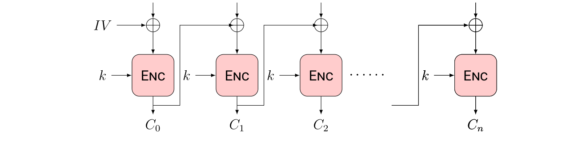
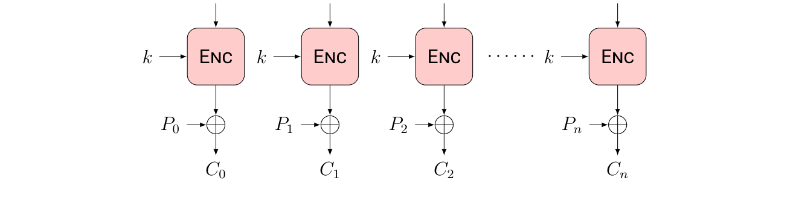
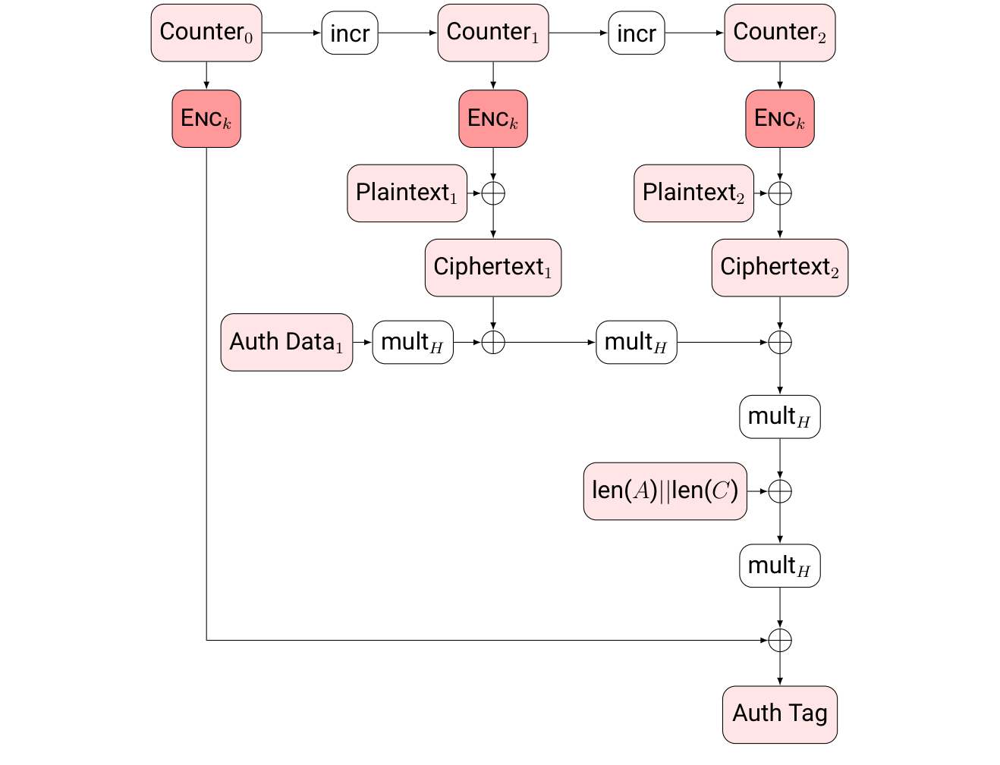

# Chapter 10: Cryptography

**Authors:** Nigel Smart (KU Leuven)

::: info About this page
This chapter is from [CyBOK Version 1.2.0](https://www.cybok.org/), © Crown Copyright, The National
Cyber Security Centre 2026, licensed under the
[Open Government Licence](https://www.nationalarchives.gov.uk/doc/open-government-licence/).
It was converted from the [PDF](https://www.cybok.org/wp-content/uploads/CyBOK_v1.2.0.pdf) into
a web page so that it works with screen readers and other assistive technology. Each
abbreviation is spelled out in square brackets the first time it appears, and those meanings are
ours, not the book's. So are the names of links the book prints as a bare web address. The PDF
(Portable Document Format) is the original, so if the two disagree, the PDF wins.
:::

## Introduction

The purpose of this chapter is to explain the various aspects of cryptography which we feel should be known to an expert in cyber-security. The presentation is at a level needed for an instructor in a module in cryptography; so they can select the depth needed in each topic. Whilst not all experts in cyber-security need be aware of all the technical aspects mentioned below, we feel they should be aware of all the overall topics and have an intuitive grasp as to what they mean, and what services they can provide. Our focus is mainly on primitives, schemes and protocols which are widely used, or which are suitably well studied that they could be used (or are currently being used) in specific application domains.

Cryptography by its very nature is one of the more mathematical aspects of cyber-security; thus this chapter contains a lot more mathematics than one has in some of the other chapters. The overall presentation assumes a basic knowledge of either first-year undergraduate mathematics, or that found in a discrete mathematics course of an undergraduate Computer Science degree.

The chapter is structured as follows: After a quick recap on some basic mathematical notation (Section 10.1), we then give an introduction to how security is defined in modern cryptography. This section (Section 10.2) forms the basis of our discussions in the other sections. Section 10.3 discusses information theoretic constructions, in particular the one-time pad, and secret sharing. Sections 10.4 and 10.5 then detail modern symmetric cryptography; by discussing primitives (such as block cipher constructions) and then specific schemes (such as modes-of-operation). Then in Sections 10.6 and 10.7 we discuss the standard methodologies for performing public key encryption and public key signatures, respectively. Then in Section 10.8 we discuss how these basic schemes are used in various standard protocols; such as for authentication and key agreement. All of the sections, up to and including Section 10.8, focus exclusively on constructions which have widespread deployment.

Section 10.9 begins our treatment of constructions and protocols which are less widely used; but which do have a number of niche applications. These sections are included to enable the instructor to prepare students for the wider applications of the cryptography that they may encounter as niche applications become more mainstream. In particular, Section 10.9 covers Oblivious Transfer, Zero-Knowledge, and Multi-Party Computation. Section 10.10 covers public key schemes with special properties, such as group signatures, identity-based encryption and homomorphic encryption.

The chapter assumes the reader wants to **use** cryptographic constructs in order to build secure systems, it is not meant to introduce the reader to attack techniques on cryptographic primitives. Indeed, all primitives here can be assumed to have been selected to avoid specific attack vectors, or key lengths chosen to avoid them. Further details on this can be found in the regular European Key Size and Algorithms report, of which the most up to date version is \[<a href="#ref-953" aria-label="Reference 953">953</a>\].

For a similar reason we do not include a discussion of historical aspects of cryptography, or historical ciphers such as Caesar, Vigenère or Enigma. These are at best toy examples, and so have no place in a such a body of knowledge. They are best left to puzzle books. However the interested reader is referred to \[<a href="#ref-954" aria-label="Reference 954">954</a>\].

## Content

## 10.1 Mathematics

\[<a href="#ref-955" aria-label="Reference 955">955</a>, c8–c9, App B\]\[<a href="#ref-956" aria-label="Reference 956">956</a>, c1–c5\]

Cryptography is inherently mathematical in nature, the reader is therefore going to be assumed to be familiar with a number of concepts. A good textbook to cover the basics needed, and more, is that of Galbraith \[<a href="#ref-957" aria-label="Reference 957">957</a>\].

Before proceeding we will set up some notation: The ring of integers is denoted by $\mathbb{Z}$, whilst the fields of rational, real and complex numbers are denoted by $\mathbb{Q}$, $\mathbb{R}$ and $\mathbb{C}$. The ring of integers modulo $N$ will be denoted by $\mathbb{Z}/N\mathbb{Z}$, when $N$ is a prime $p$ this is a finite field often denoted by $\mathbb{F}_{p}$. The set of invertible elements will be written $(\mathbb{Z}/N\mathbb{Z})^{*}$ or $\mathbb{F}^{*}_{p}$. An RSA \[Rivest-Shamir-Adleman\] modulus $N$ will denote an integer $N$, which is the product of two (large) prime factors $N = p\cdot q$.

Finite abelian groups of prime order $q$ are also a basic construct. These are either written multiplicatively, in which case an element is written as $g^{x}$ for some $x\in \mathbb{Z}/q\mathbb{Z}$; when written additively an element can be written as $[x]\cdot P$. The element $g$ (in the multiplicative case) and $P$ (in the additive case) is called the generator.

The standard example of finite abelian groups of prime order used in cryptography are elliptic curves. An elliptic curve over a finite field $\mathbb{F}_{p}$ is the set of solutions $(X, Y )$ to an equation of the form

$$
E : Y ^{2 }= X^{3 }+ A\cdot X + B
$$

where $A$ and $B$ are fixed constants. Such a set of solutions, plus a special point at infinity denoted by $O$, form a finite abelian group denoted by $E(\mathbb{F}_{p})$. The group law is a classic law dating back to Newton and Fermat called the chord-tangent process. When $A$ and $B$ are selected carefully one can ensure that the size of $E(\mathbb{F}_{p})$ is a prime $q$. This will be important later in Section 10.2.3 to ensure the discrete logarithm problem in the elliptic curve is hard.

Some cryptographic schemes make use of lattices which are discrete subgroups of the subgroups of $\mathbb{R}^{n}$. A lattice can be defined by a generating matrix $B \in \mathbb{R}^{n\cdot m}$, where each column of $B$ forms a basis element. The lattice is then the set of elements of the form $y = B \cdot x$ where $x$ ranges over all elements in $\mathbb{Z}^{m}$. Since a lattice is discrete it has a well-defined length of the shortest non-zero vector. In Section 10.2.3 we note that finding this shortest non-zero vector is a hard computational problem.

Sampling a uniformly random element from a set $A$ will be denoted by $x \leftarrow A$. If the set $A$ consists of a single element $a$ we will write this as the assignment $x\leftarrow a$; with the equality symbol $=$ being reserved for equalities as opposed to assignments. If $A$ is a randomized algorithm, then we write $x \leftarrow A(y; r)$ for the assignment to $x$ of the output of running $A$ on input $y$ with random coins $r$.

## 10.2 Cryptographic Security Models

\[<a href="#ref-955" aria-label="Reference 955">955</a>, c1–c4\]\[<a href="#ref-956" aria-label="Reference 956">956</a>, c11\]

Modern cryptography has adopted a methodology of ‘Provable Security’ to define and understand the security of cryptographic constructions. The basic design procedure is to define the **syntax** for a cryptographic scheme. This gives the input and output behaviours of the algorithms making up the scheme and defines correctness. Then a **security model** is presented which defines what security goals are expected of the given scheme. Then, given a **specific instantiation** which meets the given syntax, a formal **security proof** for the instantiation is given relative to some known **hard problems**.

The security proof is not an absolute guarantee of security. It is a proof that the given instantiation, when implemented correctly, satisfies the given security model assuming some hard problems are indeed hard. Thus, if an attacker can perform operations which are outside the model, or manages to break the underlying hard problem, then the proof is worthless. However, a security proof, with respect to well studied models and hard problems, can give strong guarantees that the given construction has no fundamental weaknesses.

In the next subsections we shall go into these ideas in more detail, and then give some examples of security statements; further details of the syntax and security definitions can be found in \[<a href="#ref-958" aria-label="Reference 958">958</a>, <a href="#ref-959" aria-label="Reference 959">959</a>\]. At a high level the reason for these definitions is that the intuitive notion of a cryptographic construction being secure is not sufficient enough. For example the natural definition for encryption security is that an attacker should be unable to recover the decryption key, or the attacker should be unable to recover a message encrypted under one ciphertext. Whilst these ideas are necessary for any secure scheme they are not sufficient. We need to protect against an attacker aims for find *some* information about an encrypted message, when the attacker is able to mount chosen plaintext and chosen ciphertext attacks on a legitimate user.

### 10.2.1 Syntax of Basic Schemes

The syntax of a cryptographic scheme is defined by the algorithms which make up the scheme, as well as a correctness definition. The correctness definition gives what behaviour one can expect when there is no adversarial behaviour. For example, a symmetric encryption scheme is defined by three algorithms $(\mathsf{KeyGen},\mathsf{Enc},\mathsf{Dec})$. The $\mathsf{KeyGen}$ algorithm is a probabilistic algorithm which outputs a symmetric key $\mathfrak{k}\leftarrow \mathsf{KeyGen}()$; $\mathsf{Enc}$ is a probabilistic algorithm which takes a message $m \in M$, some randomness $r \in R$ and a key and returns a $c\leftarrow \mathsf{Enc}(m,\mathfrak{k}; r)\in$ $C$; whilst $\mathsf{Dec}$ is (usually) a deterministic algorithm which takes a ciphertext and a key and returns the underlying plaintext. The correctness definition is:

$$
\forall \mathfrak{k}\leftarrow \mathsf{KeyGen}(), r \leftarrow R, m \leftarrow M, \mathsf{Dec}(\mathsf{Enc}(m,\mathfrak{k}; r),\mathfrak{k}) = m.
$$

For public key encryption schemes the definitions are similar, but now $\mathsf{KeyGen}()$ outputs key pairs and the correctness definition becomes:

$$
\forall (\mathfrak{pk},\mathfrak{sk})\leftarrow \mathsf{KeyGen}(), r \leftarrow R, m \leftarrow M, \mathsf{Dec}(\mathsf{Enc}(m,\mathfrak{pk}; r),\mathfrak{sk}) = m.
$$

The equivalent constructions for authentication mechanisms are Message Authentication Codes (or MACs) in the symmetric key setting, and digital signatures schemes in the public key setting. A MAC scheme is given by a triple of algorithms $(\mathsf{KeyGen},\mathsf{MAC},\mathsf{Verify})$, where the $\mathsf{MAC}$ function outputs a tag given a message and a key (and possibly some random coins), and the $\mathsf{Verify}$ function checks the message, tag and key are consistent. A signature scheme is given by a similar triple $(\mathsf{KeyGen},\mathsf{Sign},\mathsf{Verify})$, where now the tag produced is called a ‘signature’. Thus the correctness definitions for these constructions are as follows

$$
\mathfrak{k}\leftarrow \mathsf{KeyGen}(), r \leftarrow R, m \leftarrow M, \mathsf{Verify}(m,\mathsf{MAC}(m,\mathfrak{k}; r),\mathfrak{k}) =\mathsf{true}.
$$

and

$$
(\mathfrak{pk},\mathfrak{sk})\leftarrow \mathsf{KeyGen}(), r \leftarrow R, m \leftarrow M, \mathsf{Verify}(m,\mathsf{Sign}(m,\mathfrak{sk}; r),\mathfrak{pk}) =\mathsf{true}.
$$

Note, that for deterministic MACs the verification algorithm is usually just to recompute the MAC tag $\mathsf{MAC}(m,\mathfrak{k})$, and then check it was what was received.

### 10.2.2 Basic Security Definitions

A security definition is usually given in the context of an attacker’s **security goal**, followed by their **capabilities**. So, for example, a naive security goal for encryption could be to recover the underlying plaintext, so-called One-Way (or OW) security. This process of an attacker trying to obtain a specific goal is called a *security game*, with the attacker winning the *game*, if they can break this security goal with greater probability than random guessing. This advantage in probability over random guessing is called the adversary’s *advantage*. The capabilities are expressed in terms of what oracles, or functions, we give the adversary access to. So, for example, in a naive security game for encryption we may give the adversary no oracles at all, producing a so-called Passive Attack (or PASS) capability.

The attacker is modelled as an arbitrary algorithm, or Turing machine, $A$, and if we give the adversary access to oracles then we write these as subscripts $A^{O}$. In our naive security game (called OW-PASS) the adversary has no oracles and its goal is simply to recover the message underlying a given ciphertext. The precise definition is given in [Figure 10.1](#figure-10-1), where $\mathsf{Adv}^{\mathsf{OW}-\mathsf{PASS}}(A, t)$ denote the advantage over a random guess that a given adversary has after running for time $t$. We say that a given construction is secure in the given model (which our naive example would be named OW-PASS), if the above advantage is *negligible* for all probabilistic polynomial time adversaries $A$. Here, negligible and polynomial time are measured in terms of a *security parameter* (which one can think of as the key size). Note, for OW-PASS this assumes that the message space is not bigger than the space of all possible keys. Also note, that this is an asymptotic definition, which in the context of schemes with fixed key size, makes no sense. In such situations we require that $(t/\mathsf{Adv})$ is greater than some given concrete bound such as $2^{128}$, since it is believed that performing an algorithm requiring $2^{128}$ steps is infeasible even for a nation-state adversary.

In the context of encryption (both symmetric and public key) the above naive security goal is not seen as being suitable for real applications. Instead, the security goal of Indistinguishable encryptions (or IND) is usually used. This asks the adversary to first come up with two plaintexts, of equal length, and then the challenger (or environment) encrypts one of them and gives the resulting challenge to the adversary. The adversary’s goal is then to determine which plaintext was encrypted. In the context of a passive attack this gives an advantage statement as given in the second part of [Figure 10.1](#figure-10-1), where the two stages of the adversary are given by $A_{1}$ and $A_{2}$.

In terms of encryption, the above passive attack is almost always not sufficient in terms of capturing real-world adversarial capabilities, since real systems almost always give the attacker additional attack vectors. Thus two other (increasingly strong) attack capabilities are usually considered. These are a Chosen Plaintext Attack (or CPA capability), in which the adversary is given access to an encryption oracle to encrypt arbitrary messages of his choice, and a Chosen Ciphertext Attack (or CCA capability), in which the adversary has both an encryption and decryption oracle. In the case of a public key scheme the adversary always has access to an encryption oracle because it can encrypt plaintexts for itself using the public key, so in this case PASS and CPA are equivalent. In the case of a CCA capability we restrict the decryption oracle so that the adversary may not ask of it the challenge ciphertext $c^{*}$; otherwise it can trivially win the security game. Thus the advantage of an IND-CCA adversary against a public key encryption scheme would be defined as the third definition in [Figure 10.1](#figure-10-1). Other security definitions are possible for encryption (such as Real-or-Random) but the above are the main ones.

<figure id="figure-10-1">

<figcaption>

**Figure** 10.1: Technical Security Definitions

</figcaption>

**OW-PASS Definition:**

$$\mathsf{Adv}^{\mathsf{OW-PASS}}(A,t) = \Pr\left[\begin{array}{l} \mathfrak{k} \leftarrow \mathsf{KeyGen}(),\ m^* \leftarrow \mathcal{M},\ r \leftarrow \mathcal{R}, \\ c^* \leftarrow \mathsf{Enc}(m, \mathfrak{k}; r),\ m \leftarrow A(c^*) :\ m = m^* \end{array}\right] - \frac{1}{|\mathcal{M}|}.$$

One reads the probability statement as the being the probability that $m = m^*$, given that $m$ and $m^*$ are produced by first sampling $\mathfrak{k}$ from algorithm $\mathsf{KeyGen}()$, then sampling $m^*$ and $r$ from the spaces $\mathcal{M}$ and $\mathcal{R}$ at random, then determining $c^*$ by calling $\mathsf{Enc}(m, \mathfrak{k}; r)$ and finally passing $c^*$ to the Adversary $A$, and getting $m$ in return.

**IND-PASS Symmetric Key Encryption Definition:**

$$\mathsf{Adv}^{\mathsf{IND-PASS}}(A,t) = \Pr\left[\begin{array}{l} \mathfrak{k} \leftarrow \mathsf{KeyGen}(),\ b \leftarrow \{0,1\},\ m_0,\ m_1,\ \mathsf{state} \leftarrow A_1(), \\ r \leftarrow \mathcal{R},\ c^* \leftarrow \mathsf{Enc}(m_b, \mathfrak{k}; r),\ b' \leftarrow A_2(c^*, \mathsf{state}) :\ b = b' \end{array}\right] - \frac{1}{2}.$$

**IND-CCA Public Key Encryption Definition:**

$$\mathsf{Adv}^{\mathsf{IND-CCA}}(A,t) = \Pr\left[\begin{array}{l} (\mathfrak{pk}, \mathfrak{sk}) \leftarrow \mathsf{KeyGen}(),\ b \leftarrow \{0,1\},\ m_0,\ m_1, \mathsf{state} \leftarrow A_1^{\mathsf{Dec}(\cdot,\mathfrak{sk})}(\mathfrak{pk}), \\ r \leftarrow \mathcal{R},\ c^* \leftarrow \mathsf{Enc}(m_b, \mathfrak{pk}; r),\ b' \leftarrow A_2^{\mathsf{Dec}(\cdot,\mathfrak{sk})}(c^*, \mathsf{state}) :\ b = b' \end{array}\right] - \frac{1}{2}.$$

**UF-CMA Signature Security Definition:**

$$\mathsf{Adv}^{\mathsf{UF-CMA}}(A,t) = \Pr\left[(\mathfrak{pk}, \mathfrak{sk}) \leftarrow \mathsf{KeyGen}(),\ (m, \sigma) \leftarrow A^{\mathsf{Sign}(\cdot,\mathfrak{sk})}(\mathfrak{pk}) :\ \mathsf{Verify}(m, \sigma, \mathfrak{pk}) = \mathsf{true}\right].$$

**IND-CCA KEM \[Key Encapsulation Mechanism\] Security Definition:**

$$\mathsf{Adv}^{\mathsf{IND-CCA}}(A,t) = \Pr\left[\begin{array}{l} (\mathfrak{pk}, \mathfrak{sk}) \leftarrow \mathsf{KEMKeyGen}(),\ b \leftarrow \{0,1\},\ \mathfrak{k}_0 \leftarrow \mathcal{K},\ r \leftarrow \mathcal{R}, \\ \mathfrak{k}_1, c^* \leftarrow \mathsf{KEMEnc}(\mathfrak{pk}; r),\ b' \leftarrow A_2^{\mathsf{KEMDec}(\cdot,\mathfrak{sk})}(c^*, \mathfrak{k}_b) :\ b = b' \end{array}\right] - \frac{1}{2}.$$

</figure>

For MACs (resp. digital signature schemes) the standard security goal is to come up with a message/tag (resp. message/signature) pair which passes the verification algorithm, a so-called Universal Forgery (or UF) attack. We make no assumption about whether the message has any meaning, indeed, the attacker wins if he is able to create a signature on *any* bit-string. If the adversary is given no oracles then he is said to be mounting a passive attack, whilst if the adversary is given a tag generation (resp. signing oracle) he is said to be executing a Chosen Message Attack (CMA). In the latter case the final forgery must not be one of the outputs of the given oracle. In the case of MAC security, one may also give the adversary access to a tag verification oracle. However, for deterministic MACs this is implied by the CMA capability and is hence usually dropped, since verification only involves re-computing the MAC.

Again we define an advantage and require this to be negligible in the security parameter. For digital signatures the advantage for the UF-CMA game is given by the fourth equation in [Figure 10.1](#figure-10-1).

### 10.2.3 Hard Problems

As explained above, security proofs are always relative to some hard problems. These hard problems are often called *cryptographic primitives*, since they are the smallest atomic object from which cryptographic schemes and protocols can be built. Such cryptographic primitives come in two flavours: Either they are keyed complexity theoretic definitions of functions, or they are mathematical hard problems.

In the former case one could consider a function $F_{k}(\cdot ) : D \longrightarrow C$ selected from a function family $\{F_{k}\}$ and indexed by some index $k$ (thought of as a key of varying length). One can then ask whether the function selected is indistinguishable (by a probabilistic polynomial time algorithm $A$ which has oracle access to the function) from a uniform random function from $D$ to $C$. If such an assumption holds, then we say the function family defines a (keyed) Pseudo-Random Function (PRF). In the case when the domain $D$ is equal to the co-domain $C$ we can ask whether the function is indistinguishable from a randomly chosen permutation, in which case we say the family defines a (keyed) Pseudo-Random Permutation (PRP).

In the case of a block cipher, such as AES (see later), where one has $C = D =\{0, 1\}^{128}$, it is a basic assumption that the AES function family (indexed by the key $k$) is a Pseudo-Random Permutation.

In the case of mathematical hard problems we have a similar formulation, but the definitions are often more intuitive. For example, one can ask the question whether a given RSA modulus $N = p\cdot q$ can be factored into its prime components $p$ and $q$, the so-called factoring problem. The RSA group $\mathbb{Z}/N\mathbb{Z}$ defines a finite abelian group of unknown order (the order is known to the person who created $N$), finding the order of this group is equivalent to factoring $N$. The RSA function $x\longrightarrow x^{e }(\mathrm{mod} N)$ is believed to be hard to invert, leading to the so-called RSA-inversion problem of, given $y \in$($\mathbb{Z}/N\mathbb{Z})^{*}$, finding $x$ such that $x^{e }= y (\mathrm{mod} N)$. It is known that the function can easily be inverted if the modulus $N$ can be factored, but it is unknown if inverting the function implies $N$ can be factored. Thus we have a situation where one problem (factoring) seems to be harder to solve than another problem (the RSA problem). However, in practice, we assume that both problems are hard, given appropriately chosen parameters. Details on the best method to factor large numbers, the so-called Number Field Sieve, can be found in \[<a href="#ref-960" aria-label="Reference 960">960</a>\].

In finite abelian groups of known order (usually assumed to be prime), one can define other problems. The problem of inverting the function $x\longrightarrow g^{x}$, is known as the Discrete Logarithm Problem (DLP). The problem of, given $g^{x}$ and $g^{y}$, determining $g^{x\cdot y}$ is known as the Diffie– Hellman Problem (DHP). The problem of distinguishing between triples of the form $(g^{x}, g^{y}, g^{z})$ and $(g^{x}, g^{y}, g^{x\cdot y})$ for random $x, y, z$ is known as the Decision Diffie–Hellman (DDH) problem. When written additively in an elliptic curve group, a DDH triple has the form $([x]\cdot P, [y]\cdot P, [z]\cdot P)$.

Generally speaking, the mathematical hard problems are used to establish the security of public key primitives. A major issue is that the above problems (Factoring, RSA-problem, DLP, DHP, DDH), on which we base all of our main existing public key algorithms, are easily solved by large-scale quantum computers. This has led designers to try to build cryptographic schemes on top of mathematical primitives which do not appear to be able to be broken by a quantum computer. Examples of such problems are the problem of determining the shortest vector in a high dimensional lattice, the so-called Shortest Vector Problem (SVP), and the problem of determining the closest lattice vector to a non-lattice vector, the so-called Closest Vector Problem (CVP). The best algorithms to solve these hard problems are lattice reduction algorithms, a nice survey of these algorithms and applications can be found in \[<a href="#ref-961" aria-label="Reference 961">961</a>\]. The SVP and CVP problems, and others, give rise to a whole new area called Post-Quantum Cryptography (PQC).

**Example:** Putting the above ideas together, one may encounter statements such as: *The public key encryption XYZ is IND-CCA secure assuming the RSA-problem is hard and AES is a PRP.* This statement tells us that *any* attack against the XYZ scheme must either be against some weakness in the implementation, or must come from some attack not captured in the IND-CCA model, or must come from solving the RSA-problem, or must come from showing that AES is not a PRP.

### 10.2.4 Setup Assumptions

Some cryptographic protocols require some setup assumptions. These are assumptions about the environment, or some data, which need to be satisfied before the protocol can be considered secure. These assumptions come in a variety of flavours. For example, one common setup assumption is that there exists a so-called Public Key Infrastructure (PKI), meaning that we have a trusted binding between entities’ public keys and their identities.

Another setup assumption is the existence of a string (called the Common Reference String or CRS) available to all parties, and which has been set up in a trusted manner, i.e. such that no party has control of this string.

Other setup assumptions could be physical, for example, that the algorithms have access to good sources of random numbers, or that their internal workings are not susceptible to an invasive attacker, i.e. they are immune to side-channel attacks.

### 10.2.5 Simulation and UC Security

The above definitions of security make extensive use of the notion of indistinguishability between two executions. Indeed, many of the proof techniques used in the security proofs construct *simulations* of cryptographic operations. A simulation is an execution which is indistinguishable from the real execution, but does not involve (typically) the use of any key material. Another method to produce security models is the so-called *simulation paradigm*, where we ask that an adversary cannot tell the simulation from a real execution (unless they can solve some hard problem). This paradigm is often used to establish security results for more complex cryptographic protocols.

A problem with both the game/advantage-based definitions defined earlier and the simulation definitions is that they only apply to stand-alone executions, i.e. executions of one instance of the protocol in one environment. To cope with arbitrarily complex executions and composition of cryptographic protocols an extension to the simulation paradigm exists called the Universal Composability (UC) framework.

## 10.3 Information-theoretically Secure Constructions {#_10-3-information-theoretically-secure-constructions}

\[<a href="#ref-955" aria-label="Reference 955">955</a>, c2\]\[<a href="#ref-956" aria-label="Reference 956">956</a>, c19\]

Whilst much of cryptography is focused on securing against adversaries that are modelled as probabilistic polynomial time Turing machines, some constructions are known to provide security against unbounded adversaries. These are called information-theoretically secure constructions. A nice introduction to the information theoretic side of cryptography can be found in \[<a href="#ref-962" aria-label="Reference 962">962</a>\].

### 10.3.1 One-Time Pad

The most famous primitive which provides information-theoretic security is the one-time pad. Here, a binary message $m \in \{0, 1\}^{t}$ is encrypted by taking a key $k \in \{0, 1\}^{t}$ uniformly at random, and then producing the ciphertext $c = m\oplus k$. In terms of our earlier security models, this is an IND-PASS scheme even in the presence of a computationally unbounded adversary. However, the fact that it does not provide IND-CPA security is obvious, as the encryption scheme is determinisitic. The scheme is unsuitable in almost all modern environments as one requires a key as long as the message and the key may only be used once; hence the name one-time pad.

### 10.3.2 Secret Sharing

Secret sharing schemes allow a secret to be shared among a set of parties so that only a given subset can reconstruct the secret by bringing their shares together. The person who constructs the sharing of the secret is called the dealer. The set of parties who can reconstruct the secret are called qualified sets, with the set of all qualified sets being called an *access structure*.

Any set which is not qualified is said to be an unqualified set, and the set of all unqualified sets is called an *adversary structure*. The access structure is usually assumed to be monotone, in that if the parties in $A$ can reconstruct the secret, then so can any super-set of $A$.

Many secret sharing schemes provided information-theoretic security, in that any set of parties which is unqualified can obtain no information about the shared secret even if they have unbounded computing power.

A special form of access structure is a so-called *threshold* structure. Here we allow any subset of $t + 1$ parties to reconstruct the secret, whereas any subset of $t$ parties is unable to learn anything. The value $t$ is being called the threshold. One example construction of a threshold secret sharing scheme for a secret $s$ in a field $\mathbb{F}_{p}$, with $n > p$ is via Shamir’s secret sharing scheme.

In Shamir secret sharing, one selects a polynomial $f(X)\in \mathbb{F}_{p}[X]$ of degree $t$ with constant coefficients $s$, the value one wishes to share. The share values are then given by $s_{i }= f(i)$ $(\mathrm{mod} p)$, for $i = 1, . . . , n$, with party $i$ being given $s_{i}$. Reconstruction of the value $s$ from a subset of more than $t$ values $s_{i}$ can be done using Lagrange interpolation.

Due to an equivalence with Reed-Solomon error correcting codes, if $t < n/2$, then on receipt of $n$ share values $s_{i}$, a reconstructing party can detect if any party has given it an invalid share. Additionally, if $t < n/3$ then the reconstructing party can correct for any invalid shares.

Replicated secret sharing is a second popular scheme which supports any monotone access structure. Given a boolean formula defining who should have access to the secret, one can define a secret sharing scheme from this formula by replacing all occurrences of $\mathrm{AND}$ with $+$ and all occurrences of $\mathrm{OR}$ with a new secret. For example, given the formulae

$(P_{1}$ AND $P_{2})$ OR \[Onion Router\] $(P_{2}$ AND $P_{3}),$

one can share a secret $s$ by writing it as $s = s_{1} +s_{2 }= s^{'}_{2 }+s_{3}$ and then, giving party $P_{1}$ the value $s_{1}$, party $P_{2}$ the pair of values $s_{2}$ and $s^{'}_{2}$, and party $P_{3}$ the value $s_{3}$. Replicated secret sharing is the scheme obtained in this way when putting the boolean formulae into Conjunctive Normal Form.

Of importance in applications of secret sharing, especially to Secure Multi-Party Computation (see Section 10.9.4) is whether the adversary structure is $Q_{2}$ or $Q_{3}$. An adversary structure is said to be $Q_{i}$ if no set of $i$ unqualified sets have union the full set of players. Shamir’s secret sharing scheme is $Q_{2}$ if $t < n/2$ and $Q_{3}$ when $t < n/3$. The error detection (resp. correction) properties of Shamir’s secret sharing scheme mentioned above follow through to any $Q_{2}$ (resp. $Q_{3}$) adversary structure.

## 10.4 Symmetric Primitives {#_10-4-symmetric-primitives}

\[<a href="#ref-955" aria-label="Reference 955">955</a>, c3–c6\]\[<a href="#ref-956" aria-label="Reference 956">956</a>, c11–c14\]

Symmetric primitives are a key component of many cryptographic constructions. There are three such basic primitives: block ciphers, stream ciphers, and hash functions. Theoretically, all are keyed functions, i.e. they take as input a secret key, whilst in practice one often considers hash functions which are unkeyed. At a basic level, all are functions $f : K \times D \longrightarrow C$ where $K$ is the key space, $D$ is the domain (which is of a fixed finite size for block ciphers and stream ciphers).

As explained in the introduction we will not be discussing in this report cryptanalysis of symmetric primitives, we will only be examining secure constructions. However, the main two techniques for attacks in this space are so-called differential and linear cryptanalysis. The interested reader is referred to the excellent tutorial by Howard Heys \[<a href="#ref-963" aria-label="Reference 963">963</a>\] on these topics, or the book \[<a href="#ref-964" aria-label="Reference 964">964</a>\].

### 10.4.1 Block Ciphers

A block cipher is a function $f : K \times \{0, 1\}^{b }-\rightarrow \{0, 1\}^{b}$, where $b$ is the block size. Despite their names such functions should not be thought of as an encryption algorithm. It is, however, a building block in many encryption algorithms. The design of block ciphers is a deep area of subject in cryptography, analogous to the design of number theoretic one-way functions. Much like number-theoretic one-way functions, cryptographic constructions are proved secure relative to an associated hard problem which a given block cipher is assumed to satisfy.

For a fixed key, a block cipher is assumed to act as a permutation on the set $\{0, 1\}^{b}$, i.e. for a fixed key $k$, the map $f_{k }:\{0, 1\}^{b }-\rightarrow \{0, 1\}^{b}$ is a bijection. It is also assumed that inverting this permutation is also easy (if the key is known). A block cipher is considered *secure* if no polynomial time adversary, given oracle access to a permutation on $\{0, 1\}^{b}$, can tell the difference between being given a uniformly random permutation or the function $f_{k}$ for some fixed hidden key $k$, i.e. the block cipher is a PRP. In some applications, we only require that the block cipher is a function, i.e. not a bijection. In which case we require the block cipher is a PRF.

One can never prove that a block cipher is a PRP, so the design criteria is usually a task of building a mathematical construction which resists all known attacks. The main such attacks which one resists are so-called *linear cryptanalysis*, where one approximates nonlinear components within the block cipher by linear functions, and *differential cryptanalysis*, where one looks at how two outputs vary on related input messages, e.g. one applies $f_{k}$ to various inputs $m_{0}$ and $m_{1}$ where $m_{0}\oplus m_{1 }= ∆$ a fixed value.

The design of a block cipher is made up of a number of simpler components. There are usually layers of simple fixed permutations, and layers of table lookups. These table lookups are called S-boxes, where the S stands for substitutions. There are two main techniques to design block ciphers. Both repeat a simple operation (called a round) a number of times. Each round consists of a combination of permutations and substitutions, and a key addition. The main key is first expanded into round-keys, with each round having a different round-key.

In the first methodology, called a *Feistel Network*, the S-Boxes allowed in each round can be non-injective, i.e. non-invertible. Despite this, the Feistel constructions still maintain the overall invertibility of the block cipher construction. The second method is a *Substitution-Permutation Network* design in which each round consists of a round-key addition, followed by a fixed permutation, followed by the application of bijective S-boxes. In general, the Feistel construction requires more rounds than the Substitution-Permutation network construction.

The DES (Data Encryption Standard) block cipher (with an original key of $56$-bits and block size of $b = 64$) is a Feistel construction. The DES algorithm dates from the 1970s, and the key size is now considered far too small for any application. However, one can extend DES into a $112$\- or $168$-bit key block cipher to construct an algorithm called 2DES or 3DES. The use of 2DES or 3DES is still considered secure, although in some applications, the block size of $64$-bits is considered insecure for real-world use.

The AES (Advanced Encryption Standard) block cipher is the modern replacement for DES, and it is a block cipher with a $128$-, $192$\- or $256$-bit key, and with a block size of $b = 128$ bits. The AES algorithm has hardware support on many microprocessors, making operations using AES much faster than using other cryptographic primitives. Readers who wish to understand more about the design of the AES block cipher referred to \[<a href="#ref-965" aria-label="Reference 965">965</a>\].

### 10.4.2 Stream Ciphers

A stream cipher is one which produces an arbitrary length string of output bits, i.e. the co-domain of the function is essentially unbounded. Stream ciphers can be constructed from block ciphers, by using a block cipher in Counter Mode (see Section 10.5.1). However, the stream cipher is usually reserved for constructions which are special-purpose and for which the hardware complexity is much reduced.

Clearly, a stream cipher cannot be a permutation, but we require that no polynomial time adversary can distinguish oracle access to the stream cipher from oracle access to a uniformly random function with infinite co-domain. The design of stream ciphers is more ad-hoc than that of the design of block ciphers. In addition, there is less widespread adoption outside specific application areas. The interested reader is referred to the outcome of the eStream competition for details of specific ad-hoc stream cipher designs \[<a href="#ref-966" aria-label="Reference 966">966</a>\].

### 10.4.3 Hash Functions

Hash functions are much like block ciphers in that they should act as PRFs. However, the input domain can be unbounded. Since a PRF needs to be keyed to make any sense in theoretical tracts, a hash function is usually a keyed object. In practice, we often require an unkeyed object, in which case one considers the actual hash function used to have an implicit inbuilt fixed key, and have been chosen from a function family already.

When considering a fixed hash function, one is usually interested in the intractability of inverting the hash function (the one-way property), the intractability of finding two inputs with the same output (the collision resistance property), or the intractability of finding, given an input/output pair, a new input which gives the same output (the second-preimage resistance property). **10.4.3.1 Merkle-Damgård Construction**

Early hash functions were based on the Merkle-Damgård construction. The family of such functions (MD4, MD5 \[Message Digest 5\], SHA-1, SHA-2) have a number of issues, with only SHA-2 now being considered secure. The Merkle-Damgård construction takes a compression function $f(x, y)$ taking two inputs $x, y$ of fixed length with the output length of $x$. This is used to derive a function which allows arbitrary length inputs by first dividing a message $m$ into $t$ blocks $m_{1}, . . . , m_{t}$ each of length $\vert y\vert$, and then applying

$h_{i }= f(h_{i-1}, m_{i})$ for $i = 1, . . . , t,$

where the output is $h_{t}$ and $h_{0}$ is some initial value, which can be thought of as a fixed key for the hash function.

The above methodology requires a method to pad the initial input block to encode the length, and it suffers from a number of practical issues. For example, there are obvious length extension attacks (namely a hash on a message $m$ can be extended to a hash on $m\parallel m^{'}$ without knowing the whole of $m$) which render the use of such hash functions problematic in some applications. For example, in HMAC (see Section 10.5.2), one requires two applications of the hash function to prevent such attacks.

**10.4.3.2 Sponge Constructions**

A more modern approach to hash function design is to create a so-called sponge construction. This is the design philosophy behind SHA-3 (a.k.a. ). A sponge is a function which operates in two phases. In the first phase, one enters data into the sponge state and, in the second phase, one squeezes data out from the sponge.

The sponge state is a pair $(r, c) \in \{0, 1\}^{\vert r\vert +\vert c\vert }$, where the length of $r$ denotes the input/output rate and $c$ is a variable holding an internal state hidden from any attacker. The size of $c$ is directly related to the security of the construction. At each round, a public permutation $p$ is applied to the state $(r, c)$.

In the input phase of the sponge, the input data $m$, after suitable padding, is divided into $t$ blocks $m_{1}, . . . , m_{t}$ of size $\vert r\vert$. Then the state is updated via the mapping

$(r_{i}, c_{i}) = p(r_{i-1}\oplus m_{i}, c_{i-1})$ for $i = 1, . . . , t,$

where $r_{0}$ and $c_{0}$ are initialized to be fixed all-zero bit strings. After data is entered into the sponge, one can obtain $s$ blocks of $\vert r\vert$-bit outputs $o_{1}, . . . , o_{s}$ by computing

$(o_{i}, c^{'}_{i}) = p(o_{i-1}, c^{'}_{i-1})$ for $i = 1, . . . , s,$

where $o_{0 }= r_{t}$ and $c^{'}_{0 }= c_{t}$. Thus the whole function is given by

$$
H(m_{1}, . . . , m_{t}) = o_{1}, . . . , o_{s}.
$$

Further details on sponge constructions, and the further objects one can construct from them, and the SHA-3 design in particular can be found at the Keccak web page \[<a href="#ref-967" aria-label="Reference 967">967</a>\].

**10.4.3.3 Random Oracle Model**

Many cryptographic constructions are only secure if one assumes that the hash function used in the construction behaves ‘like a random oracle’. Such constructions are believed to be secure in the real world, but theoretically, they are less pleasing. One can think of a proof of security in the random oracle model as a proof in which we allow the attacker to have their usual powers; however, when they (or any of the partners they are attacking) call the underlying hash function the call is made to an external party via an oracle call. This external party then simply plays back a random value, i.e. it does not use any algorithm to generate the random values. All that is required is that if the input is given to the oracle twice, then the same output is always returned.

This clearly does not capture attacks in which the adversary makes clever use of exactly how the hash function is defined etc, and how this definition interacts with other aspects of the scheme/protocol under analysis. However, this modelling methodology has proved remarkably good in enabling cryptographers to design schemes which are secure in the real world.

## 10.5 Symmetric Encryption and Authentication {#_10-5-symmetric-encryption-and-authentication}

\[<a href="#ref-955" aria-label="Reference 955">955</a>, c3–c4\]\[<a href="#ref-956" aria-label="Reference 956">956</a>, c13–c14\]

A block cipher, such as AES or DES, does not provide an effective form of data encryption or data/entity authentication on its own. To provide such symmetric cryptographic constructions, one needs a scheme, which takes the primitive and then utilizes this in a more complex construction to provide the required cryptographic service. In the context of symmetric encryption, these are provided by modes of operation. In the case of authentication, it is provided by a MAC construction. Additionally, block ciphers are often used to take some entropy and then expand, or collapse, this into a pseudo-random stream or key; a so-called XOF (or Extendable Output Function) or KDF (or Key Derivation Function). Further details on block cipher based constructions can be found at \[<a href="#ref-968" aria-label="Reference 968">968</a>\], whereas further details on Sponger/Keccak based constructions can be found at \[<a href="#ref-967" aria-label="Reference 967">967</a>\].

$$
P_{0} P_{1} P_{2} PP_{nn}
$$

<figure id="figure-10-2">

{width=659 height=164}

<figcaption>

Figure 10.2: CBC \[Cipher Block Chaining\] Mode Encryption (All Figures are produced using *TikZ for Cryptographers* [TikZ for Cryptographers](https://www.iacr.org/authors/tikz/)).

</figcaption>
</figure>

::: details Text description of Figure 10.2

A block diagram with a row of encryption blocks, each labelled "Enc", read left to right. Each block takes the key $k$ from its left. A plain arrow enters each XOR (exclusive-or, drawn as a circled plus) from the top; this is the plaintext block. The caption's note about TikZ is only a credit for how the figures were drawn.

- First block: the initial value $IV$ enters the XOR from the left. The XOR output feeds Enc. The output of Enc is the ciphertext $C_0$.
- Second block: the XOR takes the plaintext from above and the previous block's ciphertext $C_0$ (a line from below the first Enc, up and across to this XOR). The XOR output feeds Enc, which outputs $C_1$.
- Third block: in the same way, $C_1$ is XORed with the plaintext and fed into Enc, which outputs $C_2$.
- Dots ($\cdots$) show that the pattern repeats.
- Last block: a line carrying the previous ciphertext enters the XOR, the XOR feeds Enc, and the output is $C_n$.

:::

### 10.5.1 Modes of Operation

Historically, there have been four traditional modes of operation to turn a block cipher into an encryption algorithm. These were ECB \[Electronic Code Book\], CBC, OFB \[Output Feedback\] and CFB \[Cipher Feedback\] modes. In recent years, the CTR \[Counter Mode\] mode has also been added to this list. Among these, only CBC mode (given in [Figure 10.2](#figure-10-2)) and CTR mode (given in [Figure 10.3](#figure-10-3)) are used widely within current systems. In these Figures, the block cipher is represented by the function $\mathsf{Enc}$

IV \[Initialisation Vector\], Ctr+$0$ IV, Ctr+$1$ IV, Ctr+$2$ IV, Ctr+$n$

<figure id="figure-10-3">

{width=659 height=167}

<figcaption>

Figure 10.3: CTR Mode Encryption

</figcaption>
</figure>

::: details Text description of Figure 10.3

A block diagram with a row of encryption blocks, each labelled "Enc", read left to right. Each block takes the key $k$ from its left, and a plain arrow enters its top (the counter value, unlabelled in the figure). The output of each Enc block goes down to an XOR (exclusive-or, drawn as a circled plus) that also takes a plaintext block from the left.

- First column: plaintext $P_0$ is XORed with the Enc output, giving ciphertext $C_0$.
- Second column: $P_1$ gives $C_1$.
- Third column: $P_2$ gives $C_2$.
- Dots ($\cdots$) show that the pattern repeats.
- Last column: $P_n$ gives $C_n$.

The columns do not depend on each other.

:::

On their own, however, CBC and CTR modes only provide IND-CPA security. This is far weaker than the ‘gold standard’ of security, namely IND-CCA (discussed earlier). Thus, modern systems use modes which provide this level of security, also enabling additional data (such as session identifiers) to be tagged into the encryption algorithm. Such algorithms are called AEAD methods (or Authenticated Encryption with Associated Data). In such algorithms, the encryption primitive takes as input a message to be encrypted, plus some associated data. To decrypt, the ciphertext is given, along with the associated data. Decryption will only work if both the key is correct and the associated data is what was input during the encryption process.

The simplest method to obtain an AEAD algorithm is to take an IND-CPA mode of operation such as CBC or CTR, and then to apply a MAC to the ciphertext and the data to be authenticated, giving us the so-called Encrypt-then-MAC paradigm. Thus, to encrypt $m$ with authenticated data $a$, one applies the transform

$$
c_{1 }\leftarrow \mathsf{Enc}(m,\mathfrak{k}_{1}; r), c_{2 }\leftarrow \mathsf{MAC}(c_{1}\parallel a,\mathfrak{k}_{2}; r),
$$

with the ciphertext being $(c_{1}, c_{2})$. In such a construction, it is important that the MAC is applied to the ciphertext as opposed to the message.

A major issue with the Encrypt-then-MAC construction is that one needs to pass the data to the underlying block cipher twice, with two different keys. Thus, new constructions of AEAD schemes have been given which are more efficient. The most widely deployed of these is GCM (or Galois Counter Mode), see [Figure 10.4](#figure-10-4), which is widely deployed due to the support for this in modern processors.

One time AEAD constructions, otherwise known as DEMs \[Data Encapsulation Mechanism\], can be obtained by simply making the randomized AEAD deterministic by fixing the IV to zero.

<figure id="figure-10-4">

{width=659 height=504}

<figcaption>

Figure 10.4: GCM Mode Encryption

</figcaption>
</figure>

::: details Text description of Figure 10.4

A block diagram, read top to bottom, with three columns. The abbreviation GCM is Galois/Counter Mode. XOR (exclusive-or) is drawn as a circled plus. Boxes with a plain outline are operations; shaded boxes are data. "mult" boxes multiply by $H$.

**Top row (counters).** $\text{Counter}_0$, then an arrow through a box "incr" to $\text{Counter}_1$, then an arrow through a second "incr" to $\text{Counter}_2$.

**Encryption.** Each counter goes down into a box $\text{Enc}_k$.

- $\text{Counter}_1$ goes to $\text{Enc}_k$. Its output is XORed with $\text{Plaintext}_1$. The result is $\text{Ciphertext}_1$.
- $\text{Counter}_2$ goes to $\text{Enc}_k$. Its output is XORed with $\text{Plaintext}_2$. The result is $\text{Ciphertext}_2$.
- The output of the $\text{Enc}_k$ box under $\text{Counter}_0$ goes down the left side to the last XOR.

**Authentication chain.**

1. $\text{Auth Data}_1$ goes into $\text{mult}_H$. Its output is XORed with $\text{Ciphertext}_1$.
2. That result goes into a second $\text{mult}_H$ and is XORed with $\text{Ciphertext}_2$.
3. That result goes down into a third $\text{mult}_H$ and is XORed with $\text{len}(A) || \text{len}(C)$.
4. That result goes into a fourth $\text{mult}_H$.
5. That result is XORed with the output of $\text{Enc}_k$ under $\text{Counter}_0$.
6. The output is $\text{Auth Tag}$.

:::

### 10.5.2 Message Authentication Codes

Message authentication codes can be produced in roughly the same manner as modes of operation. In particular, the standard MAC function is to utilize CBC mode with a zero-IV, and then to output the final ciphertext block as the MAC tag, thus producing a deterministic MAC function. On its own, even with suitable padding of the message, this is only secure when used with fixed length messages. Thus, often a form of post-processing of the MAC output tag is performed. For example, the final CBC ciphertext block is then passed through another application of the underlying block cipher, but using a different key.

The GCM AEAD method of the previous section can be thought of as an Encrypt-then-MAC construction, with the IND-CPA encryption being CTR mode, and the MAC function being a function called GMAC \[Galois Message Authentication Code\]. Although this is rarely used on its own as a MAC function.

Hash functions can also be used to construct MAC functions. The most famous of these is HMAC which is a construction designed for use with Merkle–Damgård-based hash functions. Since Merkle–Damgård-based hash functions suffer from length extension attacks, the HMAC function requires two applications of the underlying hash function. The construction produces a deterministic MAC function given by

$$
\mathsf{HMAC}(m,\mathfrak{k}) = H ((\mathfrak{k}\oplus \mathsf{opad})\parallel H((\mathfrak{k}\oplus \mathsf{ipad})\parallel m)) ,
$$

where $\mathsf{opad}$ is the string $\mathsf{0x5c5c}...\mathsf{5c5c}$ and $\mathsf{ipad}$ is the string $\mathsf{0x3636}...\mathsf{3636}$.

As HMAC is designed specifically for use with Merkle–Damgård-based hash functions, it makes no-sense to use this construction when using a sponge based hash function such as SHA-3. The standardized MAC function derived from SHA-3 is called KMAC (or Keccak MAC). In this function, the sponge construction is used to input a suitably padded message, then the required MAC output is taken as the squeezed output of the sponge; whereas as many bits as squeezed are as needed for the MAC output.

### 10.5.3 Key Derivation and Extendable Output Functions

The security definition of a deterministic MAC is essentially equivalent to the definition that the output of the MAC function is indistinguishable from a random string, if one does not know the underlying secret key. As such, MAC functions can be used for other cryptographic operations. For example, in many situations, one must derive a long (or short) string of random bits, given some random input bits. Such functions are called KDFs or XOFs (for Key Derivation Function and Extendable Output Function). Usually, one uses the term KDF when the output is of a fixed length, and XOF when the output could be of an arbitrary length. But the constructions are, usually, essentially the same in both cases.

Such functions can take an arbitrary length input string, and produce another arbitrary length output string which is pseudo-random. There are three main constructions for such functions; one based on block ciphers, one on the Merkle–Damgård hash functions, and one based on sponge-based hash functions.

The constructions based on a block cipher are, at their heart, using CBC-MAC, with a zero key to compress the input string into a cryptographic key and then use the CTR mode of operation under this key to produce the output string. Hence, the construction is essentially given by

$$
\mathfrak{k}\leftarrow \mathsf{CBC}-\mathsf{MAC}(m, 0), o_{1 }\leftarrow \mathsf{Enc}(1,\mathfrak{k}), o_{2 }\leftarrow \mathsf{Enc}(2,\mathfrak{k}), . . .
$$

where $\mathsf{Enc}$ is the underlying block cipher.

The constructions based on the Merkle–Damgård hash function use a similar structure, but using one hash function application per output block, in a method similar to the following

$$
o_{1 }\leftarrow H(m\parallel 1), o_{2 }\leftarrow H(m\parallel 2), . . .
$$

Due to the way Merkle–Damgård hash functions are constructed, the above construction (for large enough $m$) can be done more efficiently than simply applying $H$ as many times as the number of output blocks will dictate.

As one can imagine, the functions based on Keccak are simpler—one simply inputs the suitably padded message into the sponge and then squeezes as many output bits out as required.

Special KDFs can also be defined which take as input a low entropy input, such as a password or PIN \[Personal Identification Number\], and produce a key for use in a symmetric algorithm. These *password based key derivation functions* are designed to be computationally expensive, so as to mitigate problems associated to brute force attacking of the underlying low entropy input.

### 10.5.4 Merkle-Trees and Blockchains

An application of cryptographic hash functions which has recently come to prominance is that of using Merkle-Trees and by extension blockchains. A Merkle-Tree, or hash-tree, is a tree in which each leaf node contains data, and each internal node is the hash of its child nodes. The root node is then publicly published. Merkle-Trees enable efficient demonstration that a leaf node is contained in the tree, in that one simply presents the path of hashes from the leaf up to the root node. Thus verification is logarithmic in the number of leaf nodes. Merkle-Trees can verify any form of stored data and have been used in various protocols such as version control systems, such as Git, and backup systems.

A blockchain is a similar structure, but now the data items are aligned in a chain, and each node hashes both the data item and a link to the previous item in the chain. Blockchains are used in cryptocurrencies such as *Bitcoin*, but they have wider application. The key property a blockchain provides is that (assuming the current head of the chain is authenticated and trusted) the data provides an open distributed ledger in which previous data items are immutable, and the ordering of data items is preserved.

## 10.6 Public Key Encryption {#_10-6-public-key-encryption}

\[<a href="#ref-955" aria-label="Reference 955">955</a>, c11\]\[<a href="#ref-956" aria-label="Reference 956">956</a>, c15–c17\]

As explained above, public key encryption involves two keys, a public one $\mathfrak{pk}$ and a private one $\mathfrak{sk}$. The encryption algorithm uses the public key, whilst the decryption algorithm uses the secret key. Much of public key cryptography is based on number theoretic constructions, thus \[<a href="#ref-957" aria-label="Reference 957">957</a>\] provides a good coverage of much in this section. The standard security requirement for public key encryption is that the scheme should be IND-CCA. Note that since the encryption key is public we have that IND-PASS is the same as IND-CPA for a public key encryption scheme.

### 10.6.1 KEM-DEM Philosophy

In general, public key encryption schemes are orders of magnitude less efficient than symmetric key encryption schemes. Thus, the usual method in utilizing a public key scheme, when large messages need to be encrypted, is via a hybrid method. This hybrid methodology is called the KEM-DEM philosophy A KEM, which stands for Key Encapsulation Mechanism, a public key method to transmit a short key, selected at random from a set $K$, to a designated recipient. Whereas, a DEM, or Data Encapsulation Mechanism, is essentially the same as an IND-CCA symmetric encryption scheme, which has key space $K$. Since a DEM is only ever used once with the same key, we can actually use a weaker notion of IND-CCA encryption for the DEM, in which the adversary is not given access to an encryption oracle; which means the DEM can be *deterministic*.

For a KEM, we call the encryption and decryption mechanisms encapsulation and decapsulation, respectively. It is usual for the syntax of the encapsulation algorithm to not take any input, bar the randomness, and then to return both the ciphertext and the key which it encapsulates. Thus, the syntax, and correctness, of a KEM becomes

$$
(\mathfrak{pk},\mathfrak{sk})\leftarrow \mathsf{KEMKeyGen}(), r \leftarrow R, (\mathfrak{k}, c)\leftarrow \mathsf{KEMEnc}(\mathfrak{pk}; r), \mathsf{KEMDec}(c,\mathfrak{sk}) =\mathfrak{k}.
$$

The security definition for a KEM is described in the last equation of [Figure 10.1](#figure-10-1). To construct the hybrid public key encryption scheme we define $\mathsf{KeyGen}()$ to be equal to $\mathsf{KEMKeyGen}$, then $\mathsf{Enc}(m,\mathfrak{pk}; r)$ outputs $(c_{0}, c_{1})$ where

$$
\mathfrak{k}, c_{0 }\leftarrow \mathsf{KEMEnc}(\mathfrak{pk}; r), c_{1 }\leftarrow \mathsf{DEM}(m,\mathfrak{k}),
$$

with $\mathsf{Dec}((c_{0}, c_{1}),\mathfrak{sk})$ being given by

$$
\mathfrak{k}\leftarrow \mathsf{KEMDec}(c_{0},\mathfrak{sk}), m\leftarrow \mathsf{DEM}^{-1}(c_{1},\mathfrak{k}).
$$

### 10.6.2 Constructions based on RSA

The simplest public key encryption scheme is the RSA scheme, which is based on the difficulty of factoring integers. In the key generation algorithm, two large primes $p$ and $q$ are selected and multiplied together to form $N = p\cdot q$. Then a (usually small) integer $e$ is selected which is co-prime to $ϕ(N) = (p-1)\cdot (q-1)$. Finally, the integer $d$ is found, using the extended Euclidean algorithm, such that $d = 1/e (\mathrm{mod} ϕ(N))$. The public key is set to be $\mathfrak{pk} = (N, e)$, whereas the secret key is set to be $\mathfrak{sk} = (N, d)$. Note that given the $\mathfrak{pk}$ only, finding the secret key $\mathfrak{sk}$ is provably equivalent to factoring $N$.

The public/private keys are used via the RSA function $x \longrightarrow x^{e }(\mathrm{mod} N)$, which has the inverse map $x \longrightarrow x^{d }(\mathrm{mod} N)$. Thus, the RSA function is a trapdoor permutation on the group $(\mathbb{Z}/N\mathbb{Z})^{*}$. It is not believed that inverting the RSA map is equivalent to factoring, so inversion of this map is identified as a separate problem (the RSA problem). At the time of writing, one should select $p$ and $q$ to be primes of at least $1536$ bits in length to obtain suitable security.

There are many historic ways of using the RSA function as a public key encryption scheme, many of which are now considered obsolete and/or insecure. The two recommended methodologies in using RSA for encryption are RSA-OAEP and RSA-KEM; which are both IND-CCA secure in the random oracle model.

OAEP, or Optimized Asymmetric Encryption Padding, is a method to use the RSA function directly as an IND-CCA public key encryption algorithm. OAEP is parametrized by two integers $k_{0}, k_{1 }\ge 128$ such that $n =\mathrm{log}_{2 }- k_{0}- k_{1 }\ge 0$. We then encrypt messages of at most $n$ bits

$N$

in length as follows, using hash functions (which are assumed to be random oracles for the security proof)

$$
G :\{0, 1\}^{k0 }-\rightarrow \{0, 1\}^{n+k1}
$$

$$
H :\{0, 1\}^{n+k1 }-\rightarrow \{0, 1\}^{k0}.
$$

We then encrypt using the function

$$
� �_{ k1}� ��_{ k1}� � �_{e}
$$

$$
c\leftarrow \{ m\parallel 0\oplus G(R)\} \parallel \{R\oplus H m\parallel 0\oplus G(R)\} (mod N)
$$

where

- $m\parallel 0^{k1}$ means $m$ followed by $k_{1}$ zero bits,
- $R$ is a random bit string of length $k_{0}$,
- $\parallel$ denotes concatenation.

RSA-KEM, on the other hand, is a KEM which is much simpler to execute. To produce the encapsulated key and the ciphertext, one takes the random input $r$ (which one thinks of as a uniformly random element in $(\mathbb{Z}/N\mathbb{Z})^{*}$). Then the KEM is defined by

$$
c\leftarrow r^{e} (mod N), \mathfrak{k}\leftarrow H(r),
$$

where $H : (\mathbb{Z}/N\mathbb{Z}) -\rightarrow K$ is a hash function, which we model as a random oracle.

### 10.6.3 Constructions based on Elliptic Curves

Elliptic Curve Cryptography, or ECC, uses the fact that elliptic curves form a finite abelian group. In terms of encryption schemes, the standard method is to use ECIES (Elliptic Curve Integrated Encryption Scheme) to define a public key, KEM which is IND-CCA in the random oracle model, assuming the DDH problem in the subgroup of the elliptic curve being used. In practice, this means that one selects a curve $E(\mathbb{F}_{p})$ for which there is a point $P \in E(\mathbb{F}_{p})$ whose order is a prime $q > 2^{256}$.

For ECIES, the $\mathsf{KeyGen}$ algorithm is defined as follows. A secret key $\mathfrak{sk} \leftarrow \mathbb{F}^{*}_{q}$ is selected uniformly at random, and then the public key is set to be $Q\leftarrow [\mathfrak{sk}]P$. Key encapsulation is very similar to RSA-KEM in that it is defined by

$$
r \leftarrow \mathbb{F}^{*}_{q}, C \leftarrow [r]\cdot P, \mathfrak{k}\leftarrow H([r]\cdot Q),
$$

where $H : E(\mathbb{F}_{p}) -\rightarrow K$ is a hash function (modelled as a random oracle). To decapsulate the key is recovered via

$$
\mathfrak{k}\leftarrow H([\mathfrak{sk}]C).
$$

Compared to RSA-based primitives, ECC-based primitives are relatively fast and use less bandwidth. This is because, at the time of writing, one can select elliptic curve parameters with $p\approx q \approx 2^{256}$ to obtain security equivalent to a work-factor of $2^{128}$ operations. Hence, in current systems elliptic curve-based systems are preferred over RSA-based ones.

### 10.6.4 Lattice-based Constructions

A major problem with both RSA and ECC primitives is that they are not secure against quantum computers; namely, Shor’s algorithm will break both the RSA and ECC hard problems in polynomial time. Hence, the search is on for public key schemes which would resist the advent of a quantum computer. The National Institute of Standards and Technology (NIST) is currently engaged in a process to determine potential schemes which are *post-quantum* secure, see \[<a href="#ref-969" aria-label="Reference 969">969</a>\] for more details on this.

The most prominent of these so-called post-quantum schemes are those based on hard problems on lattices. In particular, the NTRU schemes and a variety of schemes based on the Learning With Errors (LWE) problem, and its generalisation to polynomial rings, known as the Ring-LWE problem. There are other proposals based on hard probles in coding theory, on the difficulty of computing isogenies between elliptic curves and other constructs. NIST is currently conducting a program to select potential post-quantum replacements.

## 10.7 Public Key Signatures {#_10-7-public-key-signatures}

\[<a href="#ref-955" aria-label="Reference 955">955</a>, c12\]\[<a href="#ref-956" aria-label="Reference 956">956</a>, c16\]

Public key encryption assumes that the receivers public key is known to be associated with the physical entity that the sender wishes to communicate with. This binding of public key with an entity is done via means of a so called *digital certificate*. A digital certificate is a signed statement that a given entity is associated with a given public key. This certificate is issued by a certificate authority, and utilizes the second main public key construct; namely a digital signature.

Just as with public key encryption algorithms, modern digital signature algorithms are based either on the RSA problem or a variant of the DLP problem; hence the reader is also directed again to \[<a href="#ref-957" aria-label="Reference 957">957</a>\] for more advanced details. For post-quantum security, there are a number of proposals based on lattice constructions; but none have yet been widely accepted or deployed at the time of writing this document. Again for PQC signatures we refer to the current NIST process \[<a href="#ref-969" aria-label="Reference 969">969</a>\].

The prototypical digital signature scheme given in text-books is loosely called RSA-FDH, where FDH stands for Full Domain Hash. The algorithm takes a message $m$ and signs it by outputting

$$
s = H(m)^{d} (mod N).
$$

Verification is then performed by testing whether the following equation holds

$$
s^{e }= H(m) (mod N).
$$

Here, the hash function is assumed to have domain $\{0, 1\}^{*}$ and co-domain $(\mathbb{Z}/N\mathbb{Z})^{*}$. This scheme comes with a security proof in the random oracle model, but is almost impossible to implement as no standardized hash function has co-domain the whole of $(\mathbb{Z}/N\mathbb{Z})^{*}$, since $N$ is much bigger than the output of hash functions such as SHA-2.

All standardized hash functions output a value in $\{0, 1\}^{t}$ for some $t$, thus what is usually done is to take a hash value and then prepend it with some known pre-determined values, and then ‘sign’ the result. This forms the basic idea behind the Public Key Cryptography Standards (PKCS) v1.5 signature standard. This signs a message by computing

$$
s = (\mathsf{0}x01\parallel \mathsf{0}xFF . . .\mathsf{0}xFF\parallel \mathsf{0}x00\parallel H(m))^{d} (mod N),
$$

where enough padding of $0xFF$ bytes is done to ensure the whole padded string is just less than $N$ in size. Despite the close relationship to RSA-FDH, the above signature scheme has no proof of security, and hence a more modern scheme is usually to be preferred.

### 10.7.1 RSA-PSS

The modern way to use the RSA primitive in a digital signature scheme is via the padding method called PSS (Probabilistic Signature Scheme). This is defined much like RSA-OAEP via the use of two hash functions, one which expands data and one which compresses data:

$$
G :\{0, 1\}^{k1 }-\rightarrow \{0, 1\}^{k-k1-1},
$$

$$
H :\{0, 1\}^{*} -\rightarrow \{0, 1\}^{k1},
$$

where $k = log_{2}$ . From $G$ we define two auxiliary functions

$N$

$$
G_{1 }:\{0, 1\}^{k1 }-\rightarrow \{0, 1\}^{k0}
$$

which returns the first $k_{0}$ bits of $G(w)$ for $w \in \{0, 1\}^{k1}$,

$$
G_{2 }:\{0, 1\}^{k1 }-\rightarrow \{0, 1\}^{k-k0-k1-1}
$$

which returns the last $k- k_{0}- k_{1}- 1$ bits of $G(w)$ for $w \in \{0, 1\}^{k1}$, i.e. $G(w) = G_{1}(w)\parallel G_{2}(w)$.

To sign a message $m$ the private key holder performs the following steps:

- $r \leftarrow \{0, 1\}^{k0}$.
- $w \leftarrow H(m\parallel r)$.
- $y \leftarrow 0\parallel w\parallel (G_{1}(w)\oplus r)\parallel G_{2}(w)$.
- $s\leftarrow y^{d }(mod N)$.

To verify a signature $(s, m)$ the public key holder performs the following

- $y \leftarrow s^{e }(mod N)$.
- Split $y$ into the components $b\parallel w\parallel α\parallel γ$ where $b$ is one bit long, $w$ is $k_{1}$ bits long, $α$ is $k_{0}$ bits long and $γ$ is $k- k_{0}- k_{1}- 1$ bits long.
- $r \leftarrow α\oplus G_{1}(w)$.
- The signature is verified as correct if and only if $b$ is the zero bit, $G_{2}(w) = γ$ and $H(m\parallel r) =$ $w$.

Despite being more complicated than PKCS-1.5, the RSA-PSS has a number of advantages. It is a randomized signature scheme, i.e. each application of the signing algorithm on the same message will produce a distinct signature, and it has a proof of security in the random oracle model relative to the difficulty of solving the RSA problem.

### 10.7.2 DSA, EC-DSA and Schnorr Signatures

The standard methodology for performing signatures in the discrete logarithm setting is to adapt interactive verification protocols, using proofs of knowledge of a discrete logarithm (see Sections 10.8.1 and 10.9.3), and then to convert them into a non-interactive signature scheme using a hash function.

The two most well known of these are the DSA (Digital Signature Algorithm) method and a method due to Schnorr. The former has widespread deployment but establishing security via security proofs uses less well-accepted assumptions, whereas the latter is less deployed but has well-established security proofs. The former also has, as we shall see, a more complex signing process. Both cases use a hash function $H$ with co-domain $(\mathbb{Z}/q\mathbb{Z})^{*}$, unlike RSA-FDH this is easy to construct as $q$ is relatively small.

We will describe both algorithms in the context of elliptic curves. Both make use of a public key of the form $Q = [x]\cdot P$, where $x$ is the secret key. To sign a message $m$, in both algorithms, one first selects a random value $k \in (\mathbb{Z}/q\mathbb{Z})^{*}$, and computes $r \leftarrow \mathsf{x}-\mathsf{coord}([k]\cdot P)$. One then computes a hash of the message. In the DSA algorithm, this is done with $e\leftarrow H(m)$, whereas for the Schnorr algorithm, one computes it via $e\leftarrow H(m\parallel r)$. Then the signature equation is applied which, in the case of EC-DSA, is

$$
s\leftarrow (e + x\cdot r)/k (mod q)
$$

and, in the case of Schnorr, is

$$
s\leftarrow (k + e\cdot x) (mod q).
$$

Finally, the output signature is given by $(r, s)$ for EC-DSA and $(e, s)$ for Schnorr.

Verification is done by checking the equation

$$
r =\mathsf{x}-\mathsf{coord}([e/s]\cdot P + [r/s]\cdot Q)
$$

in the case of EC-DSA, and by checking

$$
e = H (m\parallel \mathsf{x}-\mathsf{coord}([s]\cdot P - e\cdot Q))
$$

in the case of Schnorr. The key difference in the two algorithms is not the signing and verification equations (although these do affect performance), but the fact that, with the Schnorr scheme, the $r$ value is also entered into the hash function to produce $e$. This small distinction results in the different provable security properties of the two algorithms.

A key aspect of both EC-DSA and Schnorr signatures is that they are very brittle to exposure of the per-message random nonce $k$. If only a small number of bits of $k$ leak to the attacker with every signing operation, then the attacker can easily recover the secret key.

## 10.8 Standard Protocols {#_10-8-standard-protocols}

\[<a href="#ref-956" aria-label="Reference 956">956</a>, c18\]

Cryptographic protocols are interactive operations conducted between two or more parties in order to realize some cryptographic goal. Almost all cryptographic protocols make use of the primitives we have already discussed (encryption, message authentication, secret sharing). In this section, we discuss the two most basic forms of protocol, namely authentication and key agreement.

### 10.8.1 Authentication Protocols

In an authentication protocol, one entity (the Prover) convinces the other entity (the Verifier) that they are who they claim to be, and that they are ‘online’; where ‘online’ means that the verifying party is assured that the proving party is actually responding and it is not a replay. There are three basic types of protocol: Encryption based, Message Authentication based and Zero-Knowledge based.

**10.8.1.1 Encryption-Based Protocols**

These can operate in the symmetric or public key setting. In the symmetric key setting, both the prover and the verifier hold the same secret key, whilst in the public key setting, the prover holds the private key and the verifier holds the public key. In both settings, the verifier first encrypts a random nonce to the prover, the prover then decrypts this and returns it to the verifier, the verifier checks that the random nonce and the returned value are equivalent.

> Verifier Prover

$$
N \leftarrow M
$$

$$
c\leftarrow \mathsf{Enc}(N,\mathfrak{pk}; r)\longrightarrow ^{c}
$$

$$
\leftarrow -^{m} m\leftarrow \mathsf{Dec}(c,\mathfrak{sk})
$$

> ?

$$
N = m
$$

The encryption scheme needs to be IND-CCA secure for the above protocol to be secure against active attacks. The nonce $N$ is used to prevent replay attacks.

**10.8.1.2 Message Authentication-Based Protocols**

These also operate in the public key or the symmetric setting. In these protocols, the verifier sends a nonce in the clear to the prover, the prover then produces a digital signature (or a MAC in the symmetric key setting) on this nonce and passes it back to the verifier. The verifier then verifies the digital signature (or verifies the MAC). In the following diagram we give the public key/digital signature based variant.

> Verifier Prover

$$
N \leftarrow M\longrightarrow ^{N}
$$

$$
\longrightarrow ^{σ} σ \leftarrow \mathsf{Sign}(N,\mathfrak{sk})
$$

> ?

$$
\mathsf{Verify}(N, σ,\mathfrak{pk}) =\mathsf{true}
$$

**10.8.1.3 Zero-Knowledge-Based**

Zero-knowledge-based authentication protocols are the simplest examples of zero-knowledge protocols (see Section 10.9.3) available. The basic protocol is a so-called $Σ$\- (or Sigma-) protocol consisting of three message flows; a commitment, a challenge and a response. The simplest example is the Schnorr identification protocol, based on the hardness of computing discrete logarithms. In this protocol, the Prover is assumed to have a long-term secret $x$ and an associated public key $Q = [x]\cdot P$. One should note the similarity of this protocol to the Schnorr signature scheme above.

> Verifier Prover

$$
k \leftarrow \mathbb{Z}/q\mathbb{Z}
$$

$$
\leftarrow -^{r} R\leftarrow [k]\cdot P
$$

$$
e\leftarrow \mathbb{Z}/q\mathbb{Z}\longrightarrow ^{e}
$$

$$
\leftarrow -^{s} s\leftarrow (k + e\cdot x) (mod q)
$$

?

$$
R = [s]\cdot P- e\cdot Q
$$

Indeed, the conversion of the Schnorr authentication protocol into the Schnorr signature scheme is an example of the Fiat–Shamir transform, which transforms any $Σ$-protocol into a signature scheme. If the underlying $Σ$-protocol is secure, in the sense of a zero-knowledge proofs of knowledge (see Section 10.9.3), then the resulting signature scheme is UF-CMA.

### 10.8.2 Key Agreement Protocols

A key agreement protocol allows two parties to agree on a secret key for use in subsequent protocols. The security requirements of key agreement protocols are very subtle, leading to various subtle security properties that many deployed protocols may or may not have. We recap on basic properties of key agreement protocols here, but a more complete discussion can be found in \[<a href="#ref-970" aria-label="Reference 970">970</a>\]. The basic security requirements are

- The underlying key should be indistinguishable from random to the adversary, or that at least it should be able to be used in the subsequent protocol without the adversary breaking the subsequent protocol.
- Each party is assured that only the other party has access to the secret key. This is so-called mutual authentication. In many application scenarios (e.g. in the standard application of Transport Layer Security (TLS) to web browsing protocol), one only requires this property of one-party, in which case we are said to only have one-way authentication.

Kerberos is an example of a (usually) symmetric key-based key agreement system. This is a protocol that requires trusted parties to relay and generate secret keys from one party to another. It is most suited to closed corporate networks. On the public internet, protocols like Kerberos are less useful. Thus, here one uses public key-based protocols such as TLS and IPSec. More advanced properties required of modern public key-based protocols are as follows.

- **Key Confirmation:** The parties know that the other party has received the same secret key. Sometimes this can be eliminated as the correct execution of the subsequent protocol using the secret key provides this confirmation. This later process is called *implicit key confirmation*.
- **Forward Secrecy:** The compromise of a participant’s long-term secret in the future does not compromise the security of the secret key derived now, i.e. current conversations are still secure in the future.
- **Unknown Key Share Security:** This prevents one party (Alice) sharing a key with Bob, whereas Bob thinks he shares a key with Charlie, despite sharing it with Alice.

Variations on the theme of key agreement protocols include group key agreement, which enables a group of users to agree on a key, or password based key agreement, in which two parties only agree on a (high entropy) key if they also agree on a shared password.

**10.8.2.1 Key Transport**

The most basic form of key agreement protocol is a form of key transport in which the parties use public key encryption to exchange a random key. In the case of a one-way authenticated protocol, this was the traditional method of TLS operation (up until TLS version 1.2) between a server and a client

> Client Server

$$
\leftarrow -^{\mathfrak{pk}}
$$

$$
k \leftarrow K
$$

$$
c\leftarrow \mathsf{Enc}(k,\mathfrak{pk}; r)\longrightarrow ^{c}
$$

$$
k \leftarrow \mathsf{Dec}(c,\mathfrak{sk})
$$

This protocol produced the pre-master secret in older versions of TLS (pre-TLS 1.2). To derive the final secret in TLS, further nonces were exchanged between the parties (to ensure that both parties were alive and the key was fresh). Then, a master secret was derived from the pre-master secret and the nonces. Finally, key confirmation was provided by the entire protocol transcript being hashed and encrypted under the master secret (the so-called *FINISHED* message). In TLS, the resulting key is not indistinguishable from random as the encrypted FINISHED message provides the adversary with a trivial check to determine whether a key is real or not. However, the protocol can be shown to be secure for the purposes of using the master secret to produce a secure bi-directional channel between the server and the client.

A more basic issue with the above protocol is that it is not forward-secure. Any adversary who records a session now, and in the future manages to obtain the server’s long-term secret $\mathfrak{sk}$, can obtain the pre-master secret, and hence decrypt the entire session.

**10.8.2.2 Diffie–Hellman Key Agreement**

To avoid the issues with forward secrecy of RSA-based key transport, modern protocols make use of Diffie–Hellman key exchange. This allows two parties to agree on a uniformly random key, which is indistinguishable from random assuming the Decision Diffie–Hellman problem is hard

> Alice Bob

$$
a\leftarrow \mathbb{Z}/q\mathbb{Z} b\leftarrow \mathbb{Z}/q\mathbb{Z}
$$

$$
Q_{A }\leftarrow [a]\cdot P --\rightarrow ^{QA}
$$

$$
\leftarrow --^{QB} Q_{B }\leftarrow [b]\cdot P
$$

$$
K \leftarrow [a]\cdot Q_{B} K \leftarrow [b]\cdot Q_{A}
$$

This protocol provides forward secrecy, but provides no form of authentication. Due to this, the protocol suffers from a man-in-the-middle attack. To obtain mutual authentication, the message flow of $Q_{A}$ is signed by Alice’s public key and the message flow of $Q_{B}$ is signed by Bob’s public key. This prevents the man-in-the-middle attack. However, since the signatures are not bound into the message, the signed-Diffie–Hellman protocol suffers from an unknown-key-share attack; an adversary (Charlie) can strip Alice’s signature from $Q_{A}$ and replace it with their signature. The adversary does not learn the secret, but does convince Bob he is talking to another entity.

The one-way authenticated version of Diffie–Hellman key agreement is the preferred method of key agreement in modern TLS deployments, and is the only method of key agreement supported by TLS 1.3. In TLS, the FINISHED message, which hashes the entire transcript, prevents the above unknown-key-share attack. However, it also prevents the protocol from producing keys which are indistinguishable from random, as mentioned above.

**10.8.2.3 Station-to-Station Protocol**

The Station-to-Station (STS) protocol can be used to prevent unknown-key-share attacks on signed Diffie–Hellman and maintain key indistinguishability. In this protocol, the Diffie– Hellman derived key is used to encrypt the signatures, thus ensuring the signatures cannot be stripped off the messages. In addition, the signatures are applied to the transcript so as to convince both receiving parties that the other party is ‘alive’.

> Alice Bob

$$
a\leftarrow \mathbb{Z}/q\mathbb{Z} b\leftarrow \mathbb{Z}/q\mathbb{Z}
$$

$$
Q_{A }\leftarrow [a]\cdot P --\rightarrow ^{QA}
$$

$$
Q_{B }\leftarrow [b]\cdot P
$$

$$
K \leftarrow [b]\cdot Q_{A}
$$

$$
σ_{B }\leftarrow \mathsf{Sign}(\{Q_{B}, Q_{A}\},\mathfrak{sk}_{B})
$$

$$
\leftarrow ----^{QB,cB} c_{B }\leftarrow \mathsf{Enc}_{K}(σ_{B})
$$

$$
K \leftarrow [a]\cdot Q_{B}
$$

$$
σ_{B }\leftarrow \mathsf{Dec}_{K}(c_{B})
$$

> ?

$$
\mathsf{Verify}(\{Q_{B}, Q_{A}\}, σ_{B},\mathfrak{pk}_{B}) =\mathsf{true}
$$

$$
σ_{A }\leftarrow \mathsf{Sign}(\{Q_{A}, Q_{B}\},\mathfrak{sk}_{A})
$$

$$
c_{A }\leftarrow \mathsf{Enc}_{K}(σ_{A})\longrightarrow ^{cA}
$$

$$
σ_{A }\leftarrow \mathsf{Dec}_{K}(c_{A})
$$

> ?

$$
\mathsf{Verify}(\{Q_{A}, Q_{B}\}, σ_{A},\mathfrak{pk}_{A}) =\mathsf{true}
$$

## 10.9 Advanced Protocols

\[<a href="#ref-956" aria-label="Reference 956">956</a>, c20–c22\]

Modern cryptography has examined a number of more complex protocols to achieve more complex ends. For example, secure e-voting schemes, secure auctions, data storage and retrieval, etc. Most of these advanced protocols are either based on the simpler components described in this section and/or on the encryption and signature schemes with special properties discussed in the next section. Here we restrict ourselves to discussing three widely needed protocols: Oblivious Transfer, Zero-Knowledge and Multi-Party Computation.

### 10.9.1 Oblivious Transfer

While Oblivious Transfer (OT) is at the heart of many advanced protocols, it is a surprisingly simple primitive which enables one to accomplish various more complex tasks. In the following, we describe the basic $1$-out-of-$2$ Oblivious Transfer, but extensions to $n$-out-of-$m$ are immediate. In all cases, the protocol is one executed between a Sender and a Receiver.

In a $1$-out-of-$2$ Oblivious Transfer, the Sender has two messages $m_{0}$ and $m_{1}$, whilst the Receiver has an input bit $b$. The output of the protocol should be the message $m_{b}$ for the Receiver, and the Sender obtains no output. In particular, the Receiver learns nothing about the message $m_{1-b}$, whilst the Sender learns nothing about the bit $b$.

This passively secure protocol can be implemented as follows. We assume the Sender’s messages are two elements $M_{0}$ and $M_{1}$ in an elliptic curve group $E(\mathbb{F}_{p})$ of prime order $q$.

> Sender Receiver

$$
C \leftarrow E(\mathbb{F}_{p})\longrightarrow ^{C}
$$

$$
x\leftarrow (\mathbb{Z}/q\mathbb{Z})
$$

$$
Q_{b }\leftarrow [x]\cdot P
$$

$$
Q_{1-b }\leftarrow C- Q_{b}
$$

$$
\leftarrow -^{Q0}
$$

$$
Q_{1 }\leftarrow C- Q_{0}
$$

$$
k \leftarrow (\mathbb{Z}/q\mathbb{Z})
$$

$$
C_{1 }\leftarrow [k]\cdot P
$$

$$
E_{0 }\leftarrow M_{0} + [k]\cdot Q_{0}
$$

$$
E_{1 }\leftarrow M_{1} + [k]\cdot Q_{1}
$$

$$
^{C}\longrightarrow ^{,E}
$$

$$
_{1 0,E1}
$$

$$
M_{b }\leftarrow E_{b}- [x]\cdot C_{1}
$$

The extension to an actively secure protocol is only a little more complex, but beyond the scope of this article.

### 10.9.2 Private Information Retrieval and ORAM

A Private Information Retrieval (PIR) protocol is one which enables a computer to retrieve data from a server held database, without revealing the exact item which is retrieved. If the server has $n$ data items then this is related to a $1$-out-of-$n$ OT protocol. However, in PIR we do not insist that the user does not learn anything else about the servers data, we only care about privacy of the user query. In addition protocols for PIR are meant to be run many times, and we are interested in hiding the total set of access patterns, i.e. even whether a data item is retrieved multiple times. The goal of PIR protocols is to obtain greater efficiency than the trivial solution of the server sending the user the entire database.

An Oblivious Random Access Memory (ORAM) protocol is similar but now we not only allow the user to obliviously read from the server’s database, we also allow the user to write to the database. So as to protect the write queries the server held database must now be held in an encrypted form (so what is written cannot be determined by the server). In addition the access patterns, i.e. where data is written to and read from, needs to be hidden from the server.

### 10.9.3 Zero-Knowledge

A Zero-Knowledge protocol is a protocol executed between a Prover and a Verifier in which the Prover demonstrates that a statement is true, without revealing why the statement is true. The concept is used in many places in cryptography, to construct signature schemes, to attest ones identity, and to construct more advanced protocols. An introduction to the more theoretical aspects of zero-knowledge can be found in \[<a href="#ref-958" aria-label="Reference 958">958</a>\]. More formally, consider an NP \[nondeterministic polynomial time\] language $L$ (i.e. a set of statements $x$ which can be verified to be true in polynomial time given a witness or proof $w$). An interactive proof system for $L$ is a sequence of protocol executions by an (infinitely powerful) Prover $P$ and a (probabilistic polynomial time) Verifier $V$ , which on joint input $x$ proceeds as follows:

> Verifier Prover

$$
\leftarrow -^{p1} (p_{1}, s^{'}_{1})\leftarrow P_{1}(x)
$$

$$
(v_{1}, s_{1})\leftarrow V_{1}(x, p_{1})\longrightarrow ^{v1}
$$

$$
\leftarrow -^{p2} (p_{2}, s^{'}_{2})\leftarrow P_{2}(s^{'}_{1}, v_{1})
$$

$$
(v_{2}, s_{2})\leftarrow V_{2}(s_{1}, p_{2})\longrightarrow ^{v2}
$$

$$
\leftarrow -^{p3} (p_{3}, s^{'}_{3})\leftarrow P_{3}(s^{'}_{2}, v_{2})
$$

> ... ...

$$
\longrightarrow ^{pr} (p_{r}, s^{'}_{r})\leftarrow P_{r}(s_{r1}, v_{r1})
$$

By the end of the protocol, the Verifier will output either $\mathsf{true}$ or $\mathsf{false}$. An interactive proof system is one which is both *complete* and *sound*

- **Completeness:** If the statement $x$ is true, i.e. $x \in L$, then if the Prover is honest then the Verifier will output $\mathsf{true}$.
- **Soundness:** If the statement is false, i.e. $x̸ \in L$, then no cheating Prover can convince the Verifier with probability greater than $p$.

Note that even if $p$ is large (say $p = 0.5$) then repeating the proof multiple times can reduce the soundness probability to anything desired. Of course, protocols with small $p$ to start with are going to be more efficient.

For any NP statement, there is a trivial proof system. Namely, the Prover simply sends over the witness $w$ which the Verifier then verifies. However, this reveals the witness. In a zero-knowledge proof, we obtain the same goal, but the Verifier learns nothing bar the fact that $x \in L$. To formally define zero-knowledge, we insist that there is a (probabilistic polynomial time) *simulator* $S$ which can produce protocol transcripts identical to the transcripts produced between a Verifier and an honest Prover; except the simulator has no access to the Prover. This implies that the Verifier cannot use the transcript to perform any other task, since what it learned from the transcript it could have produced without the Prover by simply running the simulator.

A zero-knowledge proof is said to be *perfect zero-knowledge* if the distribution of transcripts produced by the simulator is identical to those produced between a valid prover and verifier. If the two distributions only cannot be distinguished by an efficient algorithm we say we have *computational zero-knowledge*.

A zero-knowledge proof is said to be a *proof of knowledge* if a Verifier given rewinding access to the prover (i.e. the Verifier can keep resetting the Prover to a previous protocol state and continue executing) can extract the underlying witness $w$. This implies that the Prover must ‘know’ $w$ since we can extract $w$ from it.

A *non-interactive zero-knowledge proof* is one in which there is no message flowing from the Verifier to the Prover, and only one message flowing from the Prover to the Verifier. Such non-interactive proofs require additional setup assumptions, such as a Common Reference String (CRS), or they require one to assume the Random Oracle Model. Traditionally these are applied to specific number theoretic statements, such to show knowledge of a discrete logarithm (see the next section on $Σ$-protocols), however recently so called Succinct Non-Interactive Arguments of Knowledge (SNARKs) have been developed which enable such non-interactive arguments for more complex statements. Such SNARKs are finding applications in some blockchain systems.

**10.9.3.1** $Σ$**-Protocols**

The earlier $Σ$-protocol for identification is a zero-knowledge proof of knowledge.

> Verifier Prover

$$
k \leftarrow \mathbb{Z}/q\mathbb{Z}
$$

$$
\leftarrow -^{R} R\leftarrow [k]\cdot P
$$

$$
e\leftarrow \mathbb{Z}/q\mathbb{Z}\longrightarrow ^{e}
$$

$$
\leftarrow -^{s} s\leftarrow (k + e\cdot x) (mod q)
$$

?

$$
R = [s]\cdot P- e\cdot Q
$$

The protocol is obviously complete since $Q = [x]\cdot P$, and the soundness error is $1/q$. That it is zero-knowledge follows from the following simulation, which first samples $e, s\leftarrow \mathbb{Z}/q\mathbb{Z}$ and then computes $R = [s]P - e\cdot Q$; the resulting simulated transcript being $(R, e, s)$. Namely, the simulator computes things in the wrong order.

The protocol is also a proof of knowledge since if we execute two protocol runs with the same $R$ value but different $e$-values ($e_{1}$ and $e_{2}$) then we obtain two $s$-values ($s_{1}$ and $s_{2}$). This is done by rewinding the prover to just after it has sent its first message. If the two obtained transcripts $(R, e_{1}, s_{1})$ and $(R, e_{2}, s_{2})$ are both valid then we have

$$
R = [s_{1}]\cdot P - e_{1}\cdot Q = [s_{2}]\cdot P - e_{2}\cdot Q
$$

and so

$$
[s_{1}- s_{2}]\cdot P = [e_{1}- e_{2}]\cdot Q
$$

and hence $� �$

$$
s_{1}- s_{2}
$$

$$
Q =\cdot P
$$

$$
e_{1}- e_{2}
$$

and hence we ‘extract’ the secret $x$ from $x = (s_{1}- s_{2})/(e_{1}- e_{2}) (mod q)$.

### 10.9.4 Secure Multi-Party Computation

Multi-Party Computation (MPC) is a technique to enable a set of parties to compute on data, without learning anything about the data. Consider $n$ parties $P_{1}, . . . , P_{n}$ each with input $x_{1}, . . . , x_{n}$. MPC allows these parties to compute *any* function $f(x_{1}, . . . , x_{n})$ of these inputs without revealing any information about the $x_{i}$ to each other, bar what can be deduced from the output of the function $f$. A general introduction to the theory of such protocols can be found in \[<a href="#ref-959" aria-label="Reference 959">959</a>\].

In an MPC protocol, we assume that a subset of the parties $A$ is corrupt. In *statically* secure protocols, this set is defined at the start of the protocol, but remains unknown to the honest parties. In an *adaptively* secure protocol, the set can be chosen by the adversary as the protocol progresses. An MPC protocol is said to be *passively* secure if the parties in $A$ follow the protocol, but try to learn data about the honest parties’ inputs from their joint view. In an *actively* secure protocol, the parties in $A$ can arbitrarily deviate from the protocol.

An MPC protocol should be *correct*, i.e. it outputs the correct answer if all parties follow the protocol. It should also be *secure*, i.e. the dishonest parties should learn nothing about the inputs of the honest parties. In the case of active adversaries, a protocol is said to be *robust* if the honest parties will obtain the correct output, even when the dishonest parties deviate from the protocol. A protocol which is not robust, but which aborts with overwhelming probability when a dishonest party deviates, is said to be an actively secure MPC protocol *with abort*.

MPC protocols are catagorized by whether they utilize information-theoretic primitives (namely secret sharing), or they utilize computationally secure primitives (such as symmetric-key and public-key encryption). They are also further characterized by the properties of the set $A$. Of particular interest is when the size $t$ of $A$ is bounded by a function of $n$ (so-called threshold schemes). The cases of particular interest are $t < n$, $t < n/2$, and $t < n/3$; the threshold cases of $t < n/2$ and $t < n/3$ can be generalized to $Q_{2}$ and $Q_{3}$ access structures, as discussed in Section 10.3.2.

In the information-theoretic setting, one can achieve passively secure MPC in the case of $t < n/2$ (or $Q_{2}$ access structures). Actively secure robust MPC is possible in the information-theoretic setting when we have $t < n/3$ (or $Q_{3}$ access structures). All of these protocols are achieved using secret sharing schemes. A detailed study of secret sharing based MPC protocols is given in \[<a href="#ref-971" aria-label="Reference 971">971</a>\].

In the computational setting, one can achieve actively secure robust computation when $t < n/2$, using Oblivious Transfer as the basic computational foundation. The interesting case of two party computation is done using the Yao protocol. This protocol has one party (the Circuit Creator, also called the Garbler) ‘encrypting’ a boolean function gate by gate using a cipher such as AES, the circuit is then sent to the other party (called the Circuit Evaluator). The Evaluator then obtains the ‘keys’ for their input values from the Creator using Oblivious Transfer, and can then evaluate the circuit. A detailed study of two party Yao based protocols is given in \[<a href="#ref-972" aria-label="Reference 972">972</a>\].

Modern MPC protocols have looked at active security with abort in the case of $t < n$. The modern protocols are divided into a function-dependent offline phase, which requires public key functionality but which is function independent, then a function-dependent online phase which mainly uses information-theoretic primitives. Since information theoretic primitives are usually very fast, this means the time-critical online phase can be executed as fast as possible.

## 10.10 Public Key Encryption/Signatures With Special Properties

\[<a href="#ref-955" aria-label="Reference 955">955</a>, c13\]

A major part of modern cryptography over the last twenty years has been the construction of encryption and signature algorithms with special properties or advanced functionalities. A number of the following have been deployed in specialized systems (for example, U-PROVE, IDEMIX, attestation protocols and some cryptocurrencies). We recap the main variants below, giving for each one the basic idea behind their construction.

### 10.10.1 Group Signatures

A group signature scheme defined a group public key $\mathfrak{pk}$, associated to a number of secret keys $\mathfrak{sk}_{1}, . . . ,\mathfrak{sk}_{n}$. The public key is usually determined by an entity called a *Group Manager*, during an interaction with the group members. Given a group signature $s$, one cannot tell which secret key signed it, although one is guaranteed that one did. Thus group signatures provide the anonymity of a Signer. Most group signature algorithms have a special entity called an *Opener* who has some secret information which enables them to revoke the anonymity of a Signer. This last property ensures one can identify group members who act dishonestly in some way.

A group signature scheme can either support *static* or *dynamic* groups. In a static group signature scheme, the group members are fixed at the start of the protocol, when the public key is fixed. In a dynamic group signature scheme the group manager can add members into the group as the protocol proceeds, and (often) revoke members as well.

An example of this type of signature scheme which is currently deployed is the Direct Anonymous Attestation (DAA) protocol; which is essentially a group signature scheme in which the *Opener* is replaced with a form of user controlled linkability; i.e. a signer can decide whether two signatures output by the specific signer can be linked or not.

### 10.10.2 Ring Signatures

A ring signature scheme is much like a group signature scheme, but in a ring signature there is no group manager. Each user in a ring signature scheme has a public/private key pair $(\mathfrak{pk}_{i},\mathfrak{sk}_{i})$. At the point of signing, the Signer selects a subset of the public keys (containing this own), which is called a ring of public keys, and then produces a signature. The Receiver knows the signature was produced by someone in the ring, but not which member of the ring.

### 10.10.3 Blind Signatures

A blind signature scheme is a two party protocol in which a one party (the User) wants to obtain the signature on a message by a second party (the Signer). However, the Signer is not allowed to know which message is being signed. For example, the Signer may be simply notarising that something happened, but does not need to know precisely what. Security requires that the Signer should not learn anything about any message passed to it for signing, and the user should not obtain the signature on any message other than those they submitted for signing.

### 10.10.4 Identity-Based Encryption

In normal public key encryption, a user obtains a public key $\mathfrak{pk}$, along with a certificate $C$. The certificate is produced by a trusted third party, and binds the public key to the identity. Usually, a certificate is a digitally signed statement containing the public key and the associated user identity. So, when sending a message to Alice the Sender is sure that Alice is the legitimate holder of public key $\mathfrak{pk}$.

Identity Based Encryption (IBE) is an encryption scheme which dispenses with the need for certificate authorities, and certificates. To encrypt to a user, say Alice, we simply use her identity *Alice* as the public key, plus a global ‘system’ public key. However, to enable Alice to decrypt, we must have a trusted third party, called a Key Generation Centre, which can provide Alice with her secret key. This third party uses its knowledge of the ‘system’ secret key to be able to derive Alice’s secret key. Whilst dispensing with certificates, an IBE system inherently has a notion of key escrow; the Key Generation Centre can decrypt all messages.

### 10.10.5 Linearly Homomorphic Encryption

In a linearly homomorphic encryption scheme one can perform a number of linear operations on ciphertexts, which result in a ciphertext encrypting a message having had the same operations performed on the plaintext. Thus, given two encryptions $c_{1 }\leftarrow \mathsf{Enc}(m_{1},\mathfrak{pk}; r_{1})$ and $c_{2 }\leftarrow \mathsf{Enc}(m_{2},\mathfrak{pk}; r_{2})$ one can form a ‘sum’ operation $c\leftarrow c_{1}\oplus c_{2}$ such that $c$ decrypts to $m_{1} +m_{2}$. The standard example of such encryption schemes is the Paillier encryption scheme, which encrypts elements $m \in (\mathbb{Z}/N\mathbb{Z})$, for an RSA-modulus $N$ by computing $c \leftarrow (1 + N)^{m }\cdot r^{N}$ $(mod N ^{2})$ where $r$ is selected in $\mathbb{Z}/N\mathbb{Z}$.

Such encryption algorithms can never be IND-CCA secure, as the homomorphic property produces a trivial malleability which can be exploited by a CCA attacker. However, they can have applications in many interesting areas. For example, one can use a linearly homomorphic encryption scheme to add up votes in a digitally balloted election for two candidates, where each vote is an encryption of either the message zero or one.

### 10.10.6 Fully Homomorphic Encryption

Fully Homomorphic Encryption (or FHE) is an extension to linearly homomorphic encryption, in that one can not only homomorphically evaluate linear functions, but also non-linear ones. In particular, the ability to homomorphically evaluate both addition *and* multiplication on encrypted data enables one to (theoretically) evaluate any function. Applications of FHE which have been envisioned are things such as performing complex search queries on encrypted medical data etc. Thus, FHE is very interesting in a cloud environment.

All existing FHE schemes are highly inefficient. Thus only very simple functions can be evaluated in suitable time limits. A scheme which can perform homomorphic operations from a restricted class of functions (for example, to homomorphically evaluate all multi-variate polynomials of total degree five) is called a Somewhat Homomorphic Encryption (or SHE) scheme. Obviously, if the set of functions are all multi-variate polynomials of degree one, then the SHE scheme is a linear homomorphic encryption scheme.

## 10.11 Implementation Aspects

There are two aspects one needs to bear in mind with respect to cryptographic implementation. Firstly security and secondly performance.

In terms of security the main concern is one of side-channel attacks. These can be mounted against both hardware implementations, for example cryptographic circuits implemented on smart-cards, or against software implementations running on commodity processors. Any measurable difference which occurs when running an algorithm on one set of inputs versus another can lead to an attack. Such measurements may involve timing differences, power comsumption differences, differences in electromagnetic radiation, or even differences in the sound produced by the fan on the processor. It is even possible to mount remote side-channel attacks where one measures differences in response times from a remote server. A good survey of such attacks, focused on power analysis applied to symmetric algorithms such as AES, can be found in \[<a href="#ref-973" aria-label="Reference 973">973</a>\].

To protect against such side-channel attacks at the hardware level various techniques have been proposed including utilizing techniques based on secret-sharing (called *masking* in the side-channel community). In the area of software one needs to ensure code is constant-time at the least (i.e. every execution path takes the same amount of time), indeed having multiple execution paths can itself lead to attacks via power-analysis.

To enable increased performance it is becoming increasingly common for processor manufacturers to supply special instructions to enable improvements to cryptographic algorithms. This is similar to the multi-media extensions which have been common place for other applications for some decades. An example of this is special instructions on x86 chips to perform operations related to AES, to perform GCM-mode and to perform some ECC operations.

Public key, i.e. number theoretic constructions, are particularly expensive in terms of computational resources. Thus it is common for these specific algorithms to be implemented in low level machine code, which is tuned to a specific architecture. However, this needs to be done with care so as to take into account the earlier mentioned side-channel attacks.

Finally an implementation can also be prone to fault attacks. These are attacks in which an attacker injects faults (either physical faults on hardware, or datagram faults into a protocol). Defences against such attacks need to be considered including standard fault tolerent computing approaches in hardware, and full input validation in all protocols. Further details on fault attacks can be found in \[<a href="#ref-974" aria-label="Reference 974">974</a>\].

## Cross-reference of Topics vs Reference Material

The two main textbooks below we cross-reference against the main sections here. Further topic specific reading is given by references to the main bibliography.

| Section | \[<a href="#ref-955" aria-label="Reference 955">955</a>\] | \[<a href="#ref-956" aria-label="Reference 956">956</a>\] | Other |
| --- | --- | --- | --- |
| 10.1 Mathematics | c8–c9, App B | c1–c5 | \[<a href="#ref-957" aria-label="Reference 957">957</a>\] |
| 10.2 Cryptographic Security Models | c1–c4 | c11 | \[<a href="#ref-958" aria-label="References 958–961">958–961</a>\] |
| 10.3 Information-theoretically Secure Constructions | c2 | c19 | \[<a href="#ref-962" aria-label="Reference 962">962</a>\] |
| 10.4 Symmetric Primitives | c3–c6 | c11–c14 | \[<a href="#ref-963" aria-label="References 963–967">963–967</a>\] |
| 10.5 Symmetric Encryption and Authentication | c3–c4 | c13–c14 | \[<a href="#ref-967" aria-label="Reference 967">967</a>, <a href="#ref-968" aria-label="Reference 968">968</a>\] |
| 10.6 Public Key Encryption | c11 | c15–c17 | \[<a href="#ref-957" aria-label="Reference 957">957</a>, <a href="#ref-969" aria-label="Reference 969">969</a>\] |
| 10.7 Public Key Signatures | c12 | c16 | \[<a href="#ref-957" aria-label="Reference 957">957</a>, <a href="#ref-969" aria-label="Reference 969">969</a>\] |
| 10.8 Standard Protocols | – | c18 | \[<a href="#ref-970" aria-label="Reference 970">970</a>\] |
| 10.9 Advanced Protocols | – | c20–c22 | \[<a href="#ref-958" aria-label="Reference 958">958</a>, <a href="#ref-959" aria-label="Reference 959">959</a>, <a href="#ref-971" aria-label="Reference 971">971</a>, <a href="#ref-972" aria-label="Reference 972">972</a>\] |
| 10.10 Public Key Encryption/Signatures With Special Properties | c13 | – | |
| 10.11 Implementation Aspects | – | – | \[<a href="#ref-973" aria-label="Reference 973">973</a>, <a href="#ref-974" aria-label="Reference 974">974</a>\] |

## Further Reading

The following two text books are recommended to obtain further information on the topics in this knowledge area. Further topic specific reading is given in the bibliography.

### Introduction to Modern Cryptography (J. Katz and Y. Lindell) [955]

A standard modern textbook covering aspects of the design of cryptographic schemes from a provable security perspective.

### Cryptography Made Simple (N.P. Smart) [956]

A textbook with less mathematical rigour than the previously mentioned one, but which also covers a wider range of areas (including zero-knowledge and MPC), and touches on aspects related to implementation.

## References

- \[953\] Smart, Nigel, “[Algorithms, key size and protocols report (2018)](https://web.archive.org/web/20180803162803/http://www.ecrypt.eu.org/csa/documents/D5.4-FinalAlgKeySizeProt.pdf),” 2018.>
- \[954\] D. Kahn, *The Codebreakers*. Simon and Schuster, 1996.
- \[955\] J. Katz and Y. Lindell, *[Introduction to Modern Cryptography, Second Edition](https://archive.org/details/Introduction_to_Modern_Cryptography)*. CRC Press, 2014.
- \[956\] N. P. Smart, *[Cryptography Made Simple](https://doi.org/10.1007/978-3-319-21936-3)*, ser. Information Security and Cryptography. Springer, 2016.
- \[957\] S. D. Galbraith, *[Mathematics of Public Key Cryptography](https://www.math.auckland.ac.nz/~sgal018/crypto-book/crypto-book.html)*. Cambridge University Press, 2012.
- \[958\] O. Goldreich, *The Foundations of Cryptography - Volume 1, Basic Techniques*. Cambridge University Press, 2001.
- \[959\] ——, *The Foundations of Cryptography - Volume 2, Basic Applications*. Cambridge University Press, 2004.
- \[960\] A. K. Lenstra and H. W. L. Jr., *The Development of the Number Field Sieve*, ser. Lecture Notes in Mathematics. Springer, 1993.
- \[961\] P. Q. Nguyen and B. Vallée, Eds., *[The LLL Algorithm - Survey and Applications](https://doi.org/10.1007/978-3-642-02295-1)*, ser. Information Security and Cryptography. Springer, 2010.
- \[962\] D. Welsh, *Codes and Cryptography*. Oxford University Press, 1988.
- \[963\] H. M. Heys, “A tutorial on linear and differential cryptanalysis,” [online copy of reference 963](https://www.engr.mun.ca/~howard/PAPERS/ldc_tutorial.pdf).
- \[964\] E. BIham and O. Dunkelman, *Techniques for Cryptanalysis of Block Ciphers*, ser. Information Security and Cryptography. Springer, 2018.
- \[965\] J. Daemen and V. Rijmen, *[The Design of Rijndael: AES - The Advanced Encryption Standard](https://doi.org/10.1007/978-3-662-04722-4)*, ser. Information Security and Cryptography. Springer, 2002.
- \[966\] eCrypt-II Consortium, “[eSTREAM: The ECRYPT Stream Cipher Project](https://web.archive.org/web/20220303182337/https:/www.ecrypt.eu.org/stream/),” 2012.
- \[967\] K. W. Site, “Team Keccak,” [online copy of reference 967](https://keccak.team/), 2018.
- \[968\] NIST-CSRC, “Block cipher techniques: Block cipher modes,” [online copy of reference 968](https://csrc.nist.gov/Projects/Block-Cipher-Techniques/BCM), 2018.
- \[969\] ——, “Post-quantum cryptography: Post-quantum cryptography standardization,” [online copy of reference 969](https://csrc.nist.gov/projects/post-quantum-cryptography/post-quantum-cryptography-standardization), 2018.
- \[970\] C. Boyd and A. Mathuria, *[Protocols for Authentication and Key Establishment](https://doi.org/10.1007/978-3-662-09527-0)*, ser. Information Security and Cryptography. Springer, 2003.
- \[971\] R. Cramer, I. Damgård, and J. B. Nielsen, *[Secure Multiparty Computation and Secret Sharing](http://www.cambridge.org/de/academic/subjects/computer-science/cryptography-cryptology-and-coding/secure-multiparty-computation-and-secret-sharing?format=HB&isbn=9781107043053)*. Cambridge University Press, 2015.
- \[972\] C. Hazay and Y. Lindell, *[Efficient Secure Two-Party Protocols - Techniques and Constructions](https://doi.org/10.1007/978-3-642-14303-8)*, ser. Information Security and Cryptography. Springer, 2010.
- \[973\] S. Mangard, E. Oswald, and T. Popp, *Power analysis attacks - revealing the secrets of smart cards*. Springer, 2007.
- \[974\] M. Joye and M. Tunstall, Eds., *[Fault Analysis in Cryptography](https://doi.org/10.1007/978-3-642-29656-7)*, ser. Information Security and Cryptography. Springer, 2012.
