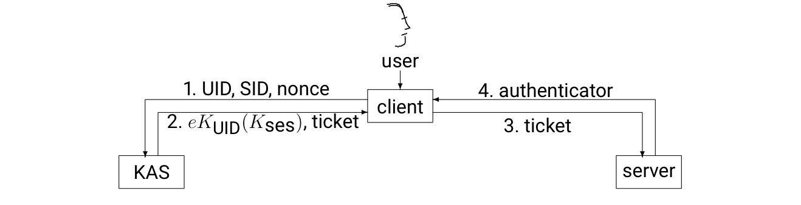
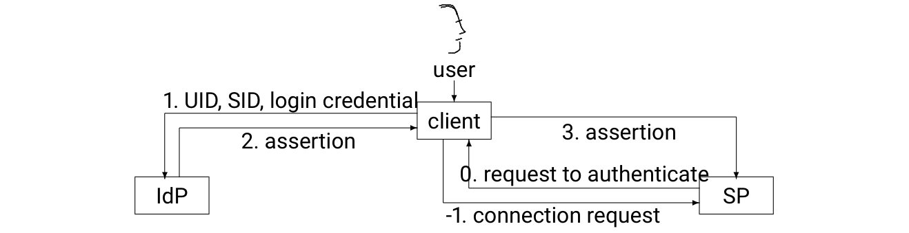
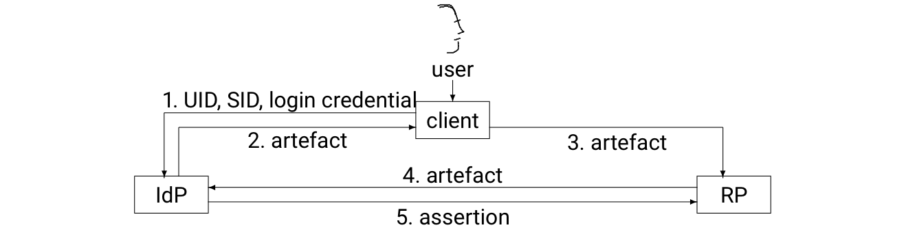
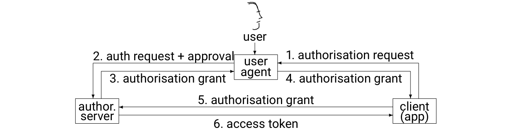

# Chapter 14: Authentication, Authorisation & Accountability

**Authors:** Dieter Gollmann (Hamburg University of Technology &), Nanyang Technological, University Singapore

::: info About this page
This chapter is from [CyBOK Version 1.2.0](https://www.cybok.org/), © Crown Copyright, The National
Cyber Security Centre 2026, licensed under the
[Open Government Licence](https://www.nationalarchives.gov.uk/doc/open-government-licence/).
It was converted from the [PDF](https://www.cybok.org/wp-content/uploads/CyBOK_v1.2.0.pdf) into
a web page so that it works with screen readers and other assistive technology. Each
abbreviation is spelled out in square brackets the first time it appears, and those meanings are
ours, not the book's. So are the names of links the book prints as a bare web address. The PDF
(Portable Document Format) is the original, so if the two disagree, the PDF wins.
:::

## Abstract

Access control builds on authorisation and authentication. This KA \[Knowledge Area\][^14-1] will present the general foundations of access control and some significant instantiations that have emerged as IT \[information technology\] kept spreading into new application areas. It will survey modes of user authentication and the way they are currently deployed, authentication protocols for the web, noting how new use cases have led to a shift from authentication to authorisation protocols, and the formalisation of authentication properties as used in today’s protocol analysis tools. On accountability, the focus is on the management and protection of audit logs. The surveillance of logs to detect attacks or inappropriate behaviour is described in the Security Operations & Incident Management Knowledge Area (Chapter 8) while the examination of evidence following a breach of policy or attack is covered in the Forensics Knowledge Area (Chapter 9). Throughout the KA, we will flag technical terms that appear in more than one meaning in the academic and the trade literature.

## 14.1 Introduction {#_14-1-introduction}

> “All science is either physics or stamp collecting.” [Ernest Rutherford]

In some cases, IT systems may guarantee – by design – that no undesirable behaviour is possible. In other cases, IT systems exhibit such a degree of flexibility – also by design – that additional measures need to be taken to limit undesirable behaviour in accordance with the given circumstances. As noted by Lessig, this can be done by code in the system that excludes behaviour, which will violate certain rules, or it can be done by codes of conduct that the users of the system are expected to adhere to \[<a href="#ref-1367" aria-label="Reference 1367">1367</a>\]. In the latter case, disciplinary or legal processes deal with those that had broken the rules. This is the context for authentication, authorisation, and accountability.

Readers acquainted with the mores of academic writing may now expect definitions of core terms, maybe some refinement of terminology, and then an overview of the latest approaches in achieving authentication, authorisation, and accountability. As will be shown, this approach fails at the first hurdle. These three terms are overloaded to an extent that provides ample space for confusion and dispute. For example, *authorisation* stands both for the setting of rules and for checking compliance with those very rules. Readers should thus be cautious when studying the literature on this Knowledge Area.

Changes in the way IT is being used create their own challenges for taxonomies. How closely should terms be tied to the environment in which they first emerged? There is a habit in the trade and research literature of linking terms exclusively to a notional ‘traditional’ instantiation of some generic concept, and inventing new fashionable terms for new environments, even though the underlying concepts have not changed.

## 14.2 Content

This KA first addresses authorisation in the context of access control and presents the main flavours of access control in use today. The section on access control in distributed systems explains concepts used when implementing access control across different sites. The KA then moves to authentication, touching on user authentication and on authentication in distributed systems, and concludes with a discussion of logging services that support accountability.

## 14.3 Authorisation

\[<a href="#ref-1368" aria-label="References 1368–1372">1368–1372</a>\]

In their seminal paper \[<a href="#ref-1369" aria-label="Reference 1369">1369</a>\], Lampson et al. postulate *access control = authentication + authorisation*. We will follow this lead and present authorisation in the context of access control, starting with an introduction to the concepts fundamental for this domain, followed by an overview of different policy types. Libicki’s dictum, “connotation, not denotation, is the problem” \[<a href="#ref-1373" aria-label="Reference 1373">1373</a>\] also applies here, so we will pay particular attention to the attributes used when setting access rules, and to the nature of the entities governed by those rules. Code-based access control, mobile security, and Digital Rights Management will introduce new paradigms to access control, without changing its substance. We will then present design options for policy enforcement and discuss delegation and some important theoretical foundations of access control.

### 14.3.1 Access Control {#_14-3-1-access-control}

Access control is “the process of granting or denying specific requests ...” \[<a href="#ref-1374" aria-label="Reference 1374">1374</a>\]. This process needs the following inputs

- Who issued the request?
- What is requested?
- Which rules are applicable when deciding on the request?

“Who” in the first question is dangerous. The word suggests that requests always come from a person. This is inaccurate for two reasons. First, the source of a request could be a particular machine, a machine in a particular configuration, or a particular program, e.g. a particular Android app. Secondly, at a technical level, requests in a machine are issued by a process, not by a person. The question thus becomes, “for whom or what is the process speaking for when making the request?” “What is requested” is frequently given as a combination of an action to be performed and the object on which the action is to be performed. The rules are logical expressions that evaluate to a decision. In the elementary case, the decision is *permit* or *deny*. When policies get more elaborate, there may be reasons for adding an *indeterminate* decision. A decision may also prescribe further actions to be performed, sometimes called *obligations*. **14.3.1.1 Core Concepts**

The term ’security policy’ is used both for the general rules within an organisation that stipulate how sensitive resources should be protected, and for the rules enforced by IT systems on the resources they manage. Sterne had coined the terms *organisational policies* and *automated policies* to distinguish these two levels of discourse \[<a href="#ref-1368" aria-label="Reference 1368">1368</a>\].

When setting security policies, *principal* stands for the active entity in an access request. When policies directly refer to users, as was the case in the early stages of IT security, *user identities* serve as principals. Access control based on user identities is known as *Identity-Based Access Control (IBAC)*. In security policies that refer to concepts such as *roles* or to the program that issues a request, the principal is a role or a program. Principal may then generally stand for any security attribute associated with the issuer of a request. With this generalisation, any flavour of access control is by definition *attribute-based access control* (see Section 14.3.1.4).

*Subject* stands for the active entity making a request when a system executes some program. A subject *speaks for* a principal when the runtime environment associates the subject with the principal in an unforgeable manner. The original example for creating a subject that speaks for a principal is user log-in, spawning a process running under the user identity of the person that had been authenticated. The research literature does not always maintain this distinction between principals and subjects and one may find security policies referring to subjects. When policies refer to attributes of a user but not to the user’s identity, user identities become a layer of indirection between principals and subjects \[<a href="#ref-1375" aria-label="Reference 1375">1375</a>\].

A subject is created, e.g., at log-in, and can be terminated, e.g. at log-out. Similarly, user identities are created through some administrative action and can be terminated, e.g., by deleting a user account. In practice, subjects have considerably shorter lifetimes than user identities. Processes that control industrial plants are a rare example of subjects that could live forever, but could be killed by system crashes.

*Object* is the passive entity in an access request. *Access operations* define how an object may be accessed by a subject. Access operations can be as elementary as *read*, *write*, *execute* in Linux, they can be programs such as *setuid programs* in Linux, and they can be entire workflows as in some flavours of UCON (Section 14.3.1.8).

*Access rights* express how a principal may access an object. In situations where there is a direct match between access operations and access rights, the conceptual distinction between access operations and access rights may not be maintained. *Permission* is frequently used as a synonym for access right. *Privilege* may also be used as a synonym for access right, e.g., Oracle9i Database Concepts Release 2 (9.2) states:

> “A privilege is permission to access a named object in a prescribed manner ...”

Other systems, such as Windows, make a distinction between access rights and privileges, using privilege specifically for the right to access system resources and to perform system-related tasks. Operating systems and databases often have a range of *system privileges* that are required for system administration.

The *reference monitor* (more details in Section 14.3.2.2) is the component that decides on access requests according to the given policy.

#### 14.3.1.2 Security Policies

Automated *security policies* are a collection of rules. The rules specify the access rights a principal has on an object. Conceptually, a policy could then be expressed as an *Access Control Matrix* with rows indexed by principals and columns indexed by objects \[<a href="#ref-1113" aria-label="Reference 1113">1113</a>\]. *Access Control Lists (ACLs)* stored with the objects correspond to the columns of this matrix; *capabilities* stored with principals correspond to the rows of this matrix (also see the Operating Systems & Virtualisation Security Knowledge Area (Chapter 11)).

*Discretionary Access Control (DAC)* and *Mandatory Access Control (MAC)* are two core policies formulated in the 1970s in the context of the US \[United States\] defence sector. Discretionary access control policies assign the right to access protected resources to individual user identities, at the discretion of the resource owner. In the literature, DAC may generically refer to policies set by resource owners but also to policies referring directly to user identities, i.e., to IBAC.

Mandatory access control policies label subjects and objects with *security levels*. The set of security levels is partially ordered, with a least upper bound and a greatest lower bound operator. The security levels thus form a *lattice*. In the literature, MAC may generically refer to policies mandated by the system as, e.g., in Security-Enhanced Linux (SELinux) \[<a href="#ref-1376" aria-label="Reference 1376">1376</a>, <a href="#ref-1377" aria-label="Reference 1377">1377</a>\] and in Security-Enhanced (SE) Android \[<a href="#ref-1378" aria-label="Reference 1378">1378</a>\], or to policies based on security levels as in past products such as Trusted Xenix or Trusted Oracle. Policies of the latter type are also known as *multi-level security policies* and as *lattice-based policies*.

#### 14.3.1.3 Role-based Access Control

In *Role-Based Access Control (RBAC)*, *roles* are an intermediate layer between users and the permissions to execute certain operations. Operations can be well-formed transactions with built-in integrity checks that mediate the access to objects. Users are assigned roles and are authorised to execute the operations linked to their active role. *Separation of Duties (SoD)* refers to policies that stop single users from becoming too powerful. Examples for SoD are rules stating that more than one user must be involved to complete some transaction, rules stating that a user permitted to perform one set of transactions is not permitted to perform some other set of transactions, the separation between front office and back office in financial trading firms is an example, or rules stating that policy administrators may not assign permissions to themselves. Static SoD rules are considered during user-role assignment, dynamic SoD must be enforced when a role is activated. The NIST \[National Institute of Standards and Technology\] RBAC model \[<a href="#ref-1371" aria-label="Reference 1371">1371</a>\] distinguishes between:

- *Flat RBAC*: users are assigned to roles and roles to permissions to operations; users get permissions to execute procedures via role membership; user-role reviews are supported.
- *Hierarchical RBAC*: adds support for role hierarchies.
- *Constrained RBAC*: adds separation of duties.
- *Symmetric RBAC*: adds support for permission-role reviews, which may be difficult to achieve in large distributed systems.

Many commercial systems support some flavour of role-based access control, without necessarily adhering to the formal specifications of RBAC published in the research literature. RBAC is an elegant and intuitive concept, but may become quite messy in deployment as suggested by comments in an empirical study on the use of RBAC \[<a href="#ref-1379" aria-label="Reference 1379">1379</a>\]. Practitioners note that RBAC works as long as every user has only one role, or that “the enormous effort required for designing the role structure and populating role data” constitutes an inhibitor for RBAC.

#### 14.3.1.4 Attribute-based Access Control

*Attribute-Based Access Control (ABAC)* is defined in \[<a href="#ref-1380" aria-label="Reference 1380">1380</a>\] as a *“logical access control methodology where authorisation to perform a set of operations is determined by evaluating attributes associated with the subject, object, requested operations, and, in some cases, environment conditions against policy, rules, or relationships that describe the allowable operations for a given set of attributes”*. This is a generic definition of access control that no longer reserves a special place to the user or to the user’s role, reflecting how the use of IT systems has changed over time.

Access control may be performed in an application or in the infrastructure supporting the application. Access control in an infrastructure uses generic attributes and operations. The Linux access control system may serve as an example. Access control in an application uses application-specific attributes and operations. In this distinction, ABAC can be viewed as a synonym for application-level access control.

#### 14.3.1.5 Code-based Access Control

*Code-Based Access Control (CBAC)* assigns access rights to executables. Policies may refer to code origin, to code identity (e.g., the hash of an executable), or to other properties of the executable, rather than to the identity of the user who had launched the executable. Origin can subsume the domain the code was obtained from, the identity of the code signer, a specific name space (.NET had experimented with *strong names*, i.e. bare public keys serving as names for name spaces), and more. CBAC can be found in the Java security model \[<a href="#ref-1381" aria-label="Reference 1381">1381</a>\] and in Microsoft’s .NET architecture \[<a href="#ref-1382" aria-label="Reference 1382">1382</a>\].

The reference monitor in CBAC typically performs a *stack walk* to check that all callers have been granted the required access rights. The stack walk addresses the *confused deputy problem* \[<a href="#ref-1383" aria-label="Reference 1383">1383</a>\], where an unprivileged attacker manipulates a system via calls to privileged code (the confused deputy). Controlled invocation is implemented through *assert* statements; a stack walk for an access right will stop at a caller that asserts this right.

#### 14.3.1.6 Mobile Security

Smartphones typically have a single owner, hold private user data, offer communication functions ranging from cell phone to NFC \[Near-Field Communication\], can observe their surroundings via camera and microphone, and can determine their location, e.g., via GPS \[Global Positioning System\]. On smartphones, apps are the principals for access control. The objects of access control are the sensitive data stored on a phone and the sensitive device functions on a phone.

Access control on a smartphone addresses the privacy requirements of the owner and the integrity requirements of the platform. Android, for example, divides permission groups into normal, dangerous, and signature permissions. Normal permissions do not raise privacy or platform integrity concerns; apps do not need approval when asserting such permissions. Dangerous permissions can impact privacy and need user approval. Up to Android 6.0, users had to decide whether to authorise a requested permission when installing an app. User studies showed that permissions were authorised too freely due to a general lack of understanding and risk awareness, see e.g. \[<a href="#ref-1384" aria-label="Reference 1384">1384</a>\]. Since Android 6.0, users are asked to authorise a permission when it is first needed. Signature permissions have an impact on platform integrity and can only be used by apps authorised by the platform provider; app and permission have to be signed by the same private key. For further details see the Web & Mobile Security Knowledge Area (Chapter 16).

#### 14.3.1.7 Digital Rights Management

*Digital Rights Management (DRM)* has its origin in the entertainment sector. Uncontrolled copying of digital content such as games, movies or music would seriously impair the business models of content producers and distributors. These parties hence have an interest in controlling how their content can be accessed and used on their customers’ devices. Policies can regulate the number of times content can be accessed, how long content can be sampled for free, the number of devices it can be accessed from, or the pricing of content access.

DRM turns the familiar access control paradigm on its head. DRM imposes the security policy of an external party on the system owner rather than protecting the system owner from external parties. *Superdistribution* captures the scenario where data are distributed in protected containers and can be freely redistributed. Labels specifying the terms of use are attached to the containers. The data can only be used on machines equipped with a so-called Superdistribution Label Reader that can unpack the container and track (and report) the usage of data, and enforce the terms of use \[<a href="#ref-1385" aria-label="Reference 1385">1385</a>\]. The search for such a tamper resistant enforcement mechanism was one of the driving forces of Trusted Computing.

The level of tamper resistance required depends on the anticipated threats. Trusted Platform Modules are a hardware solution giving a high degree of assurance. Enclaves in Intel SGX \[Software Guard Extensions\] are a solution in system software. Document readers that do not permit copying implement this concept within an application. *Sticky policies* pursue a related idea \[<a href="#ref-1386" aria-label="Reference 1386">1386</a>\]; policies stick to an object and are evaluated whenever the object is accessed.

*Attestation* provides trustworthy information about a platform’s configuration. *Direct anonymous attestation* implements this service in a way that protects user privacy \[<a href="#ref-1387" aria-label="Reference 1387">1387</a>\]. Remote attestation can be used with security policies that are predicated on the software running on a remote machine. For example, a content owner could check the software configuration at a destination before releasing content. In the FIDO \[Fast Identity Online\] Universal Authentication Framework (FIDO UAF) just the model of the authenticator device is attested. All devices of a given model hold the same private attestation key \[<a href="#ref-1388" aria-label="Reference 1388">1388</a>\].

For a brief period, it was fashionable to use Digital Rights Management as the generic term subsuming ‘traditional’ access control as a special case.

#### 14.3.1.8 Usage Control

*Usage Control (UCON)* was proposed as a framework encompassing authorisations based on the attributes of subject and object, *obligations*, and *conditions* \[<a href="#ref-1370" aria-label="Reference 1370">1370</a>\]. In \[1370\], obligations are additional actions a user has to perform to be granted access, e.g., clicking on a link to agree to the terms of use. In today’s use of the term, obligations may also be actions the system has to perform, e.g., logging an access request. Such actions may have to be performed before, during or after an access happens. Conditions are aspects independent of subject and object, e.g., time of day when a policy permits access only during office hours or the location of the machine access is requested from. Examples for the latter are policies permitting certain requests only when issued from the system console, giving access only from machines in the local network, or policies that consider the country attributed to the IP \[Internet Protocol\] address a request comes from. Many concepts from UCON have been adopted in the XACML \[eXtensible Access Control Markup Language\] 3.0 standard \[<a href="#ref-1389" aria-label="Reference 1389">1389</a>\].

Usage control may also include provisions for what happens after an object is accessed, e.g., that a document can be read but its content cannot be copied or adjustment of attributes after an access has been performed, e.g., decrementing the counter of free articles a visitor may access. In another interpretation, ‘traditional’ access control deals with the elementary access operations found at an infrastructure level while usage control addresses entire work flows at the application level. In telecom services, usage control may put limits on traffic volume.

### 14.3.2 Enforcing Access Control {#_14-3-2-enforcing-access-control}

To enforce a security policy, this policy first has to be set. For a given request, a decision has to be made about whether the request complies with the policy, which may need additional information from other sources. Finally, the decision has to be conveyed to the component that manages the resource requested. In the terminology of XACML, this involves

- Policy Administration Points where policies are set,
- Policy Decision Points where decisions are made,
- Policy Information Points that can be queried for further inputs to the decision algorithm,
- Policy Enforcement Points that execute the decision.

#### 14.3.2.1 Delegation and Revocation

*Delegation* and *granting* of access rights both refer to situations where a principal, or a subject, gets an access right from someone else. The research literature does not have firm definitions for those terms, and the trade literature even less so. Granting tends to be used in a generic sense; *granted access rights* often refer to the current access rights of a subject that delivers a request to a reference monitor. Delegation is sometimes, but not always, used more narrowly for granting short-lived access rights during the execution of a process. For example, XACML distinguishes between *policy administration* and *dynamic delegation* that *“permits some users to create policies of limited duration to delegate certain capabilities to others”* \[<a href="#ref-1390" aria-label="Reference 1390">1390</a>\].

A second possible distinction lets delegation refer only to the granting of access rights held by the delegator, while granting access also includes situations where a managing principal assigns access rights to others but is not permitted to exercise those rights itself.

Rights may not always be granted in perpetuity. The grantor may set an expiry date on the delegation, a right may be valid only for the current session, or there may be a *revocation* mechanism such as the Online Certificate Status Protocol (OCSP) for X.509 certificates (see Section 14.4.1). OCSP is supported by all major browsers. Revocation lists are suitable when online checks are not feasible and when it is known in advance where a granted right may be consumed.

#### 14.3.2.2 Reference Monitor

<figure id="figure-14-1">

{width=659 height=119}

<figcaption>

Figure 14.1: Access Control = Authentication + Authorisation.

</figcaption>
</figure>

::: details Text description of Figure 14.1

A flow diagram read left to right. A drawing of a person labelled "principal" has an arrow to a dashed box "request". An arrow leads from "request" to a box "reference monitor", and another arrow leads from "reference monitor" to a box "object". A small box "ACL" (access control list) sits on top of "object", with an arrow from "ACL" to "reference monitor".

Two labelled feedback lines run above the flow:

- "authentication" (italic): a line from the principal to the request, with arrowheads at both ends of the path (one at the principal and one at the request).
- "authorisation" (italic): a line from the principal to the "ACL", with arrowheads at the principal and at the ACL.

:::

In its original definition, the *reference monitor* was the abstract machine mediating all accesses by subjects to objects. The *security kernel* was a trustworthy implementation of the reference monitor. The *Trusted Computing Base (TCB)* was the totality of protection mechanisms within a computer system responsible for enforcing a security policy (definitions follow \[<a href="#ref-1391" aria-label="Reference 1391">1391</a>\]). There has been some interpretation creep since. The reference monitor component in current operating systems, e.g., the Security Reference Monitor in Windows, would actually be the security kernel from above, and TCB is today sometimes used in a limited sense to stand only for the security kernel. A reference monitor performs two tasks.

- It *authenticates* any evidence supplied by the subject with an access request. Traditionally, the user identity the subject was speaking for was authenticated.
- It evaluates the request with respect to the given policy. The early literature on refers to this task as *authorisation* (of the request), see e.g., \[<a href="#ref-1369" aria-label="Reference 1369">1369</a>\].

However, *authorisation* also stands for the process of setting a security policy; principals are authorised to access certain resources. This overloads the term *authorisation*, applying it both to principals and to requests, but with different meanings. A convention that refers to “authorised principals” and “approved requests” would resolve this issue. [Figure 14.1](#figure-14-1) represents the view of access control adopted in operating systems research around 1990. In Section 14.5.3.4, *authorisation* will stand for the granting of access rights to principals.

The *decision algorithm* executed by the reference monitor has to identify the applicable policies and rules, and try to collect the evidence those rules refer to from *Policy Information Points*. For situations where more than one rule is applicable for a given request, *rule combining algorithms* specify the final decision.

#### 14.3.2.3 Types of Reference Monitors

Schneider describes three types of reference monitors \[<a href="#ref-1372" aria-label="Reference 1372">1372</a>\]:

- Reference monitors that only see the system calls to protected resources, but not the entire program executed. This type of reference monitor, called *execution monitor* in \[<a href="#ref-1372" aria-label="Reference 1372">1372</a>\], is implemented in many operating systems.
- Reference monitors that can see the entire program and analyse its future behaviour before making an access control decision.
- Instructions guarding all security relevant operations are in-lined into the program; in all other respects the in-lined program should behave as before. This type of reference monitor, called *in-line reference monitor* in \[<a href="#ref-1372" aria-label="Reference 1372">1372</a>\], is mostly used to deal with software security issues, see e.g. \[<a href="#ref-1181" aria-label="Reference 1181">1181</a>\].

### 14.3.3 Theory {#_14-3-3-theory}

#### 14.3.3.1 Security Models

Security models are high-level specifications of systems intended to enforce certain security policies. Such models can be used in a formal security analysis to show that a lower-level specification faithfully implements the model.

The Bell-LaPadula (BLP) model \[<a href="#ref-1008" aria-label="Reference 1008">1008</a>\] is a state machine model for discretionary and mandatory access control policies that adapted existing rules governing access to classified data to IT systems. The mandatory access control policies state that a subject can only read objects at its own or at a lower level (no read up). To prevent unauthorised declassification of data, a subject may only write to objects at its own or at a higher level ($*$-property, no write down). The SeaView model extends the BLP policies to multi-level secure relational databases \[<a href="#ref-1392" aria-label="Reference 1392">1392</a>\]. *Polyinstantiation* of database entries, i.e., keeping separate entries at the different security levels, is used to prevent integrity checks from causing information leaks. BLP was highly influential in computer security into the 1990s.

The Biba model captures integrity policies based on integrity levels \[<a href="#ref-1009" aria-label="Reference 1009">1009</a>\]. The access rules are the dual of the BLP model, no read down and no write up, but have no predecessors in the world of paper documents. The *low watermark policies* in Biba introduce dynamic policies (mutable in the terminology of UCON, Section 14.3.1.8) that adapt the integrity level of an object depending on the integrity level of the subject performing the access operation.

The Clark-Wilson model \[<a href="#ref-1393" aria-label="Reference 1393">1393</a>\] places *well-formed transactions* as an intermediate layer between principals and objects; *constrained data items* can only be accessed via those transactions; users (principals) are ‘labelled’ with the transactions they are authorised to execute. This model captures the way data are processed in enterprise systems. The Chinese Wall model \[<a href="#ref-1394" aria-label="Reference 1394">1394</a>\] formalises dynamic *conflict of interest policies* that apply in financial consultancy businesses when working for clients that are commercial competitors. Hence, the act of accessing data for one client dynamically removes permissions to access data from other clients in the relevant conflict-of-interest class.

The Harrison, Ruzzo, and Ullman model (HRU) \[<a href="#ref-1395" aria-label="Reference 1395">1395</a>\] provides a context for examining a core question in policy management: is it possible to decide whether an access right may *leak* to a subject through some sequence of commands? This problem is undecidable in general, but may be decidable under certain restrictions.

#### 14.3.3.2 Enforceable Policies

Schneider has examined the relationship between different kinds of and different kinds of reference monitors \[<a href="#ref-1372" aria-label="Reference 1372">1372</a>\]. Security policies are defined as predicates over execution traces, taking a broader view than Section 14.3.1.2 where rules applied to individual access operations. Policies that only consider the given execution trace are called *properties*. Information flow policies that require an execution trace to be indistinguishable from some benign execution trace are thus not properties. It is shown that only *safety properties* can be enforced by execution monitors (see Section 14.3.2.3).

#### 14.3.3.3 Access Control Logics

Access control and delegation logics \[<a href="#ref-1396" aria-label="Reference 1396">1396</a>\] specify calculi for reasoning about composite principals in distributed systems. The calculus for in distributed systems \[<a href="#ref-1397" aria-label="Reference 1397">1397</a>\] was developed as a formal specification for parts of the Digital Distributed Systems Security Architecture. In such an architecture, cryptographically secured sessions can be established between parties. For example, when a session is established with a principal on some other machine, the session key can be treated as a subject for access control that *speaks for* that principal.

## 14.4 Access Control in Distributed Systems

\[<a href="#ref-1398" aria-label="References 1398–1401">1398–1401</a>\]

Access control in distributed systems deals with technology issues and with organisational issues. Any distributed system needs mechanisms for securely transmitting access requests, attributes, policies, and decisions between nodes. These mechanisms are largely based on cryptography. The requirement for mechanisms that identify and retrieve all policies relevant for a given request may become more pronounced than in centralised settings.

In federated systems where several organisations collaborate, can be set by different parties. This demands some common understanding of the names of principals, attributes, and attribute values so that policies issued by one party can be used in decisions by some other party. Arriving at such a common understanding adds to the practical challenges for RBAC listed in Section 14.3.1.3.

We first introduce core concepts for this domain. We will then cover origin-based access control, examining cross-site scripting from the viewpoint of access control. Federated Access Control and the use of cryptography in access control are explored further.

### 14.4.1 Core Concepts

The literature on access control in distributed systems uses the following related terms, but the distinction between those terms is fluid.

- A *certificate* is a digitally signed data structure, created by an issuer, binding a subject (not to be confused with the term subject as introduced earlier) to some further attributes. The emphasis is on protection by a digital signature.
- A *credential* is something presented to gain access. Examples for credentials are passwords or fingerprints. In distributed systems, a credential can be a data structure containing attributes of the subject. The emphasis is on evidence submitted to the decision algorithm.
- A *token* records (‘encapsulates’) the result of some authorisation decision. For example, in operating systems the access token contains the security credentials for a login session. The emphasis is on conveying the result of an access decision to some enforcement point. So-called *bearer tokens* are not tied to a specific subject and can be used by anyone in possession of the token.

X.509 certificates \[<a href="#ref-1402" aria-label="Reference 1402">1402</a>\] can be used for implementing user-centric access control. Identity certificates bind user identities to public verification keys. Attribute certificates bind user identities to access rights. Attribute certificates correspond closely to ACL entries.

### 14.4.2 Origin-based Policies

In web applications, clients and servers communicate via the HTTP \[Hypertext Transfer Protocol\] protocol. The client browser sends HTTP requests; the server returns result pages. The browser represents the page internally in the `document` object in the Document Object Model (DOM). Security policies specify which resources a script in a web page is allowed to access, or which servers an `XMLHttpRequest` may refer to. Web applications are thus the principals in access control. By convention, principal names are the domain names of the server hosting an application; the policy decision point (cf. Section 14.3.2) at the client side is located in the browser.

The prototype policy for web applications is the *Same-Origin Policy (SOP)*, stating that a script may only connect back to the origin it came from or that an HTTP cookie is only included in requests to the domain that had placed the cookie. Two pages have the same origin if they share protocol, host name and port number. Certain actions may be exempt from the same origin policy. For example, a web page may contain links to images from other domains, reflecting a view that images are innocuous data without malign side effects. There exist variations of the SOP, e.g., policies for cookies that also consider the directory path. There is also the option to set the `HttpOnly` flag in a `Set-Cookie` HTTP response header so that the cookie cannot be accessed by client side scripts.

Sender Policy Framework (SPF) \[<a href="#ref-1403" aria-label="Reference 1403">1403</a>\] implements origin-based access control in the email system as a measure against spoofing the sending domain of an email. Domain owners publish SPF policies in their DNS \[Domain Name System\] zone. An SMTP \[Simple Mail Transfer Protocol\] server can then use the domain part of the MAIL FROM identity to look up the policy and consult this policy to check whether the IP address of the SMTP client is authorised to send mail from that domain.

#### 14.4.2.1 Cross-site Scripting

Cross-site scripting attacks on web applications can be treated as cases of failed authentication in access control. The browser lets all scripts that arrive in a web page speak for the origin of that page. A browser would then run a script injected by the attacker in the context of an origin other than the attacker’s. Content Security Policy (CSP) refines SOP-based access control. The web server conveys a policy to the browser that characterises the scripts authorised to speak for that server \[<a href="#ref-1400" aria-label="Reference 1400">1400</a>\]. Typically, this is done by specifying a directory path on the web server where authorised scripts (and other web elements) will be placed.

The use of CSP in practice has been examined in \[<a href="#ref-1404" aria-label="Reference 1404">1404</a>\], observing that the `unsafe-inline` directive disabling CSP for all pages from a given domain was widely used. This is a familiar policy management issue. A new security mechanism is deployed but quickly disabled because it interferes too much with established practices. Moreover, CSP had an inherent vulnerability related to *callbacks*. Callbacks are names of scripts passed as arguments to other (authorised) scripts, but arguments are not covered by CSP. In *strict* CSP policies, the server declares a nonce in the CSP policy it sends to the client as the script source. The server also includes this nonce as an attribute in all scripts fetched by the client. The client’s browser only accepts scripts that contain this nonce as an attribute. Nonces must only be used once and must be unpredictable.

#### 14.4.2.2 Cross-origin Resource Sharing

When *mashups* of web applications became popular, this exposed another limitation of the same origin policy: there was no built-in mechanism for specifying exceptions to the SOP. Mashup designers initially had to find ways of circumventing the SOP enforced by the browsers. The Cross-Origin Resource Sharing (CORS) protocol was then introduced to support policies for sharing resources cross-origin \[<a href="#ref-1405" aria-label="Reference 1405">1405</a>\]. When a script requests a connection to a target other than its own origin, the browser asks the target to authorise the connection request. The decision at the target considers evidence supplied by the browser, such as the origin of the script or user credentials associated with the request.

CORS specifies a set of HTTP headers to facilitate this exchange. *Preflight Requests* include an `Access-Control-Request-Method` header that informs the target about the access intended. The response lists methods and headers the target grants to the given origin. CORS requests are by default sent without user credentials. The target can set the `Access-Control-Allow-Credentials: true` header to indicate that user credentials may be provided with requests to access a resource. The target must also specify an origin in the `Access-Control-Allow-Origin` header. Otherwise, the browser will not pass on the target’s response to the script that had made the request.

### 14.4.3 Federated Access Control

When organisations join to form a federated security domain, the import of identities, credentials, policy rules, and decisions from different contexts (name spaces) becomes an important security issue. A federation may have several *Policy Administration Points* where policies are defined, *Policy Decision Points* where decisions on access requests are made, *Policy Enforcement Points* where the decisions are enforced, and *Policy Information Points* where additional evidence required for evaluating an access request can be obtained.

*Trust management* as originally conceived in PolicyMaker \[<a href="#ref-1398" aria-label="Reference 1398">1398</a>\] refers to access control systems for such scenarios. *Federated identity management* deals with the management of digital identities in a federation, and in particular with single sign-on in a federation. In Web Services, related standards for authentication (SAML, Section 14.5.3.3) and access control (XACML) have been defined. OAuth 2.0 and OpenID Connect (Section 14.5.3.4) provide user authentication and authorisation via access tokens.

*Binder* is an instance of a federated access control system \[<a href="#ref-1399" aria-label="Reference 1399">1399</a>\]. The Binder policy language is based on Datalog. Policies are logical clauses. Binder *contexts* are identified by public keys and export statements by signing them with the corresponding private key. The decision algorithm is *monotonic*; presenting more evidence cannot reduce the access rights granted.

### 14.4.4 Cryptography and Access Control

Access control mechanisms in an operating system implement a logical defence. Access requests passed via the reference monitor will be policed. This includes requests for direct memory access. However, data are stored in the clear and a party with physical access to the storage medium can retrieve the data and thus bypass logical access control. When solutions for the protection of unclassified but sensitive data were evaluated in the U.S. in the 1970s, it was decided that encrypting the data was the best way forward. Access control would then be applied to the keys needed to unlock the data.

#### 14.4.4.1 Attribute-Based Encryption

Cloud computing has raised the interest in access control on encrypted data over the past decade. Storing data in encrypted form protects their confidentiality but creates a key management challenge. *Attribute-Based Encryption (ABE)* addresses this challenge by constructing encryption schemes that enforce attribute-based decryption policies. Policies are logical predicates over attributes, represented as access structures. The Key Generator is a Trusted Third Party that generates private keys and has to check a user’s policy / attributes before issuing a private key. The Key Generator is thus in a position to recreate private keys.

Key-Policy Attribute-Based Encryption (KP-ABE) works with policies that define a user’s access rights \[<a href="#ref-1401" aria-label="Reference 1401">1401</a>\]. From the corresponding access structure, the Key Generator creates a private decryption key. Documents are encrypted under a set of attributes. In Ciphertext-Policy Attribute-Based Encryption (CP-ABE) \[<a href="#ref-1406" aria-label="Reference 1406">1406</a>\], the policy refers to the document and the access structure is used for encryption. The user’s private key created by the Key Generator depends on the user’s attribute set. In both variants, decryption is possible if and only if the given attribute set satisfies the given access structure.

A study of the feasibility of ABE in realistic dynamic settings had concluded that the overheads incurred by those schemes were still prohibitive \[<a href="#ref-1407" aria-label="Reference 1407">1407</a>\]. Efficient encryption and decryption do not necessarily imply an efficient access control system.

#### 14.4.4.2 Key-centric Access Control

In distributed systems, access requests may be digitally signed. Access rights could then be granted directly to the public verification key without the need to bind the public key to some other principal. SPKI/SDSI uses authorisation certificates for implementing key centric access control, where (names of) public keys are bound to access rights \[<a href="#ref-1408" aria-label="Reference 1408">1408</a>\]. The right to further delegate an access right is controlled by a delegation flag.

Cryptographic keys are rarely suitable principals for access control, however. They would need to have an obvious meaning in the application domain that provides the context for a given security policy. In most cases, cryptographic keys would be subjects speaking for some principal. *Constrained delegation* refines the basic delegation mechanism of SPKI/SDSI so that separation of duties policies can be enforced \[<a href="#ref-1409" aria-label="Reference 1409">1409</a>\].

## 14.5 Authentication

\[<a href="#ref-1209" aria-label="Reference 1209">1209</a>, <a href="#ref-1410" aria-label="References 1410–1414">1410–1414</a>\]

Authentication in a narrow sense verifies the identity of a user logging in – locally or remotely – and binds the corresponding user identity to a subject. User authentication based on passwords is a common method. Some applications have adopted biometric authentication as an alternative. Authentication in distributed systems often entails key establishment. Some security taxonomies thus reduce authentication to a ‘heartbeat’ property to separate authentication from key establishment. The design of authentication protocols is a mature area in security research with good tool support for formal analysis. Standard protocols such as Kerberos, SAML, or OAuth are deployed widely today.

We will give a brief overview of identity management before moving to password-based and biometric user authentication. We then cover authentication protocols from the Needham-Schroeder protocol via Kerberos and SAML to OAuth 2.0, observing that OAuth 2.0 is more of an authorisation protocol than an authentication protocol. We conclude with an overview of formalisations of authentication properties that serve as the basis for a formal analysis of authentication protocols.

### 14.5.1 Identity Management {#_14-5-1-identity-management}

Following NIST, *“identity management systems are responsible for the creation, use, and termination of electronic identities”*. This includes operational aspects when creating and deleting electronic identities. On creation, one question is how strongly electronic identities must be linked to persons. In some sensitive areas, strong links have to be established and documented. For example, money laundering rules may demand a thorough verification of an account holder’s identity. In other areas, electronic identities need not to be tied to a person. *Privacy by design* implies that such applications should use electronic identities that cannot be linked to persons. Identity management may also link access rights to an electronic identity, either directly or via some layer of indirection such as a role. Electronic identities should be terminated when they are no longer required, e.g. when a person leaves an organisation. Care has to be taken that this is done on all systems where this identity had been registered.

Electronic identities exist at different layers. There are identities for internal system purposes, such as user identities in an operating system. These identities must be locally unique and could be created by system administrators (Linux). This can lead to problems when an identity is taken out of use and re-assigned later. The new user may get unintended access to resources the predecessor had access to. When organisations merge, collisions between identities may arise that identity management then must address. Alternatively, identities could be long random strings (Windows). The probability for one of the problems just mentioned to arise is then negligible, but when a user account is re-created, a new random identity is assigned so access rights have to be reassigned from scratch.

Electronic identities such as user names and email addresses could be random strings, but it is often preferable to assign understandable identities. There is, for example, merit in communicating with meaningful email addresses. Email addresses can be taken out of use and re-assigned later, but a user may then receive emails intended for its previous owner.

Web applications often use email addresses as electronic identities. This is convenient for contacting the user, and it is convenient for users as they do not have to remember a new identity. There are alternatives, such as FIDO UAF (Section 14.5.2.3), where electronic identities are randomly created public keys and a back channel for resetting passwords is not required as no passwords are used.

Identity management can also be viewed from a person’s perspective. A person using different identities with different organisations may want to manage how identities are revealed to other parties.

### 14.5.2 User Authentication {#_14-5-2-user-authentication}

Access requests are issued by subjects. Subjects can be associated with security attributes when they are created or during their lifetime. Authentication can then be viewed as the service that validates the security attributes of a subject when it is created. When subjects are created due to some user action, and when their security attributes depend on the corresponding user identity, *user authentication* has to give a reasonable degree of assurance that the user identity linked to the subject belongs to the user who had triggered the creation of the subject. The degree of assurance (strength of authentication) should be commensurate with the severity of the risk one wants to mitigate. The term *risk-based authentication* thus states the obvious.

User authentication can also support accountability, as further elaborated in Section 14.6. *Authentication ceremony* refers to the steps a user has to go through to be authenticated.

There are access control systems where the security attributes of a subject persist throughout the lifetime of that subject. Many operating systems adopt this approach. Policy changes do not affect active processes, but the lifetime of subjects is limited, which limits the period when the new policy is not applied consistently. Alternatively, the attributes of a subject are checked each time it issues a request. For example, a user already logged in to a banking application is authenticated again when requesting a funds transfer. When the focus moves from the subject to individual requests, authentication can be viewed as the service that checks the validity of the security attributes submitted with the request to the decision algorithm.

#### 14.5.2.1 Passwords

When passwords are employed for user authentication, protective measures at the system side include the storing of hashed (Unix, Linux) or encrypted (Windows) passwords, the salting of passwords, and shadow password files that move sensitive data out of world-readable password files. Protective measures at the user side include guidance on the proper choice and handling of passwords, and security awareness programs that try to instil behaviour that assures the link between a person and a principal. Recommendations in this area are changing. The Digital Identity Guidelines published by NIST build on assessments of the observed effectiveness of previous password rules and reflect the fact that users today have to manage passwords for multiple accounts \[<a href="#ref-1414" aria-label="Reference 1414">1414</a>\]. The new recommendations advise

- against automatic password expiry; passwords should only be changed when there is a reason;
- against rules for complex passwords; password length matters more than complexity;
- against password hints or knowledge-based authentication; in an era of social networks too much information about a person can be found in public sources;
- to enable “show password while typing” and to allow paste-in password fields.

Password-based protocols for remote authentication are RADIUS \[Remote Authentication Dial-In User Service\], DIAMETER (both covered in the Network Security Knowledge Area (Chapter 19)), HTTP Digest Authentication, and to some extent Kerberos (Section 14.5.3.2). Password guidance is further discussed in the Human Factors Knowledge Area (Chapter 4).

#### 14.5.2.2 Biometrics for Authentication

Numerous well-rehearsed arguments explain why passwords work poorly in practice. Biometrics are an alternative that avoids the cognitive load attached to password-based authentication. Fingerprint and face recognition are the two main methods deployed for biometric user authentication, known as *verification* in that domain.

Biometric features must be sufficiently unique to distinguish between users, but fingerprints or faces cannot be considered as secrets. Fingerprints are left in many places, for example. Biometric features are thus better treated as public information when conducting a security analysis and the process of capturing the features during authentication has to offer an adequate level of *liveness detection*, be it through supervision of that process or through device features. Employing biometrics for user authentication makes the following assumptions:

- The biometric features uniquely identify a person; face, fingerprints, and iris patterns may serve as examples.
- The features are stable; the effects of aging on fingerprint recognition are surveyed, e.g., in \[<a href="#ref-1415" aria-label="Reference 1415">1415</a>\].
- The features can be conveniently captured in operational settings.
- The features cannot be spoofed during user authentication.

User authentication, known as *verification* in biometrics, starts from a *template* captured by a device. From the template, a *feature vector* is extracted. For example, the template may be the image of a fingerprint, the features are the positions of so-called *minutiae* (ridge endings, bifurcations, whorls, etc.). Users initially register a reference feature vector. During authentication, a new template is captured, features are extracted and compared with the reference values. A user is authenticated if the number of matching features exceeds a given threshold. This process may fail for various reasons:

- Failure to capture: this may happen at registration when it is not possible to extract a sufficient number of features, or during authentication.
- False rejects: the genuine user is rejected because the number of matches between reference features and extracted features is insufficient.
- False accepts: a wrong user is accepted as the matching threshold is exceeded.
- Spoofing: to deceive the device capturing the template, some object carrying the user’s features is presented. Liveness detection tries to ensure that templates are captured from the very person that is being authenticated \[<a href="#ref-1416" aria-label="Reference 1416">1416</a>\].

Biometric authentication based on face recognition or fingerprints is used increasingly at automated border control gates \[<a href="#ref-1417" aria-label="Reference 1417">1417</a>\]. It has also become a feature on mobile devices, see e.g. \[<a href="#ref-1418" aria-label="Reference 1418">1418</a>\]. A survey of the current state-of-the-art approaches to biometric authentication is given in \[<a href="#ref-1419" aria-label="Reference 1419">1419</a>\].

#### 14.5.2.3 Authentication Tokens

Authentication by password relies on “something you know”. Biometric authentication builds on “who you are”. In a further alternative, users are issued with a device (a.k.a. *token* or *security key*, not to be confused with a cryptographic key) that computes a OTP \[One-Time Password\] synchronised with the authenticator, or a response to a challenge set by the authenticator. Possession of the device is then necessary for successful authentication, which is thus based on “something you have”.

A token could be a small hand-held device with an LED \[Light-Emmiting Diode\] display for showing an OTP that the user enters in a log-in form; RSA \[Rivest-Shamir-Adleman\] SecureID and YubiKey are examples for this type of token. A token could come with a numeric keypad in addition to the LED display and with a ‘sign’ button. The holder could then receive a challenge, e.g., an 8-digit number, enter it at the keypad, press ‘sign’ to ask the token to compute and display the response, and then enter the response in a log-in form. Some e-banking services use this type of token for account holder authentication. With PhotoTAN devices, the challenge is sent as a QR \[Quick Response\] code to the user’s computer and scanned from the screen by the PhotoTAN device. When authentication is based on a secret shared between token and server, different tokens must be used for different servers.

The FIDO authenticator is a token that can create public key / private key pairs; public keys serve as identifiers, private keys are used for generating digital signatures \[<a href="#ref-1388" aria-label="Reference 1388">1388</a>\]. In FIDO UAF, users register a public key with a server. The same token can be used for different servers, but with different keys. User authentication is based on a challenge-response pattern (Section 14.5.4.1), where the user’s authenticator digitally signs the response to the server’s challenge. The response is verified using the public key registered with the server.

In some applications, possession of the token is sufficient for user authentication. In other applications, authentication is a two-stage process. First, the token authenticates the user, e.g., based on a PIN \[Personal Identification Number\] or a fingerprint. In a second stage, the server authenticates the token. It will depend on the threat model whether ‘weak’ authentication in the first stage and ‘strong’ authentication in the second stage can provide adequate security.

Apps on smartphones can provide the same functionality as authentication tokens, but smartphones are not dedicated security devices. User authentication may then be compromised via attacks on the smartphone. This may become even easier when smartphones come with a secondary authentication mechanism for use when a device is partially locked, with a less onerous but also less secure authentication ceremony. This creates a conflict between the interests of smartphone manufacturers who value ease-of-use of a communications device, and the interests of the providers of sensitive applications searching for a security token.

#### 14.5.2.4 Behavioural Authentication

Behavioural authentication analyses “what you do”, lending itself naturally to *continuous authentication*. Keystroke dynamics \[<a href="#ref-1420" aria-label="Reference 1420">1420</a>, <a href="#ref-1421" aria-label="Reference 1421">1421</a>\] can be captured without dedicated equipment. Characteristic features of hand writing are writing speed and pen pressure \[<a href="#ref-1422" aria-label="Reference 1422">1422</a>\]. Here, special pens or writing pads need to be deployed. Voice recognition needs a microphone. Smartphones come with various sensors such as touch screens and microphones that are being utilised for behavioural authentication today. The requirements on behavioural authentication are the same as those listed in Section 14.5.2.2:

- The behavioural features uniquely identify a person.
- The features are stable and unaffected by temporary impairments.
- The features can be conveniently captured in operational settings.
- The features cannot be spoofed during user authentication.

Advocates of continuous authentication promise *minimum friction, maximum security*. Behavioural authentication does not inconvenience the user with authentication ceremonies, but variations in user behaviour may cause false rejects. For example, how will a severe cold affect voice recognition? There needs to be a smooth fall-back when behavioural authentication fails. Security depends on the strength of liveness detection. For example, will voice recognition detect synthesised speech or a very proficient human voice imitator? Without a precise threat model, behavioural authentication can only offer uncertain security guarantees. There is a growing research literature on different modes of behavioural authentication. Criteria for assessing the actual contributions of this research include sample size and composition, whether longitudinal studies have been performed, the existence of an explicit threat model and resistance to targeted impersonation attempts.

#### 14.5.2.5 Two-factor Authentication 2FA

Multi-factor authentication combines several user authentication methods for increased security. The European Payment Services Directive 2 (PSD2, Directive (EU) 2015/2366), written for the regulation of financial service providers, prescribes 2FA for online payments (with a few exceptions). PSD2 thus is a case study on rolling out large scale 2FA solutions.

The two factors could be a password and an authentication token for computing Transaction Authentication Numbers (TANs) uniquely tied to the content of a transaction. The token could be a separate device; if the device is tied to one payment service only, customers would have to carry multiple devices with them. For devices that can be used with several services, some level of prior standardisation is required. The FIDO alliance has been promoting its standards for PSD2 compliant two-factor authentication.

The token could be a smartphone registered with the service; customers could then install apps for several services on the same device. This approach has been favoured by many banks. However, when passwords (or PINs) and TANs are handled by the same device, the two mechanisms are no longer independent, reducing the security gains claimed for 2FA.

In contrast to the European Trust Services and Electronic identification regulation (eID Directive - Regulation (EU) No 910/2014) that specifies requirements on secure signature creation devices, PSD2 does not impose security requirements on the devices used for user authentication but wants “to allow for the use of all common types of devices (such as computers, tablets and mobile phones) for carrying out different payment services”. PSD2 and the eID Directive thus strike different balances between ease-of-use and security, a trade-off notoriously difficult to get right.

### 14.5.3 Authentication in Distributed Systems {#_14-5-3-authentication-in-distributed-systems}

When methods for user authentication in distributed systems were first designed, an authenticated *session* took the place of a process speaking for the user. Authenticated sessions were constructed on the basis of cryptographic keys. In the terminology of Section 14.3.1, those session keys became the subjects of access control, and *key establishment* became a core feature of the user authentication process.

#### 14.5.3.1 Needham-Schroeder Protocol

The Needham-Schroeder protocol is a key establishment protocol that employs an authentication server as an intermediary between a client and a server \[<a href="#ref-1410" aria-label="Reference 1410">1410</a>\]. Client and server share secret keys with the authentication server respectively. Nonces, values that are used only once, are used as a defence against replay attacks. The client does not have to share individual long term secrets with all servers it wants to access, it needs just one shared secret with the authentication server. The authentication server issues a session key to client and server, and has to be trusted to properly authenticate the client and the server.

#### 14.5.3.2 Kerberos

The Kerberos protocol \[<a href="#ref-1411" aria-label="Reference 1411">1411</a>\] adapted the Needham-Schroeder protocol for user authentication at the MIT campus. Most major operating systems have since adopted (variations of) Kerberos for user authentication.

Users share a password with a Kerberos Authentication Server (KAS) they are registered with. From this password, the client and the KAS derive a symmetric encryption key. In its response to a client request 1 the KAS sends an encrypted session key to the client, together with a *ticket* containing that session key encrypted under a key shared between the KAS and the server 2 . If the correct password is entered at the client, the session key can be decrypted. The ticket is forwarded to the server 3 . Client and server now share the session key, and the server can return an authenticator constructed with the session key 4 .

A Ticket Granting Server (TGS) may provide a further layer of indirection between client and server. The KAS would issue a session key for the TGS and a Ticket Granting Ticket (TGT) to the client. With the session key and the TGT, the client then requests a ticket for the resource server. The TGS checks the TGT and can apply an access control policy to decide whether to issue a ticket for use with the server. If the request is approved, the TGS issues another session key and a ticket encrypted under a secret key shared between TGS and server.

<figure id="figure-14-2">

{width=659 height=169}

<figcaption>

Figure 14.2: Message flow in the Kerberos protocol.

</figcaption>
</figure>

::: details Text description of Figure 14.2

A message flow diagram with a user above and three boxes below. A figure labelled "user" has an arrow down to the box "client", which sits in the middle. The box "KAS" is on the left and the box "server" is on the right. The abbreviation KAS is as printed in the figure.

Messages, in order:

1. From client to KAS: "1. UID \[user identifier\], SID, nonce"
2. From KAS to client: "2. $eK_{\mathsf{UID}}(K_{\mathsf{ses}})$, ticket"
3. From client to server: "3. ticket"
4. From server to client: "4. authenticator"

:::

#### 14.5.3.3 SAML

The Security Assertion Markup Language (SAML) v2.0 defines meta-protocols for authentication in web services \[<a href="#ref-1412" aria-label="Reference 1412">1412</a>\]. Meta-protocols specify high-level message flows that can be bound to various underlying protocols such as Kerberos. Applications that use SAML for authentication then need not be aware of the underlying protocol used. Many cloud service providers, e.g., AWS \[Amazon Web Services\], Azure, IBM, are using SAML for user authentication via a browser.

Security tokens containing *assertions* are used to pass information about a principal (usually an end user) between a SAML authority (a.k.a. Identity Provider (IdP) or asserting party), and a SAML consumer (a.k.a. Service Provider (SP) or relying party). Assertions can be passed via the client to the relying party (browser POST profile, [Figure 14.3](#figure-14-3)) or be pulled by the relying party from the asserting party via a handle (artefact) passed via the client (browser artefact profile, [Figure 14.4](#figure-14-4)). The specification of SAML messages and assertions is based on XML \[Extensible Markup Language\].

An authentication assertion has to include the name of the identity provider and the user identity, but this is insufficient. This was shown to be the case by an attack against the implementation of Service Provider-initiated single sign-on with Redirect/POST bindings used at that time in Google Applications \[<a href="#ref-1350" aria-label="Reference 1350">1350</a>\]. In this implementation, authentication assertions included just the two aforementioned fields. A malicious Service Provider could ask a user for authentication at a specific Identity Provider (step 0 in [Figure 14.3](#figure-14-3)) and then re-use the assertion to impersonate the user with another Service Provider that relied on the chosen Identity Provider and where the user was known by the same user identity, e.g., an email address.

The specification of SAML Redirect/POST Bindings includes the Service Provider’s ID \[identifier\] and a request ID issued by the Service Provider in the authentication assertion. Hence, a Service Provider would only accept an assertion issued in reaction to a pending authentication request.

<figure id="figure-14-3">

{width=659 height=169}

<figcaption>

Figure 14.3: Message flow in the SAML POST profile.

</figcaption>
</figure>

::: details Text description of Figure 14.3

A message flow diagram with a user above and three boxes below. A figure labelled "user" has an arrow down to the box "client", which sits in the middle. The box "IdP" is on the left and the box "SP" is on the right. The abbreviations IdP (identity provider) and SP (service provider) are as printed in the figure.

Messages, in order:

- "-1. connection request": from client to SP.
- "0. request to authenticate": from SP to client.
- "1. UID, SID, login credential": from client to IdP.
- "2. assertion": from IdP to client.
- "3. assertion": from client to SP.

:::

<figure id="figure-14-4">

{width=659 height=169}

<figcaption>

Figure 14.4: Message flow in the SAML artefact profile.

</figcaption>
</figure>

::: details Text description of Figure 14.4

A message flow diagram with a user above and three boxes below. A figure labelled "user" has an arrow down to the box "client", which sits in the middle. The box "IdP" is on the left and the box "RP" is on the right. The abbreviations IdP (identity provider) and RP (relying party) are as printed in the figure.

Messages, in order:

1. From client to IdP: "1. UID, SID, login credential"
2. From IdP to client: "2. artefact"
3. From client to RP: "3. artefact"
4. From RP to IdP: "4. artefact"
5. From IdP to RP: "5. assertion"

:::

SAML was introduced as a meta-protocol to isolate web services from underlying authentication protocols and from different underlying communication protocols. It was conceived as a federated single sign-on protocol where the relying party decides how to use assertions when making decisions according to its own security policy.

In the practical deployment of SAML, parsing XML documents – the price to be paid for employing a meta-protocol – can create non-trivial overheads and can introduce security vulnerabilities. Furthermore, the advent of smartphones has made it easier to access the internet from mobile user devices, removing one of the reasons for introducing a meta-protocol between web services and the underlying IT systems.

#### 14.5.3.4 OAuth 2 – OpenID Connect

Newer protocols such as OAuth 2.0 \[<a href="#ref-1413" aria-label="Reference 1413">1413</a>\] and OpenID Connect \[<a href="#ref-1423" aria-label="Reference 1423">1423</a>\] run directly over HTTP and provide authentication and authorisation. The parties involved include a user who owns resources, the resource owner, a resource server that stores the user’s resources, a so-called client application that wants to be granted access to those resources, and an Authorisation Server (AS) that can authenticate users and client applications.

Clients have to be registered with the AS. They will receive a public client ID and a client secret shared with the AS. This secret is used for establishing secure sessions between the client and the AS. The client also registers redirect\_URIs with the AS. The AS will redirect a user agent only to those registered redirect\_URIs. Proper definition of the redirect\_URIs is primarily a matter for the client, and can also be enforced by the AS. Weak settings are open to exploitation by attackers.

In an OAuth protocol run (a high level overview is given in [Figure 14.5](#figure-14-5)), the user agent (browser) has opened a window for the client application. In the client window, an *authorisation request* can be triggered 1 ; the request also contains a redirect\_URI. The user agent then typically conveys the authorisation request and the user’s authorisation to the AS 2 . A secure session between the user agent and the AS is required, and may already exist if the user has logged in previously at the AS. If authorisation is granted, an *authorisation grant* is returned to the user agent 3 , which will pass it on to the redirect\_URI given by the client 4 . The client then posts the *authorisation grant* and a redirect URI \[Uniform Resource Identifier\] to the AS 5 . It is assumed that the AS can authenticate this message as coming from the client. If the request is valid, the AS returns an *access token* to the *redirect URI* provided, where the token can be used to retrieve the resource from the resource server 6 .

*Authorisation requests* and *authorisation grants* are linked via a request ID, called *state* in OAuth. Omitting the request ID or using a fixed value had introduced vulnerabilities in applications using OAuth, see e.g. \[<a href="#ref-1424" aria-label="Reference 1424">1424</a>, <a href="#ref-1425" aria-label="Reference 1425">1425</a>\].

<figure id="figure-14-5">

{width=659 height=174}

<figcaption>

Figure 14.5: Message flow in OAuth 2.0.

</figcaption>
</figure>

::: details Text description of Figure 14.5

A message flow diagram with a user above and three boxes below. A figure labelled "user" has an arrow down to the box "user agent", which sits in the middle. The box "author. server" (authorisation server) is on the left and the box "client (app)" is on the right.

Messages, in order:

1. From client (app) to user agent: "1. authorisation request"
2. From user agent to author. server: "2. auth request + approval"
3. From author. server to user agent: "3. authorisation grant"
4. From user agent to client (app): "4. authorisation grant"
5. From client (app) to author. server: "5. authorisation grant"
6. From author. server to client (app): "6. access token"

:::

There is a fundamental switch in focus compared to SSO \[Single Sign-On\] protocols such as Kerberos and SAML despite a considerable degree of similarity in the message flows. In an OAuth 2.0 protocol run the user is no longer the party requesting access to a resource owned by someone else, but the party granting access to resources owned by the user. OAuth 2.0 has thus become an authorisation protocol. Several assumptions about pre-existing trust relationships between parties have to be met for OAuth to be secure. Conversely, one cannot take for granted that the OAuth security properties still hold when the protocol is deployed in a new setting.

OpenID Connect puts user authentication back into the OAuth 2.0 message flow. The client application now doubles as a relying party, and the authorisation server becomes an authentication & authorisation server that issues digitally signed *id tokens* (authentication assertions in SAML diction). An id token contains the name of the issuer, the name of the authenticated user (called *subject*), the intended relying party (called *audience*), the nonce that had been sent with the authentication request, an indicator of authentication strength, and other fields.

### 14.5.4 Facets of Authentication {#_14-5-4-facets-of-authentication}

We have sketched how user authentication in distributed systems first integrated session and key establishment with the process of verifying a user’s identity, and later established authorisation practices to access a user’s resources. In communication security, *peer entity authentication* refers to the process of verifying the identity of the peer in a *connection* and *data origin authentication* to the process of verifying the origin of individual data items.

User authentication, whether relating to a local system or to a remote system, entails three aspects:

- creating a new subject, e.g. a new process or a new session with a *fresh* session key,
- linking an internal entity, e.g. a user ID, to the subject,
- linking an external entity, e.g. a person, to an internal identity.

To differentiate between these aspects, the term *key establishment* was introduced in communication security towards the end of the 1980s for the first aspect. *Entity authentication* stood for what was left. Quoting ISO/IEC 9798, *“entity authentication mechanisms allow the verification, of an entity’s claimed identity, by another entity. The authenticity of the entity can be ascertained only for the instance of the authentication exchange”*. This property is related to *dead peer detection* and to the *heartbeat extension* in RFC \[Request For Comments\] 6250 \[<a href="#ref-1426" aria-label="Reference 1426">1426</a>\]. Note that this definition does not distinguish between internal and external entities.

#### 14.5.4.1 Patterns for Entity Authentication

Entity authentication according to the definition in ISO/IEC 9798 can be implemented with challenge response-mechanisms. When *prover* and *verifier* share a secret, the verifier sends an unpredictable challenge to the prover who constructs its response as a function of the challenge and the shared secret. For example, HTTP digest authentication uses the hash of the challenge, a password, and further data that binds authentication to a particular HTTP request.

When public key cryptography is used, the verifier needs the prover’s public key. With a digital signature scheme, the verifier could send the challenge in the clear and the prover could respond with the signed challenge. With a public key encryption scheme, the verifier could encrypt the challenge under the prover’s public key; a response constructed from the decrypted challenge would authenticate the prover. The latter mechanism is used with Trusted Platform Modules (TPMs) where successful decryption of data encrypted under the public endorsement key of a TPM authenticates the TPM. In both cases, the verifier needs an authentic copy of the prover’s public verification key. When users are identified by arbitrary public keys, no Public Key Infrastructure is required and the public key could be set directly in a registration phase.

#### 14.5.4.2 Correspondence Properties

The Public-Key Needham-Schroeder protocol uses public key encryption with its challenge-response mechanism \[<a href="#ref-1410" aria-label="Reference 1410">1410</a>\]. In this protocol, a malicious prover could decrypt a challenge and reuse it in a protocol run with a third party pretending to be the original verifier; the third party would then respond to the verifier although the verifier is not engaged in a protocol run with the third party \[<a href="#ref-1209" aria-label="Reference 1209">1209</a>\]. This scenario would amount to an attack if the mismatch in the assumptions about a protocol run is security relevant. The attack would be detected if the identities of prover and verifier are included in all messages. Note that in this ‘attack’ the verifier still correctly concludes that the prover is alive.

Matches in the assumptions about aspects of a protocol run held by the peers on completion of a run can be captured by *correspondence properties*, as proposed in \[<a href="#ref-1427" aria-label="Reference 1427">1427</a>\] and further elaborated in \[<a href="#ref-1223" aria-label="Reference 1223">1223</a>\]:

- *Aliveness*: whenever the verifier (initiator) concludes a protocol run, the prover had also been engaged in a protocol run.
- *Weak agreement*: whenever the verifier (initiator) concludes a protocol run apparently with a given prover, the prover had also been engaged in a protocol run, apparently with that verifier.
- *Non-injective agreement*: whenever the verifier (initiator) concludes a protocol run apparently with a given prover, the prover had also been engaged in a protocol run, apparently with that verifier, and responder and receiver agree on a specified set of data items pertaining to a protocol run.
- *Agreement*: whenever the verifier (initiator) concludes a protocol run apparently with a given prover, the prover had also been engaged in a protocol run, apparently with that verifier, and responder and receiver agree on a specified set of data items pertaining to a protocol run, and each protocol run of the verifier corresponds to a unique protocol run of the prover.

In the vulnerable Redirect/POST Binding in Google Applications there is no agreement on the service provider an authentication assertion is intended for (\[<a href="#ref-1350" aria-label="Reference 1350">1350</a>\], Section 14.5.3.3). Flawed implementations of OAuth that use a fixed value for the state variable do not even guarantee aliveness (\[<a href="#ref-1424" aria-label="Reference 1424">1424</a>\], Section 14.5.3.4).

Correspondence properties are *intensional* properties well suited for protocol analysis using model checking. This line of research had reversed the earlier decision to separate pure entity authentication from agreeing on session keys and again added agreement on certain data items to authentication. TAMARIN \[<a href="#ref-1238" aria-label="Reference 1238">1238</a>\] and ProVerif \[<a href="#ref-1428" aria-label="Reference 1428">1428</a>\] are examples for tools that support the automated analysis of authentication protocols.

#### 14.5.4.3 Authentication as Verified Association

Returning to a holistic view on authentication, one could use this as a general term for mechanisms that create a new subject and associate it with evidence relevant for access decisions. If this route is taken, verifying the identity of a user becomes just a special case of authentication.

There would, furthermore, be merit in distinguishing between association with internal and external entities. The latter case is an instance of the ‘difficult and error prone’ problem of faithfully representing aspects of the physical world within an IT system. The veracity of such representations cannot be guaranteed by cryptographic means alone.

For example, access control in distributed systems may make use of public key cryptography (Section 14.4.4.2). Public keys can then be interpreted as subjects for the purpose of access control. The checks performed by a certificate authority before it issues a certificate would then amount to authentication of an external entity.

#### 14.5.4.4 Authentication for Credit or for Responsibility

Authentication may serve the purpose of giving *credit* to an entity for actions it has performed, or of establishing which entity is *responsible* for an action \[<a href="#ref-1429" aria-label="Reference 1429">1429</a>\]. In the first case, an attack amounts to earning undeserved credits and authentication is broken if the attacker succeeds in making a victim perform actions under the attacker’s identity. In the second case, an attack amounts to deflecting responsibility to someone else and authentication is broken if the attacker succeeds in performing actions under the victim’s identity.

## 14.6 Accountability {#_14-6-accountability}

> \[<a href="#ref-1430" aria-label="Reference 1430">1430</a>, ch. 24\], \[<a href="#ref-1431" aria-label="Reference 1431">1431</a>, ch. 18\]

Accountability has been defined as *“the security goal that generates the requirement for actions of an entity to be traced uniquely to that entity. This supports non-repudiation, deterrence, fault isolation, intrusion detection and prevention, and after-action recovery and legal action”* \[<a href="#ref-1374" aria-label="Reference 1374">1374</a>\].

This definition invites investigations into psychology to determine what makes an effective deterrent, investigations into legal matters to determine the standard of evidence demanded in a court of law, and technical investigations into the collection, protection, and analysis of evidence. This Knowledge Area will focus on those technical aspects.

We will cover the technical prerequisites for accountability. We will briefly explore potential conflicts between privacy and accountability, describe current activities in distributed logging of events, and refer to some related terms that overlap with accountability.

### 14.6.1 Technical Aspects

Accountability supports processes that are launched after events have occurred. Such a process may be a regular audit that checks whether an organisation complies with existing regulations. It might represent a technical audit that scans logs in search for signs of a cyber attack. It may also be an investigation triggered by an incident that tries to identify the vulnerabilities exploited, or an investigation that tries to identify the parties responsible. In all cases, the quality of the evidence is decisive.

The aforementioned processes make use of logs of events. Such logs may be kept by the operating system, by networking devices, or by applications (Section 14.6.2 will give an example). The nature of the events depends on the activity that is being monitored.

#### 14.6.1.1 Audit Policies

Accountability is only as strong as the quality of evidence collected during operations. System administrators may set audit policies that define which events will be logged. Examples for such events are successful and failed authentication attempts, and decisions on sensitive access requests. Operating systems and audit tools provide menus to guide administrators through this task. Access control policies that specify as obligations that certain requests must be logged also influence which evidence is collected.

#### 14.6.1.2 Preserving the Evidence

Accountability is only as strong as the protection of the evidence collected during operations. Attackers could try to hide their traces by deleting incriminating log entries once they have acquired sufficient privileges. They could then modify audit policies so that future actions are not recorded, but should not be able to tamper with the evidence already collected.

Tamper resistance could rely on physical measures like printing the log on an endless paper reel or writing the log to WORM (Write-Once, Read-Many) memory like an optical disk. Tamper resistance could be supported by cryptography. Storing the log as a hash chain \[<a href="#ref-1432" aria-label="Reference 1432">1432</a>, <a href="#ref-1433" aria-label="Reference 1433">1433</a>\] makes it evident when entries have been removed, but does not guarantee that entries cannot be lost.

Audit policies have to address situations where logging is disrupted, e.g., because the log file has run out of space. Is it then acceptable to overwrite old entries or should the system be stopped until proper auditing is again enabled? This conflict between availability and accountability has to be resolved.

#### 14.6.1.3 Analysing the Evidence

Audit logs can create large volumes of data and many entries are not security relevant so that automated processing is required. Known attack patterns can be detected by their signatures. Machine learning techniques can help to detect anomalies. Lessons learned when applying this approach to network intrusion detection are discussed in \[<a href="#ref-1434" aria-label="Reference 1434">1434</a>\]. Visualisation techniques try to draw the administrators’ attention to the most relevant events.

#### 14.6.1.4 Assessing the Evidence

Accountability is only as strong as the method of user authentication when legal or disciplinary actions are to be supported. This relates to technical aspects of the authentication mechanism and also to user resilience to phishing and social engineering attacks. Telling users not to fall for obvious phishing attacks is easy, but a well-designed spear phishing attack will not be obvious.

Accountability is only as strong as the organisational security policies on connecting devices, e.g. USB \[Universal Serial Bus\] tokens, to internal systems, and policies on access to external web sites. Accountability is only as strong as the defences against software vulnerabilities that can be exploited to run code under a user identity without the user being aware of that fact, e.g. so-called drive-by-downloads.

### 14.6.2 Privacy and Accountability

Privacy rules can have an impact on the events that may be logged. Employment law may, for example, limit how closely a company monitors its employees, which might make it difficult to achieve accountability when rules have been broken.

Sometimes, there are technical resolutions to such conflicts between legal goals. Take the example of a company that is not permitted to log which external websites employees connect to: when an external site is attacked from within the company network, it is desirable that the perpetrator can be held accountable. To achieve both goals, the company gateway would log for outgoing requests only the internal IP address and the port number used with the global IP address. There is thus no record of visited websites. If an attack is reported, the website affected can provide the port number the attack came from, establishing the link between the internal IP address and the visited site.

Conversely, logging may have unintended privacy impacts. Take *Certificate Transparency* [RFC 6962] as an example. Certificate Transparency is a logging service for the issuers of TLS \[Transport Layer Security\] certificates. Participating Certificate Authorities record the issuance of certificates with this service. Domain owners can scan the log for certificates for their domain that they had not asked for, i.e., detect authentication failures at issuers. This service was introduced in reaction to attacks where such misissued certificates had been used to impersonate the domain affected, and makes issuers accountable to domain owners.

*Private subdomains* are subdomains created for internal use only. When a certificate for a private subdomain is requested, the certificate will be recorded in the Certificate Transparency log disclosing the existence of the private subdomain to the public \[<a href="#ref-1435" aria-label="Reference 1435">1435</a>\].

### 14.6.3 Distributed Logs

Logs may be kept to hold the users of a system accountable. Logs may be kept to hold the owner of a system accountable. In the latter case, auditors may require that the logging device is sealed, i.e., rely on a physical root of trust. Alternatively, logs could be kept in a distributed system run by independent nodes where there are sufficient barriers to forming alliances that can take over the system.

The nodes maintaining the log need to synchronise their versions of the log. The overheads for synchronisation, or *consensus*, depend on the failure model for the nodes and for the communication network, and on the rules for joining the distributed system. Systems may be open for anyone, or be governed by a membership service. The recent interest in *blockchains* extends to this type of logging solutions.

### 14.6.4 Related Concepts

The definition at the start of Section 14.6 refers to non-repudiation and intrusion detection. Non-repudiation has a specific meaning in communication security, viz. providing *unforgeable* evidence that a specific action occurred. This goal is not necessarily achieved by logging mechanisms; they may protect the entries recorded, but may record entries that have already been manipulated.

Intrusion detection (see the Security Operations & Incident Management Knowledge Area (Chapter 8)) is an area of its own with overlapping goals. Intrusion detection does not have the requirement *for actions of an entity to be traced uniquely to that entity*. The focus will be more on detecting attacks than detecting the attacker.

The definition given subsumes both the accountability of legal persons and technical investigations into security breaches. The standards of evidence may be higher in the first case. Tracing actions uniquely to an entity leads to *cyber attribution*, the process of tracking and identifying the perpetrators of a cyber attack. Circumstantial evidence such as similarity in malware may be used in this process, and mis-attribution due to *false flag operations* is an issue. Calling for DRM to protect the intellectual property of content owners, because digital content can be copied so easily, but assuming that malware cannot be copied would be incongruous.

## Applying the Knowledge

IT security mechanisms should not be deployed for their own sake but for a reason. The reason has to come from an application in need of protection. An organisational policy would capture the protection requirements and then be implemented by an automated policy (Section 14.3.1.1). Sometimes, this process can start from a clearly defined organisational policy. The policies governing access to classified paper documents are an example. There, the translation into automated policies did not have to bridge a wide conceptual gap, although there were unanticipated twists, e.g., the no write-up policy of the BLP model. These specific circumstances may have raised the unwarranted expectation that this approach would work in general. The fact that these policies were applied in highly hierarchical organisations and were fairly stable are further points worth noting.

Sinclair et al. paint a picture of a very different world \[<a href="#ref-1436" aria-label="Reference 1436">1436</a>\]. Their observations can be summarized under the headings of *translation* (from organisational to automated policies) and *automation*. Any translation has to start from a source document, in our case an organisational policy. The translator will face problems when the source is ambiguous or inconsistent. This situation is more likely to arise in organisations with a matrixed structure, where several entities are setting policies, than in strictly hierarchical organisations. Moreover, the wider the language gap between the source document and the destination document, the more difficult translation becomes, and the more difficult it is to ascertain that the translation meets the spirit of the source. The latter step is a prerequisite for *policy certification*, i.e., management approval of a given automated policy.

Organisational policies may intentionally leave decisions at the discretion of caseworkers, e.g., for handling situations where none of the existing rules is directly applicable or where competing rules apply. It is a purpose of automation to remove discretion. Removing discretion adds rules that do not have a counterpart in the organisational policy. Creating an automated policy is then more than translation, it becomes an exercise in creative writing in the spirit of the organisational policy. To do this job well, the writer needs a good understanding of the applications and their workflows, on top of proficiency in the target language (the domain of IT experts). Automated policies based on naïve assumptions easily become denial-of-service attacks on the user. As a related point, there is a tension between the competing goals of keeping a policy simple – which may be feasible in an organisational policy that leaves room for discretion – and of requiring the (automated) policy to cater for a variety of different contexts. This explains why in many cases the number of rules created to cater for exceptions to the general rules ends up being overwhelming. Points that span organisational and automated policies are the handling of dynamic policy changes and the analysis of the side-effects of policy rules in highly complex systems.

The literature on security operations has to say more about the points raised in this section than the research literature on IT security, which has a habit of abstracting problems to a point where much of the awkward issues encountered in real life have disappeared \[<a href="#ref-1436" aria-label="Reference 1436">1436</a>\], and then confusing its simplified models with reality.

Similar disconnects between application experts and infrastructure experts exist within the IT domain. Dynamically configurable applications are running foul of well-intended policies such as SOP (Section 14.4.2) and CSP (Section 14.4.2.1). Organisations may then opt for open policies that provide no protection but allow the dynamic applications to run, or applications writers may explore workarounds accepted by the automated policy but still defeating its spirit.

## Conclusions

Access control has kept adapting to the changing applications of IT systems. Access control was originally conceived for the protection of sensitive data in multi-user and multi-level secure systems. Access control without user identities was literally unthinkable. Applications have since changed and some require new modes of access control. One could then reserve ‘access control’ for the original setting and invent new terms for each new flavour of access control. DRM may serve as an example. This KA has not taken this route but applied ‘access control’, ‘authentication’, and ‘authorisation’ more generally while staying true to the generic meanings of these terms. User identities have lost their prominence along this way. Code (apps) and web domains have taken their place.

Authentication originally stood for the service that links external entities like human users to internal actions in the IT system; today, it may also denote the service that verifies evidence associated with access requests that are submitted for evaluation by a decision algorithm. Design and analysis of cryptographic authentication protocols for distributed systems is a mature knowledge area. Cryptographic solutions for other aspects of access control are often more of academic than of practical interest.

Accountability services build on tamper resistant records of events. The evidence collected may serve as input for technical investigations that try to establish how an attack was conducted and to identify its effects. The evidence collected may also be used in disciplinary processes that deal with situations where rules were broken at the level of the persons implicated. Privacy rules may put limits on the events that are recorded, and the nature of the events recorded may reduce privacy in ways not anticipated.

## Cross-reference of Topics vs Reference Material

| Section | Cites |
| --- | --- |
| 14.3 Authorisation | \[<a href="#ref-1368" aria-label="References 1368–1372">1368–1372</a>\] |
| 14.3.1 Access Control | \[1368, <a href="#ref-1370" aria-label="Reference 1370">1370</a>, <a href="#ref-1371" aria-label="Reference 1371">1371</a>\] |
| 14.3.2 Enforcing Access Control | \[<a href="#ref-1369" aria-label="Reference 1369">1369</a>\] |
| 14.3.3 Theory | \[<a href="#ref-1372" aria-label="Reference 1372">1372</a>\] |
| 14.4 Access Control in Distributed Systems | \[<a href="#ref-1398" aria-label="References 1398–1401">1398–1401</a>\] |
| 14.4.1 Core Concepts | |
| 14.4.2 Origin-based Policies | \[<a href="#ref-1400" aria-label="Reference 1400">1400</a>\] |
| 14.4.3 Federated Access Control | \[<a href="#ref-1398" aria-label="Reference 1398">1398</a>, <a href="#ref-1399" aria-label="Reference 1399">1399</a>\] |
| 14.4.4 Cryptography and Access Control | \[<a href="#ref-1401" aria-label="Reference 1401">1401</a>\] |
| 14.5 Authentication | \[<a href="#ref-1209" aria-label="Reference 1209">1209</a>, <a href="#ref-1410" aria-label="References 1410–1414">1410–1414</a>\] |
| 14.5.1 Identity Management | \[<a href="#ref-1414" aria-label="Reference 1414">1414</a>\] |
| 14.5.3 Authentication in Distributed Systems | \[<a href="#ref-1410" aria-label="References 1410–1413">1410–1413</a>\] |
| 14.5.4 Facets of Authentication | \[<a href="#ref-1209" aria-label="Reference 1209">1209</a>\] |
| 14.6 Accountability | \[<a href="#ref-1430" aria-label="Reference 1430">1430</a>, ch. 24\], \[<a href="#ref-1431" aria-label="Reference 1431">1431</a>, ch. 18\] |
| 14.6.1 Technical Aspects | \[<a href="#ref-1430" aria-label="Reference 1430">1430</a>, ch. 24\], \[<a href="#ref-1431" aria-label="Reference 1431">1431</a>, ch. 18\] |
| 14.6.2 Privacy and Accountability | |
| 14.6.3 Distributed Logs | |
| 14.6.4 Related Concepts | |

[^14-1]: The title of this KA, ‘Authentication, Authorisation & Accountability’ is abbreviated as AAA in CyBOK \[Cyber Security Body of Knowledge\] related documents and past versions of this KA. Please note that the acronym ‘AAA’ is also frequently used in other contexts to refer to ‘Authentication, Authorisation, and Accounting’, for example in connection with network access protocols such as Diameter.

## References

- \[1008\] D. E. Bell and L. J. LaPadula, “Secure computer systems: Mathematical foundations,” The MITRE Corporation, Bedford MA, Tech. Rep. ESD-TR-73-278, Nov. 1973.
- \[1009\] K. J. Biba, “Integrity consideration for secure computer systems,” The MITRE Corporation, Bedford, MA, Tech. Rep. ESD-TR-76-372, MTR-3153, April 1977.
- \[1113\] B. W. Lampson, “[Protection](https://doi.org/10.1145/775265.775268),” *ACM SIGOPS Oper. Syst. Rev.*, vol. 8, no. 1, pp. 18–24, 1974.
- \[1181\] Ú. Erlingsson and F. B. Schneider, “[IRM enforcement of java stack inspection](https://doi.org/10.1109/SECPRI.2000.848461),” in *2000 IEEE Symposium on Security and Privacy, Berkeley, California, USA, May 14-17, 2000*. IEEE Computer Society, 2000, pp. 246–255.
- \[1209\] G. Lowe, “[Breaking and fixing the needham-schroeder public-key protocol using FDR](https://doi.org/10.1007/3-540-61042-1_43),” in *Tools and Algorithms for Construction and Analysis of Systems, Second International Workshop, TACAS ’96, Passau, Germany, March 27-29, 1996, Proceedings*, ser. Lecture Notes in Computer Science, T. Margaria and B. Steffen, Eds. Springer, 1996, pp. 147–166.
- \[1223\] G. Lowe, “[A hierarchy of authentication specification](https://doi.org/10.1109/CSFW.1997.596782),” in *10th Computer Security Foundations Workshop (CSFW ’97), June 10-12, 1997, Rockport, Massachusetts, USA*. IEEE Computer Society, 1997, pp. 31–44.
- \[1238\] S. Meier, B. Schmidt, C. Cremers, and D. A. Basin, “[The TAMARIN prover for the symbolic analysis of security protocols](https://doi.org/10.1007/978-3-642-39799-8_48),” in *Computer Aided Verification - 25th International Conference, CAV 2013, Saint Petersburg, Russia, July 13-19, 2013. Proceedings*, ser. Lecture Notes in Computer Science, N. Sharygina and H. Veith, Eds. Springer, 2013, pp. 696–701.
- \[1350\] A. Armando, R. Carbone, L. Compagna, J. Cuéllar, and L. Tobarra, “[Formal analysis of SAML 2.0 web browser single sign-on: breaking the saml-based single sign-on for google apps](https://doi.org/10.1145/1456396.1456397),” in *Proceedings of the 6th ACM Workshop on Formal Methods in Security Engineering, FMSE 2008, Alexandria, VA, USA, October 27, 2008*, V. Shmatikov, Ed. ACM, 2008, pp. 1–10.
- \[1367\] L. Lessig, *Code: And other laws of cyberspace*. ReadHowYouWant.com, 2009.
- \[1368\] D. F. Sterne, “[On the buzzword "security policy"](https://doi.org/10.1109/RISP.1991.130789),” in *Proceedings of the 1991 IEEE Symposium on Security and Privacy, Oakland, California, USA, May 20-22, 1991*. IEEE Computer Society, 1991, pp. 219–231.
- \[1369\] B. W. Lampson, M. Abadi, M. Burrows, and E. Wobber, “[Authentication in distributed systems: Theory and practice](https://doi.org/10.1145/138873.138874),” *ACM Trans. Comput. Syst.*, vol. 10, no. 4, pp. 265–310, 1992.
- \[1370\] J. Park and R. S. Sandhu, “[The uconabc usage control model](https://doi.org/10.1145/984334.984339),” *ACM Trans. Inf. Syst. Secur.*, vol. 7, no. 1, pp. 128–174, 2004.
- \[1371\] R. S. Sandhu, D. F. Ferraiolo, and D. R. Kuhn, “[The NIST model for role-based access control: towards a unified standard](https://doi.org/10.1145/344287.344301),” in *Fifth ACM Workshop on Role-Based Access Control, RBAC 2000, Berlin, Germany, July 26-27, 2000*, K. Rebensburg, C. E. Youman, and V. Atluri, Eds. ACM, 2000, pp. 47–63.
- \[1372\] F. B. Schneider, “[Enforceable security policies](https://doi.org/10.1145/353323.353382),” *ACM Trans. Inf. Syst. Secur.*, vol. 3, no. 1, pp. 30–50, 2000.
- \[1373\] M. C. Libicki, “Cyberspace is not a warfighting domain,” *ISJLP*, vol. 8, p. 321, 2012.
- \[1374\] R. Kissel, *Revision 2: Glossary of key information security terms*. Diane Publishing, 2013.
- \[1375\] J. Crampton and J. Sellwood, “[Path conditions and principal matching: a new approach to access control](https://doi.org/10.1145/2613087.2613094),” in *19th ACM Symposium on Access Control Models and Technologies, SACMAT ’14, London, ON, Canada - June 25 - 27, 2014*, S. L. Osborn, M. V. Tripunitara, and I. M. Molloy, Eds. ACM, 2014, pp. 187–198.
- \[1376\] P. A. Loscocco and S. Smalley, “[Integrating flexible support for security policies into the linux operating system](http://www.usenix.org/publications/library/proceedings/usenix01/freenix01/loscocco.html),” in *Proceedings of the FREENIX Track: 2001 USENIX Annual Technical Conference, June 25-30, 2001, Boston, Massachusetts, USA*, C. Cole, Ed. USENIX, 2001, pp. 29–42.
- \[1377\] F. Mayer, D. Caplan, and K. MacMillan, *SELinux by example: using security enhanced Linux*. Pearson Education, 2006.
- \[1378\] S. Smalley and R. Craig, “[Security enhanced (SE) android: Bringing flexible MAC to android](https://www.ndss-symposium.org/ndss2013/security-enhanced-se-android-bringing-flexible-mac-android),” in *20th Annual Network and Distributed System Security Symposium, NDSS 2013, San Diego, California, USA, February 24-27, 2013*. The Internet Society, 2013.
- \[1379\] N. Condori-Fernández and, V. N. L. Franqueira, and R. Wieringa, “Report on the survey of role-based access control (RBAC) in practice,” Centre for Telematics and Information Technology, University of Twente, Tech. Rep. TR-CTIT-12-06, 2012.
- \[1380\] V. C. Hu, D. Ferraiolo, R. Kuhn, A. R. Friedman, A. J. Lang, M. M. Cogdell, A. Schnitzer, K. Sandlin, R. Miller, K. Scarfone *et al.*, “Guide to attribute based access control (ABAC) definition and considerations (draft),” *NIST special publication*, vol. 800, no. 162, 2013.
- \[1381\] L. Gong, M. Dageforde, and G. W. Ellison, *Inside Java 2 Platform Security*, 2nd ed. Reading, MA: Addison-Wesley, 2003.
- \[1382\] B. A. La Macchia, S. Lange, M. Lyons, R. Martin, and K. T. Price, *.NET Framework Security*. Boston, MA: Addison-Wesley Professional, 2002.
- \[1383\] N. Hardy, “[The confused deputy (or why capabilities might have been invented)](https://doi.org/10.1145/54289.871709),” *ACM SIGOPS Oper. Syst. Rev.*, vol. 22, no. 4, pp. 36–38, 1988.
- \[1384\] A. P. Felt, E. Ha, S. Egelman, A. Haney, E. Chin, and D. A. Wagner, “[Android permissions: user attention, comprehension, and behavior](https://doi.org/10.1145/2335356.2335360),” in *Symposium On Usable Privacy and Security, SOUPS ’12, Washington, DC, USA - July 11 - 13, 2012*, L. F. Cranor, Ed. ACM, 2012, pp. 1–14.
- \[1385\] R. Moan and I. Kawahara, “Superdistribution: An electronic infrastructure for the economy of the future,” *Transactions of Information Processing Society of Japan*, vol. 38, no. 7, pp. 1465–1472, 1997.
- \[1386\] M. C. Mont, S. Pearson, and P. Bramhall, “[Towards accountable management of identity and privacy: Sticky policies and enforceable tracing services](https://doi.org/10.1109/DEXA.2003.1232051),” in *14th International Workshop on Database and Expert Systems Applications (DEXA’03), September 1-5, 2003, Prague, Czech Republic*. IEEE Computer Society, 2003, pp. 377–382.
- \[1387\] E. F. Brickell, J. Camenisch, and L. Chen, “[Direct anonymous attestation](https://doi.org/10.1145/1030083.1030103),” in *Proceedings of the 11th ACM Conference on Computer and Communications Security, CCS 2004, Washington, DC, USA, October 25-29, 2004*, V. Atluri, B. Pfitzmann, and P. D. McDaniel, Eds. ACM, 2004, pp. 132–145.
- \[1388\] M. Salah, R. Philpott, S. Srinivas, J. Kemp, and J. Hodges, “FIDO UAF architectural overview,” FIDO Alliance, Tech. Rep., February 2018, draft 20.
- \[1389\] E. Rissanen, “eXtensible access control markup language (XACML),” Oasis, Tech. Rep. xacml-3.0-core-spec-os-en, 2013, version 3.0.
- \[1390\] E. Rissanen, H. Lockhart, and T. Moses, “Xacml v3. 0 administration and delegation profile version 1.0,” *Committee Draft*, vol. 1, 2009.
- \[1391\] “DoD Trusted Computer System Evaluation Criteria,” U.S. Department of Defense, 1985, DOD 5200.28-STD.
- \[1392\] T. F. Lunt, D. E. Denning, R. R. Schell, M. R. Heckman, and W. R. Shockley, “[The seaview security model](https://doi.org/10.1109/32.55088),” *IEEE Trans. Software Eng.*, vol. 16, no. 6, pp. 593–607, 1990.
- \[1393\] D. D. Clark and D. R. Wilson, “[A comparison of commercial and military computer security policies](https://doi.org/10.1109/SP.1987.10001),” in *Proceedings of the 1987 IEEE Symposium on Security and Privacy, Oakland, California, USA, April 27-29, 1987*, 1987, pp. 184–195.
- \[1394\] D. F. C. Brewer and M. J. Nash, “[The chinese wall security policy](https://doi.org/10.1109/SECPRI.1989.36295),” in *Proceedings of the 1989 IEEE Symposium on Security and Privacy, Oakland, California, USA, May 1-3, 1989*. IEEE Computer Society, 1989, pp. 206–214.
- \[1395\] M. A. Harrison, W. L. Ruzzo, and J. D. Ullman, “[Protection in operating systems](https://doi.org/10.1145/360303.360333),” *Commun. ACM*, vol. 19, no. 8, pp. 461–471, 1976.
- \[1396\] N. Li, B. N. Grosof, and J. Feigenbaum, “[Delegation logic: A logic-based approach to distributed authorization](https://doi.org/10.1145/605434.605438),” *ACM Trans. Inf. Syst. Secur.*, vol. 6, no. 1, pp. 128–171, 2003.
- \[1397\] M. Abadi, M. Burrows, B. W. Lampson, and G. D. Plotkin, “[A calculus for access control in distributed systems](https://doi.org/10.1145/155183.155225),” *ACM Transactions Programming Language Systems*, vol. 15, no. 4, pp. 706–734, 1993.
- \[1398\] M. Blaze, J. Feigenbaum, and J. Lacy, “[Decentralized trust management](https://doi.org/10.1109/SECPRI.1996.502679),” in *1996 IEEE Symposium on Security and Privacy, May 6-8, 1996, Oakland, CA, USA*. IEEE Computer Society, 1996, pp. 164–173.
- \[1399\] J. DeTreville, “[Binder, a logic-based security language](https://doi.org/10.1109/SECPRI.2002.1004365),” in *2002 IEEE Symposium on Security and Privacy, Berkeley, California, USA, May 12-15, 2002*. IEEE Computer Society, 2002, pp. 105–113.
- \[1400\] S. Stamm, B. Sterne, and G. Markham, “[Reining in the web with content security policy](https://doi.org/10.1145/1772690.1772784),” in *Proceedings of the 19th International Conference on World Wide Web, WWW 2010, Raleigh, North Carolina, USA, April 26-30, 2010*, M. Rappa, P. Jones, J. Freire, and S. Chakrabarti, Eds. ACM, 2010, pp. 921–930.
- \[1401\] V. Goyal, O. Pandey, A. Sahai, and B. Waters, “[Attribute-based encryption for fine-grained access control of encrypted data](https://doi.org/10.1145/1180405.1180418),” in *Proceedings of the 13th ACM Conference on Computer and Communications Security, CCS 2006, Alexandria, VA, USA, October 30 - November 3, 2006*, A. Juels, R. N. Wright, and S. D. C. di Vimercati, Eds. ACM, 2006, pp. 89–98.
- \[1402\] ITU-T, “X509 (2014) ISO/IEC 9594-8:2014/Cor 2:2016, Directory: Public-key and attribute certificate framework [TECHNICAL CORRIGENDUM 2],” 2016.
- \[1403\] M. W. Wong and W. Schlitt, “[Sender policy framework (SPF) for authorizing use of domains in e-mail, version 1](https://doi.org/10.17487/RFC4408),” *RFC*, vol. 4408, pp. 1–48, 2006.
- \[1404\] L. Weichselbaum, M. Spagnuolo, S. Lekies, and A. Janc, “[CSP is dead, long live csp! on the insecurity of whitelists and the future of content security policy](https://doi.org/10.1145/2976749.2978363),” in *Proceedings of the 2016 ACM SIGSAC Conference on Computer and Communications Security, Vienna, Austria, October 24-28, 2016*, E. R. Weippl, S. Katzenbeisser, C. Kruegel, A. C. Myers, and S. Halevi, Eds. ACM, 2016, pp. 1376–1387.
- \[1405\] A. Van Kesteren, “Cross-origin resource sharing,” *W3C Working Draft, [online copy of reference 1405](http://www.w3.org/TR/2014/REC-cors-20140116/)*, 2014.
- \[1406\] J. Bethencourt, A. Sahai, and B. Waters, “[Ciphertext-policy attribute-based encryption](https://doi.org/10.1109/SP.2007.11),” in *2007 IEEE Symposium on Security and Privacy (S&P 2007), 20-23 May 2007, Oakland, California, USA*. IEEE Computer Society, 2007, pp. 321–334.
- \[1407\] W. C. G. III, A. Shull, S. A. Myers, and A. J. Lee, “[On the practicality of cryptographically enforcing dynamic access control policies in the cloud](https://doi.org/10.1109/SP.2016.54),” in *IEEE Symposium on Security and Privacy, SP 2016, San Jose, CA, USA, May 22-26, 2016*. IEEE Computer Society, 2016, pp. 819–838.
- \[1408\] C. M. Ellison, B. Frantz, B. W. Lampson, R. Rivest, B. Thomas, and T. Ylönen, “[SPKI certificate theory](https://doi.org/10.17487/RFC2693),” *RFC*, vol. 2693, pp. 1–43, 1999.
- \[1409\] O. L. Bandmann, M. Dam, and B. S. Firozabadi, “[Constrained delegation](https://doi.org/10.1109/SECPRI.2002.1004367),” in *2002 IEEE Symposium on Security and Privacy, Berkeley, California, USA, May 12-15, 2002*. IEEE Computer Society, 2002, pp. 131–140.
- \[1410\] R. M. Needham and M. D. Schroeder, “[Using encryption for authentication in large networks of computers](https://doi.org/10.1145/359657.359659),” *Commun. ACM*, vol. 21, no. 12, pp. 993–999, 1978.
- \[1411\] J. G. Steiner, B. C. Neuman, and J. I. Schiller, “Kerberos: An authentication service for open network systems,” in *Proceedings of the USENIX Winter Conference. Dallas, Texas, USA, January 1988*. USENIX Association, 1988, pp. 191–202.
- \[1412\] H. Lockhart and B. Campbell, “Security assertion markup language (SAML) v2. 0 technical overview,” *OASIS Committee Draft*, vol. 2, pp. 94–106, 2008.
- \[1413\] D. Hardt, “[The oauth 2.0 authorization framework](https://doi.org/10.17487/RFC6749),” *RFC*, vol. 6749, pp. 1–76, 2012.
- \[1414\] P. A. Grassi, M. E. Garcia, and J. L. Fenton, “Digital identity guidelines,” *NIST special publication*, vol. 800, pp. 63–3, 2017.
- \[1415\] S. K. Modi, S. J. Elliott, J. Whetsone, and H. Kim, “[Impact of age groups on fingerprint recognition performance](https://doi.org/10.1109/AUTOID.2007.380586),” in *2007 IEEE Workshop on Automatic Identification Advanced Technologies, AutoID 2007, Alghero, Italy, June 7-8, 2007*. IEEE, 2007, pp. 19–23.
- \[1416\] L. Ghiani, D. Yambay, V. Mura, S. Tocco, G. L. Marcialis, F. Roli, and S. Schuckers, “[Livdet 2013 fingerprint liveness detection competition 2013](https://doi.org/10.1109/ICB.2013.6613027),” in *International Conference on Biometrics, ICB 2013, 4-7 June, 2013, Madrid, Spain*, J. Fiérrez, A. Kumar, M. Vatsa, R. N. J. Veldhuis, and J. Ortega-Garcia, Eds. IEEE, 2013, pp. 1–6.
- \[1417\] R. D. Labati, A. Genovese, E. M. Ballester, V. Piuri, F. Scotti, and G. Sforza, “[Biometric recognition in automated border control: A survey](https://doi.org/10.1145/2933241),” *ACM Comput. Surv.*, vol. 49, no. 2, pp. 24:1–24:39, 2016.
- \[1418\] L. M. Mayron, “[Biometric authentication on mobile devices](https://doi.org/10.1109/MSP.2015.67),” *IEEE Secur. Priv.*, vol. 13, no. 3, pp. 70–73, 2015.
- \[1419\] M. S. Obaidat, I. Traore, and I. Woungang, *Biometric-Based Physical and Cybersecurity Systems*. Springer, 2019.
- \[1420\] R. Joyce and G. Gupta, “[Identity authentication based on keystroke latencies](https://doi.org/10.1145/75577.75582),” *Commun. ACM*, vol. 33, no. 2, pp. 168–176, 1990.
- \[1421\] F. Monrose and A. D. Rubin, “[Keystroke dynamics as a biometric for authentication](https://doi.org/10.1016/S0167-739X(99)00059-X),” *Future Gener. Comput. Syst.*, vol. 16, no. 4, pp. 351–359, 2000.
- \[1422\] M. Ammar, Y. Yoshida, and T. Fukumura, “A new effective approach for on-line verification of signatures by using pressure features,” *IEEE Transactions on Systems, Man and Cybernetics*, vol. SMC-6, no. 3, pp. 39–47, 1986.
- \[1423\] N. Sakimura, J. Bradley, M. Jones, B. de Medeiros, and C. Mortimore, “OpenID connect core 1.0 incorporating errata set 1,” *The OpenID Foundation, specification*, 2014.
- \[1424\] W. Li and C. J. Mitchell, “[Security issues in oauth 2.0 SSO implementations](https://doi.org/10.1007/978-3-319-13257-0_34),” in *Information Security - 17th International Conference, ISC 2014, Hong Kong, China, October 12-14, 2014. Proceedings*, ser. Lecture Notes in Computer Science, S. S. M. Chow, J. Camenisch, L. C. K. Hui, and S. Yiu, Eds. Springer, 2014, pp. 529–541.
- \[1425\] D. Fett, R. Küsters, and G. Schmitz, “[A comprehensive formal security analysis of oauth 2.0](https://doi.org/10.1145/2976749.2978385),” in *Proceedings of the 2016 ACM SIGSAC Conference on Computer and Communications Security, Vienna, Austria, October 24-28, 2016*, E. R. Weippl, S. Katzenbeisser, C. Kruegel, A. C. Myers, and S. Halevi, Eds. ACM, 2016, pp. 1204–1215.
- \[1426\] R. Seggelmann, M. Tüxen, and M. G. Williams, “[Transport layer security (TLS) and datagram transport layer security (DTLS) heartbeat extension](https://doi.org/10.17487/RFC6520),” Internet Engineering Task Force (IETF), Tech. Rep. RFC 6250, 2012.
- \[1427\] T. Y. C. Woo and S. S. Lam, “[Verifying authentication protocols: methodology and example](https://doi.org/10.1109/ICNP.1993.340904),” in *1993 International Conference on Network Protocols, ICNP 1993, San Francisco, CA, USA, October 19-22, 1993, Proceedings*. IEEE Computer Society, 1993, pp. 36–45.
- \[1428\] B. Blanchet, “[Modeling and verifying security protocols with the applied pi calculus and proverif](https://doi.org/10.1561/3300000004),” *Found. Trends Priv. Secur.*, vol. 1, no. 1-2, pp. 1–135, 2016.
- \[1429\] M. Abadi, “[Two facets of authentication](https://doi.org/10.1109/CSFW.1998.683152),” in *Proceedings of the 11th IEEE Computer Security Foundations Workshop, Rockport, Massachusetts, USA, June 9-11, 1998*. IEEE Computer Society, 1998, pp. 27–32.
- \[1430\] M. Bishop, *Computer security: Art and science. 2003*. Westford, MA: Addison Wesley Professional, 2003.
- \[1431\] W. Stallings, L. Brown, M. D. Bauer, and A. K. Bhattacharjee, *Computer security: principles and practice*. Upper Saddle River, NJ, USA: Pearson Education, 2012.
- \[1432\] B. Schneier and J. Kelsey, “[Secure audit logs to support computer forensics](https://doi.org/10.1145/317087.317089),” *ACM Trans. Inf. Syst. Secur.*, vol. 2, no. 2, pp. 159–176, 1999.
- \[1433\] D. Ma and G. Tsudik, “[A new approach to secure logging](https://doi.org/10.1145/1502777.1502779),” *ACM Trans. Storage*, vol. 5, no. 1, pp. 2:1–2:21, 2009.
- \[1434\] R. Sommer and V. Paxson, “[Outside the closed world: On using machine learning for network intrusion detection](https://doi.org/10.1109/SP.2010.25),” in *31st IEEE Symposium on Security and Privacy, SP 2010, 16-19 May 2010, Berleley/Oakland, California, USA*. IEEE Computer Society, 2010, pp. 305–316.
- \[1435\] S. Eskandarian, E. Messeri, J. Bonneau, and D. Boneh, “[Certificate transparency with privacy](https://doi.org/10.1515/popets-2017-0052),” *Proc. Priv. Enhancing Technol.*, vol. 2017, no. 4, pp. 329–344, 2017.
- \[1436\] S. Sinclair and S. W. Smith, “[What’s wrong with access control in the real world?](https://doi.org/10.1109/MSP.2010.139)” *IEEE Secur. Priv.*, vol. 8, no. 4, pp. 74–77, 2010.
