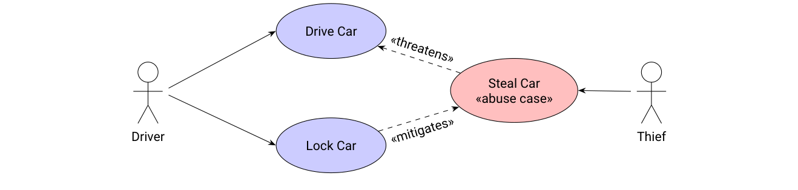
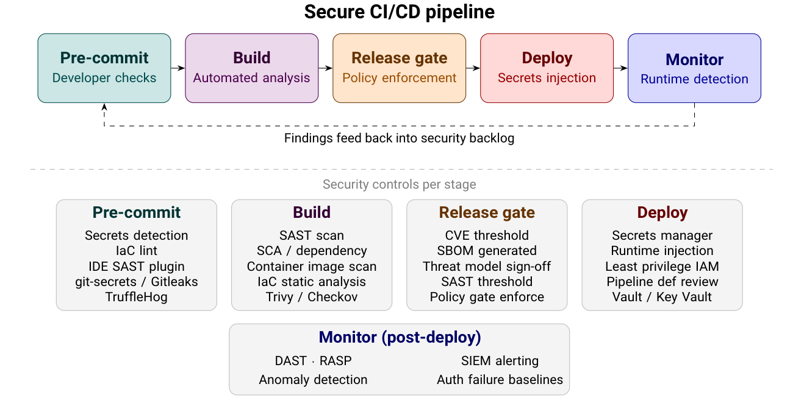

# Chapter 17: Secure Software Lifecycle

**Authors:** Laurie Williams (North Carolina State University)

::: info About this page
This chapter is from [CyBOK Version 1.2.0](https://www.cybok.org/), © Crown Copyright, The National
Cyber Security Centre 2026, licensed under the
[Open Government Licence](https://www.nationalarchives.gov.uk/doc/open-government-licence/).
It was converted from the [PDF](https://www.cybok.org/wp-content/uploads/CyBOK_v1.2.0.pdf) into
a web page so that it works with screen readers and other assistive technology. Each
abbreviation is spelled out in square brackets the first time it appears, and those meanings are
ours, not the book's. So are the names of links the book prints as a bare web address. The PDF
(Portable Document Format) is the original, so if the two disagree, the PDF wins.
:::

## Introduction

The purpose of this Secure Software Lifecycle Knowledge Area is to provide an overview of software development processes for implementing secure software from the design of the software to the operational use of the software. This implementation may involve new coding as well as the incorporation of third-party libraries and components. The resulting software abides by the CIA \[Confidentiality, Integrity and Availability\] Triad, which is a foundational information security model comprising three core principles: Confidentiality (ensuring data is accessible only to authorised individuals), Integrity (ensuring data remains accurate and unaltered by unauthorised parties), and Availability (ensuring systems and data are accessible to authorised users when needed). The goal of this overview is for use in academic courses in the area of software security; and to guide industry professionals who would like to use a secure software lifecycle.

The Software Security Knowledge Area (Chapter 15) provides a structured overview of known categories of software implementation vulnerabilities, and of techniques that can be used to prevent or detect such vulnerabilities, or to mitigate their exploitation. By contrast, this Secure Software Lifecycle Knowledge Area focuses on the components of a comprehensive software development process to prevent and detect security defects and respond to exploits.

This Knowledge Area will begin with a history of secure software lifecycle models in Section 17.1. Section 17.2 presents four prescriptive secure software lifecycle processes: the Microsoft Secure Development Lifecycle, Touchpoints, SAFECode, and the National Institute of Standards and Technology (NIST) Secure Software Development Framework (SSDF). Sections 17.3 and 17.4 discuss agile/DevOps/DevSecOps and secure software supply chain development, respectively. Section 17.5 presents AI-assisted and AI-native software development. Section 17.6 discusses how these processes can be adapted in six specific domains: mobile, cloud computing, internet of things, road vehicles, ecommerce/payment card, and application software interface (API). Section 17.7 provides information on frameworks for assessing an organisation’s secure software lifecycle process, and Section 17.8 provides regulation frameworks. Finally, Section 17.9 provides information on adopting the practices and processes of this Knowledge Area, before concluding with a discussion.

## Content

## 17.1 Motivation

\[<a href="#ref-1462" aria-label="Reference 1462">1462</a>, <a href="#ref-1561" aria-label="References 1561–1569">1561–1569</a>\]

Historically, and at times currently, organisations have taken a *reactive* approach to software security, using an approach commonly referred to as ’penetrate and patch’, using penetration tests, sometimes augmented by firewalls \[<a href="#ref-1564" aria-label="Reference 1564">1564</a>\]. With this approach, security is assessed when the product is complete via penetration testing by attempting known attacks; or vulnerabilities are discovered post-release when organisations are victims of an attack on deployed software. In either case, organisations respond by finding and fixing the vulnerability via a security patch. The following shortcomings more prevalent with this approach:

- **Breaches are costly.** Based on a 2025 study of 600 companies in 16 countries and 17 industries, IBM and the Poneman Institute \[<a href="#ref-1563" aria-label="Reference 1563">1563</a>\] reported a global average breach cost of 4.4 million US dollars (USD), ranging from 10.2 USD in the United States to 3.73 million USD in France. The cost of a data breach declined by about 9% in 2025 when compared with the 2024 IBM/Poneman study, attributed to better-trained security teams and the use of Artificial Intelligence (AI) tools. Additionally, approximately one-third of organisations are required to report breaches to regulators or other government agencies, with an average fine of 100,000 USD. As with all software defects \[<a href="#ref-1569" aria-label="Reference 1569">1569</a>\], fixing vulnerabilities late in development or post-release is significantly more expensive than addressing them early. Loss of reputation caused by a breach is difficult to quantify.
- **Attackers can find and exploit vulnerabilities without being noticed.** Based on the same study, the mean time to identify that a breach had occurred was 267 days, and the mean time to recover from the breach was an additional 100 days.
- **Patches can introduce new vulnerabilities or other problems.** Vulnerability patches are considered urgent and can be rushed out, potentially introducing new problems to a system. For example, Microsoft’s early patches for the Meltdown[^17-1] chip flaw introduced an even more serious vulnerability in Windows 7[^17-2]. The new vulnerability allowed attackers to read kernel memory much faster and to write their own memory, and could allow an attacker to access every user-level computing process running on a machine.
- **Patches often go unapplied by customers.** Users and system administrators may be reluctant to apply security patches or may pin their dependencies to a specific version of a component. For example, the Log4Shell vulnerability in the widely used logging tool Log4j was discovered in December 2021. The vulnerability enables full Remote Code Execution (RCE), allowing attackers to seize complete control of servers, steal sensitive data, deploy ransomware, or install cryptocurrency miners. In 2025 alone, developers downloaded 42 million vulnerable versions, representing 13% of log4j downloads \[<a href="#ref-1565" aria-label="Reference 1565">1565</a>\]. Once a vulnerability is publicly reported, attackers formulate a new mechanism to exploit the vulnerability with the knowledge that many organisations will not adopt the fix.

In 1998, McGraw \[<a href="#ref-1564" aria-label="Reference 1564">1564</a>\] advocated moving beyond the penetrate and patch approach based upon his work on a DARPA-funded research effort investigating the application of software engineering to the assessment of software vulnerabilities. He contended that *proactive* rigorous software analysis should play an increasingly important role in assessing and preventing vulnerabilities in applications, given the well-known fact that security violations occur because of errors in software design and coding. In 2001, Viega and McGraw published the first book on developing secure programs, *Building Secure Software: How to Avoid Security Problems the Right Way* \[<a href="#ref-1462" aria-label="Reference 1462">1462</a>\], with a focus on preventing the injection of vulnerabilities and reducing security risk by integrating security into a software development process.

In the early 2000s, attackers became more aggressive. Microsoft was a focus of this aggression, with the exposure of security weaknesses in its products, particularly Internet Information Services (IIS). Gartner, a leading research and advisory company that seldom advises its clients to steer clear of specific software, advised companies to stop using IIS. In response to customer concerns and mounting bad press, the then Microsoft CEO \[Chief Executive Officer\], Bill Gates, sent the *Trustworthy Computing* memo \[<a href="#ref-1561" aria-label="Reference 1561">1561</a>\] to all employees on January 15, 2002. An excerpt of the memo, which was widely circulated on the Internet, read:

> ‘Trustworthy Computing is the highest priority for all the work we are doing. We must lead the industry to a whole new level of Trustworthiness in computing ...
>
> Trustworthy Computing is computing that is as available, reliable and secure as electricity, water services and telephony’.

The memo caused a shift in the company and in the industry. Two weeks later, Microsoft announced the delay of the release of Windows .NET Server \[<a href="#ref-1568" aria-label="Reference 1568">1568</a>\] to ensure a proper security review (referred to as the Windows Security Push). In 2003, Microsoft employees Howard and Le Blanc \[<a href="#ref-1566" aria-label="Reference 1566">1566</a>\] publicly published a second edition of the book *Writing Secure Code* on writing secure code to prevent vulnerabilities, to detect design flaws and implementation bugs, and to improve test code and documentation.

During the ensuing years, Microsoft changed its development process to build secure products through a comprehensive overhaul of its development process from early planning through product end-of-life. Their products contained demonstrably fewer vulnerabilities \[<a href="#ref-1566" aria-label="Reference 1566">1566</a>\]. In 2006, after internal use of the process, Microsoft codified and contributed its 13-stage internal development process, the Microsoft Security Development Lifecycle (SDL) to the community through its book, *The Security Development Lifecycle* \[<a href="#ref-1562" aria-label="Reference 1562">1562</a>\]. Microsoft continues to develop and disseminate its SDL, as discussed in Section 17.2.1.1.

In 2003, the Open Web Application Security Project (OWASP) published the inaugural Top 10 Web Application Security Risks, a taxonomy for common web application security risks facing the industry. This Top 10 list is updated approximately every three years. Also in 2006, McGraw published the first book on software security best practices, *Software Security: Building Security In* \[<a href="#ref-1567" aria-label="Reference 1567">1567</a>\]. As will be discussed further in Section 17.2.1.2, in 2008, the OWASP Application Security Verification Standard (ASVS) was established as a basis for testing web application technical security controls and to provide developers with a list of requirements for secure development. ASVS continues to be updated.

As discussed in the rest of this Knowledge Area, organisations have built upon the foundation set forth by these early initiatives.

## 17.2 Secure Software Development

\[<a href="#ref-11" aria-label="Reference 11">11</a>, <a href="#ref-49" aria-label="Reference 49">49</a>, <a href="#ref-54" aria-label="Reference 54">54</a>, <a href="#ref-1108" aria-label="Reference 1108">1108</a>, <a href="#ref-1462" aria-label="Reference 1462">1462</a>, <a href="#ref-1562" aria-label="Reference 1562">1562</a>, <a href="#ref-1566" aria-label="Reference 1566">1566</a>, <a href="#ref-1567" aria-label="Reference 1567">1567</a>, <a href="#ref-1570" aria-label="References 1570–1611">1570–1611</a>\]

Secure software lifecycle processes are *proactive* approaches to building security into a product, treating the ‘disease’ of poorly designed, insecure software at the source, rather than ‘applying a band aid’ to stop the symptoms through a *reactive* penetrate-and-patch approach. These processes work software security deeply into the full product development process and incorporate people and technology to tackle and prevent software security issues. Section 17.2.1 will provide information on three seminal secure software lifecycle processes that set the foundation for organisations to create their own lifecycle processes. [Table 17.1](#table-17-1) presents the commonalities between these processes.

While Section 17.2.1 provides comprehensive and prescriptive lifecycle processes, Section 17.2.2 provides information on the NIST 800-218 Secure Software Development Framework (SSDF), a set of 19 software development practices that can be integrated into a secure software lifecycle process.

No ’best’ secure software lifecycle process exists. Practitioners should consider incorporating practices from the three processes and the SSDF into their own secure software process. Assessments of secure lifecycle processes will be discussed in Section 17.7.

### 17.2.1 Seminal Prescriptive Secure Software Lifecycle Processes

A *prescriptive* software development process provides teams with a comprehensive set of *recommendations* on what security activities they *should* perform. Three exemplar prescriptive secure software lifecycle processes are summarised in Sections 17.2.1.1 through 17.2.1.3 and compared in Section 17.2.1.4. The processes are *prescriptive* in that they explicitly recommend software practices. They were chosen because their practices are integrated and cover a broad spectrum of lifecycle phases, from software requirements to release/deployment and software maintenance. Two of these processes were identified in a systematic mapping study \[<a href="#ref-1581" aria-label="Reference 1581">1581</a>\] on security approaches in software development lifecycles. They were also chosen for their maturity, measured by the number of years they have existed and their widespread acceptance in the industry.

**17.2.1.1 Microsoft Security Development Lifecycle (SDL)**

As discussed in Section 17.1, Microsoft used an internal development process, the Security Development Lifecycle (SDL), to improve the security of their products. Howard and Lipner \[<a href="#ref-1562" aria-label="Reference 1562">1562</a>\] disseminated a snapshot of this process in 2006. Since that time, Microsoft has made dramatic shifts in its SDL, providing up-to-date resources to the community \[<a href="#ref-1570" aria-label="Reference 1570">1570</a>\], including an increased focus on zero trust architecture (ZTA) \[<a href="#ref-1593" aria-label="Reference 1593">1593</a>\] and governance.

Currently \[<a href="#ref-1570" aria-label="Reference 1570">1570</a>\], the Microsoft SDL contains 10 key security practices to integrate security into each stage of a software development process.These are enumerated below. For each of the practices,implementation techniques may be mentioned, though the SDL does not prescribe the specific technique.

1. **Establish security standards, metrics, and governance**. Security requirements must be continually updated to reflect changes in required functionality, standards, and the threat landscape. Security requirements should be defined during the initial design and planning phases. Influential factors include the system’s specific functional requirements, legal and industry compliance requirements, internal and external standards, previous security incidents, and known threats. Security requirements may be gathered through the secure software development practices outlined in the NIST Secure Software Development Framework (SSDF), which will be described in Section 17.2.1.3.

   In the early days of secure software lifecycle process development, techniques were developed for systematically compiling security requirements. Emerging in 2004, abuse cases (as discussed in Section 17.2.1.2, bullet 5) are a means of specifying security requirements. Also in 2004, Van Lamsweerde extended the Keep All Objectives Satisfied (KAOS) framework for goal-based requirements specification language to include anti-models \[<a href="#ref-1583" aria-label="Reference 1583">1583</a>\]. An anti-model is constructed by addressing malicious obstacles (called anti-goals) set up by attackers to threaten a system’s security goals. An obstacle negates existing goals of the system. Jürjens \[<a href="#ref-1594" aria-label="Reference 1594">1594</a>\] contributed an extensible verification framework for UML \[Unified Modelling Language\] models to meet security requirements in 2005. In 2006, Rodrigues et al. \[<a href="#ref-1595" aria-label="Reference 1595">1595</a>\] provided a UML 2.0 profile for secure business process modelling through activity diagrams. Also in 2006, Boström et al. \[<a href="#ref-1596" aria-label="Reference 1596">1596</a>\] presented security requirements as agile user stories. Secure i\* \[<a href="#ref-1584" aria-label="Reference 1584">1584</a>\] extends the i\*-modelling framework with modelling and analysis of security trade-offs and aligns security requirements with other requirements in 2007. In 2008, Security Quality Requirements Engineering (SQUARE) \[<a href="#ref-1582" aria-label="Reference 1582">1582</a>\] provided a nine-step process that helps organisations build security into the early stages of the production lifecycle. Also in 2008, Haley et al. \[<a href="#ref-1612" aria-label="Reference 1612">1612</a>\] developed a framework for security requirements elicitation and analysis that constructs a system context, represents security requirements as constraints, and develops satisfaction arguments for them. Of these, user stories may be the most common.

   Lord Kelvin is quoted as saying, “If you can not measure it, you can not improve it”. The management team should understand and be held accountable for minimum acceptable levels of security using security metrics \[<a href="#ref-1572" aria-label="Reference 1572">1572</a>\]. A subset of these metrics may be set as Key Performance Indicators (KPIs) for management reporting. Defect tracking should clearly label security defects and security work items as such to allow for accurate prioritisation, risk management, tracking, and reporting of security work. Additionally, products must comply with regulatory standards, such as the Payment Card Industry Data Security Standard (PCI DSS)[^17-3]; the EU \[European Union\] General Data Protection Regulation (GDPR)[^17-4]; and the EU Cyber Resilience Act (CRA)[^17-5], which may impose additional process steps and metrics for compliance, reporting, and audits. These will be discussed in Section 17.8.1.

   A formal mechanism for tracking exceptions to standards is needed to manage risk. In a mature governance process, risk acceptance is handled through a well-defined process for triaging, justifying, approving, and tracking temporary exceptions.

2. **Require use of proven security features, languages, and frameworks**. Security features are functional requirements allocated to a system to satisfy security objectives derived from a threat model or risk assessment. Engineers should use well-established, proven security features, such as Multi-Factor Authentication (MFA), rather than inventing new solutions. Additionally, the architecture and design must be resistant to known threats in the intended operational environment. Design requirements also involve the selection of security features, such as cryptography, authentication, and logging to reduce the risks identified through threat modelling. A security property (e.g., “the system maintains integrity of the audit log”) is a goal or guarantee. A security feature is the mechanism that implements or contributes to that property (e.g., “the audit log is hash-chained and append-only”). One property may require multiple features; one feature may contribute to multiple properties.

   An important design consideration is the Zero Trust Architecture \[<a href="#ref-1593" aria-label="Reference 1593">1593</a>\] (ZTA). ZTA is build on the principle of “never trust, always verify,” which requires every user and device to be continuously authenticated and authorised before gaining or retaining access to resources. ZTA applies to deployed applications and to development environments. ZTA is designed and deployed with adherence to the following basic tenets:

   - All data sources and computing services are considered resources.
   - All communication is secured regardless of network location.
   - Access to individual enterprise resources is granted on a per-session basis.
   - Access to resources is determined by dynamic policy — including the observable state of client identity, application/service, and the requesting asset — and may include other behavioural and environmental attributes.
   - The enterprise monitors and measures the integrity and security posture of all owned and associated assets.
   - All resource authentication and authorisation is dynamic and strictly enforced before access is allowed.
   - The enterprise collects as much information as possible about the current state of assets, network infrastructure, and communication, and uses it to improve its security posture.

   Software design involves adhering to the timeless security principles set forth by Saltzer and Schroeder \[<a href="#ref-11" aria-label="Reference 11">11</a>\] in 1975 and restated by Viega and McGraw \[<a href="#ref-1462" aria-label="Reference 1462">1462</a>\] in 2002. The eight Saltzer and Schroeder principles are:

   - **Economy of mechanism (Simplicity)**. Keep the system’s design as simple and small as possible.
   - **Fail-safe defaults (Deny by default)**. Access should be denied unless explicitly granted. When a system fails, the default behaviour should remain secure.
   - **Complete mediation (Authenticate every access)**. Every access to every object must be checked for authorisation.
   - **Open design**. The design should not depend on attackers’ ignorance, but rather on the possession of keys or passwords. This principle is also referred to as “There is no security through obscurity.”)
   - **Separation of privilege**. A protection mechanism that requires two keys to unlock is more robust than one that requires a single key when two or more decisions must be made before access should be granted.
   - **Least privilege**. Every program and every user, service, pipeline, and tool should operate using the least set of privileges necessary to complete the job, including narrowly scoped tokens/roles and time-bound access.
   - **Least common mechanism**. Minimise the number of mechanisms common to more than one user and depended on by all users.
   - **Psychological acceptability** The human interface should be designed for ease of use so that users routinely and automatically apply the mechanisms correctly and securely.

   In 2014, the IEEE \[Institute of Electrical and Electronics Engineers\] Center for Secure Design \[<a href="#ref-1574" aria-label="Reference 1574">1574</a>\] enumerated the top ten security design flaws and provided guidelines on techniques for avoiding them. These guidelines are as follows:

   - Earn or give, but never assume, trust.
   - Use an authentication mechanism that cannot be bypassed or tampered with.
   - Authorise after you authenticate.
   - Strictly separate data and control instructions, and never process control instructions received from untrusted sources.
   - Define an approach that ensures all data are explicitly validated.
   - Use cryptography correctly.
   - Identify sensitive data and how it should be handled.
   - Always consider the users.
   - Understand how integrating external components changes your attack surface.
   - Be flexible when considering future changes to objects and actors.

   In 2023, the Secure by Design principles \[<a href="#ref-1597" aria-label="Reference 1597">1597</a>\], primarily focused at software manufacturers, provided guidance for building technology products that reasonably protect against malicious cyber actors gaining access to devices, data, and connected infrastructure. In 2025, OWASP \[<a href="#ref-1613" aria-label="Reference 1613">1613</a>\] also proposed Secure by Design principles, including the following:

   - **Least Privilege.** See Saltzer and Schroeder principle above.
   - **Defense in depth**. Provide multiple layers of security controls to provide redundancy in the event a security breach.
   - **Secure defaults** The systems should start in the safest reasonable configuration automatically. Developers and operators should not have to ”turn security on.”
   - **Zero-Trust and Explicit Boundaries** Never automatically trust users, devices, services, or networks, and have explicit trust boundaries. This principle is similar to the IEEE Center for Secure Design: ”Earn or give, but never assume, trust.”
   - **Fail secure/Graceful degradation.** Similar to Saltzer and Schroeder’s Fail-safe defaults principle, this principle also includes designing to continue safely under partial failure, avoiding information leakage, and preserving critical functionality.
   - **Simplicity and Minimised attack surface.** Complexity creates vulnerabilities. Teams take actions to reduce the attack surface of their system design. The attack surface, a concept introduced by Howard \[<a href="#ref-1573" aria-label="Reference 1573">1573</a>\] in 2003, can be thought of as the sum of the points where attackers can try to enter data into or extract data from a system \[<a href="#ref-1108" aria-label="Reference 1108">1108</a>, <a href="#ref-1580" aria-label="Reference 1580">1580</a>\].
   - **Observability by Design.** Build systems so secure that operational problems can be detected and investigated. Systems should generate structured logs, traces, metrics, security events, and audit records.
   - **Contract-first and Versioned interfaces.** Design interfaces formally before implementation and evolve them safely.
   - **Automation and repeatability.** Security should be enforced automatically and consistently, such as through the use of Infrastructure as Code (IaC) and policy-as-code. Manual configuration causes drift and inconsistency.

   An organisation should publish a list of approved tools, such as Static Application Security Testing (SAST) and Dynamic Application Security Testing (DAST) tools, and their associated security checks and settings, such as compiler/linker options and warnings. Engineers should use the latest versions of these tools, including compiler versions, and take advantage of new security analysis capabilities and protections. Often, the resultant software must be backward compatible with previous versions.

3. **Perform security design review and threat modelling**. A technique for enumerating threats involves using ‘attack trees’ \[<a href="#ref-1585" aria-label="Reference 1585">1585</a>\], which are conceptual diagrams of threats on systems and the possible attacks to reach them. The tree root is the attacker’s goal, and the leaves are ways to achieve the goal. Each attacker’s goal is represented as a separate tree. Mitigations for the attacks and attack techniques of the attack tree can be enumerated as a corresponding defense tree.

   Through the use of threat modelling \[<a href="#ref-54" aria-label="Reference 54">54</a>, <a href="#ref-1579" aria-label="Reference 1579">1579</a>, <a href="#ref-1598" aria-label="Reference 1598">1598</a>\] early and throughout a product’s lifecycle, teams can iteratively consider, document, and discuss the security implications of designs in the context of their planned operational environment and in a structured fashion. Threat modelling methods are used to create an abstraction of the system, profiles of potential actors, including their goals and methods, and a catalog of potential threats, enabling the system design to be fortified and security features to be selected. An approach is to consider the (1) the malicious and benevolent interactors with the system; (2) the design of the system and its components (i.e. processes and data stores),

- (3) the trust boundaries of the system; and (4) the data flow of the system within and

  across trust boundaries to/from its interactors.

  Threats can be enumerated using a systematic approach of considering each system component, such as the 12 methods summarised in \[<a href="#ref-1599" aria-label="Reference 1599">1599</a>\]. One of these systematic approaches is the STRIDE (Spoofing, Tampering, Repudiation, Information Disclosure, Denial of Service, Elevation of Privilege) \[<a href="#ref-1566" aria-label="Reference 1566">1566</a>\] method. This begins with the creation of a dataflow diagram (DFD), followed by the enumeration of threats:

  - (a) **Spoofing identity**. Spoofing threats allow an attacker to impersonate another user or a rogue server to impersonate a valid server.
  - (b) **Tampering with data**. Data tampering threats involve malicious modification of data.
  - (c) **Repudiation**. Repudiation threats are associated with users who deny performing an action without other parties having any way to prove otherwise.
  - (d) **Information disclosure** Information disclosure threats involve exposing information to unauthorised individuals.
  - (e) **Denial of Service** A Denial of Service (DoS) attack denies service to valid users by making the system unavailable or unusable.
  - (f) **Elevation of privilege** An unprivileged user gains privileged access and thereby has sufficient access to compromise or destroy the system.

  The output of a STRIDE threat model is a threat list by DFD element, which can be used for mitigation planning.

  Another systematic threat modelling approach is the PASTA (Process for Attack Simulation and Threat Analysis \[<a href="#ref-1600" aria-label="Reference 1600">1600</a>\] risk-centric framework. One of its strengths is its focus on communicating risk in business terms. PASTA has seven stages:

  - (a) **Define objectives**: Business objectives and security/compliance requirements are identified. Business impact analysis is performed.
  - (b) **Define technical scope**. Boundaries of the technical environment are captured. Infrastructure, application, and software dependencies are captured.
  - (c) **Application decomposition**. Use cases, actors, high-level architecture diagrams, and trust boundaries are identified and documented.
  - (d) **Threat analysis**. Probabilistic attack scenarios and regression on security events are analyzed. Threat intelligence correlation and analytics are conducted.
  - (e) **Vulnerability and weakness analysis**. Existing vulnerability and issue reports are studied, including the consideration of severity (in terms of the Common Vulnerability Scoring System (CVSS)[^17-6] score) and use/abuse cases (see 17.2.1.2 bullet 5).
  - (f) **Attack modelling**. Attack surfaces are analyzed. Attack trees using attack libraries are developed. Vulnerability and exploit analysis is conducted using the attack trees.
  - (g) **Risk and impact analysis**. Business impact is qualified and quantified. Countermeasures are identified and residual risk is analyzed. Risk mitigation strategies are developed.

  The output of a PASTA threat model is an asset-centric, risk-ranked threat enumeration and scoring.

  The LINDDUN (Linkability, Identifiability, Non-Repudiation, Detectability, Disclosure of Information, Unawareness, Non-Compliance) \[<a href="#ref-1601" aria-label="Reference 1601">1601</a>\] is a privacy threat modelling method that focuses on privacy concerns but can also be applied to data security. Similar to STRIDE, LINDDUN begins by developing a DFD. The privacy threats enumerated in the following list are mapped to the DFD elements, and mitigation strategies are developed. The LINDDUN threats are as follows:

  - **Linking**. Connecting two or more pieces of data (or actions) about a person across contexts — even if neither piece is sensitive alone.
  - **Identifying**. Determining the identity of an individual from data that was intended to be anonymous or pseudonymous. Re-identification attacks on ”anonymised” datasets are the classic example.
  - **Non-repudiation**. Similar to the STRIDE Repudiation threat, the threat is a person who should not be able to plausibly deny an action or an association.
  - **Detecting**. Inferring that a specific individual is present in a dataset or system, even without knowing other details about them. For example, determining that a particular person visited a health clinic from aggregate traffic data.
  - **Data Disclosure**. Legitimate or illegitimate exposure of personal data to parties who shouldn’t have access — through breaches, over-permissioned APIs, insecure storage, or excessive sharing, similar to the Information Disclosure STRIDE threat.
  - **Unawareness**. Data subjects do not know what data is collected, how it is used, or by whom — violating transparency and consent principles. Poor privacy notices and opaque data flows are common causes.
  - **Non-compliance**. The system fails to comply with applicable privacy laws, regulations, or its own stated privacy policies (e.g., GDPR, CCPA \[California Consumer Privacy Act\], HIPAA \[Health Insurance Portability and Accountability Act\]). This can result from poor data governance, lack of retention limits, or missing rights-fulfillment mechanisms.

  The output of a PASTA threat model is a privacy threat model mapped to privacy-enhancing technology (PET) mitigations.

  Each of STRIDE, PASTA, and LINDDUN has its strengths, with both STRIDE and PASTA producing security risks. STRIDE is considered lower effort than PASTA, but PASTA brings the business risk perspective. LINDDUN focuses on privacy threats.

  Adam Shostack’s lightweight **Four Question Framework for Threat Modeling** \[<a href="#ref-1602" aria-label="Reference 1602">1602</a>\] provides an informal framework and common language for effective communication about threat modelling across a business, and informs Secure By Design thinking. The framework comprises these four questions:

  - (a) What are we working on?
  - (b) What can go wrong?
  - (c) What are we going to do about it?
  - (d) Did we do a good job?

  Games have been created to aid teams in collaboratively (and competitively) conducting threat modelling. These games aid in threat modelling by inviting cross-functional participation, which leads to more diverse perspectives being discussed:

  - (a) Elevation of Privilege[^17-7] was designed by Adam Shostack where players use a STRIDE-based deck to identify security threats in their system designs by playing cards and mapping them to potential vulnerabilities.
  - (b) OWASP Cornucopia[^17-8] was designed to help development teams identify security requirements and threats in web applications, with suits aligned to common vulnerability categories like data validation, authentication, and cryptography.
  - (c) Protection Poker \[<a href="#ref-1586" aria-label="Reference 1586">1586</a>\] is an agile security estimation game in which team members independently assign security risk values to user stories and then discuss discrepancies, helping to surface security concerns early in the development process through structured conversation.

  A closely related practice to threat modelling is Architectural Risk Analysis, as discussed in Section 17.2.1.2 bullet 2.

4. **Define and use cryptography standards**. The use of cryptography is an important design feature for a system to ensure security- and privacy-sensitive data is protected from unintended disclosure or alteration when it is transmitted or stored. However, an incorrect choice in the use of cryptography can render the intended protection weak or ineffective. Custom cryptographic algorithms or protocols should not be developed. Experts should be consulted on the use of clear encryption standards that specify every element of the encryption implementation and on the use of only properly vetted encryption libraries, such as OpenSSL. Systems should be designed to allow the encryption libraries to be easily replaced, if needed, in the event the library is broken by an attacker, such as was done to the Data Encryption Standard (DES) through ’Deep Crack’[^17-9], a brute force search of every possible key as designed by Paul Kocher, president of Cryptography Research. As Post-Quantum Cryptography (PQC) \[<a href="#ref-1603" aria-label="Reference 1603">1603</a>\] becomes increasingly important, current asymmetric algorithms are being replaced or augmented with quantum-resistant alternatives, while symmetric encryption remains comparatively robust. Managing and rotating encryption keys are also of prime importance.
5. **Secure the software supply chain**. The vast majority of software projects are built using proprietary and open-source third-party components. Each of these components can have vulnerabilities upon adoption or in the future. An organisation should have an accurate inventory of third-party components \[<a href="#ref-1588" aria-label="Reference 1588">1588</a>\] such as can be provided by a Software Bill of Materials (SBOM, see Section 17.4.2 bullet 2), continuously use a tool to scan for vulnerabilities in its components, and have a plan to respond when new vulnerabilities are discovered. Freely available and proprietary software composition analysis (SCA) tools, such as OWASP Dependency Check and Dependabot, can be used to identify project component dependencies and to check for any known, publicly disclosed vulnerabilities in these components. Software supply chain security will be discussed thoroughly in Section 17.4
6. **Secure the engineering environment**. Attackers are increasingly compromising development environment infrastructure to take over workloads, discover and exploit vulnerabilities, access data, launch lateral attacks on other internal systems, and more. Attackers target user accounts, development environments, and build processes, so these systems must be defended. For example, attackers can use sophisticated phishing techniques to obtain maintainer credentials or contribute malicious GitHub Actions. Access to source code and engineering systems should be managed, controlled, and secured through ZTA (see bullet 1) and least-privilege access policies. Engineering systems should be segmented and managed from privileged access workstations by individuals using separate authorised identities. Privilege access should be provided using Just-in-Time and Just-Enough-Access (JIT/JEA) principles, and security logging and monitoring should be enabled.
7. **Perform security testing**. Applications must be tested to gain insight into the potential risk and to validate the security results from the development process. Security testing includes both automated and manual methods, such as Static Application Security Testing (SAST), Dynamic Application Security Testing (DAST), and Penetration Testing. Each of these will now be discussed.

   SAST tools can be used for an automated security code review to find instances of insecure coding patterns and to help ensure that secure coding policies are being followed. SAST can be run early in te software development process to analyze source code that may not yet compile but can also be integrated into the commit and deployment pipeline as a check-in gate to identify vulnerabilities each time the software is built or packaged. To improve efficiency, SAST tools can be integrated into the developer environment and run by developers during coding. Some SAST tools spot certain implementation bugs, such as the presence of unsafe or otherwise banned functions, and automatically replace them with (or suggest) safer alternatives as the developer is actively coding. An upside of SAST is that a large number of vulnerabilities of a variety of Common Weakness Enumerations (CWEs)[^17-10] types are discovered. The downside of SAST tools are potentially a large number of false positives \[<a href="#ref-1604" aria-label="Reference 1604">1604</a>\] and that the exploitability of discovered vulnerabilities can be questioned. See also the Software Security Knowledge Area (Section 15.3.1).

   DAST performs run-time testing of compiled or packaged software to check functionality that is only apparent when all components are integrated and running. DAST often involves the use of a suite of pre-built attacks and malformed strings that can detect memory corruption, user privilege issues, injection attacks, and other critical security problems. DAST tools may employ *fuzzing*, an automated technique of inputting known invalid and unexpected test cases at an application, often in large volume. Similar to SAST, DAST can be run by the developer and/or integrated into the build and deployment pipeline as a check-in gate. The upside of DAST tools are that exploitability of discovered vulnerabilities are not questioned. However, DAST tools have been found to discover fewer vulnerabilities when compared with SAST tools \[<a href="#ref-1604" aria-label="Reference 1604">1604</a>\]. DAST can be considered to be automated penetration testing. See also the Software Security Knowledge Area (Section 15.3.2).

   Interactive Application Security Testing (IAST) vulnerability detection tools have access to the code, enabling them to perform static analysis. IAST tools also involve active real-time interaction with the application being tested for vulnerabilities, similar to dynamic analysis/DAST. An agent of the IAST tool is integrated with the application server so that the tool monitors all requests, code, and data flows within the application \[<a href="#ref-1606" aria-label="Reference 1606">1606</a>\]. The application code related to those requests and data flow is scanned for vulnerabilities. Therefore, the code coverage provided by an IAST tool reflects how thoroughly the application is used. Since IAST tools scan code and also use dynamic analysis for detecting vulnerabilities, they are said to incorporate the advantages of both SAST and DAST tools. A large-scale study \[<a href="#ref-1605" aria-label="Reference 1605">1605</a>\] found that, as a vulnerability discovery tool, IAST was efficient, found vulnerabilities not found by SAST or DAST, and found 8 of the Top-10 OWASP web application security risks.

   Manual penetration testing is black box testing or grey box testing of a running system to simulate the actions of an attacker. Penetration testing is often performed by skilled security professionals, who can be internal to an organisation or consultants, opportunistically simulating the actions of a hacker. The objective of a penetration test is to uncover any form of vulnerability — from small implementation bugs to major design flaws resulting from coding errors, system configuration faults, design flaws or other operational deployment weaknesses. Tests should attempt both unauthorised misuse of and access to target assets. A widely-referenced resource for structuring penetration tests is the OWASP Top 10 Web Application Security Risks Security Risks[^17-11]. As such, penetration testing has been shown to find the broadest variety of vulnerabilities, although usually less efficiently compared with SAST and DAST \[<a href="#ref-1576" aria-label="Reference 1576">1576</a>, <a href="#ref-1604" aria-label="Reference 1604">1604</a>\]. Penetration testers are also known as white hat hackers or ethical hackers. In the penetration and patch model, penetration testing was the only line of security analysis prior to deploying a system.

8. **Ensure operational platform security**. Attackers are increasingly targeting production infrastructure to take over its workload and data, and to launch lateral attacks on other internal systems. The security of the workload depends on the security of the environment, including identities, networks, servers, containers, email, user endpoints, and other systems. Some important controls include enforcing zero-trust architecture, multi-factor authentication, protecting administrative accounts, implementing configuration baselines and security standards, creating isolation layers, and reducing the attack surface.
9. **Implement security monitoring and response**. Despite a secure software lifecycle, organisations must be prepared for inevitable attacks. organisations need to monitor operations to proactively detect and address threats using a security analytics and threat intelligence platform to enable attack detection threat visibility, proactive hunting, and threat response. Teams can use a Security Information and Event Management (SIEM) tool, such as Splunk or Elastic Security, to aggregate, correlate, and analyze security data from across an IT \[information technology\] infrastructure to detect, investigate, and respond to cyber threats.

   Organisations should proactively prepare an Incident Response Plan (IRP) in conjunction with the Product Security Incident Response Team (PSIRT). The plan should include who to contact in case of a security emergency, establish protocols for efficient vulnerability mitigation, customer response and communication, and rapid deployment of a fix. The IRP should include plans for code inherited from other groups within the organisation and for third-party code. The IRP should be tested before it is needed. A Security Orchestration, Automation, and Response (SOAR) platforms, such as Palo Alto XSOAR or Splunk SOAR, accelerate and systematises incident response by handling repetitive, multi-tool workflows that analysts would otherwise do manually.

   Lessons learned through responses to actual attacks should be factored back into the SDL.

10. **Provide security training**. A range of professionals, such as developers, service engineers, program managers, product managers, and project managers, participate in the development of secure products while still addressing business needs and delivering user value. Software developers and architects must understand technical approaches for preventing and detecting vulnerabilities. The entire development organisation should be cognisant of the attacker’s perspective, goals, and techniques; and of the business implications of not building secure products. Some possible forms of training include security awareness training, regulatory compliance training, role-based training, contingency training, and table-top exercises.

    Attack vectors, security tools, secure programming languages, and experiences are constantly evolving, so knowledge and course material must be refreshed. Ongoing cybersecurity training is essential for software organisations.

**17.2.1.2 Touchpoints**

In 2006, international software security consultant, Gary McGraw, provided seven Software Security Touchpoints \[<a href="#ref-1567" aria-label="Reference 1567">1567</a>\] by codifying extensive industrial experience with building secure products. McGraw uses the term *touchpoint* to refer to software security best practices that can be incorporated into a secure software lifecycle. Within the Touchpoints, McGraw differentiates vulnerabilities into implementation bugs and design flaws \[<a href="#ref-1574" aria-label="Reference 1574">1574</a>\]. *Implementation bugs* are localised errors, such as buffer overflow and input validation errors, within a single piece of code, making them easier to spot and understand. *Design flaws* are systemic problems at the design level of the code, such as error-handling and recovery systems that fail in an insecure fashion, or object-sharing systems that mistakenly include transitive trust issues \[<a href="#ref-1567" aria-label="Reference 1567">1567</a>\]. Kuhn et al. \[<a href="#ref-1588" aria-label="Reference 1588">1588</a>\] analysed the 2008–2016 vulnerability data from the US National Vulnerability Database (NVD)[^17-12] and found that 67% of the vulnerabilities were implementation bugs. The seven Touchpoints help to prevent and detect both bugs and flaws. They are described below and intentionally ordered (from most to least effective) by their ability to catch problems earlier in development, based on McGraw’s many years of experience. Hence, the Touchpoints are prescriptive:

1. **Code Review (Tools)**. Code review is used to detect implementation bugs. It can be conducted early in development, as soon as code is written, even if it is not yet compilable. Manual code review may be used, but it requires that auditors be knowledgeable about security vulnerabilities before they can rigorously examine the code. ’Code review with a tool’ (a.k.a. the use of static analysis tools or SAST) has been shown to be effective and can be used by engineers who do not have expert security knowledge. For further discussion on SAST, including its strengths and weaknesses, see Section 17.2.1.1 bullet 5.
2. **Architectural Risk Analysis**. Architectural Risk Analysis is used to prevent and detect design flaws. Designers and architects provide a high-level view of the target system and documentation for assumptions, and identify possible attacks. Through architectural risk analysis, security analysts uncover and rank architectural and design flaws so mitigation can begin. For example, risk analysis may identify a possible attack type, such as the ability to intercept and read data. This identification would prompt the designers to review all their code’s traffic flows to determine whether interception was a concern and whether adequate protection (i.e., encryption) was in place. The review uncovers design flaws, such as sensitive data being transported in the clear.

   No system can be perfectly secure, so risk analysis must be used to prioritise security efforts. It also links system-level concerns to probability and impact measures that matter to the business building the software. Risk exposure is computed by multiplying the probability of occurrence of an adverse event by the cost associated with that event \[<a href="#ref-1589" aria-label="Reference 1589">1589</a>\].

   McGraw proposes three basic steps for architectural risk analysis:

   - *Attack resistance analysis* uses a checklist/systematic approach to consider each system component relative to *known* threats, as is done in Microsoft threat modelling, discussed in Section 17.2.1.1, bullet 3. Information about known attacks and attack patterns is used during the analysis, identifying risks in the architecture and understanding the viability of known attacks. Threat modelling that incorporates STRIDE-based attacks, as discussed in Section 17.2.1.1, bullet 3, is an example process for performing attack-resistance analysis.
   - *Ambiguity analysis* is used to capture the creative activity involved in discovering *new* risks. Ambiguity analysis requires two or more experienced analysts who carry out separate analysis activities in parallel on the same system. By unifying the understanding of multiple analyses, disagreements among analysts can uncover ambiguity, inconsistency, and new flaws.
   - *Weakness analysis* focuses on understanding risks related to security issues in other third-party components (see Section 17.2.1.1, bullet 2). The idea is to understand the assumptions being made about third-party software and what will happen when those assumptions fail.

   Risk identification, ranking, and mitigation are continuous processes through the software lifecycle, beginning with the requirement phase.

3. **Penetration Testing**.

   Penetration testing can be guided by the outcome of architectural risk analysis (See Section 17.2.1.2 bullet 2). For further discussion on penetration testing, see Section 17.2.1.1, bullet 5.

4. **Risk-based Security Testing**.

   Security testing must encompass two strategies: (1) testing of security functionality with standard functional testing techniques; and (2) risk-based testing based upon attack patterns and architectural risk analysis results (see Section 17.2.1.2 bullet 2), and abuse cases (see Section 17.2.1.2 bullet 5). For web applications, testing of security functionality can be guided by the OWASP Application Security Verification Standard (ASVS) Project \[<a href="#ref-1607" aria-label="Reference 1607">1607</a>\], an open standard for testing application technical security controls. ASVS also provides developers with a list of requirements for secure development.

   Guiding tests with knowledge of the software architecture and construction, common attacks, and the attacker’s mindset is extremely important. Using the results of architectural risk analysis, the tester can properly focus on areas of code where an attack is likely to succeed.

   The difference between risk-based testing and penetration testing lies in the approach’s level and the timing of testing. Penetration testing is done when the software is complete and installed in an operational environment. Penetration tests are outside-in black box tests. Risk-based security testing can begin before the software is complete, even pre-integration, including the use of white-box unit tests and stubs. The two are similar in that they both should be guided by risk analysis, abuse cases and functional security requirements.

5. **Abuse Cases**. This Touchpoint codifies ’thinking like an attacker’. Use cases describe the desired system’s behaviour by benevolent actors. Abuse cases \[<a href="#ref-1577" aria-label="Reference 1577">1577</a>\] describe the system’s behaviour when under attack by a malicious actor. To develop abuse cases, an analyst enumerates the types of malicious actors who would be motivated to attack the system. For each bad actor, the analyst creates one or more abuse cases for the functionality the bad actor desires from the system. The analyst then considers the interaction between the use cases and the abuse cases to fortify the system. As shown in [Figure 17.1](#figure-17-1), consider an automobile example: an actor is the driver of the car, and this actor has a use case ’drive the car’. A malicious actor is a car thief whose abuse case is ’steal the car’. This abuse case *threatens* the use case. To prevent theft, a new use case, ’lock the car,’ can be added to *mitigate* the abuse case and fortify the system. The ’lock the car’ use case becomes a security requirement.

<figure id="figure-17-1">

{width=659 height=156}

<figcaption>

Figure 17.1: Sample abuse case

</figcaption>
</figure>

::: details Text description of Figure 17.1

A UML (Unified Modeling Language) use case diagram with two stick-figure actors and three ovals. "Driver" is on the left and "Thief" is on the right. The "Drive Car" and "Lock Car" ovals are blue and sit at the top centre and bottom centre; the "Steal Car" oval is red and sits at the right.

- Driver to "Drive Car": solid arrow.
- Driver to "Lock Car": solid arrow.
- Thief to "Steal Car «abuse case»": solid arrow. The oval is labelled with two lines, "Steal Car" and "«abuse case»".
- "Steal Car" to "Drive Car": dashed arrow labelled "«threatens»".
- "Lock Car" to "Steal Car": dashed arrow labelled "«mitigates»".

The colours mark the abuse case (red) apart from the normal use cases (blue).

:::

> Human error is responsible for a large number of breaches. System analysts should also consider actions by benevolent users, such as being the victim of a phishing attack, which result in a security breach. These actions can be considered misuse cases \[<a href="#ref-1578" aria-label="Reference 1578">1578</a>\] and should be analysed similarly to abuse cases, considering what use case the misuse case threatens and the fortification to the system to mitigate the misuse case. The fortification to mitigate the misuse becomes a security requirement.
>
> The attacks and mitigations identified by the abuse and misuse case analysis can be used as input into the security requirements (Section 17.2.1.1 bullet 1.); penetration testing (Section 17.2.1.1 bullet 5); and risk-based security testing (Section 17.2.1.2 bullet 4).

6. **Security Requirements**. Software requirements should ensure the resulting software abides by the CIA Triad. The CIA Triad is a foundational information security model comprising three core principles: Confidentiality (ensuring data is accessible only to authorised individuals), Integrity (ensuring data remains accurate and unaltered by unauthorised parties), and Availability (ensuring systems and data are accessible to authorised users when needed). For further discussion on security requirements, see Section 17.2.1.1 bullet 1.
7. **Security Operations**. Network security can integrate with software security to enhance the security posture. Inevitably, attacks will happen, regardless of the applications of the other Touchpoints. Understanding attacker behaviour and the software that enabled a successful attack is an essential defensive technique. For example, logging, monitoring, incident response, and collecting threat intelligence are important. Knowledge gained from understanding attacks can be fed back into the other six Touchpoints.

The seven Touchpoints are fundamental to building security into a product and are intended to be cycled through multiple times as the software product evolves. The Touchpoints are also process agnostic, meaning that the practices can be included in any software development process, including modern DevSecOps processes.

**17.2.1.3 SAFECode**

The Software Assurance Forum for Excellence in Code (SAFECode)[^17-13] is a non-profit, global, industry-led organisation dedicated to increasing trust in information and communications technology products and services through the advancement of effective software assurance methods. The SAFECode mission is to promote best practices for developing and delivering more secure and reliable software, hardware, and services. In 2018, the SAFECode organisation published the ’Fundamental practices for secure software development: Essential elements of a secure development lifecycle program’ \[<a href="#ref-1590" aria-label="Reference 1590">1590</a>\] guidelines to foster the industry-wide adoption of fundamental secure development practices. These deal with assurance – the ability of the software to withstand attacks that attempt to exploit design or implementation errors. The eight fundamental practices outlined in the guidelines cover:

1. **Application Security Control Definition**. SAFECode uses the term Application Security Controls (ASC) to refer to the definition and implementation of security requirements (see Section 17.2.1.1 bullet 1). Similarly, NIST 800-53 \[<a href="#ref-49" aria-label="Reference 49">49</a>\] uses the phrase *security control* to refer to security functionality and security assurance requirements.

   The inputs to ASC include the following: secure design principles (see Section 17.2.1.3 bullet 3); secure coding practices; legal and industry requirements with which the application needs to comply (such as HIPAA, PCI, GDPR, or SCADA \[Supervisory Control and Data Acquisition\]); internal policies and standards; incidents and other feedback; threats and risk. The development of ASC begins before the design phase and continues throughout the lifecycle to provide clear, actionable controls and remain responsive to changing business requirements and the ever-evolving threat environment.

2. **Design**. Software must incorporate security features to comply with internal security practices and external laws or regulations. Additionally, the software must resist known threats based upon the operational environment (see Section 17.2.1.1 bullet 2). Threat modelling (see Section 17.2.1.1 bullet 3), architectural reviews, and design reviews can be used to identify and address design flaws before their implementation into source code.

   The system design should incorporate an encryption strategy (see Section 17.2.1.1 bullet 4) to protect sensitive data from unintended disclosure or alteration while the data are at rest or in transit.

   The system design should use a standardised approach to identity and access management to perform authentication and authorisation. The standardisation provides consistency between components and clear guidance on how to verify the presence of the proper controls. Authenticating the identity of a principal (be it a human user, other service or logical component) and verifying the authorisation to perform an action are foundational controls of the system. Several access control schemes have been developed to support authorisation: mandatory, discretionary, role-based or attribute-based. Each of these has benefits and drawbacks and should be chosen based upon project characteristics.

   With proper integrity protection and correlation, log files provide the evidence needed for forensic analysis when a breach occurs, helping mitigate repudiation threats. In a well-designed application, system and security log files provide the ability to understand an application’s behaviour and how it is used at any moment, and to distinguish benevolent user behaviour from malicious user behaviour. Because logging affects the available system resources, the logging system should be designed to capture critical information without capturing excess data or disclosing sensitive information. Policies and controls need to be established around storing, tamper prevention, and monitoring log files. OWASP provides valuable resources on designing and implementing logging[^17-14][^17-15].

3. **Secure Coding Practices**. Unintended code-level vulnerabilities arise from programmer errors. These types of mistakes can be prevented and detected through the use of coding standards; selecting the most appropriate (and safe) languages, frameworks and libraries, including the use of their associated security features (see Section 17.2.1.1 bullet 6); using automated analysis tools (see Section 17.2.1.1 bullet 7); and manually reviewing the code.

   Organisations provide standards and guidelines for secure coding, for example:

   - (a) OWASP Secure Coding Practices, Quick Reference Guide [^17-16]
   - (b) Oracle Secure Coding Guidelines for Java SE [^17-17]
   - (c) Software Engineering Institute (SEI) CERT \[Computer Emergency Response Team\] Secure Coding Standards [^17-18]

   Special care must also be given to handling unanticipated errors in a controlled and graceful way through generic error handlers or exception handlers that log the events. If the generic handlers are invoked, the application should be considered to be in an unsafe state such that further execution is no longer considered trusted.

4. **Manage Security Risk Inherent in the Use of Third-Party Components**. See Section 17.2.1.1 bullet 2.
5. **Testing and Validation**. See Section 17.2.1.1 bullet 7 and Section 17.2.1.2 bullets 2, 3 and 4.
6. **Manage Security Findings**. The first five practices produce artifacts that contain or generate findings related to the product’s security (or lack thereof). The findings in these artifacts should be tracked, and actions should be taken to remediate vulnerabilities, as laid out in the Common Criteria (see Section 17.7.3) flaw remediation procedure \[<a href="#ref-1591" aria-label="Reference 1591">1591</a>\]. Alternatively, the team may consciously accept the security risk when the risk is determined to be acceptable. Acceptance of risk must be tracked, including a severity rating; a remediation plan, an expiration or a re-review deadline; and the area for re-review/validation. Clear definitions of severity are important to ensure that all participants have and communicate with a consistent understanding of a security issue and its potential impact. A possible starting point is mapping to the severity levels, attributes, and thresholds used by the Common Vulnerability Scoring System (CVSS)[^17-19] as in CVSS 4.0 10.0–9.0 is critical, 8.9–7.0 is high, etc. The severity levels are used to prioritise mitigations based upon their complexity of exploitation and impact on the properties of a system.
7. **Vulnerability Response and Disclosure**. Even with following a secure software lifecycle, no product can be ’perfectly secure’ because of the constantly changing threat landscapes. Vulnerabilities will be exploited, and the software will eventually be compromised. An organisation must develop a vulnerability response and disclosure process to help drive the resolution of externally discovered vulnerabilities and to keep all stakeholders informed of progress. ISO \[International Organization for Standardization\] provides industry-proven standards[^17-20] for vulnerability disclosure and handling. Teams should define their disclosure timelines, patch management processes, and consider initiating a bug bounty program. To prevent vulnerabilities from recurring in new or updated products, the team should perform a root cause analysis and incorporate the lessons learned into secure software lifecycle practices. For further discussion, see Sections 17.2.1.1 bullet 9 and 17.2.1.2 bullet 7.
8. **Planning the Implementation and Deployment of Secure Development**. A healthy and mature secure development lifecycle includes the above seven practices but also an integration of these practices into the business process and the entire organisation, including program management, stakeholder management, deployment planning, metrics and indicators, and a plan for continuous improvement. The culture, expertise, and skill level of the organisation need to be considered when planning to deploy a secure software lifecycle. Based upon past history, the organisation may respond better to a corporate mandate, to a bottom-up groundswell approach or to a series of pilot programs. Training will be needed (see Section 17.2.1.1 bullet 10). The specification of the organisation’s secure software lifecycle, including the roles and responsibilities, should be documented. Plans for compliance and process health should be made (see Section 17.7).

**17.2.1.4 Comparing the seminal prescriptive models**

In 2009, De Win et al. \[<a href="#ref-1592" aria-label="Reference 1592">1592</a>\] compared CLASP \[Comprehensive, Lightweight Application Security Process\], Microsoft’s originally-documented SDL \[<a href="#ref-1562" aria-label="Reference 1562">1562</a>\], and Touchpoints (see Section 17.2.1.2) to provide guidance on their commonalities and the specificity of the approach, and suggest for improvements. The authors mapped the 153 possible activities of each lifecycle model into six software development phases: education and awareness; project inception; analysis and requirements; architectural and detailed design; implementation and testing; and release, deployment and support. The activities took the practices in Sections 17.2.1.1–17.2.1.3 into much finer granularity. The authors indicated whether each model includes each of the 153 activities and provided guidance on the strengths and weaknesses of each model. The authors found no clear comprehensive ’winner’ among the models, so practitioners could consider using guidelines for the desired fine-grained practices from all the models.

[Table 17.1](#table-17-1) places the practices of Sections 17.2.1.1–17.2.1.3 into the six software development phases used by De Win et al. \[<a href="#ref-1592" aria-label="Reference 1592">1592</a>\]. Similar to prior work \[<a href="#ref-1592" aria-label="Reference 1592">1592</a>\], the three processes demonstrate strengths and weaknesses in their guidance across the six software development phases. Microsoft SDL was first published in 2006. The 13 practices shown in [Table 17.1](#table-17-1) are based upon Version 5.2 formally released in July 2024. However, Microsoft has moved away from formal versioned updates toward a continuously evolving model. The seven Touchpoints were authored in 2006, and the SAFECode model was authored in 2018. As such, the Microsoft SDL reflects modern development practices, though all three models provide a foundational and timeless view of practices that should be integrated into a secure software lifecycle.

Microsoft SDL contains more practices related to education and awareness and project inception phases. The Touchpoints begin in the product development stage of analysis and requirements. The Microsoft SDL has more practices in the release, deployment, and support phase, likely due to attackers using the environment and development/deployment pipeline as an attack vector.

No model can be considered perfect for all contexts. Security experts can customise a model for their organisations based on the foundation laid by these three seminal secure software lifecycle practices.

### 17.2.2 NIST 800-218: Recommendations for Mitigating the Risk of Software Vulnerabilities (SSDF)

In 2022, NIST published NIST 800-218, the Secure Software Development Framework (SSDF) \[<a href="#ref-1614" aria-label="Reference 1614">1614</a>\], a set of recommended high-level secure software development practices that can be integrated into every stage of the software development lifecycle. The SSDF strongly supports software supply chain integrity, provenance, and the Software Bill of Materials (SBOM) which will be discussed in Section 17.4. The SSDF was given prominence through its inclusion in US Executive Order 14028 which is discussed in Section 17.4.2.

The SSDF describes 19 software security practices organised into four major groups. Each practice has one or more tasks; SSDF contains 34 tasks. Tasks are defined as one or more actions that may be needed to perform a practice. Each group, practice, and task has a unique identifier and a brief explanation. Each task is mapped to a corresponding task in other frameworks, including:

- NIST 800-53 Security and Privacy Controls for Information Systems and Organisations \[<a href="#ref-1608" aria-label="Reference 1608">1608</a>\],

<figure id="table-17-1">

<figcaption>

Table 17.1: Comparing the Seminal Prescriptive Software Security Lifecycle Models

</figcaption>

| Phase | Microsoft SDL | Touchpoints | SAFECode |
| --- | --- | --- | --- |
| *Education and awareness* | Provide security training | | |
| *Project inception* | Establish security standards, metrics, governance Define and use cryptography standards | | Planning the implementation and deployment of secure development |
| *Analysis and requirements* | Perform design review & threat modelling | Abuse cases Security requirements | Application security control definition |
| *Architectural and detailed design* | Require proven security features, languages, frameworks | Architectural risk analysis | Design |
| *Implementation and testing* | Secure the supply chain Perform security testing | Code review (tools) Penetration testing Risk-based security testing | Secure coding practices Manage security risk inherent in the use of third-party components Testing and validation |
| *Release, deployment, and support* | Secure the engineering environment Ensure operational platform security Implement security monitoring and response | Security operations | Vulnerability response and disclosure |

</figure>

- NIST SP \[Service Provider\] 800-161 Cybersecurity Supply Chain Risk Management Practices for Systems and Organizations \[<a href="#ref-1609" aria-label="Reference 1609">1609</a>\],
- OWASP Software Component Verification Standard (SCVS) \[<a href="#ref-1610" aria-label="Reference 1610">1610</a>\],
- OWASP Software Assurance Maturity Model (SAMM)[^17-21], and
- the Building Security In Maturity Model (BSIMM, see Section 17.7.2).

The groups and practices of SSDF are now provided.

1. **Prepare the Organization (PO)**. The purpose of the practices in this group is to ensure that an organisation’s people, processes, and technology are prepared to perform secure software development at the organisational level and, in some cases, at the individual development group or project level. With a focus on *organisational readiness and governance*, the PO group comprises six practices:
   - **PO.1: Define security requirements for software development.** Ensure that security requirements for software development are known at all times so that they can be taken into account throughout the software development lifecycle (SDLC). The duplication of effort can thus be minimised because information can be collected once and shared, including requirements from both internal (e.g., organisational policy) and external sources (e.g., laws and regulations). Two sample tasks include identifying and documenting all security requirements for the organisation’s software development infrastructure (PO.1.1); and communicating requirements to all third parties who will provide commercial software components for reuse (PO.1.3).
   - **PO.2: Implement roles and responsibilities.** Ensure that everyone inside and outside of the organisation involved in the SDLC is prepared to perform their SDLC-related roles and responsibilities. Two example tasks include creating new roles, such as security champion, and altering responsibilities for existing roles (such as for an architect to conduct threat modelling) to encompass all parts of the SDLC (PO.2.1); and providing role-based training for all personnel with responsibilities that contribute to secure development (PO.2.2)
   - **PO.3: Implement supporting toolchains.** Use automation to reduce human effort and improve the accuracy, reproducibility, usability, and comprehensiveness of security practices throughout the SDLC and to document and demonstrate the use of these practices. Two example tasks include following the recommended security practices to deploy, operate, and maintain tools and toolchains (PO.3.2); and configuring tools to generate an audit trail of the secure development-related actions (PO.3.3)
   - **PO.4: Define criteria for software security checks.** Help ensure that the software resulting from the SDLC meets the organisation’s expectations by defining and using criteria for checking the software’s security during development. Two example tasks include defining criteria for software security checks, such as Definition of Done in agile SDLC methodologies, and tracking them throughout development (PO.4.1); and implementing processes and mechanisms to gather and safeguard information in support of the criteria, such as preventing alteration or deletion of decision-making information (PO.4.2).
   - **PO.5: Implement and maintain secure environments for software development.** Ensure that all components of the environments (e.g., development, build, test, distribution) for software development are strongly protected from internal and external threats to prevent compromises of the environments or the software being developed or maintained within them. Example tasks include separating and protecting each environment involved in software development (PO.5.1); and securing and hardening development endpoints (PO.5.2).
   - **PO.6. Define and implement a continuous process improvement plan**. Identify and execute improvements to cybersecurity processes and procedures throughout the SDLC and across SSDF practices. Three tasks include: updating and improving software development environments in response to new threats and as new tools are included in the development process, such as logging and auditing capabilities (PO.6.1); identifying new processes, tools and techniques to avoid software errors, such as expanding test coverage (PO.6.2); and improving vulnerability response processes and periodically reviewing prior decisions, such as implementing measures to identify customer impact over time (PO.6.3).
2. **Protect the Organization (PS)**. The purpose of the practices in this group is to protect all software components from tampering and unauthorised access. With a focus on *protecting code and artifacts*, the PS group comprises three practices:
   - **PS.1: Protect all forms of code from unauthorised access and tampering.** Help prevent unauthorised changes to code, both inadvertent and intentional, which could circumvent or negate the intended security characteristics of the software. This practice has one task: storing all forms of code in accordance with the principle of least privilege, so that only authorised personnel, tools, and services have access (PS.1.1).
   - **PS.2: Provide a mechanism for verifying software release integrity.** Help software acquirers ensure that the software they acquire is legitimate and has not been tampered with. This practice has one task: making software integrity verification information available to software acquirers (e.g., cryptographic hashes for release files) (PS.2.1).
   - **PS.3: Archive and protect each software release.** Preserve software releases to help identify, analyze, and eliminate vulnerabilities discovered in the software after release. The two tasks of this practice include securely archiving the necessary files and supporting data (e.g., provenance data) to be retained for each software release (PS.3.1); and collecting, safeguarding, maintaining, and sharing provenance data for all components of each release (e.g., in a Software Bill of Materials (SBOM)(PS.3.2).
3. **Produce Well-Secured Software (PW)**. The purpose of the practices in this group is to produce well-secured software with minimal security vulnerabilities in its release. With a focus on *secure development activities*, the PW group comprises four practices:
   - **PW.1: Design software to meet security requirements and mitigate security risks.** Identify and evaluate the security requirements for the software; determine what security risks the software is likely to face during operation and how the software’s design and architecture should mitigate those risks; and justify any cases for which risk-based analysis indicates that security requirements should be relaxed or waived. Two example tasks in the practice include using risk modelling techniques (e.g., threat modelling) to assess the security risk of the software (PW.1.1); and tracking and maintaining the software’s security requirements, risks, and design decisions (PW.1.2).
   - **PW.2: Review the software design to verify compliance with security requirements and risk information.** Help ensure that the software will meet the security requirements and satisfactorily address the identified risk information. The only task in the practice is to have a qualified person not involved in the design, or an automated process instantiated in the toolchain, review the software design to confirm and enforce that it meets all security requirements and addresses the identified risks (PW.2.1).
   - **PW.3: Verify third-party software complies with security requirements.** [All tasks were moved to PW.4 in SSDF v1.2].
   - **PW.4: Reuse existing, well-secured software when feasible instead of duplicating functionality.** Lower the costs of software development, expedite software development, and decrease the likelihood of introducing additional security vulnerabilities into the software by reusing software modules and services that have already had their security posture checked (e.g., cryptographic modules and protocols). Two example tasks include creating and maintaining well-secured software components in-house following SDLC processes to meet common internal software development needs that cannot be better met by third-party software components (PW.4.2); and verifying that acquired commercial, open-source, and other third-party software components comply with the requirements, such as remediating vulnerabilities and active maintenance, throughout their lifecycle (PW.4.4).
   - **PW.5: Create source code by adhering to secure coding practices.** Decrease the number of security vulnerabilities in the software, and reduce costs by minimizing vulnerabilities introduced during source code creation that meet or exceed organisation-defined vulnerability severity criteria. The only task in this practice is to follow all secure coding practices appropriate to the development languages and environment to meet the organisation’s requirements. Example coding practices include avoiding unsafe functions, handling errors gracefully, and providing logging and tracing capabilities.
   - **PW.6: Configure the compilation, interpreter, and build processes to improve executable security.** Decrease the number of security vulnerabilities in the software and reduce costs by eliminating vulnerabilities before testing occurs. Relevant tasks here include using the compiler, interpreter, and build tools to improve executable security, such as using up-to-date versions of the compiler, interpreter and build tools (PW.6.1); and determining which compiler, interpreter, and build tool features to use and how each should be configured, then implementing and using the approved configurations, such as the use of compiler features to produce warnings for poorly secured code or compiler warnings are treated as errors (PW.6.2).
   - **PW.7: Review and/or analyze human-readable code to identify vulnerabilities and verify compliance with security requirements.** Human-readable code includes source code, scripts, and any other form of code that an organisation deems human-readable. The practice involves identifying vulnerabilities so that they can be corrected before the software is released to prevent exploitation. Using automated methods, such as scanning tools, lowers the effort and resources needed to detect vulnerabilities. Tasks in this practice are determining whether code review and/or code analysis tools should be used (PW.7.1); and performing code review or code analysis based on the organisation’s secure coding standards, and recording and triaging all discovered issues and recommended remediations (PW.7.2).
   - **PW.8: Test executable code to identify vulnerabilities and verify compliance with security requirements.** Vulnerabilities are identified so that they can be corrected before the software is released to prevent exploitation. Tasks here include determining whether executable code testing should be performed to find vulnerabilities not identified by prior reviews, analysis or testing, and what types of testing should be used (PW.8.1); and scoping the testing, designing the tests, performing the testing, documenting the results in the development team’s workflow or issue tracking system.
   - **PW.9: Configure software to have secure settings by default.** Help improve the security of the software at the time of installation to reduce the likelihood of the software being deployed with weak security settings, putting it at greater risk of compromise. Tasks include defining a secure baseline by determining how to configure each setting that affects security or a security-related setting so that default settings are secure (PW.9.1); and implementing the default settings and documenting each setting for software administrators (PW.9.2).
4. **Respond to Vulnerabilities (RV)** The purpose of the practices in this group is to identify residual vulnerabilities in software releases and respond appropriately to address those vulnerabilities and prevent similar vulnerabilities from occurring in the future. With a focus on *post-release security*, the PW group comprises three practices:
   - **RV.1: Identify and confirm vulnerabilities on an ongoing basis.** Help ensure that vulnerabilities are identified more quickly so they can be remediated promptly in accordance with risk, thereby reducing the window of opportunity for attackers. There are three tasks in this practice, which include gathering information from software acquirers, users, and public sources on potential vulnerabilities in the software and third-party components, and investigating all credible reports (RV.1.1); and reviewing, analyzing, and/or testing the software’s code to identify or confirm the presence of undetected vulnerabilities (RV.1.2).
   - **RV.2: Assess, prioritise, and remediate vulnerabilities.** Help ensure that vulnerabilities are remediated in accordance with risk, thereby reducing the window of opportunity for attackers. Tasks in this practice include analyzing each vulnerability to gather sufficient information about risk and plan its remediation (RV.2.1); and planning and implementing risk responses for vulnerabilities (RV.2.2)
   - **RV.3: Analyzing vulnerabilities to identify their root causes.** Two of the four tasks in this practice include analyzing the root causes over time to identify patterns, such as a particular secure coding practice not being followed consistently (RV3.2); and reviewing the SDLC process and updating it if appropriate to prevent (or reduce the likelihood of) the root cause recurring in updates to the software or new software that is created (RV.3.4).

The SSDF encompasses many of the same concepts as the Microsoft SDL, Touchpoints, and SAFECode, but at a higher level of abstraction. The SSDF outlines 34 tasks grouped into 19 practices and four groups, including those listed in [Table 17.1](#table-17-1) by the Microsoft SDL, Touchpoints, and SAFECode, among others. As will be discussed in Section 17.5.4, in 2025, NIST published an extension, SSDF-AI \[<a href="#ref-1611" aria-label="Reference 1611">1611</a>\]), which adapts secure development practices to machine-learning and AI software pipelines. Neither of the two SSDF frameworks prescribes specific tools or processes, unlike the three seminal processes in Section 17.2.1.

## 17.3 Agile/DevOps/DevSecOps Software Development

\[<a href="#ref-1590" aria-label="Reference 1590">1590</a>, <a href="#ref-1615" aria-label="Reference 1615">1615</a>, <a href="#ref-1616" aria-label="Reference 1616">1616</a>\]

Agile and continuous software development methodologies are highly iterative, with new functionality frequently being provided to customers — potentially as quickly as multiple times per day or as ’slowly’ as every two to four weeks.

Agile software development methodologies can be functional-requirement-centric, with functionality expressed as *user stories*. Additionally, agile incorporates non-functional security requirements. SAFECode \[<a href="#ref-1615" aria-label="Reference 1615">1615</a>\] provides practical software security guidance to agile practitioners. This includes a set of 36 recommended security-focused stories that can be handled similarly to the functionality-focused user stories. These stories are based upon common security issues such as those listed in the OWASP Top 10[^17-22] Most Critical Web Application Security Risks. The stories are mapped to CWE identifiers, as applicable. The security-focused stories are worded in a format similar to functionality stories (i.e., As a [stakeholder], I want to [new functionality] so that I can [goal]). For example, a security-focused story using this format is provided in \[<a href="#ref-1615" aria-label="Reference 1615">1615</a>\]: *As an architect/developer, I do not want to store AND as QA I want to verify that the system does not store hard-coded sensitive information*, that is mapped to CWE-798. The security-focused stories are further broken down into manageable and concrete tasks owned by team roles, including architects, developers, testers, and security experts, and are mapped to SAFECode Fundamental Practices \[<a href="#ref-1590" aria-label="Reference 1590">1590</a>\]. Finally, SAFECode specified 17 operational security tasks. These tasks are not directly tied to stories but are handled as continuous maintenance work (such as *Continuously verify coverage of static code analysis tools*) or as an item requiring special attention (such as *Configure bug tracking to track security vulnerabilities*).

With a DevOps approach to software development, development and operations are tightly integrated to enable fast, continuous delivery of value to end users. Microsoft has published a DevOps secure software lifecycle model \[<a href="#ref-1616" aria-label="Reference 1616">1616</a>\] that includes activities for operations engineers to provide early, rapid feedback to the team, building security into DevOps processes. The Secure DevOps model contains eight practices, including eight of the 12 practices in the Microsoft Security Development Lifecycle discussed in Section 17.2.1.1:

1. **Provide Training**. The training, as outlined in Section 17.2.1.1 bullet 10, must include the operations engineers. It should encompass attack vectors made available through the deployment pipeline.
2. **Define Requirements**. See Section 17.2.1.1 bullet 1.
3. **Define Metrics and Compliance Reporting**. See Section 17.2.1.1 bullet 1.
4. **Use Software Composition Analysis (SCA) and Governance**. When selecting both commercial and open-source third-party components, the team should understand the impact that a vulnerability in the component could have on the overall security of the system and consider performing a more thorough evaluation beforehand. Software Composition Analysis (SCA) tools, such as BlackDuck[^17-23] can assist with licensing exposure, provide an accurate inventory of components, and report any vulnerabilities with referenced components. See also Section 17.2.1.1 bullet 5.
5. **Perform Threat Modelling**. See Section 17.2.1.1 bullet 3. The Microsoft Security DevOps model acknowledges that threat modelling may be perceived as slowing down the rapid DevOps pace. However, products deployed rapidly through a DevOps process should have a defined overall architecture within which the DevOps process makes changes and adds features. That architecture should be threat modeled, and when the team needs to change the architecture, the threat model should also be updated.
6. **Use Tools and Automation**. See Section 17.2.1.1 bullets 6 and 7. The team should carefully select tools that can be integrated into the engineer’s Integrated Development Environment (IDE) and workflow while causing minimal disruption. The goal of using these tools is to detect defects and vulnerabilities and not to overload engineers with too many tools or alien processes outside of their everyday engineering experience. The tools used as part of a secure DevOps workflow should adhere to the following principles:
   - (a) Tools must be integrated into the Continuous Integration/Continuous Delivery (CI/CD) pipeline.
   - (b) Tools must not require security expertise beyond what is imparted by the training.
   - (c) Tools must avoid a high false-positive rate of reporting issues.
7. **Keep Credentials Safe**. Scanning for credentials and other sensitive content in source files is necessary during pre-commit to reduce the risk of propagating the sensitive information through the CI/CD process, such as through Infrastructure as Code or other deployment scripts. Tools, such as CredScan[^17-24], can identify credential leaks, such as those in source code and configuration files. Some commonly found types of credentials include default passwords, hard-coded passwords, SQL \[Structured Query Language\] connection strings and certificates with private keys.
8. **Use Continuous Learning and Monitoring**. Rapidly-deployed systems often monitor the health of applications, infrastructure, and networks through instrumentation to ensure the systems are behaving ’normally’. This monitoring can also help uncover security and performance issues that are departures from normal behaviour. Monitoring is also an essential part of supporting a defense-in-depth strategy and can reduce an organisation’s Mean Time To Identify (MTTI) and Mean Time To Contain (MTTC) an attack.

<figure id="figure-17-2">

{width=659 height=338}

<figcaption>

Figure 17.2: Security controls embedded at each stage of a secure CI/CD pipeline.

</figcaption>
</figure>

::: details Text description of Figure 17.2

A diagram in two parts, under the title "Secure CI/CD pipeline".

**Top part: the pipeline.** Five boxes in a row, joined left to right by arrows:

1. "Pre-commit", subtitle "Developer checks"
2. "Build", subtitle "Automated analysis"
3. "Release gate", subtitle "Policy enforcement"
4. "Deploy", subtitle "Secrets injection"
5. "Monitor", subtitle "Runtime detection"

A dashed arrow runs from "Monitor" back to "Pre-commit", labelled "Findings feed back into security backlog".

A dashed line then separates this from the lower part, labelled "Security controls per stage".

**Bottom part: the controls.** One box per stage, each titled with the stage name:

| Stage | Controls |
|---|---|
| Pre-commit | Secrets detection; IaC lint; IDE SAST plugin; git-secrets / Gitleaks; TruffleHog |
| Build | SAST scan; SCA / dependency; Container image scan; IaC static analysis; Trivy / Checkov |
| Release gate | CVE \[Common Vulnerabilities and Exposures\] threshold; SBOM generated; Threat model sign-off; SAST threshold; Policy gate enforce |
| Deploy | Secrets manager; Runtime injection; Least privilege IAM \[Identity and Access Management\]; Pipeline def review; Vault / Key Vault |
| Monitor (post-deploy) | DAST · RASP \[runtime application self-protection\]; SIEM alerting; Anomaly detection; Auth failure baselines |

The "Monitor (post-deploy)" box sits on its own row below the other four. Its four items are in two columns: "DAST · RASP" and "Anomaly detection" on the left, "SIEM alerting" and "Auth failure baselines" on the right. Each stage uses the same colour in the top and bottom parts.

:::

[Figure 17.2](#figure-17-2) illustrates how security controls are embedded at each stage of a secure Continuous Integration/Continuous Delivery (CI/CD) pipeline, reflecting the principle that security is most effective and least costly when enforced continuously throughout the development process rather than applied as a final check before release. Traditionally, each stage was conceived as a *security gate*: a binary checkpoint that blocks promotion of a non-compliant artefact. While gates remain appropriate at critical transition points, particularly the release gate, where policy thresholds must be enforced before promotion to production, a mature DevSecOps culture increasingly favours *security guardrails* over gates as the dominant model. Where a gate stops a developer, a guardrail automatically guides a developer toward the secure choice, through tooling embedded in the existing workflow. This might include IDE plugins that surface CWE-mapped findings inline, policy-as-code frameworks that encode security constraints as version-controlled rules, and platform engineering practices that provide *golden paths* that are pre-approved, pre-hardened templates and pipelines that make the secure option the path of least resistance. This shift is as much cultural as technical: it repositions the security team from external gatekeeper to internal enabler, reducing the adversarial dynamic that security gates can produce, and increasing developer autonomy without sacrificing accountability. Post-deployment monitoring closes the feedback loop by detecting anomalous behaviour that static analysis cannot anticipate. Findings re-enter the development backlog as security-focused stories, ensuring that the pipeline itself evolves in response to the threat landscape.

## 17.4 Software Supply Chain Security

\[<a href="#ref-1575" aria-label="Reference 1575">1575</a>, <a href="#ref-1609" aria-label="Reference 1609">1609</a>, <a href="#ref-1610" aria-label="Reference 1610">1610</a>, <a href="#ref-1614" aria-label="Reference 1614">1614</a>, <a href="#ref-1617" aria-label="References 1617–1626">1617–1626</a>\]

Digital innovation has accelerated substantially as software is increasingly built with layers of reusable artifacts, including libraries, frameworks, cloud infrastructure, and artificial intelligence (AI) modules. These reusable artifacts comprise third-party and, more prevalently, open-source components. This style of software development is considered a *software supply chain*, in which software projects depend on and build upon other software projects. Based on its analysis of 947 codebases (comprising nearly 3,000 individual projects) across 17 industries, Black Duck \[<a href="#ref-1575" aria-label="Reference 1575">1575</a>\] reports that 98% of codebases contain open-source software, and the mean number of open-source components per application is 1,180.

Attackers implant vulnerabilities directly into open-source software components and infect build and deployment pipelines. In 2026, Sonatype reported that 1.2 million malicious open-source packages had been logged since 2019, increasingly reflecting a nation-state attack strategy \[<a href="#ref-1565" aria-label="Reference 1565">1565</a>\]. Well-known attacks, such as SolarWinds, log4j, and XZ Util, affected thousands of customers and hundreds of businesses and government agencies worldwide. Consequently, the US Executive Order (EO) 14028 \[<a href="#ref-1617" aria-label="Reference 1617">1617</a>\] and the European Cybersecurity Resilience Act (CRA) \[<a href="#ref-1618" aria-label="Reference 1618">1618</a>\] highlight the urgent need to improve transparency and integrity in open-source artifacts to enhance supply chain security. The EO and CRA impose the inclusion of software security practices in the software development lifecycle. The EO will be discussed further in Section 17.4.2, and CRA will be discussed further in Section 17.8.1.

Software supply chain attacks are considered to have three major attack vectors \[<a href="#ref-1619" aria-label="Reference 1619">1619</a>, <a href="#ref-1620" aria-label="Reference 1620">1620</a>\]. The first is through vulnerabilities and malware accidentally or maliciously injected into open-source and third-party *code dependencies*, such as components, containers, and AI models. For example, log4j was an accidentally injected vulnerability. However, once discovered, attackers exploited this vulnerability to execute arbitrary code, steal sensitive data like passwords, install ransomware, establish backdoors, mine cryptocurrency, and take control of affected networks. In what is referred to as ’protestware’, an attacker injected malicious code into the npm package node-ipc at the start of the Russian-Ukrainian conflict in 2022. Malicious components are injected into ecosystems such as npm, PyPI \[Python Package Index\], and Maven, allowing applications to download them and thereby enabling attackers. With nodeipc, the malicious code was intended to overwrite arbitrary files based on the geolocation of the user’s IP \[Internet Protocol\] address.

Second, attackers conduct software supply chain attacks by infiltrating the *build infrastructure* during the build and deployment processes. Attackers launch attacks through the tooling and automation that turns the code of multiple software projects into a production application. For example, with SolarWinds, the build process was compromised to inject malicious code into the end product that was signed and distributed to commercial companies, including a range of critical US government organisations and businesses.

Finally, attackers conduct software supply chain attacks through targeted techniques aimed at the *humans* involved in software development, such as through social engineering. The humans involved in software development can be referred to as the software supply chain’s ’weak link.’ In the words of Ken Thompson in his Turing award speech \[<a href="#ref-1621" aria-label="Reference 1621">1621</a>\]: “To what extent should one trust a statement that a program is free of Trojan horses? Perhaps it is more important to trust the people who wrote the software.”

Section 17.4.1 provides more information about these attack vectors. Sections 17.4.2 and 17.4.3 provide information on initiatives to impose and provide guidance to software organisations on practices that can be included in their software development lifecycle to manage software supply chain risk.

### 17.4.1 Dependency Management, Provenance, and Package Ecosystem Attacks

The attack vectors described above are compounded by the structural complexity of modern dependency graphs. Most applications depend not only on components that developers deliberately select, *direct dependencies*, but also transitively on the dependencies of the direct dependencies (a.k.a transitive dependencies) through a dependency tree. A single direct dependency may introduce many transitive dependencies, each with its own vulnerability surface and provenance, and many of which the development team has never explicitly reviewed or approved. Effective dependency management, therefore, requires tooling that resolves and inspects the full dependency graph, not merely the top-level manifest.

**17.4.1.1 Artifact Provenance and Integrity**

Establishing that a software artefact is what it claims to be — and that it has not been tampered with between build and consumption — requires *provenance* and *integrity* mechanisms. The SolarWinds attack in 2020 illustrated the consequence of a failure: a legitimate build process was compromised to produce a signed artefact that contained malicious code, and consumers had no mechanism to detect the tampering. Two complementary frameworks address this problem. Supply chain Levels for Software Artifacts (SLSA) (Supply-chain Levels for Software Artefacts) \[<a href="#ref-1622" aria-label="Reference 1622">1622</a>\] defines a graduated set of controls for build integrity, ranging from basic documentation of the build process (SLSA level 1) to a fully hermetic, reproducible build with cryptographically signed provenance (SLSA level 4) (See Section 17.4.3 for more information about SLSA). Sigstore[^17-25], a Linux Foundation project, provides a transparency log and keyless signing infrastructure that enables developers to cryptographically sign release artefacts and for consumers to verify those signatures against a tamper-evident log. Together, SLSA and Sigstore address the question: *can we verify not just what is in the artefact, but where it came from and how it was built?*

**17.4.1.2 Package Ecosystem Attacks**

Beyond injecting malicious code into legitimate packages, attackers exploit the resolution mechanisms of package ecosystems through several targeted techniques.

*Typosquatting* exploits typographical errors in package names: an attacker publishes a malicious package under a name visually similar to a popular legitimate package (e.g., `requets` instead of `requests`, or `colourama` instead of `colorama`) in the expectation that developers will accidentally install the malicious version. Typosquatting attacks have been documented extensively in npm, PyPI, and RubyGems.

*Dependency confusion* (also called namespace confusion) exploits the resolution order of package managers that consult both public and private registries. If an organisation uses an internal package named `internal-utils` but has not reserved that name on the public registry, an attacker can publish a malicious package under the same name on the public registry at a higher version number. Many package managers will resolve the public version in preference to the private one, silently substituting the malicious package.

*Slopsquatting* is an emerging variant in which attackers publish malicious packages under names that AI coding assistants are prone to hallucinate. When a developer prompts an AI assistant to suggest a dependency for a given task, the assistant may recommend a package name that does not exist in the registry. An attacker who has pre-registered that name can intercept the installation. As AI-assisted development becomes more prevalent, slopsquatting represents a novel and growing attack surface.

Mitigations against these techniques include: pinning dependencies to specific cryptographic hashes rather than version ranges; configuring package managers to prefer private registries unambiguously, enabling namespace reservation on internal package names in public registries; and applying Software Composition Analysis (SCA) scanning that includes package name anomaly detection alongside vulnerability matching.

### 17.4.2 US Executive Order 14028: Improving the Nation’s Cybersecurity

In the United States, the high-profile Solarwinds \[<a href="#ref-1623" aria-label="Reference 1623">1623</a>\] cyberattack in December 2020 led to President Joe Biden signing Executive Order (EO) 14028 \[<a href="#ref-1617" aria-label="Reference 1617">1617</a>\] entitled ’Improving the Nation’s Cybersecurity’ on May 12, 2021. In particular, Section 4 of this EO pushed the adoption of software security practices, as software vendors worldwide who were seeking to sell to the US government had to comply with its stipulations. The White House Office of Management and Budget (OMB) subsequently issued the M-22-18 memo \[<a href="#ref-1624" aria-label="Reference 1624">1624</a>\] (*Enhancing the Security of the Software Supply Chain through Secure Software Development Practices*) documenting requirements for software organisations that supply software to the US government to provide self-attestation of the use of secure software development practices.

Since its signing, subsequent US EOs in 2026 have rescinded mandatory provisions, but several software security initiatives stemming from this EO have had a lasting effect on the software industry. These include the following:

1. **Adoption of software security practices**. The EO stipulated that NIST would ”identify practices that enhance the security of the software supply chain”. A later memo \[<a href="#ref-1624" aria-label="Reference 1624">1624</a>\] laid out the need for a Chief Executive Officer (CEO) or a representative of the CEO of companies to self-attest to the use of the set of security practices defined in the SSDF \[<a href="#ref-1614" aria-label="Reference 1614">1614</a>\] laid out in Section 17.2.1.3. These government actions led software organisations to implement good software security practices within their software development lifecycle, impose these practices on their vendors, and establish measurement frameworks that enable the attestation of their use.
2. **Software Bill of Materials (SBOM)** An SBOM is a nested inventory for software, a list of ingredients that make up software components. An SBOM can enable organisations to identify components, assess risks, take informed action to protect critical systems, manage vulnerabilities, and support secure-by-design development. Although SBOMs had been discussed for more than a decade, EO 14028 mandated that organisations selling to the US government provide an SBOM (with the general exclusion of incorporated third-party proprietary and open-source components), thereby heightening the focus. Throughout the world, the number of tools for producing SBOMs in the major accepted formats, SPDX \[Software Package Data Exchange\] and CycloneDX, has expanded. The US Cybersecurity and Infrastructure Security Agency (CISA) and 19 international cybersecurity organisations have shared a vision \[<a href="#ref-1627" aria-label="Reference 1627">1627</a>\] for SBOMs, including widespread SBOM adoption across sectors and borders, harmonised technical implementations to reduce complexity and cost, and integration of SBOMs into security workflows to improve risk management. The CRA, as discussed in Section 17.8.1, mandates the provision of an SBOM in Europe.
3. **Zero Trust Architecture (ZTA)**, as discussed in Section 17.2.1.1 bullet 1.
4. **Machine-readable software attestations**. Industry is moving toward using in-toto[^17-26] as the de facto machine-readable attestation standard. Organisations desire automated, objective evidence of the development process used and of the integrity of the resulting software, even if not required by the government.

### 17.4.3 Other secure software supply chain risk management frameworks

In addition to the SSDF, government and industrial organisations have developed frameworks that enumerate tasks to reduce software supply chain risk across all roles in an organisation involved in that effort. Each framework has a different focus.

1. **NIST SP 800-161 Cybersecurity Supply Chain Risk Management Practices for Systems and Organizations** \[<a href="#ref-1609" aria-label="Reference 1609">1609</a>\]. This framework contains tasks for both hardware and software supply chain security and addresses software supply chain risk management across the system lifecycle. Compared with other frameworks, this includes more governance tasks, such as those performed by vendor management and risk analysts.
2. **Supply chain Levels for Software Artifacts (SLSA)** \[<a href="#ref-1622" aria-label="Reference 1622">1622</a>\]. SLSA is a framework focused on improving artifact integrity through source, build, provenance, and dependency controls. Compared with other frameworks, SLSA places particular emphasis on tasks that reduce the attack surface through the build to ensure the integrity of artifacts.
3. **Cloud Native Computing Foundation (CNCF) ”Software supply chain best practices”** \[<a href="#ref-1625" aria-label="Reference 1625">1625</a>\] Compared with other frameworks, this has a particular focus on securing the environment including the development and production environments and cloud infrastructure..
4. **OWASP Software Component Verification Standard (SCVS)** \[<a href="#ref-1610" aria-label="Reference 1610">1610</a>\] Compared with other frameworks, SCVS places particular emphasis on tasks that reduce the attack surface through the components.

Organisations seeking to reduce software supply chain risk may be overwhelmed by the number of practices prescribed by these frameworks. The Proactive Software Supply Chain Risk Management (P-SSCRM) \[<a href="#ref-1626" aria-label="Reference 1626">1626</a>\] framework provides the union of the practices of the SSDF, the above frameworks, and BSIMM (Section 17.7.2) through a mapping between the frameworks. P-SSCRM comprises 76 tasks, grouped into 15 practices organised into four groups: Governance, Product, Environment, and Deployment.

## 17.5 AI Code Generation and AI-Native Software Development

\[<a href="#ref-1611" aria-label="Reference 1611">1611</a>, <a href="#ref-1628" aria-label="Reference 1628">1628</a>\]

Advances in large language models and generative AI have enabled tools that can synthesise code, explain existing implementations, generate tests, and assist with debugging. Early research on machine-learning-assisted programming began in the mid-2010s, but widespread practical adoption began with tools such as GitHub Copilot in 2021 and expanded rapidly after the release of ChatGPT in 2022 and the subsequent deployment of more capable models such as GPT-4. These systems are trained on large corpora of publicly available, licensed, curated, proprietary, and synthetic data, code, and documentation. The models can generate plausible code snippets and functions, although the output may be incorrect, insecure, or unsuitable for the intended context. As a result, developers increasingly interact with development environments through conversational prompts and AI-assisted code suggestions rather than writing every line manually. These developers use *code generation*, perhaps within a more traditional development process.

*AI-native software development* refers to the design and construction of software systems in which Artificial Intelligence (AI) components, such as Large Language Models (LLMs), embedding models, retrieval pipelines, and autonomous agents are first-class architectural constituents rather than peripheral add-ons. In an AI-native system, AI components participate directly in core application logic: processing user input, retrieving and synthesising information, making or recommending decisions, and invoking external tools or services autonomously. This contrasts with code generation in which AI tools augment the developer’s workflow, but the deployed system itself remains a conventional software artefact.

The growing integration of AI coding assistants into development environments is reshaping productivity and workflow. Developers using generative coding tools can complete certain programming tasks more quickly, often by delegating boilerplate generation, test scaffolding, and documentation writing to an AI assistant. As a consequence, AI systems are increasingly acting as *pair programmers*, augmenting human developers during coding, debugging, and learning.

### 17.5.1 Security Risks of AI-Generated Code

The rapid adoption of AI-generated code introduces new challenges for an SDL. While generative models can accelerate development, they cannot reliably enforce security requirements or secure coding policies in the generated output. Research has shown that AI-generated code can include insecure patterns, outdated libraries, or vulnerable implementations when prompted to perform common tasks \[<a href="#ref-1628" aria-label="Reference 1628">1628</a>\]. This creates a risk that vulnerabilities may be introduced earlier and more frequently during development, particularly if developers overly trust AI-generated suggestions. Consequently, traditional SDL practices: secure design reviews, threat modelling, code review, and automated security testing presented in Section 17.2 — become even more important in AI-assisted development environments.

As discussed in Section 17.4, a supply chain security risk arises from the way AI coding assistants suggest dependencies. When prompted to recommend a library for a given task, a model may *hallucinate* a plausible-sounding but non-existent package name. Attackers can pre-register these hallucinated names in public package registries, a technique known as *slopsquatting*, so that a developer who installs the suggested package silently receives malicious code. This attack complements classic *typosquatting*, in which attackers register names that are typographical variants of popular legitimate packages (e.g., `colourama` instead of `colorama`), and *dependency confusion*, in which an attacker publishes a public package whose name matches an organisation’s internal private package at a higher version number, causing the package manager to resolve the malicious public version in preference. Mitigations include pinning dependencies to cryptographic hashes, configuring package managers to prefer private registries unambiguously, and applying Software Composition Analysis (SCA) scanning that detects package name anomalies alongside vulnerability matching.

AI-generated code and AI-suggested dependencies should also be subject to *provenance tracking* and *artifact attestation*. Just as the SLSA framework and Sigstore provide cryptographic evidence of how a software artefact was built and by whom, organisations should maintain records of which portions of their codebase were generated or substantially influenced by an AI assistant. This supports auditability, licence compliance, and accountability when AI-generated code is later found to be vulnerable or to contain copied material. Some organisations are beginning to treat AI-generated code as a distinct provenance category in their SBOM, requiring additional review gates before such code is promoted to production.

AI is also positively influencing the SDL. The same technologies that generate code can assist in identifying vulnerabilities, generating unit tests, performing static analysis triage, and summarising security issues for developers. Emerging tools help developers write more secure code by suggesting safer APIs, generating security tests, or explaining the root causes of vulnerabilities. AI can also help organisations analyse large volumes of code and dependency data, supporting supply-chain security efforts such as SBOM generation and vulnerability prioritisation.

### 17.5.2 Security of AI-Native Systems

Beyond the use of AI as a development *tool*, organisations are increasingly building AI-native systems in which Large Language Model (LLM) components are themselves part of the deployed application: chatbots, retrieval- augmented generation (RAG) pipelines, autonomous agents, and AI-assisted decision systems. Securing these systems requires extending the SDL to treat prompts, models, and retrieval corpora as first-class software artefacts with their own security requirements.

**Prompts as artefacts.**

A *prompt* is any natural-language or structured input provided to an LLM that elicits a response. A *user prompt* is supplied interactively by the end user at runtime and must be treated as untrusted input, as it may contain adversarial content intended to manipulate model behaviour. A *system prompt* is a privileged, developer-authored instruction provided to the model at initialisation time that configures its role, constraints, and application context, and functions as a *security policy artefact* requiring version control and access control.

System prompts that configure LLM behaviour, such as defining persona, permissions, and constraints, should be subject to the same version control, peer review, and access control as application source code. A compromised or carelessly written system prompt can fundamentally alter the behaviour of the AI component, enabling attackers to bypass intended restrictions. Prompt versioning, change management, and audit logging of prompt modifications are therefore necessary security controls in AI-native development.

**Prompt injection.** Prompt injection is the LLM analogue of SQL injection. An attacker embeds malicious instructions in data that the model processes, such as a user message, a retrieved document, a tool response, or a web page, causing the model to execute attacker-controlled instructions rather than developer-intended instructions. *Direct prompt injection* targets the user-facing interface; *indirect prompt injection* embeds instructions in external content that the model retrieves or processes autonomously (e.g., a malicious document in a RAG corpus, or a compromised web page visited by an AI browsing agent). Prompt injection is listed as the top risk in the Open Web Application Security Project (OWASP) LLM Top 10 (see Section 17.5.3) and currently has no complete technical mitigation. Defense requires a combination of input validation, output filtering, privilege separation, and human-in-the-loop controls for high-consequence actions.

**RAG pipeline security.** RAG systems augment LLM responses by retrieving relevant documents from an external corpus at inference time. This introduces a retrieval attack surface. An attacker who can influence the contents of the retrieval corpus, whether through data poisoning, document injection, or corpus misconfiguration, can manipulate the LLM’s responses without modifying the model itself. Security controls for RAG pipelines include: access-controlled retrieval (the model retrieves only documents that the user is authorised to see); corpus integrity monitoring to detect unauthorised modifications; and sandboxing of retrieved content to prevent indirect prompt injection.

**AI guardrails.** AI guardrails are programmatic controls applied to LLM inputs and outputs to enforce safety, security, and policy constraints independently of the model’s own behaviour. Input guardrails screen user prompts for malicious patterns, personally identifiable information, or policy violations before they reach the model. Output guardrails filter or block model responses that contain harmful content, sensitive data, or policy-violating material before they are returned to the user. Guardrails are architecturally analogous to the security guardrails discussed in Section 17.3. They guide the system toward safe behaviour by default, rather than relying solely on the model’s training to enforce constraints.

**Model monitoring and continuous assurance.** Unlike traditional software, LLM behaviour can drift over time as models are updated, fine-tuned, or exposed to shifted input distributions — a phenomenon sometimes called *model drift*. Continuous assurance for AI-native systems therefore extends post-deployment monitoring beyond infrastructure metrics to include: behavioural monitoring of model outputs against defined safety and quality baselines; anomaly detection for unusual prompt patterns that may indicate adversarial probing or prompt injection attempts; audit logging of all model interactions to support incident response and forensic analysis; and periodic red-teaming of the AI component against updated threat models. Model cards and AI SBOMs, that is inventories of the training data, fine-tuning datasets, and third-party model components used in a deployed system, are emerging as transparency artefacts analogous to traditional software SBOMs, and should be maintained and re-evaluated as models and their dependencies change.

As the use of AI in development and deployment continues to grow, secure software engineering must evolve to incorporate AI-aware security controls across the full S-SDLC: validation of AI-generated code, provenance tracking for generated artefacts, prompt and corpus security for AI-native systems, and continuous behavioural monitoring of deployed models.

### 17.5.3 OWASP Top 10 for LLM Applications

In 2025, Open Web Application Security Project (OWASP) contributed the Top 10 for LLM Applications[^17-27] to highlight and address security issues specific to AI applications. The top 10 are as follows:

- LLM1: Prompt injection
- LLM2: Sensitive information disclosure
- LLM3: Supply chain
- LLM4: Data and model poisoning
- LLM5: Improper output handling
- LLM6: Excessive agency
- LLM7: System prompt leakage
- LLM8: Vector and embedding weaknesses
- LLM9: Misinformation
- LLM10: Unbounded consumption

### 17.5.4 NIST 800-218A: Secure Software Development Practices for Generative AI and Dual-Use Foundation Models (SSDF-AI)

The SSDF-AI \[<a href="#ref-1611" aria-label="Reference 1611">1611</a>\] augments the SSDF by adding practices, tasks, and recommendations specific to AI model development throughout the software development lifecycle, thereby incorporating secure development practices for generative AI and dual-use foundation models. Attackers can manipulate AI models and systems, their configuration parameters (e.g., model weights), and the data they interact with (e.g., training data) for unintended functionality. Training datasets may be acquired from unknown or untrusted sources. Model weights and other training parameters can be susceptible to tampering. Complex models may not be thoroughly inspectable, enabling the undetectable execution of arbitrary code. User queries can be crafted to produce undesirable or objectionable output that can be leveraged for injection-style attacks. The SSDF AI documents practices and tasks to address these novel risks.

Section 17.2.2 outlined the SSDF and its four groups and 19 practices for mitigating the risk of software vulnerabilities, with a focus on implementation code and its build and deployment. The SSDF-AI adopts the same structure as the SSDF-AI, with four groups and 21 practices. The group, practice, and task identifiers and names are primarily unchanged from the SSDF, with some extras:

One additional practice was added:

**PW.3 Confirm the integrity of training, testing, fine-tuning, and aligning data before use.** Prevent data that is likely to negatively impact the cybersecurity of the AI model from being consumed as part of AI model training, testing, fine-tuning, and aligning. The three tasks of this practice include analyzing data for signs of data poisoning, bias, homogeneity, and tampering before using it for AI model training, testing, fine-tuning, or aligning purposes, and mitigating the risks as necessary (PW.3.1); tracking the provenance of training, testing, fine-tuning, and aligning data used for an AI model, and documenting which data does not have provenance (PW.3.2); and including adversarial samples in the training and testing data to improve attack prevention (PW.3.3).

Three tasks were added:

1. PO.5.3: Continuously monitor software execution performance and behaviour in software development environments to identify potential suspicious activity and other issues.
2. PS.1.2: Protect all training, testing, fine-tuning, and aligning data from unauthorised access and modification.
3. PS.1.3: Protect all model weights and configuration parameter data from unauthorised access and modification.

The primary difference between the SSDF and the SSDF-AI is that each task in the SSDF has corresponding ‘Notional Implementation Examples’, whereas in the SSDF-AI, each task has ‘Recommendations’. Both the Examples and the Recommendations provide more specific guidance on actions to take. In the SSDF-AI, the Recommendations focus on generative AI and dual-use foundation models, whereas in the SSDF, the Examples are more general. For instance, five exemplar Examples from SSDF include:

1. PO.2.1: Define SDLC-related roles and responsibilities for all members of the software development team.
2. PS.1.1: Configuration as code in a code repository, and restrict access to it based on the nature of the code. For example, open-source code intended for public access may need its integrity and availability protected; other code may also need its confidentiality protected.
3. PS.3.1 Store the release files, images, and other associated data in repositories following the organisation’s established policy. Allow read-only access to them by the necessary personnel and no access by anyone else.
4. PW.4.4 Regularly check whether there are publicly known vulnerabilities in the software modules and services that vendors have not yet remediated.
5. RV.1.2 Configure the toolchain to perform automated code analysis and testing on a regular or continuous basis for all supported releases.

Five Recommendations for the same tasks in the SSDF-AI include:

1. PO.2.1: Incorporate AI model development security into SDLC-related roles and responsibilities throughout the SDLC. The roles and responsibilities should feature, but are not limited to, AI model development, AI model operations, and data science.
2. PS.1.1: Secure code storage should include AI models, model weights, pipelines, reward models, and any other AI model elements that need their confidentiality, integrity, and/or availability protected. These elements do not all have to be stored in the same place or through the same type of mechanism.
3. PS.3.1 Perform versioning and tracking for infrastructure tools (e.g., pre-processing, transforms, collection) that support dataset creation and model training.
4. PW.4.4 Verify the integrity, provenance, and security of an existing AI model or any other acquired AI components — including training, testing, fine-tuning, and aligning datasets; reward models; adaptation layers; and configuration parameters — before using them.
5. RV.1.2 Scan and test AI models frequently to identify previously undetected vulnerabilities.

## 17.6 Domain-Specific Secure Software Lifecycle

\[<a href="#ref-1629" aria-label="References 1629–1637">1629–1637</a>\]

The secure software lifecycle models discussed in Section 17.2.1 can be integrated with any software development model and are domain agnostic. This section provides information on six adaptations to the secure software lifecycle.

### 17.6.1 Mobile

Mobile applications differ from traditional desktop and web applications because they execute on user-controlled devices, interact with platform permission models, rely heavily on backend APIs, and are distributed in forms that can be reverse-engineered or tampered with. Secure mobile development should therefore address not only cryptography, storage, networking, and inter-app communication, but also platform permissions, secrets management, reverse engineering resistance, secure API authorisation, third-party SDK \[software development kit\] risks, privacy-sensitive data handling, and secure update mechanisms.

The OWASP Mobile Application Security[^17-28] project supports these activities through the following four resources:

1. **OWASP Mobile Application Security Verification Standard (MASVS) Security Requirements and Verification**. MASVS[^17-29] defines a mobile app security model and lists generic security requirements for mobile apps. It can be used by architects, developers, testers, security professionals, and consumers to define and understand the qualities of a secure mobile app.
2. **Mobile Application Security Testing Guide (MASTG)**[^17-30] is a comprehensive manual for mobile application security testing and reverse engineering for iOS and Android mobile security testers. It provides:
   - (a) *A general mobile application testing guide* that contains a mobile app security testing methodology and general vulnerability analysis techniques as they apply to mobile app security. The guide also contains additional technical test cases that are operating system independent, such as authentication and session management, network communications, and cryptography.
   - (b) *Operating system-dependent testing guides* for mobile security testing on the Android and iOS platforms, including security basics; security test cases; reverse engineering techniques and prevention; and tampering techniques and prevention.
   - (c) *Detailed test cases* that map to the requirements in the MASVS.
3. **Mobile App Security Checklist** [^17-31] is used for security assessments and compliance to the MASVS and MASTG test case for each requirement.
4. **Mobile Application Security Weakness Enumeration** is a list[^17-32] of common security and privacy weaknesses in mobile applications, intended as a reference for developers, security researchers, and security professionals. It acts as the bridge between the MASVS and the MASTG.

### 17.6.2 Cloud Computing

The emergence of cloud computing brings unique security risks and challenges. In 2024, the Cloud Security Alliance (CSA), provided a list of ’Top Threats to Cloud Computing’ \[<a href="#ref-1629" aria-label="Reference 1629">1629</a>\] to raise awareness of cloud threats, vulnerabilities, and risks based upon a survey of over 500 industry experts on security issues in the cloud industry. Ranked in order of significance per the survey, these 11 threats and associated practices are:

1. **Misconfiguration and inadequate change control**. Misconfigurations are incorrect or suboptimal configurations of cloud computing assets that can leave them vulnerable to unintended damage or malicious activity, internal or external. Some common examples are secrets management, disabled monitoring and logging, insecure automated backups, lack of validation, overly permissive access to virtual machines, and unlimited access to non-HTTPS/HTTP ports. In cloud-native environments, misconfiguration can originate in Infrastructure as Code (IaC) templates — such as Terraform or CloudFormation definitions — that instantiate insecure infrastructure at scale. Suggested practices:
   - (a) Leverage machine learning to automate the regular detection of security misconfigurations.
   - (b) Ensure approved changes are made properly using real-time automated verification.
   - (c) Ensure logging and monitoring are adequate and enabled.
   - (d) Static analysis tools (e.g., Checkov, tfsec) should be integrated into the CI/CD pipeline to detect IaC misconfigurations before deployment.
2. **Identity and access management (IAM)**. IAM ensures individuals only get access to resources they are allowed (authorised) to after proving who they say they are. Serverless permissions refer to the IAM rules that control what serverless functions, such as AWS \[Amazon Web Services\] Lambda, can do and what developers can do with serverless infrastructure. User roles, access privileges, and the conditions under which those privileges are granted need to be defined and managed. Serverless functions and containers require particular attention: each function or service should operate under a dedicated execution role adhering to least privilege, since overly permissive execution roles are a common misconfiguration in ephemeral workloads. Suggested practices:
   - (a) Use a centralised and unified IAM solution with strong authentication, like single sign-on and phishing-resistance multi-factor authentication.
   - (b) Adhere to the principle of least privilege.
   - (c) Automated provisioning and deprovisioning of processes to manage the lifecycle of accounts and permissions.
   - (d) Implement automated tools to manage the lifecycle of accounts and permissions, ensuring timely updates and removal of unnecessary access.
3. **Insecure user interfaces (UIs) and application programming interfaces (APIs)**. UIs and APIs become insecure for various reasons, including inadequate authentication mechanisms, lack of encryption, improper session management, insufficient input validation, poor logging and monitoring, outdated or unpatched software, weak or reused passwords, and overly permissive access controls. The most commonly reported impact is the unintended exposure of sensitive or private data. Suggested practices:
   - (a) Rate limiting and throttling should be implemented to protect against Denial of Service.
   - (b) Examine shorter-duration credentials with automatic time-based rotation and the use of multi-factor authentication.
   - (c) Investigate technologies to continuously monitor for anomalous API traffic and to remediate problems in near real-time.
4. **Inadequate selection/implementation of cloud security strategy**. A strategy can include cloud architecture and design of cloud deployment models, cloud service models, cloud service providers (CSPs), service region availability zone, and forward-looking design of IAM, networking, and security controls. Suggested practices:
   - (a) Design appropriate and best-practice cloud networks, accounts, data, identity management, and boundaries.
   - (b) Devise a cloud security strategy with defined goals and objectives.
   - (c) Consider likely human error, persistent threat actors working against cloud resilience, and failure to activate a core protective control (e.g., defense-in-depth) in the cloud strategy and security.
5. **Insecure third-party resources**. Risks from third-party resources can also be considered supply chain vulnerabilities. An exploit can start with any component integrated into an application, and an attacker will look for the weakest link as an entry point. Container images can also be considered third-party resources. Suggested practices:
   - (a) Utilise third-party resources that are officially supported.
   - (b) Identify third-party resources through Software Composition Analysis (SCA) or through the development of a Software Bill of Materials (SBOM) or a SaaS \[Software as a Service\] Bill of Materials (SaaSBOM).
   - (c) Integrate SCA scanning of third-party resources into the CI/CD pipeline. Remediate outdated and vulnerable versions.
6. **Insecure software development**. When such insecure software is deployed, threat actors can exploit these weaknesses to compromise cloud applications. For cloud-native applications, the SDL should explicitly encompass the IaC lifecycle: infrastructure definitions should undergo the same threat modelling, peer review, and automated security scanning as application source code, and container images should be scanned for vulnerabilities at build time and re-scanned periodically against updated vulnerability feeds. Suggested practices:
   - (a) Define and implement a cloud-first Security Development Lifecycle (SDL), using the process and practices outlined in Section 17.2 as a starting point. Use cloud technologies to develop a more secure cloud application and deploy resiliency mechanisms.
   - (b) Understand the shared responsibility model[^17-33] to gain understanding of who is responsible (cloud service provider or developer) for patching vulnerabilities, the implementation of secure design patterns, and implementing services securely.
7. **Accidental cloud disclosure**. The risk of accidental data disclosure (often due to human error and misconfiguration, see threat 1 above) grows annually \[<a href="#ref-1563" aria-label="Reference 1563">1563</a>\]. The cloud and the data in it are a prime target. Suggested practices:
   - (a) Institute robust education on secure configuration to minimise access to data, including access control/IAM, least privilege, privacy settings, encryption, strong passwords, zero trust architecture, and Multi-Factor Authentication (MFA).
   - (b) Periodically identify and audit data buckets and their permissions.
8. **System vulnerabilities**. System vulnerabilities in cloud service platforms expand the attack surface and can be exploited to compromise Confidentiality, Integrity and Availability (CIA) of data and disrupt operations. These vulnerabilities are generally: misconfiguration (see threat 1), zero-day vulnerabilities, unpatched software, and weak/default credentials. A vulnerability can occur when a DNS \[Domain Name System\] record points to a removed cloud service, storage bucket or hosting platform such that an attacker can take control of this unused domain/service and utilise it for phishing, malware hosting, or impersonation. Suggested practices:
   - (a) Continuously monitor systems and networks to obtain visibility into security vulnerabilities and other system integrity issues.
   - (b) Perform regular patch management to ensure the latest security patches are deployed.
   - (c) Use Zero Trust Architecture (ZTA) to limit potential damage by zero-day vulnerabilities by limiting access to critical cloud resources.
9. **Limited cloud visibility/observability**. Limited cloud visibility occurs when an organisation cannot effectively visualise or analyze whether cloud service usage is safe or malicious, caused by two major challenges: un-sanctioned app use (a.k.a Shadow IT) and sanctioned app misuse. Sanctioned app misuse occurs when organisations cannot monitor how approved apps are being used by insiders or threat actors, often through credential theft, SQL injection, and DNS attacks, leading to undetected security breaches. Suggested practices:
   - (a) Task a cloud architect with creating a cloud visibility solution that integrates people, processes, and technology, and a ZTA.
   - (b) Review all non-approved cloud services.
   - (c) Deploy a web application firewall, and monitor enterprise cloud applications to control and mitigate suspicious behaviour.
10. **Unauthenticated resource sharing**. Unauthenticated cloud resource sharing can lead to compromise by threat actors who want to steal confidential data.

    Suggested practices:

    - (a) Password-protect cloud storage and database facilities, enhanced by using MFA and third-party authorisation services.
    - (b) Monitor users to determine if their activities are legitimate or malicious.
11. **Advanced persistent threats (APT)**. Sophisticated adversaries, including nation-state actors and organised crime groups, can carry out long-term attack campaigns targeting sensitive data and resources in the cloud. Suggested practices:
    - (a) Monitor Cyber-Threat Intelligence (CTI) to understand the most relevant APT groups and their tactics, techniques, and procedures (TTP).
    - (b) Use red-team and threat-hunting exercises to test and improve detection and response capabilities and for identifying stealthy APT.
    - (c) Use a mult-layered cloud strategy with strong IAM, encryption, monitoring, and incident response.

Additionally, **shared domain** issues should be considered. Cloud providers can offer domains that developers can use to store user content or to stage and test their cloud applications. As such, these domains, which may be used by multiple vendors, are considered ’shared domains’ when running client-side script (such as JavaScript) and when reading data. A better practice is to ensure the cloud provider is using custom domains, and source code should be reviewed to detect references to shared domains. The cloud provider should also practice **tenant isolation** so that one customer, user, or tenant cannot access another tenant’s data, process, or configuration in a shared cloud environment. Weak tenant isolation can lead to data leakage or privilege escalation.

The European Union Agency for Cybersecurity (ENISA) \[<a href="#ref-1634" aria-label="Reference 1634">1634</a>\] conducted an in-depth and independent analysis of the information security benefits and key security risks of cloud computing. The analysis reports that the massive concentrations of resources and data in the cloud present a more attractive target to attackers, but cloud-based defenses can be more robust, scalable, and cost-effective.

### 17.6.3 Internet of Things (IoT)

The Internet of Things (IoT) is utilised in almost every aspect of our daily life, including the extension into industrial sectors and applications (i.e. Industrial Internet of Things (IIoT)). IoT and IIoT constitute an area of rapid growth that presents unique security challenges. [From this point forth, we include IIoT when we use IoT.] Some of these are addressed in the Cyber-Physical Systems Security Knowledge Area (Chapter 21), but we focus specifically on software lifecycle issues here.

IoT devices must be securely provisioned, connectivity between these devices and the cloud must be secure, and data in storage and in transit must be protected. However, the devices are small, cheap, and resource-constrained. Building security into each device may not be considered to be cost-effective by its manufacturer, depending upon the value of the device and the importance of the data it collects. An IoT-based solution often has a large number of geographically-distributed devices. Some ongoing technical challenges include the following:

- **Secure device identity and onboarding** IoT devices need unique identities, secure provisioning, certificate/key management, and authenticated enrollment into networks or cloud services.
- **Hardware root of trust, secure boot, and measured boot.** Firmware integrity and resisting persistent compromise must be ensured.
- **Secure firmware update lifecycle.** Updates and upgrades should explicitly be signed and have rollback protection, an update availability period, recovery from failed updates, and end-of-support handling.
- **Vulnerability disclosure and patch support.** IoT vendors need a vulnerability disclosure process, security contact, patch policy, and stated support lifetime (See the UK \[United Kingdom\] PSTI Act below).
- **Device lifecycle management.** Provisioning, deployment, operation, maintenance, ownership transfer, decommissioning, and secure disposal must be planned and documented.
- **Privacy and data minimisation.** IoT often collects location, audio, video, health, behavioural, or industrial telemetry data. Privacy, consent, retention, and minimisation should be included.
- **Network segmentation and zero trust.** IoT devices are often difficult to secure individually, so network controls, least privilege, Manufacturer Usage Description (MUD), anomaly detection, and segmentation are important.
- **Physical access and tamper resistance.** Unlike many software systems, IoT devices may be physically accessible to attackers.
- **Resource constraints and crypto trade-offs.** Lightweight crypto, secure storage limitations, energy constraints, intermittent connectivity, and update reliability cause challenges.
- **Supply chain risk.** IoT products often depend on third-party hardware components, firmware libraries, RTOSs \[Real-Time Operating System\], chip vendors, SDKs, cloud services, and manufacturing processes.

As a result of these technical challenges, trust concerns exist in the IoT, most of which currently lack a resolution and require further research.

The US National Institute of Standards and Technology (NIST) \[<a href="#ref-1630" aria-label="Reference 1630">1630</a>\] Internet of Things Trust Concerns recommends four practices for the development of secure IoT-based systems:

1. **Use of Radio-Frequency Identification (RFID) tags**. Sensors and their data may be tampered with, deleted, dropped, or transmitted insecurely. Counterfeit ’things’ exist in the marketplace. Unique identifiers can mitigate this problem by attaching Radio-Frequency Identification (RFID) tags to devices. Readers activate a tag, causing the device to broadcast radio waves within a bandwidth reserved for RFID usage by governments internationally. The radio waves transmit identifiers or codes that reference unique information associated with the device. However, RFID is not a general solution for counterfeit devices, secure provisioning, device authentication or data integrity because RFID tags can be cloned or tampered with unless protected.
2. **Not using or allowing the use of default passwords or credentials**. IoT devices are often not developed to require users and administrators to change default passwords during system set up. Additionally, devices often lack intuitive user interfaces for changing credentials. Recommended practices are to require passwords to be changed or to design in intuitive interfaces. Alternatively, manufacturers can randomise passwords per device rather than having a small number of default passwords.
3. **Use of the Manufacturer Usage Description (MUD) specification**. This[^17-34] allows manufacturers to specify authorised and expected user traffic patterns to reduce the threat surface of an IoT device by restricting communications to/from the device to sources and destinations intended by the manufacturer.
4. **Development of a Secure Upgrade Process**. In non-IoT systems, updates are usually delivered via a secure process in which the computer can authenticate the source pushing the patches and feature and configuration updates. IoT manufacturers have generally not established such a secure upgrade process, which enables attackers to conduct a man-in-the-middle push of their own malicious updates to the devices. The IoT Firmware Update Architecture[^17-35] provides guidance on implementing a secure firmware update architecture, including hard rules defining how device manufacturers should operate.

Additionally, the UK Department for Digital, Culture, Media, and Sport has provided the *Code of Practice for consumer IoT security*[^17-36]. Included in the code of practice are 13 guidelines for improving the security of consumer IoT products and associated services. Two of the guidelines overlap with NIST bullets 2 and 4 above. The full list of guidelines include the following: (1) No universal/default passwords; (2) Implement a vulnerability disclosure policy; (3) Keep software updated; (4) Securely store credentials and security-sensitive data; (5) Communicate securely (i.e. use encryption for sensitive data); (6) Minimise exposed attack surfaces; (7) Ensure software integrity (e.g. use of a secure boot); (8) Ensure that personal data is protected (i.e. in accordance with GDPR); (9) Make systems resilient to outages; (10) Monitor system telemetry data; (11) Make it easy for consumers to delete personal data; (12) Make installation and maintenance of devices easy; and (13) Validate input data. The UK Product Security and Telecommunications Infrastructure (PSTI) Act[^17-37] requires #1 (no universal default passwords), #2 (vulnerability disclosure), and transparency about security update support periods.

The NIST IR \[Intermediate Representation\] 8259 series (Foundational Cybersecurity Activities for IoT Product Manufacturers) \[<a href="#ref-1631" aria-label="Reference 1631">1631</a>\] provides guidance for manufacturers across design, development, testing, sale, and support. NIST IR 8259A defines a core baseline of IoT device cybersecurity capabilities, and NISTIR \[NIST Interagency Report\] 8259B covers non-technical supporting capabilities.

### 17.6.4 Road Vehicles

A hacker that compromises a connected road vehicle’s braking or steering system could cause a passenger or driver to lose their lives. Attacks such as these have been demonstrated, beginning with the takeover of a Ford Escape and a Toyota Prius by white-hat hackers Charlie Miller and Chris Valasek in 2015[^17-38]. Connected commercial vehicles are part of the critical infrastructure in complex global supply chains. In 2018, the number of reported attacks on connected vehicles shot up six times more than the number just three years earlier \[<a href="#ref-1632" aria-label="Reference 1632">1632</a>\], due to both the increase in connected vehicles and their increased attractiveness as a target of attackers \[<a href="#ref-1633" aria-label="Reference 1633">1633</a>\]. Broader issues with Cyber-Physical Systems are addressed in the Cyber-Physical Systems Security Knowledge Area (Chapter 21).

The US National Highway Traffic Safety Administration (NHTSA) defines road vehicle cyber security as the protection of automotive electronic systems, communication networks, control algorithms, software, users and underlying data from malicious attacks, damage, unauthorised access or manipulation[^17-39]. The International Organization for Standardization (ISO)[^17-40] and the Society for Automotive Engineering (SAE) International[^17-41] developing an international Standard, *ISO/SAE 21434 Road vehicles – cyber security engineering*[^17-42]. The standard establishes a framework for managing cybersecurity risks throughout the entire automotive lifecycle, from concept and design through production, operation, and decommissioning. Explicitly, the goal is to provide a structured process to ensure cyber security is designed in upfront and integrated throughout the lifecycle process for both hardware and software.

The NHTSA Cybersecurity Best Practices for the Safety of Modern Vehicles \[<a href="#ref-1636" aria-label="Reference 1636">1636</a>\] provides guidelines for voluntary best practices for improving motor vehicle cybersecurity, specifically 45 general practices and 23 technical best practices. These guidelines reflect and recommend, as complementary resources, the ISO/SAE 21434 discussed above and the Auto-ISAC Best Practices Guides [^17-43], which cover incident response, governance, risk assessment, awareness and training, threat detection and analysis, and security development lifecycle.

The purpose of the Auto-ISAC Security Development Lifecycle \[<a href="#ref-1635" aria-label="Reference 1635">1635</a>\] guide is to help automotive industry stakeholders implement cybersecurity practices throughout the entire product, IT, and OT \[operational technology\] development process, including the design, development, deployment, and decommissioning of systems, hardware, and software. The aspects of the Auto-ISAC SDL that are unique to the automotive industry include:

- **Long and complex lifecycle**. Vehicles remain in service for 10-20 years. As a result, suppliers must maintain security support, patches, and vulnerability management long after production ends. Some vehicles will not be able to receive over-the-air updates and will require in-person dealer intervention.
- **Safety-security intersection**. The guide emphasises aligning ISO 26262 (functional safety) with ISO/SAE 21534 (cybersecurity) and notes that insecure systems can directly emphasise vehicle safety.
- **Multi-tier supply chain complexity**. Vehicles incorporate components from many suppliers, including cellular providers, app companies, and tool vendors who may not follow automotive standards. The SDL must extend expectations across all tiers, with SBOMs as a tool for visibility. Each component adds to the attack surface.
- **Vehicle Security Operations Center, VSOC**. A VSOC must track mobile assets that may have intermittent or no connectivity, requiring different approaches to detection, triage, and response, including coordination with dealer networks. Data and insights from the VSOC can be fed into the design of systems, to address known vulnerabilities, to anticipate potential threats, and to monitor for attacks.

The adoption of a secure software lifecycle in the automotive industry may be driven by legislation and regulation. The United Nations Economic Commission for Europe (UNECE) regulations UNECE RI55 and UN R156 establish mandatory cybersecurity and software update requirements for motor vehicles. UN R155 (Cybersecurity Management Systems, CSMS)[^17-44] requires vehicle manufacturers to implement a Cybersecurity Management System covering the entire vehicle lifecycle — from design through production and post-production. It mandates that OEMs \[original equipment manufacturer\] identify and manage cyber risks, monitor for new threats, respond to incidents, and demonstrate these activities to an approval authority. UN R156 (Software Update Management System, SUMS)[^17-45] governs how manufacturers manage software updates — both over-the-air (OTA) and physical — throughout a vehicle’s life. It requires a formal Software Update Management System that ensures updates don’t introduce new safety or security risks, maintains version tracking, and verifies that vehicle configurations remain known and controlled.

### 17.6.5 ECommerce/Payment Card Industry

The ability to steal large quantities of money makes the Payment Card Industry (PCI) an especially attractive target for attackers. In response, major payment brands founded the PCI Security Standards Council, a global forum for the ongoing development, enhancement, storage, dissemination, and implementation of security standards for account data protection. The Security Standards Council established the Data Security Standard (PCI DSS), which must be upheld by any organisations that handle payment cards, including debit and credit cards.

PCI DSS 4.01 contains 6 control objectives or security goals and 12 requirements \[<a href="#ref-1637" aria-label="Reference 1637">1637</a>\] that are a set of security controls that businesses are required to implement to protect credit card data. These specific requirements are incorporated into the product’s security requirements, as laid out in Section 17.2.1.1 bullet 1, Section 17.2.1.2 bullet 6, and Section 17.2.1.3 bullet 1. The 6 controls and 12 requirements are as follows:

1. Control Objective 1: Build and maintain a secure network and systems
   - Requirement 1: Install and maintain network security controls
   - Requirement 2: Apply secure configurations to all system components
2. Control Objective 2: Protect account data
   - Requirement 3: Protect stored account data
   - Requirement 4: Protect cardholder data during transmission
3. Control Objective 3: Maintain a vulnerability management program
   - Requirement 5: Protect all systems against malware
   - Requirement 6: Develop and maintain secure systems and software
4. Control Objective 4: Implement strong access control measures
   - Requirement 7: Restrict access to system components and cardholder data by business need-to-know
   - Requirement 8: Identify users and authenticate access to system components
   - Requirement 9: Restrict physical access to cardholder data
5. Control Objective 5: Regularly monitor and test networks
   - Requirement 10: Log and monitor all access to system components and cardholder data
   - Requirement 11: Test security of systems and networks regularly
6. Control Objective 6: Maintain an information security policy
   - Requirement 12: Support information security with organisational policies and programs

### 17.6.6 Application Software Interface (API)

Modern software systems are rarely monolithic; they are increasingly assembled from collections of interconnected Application Programming Interfaces (APIs) that expose functionality across organisational and network boundaries. This architectural shift expands the attack surface and introduces security concerns that require greater attention to interface governance, authorisation, and lifecycle management. Unlike a conventional application, an API has a lifecycle with unique security implications at every stage: new versions must be hardened before release, while older versions must be deliberately and verifiably retired. Two particularly insidious threats arise when this lifecycle is poorly managed. *Zombie APIs* are deprecated or forgotten endpoints that remain accessible and unpatched, often unknown to the security team yet reachable by attackers. *Shadow APIs* are undocumented endpoints — frequently introduced by developers outside of formal release processes — that are invisible to governance, monitoring, and access control mechanisms. Together, zombie and shadow APIs create an attack surface that is often absent from formal inventories and security assessments. Securing APIs, therefore, requires not only hardening individual endpoints but also maintaining continuous, authoritative visibility into which APIs exist, who owns them, and what version lifecycle state they are in. In 2023, OWASP contributed the OWASP Top 10 API Security Risks[^17-46] to educate those involved in API development and maintenance:

- API1: Broken object-level authorisation
- API2: Broken authentication
- API3: Broken object property level authorisation
- API4: Unrestricted resource consumption
- API5: Broken function-level authorisation
- API6: Unrestricted access to sensitive business flows
- API7: Server-side request forgery
- API8: Security misconfiguration
- API9: Improper inventory management
- API10: Unsafe consumption of APIs

Incorporating API security into a secure software development lifecycle requires extending existing practices at each phase rather than treating API security as a separate concern. During requirements and design, teams should produce an explicit API inventory as a first-class artifact alongside traditional threat models, identifying every planned endpoint, its authentication and authorisation mechanism, and its intended consumers. Threat modelling for APIs should specifically address object-level and function-level authorisation failures — API1 and API5 in the OWASP Top 10 — as well as mass assignment and excessive data exposure, which arise from mismatches between what an API returns and what a consumer should be permitted to receive.

During *implementation*, schema validation should be enforced at the gateway or middleware layer, and API specifications should be treated as security contracts rather than mere documentation. In *testing*, conventional dynamic analysis must be supplemented with API-specific techniques: fuzz testing against schema boundaries, negative testing for broken object-level authorisation, and automated discovery scans to surface shadow APIs that have been introduced outside the formal development process. *Release* and *deployment* gates should verify that every published endpoint is registered in the organisation’s API catalogue and that deprecated versions carry explicit sunset dates enforced at the gateway level, directly addressing the zombie API risk that arises when retired endpoints remain reachable after a product or version is decommissioned. Finally, monitoring and incident response must account for API-specific attack patterns such as credential stuffing, excessive rate consumption, and enumeration attacks. These attacks may not trigger conventional intrusion-detection signatures, but they can often be detected through API gateway telemetry once normal usage baselines have been established.

## 17.7 Assessment of the Secure Software Lifecycle {#_17-7-assessment-of-the-secure-software-lifecycle}

\[<a href="#ref-1638" aria-label="Reference 1638">1638</a>, <a href="#ref-1639" aria-label="Reference 1639">1639</a>\]

Organisations may wish or be required to assess their secure development lifecycle. Five regulatory assessment approaches are described in Sections 17.7.1 through 17.8.1, with an overview of additional regulations in Section 17.8.2.

### 17.7.1 OWASP Software Assurance Maturity Model (SAMM)

The OWASP Software Assurance Maturity Model (SAMM)[^17-47] is an open framework and prescriptive model whose mission is to provide an effective and measurable way for all types of organisations to analyze and improve their software security posture. Resources are provided for the SAMM to enable an organisation to do the following:

1. assess the current software security posture
2. define the target
3. define an implementation roadmap to get there

SAMM provides prescriptive advice on implementing specific activities.

Because each organisation utilises its own secure software process (i.e., its own unique combination of the practices laid out in Sections 17.2 and 17.3), the SAMM provides a prescriptive framework to describe software security initiatives in a common way. The SAMM designers enumerated activities executed by organisations in support of their software security efforts. Some example activities include: the development of an application risk profile; specifying security requirements based upon known risks; and determining the security baseline representing the organisation’s policies and standards. These activities are categorised into one of 15 security practices, which are further grouped into one of five business functions. The business functions and security practices are:

1. Business Function: Governance
   - (a) Strategy and metrics
   - (b) Policy and compliance
   - (c) Education and guidance
2. Business Function: Design
   - (a) Threat assessment
   - (b) Security requirements
   - (c) Secure architecture
3. Business Function: Implementation
   - (a) Secure build
   - (b) Secure deployment
   - (c) Defect management
4. Business Function: Verification
   - (a) Architecture Assessment
   - (b) Requirements-driven Testing
   - (c) Security Testing
5. Business Function: Operations
   - (a) Incident Management
   - (b) Environment Management
   - (c) Operations Management

The SAMM assessments are conducted through self-assessments or by a consultant chosen by the organisation. Spreadsheets[^17-48] are provided by SAMM for scoring the assessment, providing information for the organisation on their current maturity level. The maturity levels for each of the activities are:

- 0: Implicit starting point representing the activities in the Practice being unfulfilled
- 1: Initial understanding and ad hoc provision of an activity
- 2: Increased efficiency and/or effectiveness of the use of an activity; the activity is being used systematically
- 3: Comprehensive mastery of the security activity at scale, the use of the activity is optimised and measured

Assessments may be conducted periodically to measure improvements in an organisation’s security assurance program.

### 17.7.2 Building Security In Maturity Model (BSIMM)

Gary McGraw, Sammy Migues, and Brian Chess created a descriptive model of the state of the practice in secure software development lifecycle. As a result, they forked an early version of SAMM (see Section 17.7.1) to create the original structure of the Building Security In Maturity Model (BSIMM) \[<a href="#ref-1638" aria-label="Reference 1638">1638</a>, <a href="#ref-1639" aria-label="Reference 1639">1639</a>\] in 2008. Since that time, the BSIMM has been used to structure an annual empirical study of the current state of software security initiatives in industry.

Because each organisation utilises its own secure software process (i.e., a unique combination of the practices laid out in Sections 17.2 and 17.3), the BSIMM provides a framework for describing software security initiatives in a common way. The BSIMM framework is updated annually based upon the observations if its assessors. In 2026, the BSIMM comprised 128 activities executed by organisations in support of their software security efforts. Some example activities include: integrate and deliver security features; use automated code review tools; and perform edge/boundary value condition testing during quality assurance. Each activity is associated with a maturity level and is categorised into one of 12 practices. which are further grouped into one of four domains:

1. Domain: Governance
   - (a) Strategy and metrics
   - (b) Compliance and policy
   - (c) Training
2. Domain: Intelligence
   - (a) Attack models
   - (b) Security features and design
   - (c) Standards and requirements
3. Domain: Secure software development lifecycle Touchpoints
   - (a) Architecture analysis
   - (b) Code review
   - (c) Security testing
4. Domain: Deployment
   - (a) Penetration testing
   - (b) Software environment
   - (c) Configuration management and vulnerability management

BSIMM assessments are conducted through in-person interviews by software security professionals at BlackDuck (historically this has been led by Cigital and Synopsys) with security leaders in a firm. Through the interviews, the firm obtains a scorecard indicating which of the 128 software security activities it uses. After the firm completes the interviews, the assessors obtain objective observations of practice use and compare the results with other firms in the BSIMM dataset. The firm is then provided with information comparing itself with the other organisations that have been assessed. BSIMM assessments have been conducted since 2008. Annually, the overall results across all firms are published.

### 17.7.3 The Common Criteria

The Common Criteria (CC)[^17-49] provides a vehicle for international recognition of a secure information technology (IT) *product*. The objective of the CC is to provide an evaluation scheme for IT products that have earned a CC certificate from an authorised Certification/Validation Body (CB) to be procured or used without further evaluation. The Common Criteria seeks to provide grounds for confidence in the reliability of the judgments on which the original certificate was based by requiring that a CB issuing Common Criteria certificates should meet high and consistent standards. A developer of a new product range may provide an implementation-independent specification of the products’ security requirements. This specification can be submitted as a Protection Profile (PP). Another developer can add to or change this specification. Where multiple stakeholders—such as national governments, industry groups, and CBs from different countries—collaboratively define a shared security baseline for a product category, the result is a Collaborative Protection Profile (CPP). A CPP carries broader international recognition across Common Criteria Recognition Arrangement (CCRA) member nations and is typically accompanied by Supporting Documents that provide evaluation methodology guidance. A product is evaluated against a Security Target, which may claim conformance to a PP or CPP. Products that earn certification in this product range use the PP as the delta against which they build.

Based upon the assessment of the CB, a product receives an Evaluation Assurance Level (EAL). A product or system must meet specific assurance requirements to achieve a particular EAL. Requirements involve design documentation, analysis, and functional or penetration testing. The highest level provides the highest guarantee that the system’s principal security features are reliably applied. The EAL indicates the depth/rigour of the evaluation:

- **EAL 1: Functionally tested**. Applies when security threats are not viewed as serious. The evaluation provides evidence that the system functions in a manner consistent with its documentation and that it provides useful protection against identified threats.
- **EAL 2: Structurally tested**. Applies when stakeholders require low-to-moderate independently assured security but the complete development record is not readily available, such as when securing a legacy system.
- **EAL 3: Methodically tested and checked**. Applies when stakeholders require a moderate level of independently-assured security and a thorough investigation of the system and its development, without substantial re-engineering.
- **EAL 4: Methodically designed, tested and reviewed**. Applies when stakeholders require moderate-to-high independently-assured security in commodity products and are prepared to incur additional security-specific engineering costs.
- **EAL 5: Semi-formally designed and tested**. Applies when stakeholders require high, independently assured security in a planned development and a rigorous development approach that does not incur unreasonable costs for specialist security engineering techniques.
- **EAL 6: Semi-formally verified design and tested**. Applies when developing systems in high-risk situations where the value of the protected assets justifies additional costs.
- **EAL 7: Formally verified design and tested**. Applies when developing systems in extremely high-risk situations and when the high value of the assets justifies the higher costs.

The CC provides a set of security functional and security assurance requirements. These requirements, as appropriate, are incorporated into the product’s security requirements, as laid out in Section 17.2.1.1 bullet 1, Section 17.2.1.2 bullet 6, and 17.2.1.3 bullet 1.

Note: the UK ceased operating as a certificate producer under the Common Criteria Recognition Agreement (CCRA) on October 1, 2019[^17-50]. Although it no longer issues certificates or evaluates products directly under this umbrella, the NCSC \[National Cyber Security Centre\] continues to recognise CC-compliant certificates from other member nations. Products certified through allied international schemes are still accepted as providing a valid baseline of confidence for use in the UK.

## 17.8 Regulations of the Secure Software Lifecycle

\[<a href="#ref-1618" aria-label="Reference 1618">1618</a>, <a href="#ref-1640" aria-label="References 1640–1642">1640–1642</a>\]

Organisations typically produce artifacts, e.g., policies and standards, threat models, security requirements, for assessments to comply with mandatory regulations.

### 17.8.1 EU Cyber Resilience Act (CRA)

In 2024, the European Union (EU) published the Cyber Resilience Act (CRA) \[<a href="#ref-1618" aria-label="Reference 1618">1618</a>\]. Most CRA obligations must be fulfilled by December 2027, though reporting obligations apply from 11 September. CRA introduces mandatory cybersecurity requirements for commercial software/hardware manufacturers sold in the EU market. The regulation requires products with digital components to comply with mandatory Security-by-Design and Security-by-Default by integrating security throughout the entire development lifecycle, including risk assessments, threat modelling, secure coding, secure default settings, and vulnerability management. CRA requires the creation and availability of an SBOM for at least the top-level dependencies of products, including firmware and software components, in a machine-readable format, such as CycloneDX or SPDX. Software manufacturers, importers, and distributors of products with digital elements placed in the EU market must remediate vulnerabilities without delay and provide security updates to users.

Manufacturers must also document security, and create user guides, and report actively exploited vulnerabilities to the EU Agency for Cybersecurity (ENISA) within 24 hours and follow-up obligations. Generally, the CRA does not apply to individual contributors to open-source software who do not monetise their work. The consequences of noncompliance with the CRA include significant fines, the inability to sell products in the EU, and reputational damage.

### 17.8.2 Other regulations

Organisations may wish to assess their secure development lifecycle or may be required to comply with additional regulations discussed in this section. Assessments generally involve producing artifacts, such as threat models and security requirements, which are then inspected by an independent assessor.

Relevant regulations have been mentioned in earlier sections. Road vehicles (Section 17.6.4 must comply with UNECS R155 and R156. The Payment Card Industry (Section 17.6.5) must comply with PCI DSS.

The US medical device manufacturers must comply with Section 524B of the Federal Food, Drug, and Cosmetic (FD&C) Act[^17-51], which sets the mandatory baseline (postmarket vulnerability monitoring plan, cybersecure design and patching, and SBOMs). The Food and Drug Administration (FDA) Premarket Cyber Security Guidance \[<a href="#ref-1640" aria-label="Reference 1640">1640</a>\] operationalises that law and identifies key cybersecurity controls, including secure-by-design, as demonstrated through threat models and system architecture, producing SBOMs, and performing risk assessments.

The Network and Information Security Directive 2 (NIS2) \[<a href="#ref-1641" aria-label="Reference 1641">1641</a>\], which took effect in 2023, is a European Union cybersecurity law designed to strengthen cyber resilience across critical sectors and digital infrastructure. NIS2 stipulates risk management obligations, incident reporting, and evidence of supply-chain risk management practices.

Adopted in 2022 and fully applicable in 2025, the Digital Operational Resilience Act (DORA) \[<a href="#ref-1642" aria-label="Reference 1642">1642</a>\] is a European Union regulation that establishes cybersecurity and operational resilience requirements for the financial sector. DORA stipulates incident reporting, resilience testing, third-party risk management, and information sharing. The secure software lifecycle is impacted by DORA compliance in the areas of secure development and secure testing requirements, secure software supply chain risk management, and vulnerability and patch management.

Customers of software organisations may desire their vendors to be ISO/IEC 27001 [^17-52] compliant. ISO 27001:2022 includes an entire cluster of controls in Annex A, Domain 8 (Technological Controls), that map to SDL phases.

## 17.9 Adopting a Secure Software Lifecycle

\[<a href="#ref-1638" aria-label="Reference 1638">1638</a>, <a href="#ref-1639" aria-label="Reference 1639">1639</a>, <a href="#ref-1643" aria-label="Reference 1643">1643</a>\]

This Knowledge Area has provided a wide range of possible practices an organisation can include in its secure software lifecycle. Some of these practices, such as those discussed in Section 17.2, may apply to any product. Other practices are domain-specific, such as those discussed in Section 17.6.

No secure software development model is universally applicable in its entirety. Real-world adoption is shaped by resource constraints, delivery pressure, accumulated technical debt, and the organisation’s existing security maturity. A startup shipping its first product operates under fundamentally different constraints than a regulated financial institution maintaining a decades-old codebase, yet both must manage software security risk. Security experts should therefore treat the Microsoft SDL, McGraw’s Touchpoints, SAFECode’s Fundamental Practices, and the SSDF not as prescriptive checklists to be adopted wholesale, but as a foundation from which a pragmatic, risk-proportionate program can be constructed.

A useful starting point is to recognise that not all practices deliver equal return on investment. Practices that are automated, developer-facing, and low-friction, such as Static Analysis Security Testing (SAST) integration in the IDE, dependency scanning in the CI/CD pipeline, and secrets detection at pre-commit, provide broad coverage at relatively low ongoing cost, and are appropriate even for organisations at the early stages of security maturity. Practices that are labor-intensive and require specialised expertise, such as formal threat modelling, penetration testing, and security architecture review, deliver higher assurance, but require more deliberate investment and are best introduced incrementally as organisational capability grows.

Several maturity frameworks can assist organisations in sequencing this adoption. The Open Web Application Security Project (OWASP) Software Assurance Maturity Model (SAMM) provides a structured model for assessing current software security practice across five business functions, Governance, Design, Implementation, Verification, and Operations, and defining a roadmap toward higher maturity levels. Similarly, the Building Security In Maturity Model (BSIMM) \[<a href="#ref-1638" aria-label="Reference 1638">1638</a>\] provides an empirical baseline derived from observing real software security initiatives across hundreds of organisations, allowing a team to compare its current practices against what similarly-situated organisations are doing rather than against an idealised standard.

In practice, organisations facing significant delivery pressure or resource constraints should prioritise practices in roughly the following order: first, establish visibility — know what is in the codebase and its dependencies (SBOM, SCA); second, automate the highest-yield low-friction controls (SAST, secrets scanning, dependency updates); third, introduce process Touchpoints at the highest-risk phases (design review and threat modelling for new features, penetration testing before major releases); and fourth, build organisational capability over time through training, metrics, and a security champions program that distributes security knowledge across development teams. This progression reflects the broader DevSecOps shift from security as a gate to security as a guardrail — embedding controls where developers already work, at a pace the organisation can sustain and expand coverage as maturity and capacity allow.

Organisations adopting new practices often like to learn from organisations similar to themselves \[<a href="#ref-1643" aria-label="Reference 1643">1643</a>\]. When choosing which security practices to include in a secure software lifecycle, organisations can consider looking at the latest BSIMM \[<a href="#ref-1638" aria-label="Reference 1638">1638</a>, <a href="#ref-1639" aria-label="Reference 1639">1639</a>\] results that provide updated information on the adoption of practices in the industry.

## Discussion

\[<a href="#ref-1575" aria-label="Reference 1575">1575</a>, <a href="#ref-1614" aria-label="Reference 1614">1614</a>, <a href="#ref-1618" aria-label="Reference 1618">1618</a>, <a href="#ref-1638" aria-label="Reference 1638">1638</a>, <a href="#ref-1644" aria-label="Reference 1644">1644</a>\]

This chapter has provided an overview of three prominent and prescriptive secure software lifecycle processes and several adaptations of these processes that can be applied in specified domains. However, the cybersecurity landscape in terms of threats, vulnerabilities, tools, and practices is ever evolving, and no single process or framework should be treated as complete or final.

One practice not explicitly addressed in the processes surveyed is the *bug bounty program*. With a bug bounty program, organisations compensate external individuals and researchers for finding and responsibly disclosing vulnerabilities. Participants may work independently or through platforms such as HackerOne[^17-53]. Bug bounty programs complement internal assurance activities by introducing an adversarial perspective at scale — effectively crowdsourcing penetration testing — and are increasingly used alongside formal vulnerability disclosure policies as part of a mature security program.

Three structural shifts in software development are reshaping how secure software lifecycle practices must be conceived and applied. First, the rise of *software supply chain* dependencies with the average application now incorporating over a thousand open-source components \[<a href="#ref-1575" aria-label="Reference 1575">1575</a>\] means that a significant portion of an application’s attack surface lies outside the development team’s direct control. Managing this surface requires practices that go beyond the scope of the original SDL and Touchpoints models: continuous dependency monitoring, SBOM generation and maintenance, artifact provenance verification, and vigilance against package ecosystem attacks such as typosquatting, dependency confusion, and slopsquatting. Second, the proliferation of APIs as the primary integration mechanism of modern software introduces a distinct attack surface, including zombie APIs, shadow APIs, and broken object-level authorisation, that requires API-specific security practices embedded throughout the lifecycle. Third, the emergence of AI-native systems, in which Large Language Models (LLMs) and retrieval pipelines participate directly in application logic, introduces new artefact types — prompts, RAG, and model weights — that must be secured, versioned, and monitored with the same rigour applied to conventional source code.

While the majority of this chapter focuses on technical practices, the successful adoption of these practices involves organisational and cultural change. The organisation, starting from executive leadership, must support the training, resources, and process changes required to sustain a secure development lifecycle. Every developer must accept responsibility for security as an intrinsic aspect of software quality, not as an external constraint imposed by a separate security team. The DevSecOps cultural shift, from security as a gate to security as a guardrail, reflects this evolution: security controls are most effective when they are embedded in developer workflows as enabling tools rather than experienced as bureaucratic checkpoints.

A team and an organisation must choose the appropriate software security practices to develop a customised secure software lifecycle based upon team characteristics, technology stack, and the security risk of the product. Maturity frameworks such as OWASP SAMM and the BSIMM \[<a href="#ref-1638" aria-label="Reference 1638">1638</a>\] provide structured approaches to assessing current practice and prioritising improvement, while the SSDF \[<a href="#ref-1614" aria-label="Reference 1614">1614</a>\] provides a practice-oriented reference.

While this chapter has provided practices for developing secure products, information insecurity is often driven by economic disincentives \[<a href="#ref-1644" aria-label="Reference 1644">1644</a>\] that lead software organisations to prioritise rapid delivery of functionality over the production of secure products. Increasingly, governments and industry groups are responding by imposing cybersecurity standards as a condition of legal compliance or market access — most significantly the European Cybersecurity Resilience Act \[<a href="#ref-1618" aria-label="Reference 1618">1618</a>\], which imposes direct requirements on software development practices and supply chain transparency.

Compliance requirements may accelerate the adoption of secure development practices; however, compliance-driven adoption carries its own risk of diverting effort toward documentation and checklist satisfaction rather than toward the pragmatic prevention and detection of the most consequential security concerns. The most resilient posture combines regulatory compliance as a floor with a risk-driven, continuously improving security program as the ceiling, one that evolves alongside the threat landscape rather than waiting for the next regulatory update to drive change.

## Further Reading

### Building Secure and Reliable Systems: Best Practices for Designing, Imple- menting, and Maintaining Systems [1645]

Authored by Google security and site reliability engineers, this book argues that security and reliability are not competing concerns but are deeply complementary properties that should be designed into systems from the start rather than bolted on afterward. It covers the full system lifecycle — from design and development through deployment and operations to incident response and recovery — providing concrete engineering guidance grounded in Google’s real-world experience operating systems at massive scale. Key topics include secure design principles (least privilege, defense in depth, separation of duties), safe coding and code review practices, building trustworthy and auditable infrastructure, understanding and mitigating insider threats, and structuring teams and organisations to sustain security and reliability over time.

### Agile Application security: enabling security in a continuous delivery pipeline [1646]

This book addresses a persistent tension in modern software development: agile and DevOps methodologies have been widely adopted for their speed and flexibility, but traditional security practices have largely failed to keep pace, leaving security teams and development teams speaking different languages and working at cross-purposes. Written by practitioners with hands-on experience in both disciplines, the book provides concrete guidance for embedding security activities — threat modelling, security testing, compliance, and risk management — directly into each stage of the agile development lifecycle, from sprint planning and requirements through coding, continuous integration, and deployment. The central argument is that effective application security in a continuous delivery environment is less a technical problem than an organisational and cultural one, requiring security teams to adopt agile fluency and development teams to internalise security ownership, ultimately building programs grounded in empathy, transparency, and shared responsibility.

### Threat modeling: Designing for Security [54]

The definitive practical guide to identifying and addressing security risks during the design phase of software and systems development, before vulnerabilities are baked into code. The book walks through multiple threat modelling approaches, including the STRIDE framework Shostack helped develop at Microsoft, and organises the practice around four core questions: what are you building, what can go wrong, what are you going to do about it, and did you do a good job. Grounded in real-world experience shipping products at both large enterprises and startups, the book is notable for being methodology-agnostic and actionable, providing tools and techniques applicable across programming languages, operating systems, and development processes for software developers, security professionals, and system architects alike.

### Building Secure Software: How to Avoid Security Problems the Right Way [1462]

This book introduces the term software security as an engineering discipline for building security into a product. It provides essential lessons and expert techniques for security professionals who understand the role of software in security problems and for software developers who want to build secure code. The authors also discuss risk assessment, developing security tests, and plugging security holes before software is shipped.

### Writing Secure Code, Second Edition. [1566]

The first edition of this book was internally published in Microsoft and was required reading for all members of the Windows team during the Windows Security Push. The second edition was made publicly available in 2003 and provides secure coding techniques to prevent vulnerabilities, detect design flaws and implementation bugs, and improve test code and documentation.

### Software Security: Building Security In [1567]

This book discusses seven software securing best practices, called Touchpoints. It also provides information on software security fundamentals and contexts for a software security program in an enterprise.

### The Security Development Lifecycle (Original Book) [1562]

This seminal book provides the foundation for the other processes laid out in this Knowledge Area, and was customised over the years by other organisations, such as Cisco[^17-54]. Thirteen stages are outlined for integrating practices into a software development lifecycle such that the product is more secure. This book is out of print, but is available as a free download[^17-55].

### The Security Development Lifecycle (Current Microsoft Resources) [1570]

The Microsoft SDL outlines practices that are used internally to build secure products and services. It addresses security compliance requirements by introducing security practices throughout every phase of the development process. This webpage is a continuously-updated version of the seminal book \[<a href="#ref-1562" aria-label="Reference 1562">1562</a>\] based on Microsoft’s growing experience with new scenarios such as the cloud, the Internet of Things (IoT) and Artificial Intelligence (AI).

### Software Security Engineering: A Guide for Project Managers [1582]

This book is a management guide for selecting sound software development practices that have been shown to increase the security and dependability of a software product, both during development and subsequently during its operation. Additionally, the authors discuss governance and the need for a dynamic risk management approach for identifying priorities throughout the product lifecycle.

### Cyber Security Engineering: A Practical Approach for Systems and Software Assurance [1647]

This book provides a tutorial on the best practices for building software systems that exhibit superior operational security, and for considering security throughout system development and acquisition lifecycles. It provides seven core principles of software assurance, and shows how to apply them coherently and systematically. Topics addressed include the use of standards, engineering security requirements for acquiring COTS \[Common Off The Shelf\] software, applying DevOps, analysing malware to anticipate future vulnerabilities, and planning ongoing improvements.

### SAFECode’s Fundamental Practices for Secure Software Development: Essen- tial Elements of a Secure Development Lifecycle Program, Third Edition [1590]

Eight practices for secure development are provided based upon the experiences of member companies of the SAFECode organisation.

### OWASP’s Secure Software Development Lifecycle Project (S-SDLC) [1571]

Based upon a committee of industry participants, the Secure-Software Development Lifecycle Project (S-SDLC) defines a standard Secure Software Development Life Cycle and provides resources to help developers know what should be considered or best practices at each phase of a development lifecycle (e.g., Design Phase/Coding Phase/Maintain Phase/etc.) The committee of industry participants are members of the Open Web Application Security Project (OWASP)[^17-56], an international not-for-profit organisation focused on improving the security of web application software. The earliest secure software lifecycle contributions from OWASP were referred to as the Comprehensive, Lightweight Application Security Process (CLASP).

### Security controls

Government and standards organisations have provided security controls to be integrated in a secure software or systems lifecycle:

1. The Trustworthy Software Foundation[^17-57] provides the the Trustworthy Software Framework (TSFr)[^17-58] a collection of good practice, existing guidance and relevant standards across the five main facets of trustworthiness: Safety; Reliability; Availability; Resilience; and Security. The purpose of the TSFr is to provide a minimum set of controls such that, when applied, all software (irrespective of implementation constraints) can be specified, realised and used in a trustworthy manner.
2. The US National Institute of Standards and Technology (NIST) has authored the Systems Security Engineering Cyber Resiliency Considerations for the Engineering \[<a href="#ref-1648" aria-label="Reference 1648">1648</a>\] framework (NIST SP 800-160). This Framework provides resources on cybersecurity Knowledge, Skills and Abilities (KSA) and tasks for a number of work roles for achieving the identified cyber resiliency outcomes based on a systems engineering perspective on system life cycle processes.
3. The Software Engineering Institute (SEI) has collaborated with professional organisations, industry partners and institutions of higher learning to develop freely-available curricula and educational materials. Included in these materials are resources for a software assurance program[^17-59] to train professionals to build security and correct functionality into software and systems.
4. The UK National Cyber Security Centre (NCSC)[^17-60] provide resources for secure software development:
   - (a) Application development[^17-61]: recommendations for the secure development, procurement, and deployment of generic and platform-specific applications.
   - (b) Secure development and deployment guidance[^17-62]: more recommendations for the secure development, procurement, and deployment of generic and platform-specific applications.
   - (c) The leaky pipe of secure coding[^17-63]: a discussion of how security can be woven more seamlessly into the development process, particularly by developers who are not security experts.

### Training materials

Training materials are freely-available on the Internet. Some sites include:

1. The Trustworthy Software Foundation provides a resource library[^17-64] of awareness materials and guidance targeted for those who teach trustworthy software principles, those who seek to learn about Trustworthy Software and those who want to ensure that the software they use is trustworthy. The resources available include a mixture of documents, videos, animations and case studies.
2. The US National Institute of Standards and Technology (NIST) has created the NICE \[National Institute for Cybersecurity Education\] Cyber security Workforce Framework \[<a href="#ref-1649" aria-label="Reference 1649">1649</a>\]. This Framework provides resources on cybersecurity Knowledge, Skills and Abilities (KSA) and tasks for a number of work roles.
3. The Software Engineering Institute (SEI) has collaborated with professional organisations, industry partners and institutions of higher learning to develop freely-available curricula and educational materials. Included in these materials are resources for a software assurance program[^17-65] to train professionals to build security and correct functionality into software and systems.
4. SAFECode offers free software security training courses delivered via on-demand webcasts[^17-66].

[^17-1]: [Meltdown and Spectre](https://meltdownattack.com/) Meltdown lets hackers get around a barrier between applications and computer memory to steal sensitive data.

[^17-2]: [CyberScoop on the Meltdown patches for Windows 7](https://www.cyberscoop.com/microsoft-meltdown-patches-windows-7-memory-management/)

[^17-3]: [the PCI Security Standards Council](https://www.pcisecuritystandards.org/)

[^17-4]: [ISW Legal](https://iswlegal.com/)

[^17-5]: [the EU Cyber Resilience Act](https://digital-strategy.ec.europa.eu/en/policies/cyber-resilience-act)

[^17-6]: [the Common Vulnerability Scoring System](https://www.first.org/cvss/)

[^17-7]: [Shostack, Elevation of Privilege (3GSE 2014)](https://www.usenix.org/conference/3gse14/summit-program/presentation/shostack)

[^17-8]: [OWASP Cornucopia](https://owasp.org/www-project-cornucopia/)

[^17-9]: [the EFF DES Cracker FAQ](https://w2.eff.org/Privacy/Crypto/Crypto_misc/DESCracker/HTML/19980716_eff_des_faq.html)

[^17-10]: [Common Weakness Enumeration](https://cwe.mitre.org/); CWE is a community-developed list of common software security weaknesses. It serves as a common language, a measuring stick for software security tools, and a baseline for identifying, mitigating, and preventing weaknesses.

[^17-11]: [the OWASP Top 10](https://owasp.org/www-project-top-ten/)

[^17-12]: [the National Vulnerability Database](http://nvd.nist.gov)

[^17-13]: [SAFECode](https://safecode.org/)

[^17-14]: [the OWASP Logging Cheat Sheet](https://cheatsheetseries.owasp.org/cheatsheets/Logging_Cheat_Sheet.html)

[^17-15]: [the OWASP Logging Guide](https://www.owasp.org/images/e/e0/OWASP_Logging_Guide.pdf)

[^17-16]: [the OWASP Secure Coding Practices Quick Reference Guide](https://www.owasp.org/images/0/08/OWASP_SCP_Quick_Reference_Guide_v2.pdf)

[^17-17]: [Oracle's Secure Coding Guidelines for Java SE](https://www.oracle.com/technetwork/java/seccodeguide-139067.html)

[^17-18]: [the SEI CERT Secure Coding Standards](https://cmu-sei.github.io/secure-coding-standards/)

[^17-19]: [the Common Vulnerability Scoring System](https://www.first.org/cvss/)

[^17-20]: [ISO catalogue entry 72311](https://www.iso.org/standard/72311.html), [ISO catalogue entry 45170](https://www.iso.org/standard/45170.html) and [ISO catalogue entry 53231](https://www.iso.org/standard/53231.html)

[^17-21]: [OWASP SAMM](https://owasp.org/www-project-samm/)

[^17-22]: [the OWASP Top Ten Project (old wiki)](https://www.owasp.org/index.php/Category:OWASP_Top_Ten_Project)

[^17-23]: [Black Duck](https://www.blackduck.com/)

[^17-24]: [Microsoft: Using CredScan](https://techcommunity.microsoft.com/blog/coreinfrastructureandsecurityblog/secure-application-lifecycle---part-1---using-credscan/1986960)

[^17-25]: [Sigstore](https://openssf.org/community/sigstore/)

[^17-26]: [in-toto](https://in-toto.io/community/)

[^17-27]: [the OWASP Top 10 for LLM Applications 2025](https://genai.owasp.org/resource/owasp-top-10-for-llm-applications-2025/)

[^17-28]: [the OWASP Mobile Application Security project](https://owasp.org/www-project-mobile-app-security/)

[^17-29]: [OWASP MASVS](https://mas.owasp.org/MASVS/)

[^17-30]: [OWASP MASTG releases](https://github.com/OWASP/mastg/releases)

[^17-31]: [the OWASP MAS \[OWASP Mobile Application Security\] checklists](https://mas.owasp.org/checklists/)

[^17-32]: [OWASP MASWE](https://mas.owasp.org/MASWE)

[^17-33]: [the AWS Shared Responsibility Model](https://aws.amazon.com/compliance/shared-responsibility-model/)

[^17-34]: [RFC \[Request For Comments\] 8520](https://www.rfc-editor.org/info/rfc8520/)

[^17-35]: [the IETF \[Internet Engineering Task Force\] SUIT architecture draft](https://datatracker.ietf.org/doc/draft-ietf-suit-architecture/12/)

[^17-36]: [the UK Code of Practice for Consumer IoT Security](https://www.gov.uk/government/publications/code-of-practice-for-consumer-iot-security/code-of-practice-for-consumer-iot-security)

[^17-37]: [the Product Security and Telecommunications Infrastructure Act 2022](https://www.legislation.gov.uk/ukpga/2022/46)

[^17-38]: [Wired: Hackers Remotely Kill a Jeep on the Highway](https://www.wired.com/2015/07/hackers-remotely-kill-jeep-highway/)

[^17-39]: [NHTSA: Automotive Cybersecurity](https://www.nhtsa.gov/crash-avoidance/automotive-cybersecurity#automotive-cybersecurity-overview)

[^17-40]: [the ISO website](https://www.iso.org/)

[^17-41]: [the SAE International website](https://www.sae.org/)

[^17-42]: [ISO/SAE 21434](https://www.iso.org/standard/70918.html)

[^17-43]: [Auto-ISAC Best Practice Guides](https://automotiveisac.com/best-practice-guides)

[^17-44]: [UN Regulation No. 155](https://unece.org/transport/documents/2021/03/standards/un-regulation-no-155-cyber-security-and-cyber-security)

[^17-45]: [UN Regulation No. 156](https://unece.org/transport/documents/2021/03/standards/un-regulation-no-156-software-update-and-software-update)

[^17-46]: [the OWASP API Security Top 10 2023](https://owasp.org/API-Security/editions/2023/en/0x11-t10/)

[^17-47]: [the SAMM assessment](https://owaspsamm.org/assessment/) and [the SAMM model](https://owaspsamm.org/model/)

[^17-48]: [the SAMM assessment tools](https://owaspsamm.org/resources/assessment-tools/)

[^17-49]: [the Common Criteria Recognition Arrangement](https://www.commoncriteriaportal.org/ccra/index.cfm)

[^17-50]: [NCSC: Common Criteria](https://www.ncsc.gov.uk/information/common-criteria-0)

[^17-51]: [the Federal Food, Drug, and Cosmetic Act](https://www.fda.gov/regulatory-information/laws-enforced-fda/federal-food-drug-and-cosmetic-act-fdc-act)

[^17-52]: Information security, cybersecurity and privacy protection — Information security management systems — Requirements; [ISO/IEC 27001](https://www.iso.org/standard/27001)

[^17-53]: [HackerOne](https://www.hackerone.com)

[^17-54]: [Cisco: Built-in Security](https://www.cisco.com/c/en/us/about/trust-center/technology-built-in-security.html#~stickynav=2)

[^17-55]: [Microsoft Press: The Security Development Lifecycle (free ebook)](https://blogs.msdn.microsoft.com/microsoft_press/2016/04/19/free-ebook-the-security-development-lifecycle/)

[^17-56]: [the OWASP website](https://www.owasp.org/)

[^17-57]: [the Trustworthy Software Foundation](https://tsfdn.org)

[^17-58]: [the Trustworthy Software Framework](https://tsfdn.org/ts-framework/)

[^17-59]: [the SEI Software Assurance Curricula](https://www.sei.cmu.edu/education-outreach/curricula/software-assurance/index.cfm)

[^17-60]: [the NCSC website](https://www.ncsc.gov.uk/)

[^17-61]: [NCSC: Application Development](https://www.ncsc.gov.uk/collection/application-development)

[^17-62]: [NCSC: Developers Collection](https://www.ncsc.gov.uk/collection/developers-collection)

[^17-63]: [NCSC: Leaky Pipe of Secure Coding](https://www.ncsc.gov.uk/blog-post/leaky-pipe-secure-coding)

[^17-64]: [the Trustworthy Software Foundation resource library](https://tsfdn.org/resource-library/)

[^17-65]: [the SEI Software Assurance Curricula](https://www.sei.cmu.edu/education-outreach/curricula/software-assurance/index.cfm)

[^17-66]: [SAFECode training](https://safecode.org/training/)

## References

- \[11\] J. H. Saltzer and M. D. Schroeder, “[The protection of information in computer systems](https://doi.org/10.1109/PROC.1975.9939),” *Proceedings of the IEEE*, vol. 63, no. 9, pp. 1278–1308, 1975.
- \[49\] Joint Task Force Transformation Initiative, “Security and privacy controls for federal information systems and organizations,” National Institute of Standards and Technology, Tech. Rep. Special Publication 800-53, Revision 4, 2014.
- \[54\] A. Shostack, *Threat Modeling: Designing for Security*, 1st ed. Wiley Publishing, 2014.
- \[1108\] P. K. Manadhata and J. M. Wing, “[An attack surface metric](https://doi.org/10.1109/TSE.2010.60),” *IEEE Trans. Software Eng.*, vol. 37, no. 3, pp. 371–386, 2011.
- \[1462\] J. Viega and G. McGraw, *Building Secure Software: How to Avoid Security Problems the Right Way*. Addison-Wesley Professional, 2002.
- \[1561\] B. Gates, “Trustworthy Computing,” [online copy of reference 1561](https://www.wired.com/2002/01/bill-gates-trustworthy-computing/), 2002.
- \[1562\] M. Howard and S. Lipner, *The Security Development Lifecycle*. Redmond, WA, USA: Microsoft Press, 2006.
- \[1563\] IBM, “[Cost of a data breach 2025](https://www.bakerdonelson.com/webfiles/Publications/20250822_Cost-of-a-Data-Breach-Report-2025.pdf/),” 2025, online.
- \[1564\] G. McGraw, “Testing for security during development: why we should scrap penetrate-and-patch,” *IEEE Aerospace and Electronic Systems Magazine*, vol. 13, no. 4, pp. 13–15, April 1998.
- \[1565\] Sonatype, “[2026 state of the software supply chain](https://www.sonatype.com/state-of-the-software-supply-chain/introduction),” 2026, online.
- \[1566\] M. Howard and D. E. Leblanc, *Writing Secure Code*, 2nd ed. Redmond, WA, USA: Microsoft Press, 2003.
- \[1567\] G. McGraw, *Software Security: Building Security In*. Addison-Wesley Professional, 2006.
- \[1568\] eWeek editors, “[Microsoft trustworthy computing timeline](https://www.eweek.com/security/microsoft-trustworthy-computing-timeline),” October 2005, online.
- \[1569\] B. W. Boehm, *Software Engineering Economics*, ser. Prentice-Hall Advances in Computing Science and Technology Series. Englewood Cliffs, NJ: Prentice-Hall, 1981.
- \[1570\] Microsoft, “The security development lifecycle,” [online copy of reference 1570](https://www.microsoft.com/en-us/securityengineering/sdl/practices), 2024, accessed: 2024-07-06.
- \[1571\] “Owasp secure software development lifecycle project,” [online copy of reference 1571](https://www.owasp.org/index.php/OWASP_Secure_Software_Development_Lifecycle_Project), OWASP, 2018.
- \[1572\] P. Morrison, D. Moye, R. Pandita, and L. A. Williams, “[Mapping the field of software life cycle security metrics](https://doi.org/10.1016/j.infsof.2018.05.011),” *Inf. Softw. Technol.*, vol. 102, pp. 146–159, 2018.
- \[1573\] M. Howard, “[Fending off future attacks by reducing attack surface](https://msdn.microsoft.com/en-us/library/ms972812.aspx),” *MSDN Magazine*, February 4, 2003.
- \[1574\] I. Arce, K. Clark-Fisher, N. Daswani, J. DelGrosso, D. Dhillon, C. Kern, T. Kohno, C. Landwehr, G. McGraw, B. Schoenfield *et al.*, “Avoiding the top 10 software security design flaws,” IEEE Computer Society Center for Secure Design (CSD), Tech. Rep., 2014.
- \[1575\] BlackDuck, “[2026 open source security and risk analysis](https://www.blackduck.com/blog/open-source-trends-ossra-report.html),” Synopsys Center for Open Source Research and Innovation, Tech. Rep., 2026, accessed: 2026-08-05.
- \[1576\] A. Austin, C. Holmgreen, and L. A. Williams, “[A comparison of the efficiency and effectiveness of vulnerability discovery techniques](https://doi.org/10.1016/j.infsof.2012.11.007),” *Inf. Softw. Technol.*, vol. 55, no. 7, pp. 1279–1288, 2013.
- \[1577\] P. Hope, G. McGraw, and A. I. Antón, “[Misuse and abuse cases: Getting past the positive](https://doi.org/10.1109/MSP.2004.17),” *IEEE Secur. Priv.*, vol. 2, no. 3, pp. 90–92, 2004.
- \[1578\] G. Sindre and A. L. Opdahl, “[Eliciting security requirements by misuse cases](https://doi.org/10.1109/TOOLS.2000.891363),” in *TOOLS Pacific 2000: 37th International Conference on Technology of Object-Oriented Languages and Systems, Sydney, Australia, November 2000*. IEEE Computer Society, 2000, pp. 120–131.
- \[1579\] K. Tuma, G. Çalikli, and R. Scandariato, “[Threat analysis of software systems: A systematic literature review](https://doi.org/10.1016/j.jss.2018.06.073),” *J. Syst. Softw.*, vol. 144, pp. 275–294, 2018.
- \[1580\] C. Theisen, N. Munaiah, M. Al-Zyoud, J. C. Carver, A. Meneely, and L. A. Williams, “[Attack surface definitions: A systematic literature review](https://doi.org/10.1016/j.infsof.2018.07.008),” *Inf. Softw. Technol.*, vol. 104, pp. 94–103, 2018.
- \[1581\] N. M. Mohammed, M. K. Niazi, M. R. Alshayeb, and S. Mahmood, “[Exploring software security approaches in software development lifecycle: A systematic mapping study](https://doi.org/10.1016/j.csi.2016.10.001),” *Comput. Stand. Interfaces*, vol. 50, pp. 107–115, 2017.
- \[1582\] J. H. Allen, S. Barnum, R. J. Ellison, G. McGraw, and N. R. Mead, *Software Security Engineering: A Guide for Project Managers (The SEI Series in Software Engineering)*, 1st ed. Addison-Wesley Professional, 2008.
- \[1583\] A. van Lamsweerde, “[Elaborating security requirements by construction of intentional anti-models](https://doi.org/10.1109/ICSE.2004.1317437),” in *26th International Conference on Software Engineering (ICSE 2004), 23-28 May 2004, Edinburgh, United Kingdom*, A. Finkelstein, J. Estublier, and D. S. Rosenblum, Eds. IEEE Computer Society, 2004, pp. 148–157.
- \[1584\] G. Elahi and E. S. K. Yu, “[A goal oriented approach for modeling and analyzing security trade-offs](https://doi.org/10.1007/978-3-540-75563-0_26),” in *Conceptual Modeling - ER 2007, 26th International Conference on Conceptual Modeling, Auckland, New Zealand, November 5-9, 2007, Proceedings*, ser. Lecture Notes in Computer Science, C. Parent, K. Schewe, V. C. Storey, and B. Thalheim, Eds. Springer, 2007, pp. 375–390.
- \[1585\] V. Saini, Q. Duan, and V. Paruchuri, “[Threat modeling using attack trees](https://dl.acm.org/doi/10.5555/1352079.1352100),” *J. Comput. Sci. Coll.*, vol. 23, no. 4, pp. 124–131, 2008.
- \[1586\] L. A. Williams, A. Meneely, and G. Shipley, “[Protection poker: The new software security "game";](https://doi.org/10.1109/MSP.2010.58),” *IEEE Secur. Priv.*, vol. 8, no. 3, pp. 14–20, 2010.
- \[1587\] G. McGraw, “[The new killer app for security: Software inventory](https://doi.org/10.1109/MC.2018.1451662),” *Computer*, vol. 51, no. 2, pp. 60–62, 2018.
- \[1588\] R. Kuhn, M. S. Raunak, and R. Kacker, “[What proportion of vulnerabilities can be attributed to ordinary coding errors?: poster](https://doi.org/10.1145/3190619.3191686),” in *Proceedings of the 5th Annual Symposium and Bootcamp on Hot Topics in the Science of Security, HoTSoS 2018, Raleigh, North Carolina, USA, April 10-11, 2018*, M. P. Singh, L. A. Williams, R. Kuhn, and T. Xie, Eds. ACM, 2018, p. 30:1.
- \[1589\] NIST Computer Security, “[Guide for conducting risk assessments](https://csrc.nist.gov/publications/detail/sp/800-30/rev-1/final),” National Institute of Standards and Technology, Tech. Rep. Special Publication 800-30 Revision 1, 2012.
- \[1590\] SAFECode, “[Fundamental practices for secure software development: Essential elements of a secure development lifecycle program](https://safecode.org/wp-content/uploads/2018/03/SAFECode_Fundamental_Practices_for_Secure_Software_Development_March_2018.pdf),” SAFECode, Tech. Rep. Third Edition, March 2018.
- \[1591\] Federal Office for Information Security, “[Guidelines for developer documentation according to common criteria version 3.1](https://www.commoncriteriaportal.org/files/ccfiles/CommonCriteriaDevelopersGuide_1_0.pdf),” Federal Office for Information Security, Tech. Rep. Version 1.0, 2007.
- \[1592\] B. D. Win, R. Scandariato, K. Buyens, J. Grégoire, and W. Joosen, “[On the secure software development process: Clasp, SDL and touchpoints compared](https://doi.org/10.1016/j.infsof.2008.01.010),” *Inf. Softw. Technol.*, vol. 51, no. 7, pp. 1152–1171, 2009.
- \[1593\] S. Rose, S. Mitchell, and S. Connelly, “Nist special publication 800-207 zero trust architecture,” [online copy of reference 1593](https://nvlpubs.nist.gov/nistpubs/specialpublications/NIST.SP.800-207.pdf), 2018.
- \[1594\] J. Jürjens, “[Sound methods and effective tools for model-based security engineering with UML](https://doi.org/10.1145/1062455.1062519),” in *27th International Conference on Software Engineering (ICSE 2005), 15-21 May 2005, St. Louis, Missouri, USA*, G. Roman, W. G. Griswold, and B. Nuseibeh, Eds. ACM, 2005, pp. 322–331.
- \[1595\] A. Rodríguez, E. Fernández-Medina, and M. Piattini, “[Security requirement with a UML 2.0 profile](https://doi.org/10.1109/ARES.2006.125),” in *Proceedings of the The First International Conference on Availability, Reliability and Security, ARES 2006, The International Dependability Conference - Bridging Theory and Practice, April 20-22 2006, Vienna University of Technology, Austria*. IEEE Computer Society, 2006, pp. 670–677.
- \[1596\] G. Boström, J. Wäyrynen, M. Bodén, K. Beznosov, and P. Kruchten, “[Extending XP practices to support security requirements engineering](https://doi.org/10.1145/1137627.1137631),” in *Proceedings of the 2006 international workshop on Software engineering for secure systems, SESS 2006, Shanghai, China, May 20-21, 2006*, D. Bruschi, B. D. Win, and M. Monga, Eds. ACM, 2006, pp. 11–18.
- \[1597\] US CISA and 16 other government organizations in the world, “CISA secure by design: Sifting the balance of cybersecurity risk,” [online copy of reference 1597](https://www.cisa.gov/resources-tools/resources/secure-by-design), October 25, 2023.
- \[1598\] A. Shostack, *Threats: What Every Engineer Should Learn from Star Wars*, 1st ed. Wiley Publishing, 2023.
- \[1599\] N. Shevchenko, T. Chick, P. O’Riordan, T. Scanlon, and C. Woody, “Threat modeling: A summary of available methods,” [online copy of reference 1599](https://www.sei.cmu.edu/documents/569/2018_019_001_524597.pdf), July 2018.
- \[1600\] T. UcedaVélez and M. Morana, *Risk Centric Threat Modeling: Process for Attack Simulation and Threat Analysis*. Wiley Publishing, 2015.
- \[1601\] K. Wuyts, D. V. Landuyt, A. Hovsepyan, and W. Joosen, “[Effective and efficient privacy threat modeling through domain refinements](https://doi.org/10.1145/3167132.3167414),” in *Proceedings of the 33rd Annual ACM Symposium on Applied Computing, SAC 2018, Pau, France, April 09-13, 2018*, H. M. Haddad, R. L. Wainwright, and R. Chbeir, Eds. ACM, 2018, pp. 1175–1178.
- \[1602\] A. Shostack, “[Understanding the four-question framework for threat modeling](https://shostack.org/files/papers/The_Four_Question_Framework.pdf),” 2024.
- \[1603\] NIST, “Post-quantum cryptography,” *[online copy of reference 1603](https://www.nist.gov/pqcrypto)*, 2024.
- \[1604\] S. Elder, N. Zahan, R. Shu, M. Metro, V. Kozarev, T. Menzies, and L. A. Williams, “[Do I really need all this work to find vulnerabilities?](https://doi.org/10.1007/s10664-022-10179-6)” *Empir. Softw. Eng.*, vol. 27, no. 6, p. 154, 2022.
- \[1605\] A. Seth, S. Bhattacharya, S. Elder, N. Zahan, and L. A. Williams, “[Comparing effectiveness and efficiency of interactive application security testing (IAST) and runtime application self-protection (RASP) tools in a large java-based system](https://doi.org/10.1007/s10664-025-10621-5),” *Empir. Softw. Eng.*, vol. 30, no. 3, p. 67, 2025.
- \[1606\] F. Tudela, J.-R. Higuera, J. Bermejo, J. A. Montalvo, and M. Argyros, “On combining static, dynamic and interactive analysis security testing tools to improve owasp top ten security vulnerability detection in web applications,” *Applied Sciences*, vol. 10, 12 2020.
- \[1607\] OWASP, “Application security verification standard v5.0,” [online copy of reference 1607](https://raw.githubusercontent.com/OWASP/ASVS/v5.0.0/5.0/OWASP_Application_Security_Verification_Standard_5.0.0_en.pdf), May 2025.
- \[1608\] NIST Computer Security, “[Security and privacy controls for information systems and organizations](https://nvlpubs.nist.gov/nistpubs/SpecialPublications/NIST.SP.800-53r5.pdf),” National Institute of Standards and Technology, Tech. Rep. Special Publication 800-53 Revision 5, 2020.
- \[1609\] NIST, “SP 800-161 Cybersecurity Supply Chain Risk Management Practices for Systems and Organizations,” *[online copy of reference 1609](https://nvlpubs.nist.gov/nistpubs/SpecialPublications/NIST.SP.800-161r1-upd1.pdf)*, 2024.
- \[1610\] OWASP, “Software Component Verification Standard (SCVS) ,” *[online copy of reference 1610](https://owasp-scvs.gitbook.io/scvs/)*, 2020.
- \[1611\] Harold Booth and Murugiah Souppaya and Apostol Vassilev and Michael Ogata and Martin Stanley and Karen Scarfone, “NIST 218A: Secure Software Development Practices for Generative AI and Dual-Use Foundation Models: An SSDF Community Profile (SSDF-AI),” [online copy of reference 1611](https://csrc.nist.gov/pubs/sp/800/218/a/final), 2022, july 2024.
- \[1612\] C. B. Haley, R. C. Laney, J. D. Moffett, and B. Nuseibeh, “[Security requirements engineering: A framework for representation and analysis](https://doi.org/10.1109/TSE.2007.70754),” *IEEE Trans. Software Eng.*, vol. 34, no. 1, pp. 133–153, 2008.
- \[1613\] OWASP, “Owasp secure-by-design framework v0.5,” *[online copy of reference 1613](https://owasp.org/www-project-secure-by-design-framework/)*, August 2025.
- \[1614\] Murugiah Souppaya and Karen Scarfone and Donna Dodson, “NIST 218: Secure Software Development Framework (SSDF) Version1.1: Recommendations for Mitigating the RIsk of Security Vulnerabilities,” [online copy of reference 1614](https://csrc.nist.gov/projects/ssdf), 2022, accessed: February 21, 2025.
- \[1615\] SAFECode, “[Practical security stories and security tasks for agile development environments](http://safecode.org/wp-content/uploads/2018/01/SAFECode_Agile_Dev_Security0712.pdf),” SAFECode, Tech. Rep., July 2012.
- \[1616\] Microsoft, “Secure devops,” [online copy of reference 1616](https://www.microsoft.com/en-us/securityengineering/devsecops), 2019.
- \[1617\] White House, “Executive order 14028 on improving the nation’s cybersecurity,” *[online copy of reference 1617](https://www.federalregister.gov/documents/2021/05/17/2021-10460/improving-the-nations-cybersecurity)*, 2021.
- \[1618\] European Union, “Horizontal cybersecurity requirements for products with digital elements and amending Regulations (EU) No 168/2013 and (EU) No 2019/1020 and Directive (EU) 2020/1828 (Cyber Resilience Act),” 2024.
- \[1619\] P. Ladisa, H. Plate, M. Martinez, and O. Barais, “[Sok: Taxonomy of attacks on open-source software supply chains](https://doi.org/10.1109/SP46215.2023.10179304),” in *44th IEEE Symposium on Security and Privacy, SP 2023, San Francisco, CA, USA, May 21-25, 2023*. IEEE, 2023, pp. 1509–1526.
- \[1620\] L. A. Williams, G. Benedetti, S. Hamer, R. Paramitha, I. Rahman, M. Tamanna, G. Tystahl, N. Zahan, P. Morrison, Y. Acar, M. Cukier, C. Kästner, A. Kapravelos, D. Wermke, and W. Enck, “[Research directions in software supply chain security](https://doi.org/10.1145/3714464),” *ACM Trans. Softw. Eng. Methodol.*, vol. 34, no. 5, pp. 146:1–146:38, 2025.
- \[1621\] K. Thompson, “[Reflections on trusting trust](https://doi.org/10.1145/358198.358210),” *Commun. ACM*, vol. 27, no. 8, pp. 761–763, 1984.
- \[1622\] OpenSSF, “Supply chain Levels for Software Artifacts (SLSA),” *[online copy of reference 1622](https://slsa.dev/)*, 2022.
- \[1623\] SolarWinds, “SolarWinds Security Advisory,” [online copy of reference 1623](https://www.solarwinds.com/sa-overview/securityadvisory), 2021.
- \[1624\] S. D. Young, “M-22-18 enhancing the security of the software supply chain through secure software development practices,” *[online copy of reference 1624](https://www.whitehouse.gov/wp-content/uploads/2022/09/M-22-18.pdf)*, 2022.
- \[1625\] Cloud Native Computing Foundation, “Software supply chain best practices v2,” *[online copy of reference 1625](https://tag-security.cncf.io/blog/software-supply-chain-security-best-practices-v2/)*, 2024.
- \[1626\] L. LWilliams, S. Migues, J. Boote, and B. Hutchison, “Proactive Software Supply Chain Risk Management Framework (P-SSCRM),” *[online copy of reference 1626](https://p-sscrm.github.io/)*, 2026.
- \[1627\] US Cybersecurity and Infrastructure Security Agency (CISA), “A shared vision of software bill of materials (sbom) for cybersecurity,” [online copy of reference 1627](https://www.cisa.gov/sites/default/files/2025-09/joint-guidance-a-shared-vision-of-software-bill-of-materials-for-cybersecurity_508c.pdf), September 3, 2025.
- \[1628\] M. Schreiber and P. Tippe, “[Security vulnerabilities in ai-generated code: A large-scale analysis of public github repositories](https://doi.org/10.1007/978-981-95-3537-8_9),” in *Information and Communications Security - 27th International Conference, ICICS 2025, Nanjing, China, October 29-31, 2025, Proceedings, Part III*, ser. Lecture Notes in Computer Science, J. Han, Y. Xiang, G. Cheng, W. Susilo, and L. Chen, Eds., vol. 16219. Springer, 2025, pp. 153–172.
- \[1629\] Cloud Security Alliance, “[Top threats to cloud computing 2024](https://cloudsecurityalliance.org/artifacts/top-threats-to-cloud-computing-2024),” Tech. Rep., 2024.
- \[1630\] J. Voas, R. Kuhn, P. Laplante, and S. Applebaum, “[Internet of things (iot) trust concerns](https://csrc.nist.gov/pubs/other/2018/10/17/iot-trust-concerns/ipd),” National Institute of Standards and Technology, Tech. Rep. Draft, 2018.
- \[1631\] NIST, “[Nist ir 8259r1foundational cybersecurity activities for iot product manufacturers](https://nvlpubs.nist.gov/nistpubs/ir/2026/NIST.IR.8259r1.pdf),” April 2026.
- \[1632\] Y. Vardi, “[Where automotive cybersecurity is headed in 2019](https://thenextweb.com/contributors/2019/02/10/where-automotive-cybersecurity-is-headed-in-2019/),” 2019.
- \[1633\] G. McGraw, “From mainframes to connected cars: How software drives the automotive industry,” *Security Ledger*, vol. August 15, August 2018.
- \[1634\] ENISA, “[Cloud computing: Benefits, risks and recommendations for information security](https://web.archive.org/web/20210111215736/https://www.enisa.europa.eu/publications/cloud-computing-risk-assessment/at_download/fullReport),” ENISA, Tech. Rep., 2009.>
- \[1635\] Automotive Information Sharing and Analysis Center (Auto-ISAC), “[Automative cybersecurity best practices: Secure development lifecycle version 2.0](https://automotiveisac.com/bpg5),” 2024.
- \[1636\] US Department of Transportation National Highway Traffic Safety Administration, “[Cybereecurity best practices for the safety of modern vehicles](https://www.nhtsa.gov/sites/nhtsa.gov/files/2022-09/cybersecurity-best-practices-safety-modern-vehicles-2022-tag.pdf),” 2022.
- \[1637\] Payment Card Industry, “[Payment card industry data security standard requirements and testing procedures version 4.0.1](https://docs-prv.pcisecuritystandards.org/PCI%20DSS/Standard/PCI-DSS-v4_0_1.pdf),” June 2024.
- \[1638\] G. McGraw, S. Migues, and J. West, “Building security in maturity model,” [online copy of reference 1638](https://www.bsimm.com/), 2009.
- \[1639\] L. A. Williams, G. McGraw, and S. Migues, “[Engineering security vulnerability prevention, detection, and response](https://doi.org/10.1109/MS.2018.290110854),” *IEEE Softw.*, vol. 35, no. 5, pp. 76–80, 2018.
- \[1640\] FDA, “Cybersecurity in medical devices: Quality management system considerations and content of premarket submissions,” February 3, 2026.
- \[1641\] EU, “Network and Information Security 2 Directive,” *[online copy of reference 1641](https://nis2directive.eu/)*, 2023.
- \[1642\] ——, “Digital operational resilience act (dora),” [online copy of reference 1642](https://www.eiopa.europa.eu/digital-operational-resilience-act-dora_en), 2022.
- \[1643\] G. A. Moore, *Crossing the Chasm: Marketing and Selling Disruptive Products to Mainstream Customers*. Harper Collins, 2002.
- \[1644\] R. J. Anderson, “[Why information security is hard-an economic perspective](https://doi.org/10.1109/ACSAC.2001.991552),” in *17th Annual Computer Security Applications Conference (ACSAC 2001), 11-14 December 2001, New Orleans, Louisiana, USA*. IEEE Computer Society, 2001, pp. 358–365.
- \[1648\] R. Ross, V. Pillitteri, R. Graubart, D. Bodeau, and R. McQuaid, “[Developing cyber resilient systems: a systems security engineering approach](https://csrc.nist.gov/publications/detail/sp/800-160/vol-2/draft),” National Institute of Standards and Technology, Tech. Rep. Draft (FPD) SP 800-160 Volume 2, 2019.
- \[1649\] W. Newhouse, S. Keith, B. Scribner, and G. Witte, “[National Initiative for Cybersecurity Education (NICE) cybersecurity workforce framework](https://www.nist.gov/itl/applied-cybersecurity/nice/resources/nice-cybersecurity-workforce-framework),” National Institute of Standards and Technology, Tech. Rep. Special Publication 800-181, 2017.
