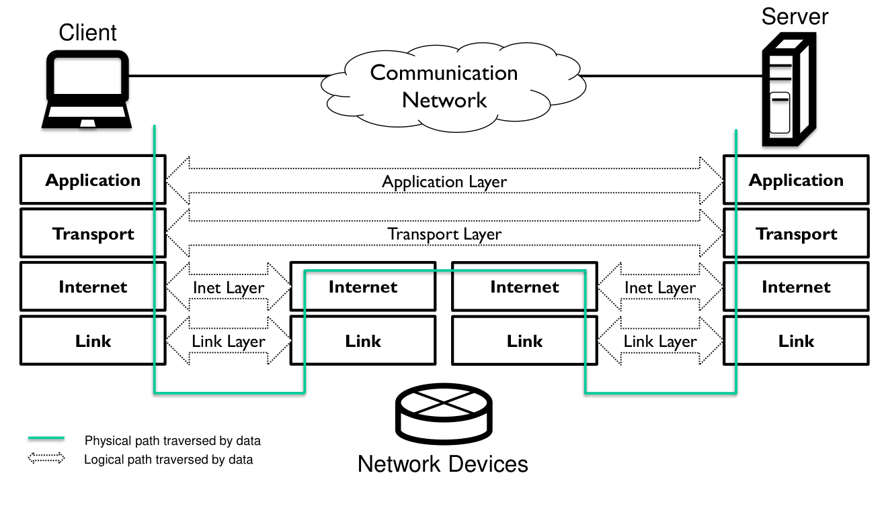
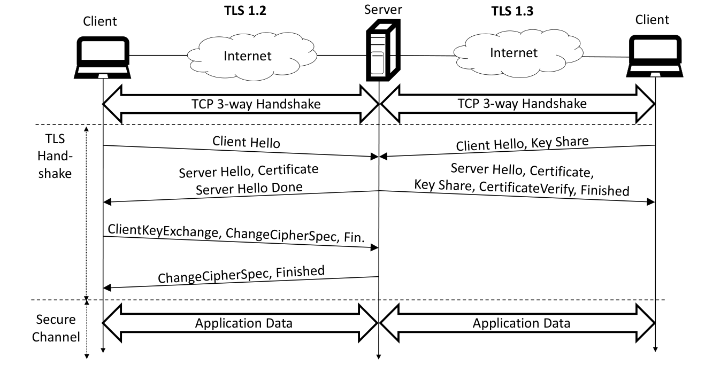
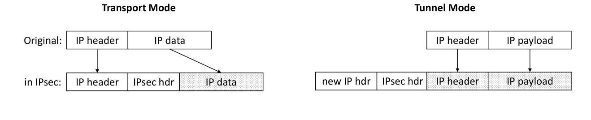
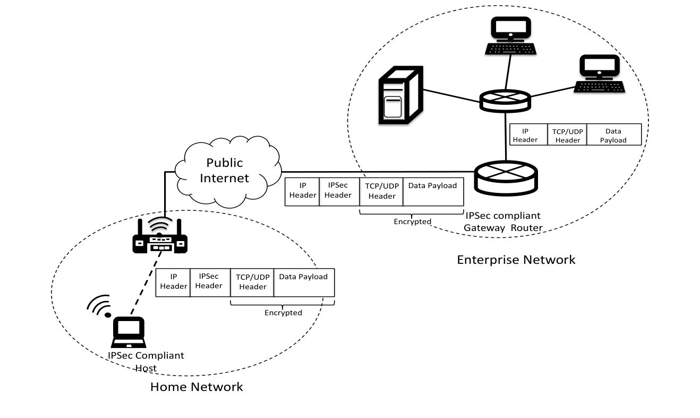
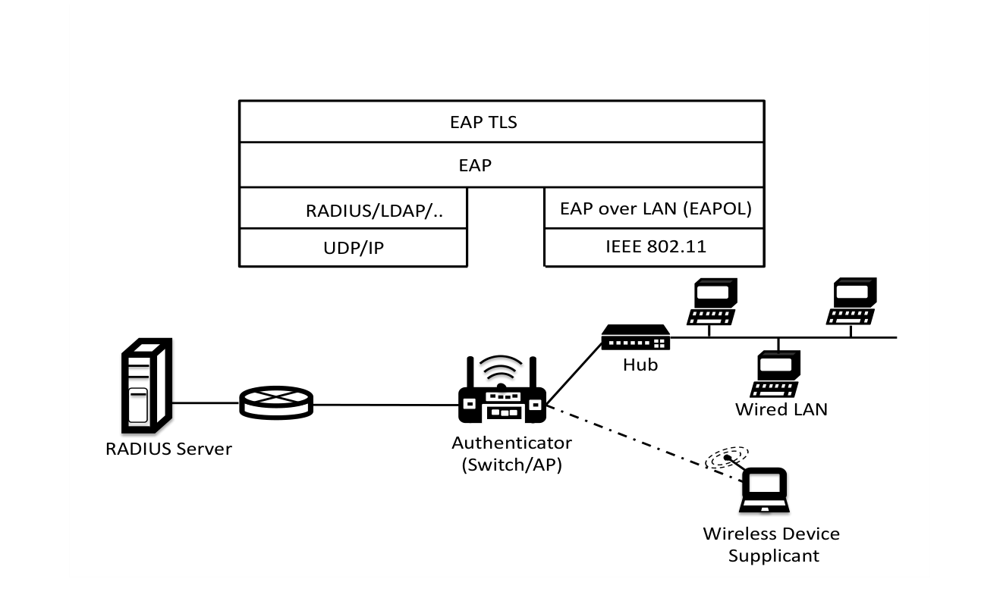

# Chapter 19: Network Security

**Authors:** Christian Rossow (CISPA Helmholtz Center), for Information Security, Sanjay Jha (University of New South Wales)

::: info About this page
This chapter is from [CyBOK Version 1.2.0](https://www.cybok.org/), © Crown Copyright, The National
Cyber Security Centre 2026, licensed under the
[Open Government Licence](https://www.nationalarchives.gov.uk/doc/open-government-licence/).
It was converted from the [PDF](https://www.cybok.org/wp-content/uploads/CyBOK_v1.2.0.pdf) into
a web page so that it works with screen readers and other assistive technology. Each
abbreviation is spelled out in square brackets the first time it appears, and those meanings are
ours, not the book's. So are the names of links the book prints as a bare web address. The PDF
(Portable Document Format) is the original, so if the two disagree, the PDF wins.
:::

## Introduction

The ubiquity of networking allows us to connect all sorts of devices and gain unprecedented access to a whole range of applications and services anytime, anywhere. However, our heavy reliance on networking technology also makes it an attractive target for malicious users who are willing to compromise the security of our communications and/or cause disruption to services that are critical for our day-to-day survival in a connected world. In this chapter, we will explain the challenges associated with securing a network under a variety of attacks for a number of networking technologies and widely used security protocols, along with emerging security challenges and solutions. This chapter aims to provide the necessary background in order to understand other knowledge areas, in particular the Security Operations & Incident Management Knowledge Area (Chapter 8) which takes a more holistic view of security and deals with operational aspects. An understanding of the basic networking protocol stack and popular network protocols is assumed. Standard networking text books explain the fundamentals of the layered Internet Protocol suite \[<a href="#ref-1753" aria-label="Reference 1753">1753</a>, <a href="#ref-1754" aria-label="Reference 1754">1754</a>\].

This chapter is organized as follows. In Section 19.1, we lay out the foundations of this chapter and define security goals in networked systems. As part of this, we also outline attackers and their capabilities that threaten these goals. In Section 19.2, we describe six typical networking scenarios that nicely illustrate why security in networking is important, and achieving it can be non-trivial. We then discuss the security of the various networking protocols in Section 19.3, structured by the layered architecture of the Internet protocol stack. In Section 19.4, we present and discuss several orthogonal network security tools such as firewalls, monitoring and Software Defined Networking (SDN). We complete this chapter with a discussion on how to combine the presented mechanisms in Section 19.5.

## Content

## 19.1 Security Goals and Attacker Models {#_19-1-security-goals-and-attacker-models}

\[<a href="#ref-1753" aria-label="Reference 1753">1753</a>, c8\] \[<a href="#ref-1755" aria-label="Reference 1755">1755</a>, c1\] \[<a href="#ref-1756" aria-label="Reference 1756">1756</a>, c1\] \[<a href="#ref-1757" aria-label="Reference 1757">1757</a>, c6\] \[<a href="#ref-1754" aria-label="Reference 1754">1754</a>, c8\]

We want and need secure networks. But what does *secure* actually mean? In this chapter, we define the fundamentals of common security goals in networking. Furthermore, we discuss capabilities, positions and powers of attackers that aim to threaten these security goals.

### 19.1.1 Security Goals in Networked Systems

When designing networks securely, we aim for several orthogonal *security goals* \[<a href="#ref-1755" aria-label="Reference 1755">1755</a>\]. The most commonly used security goals are summarized in the CIA triad: confidentiality, integrity and availability. *Confidentiality* ensures that untrusted parties cannot leak or infer sensitive information from communication. For example, in a confidential email communication system, (i) only the sender and recipient of an email can understand the email content, not anyone on the communication path (e.g., routers or email providers), and (ii) no one else ought to learn that email was sent from the sender to the recipient. *Integrity* ensures that untrusted parties cannot alter information without the recipient noticing. Sticking to our email example, integrity guarantees that any in-flight modification to an email (e.g., during its submission, or on its way between email providers) will be discovered as such by the recipient. Finally, *availability* ensures that data and services should be accessible by their designated users all the time. In our email scenario, a Denial of Service (DoS) attacker may aim to threaten the availability of email servers in order to prevent or delay email communication.

Next to the CIA triad, there are more subtle security goals, not all of which apply in each and every application scenario. *Authenticity* is ensured if the recipient can reliably attribute the origin of communication to the sender. For example, an email is authentic if the recipient can ensure that the claimed sender actually sent this email. *Non-repudiation* extends authenticity such that we can prove authenticity to arbitrary third parties, i.e., allowing for public verification. In our email scenario, non-repudiation allows the email recipient to prove to anyone else that a given email stems from a given sender. *Anonymity* means that communication cannot be traced back to its sender (sender anonymity) and/or recipient (recipient anonymity). For example, if an attacker sends a spoofed email that cannot be reliably traced back to its actual sender (e.g., the correct personal identity of the attacker), it is anonymous. There are further privacy-related guarantees such as *unlinkability* that go beyond the scope of this chapter and are defined in the Privacy & Online Rights Knowledge Area (Chapter 5).

To achieve security goals, we will heavily rely on cryptographic techniques such as public and symmetric keys for encryption and signing, block and stream ciphers, hashing, and digital signature, as described in the Cryptography Knowledge Area (Chapter 10) and the Applied Cryptography Knowledge Area (Chapter 10). Before showing how we can use these techniques for secure networking, though, we will discuss attacker models that identify capabilities of possible attackers of a networked system.

### 19.1.2 Attacker Models

Attacker models are vital to understand the security guarantees of a given networked system. They define the capabilities of attackers and determine their access to the network.

Often, the Dolev-Yao \[<a href="#ref-1222" aria-label="Reference 1222">1222</a>\] attacker model is used for a formal analysis of security protocols in the research literature. The Dolev-Yao model assumes that an attacker has complete control over the entire network, and concurrent executions of the protocol between the same set of two or more parties can take place. The Dolev-Yao model describes the worst possible attacker: an attacker that sees all network communication, allowing the attacker to read any message, prevent or delay delivery of any message, duplicate any message, or otherwise synthesise any message for which the attacker has the relevant cryptographic keys (if any).

Depending on the context, real attackers may have less power. For example, we can distinguish between *active* and *passive* attackers. Active attackers, like Dolev-Yao, can manipulate packets. In contrast, passive attackers (*eavesdroppers*) can observe but not alter network communication. For example, an eavesdropper could capture network traffic using packet sniffing tools in order to extract confidential information such as passwords, credit card details and many other types of sensitive information from unprotected communication. But even if communication is encrypted, attackers may be able to leverage communication patterns statistics to infer sensitive communication content (“traffic analysis”, see Section 19.3.1.6).

We furthermore distinguish between *on-path* and *off-path* attackers. The prime example for an on-path attacker is a person-in-the-middle (PITM), where an attacker is placed between two communication parties. In contrast, off-path attackers can neither see nor directly manipulate the communication between parties. Still, off-path attackers can cause severe harm. For example, an off-path attacker could spoof TCP \[Transmission Control Protocol\] packets aiming to maliciously terminate a suspected TCP connection between two parties. Similarly, off-path attackers could abuse high-bandwidth links and forge Internet Protocol (IP) headers (IP spoofing, see Section 19.3.2.4) to launch powerful and anonymous Denial of Service (DoS) attacks. Using forged routing protocol message, off-path attackers may even try to become on-path attackers.

In addition, the position of attackers heavily influences their power. Clearly, a single Internet user has less power than an entire rogue Internet Service Provider (ISP). The single user can leverage their relatively small bandwidth to launch attacks, while an ISP can generally also sniff on and alter communication, abuse much larger bandwidths, and correlate traffic patterns. Then again, as soon as attackers aggregate the power of many single users/devices (e.g., in form of a botnet), their overall power amplifies. Attackers could also be in control of certain Internet services, routers, or any combination thereof. We also distinguish between insider and outsider attackers, which are either inside or outside of a trusted domain, respectively.

Overall, we model (i) where attackers can be positioned, (ii) who they are, and (iii) which capabilities they have. Unfortunately, in strong adversarial settings, security guarantees diminish way too easily. For example, strong anonymity may not hold against state actors who can (theoretically) control major parts of the Internet, such as Tier-1. Similarly, availability is hard to maintain for spontaneous and widely distributed DoS incidents.

## 19.2 Networking Applications

\[<a href="#ref-1753" aria-label="Reference 1753">1753</a>, c1\] \[<a href="#ref-1754" aria-label="Reference 1754">1754</a>, c1\]

We now turn to a selection of popular concrete networking applications that help us illustrate why achieving security is far from trivial. This chapter is less about providing solutions— which are discussed in the subsequent two chapters—but more about outlining how security challenges differ by application and context. To this end, we will introduce various networking applications, starting with typical local networks and the Internet, and continuing with similarly ubiquitous architectures such as bus networks (e.g., for cyber-physical system), fully-distributed networks, wireless networks, and finally, Software Defined Networking (SDN).

### 19.2.1 Local Area Networks (LANs)

Arguably, a Local Area Network (LAN) is the most intuitive and by far predominant type of network with the (seemingly) lowest security requirements. Local networks connect systems within an internal environment, shaping billions of home networks and corporate networks alike. A typical fallacy of LAN operators is to blindly trust their network. However, the more clients (can possibly) connect to a LAN, the harder it is to secure a LAN environment. In fact, the clients themselves may undermine the assumed default security of a LAN. For example, without further protection, existing clients can find and access unauthorized services on a LAN, and possibly exfiltrate sensitive information out of band. This becomes especially problematic if the clients are no longer under full control of the network/system operators. A prime example is the recent rise of the Bring Your Own Device (BYOD) principle, which allows employees to integrate their personal untrusted devices into corporate networks—in the worst case, even creating network bridges to the outside world. Similarly, attackers may be able to add malicious clients, such as by gaining physical access to network plugs. Finally, attackers may impersonate other LAN participants by stealing their loose identity such as publicly-known hardware addresses (e.g., cloning MAC \[Media Access Control\] addresses in Ethernet).

Consequently, even though a LAN is conceptually simple, we still have uncertainties regarding LAN security: Can we control which devices become part of a network to exclude untrusted clients and/or device configurations? (Sections 19.3.4.1 and 19.4.5) Can we monitor their actions to identify attackers and hold them accountable? (Section 19.4.3) Can we partition larger local networks into multiple isolated partitions to mitigate potential damage? (Section 19.3.4.5)

### 19.2.2 Connected Networks and the Internet

Securing communication becomes significantly more challenging when connecting local networks. The most typical scenario is connecting a LAN to the Internet, yet also LAN-to-LAN communication (e.g., two factories part of a joint corporate network using a Virtual Private Network (VPN)) is common. With such connected networks, we suddenly face an insecure end-to-end channel between the networks which is no longer in control of blindly trusted network operators. When communicating over the Internet, the traffic will pass several Autonomous Systems (ASs), each of which can in principle eavesdrop and manipulate the communication. Worse, senders typically have little to no control over the communication paths. In fact, even ASs cannot fully trust all paths in their routing table. Without further precautions, any other (misbehaving) AS on the Internet can reroute a target’s network traffic by hijacking Internet routes. For example, a state actor interested in sniffing on the communication sent to a particular network can send malicious route announcements to place itself as PITM between all Internet client and the target network. Finally, especially corporate networks may choose to “include” third-party services into their network, such as data centers for off-site storage or clouds for off-site computations. Suddenly, external networks are integrated into corporate networks, and organizations may send sensitive data to servers outside of their control.

This leads to several questions: Can two parties securely communicate over an insecure channel, i.e., with guaranteed confidentiality and integrity? (Section 19.3.2.1) How should we securely connect networks, e.g., in a corporate setting? (Section 19.3.3.1) Can we ensure that the underlying routing is trusted, or at least detect attacks? (Section 19.3.3.3)

### 19.2.3 Bus Networks

Cyber-physical systems regularly use bus networks to communicate. For example, industrial control systems may use Modbus \[<a href="#ref-1758" aria-label="Reference 1758">1758</a>\] to exchange status information and steer cyber-physical devices. Home automation networks (e.g., Konnex Bus (KNX) \[<a href="#ref-1759" aria-label="Reference 1759">1759</a>\]) allow to sense inputs in houses (temperature, brightness, activity) which in turn govern actuators (e.g., heating/cooling, light, doors). Vehicular networks (e.g., Controller Area Network (CAN) \[<a href="#ref-1760" aria-label="Reference 1760">1760</a>\]) connect dozens if not hundreds of components that frequently communicate, e.g., sensors such as a radar to control actuators such as the engine or brakes. All these bus networks typically also form local networks, yet with subtle differences to the aforementioned LANs. Frequently, bus clients require real-time guarantees for the arrival and processing time of data. Clearly, even safety is affected if the signal of a car’s brake pedal arrives “too late” at its destination (the brake system). This need for real-time guarantees are often in direct conflict to simple security demands such as authenticity that may add “expensive” computations. Furthermore, by design, bus networks introduce a shared communication medium, which allows clients to both, sniff and manipulate communication. On top, many of the bus protocols were designed without paying particular attention to security, partially because they predate security best practices we know today. Finally, bus clients can have limited computing resources, having only limited capability to perform expensive security operations.

We summarize our discussion with a set of questions on bus security: Can we retrospectively add security to unprotected bus networks without breaking compatibility? Is it possible to gain security without violating real-time guarantees? (Section 19.3.4.7) Which additional mechanisms can we use to reduce the general openness of bus networks? (Section 19.3.4.5)

### 19.2.4 Wireless Networks

When moving from wired to wireless networks, we do not necessarily face fundamentally new threats, but increase the likelihood of certain attacks to occur. In particular, wireless networks (e.g., Wireless LAN) are prone to eavesdropping due to the broadcast nature of their media. Similarly, while simple physical access control may still partially work to protect a cable-connected LAN network, it fails terribly for wireless networks that—by construction—have no clear boundary for potential intruders. For example, walls around a house do not stop signals from and to wireless home networks, and without further protection, attackers can easily join and sniff on networks. In wireless settings, we thus have to pay particular attention to both access control and secure communication (including securing against traffic analysis). As it turns out, though, defining secure wireless standards is far from trivial, and several wireless and cellular standards have documented highly-critical vulnerabilities or design flaws.

To better understand their deficiencies, we will study the following questions: How can we enforce access control in wireless networks, while not sacrificing usability? How can we prevent eavesdropping attacks in wireless communication? (Section 19.3.4.6)

### 19.2.5 Fully-Distributed Networks: DHTs and Unstructured P2P Networks

Centralized client-server architectures have clear disadvantages from an operational point of view. They have a single point of failure, and require huge data centers in order to scale to many clients. Furthermore, centralized architectures have a central entity that can control or deliberately abandon them. Fully-distributed networks provide scalability and resilience by design. Not surprisingly, several popular networks chose to follow such distributed designs, including cryptocurrencies such as Bitcoin or file sharing networks. Decentralized network can be roughly grouped in two types. Distributed Hash Tables (DHTs) such as Kademlia \[<a href="#ref-1062" aria-label="Reference 1062">1062</a>\] and Freenet \[<a href="#ref-562" aria-label="Reference 562">562</a>\] have become the de-facto standard for *structured* Peer-to-Peer (P2P) networks, and offer efficient and scalable message routing to millions of peers. In *unstructured* P2P networks, peers exchange data hop-by-hop using gossip protocols. Either way, P2P networks are designed to *welcome* new peers at all times. This lack of peer authentication leads to severe security challenges. A single entity may be able to aggressively overpopulate a network if no precautions are taken. DHTs further risk that attackers can potentially disrupt routing towards certain data items. Similarly, gossip networks risk that single entities flood the network with malicious data. Finally, due to the open nature of the networks, we also face privacy concerns, as network participants can infer which data items a peer retrieves.

All in all, fully-distributed networks raise fundamentally different security concerns: Can we reliably route data (or data requests) to their target? Can we authenticate peers even in distributed networks? What are the security implications of storing data in and retrieving data from a publicly accessible network? (Section 19.3.1.5)

### 19.2.6 Software-Defined Networking and Network Function Virtualisation

Software Defined Networking (SDN) is our final use case. SDN is strictly speaking not a networking application, but more of a technology to enable for dynamic and efficient network configuration. Yet it concerns similarly many security implications as other applications do. SDN aims to ease network management by decoupling packet forwarding (data plane) and packet routing (control plane). This separation and the underlying flow handling have enabled for drastic improvements from a network management perspective, especially in highly-dynamic environments such as data centers. The concept of Network Functions Virtualisation (NFV) complements SDN, and allows to virtualize network node functions such as load balancers or firewalls.

We will revisit SDN by discussing the following questions: How can SDN help in network designs and better monitoring? Can NFV help securing networks by virtualizing security functions? Are there new, SDN-specific threats? (Section 19.4.4)

## 19.3 Network Protocols and Their Security

<figure id="figure-19-1">

{width=659 height=381}

<figcaption>

Figure 19.1: Four-Layer Internet Protocol Stack (a.k.a. *TCP/IP stack*).

</figcaption>
</figure>

::: details Text description of Figure 19.1

A layered diagram. A laptop labelled "Client" is at top left and a tower server labelled "Server" is at top right, joined by a line through a cloud labelled "Communication Network".

Four stacked boxes sit under the client and four under the server, labelled from top to bottom: "Application", "Transport", "Internet", "Link". Between them, in the middle, are two more stacks with only "Internet" and "Link" boxes. These two stacks represent the network devices, and a router icon below them is labelled "Network Devices".

Logical paths (dotted double-headed arrows):

- "Application Layer": between the client's and the server's Application boxes.
- "Transport Layer": between the client's and the server's Transport boxes.
- "Inet Layer": between the client's Internet box and the first network device's Internet box; and again between the second network device's Internet box and the server's Internet box.
- "Link Layer": between the client's Link box and the first network device's Link box; and again between the second device's Link box and the server's Link box.

Physical path (solid green line): it goes down through the client's stack, along the bottom to the first network device's stack, up through its Link and Internet boxes, across to the second network device, down through it, along the bottom, and up through the server's stack.

Legend, bottom left:

- Green solid line: "Physical path traversed by data"
- Dotted double-headed arrow: "Logical path traversed by data"

:::

After having introduced several networking applications, we now turn to the security of networking protocols. To guide this discussion, we stick to a layered architecture that categorizes protocols and applications. Indeed, a complex system such as distributed applications running over a range of networking technologies is best understood when viewed as layered architecture. [Figure 19.1](#figure-19-1) shows the 4-layer Internet protocol suite and the interaction between the various layers. For each layer, we know several network protocols—some of which are quite generic, and others that are tailored for certain network architectures. The Internet is the predominant architecture today, and nicely maps to the TCP/IP model. It uses the Internet Protocol (IP) (and others) at the Internet layer, and UDP/TCP (and others) at the transport layer—hence, the Internet protocol suite is also known as the *TCP/IP stack*.

Other networking architectures such as automotive networks use completely different sets of protocols. Not always it is possible to directly map their protocol to the layered architecture of the TCP/IP model. Consequently, more fine-grained abstractions such as the ISO/OSI model extend this layered architecture. For example, the ISO/OSI model splits the link layer into two parts, namely the data link layer (node-to-node data transfer) and the physical layer (physical transmission and reception of raw data). The ISO/OSI model defines a network layer instead of an Internet layer, which is more inclusive to networks that are not connected to the Internet. Finally, ISO/OSI defines two layers below the application layer (presentation and session).

The vast majority of topics covered in this chapter do not need the full complexity of the ISO/OSI model. In the following, we therefore describe the security issues and according countermeasures at each layer of the TCP/IP model. We thereby follow a top-down approach, starting with application-layer protocols, and slowly going down to the lower layers until the link layer. Whenever possible, we abstract from the protocol specifics, as many discussed network security principles can be generically applied to other protocols.

### 19.3.1 Security at the Application Layer

\[<a href="#ref-1753" aria-label="Reference 1753">1753</a>, c8\] \[<a href="#ref-1756" aria-label="Reference 1756">1756</a>, c6, c15, c19–c22\] \[<a href="#ref-1754" aria-label="Reference 1754">1754</a>, c8\]

We first seek to answer how application protocols can be secured, or how application-layer protocols can be leveraged to achieve certain security guarantees.

#### 19.3.1.1 Email and Messaging Security

As a first example of an application-layer security protocol, we will look at secure email. Given its age, *the* protocol for exchanging emails, Simple Mail Transfer Protocol (SMTP), was not designed with security in mind. Still, businesses use email even now. Communication parties typically want to prevent others from reading (confidentiality) or altering (integrity) their emails. Furthermore, they want to verify the sender’s identity when reading an email (authenticity). Schemes like Pretty Good Privacy (PGP) and Secure Multipurpose Internet Mail Extensions (SMIME) provide such end-to-end security for email communication. Their basic idea is that each email user has their own private/public key pair–see the Cryptography Knowledge Area (Chapter 10) for the cryptographic details, and Section 19.3.2.2 for a discussion how this key material can be shared. The sender signs the hash of a message using the sender’s private key, and sends the hash along with the (email) message to the recipient. The recipient can then validate the email’s signature using the sender’s public key. Checking this signature allows for an integrity check and authentication at the same time, as only the sender knows their private key. Furthermore, this scheme provides non-repudiation as it can be publicly proved that the hash (i.e., the message) was signed by the sender’s private key. To gain confidentiality, the sender encrypts the email before submission using “hybrid encryption”. That is, the sender creates a fresh symmetric key used for message encryption, which is significantly faster than using asymmetric cryptography. The sender then shares this symmetric key with the recipient, encrypted under the recipient’s public key.

This very same scheme can be applied to other client-to-client communication. For example, instant messengers (e.g., WhatsApp, Threema or Signal) or video conference systems can use this general principle to achieve the same end-to-end guarantees. One remaining challenge for such strong guarantees to hold is that user identities (actually, their corresponding key material) have to be reliably validated \[<a href="#ref-1761" aria-label="Reference 1761">1761</a>\]. The Applied Cryptography Knowledge Area (Chapter 18) has more details.

Not all email users leverage such client-to-client security schemes, though. Both PGP and SMIME have usability challenges (e.g., key distribution, difficulty of indexed searches, etc.) that hamper wide adoption \[<a href="#ref-341" aria-label="Reference 341">341</a>\]. To address this issue, we can secure mail protocols (SMTP, but also Internet Message Access Protocol (IMAP) and Post Office Protocol (POP)) with the help of TLS (see Section 19.3.2.1). By wrapping them in TLS, we at least achieve hop-by-hop security, e.g., between client and their mail submission server or between mail servers during email transfer. Consequently, we can protect email submission, retrieval and transport from on-path adversaries. However, even though communication is protected hop-by-hop, curious mail server operators can see emails in plain. Only end-to-end security schemes like PGP/SMIME protect against untrusted mail server operators.

There are other challenges to secure email, such as phishing and spam detection, which are described in depth in the Adversarial Behaviours Knowledge Area (Chapter 7).

#### 19.3.1.2 Hyper Text Transfer Protocol Secure (HTTPS)

The most prominent application-layer protocol, the Hypertext Transfer Protocol (HTTP), was designed without any security considerations. Yet, the popularity of HTTP and its unprecedented adoption for e-commerce imposed strict security requirements on HTTP later on. Its secure counterpart HTTPS wraps HTTP using a security protocol at the transport layer (TLS, see Section 19.3.2.1), which can be used to provide confidentiality and integrity for the entire HTTP communication—including URL \[Uniform Resource Locator\], content, forms and cookies. Furthermore, HTTPS allows clients to implicitly authenticate web servers using certificates. HTTPS is described in much greater detail in the Web & Mobile Security Knowledge Area (Chapter 16).

#### 19.3.1.3 DNS Security

In its primary use case, the Domain Name System (DNS) translates host names to their corresponding IP addresses. A hierarchy of authoritative name servers (NSs) maintain this mapping. Resolving NSs (*resolvers*) iteratively look up domain names on behalf of clients. In such an iterative lookup, the resolver would first query the root NSs, which then redirect the resolver to NSs lower in the DNS hierarchy, until the resolver contacts an NS that is authoritative for the queried domain. For example, in a lookup for a domain `sub.example.com`, a root NS would redirect the resolver to a NS that is authoritative for the `.com` zone, which in turn tell the resolver to contact the NS authoritative for `*.example.com`. To speed up these lookups, resolvers cache DNS records according to a lifetime determined by their authoritative NSs. To minimize privacy leaks towards NSs in the upper hierarchy, resolvers can minimize query names such that NSs higher up in the hierarchy do not learn the fully-qualified query name \[<a href="#ref-1762" aria-label="Reference 1762">1762</a>\].

Unfortunately, multiple attacks aim to abuse the lack of authentication in plain text DNS. A PITM attacker can impersonate a resolver, return bogus DNS records and divert traffic to a malicious server, thus allowing them to collect user passwords and other credentials. In a DNS cache poisoning attack, adversaries aim to implant bogus name records, thus diverting a user’s traffic towards the target domain to attacker-controlled servers. Learning from these attacks, the IETF \[Internet Engineering Task Force\] introduced the DNS Security Extensions (DNSSEC). DNSSEC allows authoritative name servers to sign DNS records using their private key. The authenticity of the DNS records can be verified by a requester using the corresponding public key. In addition, a digital signature provides integrity for the response data. The overall deployment of DNSSEC at the top-level domain root name servers—a fundamental requirement to deploy DNSSEC at lower levels in the near future—steadily increases \[<a href="#ref-1763" aria-label="Reference 1763">1763</a>\].

DNSSEC explicitly does not aim to provide confidentiality, i.e., DNS records are still communicated unencrypted. DNS over TLS (DoT) and DNS over HTTPS (DoH) address this problem. They provide end-to-end security between the DNS client and its chosen resolver, by tunneling DNS via secure channels, namely TLS (see Section 19.3.2.1) or HTTPS (see Section 19.3.1.2), respectively. More and more popular Web browsers (e.g., Chrome, Firefox) enable DoH by default, using selected resolvers preconfigured by the browser vendors. This resulted in a massive centralization of DNS traffic towards just a few resolvers received. Such a centralization puts resolvers in a quite unique position with the power of linking individual clients (by IP addresses) to their lookups. Oblivious DNS Over HTTPS (ODoH) addresses this issue by adding trusted proxies between DNS clients and their chosen resolvers \[<a href="#ref-1764" aria-label="Reference 1764">1764</a>\].

Irrespective of these security protocols, resolvers are in a unique situation to monitor name resolutions of their clients. Resolver operators can leverage this in order to protect clients by offering some sort of blocklist of known “misbehaving” domains which have a bad reputation. Such DNS filtering has the potential to mitigate cyber threats, e.g., by blocking phishing domains or command & control domains of known malware variants.

Finally, DNS is prone to Distributed Denial of Service (DDoS) attacks \[<a href="#ref-1765" aria-label="Reference 1765">1765</a>\]. DNS authoritative servers can be targeted by NXDOMAIN attacks, in which an IP-spoofing client looks up many unassigned subdomains of a target domain at public (open) resolvers. Subdomains are typically chosen at random and are therefore not cached, hence sometimes referred to as *random subdomain attack*. Consequently, the resolvers have to forward the lookups and hence flood the target authoritative name server. In another type of DDoS attack, DNS servers (both resolvers and authoritatives) are regularly abused for amplification DDoS attacks, in which they reflect IP-spoofed DNS requests with significantly larger responses \[<a href="#ref-661" aria-label="Reference 661">661</a>\]. Reducing the number of publicly-reachable open DNS resolvers \[<a href="#ref-845" aria-label="Reference 845">845</a>\] and DNS rate limiting can mitigate these problems.

#### 19.3.1.4 Network Time Protocol (NTP) Security

The Network Time Protocol (NTP) is used to synchronise devices (hosts, server, routers etc.) to within a few milliseconds of Coordinated Universal Time (UTC). NTP clients request times from NTP servers, taking into account round-trip times of this communication. In principle, NTP servers use a hierarchical security model implementing digital signatures and other standard application-layer security mechanisms to prevent transport-layer attacks such as replay or PITM. However, these security mechanisms are rarely enforced, easing attacks that shift the time of target system \[<a href="#ref-1766" aria-label="Reference 1766">1766</a>\] in both, on-path and off-path attacks. In fact, such time shifting attacks may have severe consequences, as they, e.g., allow attackers to use outdated certificates or force cache flushes. The large number of NTP clients that rely on just a few NTP servers on the Internet to obtain their time are especially prone to this attack \[<a href="#ref-1767" aria-label="Reference 1767">1767</a>\]. To counter this threat, network operators should install local NTP servers that use and compare multiple trusted NTP server peers. Alternatively, hosts can use NTP client implementations that offer provably secure time crowdsourcing algorithms \[<a href="#ref-1768" aria-label="Reference 1768">1768</a>\].

#### 19.3.1.5 Distributed Hash Table (DHT) Security

There are two main threats to DHTs: (i) *Eclipse* and (ii) *Sybil* attacks. An Eclipse attacker aims to poison routing tables to isolate target nodes from other, benign overlay peers. Redundancy helps best against Eclipse attacks. For example, systems like Kademlia foresee storage and routing redundancy, which mitigate some low-profile attacks against DHTs. In the extreme, DHT implementations can use dedicated routing tables with verified entries \[<a href="#ref-1769" aria-label="Reference 1769">1769</a>\]. Central authorities—which lower the degree of distribution of DHTs, though—can solve the underlying root problem and assign stable node identifiers \[<a href="#ref-1081" aria-label="Reference 1081">1081</a>\].

In a Sybil attack, an adversary introduces malicious nodes with self-chosen identifiers to subvert DHT protocol redundancy \[<a href="#ref-1077" aria-label="Reference 1077">1077</a>\]. To prevent such Sybils, one can limit the number of nodes per entity, e.g., based on IP addresses \[<a href="#ref-1769" aria-label="Reference 1769">1769</a>\]—yet causing collateral damage to nodes sharing this entity (e.g., multiple peers behind a NAT \[Network Address Translation\] gateway). Others suggested to use peer location as identifier validation mechanisms, which, however, prevents that nodes can relocate \[<a href="#ref-1770" aria-label="Reference 1770">1770</a>\]. Computational puzzles can slow down the pace at which attackers can inject malicious peers \[<a href="#ref-1771" aria-label="Reference 1771">1771</a>\], but are ineffective against distributed botnet attacks. Finally, reputation systems enable peers to learn trust profiles of their neighbors \[<a href="#ref-1772" aria-label="Reference 1772">1772</a>\], which ideally discredit malicious nodes \[<a href="#ref-1772" aria-label="Reference 1772">1772</a>\].

Unfortunately, all these countermeasures either restrict the generality of DHTs, or introduce a centralized component. Therefore, most defenses have not fully evolved from academia into practice. A more complete treatment of DHT security is provided by Urdaneta and van Steen \[<a href="#ref-1081" aria-label="Reference 1081">1081</a>\] and in the Distributed Systems Security Knowledge Area (Chapter 12).

#### 19.3.1.6 Anonymous and Censorship-Free Communication

Anonymity in communication is a double-edged sword. On the one hand, we want to hold malicious communication parties accountable. On the other hand, other scenarios may indeed warrant for anonymous communication. For example, democratic minds may want to enable journalists to communicate even in suppressing regimes.

Anonymity can best be achieved when mixing communication with others and rerouting it over multiple parties. Onion routing represents the *de facto* standard of such Anonymous Communication Networks (ACNs). *Tor* is the most popular implementation of this general idea, in which parties communicate via (typically three) onion routers in a multi-layer encrypted overlay network \[<a href="#ref-507" aria-label="Reference 507">507</a>\]. A Tor client first selects (typically three) onion routers, the entry node, middle node(s), and exit node. The client then establishes an end-to-end secure channel (using TLS) to the entry node, which the client then uses to create another end-to-end protected between stream to the middle node. Finally, the client uses this client-to-middle channel to initiate an end-to-end protected stream to the exit node. The resulting path is called a circuit. Tor clients communicate over their circuit(s) to achieve sender anonymity. Any data passed via this circuit is encrypted three times, and each node is responsible for decrypting one layer.

Onion routing provides quite strong security guarantees. First of all, the entry and middle node cannot decrypt the communication passed over the circuit, only the exit node can. Furthermore, none of the proxies can infer *both* communication endpoints. In fact, only the entry node knows the client, and only the exit node knows the server. This also means that servers connected via onion routing networks do not learn the true addresses of their clients.

This general concept can be expanded to achieve recipient anonymity, i.e., protect the identity of servers. For example, Tor allows for so-called *onion services* which can only be contacted by Tor clients that know the server identity (a hash over their public key). As onion services receive data via Tor circuits and can never be contacted directly, their identity remains hidden.

While Tor gives strong anonymity guarantees, it is not fully immune against deanonymisation. In particular, traffic analysis and active traffic delay may help to infer the communication partners, especially if entry and exit node collaborate. In fact, it is widely accepted that powerful adversaries can link communication partners by correlating traffic entering and leaving the Tor network \[<a href="#ref-508" aria-label="Reference 508">508</a>, <a href="#ref-1773" aria-label="Reference 1773">1773</a>\]. Furthermore, patterns such as inter-arrival times or cumulative packet sizes were found sufficient to attribute encrypted communication to a particular website \[<a href="#ref-1774" aria-label="Reference 1774">1774</a>\]. Consequently, attackers may be able to predict parts of the communication content even though communication is encrypted and padded. As a response, researchers explored countermeasures such as constant rate sending or more efficient variants of it \[<a href="#ref-1775" aria-label="Reference 1775">1775</a>\].

Orthogonal to ACNs, censorship-resistant networks aim to prevent that attackers can suppress communication. The typical methodology here is to blend blocklisted communication into allowed traffic. For example, decoy routing uses on-path routers to extract covert (blocklisted) information from an overt (allowed) channel and redirects this hidden traffic to the true destination \[<a href="#ref-574" aria-label="Reference 574">574</a>\]. Similarly, domain fronting leverages allowed TLS endpoints to forward a covert stream—hidden in an allowed TLS stream—to the actual endpoint \[<a href="#ref-571" aria-label="Reference 571">571</a>\]. Having said this, nation state adversaries have the power to turn off major parts (or even all) of the communication to radically subvert these schemes at the expense of large collateral damage.

### 19.3.2 Security at the Transport Layer {#_19-3-2-security-at-the-transport-layer}

\[<a href="#ref-1753" aria-label="Reference 1753">1753</a>, c8\] \[<a href="#ref-1755" aria-label="Reference 1755">1755</a>, c4, c6\] \[<a href="#ref-1754" aria-label="Reference 1754">1754</a>, c8\]

In this subsection, we discuss the security on the transport layer which sits below the application layer in the protocol stack.

#### 19.3.2.1 TLS (Transport Layer Security)

Application-layer protocols rely on the transport layer to provide confidentiality, integrity and authentication mechanisms. These capabilities are provided by a shim layer *between* the application and transport layers, called the Transport Layer Security (TLS). In this section, our discussions will be hugely simplified to just cover the basics of the TLS protocol. For a more detailed discussion, including the history of TLS and past vulnerabilities, see Applied Cryptography Knowledge Area (Section 18.5).

We discuss the most recent and popular TLS versions 1.2 and 1.3, with a particular focus on their handshakes. Irrespective of the TLS version, the handshake takes care of cryptographic details that application-layer protocols otherwise would have to deal with themselves: authenticating each other, agreeing on cryptographic cipher suites, and deriving key material.

The handshakes differ between the two TLS versions, as shown in [Figure 19.2](#figure-19-2). We start discussing TLS 1.2, as shown on the left-hand side of the figure. First, client and server negotiate which TLS version and cipher suites to use in order to guarantee compatibility even among heterogeneous communication partners. Second, server and client exchange certificates to authenticate each other, whereas client authentication is optional (and for brevity, omitted in [Figure 19.2](#figure-19-2)). Certificates contain communication partner identifiers such as domain names for web servers, and include their vetted public keys (see Section 19.3.2.2 for details). Third, the communication partners derive a symmetric key that can be used to secure the data transfer. To derive a key, the client can encrypt a freshly generated symmetric key under the server’s public (e.g., RSA \[Rivest-Shamir-Adleman\]) key. Alternatively, the partners can derive a key using a Diffie-Hellman Key Exchange (DHKE). The DHKE provides TLS with perfect forward secrecy that prevents attackers from decrypting communication even if the server’s private key leaks.

<figure id="figure-19-2">

{width=659 height=349}

<figcaption>

Figure 19.2: TLS Handshake: Comparison between TLS 1.2 (on the left) and TLS 1.3 (on the right), excluding the optional steps for client authentication.

</figcaption>
</figure>

::: details Text description of Figure 19.2

A sequence diagram with three columns. In the middle is a "Server" (tower icon). On the left is a "Client" (laptop icon) under the heading "TLS 1.2", connected to the server through a cloud labelled "Internet". On the right is another "Client" under the heading "TLS 1.3", connected to the server through another cloud labelled "Internet". Time runs from top to bottom. A vertical line drops from each of the three devices.

Both sides start with a wide double-headed arrow between client and server labelled "TCP 3-way Handshake". A dashed horizontal line follows. The area below it, down to a second dashed line, is marked on the far left "TLS Handshake" (a vertical double-headed arrow). The area below the second dashed line is marked "Secure Channel".

**TLS 1.2 (left), messages in order:**

1. Client to Server: "Client Hello"
2. Server to Client: "Server Hello, Certificate" and "Server Hello Done"
3. Client to Server: "ClientKeyExchange, ChangeCipherSpec, Fin."
4. Server to Client: "ChangeCipherSpec, Finished"

**TLS 1.3 (right), messages in order:**

1. Client to Server: "Client Hello, Key Share"
2. Server to Client: "Server Hello, Certificate, Key Share, CertificateVerify, Finished"

Finally, on both sides, a wide double-headed arrow between client and server is labelled "Application Data".

:::

As a final step, the handshake then validates the integrity of the handshake session. From now on, as part of the data transfer phase, TLS partners use the derived key material to encrypt and authenticate the subsequent communication.

TLS 1.3, as shown on the right of [Figure 19.2](#figure-19-2), designs this handshake more efficiently. Without sacrificing security guarantees, TLS 1.3 reduces the number of round-trip times to one (1RTT). TLS 1.3 no longer supports RSA-based key exchanges in favor of DHKE. The client therefore guesses the chosen key agreement protocol (e.g., DHKE) and sends its key share right away in the first step. The server would then respond with the chosen protocol, its key share, certificate and a signature over the handshake (in a *CertificateVerify* message). If the client was connected to the server before, TLS 1.3 even supports a handshake without additional round-trip time (0-RTT)—at the expense of weakening forward secrecy and replay prevention. Finally, as Formal Methods for Security Knowledge Area (Chapter 13) explores, TLS 1.3 has the additional benefit that it is formally verified to be secure \[<a href="#ref-1218" aria-label="Reference 1218">1218</a>, <a href="#ref-1742" aria-label="Reference 1742">1742</a>\].

We now briefly discuss how TLS successfully secures against common network attacks. First, consider an eavesdropper that wants to obtain secrets from captured TLS-protected traffic. As the user data is encrypted, no secrets can be inferred. Second, in an IP spoofing attack, attackers may try any of the TLS partners to accept bogus data. However, to inject data, attackers lack the secret key to inject encrypted content. Third, also data cannot be altered, as TLS protects data integrity using authenticated encryption or message authentication codes. Finally, even a strong PITM attack is prevented by the help of certificates that authenticate the parties—unless the PITM attacker can issue certificates that the TLS partners trust, as discussed next. The TLS protocol also guarantees that payload arrives at the application in order, detects dropped and modified content, and also effectively prevents replay attacks that resend the same encrypted traffic to duplicate payload. Having said this, TLS does not prevent attackers from delaying parts or all of the communication.

#### 19.3.2.2 Public Key Infrastructure

So far we have simply assumed that communication partners can reliably obtain trustworthy public keys from each other. However, in presence of active on-path attackers, how can one trust public keys exchanged via an insecure channel? The fundamental “problem” is that, conceptually, everyone can create public/private key pairs. Public Key Infrastructure (PKI) provides a solution for managing *trustworthy* public keys (and, implicitly, their private key counterparts). Government agencies or standard organisations appoint registrars who issue and keep track of so-called *certificates* on behalf of entities (individuals, servers, routers etc).

Assume a user wants to obtain a trusted certificate and the corresponding key material. To this end, the user first generates a public/private key pair on their own hardware. The private key is never shared with anyone. The public key becomes part of a certificate signing request (CSR) that the user sends to a registration authority. Before this authority signs the certificate as requested, the user has to prove their identity (e.g., possession of a domain name for an HTTPS certificate, or personal identifiers for an S/MIME certificate) to registrars. The registrar’s signature prevents forgery, as anyone can now verify the certificate using the (publicly known or similarly verifiable) registrar’s public key. The resulting certificate contains the user’s identity and public key, as well as CA \[Certification Authority\] information and a period of certificate validity. Its format and PKI management specifications are specified in RFC \[Request For Comments\] 1422 and the ITU-X.509 standard.

The existing PKI model has faced several challenges, as evidenced by cases where CAs have issued certificates in error, or under coercion, or through their own infrastructure being attacked. As a response, CAs publish a list of revoked/withdrawn certificates, which can be queried using the Online Certificate Status Protocol (OCSP) as defined in RFC 6960, or is piggy-backed (“stapled”) in TLS handshakes. To avoid wrong (but validated) certificates being issued, browsers temporarily started “pinning” them. However, this practice that was quickly abandoned and deprecated in major browsers, as it turned out to be prone to human errors (in case of key theft or key loss). Instead, big players such as Google or Cloudflare started collecting any observed and valid certificates in public immutable logs. TLS client such as browsers can then opt to refuse non-logged certificates. This scheme, known as Certificate Transparency (CT) \[<a href="#ref-1732" aria-label="Reference 1732">1732</a>\], forces attackers publishing their rogue certificates. Consequently, certificate owners can notice whether malicious parties started abusing their identifies (e.g., domains).

The web of trust is an alternative, decentralized PKI scheme where users can create a community of trusted parties by mutually signing certificates without needing a registrar. The PGP scheme we discussed in Section 19.3.1.1 and its prominent implementation GNU Privacy Guard (GPG) is a good example, in which users certify each others’ key authenticity.

A more detailed PKI discussion is part of the Applied Cryptography Knowledge Area (Section 18.3.8).

#### 19.3.2.3 TCP Security

TLS does a great deal in protecting the TCP payloads and prevents session hijacks and packet injection. Yet what about the security of TCP headers of TLS connections or other, non-TLS connections? In fact, attackers could try launching TCP reset attacks that aim to maliciously tear down a target TCP connection. To this end, they guess or bruteforce valid sequence numbers, and then spoof TCP segments with the RST flag being set. If the spoofed sequence numbers hit the sliding window, the receiving party will terminate the connection. There are mainly two orthogonal solutions to this problem deployed in practice: (i) TCP/IP stacks have to ensure strong randomness for (initial) sequence number generation. (ii) Deny RST segments with sequence numbers that fall in the middle of the sliding window. Conceptually, these defenses are ineffective against on-path attackers that can reliably manipulate TCP segments (e.g., dropping payload and setting the RST flag). Having said this, Weaver et al. \[<a href="#ref-1776" aria-label="Reference 1776">1776</a>\] show that race conditions allow for detecting RST attacks launched by off-path attackers even if they can infer the correct sequence number.

A *SYN Flooding attacker* keeps sending TCP SYN segments and forces a server to allocate resources for half-opened TCP connections. When servers limit the number of half-opened connections, benign clients can no longer establish TCP connections to the server. To mitigate this session exhaustion, servers can delete a random half-opened session whenever a new session needs to be created—potentially deleting benign sessions, though. A defence known as SYN Cookies has been implemented by operating systems as a more systematic response to SYN floods [RFC4987]. When enabled, the server does not half open a connection right away on receiving a TCP connection request. It selects an Initial Sequence Number (ISN) using a hash function over source and destination IP addresses, port numbers of the SYN segment, a timestamp with a resolution of 64 seconds, as well as a secret number only known to the server. The server then sends the client this ISN in the SYN/ACK message. If the request is from a legitimate sender, the server receives an ACK message with an acknowledgment number which is ISN plus 1. To verify if an ACK is from a benign sender, the server thus again computes the SYN cookie using the above-mentioned data, and checks if the acknowledge number in the ACK segment minus one corresponds to the SYN cookie. If so, the server opens a TCP connection, and only then starts using resources. A DoS attacker would have to waste resources themselves and reveal the true sending IP address to learn the correct ISN, hence, leveling the fairness of resource consumption.

#### 19.3.2.4 UDP \[User Datagram Protocol\] Security

What TLS is for TCP, Datagram TLS (DTLS) is for UDP. Yet again there are additional security considerations for UDP that we briefly discuss next. In contrast to its big brother TCP, UDP is designed such that application-layer protocols have to handle key mechanisms themselves (or tolerate their absence), including reordering, reliable transport, or identifier recognition.

Furthermore, being a connection-less protocol, UDP endpoints do not implicitly verify each others’ IP address before communication starts. Consequently, if not handled at the application layer, UDP protocols are prone to IP spoofing attacks. We already showcased the consequences of this at the example of DNS spoofing. In general, to protect against this threat, any UDP-based application protocol must gauge the security impact of IP spoofing.

Reflective DDoS attacks are a particular subclass of IP spoofing attacks. Here, attackers send IP packets in which the source IP address corresponds to a DDoS target. If the immediate recipients (called *reflectors*) reply to such packets, their answers overload the victim with undesired replies. We mentioned this threat already in the context of DNS (Section 19.3.1.3). The general vulnerability boils down to the lack of IP address validation in UDP. Consequently, several other UDP-based protocols are similarly vulnerable to reflection \[<a href="#ref-661" aria-label="Reference 661">661</a>\]. Reflection attacks turn into amplification attacks, if the responses are significantly larger than the requests, which effectively amplifies the attack bandwidth. Unless application-level protocols validate addresses, or enforce authentication, reflection for UDP-based protocols will remain possible. If protocol changes would break compatibility, implementations are advised to rate limit the frequency in which clients can trigger high-amplification responses. Alternative, non-mandatory instances of amplifying services can be taken offline \[<a href="#ref-845" aria-label="Reference 845">845</a>\].

#### 19.3.2.5 QUIC \[Quick UDP Internet Connections\]

QUIC is a new transport-level protocol that saw rapid deployment by popular Web browsers. QUIC offers faster communication using UDP instead of HTTP over TCP. QUIC was originally designed by Google, and was then standardized by the IETF in 2021 \[<a href="#ref-1777" aria-label="Reference 1777">1777</a>\]. Its main goal is increasing communication performance using multiplexed connections. Being a relatively new protocol, in contrast to other protocols, QUIC was designed to be secure. Technically, QUIC uses most of the concepts described in TLS 1.3, but replaces the TLS Record Layer with its own format. This way, QUIC cannot only encrypt payload, but also most of the header data. QUIC, being UDP-based, “replaces” the TCP three-way handshake by its own handshake, which integrates the TLS handshake. This eliminates any round-trip time overhead of TLS. With reference to [Figure 19.2](#figure-19-2) (page 683), QUIC integrates the only two TLS 1.3 handshake messages in its own handshake. When serving certificates and additional data during the handshake, QUIC servers run the risk of being abused for amplification attacks (cf. Section 19.3.2.4), as server responses are significantly larger than initial client requests. To mitigate this problem, QUIC servers verify addresses during the handshake, and must not exceed certain amplification prior to verifying addresses (the current IETF standard draft defines a factor of three).

### 19.3.3 Security at the Internet Layer {#_19-3-3-security-at-the-internet-layer}

\[<a href="#ref-1753" aria-label="Reference 1753">1753</a>, c8\] \[<a href="#ref-1755" aria-label="Reference 1755">1755</a>, c5, c9\] \[<a href="#ref-1756" aria-label="Reference 1756">1756</a>, c17\] \[<a href="#ref-1754" aria-label="Reference 1754">1754</a>, c8\]

Although application-layer and transport-layer security help to provide end-to-end security, there is also merit in adding security mechanisms to the network layer. First, higher-layer security mechanisms do not necessarily protect an organisation’s internal network links from malicious traffic. If and when malicious traffic is detected at the end hosts, it is too late, as the bandwidth has already been consumed. The second major issue is that the higher-layer security mechanisms described earlier (e.g., TLS) do not conceal or protect IP headers. This makes the IP addresses of the communicating end hosts visible to eavesdroppers and even modifiable to PITM attackers.

#### 19.3.3.1 IPv4 Security

**IP Spoofing**: IP spoofing, as discussed for UDP and DNS (sections 19.3.2.4 and 19.3.1.3, respectively), finds its root in the Internet Protocol (IP) and affects both IPv4 and IPv6. In principle, malicious clients can freely choose to send traffic with any arbitrary IP address. Thankfully, most providers perform egress filtering and discard traffic from IP addresses outside of their domain \[<a href="#ref-1778" aria-label="Reference 1778">1778</a>\]. Furthermore, Unicast Reverse Path Forwarding (uRPF) enables on-path routers to drop traffic from IP addresses that they would have expected entering on other interfaces \[<a href="#ref-1778" aria-label="Reference 1778">1778</a>\].

**Fragmentation Attacks**: IPv4 has to fragment packets that do not fit the network’s Maximum Transmission Unit (MTU). While fragmentation is trivial, defragmentation is not so, and has led to severe security problems in the past. For example, a Teardrop attack abuses the fact that operating systems may try to retain huge amounts of payload when trying to reassemble highly-overlapping fragments of a synthetic TCP segment. Fragmentation also eases DNS cache poisoning attacks in that attackers need to bruteforce a reduced search space by attacking only the non-starting fragments \[<a href="#ref-1779" aria-label="Reference 1779">1779</a>\]. Finally, fragmentation may assist attackers in evading simple payload matches by scattering payload over multiple fragments.

**VPNs and IPsec**: Many organisations prefer their traffic to be fully encrypted as it leaves their network. For example, they may want to connect several islands of private networks owned by an organisation via the Internet. Also, employers and employees want a flexible work environment where people can work from home, or connect from a hotel room or an airport lounge without compromising their security. If only individual, otherwise-internal web hosts need to made available, administrators can deploy web proxies that tunnel traffic (sometimes referred to as *WebVPN*). In contrast, a full-fledged Virtual Private Network (VPN) connects two or more otherwise-separated networks, and not just individual hosts.

There are plenty of security protocols that enable for VPNs, such as Point-to-Point Tunneling Protocol (PPTP) (deprecated), TLS (used by, e.g., OpenVPN \[<a href="#ref-1780" aria-label="Reference 1780">1780</a>\]), or Secure Socket Tunneling Protocol (SSTP). We will illustrate the general VPN concept at the example of the Internet Protocol Security (IPsec) protocol suite. [Figure 19.4](#figure-19-4) shows that an employee working from home accesses a server at work, the VPN client in their host encapsulates IPv4 datagrams into IPsec and encrypts IPv4 payload containing TCP or UDP segments, or other control messages. The corporate gateway detects the IPsec datagram, decrypts it and decapsulates it back to the IPv4 datagram before forwarding it to the server. Every response from the server is also encrypted by the gateway. IPsec also provides data integrity, origin authentication and replay attack prevention. These guarantees depend on the chosen IPSec protocol, though. Only the recommended and widely-deployed Encapsulation Security Payload (ESP) protocol (part of IPSec) provides these guarantees, including confidentiality and origin authentication. In contrast, the less popular Authentication Header (AH) protocol just provides integrity. Similarly, several tunneling protocols such as Generic Routing Encapsulation (GRE), Layer 2 Tunneling Protocol (L2TP) or Multiprotocol Label Switching (MPLS) do not provide CIA guarantees. Should those be required in untrusted networks, e.g., due to GRE’s multi-protocol or multi-casting functionality, it is advisable to use them in combination with IPSec.

The entire set of modes/configurations/standards provided by IPsec is extensive \[<a href="#ref-1781" aria-label="Reference 1781">1781</a>\]. Here, we only briefly introduce that IPsec supports two modes of operation: *tunnel mode* and *transport mode*, as compared in [Figure 19.3](#figure-19-3). In transport mode, only the IP payload—not the original IP header—is protected. The tunnel mode represent a viable alternative if the edge devices (routers/gateways) of two networks are IPsec aware. Then, the rest of the servers/hosts need not worry about IPsec. The edge devices encapsulate every IP packet including the header. This virtually creates a secure tunnel between the two edge devices. The receiving edge device then decapsulates the IPv4 datagram and forwards within its network using standard IP forwarding. Tunnel mode simplifies key negotiation, as two edge devices can handle connections on behalf of all hosts in their respective networks. An additional advantage is that also IP headers (including source/destination address) gets encrypted.

<figure id="figure-19-3">

{width=659 height=134}

<figcaption>

Figure 19.3: Comparison between IPsec transport mode and tunnel mode. All parts of the original packets that are shaded in gray are protected in the respective mode.

</figcaption>
</figure>

::: details Text description of Figure 19.3

Two diagrams of packet layouts, each showing an original packet above and the packet as sent in IPsec below. Gray-shaded fields are the parts of the original packet that the mode protects.

**Transport Mode**

- Original: two fields, "IP header" and "IP data".
- in IPsec: three fields, "IP header", "IPsec hdr" and "IP data". The "IP data" field is shaded gray.
- Arrows: the original "IP header" points to the "IP header" in the IPsec packet, and the original "IP data" points to the "IP data" in the IPsec packet.

**Tunnel Mode**

- Original: two fields, "IP header" and "IP payload".
- in IPsec: four fields, "new IP hdr", "IPsec hdr", "IP header" and "IP payload". The "IP header" and "IP payload" fields are both shaded gray.
- Arrows: the original "IP header" points to the "IP header" in the IPsec packet, and the original "IP payload" points to the "IP payload" in the IPsec packet.

In transport mode only the data is protected; in tunnel mode the whole original packet, header included, is protected.

:::

<figure id="figure-19-4">

{width=659 height=394}

<figcaption>

Figure 19.4: IPsec client-server interaction in transport mode (no protection of IP headers).

</figcaption>
</figure>

::: details Text description of Figure 19.4

A network diagram with two dashed ovals joined by a cloud.

**Home Network** (lower left oval, label "Home Network"): a laptop labelled "IPSec Compliant Host" with a wireless symbol, connected by a dashed line (wireless) to a wireless router. A solid line runs from the router to the cloud labelled "Public Internet".

**Enterprise Network** (upper right oval, label "Enterprise Network"): a line from the cloud leads to a router labelled "IPSec compliant Gateway Router". A second router sits above it, connected to a tower server and two desktop computers.

Each hop carries a packet drawn as a row of fields:

| Where | Fields, left to right | Encrypted part |
|---|---|---|
| Between the home host and its router | "IP Header", "IPSec Header", "TCP/UDP Header", "Data Payload" | "TCP/UDP Header" and "Data Payload", marked "Encrypted" |
| On the Public Internet link | "IP Header", "IPSec Header", "TCP/UDP Header", "Data Payload" | "TCP/UDP Header" and "Data Payload", marked "Encrypted" |
| Inside the enterprise network, between the two routers | "IP Header", "TCP/UDP Header", "Data Payload" | none (the IPSec header has been removed by the gateway router) |

The IP header is not encrypted in any of them.

:::

When a large number of endpoints use IPsec, manually distributing the IPsec keys becomes challenging. RFC 7296 \[<a href="#ref-1782" aria-label="Reference 1782">1782</a>\] defines the Internet Key Exchange protocol (IKEv2). Readers will observe a similarity between TLS (Section 19.3.2) and IKE, in that IKE also requires an initial handshake process to negotiate cryptographic algorithms and other values such as nonces and exhange identities and certificates. We will skip the details of a complex two-phase protocol exchange which results in the establishment of a quantity called SKEYSEED. These SKEYSEEDs are used to generate the keys used during a session (Security Associations (SAs)). IKEv2 uses the Internet Security Association and Key Management Protocol (ISAKMP) \[<a href="#ref-1783" aria-label="Reference 1783">1783</a>\], which defines the procedures for authenticating the communicating peer, creation and management of SAs, and the key generation techniques.

**NAT:** Due to the shortage of IPv4 address space, Network Address Translation (NAT) was designed so that private IP addresses could be mapped onto an externally routable IP address by the NAT device \[<a href="#ref-1753" aria-label="Reference 1753">1753</a>\]. For an outgoing IP packet, the NAT device changes the private source IP address to a public IP address of the outgoing link. This has implicit, yet unintentional security benefits. First, NAT obfuscates the internal IP address from the outside world. To a potential attacker, the packets appear to be coming from the NAT device, not the real host behind the NAT device. Second, unless loopholes are opened via port forwarding or via UPnP \[Universal Plug and Play\], NAT gateways such as home routers prevent attackers from reaching internal hosts.

#### 19.3.3.2 IPv6 Security

Although conceptually very similar from a security perspective, IPv6 brings a few advantages over IPv4. For example, IPv6’s 128-bit address space slows down port scans, as opposed to IPv4, where the entire 32-bit address space can be scanned in less than an hour \[<a href="#ref-1784" aria-label="Reference 1784">1784</a>\]. Similarly, IPv6 comes with built-in encryption in form of IPsec. IPsec that was initially mandated in the early IPv6 standard. Yet nowadays, due to implementation difficulties, IPsec remains a recommendation only. Furthermore, in contrast to IPv4, IPv6 has no options in its header— these were used for attacks/exploits in IPv4.

The community has debated many years over the potential security pitfalls with IPv6. As a quite drastic change, the huge address space in IPv6 obsoletes NATing within the IPv6 world, including all its implicit security benefits. In particular, NAT requires state tracking, which devices often couple with a stateful firewall (which we will discuss in Section 19.4.1) that brings additional security. Furthermore, NAT hides the true IP addresses and therefore complicates IP-based tracking—providing some weak form of anonymity. Having said this, experts argue that these perceived advantages also come with lots of complexity and disadvantages (e.g., single point of failure), and that eliminating NAT by no means implies that Internet-connected devices no longer have firewalls \[<a href="#ref-1785" aria-label="Reference 1785">1785</a>\]. Furthermore, having large networks to choose addresses from, IPv6 may allow to rotate IP addresses more frequently to complicate address-based tracking. Summarizing this debate, as long as we do not drop firewalls, and are careful with IP address assignment policies, IPv6 does not weaken security.

Finally, another important aspect to consider is that we are still in a steady transition from IPv4 to IPv6. Hence, many devices feature a so-called *dual stack*, i.e., IPv4 and IPv6 connectivity. This naturally asks for protecting both network accesses simultaneously.

#### 19.3.3.3 Routing Security

IPv4/IPv6 assume that Internet routers reliably forward packets from source to destination. Unfortunately, a network can easily be disrupted if either the routers themselves are compromised or they accept spurious routing exchange messages from malicious actors. We will discuss these threats in the following, distinguishing between internal and external routing.

**Within an Autonomous System (AS)**: Interior Gateway Protocols (IGPs) are used for exchanging routing information within an Autonomous System (AS). Two such protocols, Routing Information Protocol (RIPv2) and Open Shortest Path First (OSPFv2), are in widespread use with ASs for IPv4 networks. The newer RIPng and OSPFv3 versions support IPv6. These protocols support no security by default but can be configured to support either plain text-based authentication or MD5-based authentication. Authentication can avoid several kinds of attacks such as bogus route insertion or modifying and adding a rogue neighbour. Older routing protocols, including RIPv1 or Cisco’s proprietary Interior Gateway Routing Protocol (IGRP)—unlike its more secure successor, the Enhanced Interior Gateway Routing Protocol (EIGRP)—do not offer any kind of authentication, and hence, should be used with care.

**Across ASs**: The Internet uses a hierarchical system where each AS exchanges routing information with other ASs using the Border Gateway Protocol (BGP) \[<a href="#ref-1786" aria-label="Reference 1786">1786</a>, <a href="#ref-1787" aria-label="Reference 1787">1787</a>\]. BGP is a path vector routing protocol. We distinguish between External BGP used across ASs, and Internal BGP that is used to propagate routes *within* an AS. From now on, when referring to BGP, we talk about External BGP, as it comes with the most interesting security challenges. In BGP, ASs advertise their IP prefixes (IP address ranges of size `/24` or larger) to peers, upstreams and customers \[<a href="#ref-1753" aria-label="Reference 1753">1753</a>\]. BGP routers append their AS information before forwarding these prefixes to their neighbors. Effectively, this creates a list of ASs that have to be passed to reach the prefix, commonly referred to as the *AS path*.

High-impact attacks in the past have highlighted the security weakness in BGP due to its lack of integrity and authentication \[<a href="#ref-1788" aria-label="Reference 1788">1788</a>\]. In particular, in a *BGP prefix hijacking attack* \[<a href="#ref-1789" aria-label="Reference 1789">1789</a>\], a malicious router could advertise an IP prefix, saying that the best route to a service is through its network. Once the traffic starts to flow through its network, it can drop (DoS, censorship), sniff on (eavesdrop) or redirect traffic in order to overload an unsuspecting AS. As a countermeasure, the Resource Public Key Infrastructure (RPKI) \[<a href="#ref-1790" aria-label="Reference 1790">1790</a>\], as operated by the five Regional Internet Registrys (RIRs), maps IP prefixes to ASs in so-called Route Origin Authorization (ROA). When neighbors receive announcements, RPKI allows them to discard BGP announcements that are not backed by an ROA or are more specific than allowed by the ROA. This process, called Route Origin Validation (ROV), enables to drop advertisements in which the AS that owns the advertised prefix is not on the advertised path.

RPKI *cannot* detect bogus advertisements where the owning AS is on path, but a malicious AS aims to reroute the target’s AS traffic as an intermediary. BGPsec partially addresses this remaining security concern \[<a href="#ref-1791" aria-label="Reference 1791">1791</a>\]. Two neighbouring routers can use IPsec mechanisms for point-to-point security to exchange updates. Furthermore, BGPsec enables routers to verify the incremental updates of an announced AS path. That is, they can verify which on-path AS has added itself to the AS path, preventing bogus paths that include a malicious AS that lacks the according cryptographic secrets. However, BGPsec entails large overheads, such as verifying a larger number of signatures on booting, and splitting up bulk announcements into many smaller ones. Furthermore, BGPsec only adds security if all systems on the AS path support it. Hence, not many routers deploy BGPsec yet, fueled by the lack of short-term benefits \[<a href="#ref-1792" aria-label="Reference 1792">1792</a>\]—and it is likely to take years until it will find wide adoption, if ever.

Despite the fact that BGP prefix hijacks are a decade-old problem, fixing them retroactively remains one of the great unsolved challenges in network security. In fact, one camp argues that the BGP design is inherently flawed \[<a href="#ref-1793" aria-label="Reference 1793">1793</a>\], and entire (yet not widely deployed) Internet redesigns such as SCION \[<a href="#ref-1794" aria-label="Reference 1794">1794</a>\] indeed provide much stronger guarantees. Others did not give up yet, and hope to further strengthen the trust in AS paths by the help of ongoing initiatives such as Autonomous System Provider Authorization (ASPA) \[<a href="#ref-1795" aria-label="Reference 1795">1795</a>\].

#### 19.3.3.4 ICMP Security

Internet Control Message Protocol (ICMP) is a supportive protocol mainly used for exchanging status or error information. Unfortunately, it introduced several orthogonal security risks, most of which are no longer present but still worth mentioning. Most notably, there many documented cases in which ICMP was an enabler for Denial of Service (DoS) attacks. The *Ping of Death* abused a malformed ICMP packet that triggered a software bug in earlier versions of the Windows operating system, typically leading to a system crash at the packet recipient. In an ICMP flood, an attacker sends massive amounts of ICMP packets to swamp a target network/system. Such floods can be further amplified in so-called *smurf attacks*, in which an attacker sends IP-spoofed ICMP ping messages to the broadcast address of an IP network. If the ICMP messages are relayed to all network participants using the (spoofed) address of the target system as source, the target receives ping responses from all active devices. Smurf attacks can be mitigated by dropping ICMP packets from outside of the network, or by dropping ICMP messages destined to broadcast addresses.

But also outside of the DoS context, ICMP is worth considering from a security perspective. Insider attackers can abuse ICMP as covert channel to leak sensitive data unless ICMP is closely monitored or forbidden. ICMP reachability tests allow attackers to perform network reconnaissance during network scans (see also Section 19.4.3). Many network operators thus balance pros and cons of ICMP in their networks, often deciding to drop external ICMP messages using a firewall (see also Section 19.4.1).

### 19.3.4 Security on the Link Layer

\[<a href="#ref-1753" aria-label="Reference 1753">1753</a>, c8\] \[<a href="#ref-1755" aria-label="Reference 1755">1755</a>, c7\] \[<a href="#ref-1754" aria-label="Reference 1754">1754</a>, c8\]

In this section, we are confining our attention to the security of the link layer. We mostly focus on the logical part of the link layer. The physical part is addressed in the Physical Layer & Telecommunications Security Knowledge Area (Chapter 22).

#### 19.3.4.1 Port-based Network Access Control (IEEE \[Institute of Electrical and Electronics Engineers\] 802.1X)

The IEEE 802.1X is a port-based authentication for securing both wired and wireless networks. Before a user can access a network at the link layer, it must authenticate the switch or access point (AP) they are attempting to connect to, either physically or via a wireless channel. As with most standards bodies, this group has its own jargon. [Figure 19.5](#figure-19-5) shows a typical 802.1X setup. A user is called a supplicant and a switch or AP is called an authenticator. Supplicant software is typically available on various OS \[Operating System\] platforms or it can also be provided by chipset vendors. A supplicant (client) wishing to access a network must use the Extensible Authentication Protocol (EAP) to connect to the Authentication Server (AuthS) via an authenticator. The EAP is an end-to-end (client to authentication server) protocol. When a new client (supplicant) is connected to an authenticator, the port on the authenticator is set to the ‘unauthorised’ state, allowing only 802.1X traffic. Other higher layer traffic, such as TCP/UDP is blocked. The authenticator sends out the EAP-Request identity to the supplicant. The supplicant responds with the EAP-response packet, which is forwarded to the AS, and typically proves the supplicant possesses its credentials. After successful verification, the authenticator unblocks the port to let higher layer traffic through. When the supplicant logs off, the EAP-logoff to the authenticator sets the port to block all non-EAP traffic.

<figure id="figure-19-5">

{width=659 height=394}

<figcaption>

Figure 19.5: Extensible Authentication Protocol (EAP)

</figcaption>
</figure>

::: details Text description of Figure 19.5

A diagram in two parts.

**Top: a protocol stack.** A box of stacked layers. From top to bottom:

- "EAP TLS" (full width)
- "EAP" (full width)
- Below, two separate columns. The left column has "RADIUS/LDAP/.." above "UDP/IP". The right column has "EAP over LAN (EAPOL)" above "IEEE 802.11".

**Bottom: the network.** Left to right:

- "RADIUS \[Remote Authentication Dial-In User Service\] Server" (tower icon), joined by a line through a router to the "Authenticator (Switch/AP)" (an access point icon). The left column of the stack (RADIUS/LDAP/.., UDP/IP) is the link between server and authenticator.
- From the authenticator, a solid line goes to a "Hub", which feeds a bus line connecting three computers labelled "Wired LAN".
- From the authenticator, a dash-dot line (wireless link) goes to a laptop labelled "Wireless Device Supplicant". The right column of the stack (EAPOL, IEEE 802.11) is the link between supplicant and authenticator.

:::

There are a couple of pitfalls when deploying EAP and choosing the wrong mode of operation. Certain EAP modes are prone to PITM attacks, especially in a wireless setting. It therefore is advised to use any sort of TLS-based EAP variant, such as EAP-TLS \[<a href="#ref-1796" aria-label="Reference 1796">1796</a>\] or the Protected Extensible Authentication Protocol (PEAP). Similarly, dictionary attacks can weaken the security guarantees of certain EAP modes (e.g., EAP-MD5) that should be avoided.

#### 19.3.4.2 WAN \[Wide Area Network\] Link-Layer Security

What IEEE 802.1X is for local networks, protocols like Point-to-Point Protocol (PPP), its sibling PPP over Ethernet (PPPoE), or High-Level Data Link Control (HDLC) are for Wide Area Networks (WANs). They offer clients means to connect to the Internet by the help of their ISPs. PPP(oE) is the most widely used protocol in this context, used by billions of broadcast devices worldwide. Although optional in its standard, in practice, ISPs usually mandate client authentication to hold unauthorized users off. Popular examples of such authentication protocols within PPP are Password Authentication Protocol (PAP), Challenge Handshake Authentication Protocol (CHAP), or any of the authentication protocols supported by EAP. Usage of PAP is discouraged, as it transmits client credentials in plain. Instead, CHAP uses a reasonbly secure challenge-response authentication, which is however susceptible to offline bruteforce attacks against recorded authentication sessions that contain weak credentials.

#### 19.3.4.3 Attacks On Ethernet Switches

Ethernet switches maintain forwarding table entries in a Content Addressable Memory (CAM). As a switch learns about a new destination host, the switch includes this host’s address and its physical port in the CAM. For all future communications, this table entry is looked up to forward a frame to the correct physical port. MAC spoofing allow attackers to manipulate this mapping by forging their Message Authentication Code (MAC) addresses when sending traffic. For example, to poison the forwarding table, an attacker crafts frames with random addresses to populate an entire CAM. If successful, switches have to flood all the incoming data frames to all the outgoing ports, as they can no longer enter new address-to-port mappings. This makes the data available to the attacker attached to any of the switch ports.

Such MAC spoofing attacks can also be more targeted. Assume attackers want to steal traffic destined to one particular target host only, instead of seeing all traffic. The attacker then copies the target’s MAC address. This way, the attacker may implicitly rewrite the target’s entry in the switch forwarding table. If so, the switch will falsely forward frames to the attacking host that were actually destined for the target host.

Mitigating these MAC spoofing attacks requires authenticating the MAC addresses before populating the forwarding table entry. For example, IEEE 802.1X (see Section 19.3.4.1) mitigates such attack, vetting hosts before they can connect. Furthermore, switches may limit the number of MAC addresses per interface or enforce MAC bindings, as described next.

#### 19.3.4.4 Address Resolution Protocol (ARP) / Neighbor Discovery Protocol (NDP)

The Address Resolution Protocol (ARP) translates IPv4 addresses to link layer addresses (e.g., MAC addresses in Ethernet). ARP spoofing is similar to MAC spoofing, yet does not (only) target the switch’s address mappings. Instead, ARP spoofing target the IP-to-MAC address mappings of all network participants (possibly including the switch) in the same segment. To this end, ARP spoofing attackers send fake ARP messages over a LAN. For example, they can broadcast crafted ARP requests and hope participants learn wrong IP-to-MAC mappings on the fly, or reply with forged replies to ARP request. Either way, attackers aim to (re-)bind the target’s IP address to their own MAC address. If successful, attackers will receive data that were intended for the target’s IP address. ARP spoofing is particularly popular for session hijacking and PITM attacks. Similar attacks are possible for the Reverse Address Resolution Protocol (RARP), which—by now rarely used—allows hosts to discover their IP address. To mitigate ARP spoofing, switches employ (or learn) a trusted database of static IP-to-MAC address mappings, and refuse to relay any ARP traffic that contradicts these trusted entries. Alternatively, network administrators can spot ARP anomalies \[<a href="#ref-1797" aria-label="Reference 1797">1797</a>\], e.g., searching for suspicious cases in which one IP address maps to multiple MAC addresses.

What ARP is for IPv4, the Neighbor Discovery Protocol (NDP) is for IPv6. NDP is based on ICMPv6 and is more feature-rich than ARP. Conceptually, NDP underlies the same spoofing risks as ARP, though, and requires the same countermeasures. Furthermore, there is one more caveat due to automatic IPv6 address assignment. In IPv6’s most basic (yet common) IP address autoconfiguration scheme, layer-3 addresses are derived directly from layer-2 addresses without any need for address resolution. Knowledge of the MAC address may allow attackers to infer information about the host/servers which can be handy when launching attacks, or to track devices even if they change network prefixes. Using hash function for address generation is recommended as a mitigation technique. Further, RFC 4982 extends IPv6 by allowing for a Cryptographically Generated Address (CGA) where an address is bound to a public signature key. Orthogonal to this, RFC 7217 proposes to have stable addresses within a network prefix, and change them when clients switch networks to avoid cross-network tracking.

#### 19.3.4.5 Network Segmentation

MAC spoofing and ARP spoofing nicely illustrate how fragile security on the network layer is. Consequently, network architects aim to split their physical network into several smaller networks—a practice known as *network segmentation*. Highly-critical environments such as sensitive military or control networks use *physical* segmentation. As the required change of cables and wires is quite expensive, *virtual* network segmentation has become a popular alternative. Virtual LANs (VLANs) are the *de facto* standard for virtual segmentation on Ethernet networks. VLANs can split sensitive (e.g., internal servers) from less sensitive (guest WiFi) network segments. VLANs enforce that routers can see and react upon traffic between segments, and limit the harm attackers can do to the entire LAN. It is important to note that network segmentation (e.g., via VLANs) does not necessarily require VPNs to bridge the networks. If all network segments are local, a router that is part of multiple subnetworks can connect them, ideally augmented with secure firewall policies (cf. Section 19.4.1) that control inter-network communication at the IP layer.

VLAN hopping attacks allow an attacking host on a VLAN to gain access to resources on other VLANs that would normally be restricted. There are two primary methods of VLAN hopping: switch spoofing and double tagging. In a switch spoofing attack, an attacking host impersonates a trunking switch responding to the tagging and trunking protocols (e.g., IEEE 802.1Q or Dynamic Trunking Protocol) typically used in a VLAN environment. The attacker now succeeds in accessing traffic for multiple VLANs. Vendors mitigate these attacks by proper switch configuration. For example, the ports are assigned a trunking role explicitly and the others are configured as access ports only. Also, any automatic trunk negotiation protocol can be disabled. In a double tagging attack, an attacker succeeds in sending its frame to more than one VLAN by inserting two VLAN tags to a frame it transmits. However, this attack does not allow them to receive a response. Again, vendors provide recommended configuration methods to deal with these possible attacks. A comprehensive survey of Ethernet attacks and defence can be found in \[<a href="#ref-1798" aria-label="Reference 1798">1798</a>\].

Organizations like hosting providers that heavily virtualize services quickly reach the limitation of having a maximum of little less than 4096 VLANs when trying to isolating their services. Virtual eXtensible LAN (VXLAN) tackles this limitation by introducing an encapsulation scheme for multi-tenant environments \[<a href="#ref-1799" aria-label="Reference 1799">1799</a>\]. Unlike VLANs, which work on the link layer, VXLANs strictly speaking operate at the network layer to emulate link-layer networks. VXLAN allows creating up to $\approx16$M virtually separated networks, which can additionally be combined with VLAN functionality. Like VLANs, VXLANs also do not aim to provide confidentiality or integrity in general. Instead, they are means to segment networks. Worse, however, being on the network layer, VXLAN packets can traverse the Internet, and may allow attackers to inject spoofed VXLAN packets into “remote” networks. Thus, care has to be taken, e.g., by ingress filtering at the network edge to drop VXLAN packets that carry a valid VXLANs endpoint IP address. **19.3.4.6 Wireless Security**

Wireless LAN are more vulnerable to security risks due to the broadcast nature of media, which simplifies eavesdropping. There have been several failed attempts to add integrity and confidentiality to WLANs \[Wireless LAN\] communication. First, the Wired Equivalent Privacy (WEP) protocol used a symmetric key encryption method where the host shares a key with an Access Point (AP) out of band. WEP had several design flaws. First, a 24-bit IV \[Initialisation Vector\] introduced a weakness in that $\approx16$ million unique IVs can be exhausted in high-speed links in less than 2 hours. Given that IVs are sent in plaintext, an eavesdropper can easily detect this reuse and mount a known plaintext attack. Furthermore, using RC4 \[Rivest Cipher 4\] allowed for the Fluhrer, Martin and Shamir (FMS) attacks, in which an attacker can recover the key in an RC4 encrypted stream by capturing a large number of messages in that stream \[<a href="#ref-1800" aria-label="Reference 1800">1800</a>, <a href="#ref-1801" aria-label="Reference 1801">1801</a>\]. Furthermore, WEP’s linear CRC \[Cyclic Redundancy Check\] was great for detecting random link errors, but failed to reliably reveal malicious message modifications.

An interim standard called the Wi-Fi Protected Access (WPA) was quickly developed for backward hardware compatibility, while WPA2 \[Wi-Fi Protected Access 2\] was being worked out. WPA uses the Temporal Key Integrity Protocol (TKIP) but maintains RC4 for compatibility. The Pre-Shared Key (PSK), also known as WPA-Personal, is similar to the WEP-Key. However, the PSK is used differently, a nonce, and PSK are hashed to generate a temporal key. Following this, a cryptographic mixing function is used to combine this temporal key, the Temporal MAC (TMAC), and the sequence counter resulting in one key for encryption (128 bits) and another key for integrity (64 bits). As a consequence, every packet is encrypted with a unique encryption key to avoid FMS-style attacks. Also, the WPA extends the WEP IV to 48 bits. Several new fields include a new Frame Check Sequence (FCS) field, a CRC-32 checksum for error correction and a hash function for a proper integrity check. Due to compromises it made with respect to backwards compatibility, the WPA has had its own share of attacks, though \[<a href="#ref-1802" aria-label="Reference 1802">1802</a>\].

The Wifi alliance then standardized WPA2 in 2004. WPA2 relies on more powerful hardware supporting a 128-bit AES \[Advanced Encryption Standard\] Counter Mode with the Cipher Block Chaining Message Authentication Code Protocol (CCMP), obsoleting RC4. It also provides an improved 4-way handshake and temporary key generation method (which does not feature forward secrecy, though). While implementations of this handshake were shown insecure \[<a href="#ref-1803" aria-label="Reference 1803">1803</a>\], the general handshake methodology was formally verified and is still believed to be secure \[<a href="#ref-1804" aria-label="Reference 1804">1804</a>, <a href="#ref-1805" aria-label="Reference 1805">1805</a>\].

In 2018, a new WPA3 \[Wi-Fi Protected Access 3\] standard was accepted to make a gradual transition and eventually replace the WPA2. WPA3 overcomes the lack of perfect forward secrecy in WPA and WPA2. The PSK is replaced with a new key distribution called the Simultaneous Authentication of Equals (SAE) based on the IETF Dragonfly key exchange. The WPA3-Personal mode uses a 128-bit encryption, whereas the WPA3-Enterprise uses 192-bit encryption.

The discussion so far assumed that there is a shared secret between WLAN users and APs from which session keys can be derived. In fact, enterprise settings usually handle WLAN access control using perform strong authentication such as 802.1X (Section 19.3.4.1). Ideally, WLAN users have their own client certificates that provide much stronger security than any reasonably user-friendly password. In contrast, for openly accessible networks such as at airports or restaurants, there may neither be PSKs nor certificates. Consequently, the lack of strong encryption would leave communication unprotected. Opportunistic Wireless Encryption (OWE) tackles this open problem \[<a href="#ref-1806" aria-label="Reference 1806">1806</a>\]. Instead of using a PSK during the WPA2/3 four-way handshake, the client and AP use a pairwise secret derived from an initial DHKE.

#### 19.3.4.7 Bus Security

Bus networks follow a special topology in that all nodes are directly connected to a shared medium (the bus). Securing a bus is inherently complex, especially if we assume that an insider attacker is connected to the bus. In order to illustrate this, we will focus on the Controller Area Network (CAN) standard, which despite its age is still quite commonly used in cars today. CAN nicely reveals many issues that can arise on bus networks in general. CAN connects so-called Electronic Control Units (ECUs), such as a car’s wheel, break pedal or the radio. CAN is a real-time protocol designed to give priority to more urgent ECUs (e.g., brake pedal) over less pressing ones (e.g., multimedia control). Sadly, CAN suffers from severe security vulnerabilities. They become especially problematic if ECUs are or turn malicious (e.g., after compromise). First, CAN does not authenticate messages, i.e., any compromised ECU (e.g., multimedia system) can easily spoof messages of critical components (e.g., wheel speed sensor). Second, compromised bus components can receive and invalidate all messages of any arbitrary other ECUs on the same bus. For example, a compromised ECU could suppress the signals sent by an activated brake pedal. Finally, and a little less concerning than the previous examples, CAN is unencrypted, providing no confidentiality against sniffing.

A radical protocol change could solve all these problems. In fact, there are new standards like AUTomotive Open System ARchitecture (AUTOSAR) \[<a href="#ref-1807" aria-label="Reference 1807">1807</a>\] that provide improved security principles. Yet, as always, such radical changes take a long time in practice, as they break compatibility of existing devices. Also, devices have a years-long development cycle and usage time. Vendors are aware of these issues and aim to mitigate the problem by segmenting critical components from less critical ones (segmentation in general is discussed in Section 19.3.4.5). While certainly a vital step, as it physically disconnects more complex and vulnerable devices such as multimedia systems from safety-critical devices, this only reduces and not entirely eliminates the attack surface. A star topology would solve many of these issues, as the medium is no longer shared and address spoofing could be validated by a central entity. Yet star topologies incur significant additional physical cables, and thus, higher costs, manufacturing complexity, and weight. Academia explored several approaches to add message authenticity to CAN and to prevent spoofing on CAN without breaking backwards-compatibility \[<a href="#ref-1808" aria-label="Reference 1808">1808</a>, <a href="#ref-1809" aria-label="Reference 1809">1809</a>\]. None of them found wide deployment in practice yet, though, possibly due to costs and the need to adapt ECUs. Alternative approaches aim to detect spoofed messages by learning and modeling the per-ECU voltage of bus messages. Unfortunately, such classifiers were proven unreliable \[<a href="#ref-1810" aria-label="Reference 1810">1810</a>\]. A wider popularity of CAN-FD \[<a href="#ref-1760" aria-label="Reference 1760">1760</a>\], which offers a flexible data rate and larger messages (64B instead of 8B in CAN) will decrease overhead of security add-ons and may thus ease the development of more secure CAN communication in the future.

Many of the observed problems generalize beyond CAN to any bus system or even shared-medium network. Rogue components on a bus can suppress messages by invalidating them, anyone on a bus can see all messages, and there are no built-in protection against spoofing. Physical separation and segmentation of bus networks remains one of the key concepts to securing them. In addition, to add security guarantees to insecure bus protocols, we sometimes see complete protocol overhauls that typically break backward compatibility. For example, the insecure Modbus standard from 1979 \[<a href="#ref-1758" aria-label="Reference 1758">1758</a>\] has a secure alternative (Modbus/TCP Security Protocol \[<a href="#ref-1811" aria-label="Reference 1811">1811</a>\]) since 2018, which wraps bus messages in secure TLS-protected channels.

## 19.4 Network Security Tools {#_19-4-network-security-tools}

\[<a href="#ref-1753" aria-label="Reference 1753">1753</a>, c8\] \[<a href="#ref-1755" aria-label="Reference 1755">1755</a>, c5, c8, c11, c12\] \[<a href="#ref-1756" aria-label="Reference 1756">1756</a>, c23\] \[<a href="#ref-1757" aria-label="Reference 1757">1757</a>, c6\] \[<a href="#ref-1754" aria-label="Reference 1754">1754</a>, c8\]

Until now we have discussed attacks and defenses at the protocol level. We will now introduce additional and orthogonal tools to these protocol-level defenses. Many of these tools have become de facto standards on top of the aforementioned security schemes at the protocol level. We only provide a brief overview here. The effective deployment of these tools is covered in detail in the Security Operations & Incident Management Knowledge Area (Chapter 8).

### 19.4.1 Firewalling

Firewalls can be co-located with routers or implemented as specialised servers. In either case, they are gatekeepers, inspecting all incoming/outgoing traffic. Firewall systems are typically configured as bastion hosts, i.e., minimal systems hardened against attacks. They apply traffic filters based on a network’s security policy and treat all network packets accordingly. The term filter is used for a set of rules configured by an administrator to inspect a packet and perform a matching action, e.g., let the packet through, drop the packet, drop and generate a notification to the sender via ICMP messages. Packets may be filtered according to their source and destination network addresses, protocol type (TCP, UDP, ICMP), TCP or UDP source/destination port numbers, TCP Flag bits (SYN/ACK), rules for traffic from a host or leaving the network via a particular interface and so on. Traditionally, firewalls were pure packet filters, which worked on inspecting header field only. By now, firewalls can also be stateful, i.e., they retain state information about flows and can map packets to streams. While stateful firewalls allow to monitor related traffic and can map communication to flows, this comes at the cost of maintaining (possibly lots of) state.

<figure id="figure-19-6">

<figcaption>

Figure 19.6: Firewalling example. Rule #1 allows outgoing HTTP(S), rule #2 allows incoming SSH \[Secure Shell\].

</figcaption>

| Rule | State | Src IP | Src Port | Dst IP | Dst Port | Proto | Action |
|---|---|---|---|---|---|---|---|
| #1 | NEW | 172.16.0.0/24 | * | * | 80, 443 | TCP | ACCEPT |
| #2 | NEW | * | * | 172.16.20.5 | 22 | TCP | ACCEPT |
| #3 | ESTABLISHED | * | * | * | * | TCP | ACCEPT |
| #4 | * | * | * | * | * | * | DROP |

</figure>

[Figure 19.6](#figure-19-6) shows a simple example firewall configuration. All internal hosts (here, in network `172.16.0.0/24`) are allowed to communicate to TCP ports 80/443 for HTTP/HTTPS to external hosts (rule #1). External hosts can connect to an internal SSH server via TCP on port 22 (rule #2). All follow-up communication of these connections is granted (rule #3). Any other communication is dropped (rule #4). In reality, firewall configurations can become incredibly more complex than this minimal example. Specifying complete and coherent policies is typically hard. It typically helps to first lay out a firewall decision diagram, which is then—ideally automatically—transferred into concrete, functionally equivalent firewall policies \[<a href="#ref-1812" aria-label="Reference 1812">1812</a>\]. Tools like Firewall Builder \[<a href="#ref-1813" aria-label="Reference 1813">1813</a>\] or Capirca \[<a href="#ref-1814" aria-label="Reference 1814">1814</a>\] can assist in this process.

**Application Gateway (AG):** Application gateways, aka application proxies, perform access control and thus facilitate any additional requirements of user authentication before a session is admitted. These AGs can also inspect content at the application layer, unless fully encrypted. In a typical setting, the application gateway will use a firewall’s services after performing authentication and policy enforcement. A client wanting to access an external service would connect to the AG first. The AG would prompt them for authentication before initiating a session to the external server. The AG would now establish the connection with the destination acting as a relay on behalf of the client, essentially creating two sessions like a PITM. Another interesting application of an AG is TLS termination. An incoming webserver TLS connection could be terminated at the AG, so that it could do the resource intensive encryption/decryption and pass the un-encrypted traffic to the back-end servers. In practice, the AGs are also configured to inspect encrypted outbound traffic where the clients are configured with corresponding certificates installed at the AG.

**Circuit-level Gateway (CG):** A CG is a proxy that functions as a relay for TCP connections, thus allowing hosts from a corporate Intranet to make TCP connections over the Internet. CGs are typically co-located with a firewall. The most widely used CG today is SOCKS \[Socket Secure\]. For end user applications, it runs transparently as long as the hosts are configured to use SOCKS in place of a standard socket interface. A CG is simple to implement compared to an AG, as it does not need to understand application layer protocols.

**DMZ:** Network design ensures careful firewall placements by segmenting networks. Typically, the Demilitarised Zone (DMZ) (aka a perimeter network) is created. All external untrusted users are restricted from using the services available in this zone. Typically, an organisation’s public web server and authoritative DNS would reside in the DMZ. The rest of the network is partitioned into several security zones by a security architect. For example, a payment database would be deployed to an isolated network, so would an internal file server.

### 19.4.2 Intrusion Detection and Prevention Systems

Intrusion Detection Systems (IDSs) can provide valuable information about anomalous network behaviour. They inspect payload, higher-layer information and many more attributes of sessions beyond what a firewall can do. An IDS would monitor network traffic with the help of agents/sensors/monitors on the network and sets off alarms when it detects (or thinks it has) suspicious activity. Essentially, the IDS would compare the traffic against what it considers normal traffic and, using a range of techniques, would generate an alert. IDSs can operate purely on traffic statistics that can be derived from header data. Alternatively, Deep Packet Inspection (DPI) allows to inspect transport- or application-layer payloads to recognize known malicious communication patterns (e.g., of malware). There are several widely-used IDSs such as Snort \[<a href="#ref-853" aria-label="Reference 853">853</a>\], Zeek \[<a href="#ref-643" aria-label="Reference 643">643</a>\] or Suricata \[<a href="#ref-1815" aria-label="Reference 1815">1815</a>\]. IDSs have been used in numerous contexts, such as for detecting malware \[<a href="#ref-644" aria-label="Reference 644">644</a>, <a href="#ref-664" aria-label="Reference 664">664</a>, <a href="#ref-1816" aria-label="Reference 1816">1816</a>, <a href="#ref-1817" aria-label="Reference 1817">1817</a>\], attacks in automotive networks \[<a href="#ref-1818" aria-label="Reference 1818">1818</a>\] or against unmanned vehicles \[<a href="#ref-1819" aria-label="Reference 1819">1819</a>\], software exploits \[<a href="#ref-1820" aria-label="Reference 1820">1820</a>\], DoS attacks \[<a href="#ref-1821" aria-label="Reference 1821">1821</a>\] or attacks in wireless ad-hoc networks \[<a href="#ref-1822" aria-label="Reference 1822">1822</a>\].

The accuracy of an IDS remains a fundamental operational challenge. False alarms are a huge problem for network/security administrators despite decades of research. An IDS may generate false positives for legitimate hosts carrying out suspicious yet benign behaviour. Likewise, a false negative occurs when malicious activity remains undetected.

*Signature-based* IDSs compare monitored traffic against a database of known malicious communication patterns. The database has to be continually updated, and despite all efforts, will never be complete. Signatures can be as simple as a source/destination IP address or other protocol headers, or match payload patterns. Rule specification goes beyond the scope of this chapter and is covered by more detailed textbooks \[<a href="#ref-1823" aria-label="Reference 1823">1823</a>, <a href="#ref-1824" aria-label="Reference 1824">1824</a>\]. The following toy rule checks generates an alert if the payload of TCP/80 connection to network 192.168.5.7/24 contains a ‘GET’ string.

```text
alert tcp any any -> 192.168.5.7/24 80
(content:"GET"; msg:"GET has been detected";)
```

A signature-based IDS generates a heavy workload, as it has to compare huge numbers of signatures. Speed of detection plays a key role in preventing these attacks. Several systems deploy parallel and distributed detection systems that can cope with high traffic rates on large networks and allow online detection; others exploit parallelism at the hardware level in order to overcome processing delays so that packets and flows can be processed at high speeds.

*Anomaly-based* IDSs compare monitored traffic to behavioral models built previously “normal” traffic during a learning phase. Instead of blocking certain patterns, anomaly detection allows all communication it deems as benign, and blocks the rest. The fundamentally hard problem here is to capture normal traffic that is both clean (i.e., does not contain malicious behavior) and sufficiently representative (i.e., it also captures benign behavior that will arise in the future). For example, an anomaly-based system based on statistical features could capture bandwidth usage, protocols, ports, arrival rate and burstiness \[<a href="#ref-863" aria-label="Reference 863">863</a>\]. In this example, a large percentage of port scans would be anomalous and generate an alert. Despite using machine learning techniques, anomaly-based IDSs accuracy remains unsatisfying in practical deployments \[<a href="#ref-1434" aria-label="Reference 1434">1434</a>\].

Another way of classifying IDSs is the point of monitoring for malicious behaviour. A Host Intrusion Detection System (HIDS) runs on individual hosts in the network. Most virus scan software would have this feature where they also monitor inbound and outbound traffic in addition to the usual virus scanning. This can be particularly helpful if the hosts have been compromised and form part of a bot to attack other servers/networks. In contrast, a network intrusion detection system is deployed at strategic locations within the network to monitor inbound and outbound traffic to and from the devices in various segments of the network.

**Intrusion Prevention System (IPS):** An IPS distinguishes itself from an IDS in that it can be configured to block potential threats by setting filtering criteria on routers/switches at various locations in the network. IPS systems monitor traffic in real time dropping any suspected malicious packets, blocking traffic from malicious source addresses or resetting suspect connections. In most cases, an IPS would also have IDS capabilities.

### 19.4.3 Network Security Monitoring

Several other network monitoring tools help to understand the security situation of a network. We will briefly discuss these monitoring methodologies and mention example uses cases.

*Flow monitoring* standards such as NetFlow \[<a href="#ref-1825" aria-label="Reference 1825">1825</a>\] or IPFIX \[IP Flow Information Export\] \[<a href="#ref-1826" aria-label="Reference 1826">1826</a>\] aggregate statistical information of all communication streams within a network. They provide a sweet spot between recording all network communication and nothing at all. Flow aggregation typically requires little computational resources and has low storage demands, enabling for long-term storage. Flow data comes handy during network forensics, or even as input for anomaly detection \[<a href="#ref-1827" aria-label="Reference 1827">1827</a>\].

*Network forensics* enable administrators to extract application payload observed on their networks. When used as sniffer or when applied on recorded traffic, frameworks such as NetworkMiner \[<a href="#ref-1828" aria-label="Reference 1828">1828</a>\] or Xplico \[<a href="#ref-1829" aria-label="Reference 1829">1829</a>\] can, e.g., extract files, emails and HTTP sessions. They often come with further functionality to fingerprint the network hosts and to map network hosts to locations. Having said this, unless augmented with the according key material, these forensic tools are limited to analyzing non-secure communication.

*Network scans* allow network administrators to enumerate hosts and services within their network (or, optionally, the entire Internet). There are numerous tools such as Nmap \[<a href="#ref-1830" aria-label="Reference 1830">1830</a>\] or Zmap \[<a href="#ref-1784" aria-label="Reference 1784">1784</a>\] that can send, e.g., ICMP and SYN probes at scale.

*IP telescopes* are publicly reachable network ranges that do not host any service or client. Given these networks are still routed, though, one can monitor any traffic sent to them and derive interesting observations. For example, IP telescopes help observing network scans by others \[<a href="#ref-1831" aria-label="Reference 1831">1831</a>\]. Similarly, they allow to spot backscatter \[<a href="#ref-1832" aria-label="Reference 1832">1832</a>\], i.e., responses of traffic that attackers have provoked when using the telescope’s IP addresses in IP spoofing attacks (e.g., when assigning random IP addresses during SYN floods).

*Honeypots* are system used by defenders to trap attackers. They are intentionally vulnerable yet well-isolated client or server systems that are exposed to attackers. There is a wide diversity of client-side honeypots (e.g., to emulate browser vulnerabilities \[<a href="#ref-1833" aria-label="Reference 1833">1833</a>\]) and server-side honeypots (e.g., to emulate service vulnerabilities \[<a href="#ref-1834" aria-label="Reference 1834">1834</a>, <a href="#ref-1835" aria-label="Reference 1835">1835</a>\], or to attract DDoS attacks \[<a href="#ref-1836" aria-label="Reference 1836">1836</a>\]). Observing the techniques attackers use to exploit these honeypots gives valuable insights into tactics and procedures.

*Network reputation* services can help to assess the trustworthiness of individual network entities such as IP addresses or domain names. Based on past behaviour observed from an entity, these mostly commercial providers publish a score that serves as reputation for others. Identifying badly reputed hosts in network traffic can help to detect known attackers or connections to botnets. Reputation services are, however, limited in coverage and accuracy due to volatile domaind and IP address usage of attacking hosts.

Finally, Security Information and Event Management (SIEM) systems collect events from security-critical sensors (e.g., IDS, firewalls, host-based sensors, system log files). A SIEM system then analyes these events to distill and raise security-critical incidents for further inspection. It is particularly the combination of multiple data sources (system log files, host-based anomaly sensors, firewall or IDS events) that makes SIEM so successful in detecting, e.g., brute force attacks, worm propagations, or scans.

### 19.4.4 SDN and NFV Security

The SDN architecture enables for novel threat detection and attack prevention capabilities \[<a href="#ref-1837" aria-label="Reference 1837">1837</a>, <a href="#ref-1838" aria-label="Reference 1838">1838</a>\]. For example, the central SDN controller(s) can more accurately infer DDoS attacks, and automate mitigation strategies by dynamically reprogram switches to drop malicious traffic flows. Furthermore, infected hosts can automatically be routed to an isolated network region (sometimes called a *walled garden*) issuing quarantine notifications to users of infected systems. SDN allows for such an immediate network isolation via software-controlled changes in the network—which was tedious reconfiguration labor before. Similarly, network designs can be rapidly scaled to higher loads.

At the same time, the SDN management plane offers a unique attack vector. Intruders gaining power over the SDN controller undermine any security guarantees that SDN bring, and have additionally the power to reconfigure networks at will. It is therefore of utmost importance that the SDN controller software and the underlying platform follow strong security best practices, including hardened software and strict access control. Furthermore, the SDN platform has to be protected against new SDN-specific threats. For example, the SDN controllers use a Spanning Tree Algorithm (SPTA) for topology updates. In a DoS attack, an adversary could advertise a fake link and force the SPTA to block legitimate ports. Similarly, being in a central position, SDN controllers can be target of DoS attacks \[<a href="#ref-1839" aria-label="Reference 1839">1839</a>\]. Furthermore, Hong et al. \[<a href="#ref-1840" aria-label="Reference 1840">1840</a>\] provide a number of attack vectors on practical SDN switch implementations. SDN switches are also prone to a *timing side channel attack* \[<a href="#ref-1841" aria-label="Reference 1841">1841</a>\]. For example, attackers can send a packet and measure the time it takes the switch to process this packet. For a new packet, the switch will need to fetch a new rule from the controller, thus resulting in additional delay over the flows that already have rules installed at the switch. Consequently, the attacker can determine whether an exchange between an IDS and a database server has taken place, or whether a host has visited a particular website. A possible countermeasure would introduce delay for the first few packets of every flow even if a rule exists \[<a href="#ref-1842" aria-label="Reference 1842">1842</a>\]. A more extensive analysis of SDN vulnerabilities in general can be found in a study by Zerkane et al. \[<a href="#ref-1843" aria-label="Reference 1843">1843</a>\].

Network Functions Virtualisation (NFV) aims to reduce capex and allow for the rapid introduction of new services to the market. Specialised network middleboxes such as firewalls, encoders/decoders, DMZs and deep packet inspection units are typically closed black box devices running proprietary software \[<a href="#ref-1844" aria-label="Reference 1844">1844</a>\]. NFV researchers have proposed the deployment of these middleboxes entirely as virtualised software modules and managed via standardised and open APIs \[Application Programming Interface\]. These modules are called Virtual Network Functions (VNFs). A large number of possible attacks concern the Virtual Machine (Hypervisor) as well as configuring virtual functions. Lal et al. \[<a href="#ref-1845" aria-label="Reference 1845">1845</a>\] provide a table of NFV security issues and best practice for addressing them. For example, an attacker can compromise a VNF and spawn other new VNFs to change the configuration of a network by blocking certain legitimate ports. The authors suggest hypervisor introspection and security zoning as mitigation techniques. Yang et al. \[<a href="#ref-1846" aria-label="Reference 1846">1846</a>\] provide a comprehensive survey on security issues in NFV.

### 19.4.5 Network Access Control

Networks are typically quite lax about which devices can become part of them. Section 19.3.4.1 described port-based device authentication devices, which demands secrets from trusted devices. Unfortunately, this still gives no security guarantees on the trustworthiness of network devices. For example, while a device may have been deemed trustworthy at times, system compromises may have caused the system to boot into an untrusted state. Network Access Control, usually implemented using the Trusted Network Connect (TNC) architecture \[<a href="#ref-1847" aria-label="Reference 1847">1847</a>\], enforces configurable security policies of devices when they join networks. These policies enforce that network clients have been booted into trustworthy configurations. This may even enable firewalls to precisely attribute which client software has caused certain traffic \[<a href="#ref-1848" aria-label="Reference 1848">1848</a>\]. Technically, to perform remote attestation, the verifier relies on unforgeable trusted hardware on the proving device. Technical details can be found in the Hardware Security Knowledge Area (Chapter 20).

The main practical drawback of such policies is that they attestate only the initial system state. Malicious runtime modifications to the system are not possible with TNC. Validating if a device was compromised *after* it entered a trusted boot state is still subject to research, e.g., in runtime-attestation schemes via remote control-flow enforcement \[<a href="#ref-1849" aria-label="Reference 1849">1849</a>, <a href="#ref-1850" aria-label="Reference 1850">1850</a>\].

### 19.4.6 Zero Trust Networking

Zero trust networks radically give up the idea of blindly trusting devices within a assumed-tobe trusted part of a network. In zero trust networks, all devices are untrusted unless proven otherwise. This represent a paradigm shift which arose out of the challenges in defining centralized perimeters (e.g., a firewall) that split networks into trusted/untrusted domains. The main motivation here is that traditional networks keep losing control over which devices join the seemingly trusted side of a network (fueled by, e.g., bring-your-own-device). At the same time, devices temporarily jump from trusted to untrusted networks (e.g., work-from-home), before rejoining the trusted networks in a potentially modified state.

Migrating traditional network designs to zero trust networks is not trivial. NCSC \[National Cyber Security Centre\] provides a comprehensive tutorial which can serve as a great starting point \[<a href="#ref-1851" aria-label="Reference 1851">1851</a>\]. In essence, a transition to zero trust networks first requires a deep understanding of the assets in a network, such as users, devices, services and data. Similarly, administrators require capabilities to measure the security state of these assets. Any request to services must be authorized using strong multi-factor authentication (described in the Authentication, Authorisation & Accountability Knowledge Area (Chapter 14)), ideally paired with a single sign-on scheme not to frustrate users. Not all legacy services can readily be plugged into such a zero-trust setting, requiring adaptations to make them compatible to standard authentication schemes (e.g., OpenID Connect, OAuth, SAML \[Security Assertion Markup Language\]).

One popular example of such a zero trust network design is *BeyondCorp* \[<a href="#ref-1852" aria-label="Reference 1852">1852</a>\]. It leverages network access control (see Section 19.4.5) to identify devices, and rigorously enforces user identification using a centralized single sign-on system. In BeyondCorp, previously internal application services become external ones, protected by an access proxy that rigorously enforces strong encryption and access control.

### 19.4.7 DoS Countermeasures

Denial of Service (DoS) attacks can roughly be categorized into two categories, depending on which resources they aim to exhaust. First, in volumetric DoS attacks, adversaries aim to exhaust the network bandwidth of a victim. Amplification attacks (see Section 19.3.2.4) are the most dominant instance of such attacks, but also large-scale Distributed Denial of Service (DDoS) attacks from remote-controlled botnets can leverage high attack bandwidths. Attack targets are typically individual services or networks, yet can also be entire links in the upper Internet hierarchy (and their depending ASs) that become congested \[<a href="#ref-1853" aria-label="Reference 1853">1853</a>, <a href="#ref-1854" aria-label="Reference 1854">1854</a>\]. Volumetric attacks can be mitigated most effectively when traffic is stopped as early as possible before it reaches the target network. For example, commercial so-called scrubbing services help to filter malicious network traffic before it reaches the target. Technically, scrubbing services are high-bandwidth network providers that—with the help of their customers—place themselves between the Internet and an organization’s perimeter. Alternatively, attack victims can null route traffic towards certain subnetworks via BGP advertisements to drop their traffic, or use BGP FlowSpec to filter traffic at powerful edge routers.

Second, in application-level DoS attacks, miscreants aim to cripple resources at the software layer. They typically aim to exhaust memory or computation resources (e.g., CPU \[Central Processing Unit\]). Here, defenses are quite application specific. For example, SYN cookies (see Section 19.3.2.3) and rate limiting protect TCP-based applications against connection floods. Also, CAPTCHAs \[Completely Automated Public Turing test to tell Computers and Humans Apart\] may help to further distinguish between human- and or computer-generated communication, which is especially useful in the Web context.

## 19.5 Conclusion

\[<a href="#ref-1755" aria-label="Reference 1755">1755</a>, c5\] \[<a href="#ref-1757" aria-label="Reference 1757">1757</a>, c8, c11\] \[<a href="#ref-1754" aria-label="Reference 1754">1754</a>, c6\]

### 19.5.1 The Art of Secure Networking

We covered a broad arsenal of network security instruments and schemes that network architects, network operators and communication partners can employ. It is important to understand that there is no silver bullet to obtain “a secure” network or communication. Unfortunately, it is rarely even possible to *guarantee* that none of the security goals will be broken ever. Consequently, it requires a thorough combination of these principles to obtain a reasonable and satisfactory level of security.

Having said this, there are fundamentals that we should strive for, and for which we have proven and standardized means. Endpoints can securely communicate using TLS. Sometimes these endpoints do however not represent the final recipients of sensitive data, such as for email or messenger servers which may “buffer” messages until the recipient fetches them. In these cases, we can deploy asynchronous end-to-end security schemes at the application layer (e.g., PGP/SMIME) that tolerate untrusted middle hops. Network operators must be prepared for attackers from within their network, and from outsiders. To protect against external threats, they can deploy zero trust networking, or use firewalls for more centralized architectures. On top, an IDS helps to identify threats at the payload level that were unnoticed by the firewall, and network monitoring in general will allow for *a posterio* network forensics. Insider attacks are much harder to mitigate, especially if trusted devices have been compromised by attackers, yet port-based authentication or even network access control are good starting points. In any case, decent network defenses require a fundamental interplay of several security best practices.

### 19.5.2 Further Network Security Topics

Network security is too broad to be fully captured at reasonable detail within a single knowledge area. Therefore, we have excluded several topics that are closely related, yet (still) relatively special. We will very briefly outline them in the following.

**Cloud and Data Center Security**: As soon as organizations outsource computations (cloud) or information (data center), this immediately triggers security demands. They are only partially connected to network security, though. For example, to not expose data and computations to cloud operators, clients can store data in hardware-backed secure containers such as Intel SGX \[Software Guard Extensions\] \[<a href="#ref-1855" aria-label="Reference 1855">1855</a>\]. Data centers and clouds run into risks that adversaries may abuse side channel to leak sensitive data from co-located services or systems—a topic that is discussed in detail in the Operating Systems & Virtualisation Security Knowledge Area (Chapter 11).

**Delay-Tolerant Networks and Ad-hoc Sensors Networks:** Not all networks guarantee that communication partners are online, reachable and responsive all the time. Sensor networks are one such example, where energy-constrained sensors just wake up periodically to exchange information, and usually hibernate. Similarly, the speed of light implies that devices in networks in space have significant message inter-arrival times (e.g., already over 2 seconds between Earth and Moon). In general, this requires delay-tolerant networks, which are incompatible with many of the aforementioned security principles, most of which assume reliable and quick responsiveness of communication endpoints. A detailed treatment of this subject goes beyond this KA \[Knowledge Area\]. A great starting point for further reading is Ivancic’ security analysis on delay-tolerant networks \[<a href="#ref-1856" aria-label="Reference 1856">1856</a>\].

**Network Covert Channels**: Network covert channels aim to hide the pure existence of communication, e.g., using steganography. They allow two or more collaborating attacker processes to leak sensitive information despite network policies that should prevent such leakage. For example, attackers may encode sensitive information in TCP headers that will remain unnoticed by IDS \[<a href="#ref-1857" aria-label="Reference 1857">1857</a>\]. Similar covert channels are possible for other protocols, such as DNS \[<a href="#ref-1858" aria-label="Reference 1858">1858</a>\] or IP \[<a href="#ref-1859" aria-label="Reference 1859">1859</a>\]. Covert channels can be confined by carefully modeling and observing all protocols fields or patterns in general that could be abused for hiding information \[<a href="#ref-1860" aria-label="Reference 1860">1860</a>\].

**Payment Networks**: The banking sector foresees its own proprietary standards and network protocols. Exploring those in detail goes beyond the scope of this document, particularly also because protocols can be even specific to certain regions (e.g., *FinTS* in Germany) or special purposes (e.g., *3-D Secure* for securing credit card transactions). The rise of digital currencies such as Bitcoin which implement several protocols on their own add further complexity. Finally, stock exchanges nowadays heavily depend on reliable networks, and are extremely sensitive to timing attacks that require careful Quality-of-Service assurances \[<a href="#ref-1861" aria-label="Reference 1861">1861</a>, <a href="#ref-1862" aria-label="Reference 1862">1862</a>\].

**Physical-Layer Security**: Our security analyses stopped at the logical part of the link layer. The physical part of this layer deserves further attention and indeed is a subject on its own. In fact, we witnessed several recent advancements in this field, such as Bluetooth Low Energy, distance bounding and positioning protocols, Near-Field Communication (NFC) or cellular networks. For a detailed treatment of this subject, we refer to the Physical Layer & Telecommunications Security Knowledge Area (Chapter 22).

**Networking Infrastructure Security**: We have so far assumed that networking components are fully trusted. However, with global supply chains that involve dozens of parties and countries during manufacturing a component, such assumption may be easily invalidated in practice. What happens if network infrastructure, which often is part of critical infrastructures, *cannot* be trusted, e.g., due to backdoors or software vulnerabilities? Answering this question is far from trivial, as it depends on which components and which security guarantees are at stake. One recent real-world example of such an analysis happens in 5G networks, where some countries ban hardware that is delivered by some other countries, simply because of lacking trust. This quickly turns into a non-networking issue that finds its solutions in other chapters, such as in the Software Security Knowledge Area (Chapter 15), the Secure Software Lifecycle Knowledge Area (Chapter 17) or Hardware Security Knowledge Area (Chapter 20). Discussing non-trustworthy networking components goes beyond the scope of this chapter.

**Cross-Border Regulations**: Networks that span several countries and thus legislations are quite interesting from a law perspective. There may be conflicts of law, e.g., regarding patents, export restrictions, or simply the question whether or not a digital signature is legally binding. These topics are addressed in depth in the Law & Regulation Knowledge Area (Chapter 3).

## Cross-reference of Topics vs Reference Material

| Section | \[<a href="#ref-1753" aria-label="Reference 1753">1753</a>\] | \[<a href="#ref-1755" aria-label="Reference 1755">1755</a>\] | \[<a href="#ref-1756" aria-label="Reference 1756">1756</a>\] | \[<a href="#ref-1757" aria-label="Reference 1757">1757</a>\] | \[<a href="#ref-1754" aria-label="Reference 1754">1754</a>\] |
| --- | --- | --- | --- | --- | --- |
| 19.1 Security Goals and Attacker Models | c8 | c1 | c1 | c6 | c8 |
| 19.2 Networking Applications | c1 | | | | c1 |
| 19.3.1 Security at the Application Layer | c8 | | c6,c15,c19–c22 | | c8 |
| 19.3.2 Security at the Transport Layer | c8 | c4,c6 | | | c8 |
| 19.3.3 Security at the Internet Layer | c8 | c5,c9 | c17 | | c8 |
| 19.3.4 Security on the Link Layer | c8 | c7 | | | c8 |
| 19.4 Network Security Tools | c8 | c5,c8,c11,c12 | c23 | c6 | c8 |
| 19.5 Conclusion | | c5 | | c8,c11 | c6 |

## References

- <span id="ref-341">\[341\]</span> A. Whitten and J. D. Tygar, “[Why johnny can’t encrypt: A usability evaluation of PGP 5.0](https://www.usenix.org/conference/8th-usenix-security-symposium/why-johnny-cant-encrypt-usability-evaluation-pgp-50),” in *Proceedings of the 8th USENIX Security Symposium, Washington, DC, USA, August 23-26, 1999*, G. W. Treese, Ed. USENIX Association, 1999.
- <span id="ref-507">\[507\]</span> R. Dingledine, N. Mathewson, and P. F. Syverson, “[Tor: The second-generation onion router](http://www.usenix.org/publications/library/proceedings/sec04/tech/dingledine.html),” in *Proceedings of the 13th USENIX Security Symposium, August 9-13, 2004, San Diego, CA, USA*, M. Blaze, Ed. USENIX, 2004, pp. 303–320.
- <span id="ref-508">\[508\]</span> A. Johnson, C. Wacek, R. Jansen, M. Sherr, and P. F. Syverson, “[Users get routed: traffic correlation on tor by realistic adversaries](https://doi.org/10.1145/2508859.2516651),” in *2013 ACM SIGSAC Conference on Computer and Communications Security, CCS’13, Berlin, Germany, November 4-8, 2013*, A. Sadeghi, V. D. Gligor, and M. Yung, Eds. ACM, 2013, pp. 337–348.
- <span id="ref-562">\[562\]</span> I. Clarke, O. Sandberg, B. Wiley, and T. W. Hong, “[Freenet: A distributed anonymous information storage and retrieval system](https://doi.org/10.1007/3-540-44702-4_4),” in *Designing Privacy Enhancing Technologies, International Workshop on Design Issues in Anonymity and Unobservability, Berkeley, CA, USA, July 25-26, 2000, Proceedings*, ser. Lecture Notes in Computer Science, H. Federrath, Ed. Springer, 2000, pp. 46–66.
- <span id="ref-571">\[571\]</span> D. Fifield, C. Lan, R. Hynes, P. Wegmann, and V. Paxson, “[Blocking-resistant communication through domain fronting](https://doi.org/10.1515/popets-2015-0009),” *Proc. Priv. Enhancing Technol.*, vol. 2015, no. 2, pp. 46–64, 2015.
- <span id="ref-574">\[574\]</span> J. Karlin, D. Ellard, A. W. Jackson, C. E. Jones, G. Lauer, D. Mankins, and W. T. Strayer, “[Decoy routing: Toward unblockable internet communication](https://www.usenix.org/conference/foci11/decoy-routing-toward-unblockable-internet-communication),” in *USENIX Workshop on Free and Open Communications on the Internet, FOCI ’11, San Francisco, CA, USA, August 8, 2011*, N. Feamster and W. Lee, Eds. USENIX Association, 2011.
- <span id="ref-643">\[643\]</span> V. Paxson, “[Bro: a system for detecting network intruders in real-time](https://doi.org/10.1016/S1389-1286(99)00112-7),” *Comput. Networks*, vol. 31, no. 23-24, pp. 2435–2463, 1999.
- <span id="ref-644">\[644\]</span> G. Gu, R. Perdisci, J. Zhang, and W. Lee, “[Botminer: Clustering analysis of network traffic for protocol- and structure-independent botnet detection](http://www.usenix.org/events/sec08/tech/full_papers/gu/gu.pdf),” in *Proceedings of the 17th USENIX Security Symposium, July 28-August 1, 2008, San Jose, CA, USA*, P. C. van Oorschot, Ed. USENIX Association, 2008, pp. 139–154.
- <span id="ref-661">\[661\]</span> C. Rossow, “[Amplification hell: Revisiting network protocols for ddos abuse](https://www.ndss-symposium.org/ndss2014/amplification-hell-revisiting-network-protocols-ddos-abuse),” in *21st Annual Network and Distributed System Security Symposium, NDSS 2014, San Diego, California, USA, February 23-26, 2014*. The Internet Society, 2014.
- <span id="ref-664">\[664\]</span> G. Gu, P. A. Porras, V. Yegneswaran, M. W. Fong, and W. Lee, “[Bothunter: Detecting malware infection through ids-driven dialog correlation](https://www.usenix.org/conference/16th-usenix-security-symposium/bothunter-detecting-malware-infection-through-ids-driven),” in *Proceedings of the 16th USENIX Security Symposium, Boston, MA, USA, August 6-10, 2007*, N. Provos, Ed. USENIX Association, 2007.
- <span id="ref-845">\[845\]</span> M. Kührer, T. Hupperich, C. Rossow, and T. Holz, “[Exit from hell? reducing the impact of amplification ddos attacks](https://www.usenix.org/conference/usenixsecurity14/technical-sessions/presentation/kuhrer),” in *Proceedings of the 23rd USENIX Security Symposium, San Diego, CA, USA, August 20-22, 2014*, K. Fu and J. Jung, Eds. USENIX Association, 2014, pp. 111–125.
- <span id="ref-853">\[853\]</span> M. Roesch, “[Snort: Lightweight intrusion detection for networks](http://www.usenix.org/publications/library/proceedings/lisa99/roesch.html),” in *Proceedings of the 13th Conference on Systems Administration (LISA-99), Seattle, WA, USA, November 7-12, 1999*, D. W. Parter, Ed. USENIX, 1999, pp. 229–238.
- <span id="ref-863">\[863\]</span> T. T. T. Nguyen and G. J. Armitage, “[A survey of techniques for internet traffic classification using machine learning](https://doi.org/10.1109/SURV.2008.080406),” *IEEE Commun. Surv. Tutorials*, vol. 10, no. 1-4, pp. 56–76, 2008.
- <span id="ref-1062">\[1062\]</span> P. Maymounkov and D. Mazières, “[Kademlia: A peer-to-peer information system based on the XOR metric](https://doi.org/10.1007/3-540-45748-8_5),” in *Peer-to-Peer Systems, First International Workshop, IPTPS 2002, Cambridge, MA, USA, March 7-8, 2002, Revised Papers*, ser. Lecture Notes in Computer Science, P. Druschel, M. F. Kaashoek, and A. I. T. Rowstron, Eds. Springer, 2002, pp. 53–65.
- <span id="ref-1077">\[1077\]</span> J. R. Douceur, “[The sybil attack](https://doi.org/10.1007/3-540-45748-8_24),” in *Peer-to-Peer Systems, First International Workshop, IPTPS 2002, Cambridge, MA, USA, March 7-8, 2002, Revised Papers*, ser. Lecture Notes in Computer Science, P. Druschel, M. F. Kaashoek, and A. I. T. Rowstron, Eds. Springer, 2002, pp. 251–260.
- <span id="ref-1081">\[1081\]</span> G. Urdaneta, G. Pierre, and M. van Steen, “[A survey of DHT security techniques](https://doi.org/10.1145/1883612.1883615),” *ACM Comput. Surv.*, vol. 43, no. 2, pp. 8:1–8:49, 2011.
- <span id="ref-1218">\[1218\]</span> C. Cremers, M. Horvat, J. Hoyland, S. Scott, and T. van der Merwe, “[A comprehensive symbolic analysis of TLS 1.3](https://doi.org/10.1145/3133956.3134063),” in *Proceedings of the 2017 ACM SIGSAC Conference on Computer and Communications Security, CCS 2017, Dallas, TX, USA, October 30 - November 03, 2017*, B. Thuraisingham, D. Evans, T. Malkin, and D. Xu, Eds. ACM, 2017, pp. 1773–1788.
- <span id="ref-1222">\[1222\]</span> D. Dolev and A. C. Yao, “[On the security of public key protocols](https://doi.org/10.1109/TIT.1983.1056650),” *IEEE Transactions on Information Theory*, vol. 29, no. 2, pp. 198–207, 1983.
- <span id="ref-1434">\[1434\]</span> R. Sommer and V. Paxson, “[Outside the closed world: On using machine learning for network intrusion detection](https://doi.org/10.1109/SP.2010.25),” in *31st IEEE Symposium on Security and Privacy, SP 2010, 16-19 May 2010, Berleley/Oakland, California, USA*. IEEE Computer Society, 2010, pp. 305–316.
- <span id="ref-1732">\[1732\]</span> B. Laurie, A. Langley, and E. Käsper, “[Certificate transparency](https://doi.org/10.17487/RFC6962),” *RFC*, vol. 6962, pp. 1–27, 2013.
- <span id="ref-1742">\[1742\]</span> K. Bhargavan, B. Blanchet, and N. Kobeissi, “[Verified models and reference implementations for the TLS 1.3 standard candidate](https://doi.org/10.1109/SP.2017.26),” in *2017 IEEE Symposium on Security and Privacy, SP 2017, San Jose, CA, USA, May 22-26, 2017*, 2017, pp. 483–502.
- <span id="ref-1753">\[1753\]</span> J. F. Kurose and K. W. Ross, *Computer Networking: A Top-Down Approach (7th Edition)*, 7th ed. Pearson, 2017.
- <span id="ref-1754">\[1754\]</span> A. S. Tanenbaum and D. Wetherall, *Computer Networks*, 5th ed. Prentice Hall, 2011.
- <span id="ref-1755">\[1755\]</span> W. Stallings, *Network Security Essentials, Applications and Standards (6th Edition)*, 6th ed. Pearson, 2016.
- <span id="ref-1756">\[1756\]</span> C. Kaufman, R. J. Perlman, and M. Speciner, *Network security - private communication in a public world*, ser. Prentice Hall series in computer networking and distributed systems. Prentice Hall, 1995.
- <span id="ref-1757">\[1757\]</span> C. P. Pfleeger, S. L. Pfleeger, and J. Margulies, *Security in Computing (5th Edition)*, 5th ed. USA: Prentice Hall Press, 2015.
- <span id="ref-1758">\[1758\]</span> “[Specifications and implementation guides](https://www.modbus.org/modbus-specifications),” Modbus, accessed: 2026-08-10.
- <span id="ref-1759">\[1759\]</span> “Knx,” [online copy of reference 1759](https://www.knx.org), accessed: 2021-03-23.
- <span id="ref-1760">\[1760\]</span> I. O. for Standardization, “Road vehicles — Controller area network (CAN) — Part 1: Data link layer and physical signalling,” International Organization for Standardization, Geneva, CH, Standard, Dec. 2015.
- <span id="ref-1761">\[1761\]</span> N. Unger, S. Dechand, J. Bonneau, S. Fahl, H. Perl, I. Goldberg, and M. Smith, “[Sok: Secure messaging](https://doi.org/10.1109/SP.2015.22),” in *2015 IEEE Symposium on Security and Privacy, SP 2015, San Jose, CA, USA, May 17-21, 2015*. IEEE Computer Society, 2015, pp. 232–249.
- <span id="ref-1762">\[1762\]</span> S. Bortzmeyer, “[DNS query name minimisation to improve privacy](https://doi.org/10.17487/RFC7816),” *RFC*, vol. 7816, pp. 1–11, 2016.
- <span id="ref-1763">\[1763\]</span> I. Society, “Dnssec deployment maps,” [online copy of reference 1763](https://www.internetsociety.org/deploy360/dnssec/maps/), accessed: 2021-02-19.
- <span id="ref-1764">\[1764\]</span> S. Singanamalla, S. Chunhapanya, J. Hoyland, M. Vavruša, T. Verma, P. Wu, M. Fayed, K. Heimerl, N. Sullivan, and C. Wood, “Oblivious dns over https (odoh): A practical privacy enhancement to dns,” in *DNS Privacy Workshop, NDSS 2021*, 2021.
- <span id="ref-1765">\[1765\]</span> S. T. Zargar, J. Joshi, and D. Tipper, “[A survey of defense mechanisms against distributed denial of service (ddos) flooding attacks](https://doi.org/10.1109/SURV.2013.031413.00127),” *IEEE Commun. Surv. Tutorials*, vol. 15, no. 4, pp. 2046–2069, 2013.
- <span id="ref-1766">\[1766\]</span> A. Malhotra, I. E. Cohen, E. Brakke, and S. Goldberg, “[Attacking the network time protocol](http://eprint.iacr.org/2015/1020),” *IACR Cryptol. ePrint Arch.*, vol. 2015, p. 1020, 2015.
- <span id="ref-1767">\[1767\]</span> T. Rytilahti, D. Tatang, J. Kopper, and T. Holz, “[Masters of time: An overview of the NTP ecosystem](https://doi.org/10.1109/EuroSP.2018.00017),” in *2018 IEEE European Symposium on Security and Privacy, EuroS&P 2018, London, United Kingdom, April 24-26, 2018*. IEEE, 2018, pp. 122–136.
- <span id="ref-1768">\[1768\]</span> O. Deutsch, N. R. Schiff, D. Dolev, and M. Schapira, “Preventing (network) time travel with chronos,” in *25th Annual Network and Distributed System Security Symposium, NDSS 2018, San Diego, California, USA, February 18-21, 2018*. The Internet Society, 2018.
- <span id="ref-1769">\[1769\]</span> M. Castro and B. Liskov, “[Practical byzantine fault tolerance](https://dl.acm.org/citation.cfm?id=296824),” in *Proceedings of the Third USENIX Symposium on Operating Systems Design and Implementation (OSDI), New Orleans, Louisiana, USA, February 22-25, 1999*, M. I. Seltzer and P. J. Leach, Eds. USENIX Association, 1999, pp. 173–186.
- <span id="ref-1770">\[1770\]</span> R. A. Bazzi and G. Konjevod, “[On the establishment of distinct identities in overlay networks](https://doi.org/10.1007/s00446-006-0012-y),” *Distributed Comput.*, vol. 19, no. 4, pp. 267–287, 2007.
- <span id="ref-1771">\[1771\]</span> N. Borisov, “[Computational puzzles as sybil defenses](https://doi.org/10.1109/P2P.2006.10),” in *Sixth IEEE International Conference on Peer-to-Peer Computing (P2P 2006), 2-4 October 2006, Cambridge, United Kingdom*, A. Montresor, A. Wierzbicki, and N. Shahmehri, Eds. IEEE Computer Society, 2006, pp. 171–176.
- <span id="ref-1772">\[1772\]</span> G. Danezis, C. Lesniewski-Laas, M. F. Kaashoek, and R. J. Anderson, “[Sybil-resistant DHT routing](https://doi.org/10.1007/11555827_18),” in *Computer Security - ESORICS 2005, 10th European Symposium on Research in Computer Security, Milan, Italy, September 12-14, 2005, Proceedings*, ser. Lecture Notes in Computer Science, S. D. C. di Vimercati, P. F. Syverson, and D. Gollmann, Eds. Springer, 2005, pp. 305–318.
- <span id="ref-1773">\[1773\]</span> S. J. Murdoch and G. Danezis, “[Low-cost traffic analysis of tor](https://doi.org/10.1109/SP.2005.12),” in *2005 IEEE Symposium on Security and Privacy (S&P 2005), 8-11 May 2005, Oakland, CA, USA*. IEEE Computer Society, 2005, pp. 183–195.
- <span id="ref-1774">\[1774\]</span> K. P. Dyer, S. E. Coull, T. Ristenpart, and T. Shrimpton, “[Peek-a-boo, I still see you: Why efficient traffic analysis countermeasures fail](https://doi.org/10.1109/SP.2012.28),” in *IEEE Symposium on Security and Privacy, SP 2012, 21-23 May 2012, San Francisco, California, USA*. IEEE Computer Society, 2012, pp. 332–346.
- <span id="ref-1775">\[1775\]</span> V. Shmatikov and M. Wang, “[Timing analysis in low-latency mix networks: Attacks and defenses](https://doi.org/10.1007/11863908_2),” in *Computer Security - ESORICS 2006, 11th European Symposium on Research in Computer Security, Hamburg, Germany, September 18-20, 2006, Proceedings*, ser. Lecture Notes in Computer Science, D. Gollmann, J. Meier, and A. Sabelfeld, Eds. Springer, 2006, pp. 18–33.
- <span id="ref-1776">\[1776\]</span> N. Weaver, R. Sommer, and V. Paxson, “[Detecting forged TCP reset packets](https://www.ndss-symposium.org/ndss2009/detecting-forged-tcp-reset-packets/),” in *Proceedings of the Network and Distributed System Security Symposium, NDSS 2009, San Diego, California, USA, 8th February - 11th February 2009*. The Internet Society, 2009.
- <span id="ref-1777">\[1777\]</span> J. Iyengar and M. Thomson, “[QUIC: A udp-based multiplexed and secure transport](https://doi.org/10.17487/RFC9000),” *RFC*, vol. 9000, pp. 1–151, 2021.
- <span id="ref-1778">\[1778\]</span> F. Baker and P. Savola, “[Ingress filtering for multihomed networks](https://doi.org/10.17487/RFC3704),” *RFC*, vol. 3704, pp. 1–16, 2004.
- <span id="ref-1779">\[1779\]</span> A. Herzberg and H. Schulmann, “[Fragmentation considered poisonous, or: One-domain-to-rule-them-all.org](https://doi.org/10.1109/CNS.2013.6682711),” in *IEEE Conference on Communications and Network Security, CNS 2013, National Harbor, MD, USA, October 14-16, 2013*. IEEE, 2013, pp. 224–232.
- <span id="ref-1780">\[1780\]</span> “Openvpn,” [online copy of reference 1780](https://openvpn.net/), accessed: 2021-03-23.
- <span id="ref-1781">\[1781\]</span> S. Frankel and S. Krishnan, “[IP security (ipsec) and internet key exchange (IKE) document roadmap](https://doi.org/10.17487/RFC6071),” *RFC*, vol. 6071, pp. 1–63, 2011.
- <span id="ref-1782">\[1782\]</span> C. Kaufman, P. E. Hoffman, Y. Nir, P. Eronen, and T. Kivinen, “[Internet key exchange protocol version 2 (ikev2)](https://doi.org/10.17487/RFC7296),” *RFC*, vol. 7296, pp. 1–142, 2014.
- <span id="ref-1783">\[1783\]</span> D. Maughan, M. Schertler, M. Schneider, and J. Turner, “[Internet security association and key management protocol (ISAKMP)](https://doi.org/10.17487/RFC2408),” *RFC*, vol. 2408, pp. 1–86, 1998.
- <span id="ref-1784">\[1784\]</span> Z. Durumeric, E. Wustrow, and J. A. Halderman, “[Zmap: Fast internet-wide scanning and its security applications](https://www.usenix.org/conference/usenixsecurity13/technical-sessions/paper/durumeric),” in *Proceedings of the 22th USENIX Security Symposium, Washington, DC, USA, August 14-16, 2013*, S. T. King, Ed. USENIX Association, 2013, pp. 605–620.
- <span id="ref-1785">\[1785\]</span> C. Grundemann, “Ipv6 security myth – no ipv6 nat means less security,” [online copy of reference 1785](https://www.internetsociety.org/blog/2015/01/ipv6-security-myth-3-no-ipv6-nat-means-less-security/), accessed: 2021-03-23.
- <span id="ref-1786">\[1786\]</span> K. Lougheed and Y. Rekhter, “[Border gateway protocol (BGP)](https://doi.org/10.17487/RFC1163),” *RFC*, vol. 1163, pp. 1–29, 1990.
- <span id="ref-1787">\[1787\]</span> ——, “[Border gateway protocol 3 (BGP-3)](https://doi.org/10.17487/RFC1267),” *RFC*, vol. 1267, pp. 1–35, 1991.
- <span id="ref-1788">\[1788\]</span> K. R. B. Butler, T. R. Farley, P. D. McDaniel, and J. Rexford, “[A survey of BGP security issues and solutions](https://doi.org/10.1109/JPROC.2009.2034031),” *Proc. IEEE*, vol. 98, no. 1, pp. 100–122, 2010.
- <span id="ref-1789">\[1789\]</span> M. Lad, R. V. Oliveira, B. Zhang, and L. Zhang, “[Understanding resiliency of internet topology against prefix hijack attacks](https://doi.org/10.1109/DSN.2007.95),” in *The 37th Annual IEEE/IFIP International Conference on Dependable Systems and Networks, DSN 2007, 25-28 June 2007, Edinburgh, UK, Proceedings*. IEEE Computer Society, 2007, pp. 368–377.
- <span id="ref-1790">\[1790\]</span> M. Lepinski and S. T. Kent, “[An infrastructure to support secure internet routing](https://doi.org/10.17487/RFC6480),” *RFC*, vol. 6480, pp. 1–24, 2012.
- <span id="ref-1791">\[1791\]</span> M. Lepinski and K. Sriram, “[Bgpsec protocol specification](https://doi.org/10.17487/RFC8205),” *RFC*, vol. 8205, pp. 1–45, 2017.
- <span id="ref-1792">\[1792\]</span> C. Hall, R. Anderson, R. Clayton, E. Ouzounis, and P. Trimintzios, “Resilience of the internet interconnection ecosystem,” in *Economics of Information Security and Privacy III*. Springer, 2013, pp. 119–148.
- <span id="ref-1793">\[1793\]</span> Q. Li, Y.-C. Hu, and X. Zhang, “Even rockets cannot make pigs fly sustainably: Can bgp be secured with bgpsec?” in *Proceedings of the NDSS Workshop on Security of Emerging Network Technologies (SENT’14)*, Feb. 2014.
- <span id="ref-1794">\[1794\]</span> X. Zhang, H. Hsiao, G. Hasker, H. Chan, A. Perrig, and D. G. Andersen, “[SCION: scalability, control, and isolation on next-generation networks](https://doi.org/10.1109/SP.2011.45),” in *32nd IEEE Symposium on Security and Privacy, S&P 2011, 22-25 May 2011, Berkeley, California, USA*. IEEE Computer Society, 2011, pp. 212–227.
- <span id="ref-1795">\[1795\]</span> A. Azimov, E. Bogomazov, R. Bush, K. Patel, and J. Snijders, “[Verification of AS\_PATH Using the Resource Certificate Public Key Infrastructure and Autonomous System Provider Authorization](https://datatracker.ietf.org/doc/html/draft-ietf-sidrops-aspa-verification-07),” Internet Engineering Task Force, Internet-Draft draft-ietf-sidrops-aspa-verification-07, Feb. 2021, work in Progress.
- <span id="ref-1796">\[1796\]</span> D. Simon, B. Aboba, and R. Hurst, “[The EAP-TLS authentication protocol](https://doi.org/10.17487/RFC5216),” *RFC*, vol. 5216, pp. 1–34, 2008.
- <span id="ref-1797">\[1797\]</span> C. Leres, “arpwatch - keep track of ethernet/ip address pairings,” [online copy of reference 1797](https://linux.die.net/man/8/arpwatch), accessed: 2021-02-25.
- <span id="ref-1798">\[1798\]</span> T. Kiravuo, M. Särelä, and J. Manner, “[A survey of ethernet LAN security](https://doi.org/10.1109/SURV.2012.121112.00190),” *IEEE Commun. Surv. Tutorials*, vol. 15, no. 3, pp. 1477–1491, 2013.
- <span id="ref-1799">\[1799\]</span> M. Mahalingam, D. G. Dutt, K. Duda, P. Agarwal, L. Kreeger, T. Sridhar, M. Bursell, and C. Wright, “[Virtual extensible local area network (VXLAN): A framework for overlaying virtualized layer 2 networks over layer 3 networks](https://doi.org/10.17487/RFC7348),” *RFC*, vol. 7348, pp. 1–22, 2014.
- <span id="ref-1800">\[1800\]</span> A. Stubblefield, J. Ioannidis, and A. D. Rubin, “[Using the fluhrer, mantin, and shamir attack to break WEP](https://www.ndss-symposium.org/ndss2002/using-fluhrer-mantin-and-shamir-attack-break-wep/),” in *Proceedings of the Network and Distributed System Security Symposium, NDSS 2002, San Diego, California, USA*. The Internet Society, 2002.
- <span id="ref-1801">\[1801\]</span> S. R. Fluhrer, I. Mantin, and A. Shamir, “[Weaknesses in the key scheduling algorithm of RC4](https://doi.org/10.1007/3-540-45537-X_1),” in *Selected Areas in Cryptography, 8th Annual International Workshop, SAC 2001 Toronto, Ontario, Canada, August 16-17, 2001, Revised Papers*, ser. Lecture Notes in Computer Science, S. Vaudenay and A. M. Youssef, Eds. Springer, 2001, pp. 1–24.
- <span id="ref-1802">\[1802\]</span> E. Tews and M. Beck, “[Practical attacks against WEP and WPA](https://doi.org/10.1145/1514274.1514286),” in *Proceedings of the Second ACM Conference on Wireless Network Security, WISEC 2009, Zurich, Switzerland, March 16-19, 2009*, D. A. Basin, S. Capkun, and W. Lee, Eds. ACM, 2009, pp. 79–86.
- <span id="ref-1803">\[1803\]</span> M. Vanhoef and F. Piessens, “[Key reinstallation attacks: Forcing nonce reuse in WPA2](https://doi.org/10.1145/3133956.3134027),” in *Proceedings of the 2017 ACM SIGSAC Conference on Computer and Communications Security, CCS 2017, Dallas, TX, USA, October 30 - November 03, 2017*, B. Thuraisingham, D. Evans, T. Malkin, and D. Xu, Eds. ACM, 2017, pp. 1313–1328.
- <span id="ref-1804">\[1804\]</span> C. He, M. Sundararajan, A. Datta, A. Derek, and J. C. Mitchell, “[A modular correctness proof of IEEE 802.11i and TLS](https://doi.org/10.1145/1102120.1102124),” in *Proceedings of the 12th ACM Conference on Computer and Communications Security, CCS 2005, Alexandria, VA, USA, November 7-11, 2005*, V. Atluri, C. Meadows, and A. Juels, Eds. ACM, 2005, pp. 2–15.
- <span id="ref-1805">\[1805\]</span> J. Jonsson, “[On the security of CTR + CBC-MAC](https://doi.org/10.1007/3-540-36492-7_7),” in *Selected Areas in Cryptography, 9th Annual International Workshop, SAC 2002, St. John’s, Newfoundland, Canada, August 15-16, 2002. Revised Papers*, ser. Lecture Notes in Computer Science, K. Nyberg and H. M. Heys, Eds. Springer, 2002, pp. 76–93.
- <span id="ref-1806">\[1806\]</span> D. Harkins and W. Kumari, “[Opportunistic wireless encryption](https://doi.org/10.17487/RFC8110),” *RFC*, vol. 8110, pp. 1–12, 2017.
- <span id="ref-1807">\[1807\]</span> “[Standards](https://www.autosar.org/standards/),” Autosar, accessed: 2026-08-10.
- <span id="ref-1808">\[1808\]</span> S. Nürnberger and C. Rossow, “[- vatican - vetted, authenticated CAN bus](https://doi.org/10.1007/978-3-662-53140-2_6),” in *Cryptographic Hardware and Embedded Systems - CHES 2016 - 18th International Conference, Santa Barbara, CA, USA, August 17-19, 2016, Proceedings*, ser. Lecture Notes in Computer Science, B. Gierlichs and A. Y. Poschmann, Eds. Springer, 2016, pp. 106–124.
- <span id="ref-1809">\[1809\]</span> J. V. Bulck, J. T. Mühlberg, and F. Piessens, “[Vulcan: Efficient component authentication and software isolation for automotive control networks](https://doi.org/10.1145/3134600.3134623),” in *Proceedings of the 33rd Annual Computer Security Applications Conference, Orlando, FL, USA, December 4-8, 2017*. ACM, 2017, pp. 225–237.
- <span id="ref-1810">\[1810\]</span> R. Bhatia, V. Kumar, K. Serag, Z. B. Celik, M. Payer, and D. Xu, “[Evading voltage-based intrusion detection on automotive CAN](https://www.ndss-symposium.org/ndss-paper/evading-voltage-based-intrusion-detection-on-automotive-can/),” in *28th Annual Network and Distributed System Security Symposium, NDSS 2021, virtually, February 21-25, 2021*. The Internet Society, 2021.
- <span id="ref-1811">\[1811\]</span> “[MODBUS/TCP security](https://www.modbus.org/file/secure/modbussecurityprotocol.pdf),” Modbus, 2021, accessed: 2026-08-10.
- <span id="ref-1812">\[1812\]</span> M. G. Gouda and A. X. Liu, “[Structured firewall design](https://doi.org/10.1016/j.comnet.2006.06.015),” *Comput. Networks*, vol. 51, no. 4, pp. 1106–1120, 2007.
- <span id="ref-1813">\[1813\]</span> “Firewall builder,” [online copy of reference 1813](https://github.com/fwbuilder/fwbuilder), accessed: 2021-03-23.
- <span id="ref-1814">\[1814\]</span> “Capirca,” [online copy of reference 1814](https://github.com/google/capirca), accessed: 2021-03-23.
- <span id="ref-1815">\[1815\]</span> “Suricata,” [online copy of reference 1815](https://suricata-ids.org), accessed: 2021-03-23.
- <span id="ref-1816">\[1816\]</span> K. Rieck, G. Schwenk, T. Limmer, T. Holz, and P. Laskov, “[Botzilla: detecting the "phoning home" of malicious software](https://doi.org/10.1145/1774088.1774506),” in *Proceedings of the 2010 ACM Symposium on Applied Computing (SAC), Sierre, Switzerland, March 22-26, 2010*, S. Y. Shin, S. Ossowski, M. Schumacher, M. J. Palakal, and C. Hung, Eds. ACM, 2010, pp. 1978–1984.
- <span id="ref-1817">\[1817\]</span> G. Gu, J. Zhang, and W. Lee, “[Botsniffer: Detecting botnet command and control channels in network traffic](https://www.ndss-symposium.org/ndss2008/botsniffer-detecting-botnet-command-and-control-channels-in-network-traffic/),” in *Proceedings of the Network and Distributed System Security Symposium, NDSS 2008, San Diego, California, USA, 10th February - 13th February 2008*. The Internet Society, 2008.
- <span id="ref-1818">\[1818\]</span> H. M. Song, H. R. Kim, and H. K. Kim, “[Intrusion detection system based on the analysis of time intervals of CAN messages for in-vehicle network](https://doi.org/10.1109/ICOIN.2016.7427089),” in *2016 International Conference on Information Networking, ICOIN 2016, Kota Kinabalu, Malaysia, January 13-15, 2016*. IEEE Computer Society, 2016, pp. 63–68.
- <span id="ref-1819">\[1819\]</span> G. Choudhary, V. Sharma, I. You, K. Yim, I. Chen, and J. Cho, “[Intrusion detection systems for networked unmanned aerial vehicles: A survey](https://doi.org/10.1109/IWCMC.2018.8450305),” in *14th International Wireless Communications & Mobile Computing Conference, IWCMC 2018, Limassol, Cyprus, June 25-29, 2018*. IEEE, 2018, pp. 560–565.
- <span id="ref-1820">\[1820\]</span> N. Provos and T. Holz, *Virtual honeypots: from botnet tracking to intrusion detection*. Pearson Education, 2007.
- <span id="ref-1821">\[1821\]</span> A. M. Lonea, D. E. Popescu, and H. Tianfield, “Detecting ddos attacks in cloud computing environment,” *International Journal of Computers Communications & Control*, vol. 8, no. 1, pp. 70–78, 2012.
- <span id="ref-1822">\[1822\]</span> Y. Zhang and W. Lee, “[Intrusion detection in wireless ad-hoc networks](https://doi.org/10.1145/345910.345958),” in *MOBICOM 2000, Proceedings of the sixth annual international conference on Mobile computing and networking, Boston, MA, USA, August 6-11, 2000*, R. L. Pickholtz, S. K. Das, R. Cáceres, and J. J. Garcia-Luna-Aceves, Eds. ACM, 2000, pp. 275–283.
- <span id="ref-1823">\[1823\]</span> A. Orebaugh, S. Biles, and J. Babbin, *[Snort cookbook - solutions and examples for Snort administrators](https://www.oreilly.com/library/view/snort-cookbook/0596007914/)*. O’Reilly, 2005.
- <span id="ref-1824">\[1824\]</span> K. Cox and C. Gerg, *[Managing security with Snort and IDS tools - intrusion detection with open source tools](https://www.oreilly.com/library/view/managing-security-with/0596006616/)*. O’Reilly, 2004.
- <span id="ref-1825">\[1825\]</span> B. Claise, “[Cisco systems netflow services export version 9](https://doi.org/10.17487/RFC3954),” *RFC*, vol. 3954, pp. 1–33, 2004.
- <span id="ref-1826">\[1826\]</span> B. Claise, B. Trammell, and P. Aitken, “[Specification of the IP flow information export (IPFIX) protocol for the exchange of flow information](https://doi.org/10.17487/RFC7011),” *RFC*, vol. 7011, pp. 1–76, 2013.
- <span id="ref-1827">\[1827\]</span> Z. Jadidi, V. Muthukkumarasamy, E. Sithirasenan, and M. Sheikhan, “[Flow-based anomaly detection using neural network optimized with GSA algorithm](https://doi.org/10.1109/ICDCSW.2013.40),” in *33rd International Conference on Distributed Computing Systems Workshops (ICDCS 2013 Workshops), Philadelphia, PA, USA, 8-11 July, 2013*. IEEE Computer Society, 2013, pp. 76–81.
- <span id="ref-1828">\[1828\]</span> “Networkminer,” [online copy of reference 1828](https://www.netresec.com/?page=networkminer), accessed: 2021-03-23.
- <span id="ref-1829">\[1829\]</span> “Xplico,” [online copy of reference 1829](https://www.xplico.org), accessed: 2021-03-23.
- <span id="ref-1830">\[1830\]</span> “Nmap: the network mapper,” [online copy of reference 1830](https://nmap.org), accessed: 2021-03-23.
- <span id="ref-1831">\[1831\]</span> D. Moore, C. Shannon, G. Voelker, S. Savage *et al.*, “Network telescopes: Technical report,” Cooperative Association for Internet Data Analysis (CAIDA), Tech. Rep., 2004.
- <span id="ref-1832">\[1832\]</span> G. Yao, J. Bi, and A. V. Vasilakos, “Passive ip traceback: Disclosing the locations of ip spoofers from path backscatter,” *IEEE Transactions on Information Forensics and Security*, vol. 10, no. 3, pp. 471–484, 2014.
- <span id="ref-1833">\[1833\]</span> C. Seifert, I. Welch, P. Komisarczuk *et al.*, “Honeyc-the low-interaction client honeypot,” in *NZCSRCS*, vol. 6. Citeseer, 2007.
- <span id="ref-1834">\[1834\]</span> A. Mairh, D. Barik, K. Verma, and D. Jena, “[Honeypot in network security: a survey](https://doi.org/10.1145/1947940.1948065),” in *Proceedings of the 2011 International Conference on Communication, Computing & Security, ICCCS 2011, Odisha, India, February 12-14, 2011*, S. K. Jena, R. Kumar, A. K. Turuk, and M. Dash, Eds. ACM, 2011, pp. 600–605.
- <span id="ref-1835">\[1835\]</span> Y. M. P. Pa, S. Suzuki, K. Yoshioka, T. Matsumoto, T. Kasama, and C. Rossow, “[Iotpot: Analysing the rise of iot compromises](https://www.usenix.org/conference/woot15/workshop-program/presentation/pa),” in *9th USENIX Workshop on Offensive Technologies, WOOT ’15, Washington, DC, USA, August 10-11, 2015*, A. Francillon and T. Ptacek, Eds. USENIX Association, 2015.
- <span id="ref-1836">\[1836\]</span> L. Krämer, J. Krupp, D. Makita, T. Nishizoe, T. Koide, K. Yoshioka, and C. Rossow, “[Amppot: Monitoring and defending against amplification ddos attacks](https://doi.org/10.1007/978-3-319-26362-5_28),” in *Research in Attacks, Intrusions, and Defenses - 18th International Symposium, RAID 2015, Kyoto, Japan, November 2-4, 2015, Proceedings*, ser. Lecture Notes in Computer Science, H. Bos, F. Monrose, and G. Blanc, Eds. Springer, 2015, pp. 615–636.
- <span id="ref-1837">\[1837\]</span> S. T. Ali, V. Sivaraman, A. Radford, and S. Jha, “[A survey of securing networks using software defined networking](https://doi.org/10.1109/TR.2015.2421391),” *IEEE Trans. Reliab.*, vol. 64, no. 3, pp. 1086–1097, 2015.
- <span id="ref-1838">\[1838\]</span> A. Shaghaghi, M. A. Kâafar, and S. Jha, “[Wedgetail: An intrusion prevention system for the data plane of software defined networks](https://doi.org/10.1145/3052973.3053039),” in *Proceedings of the 2017 ACM on Asia Conference on Computer and Communications Security, AsiaCCS 2017, Abu Dhabi, United Arab Emirates, April 2-6, 2017*, R. Karri, O. Sinanoglu, A. Sadeghi, and X. Yi, Eds. ACM, 2017, pp. 849–861.
- <span id="ref-1839">\[1839\]</span> S. M. Mousavi and M. St-Hilaire, “[Early detection of ddos attacks against SDN controllers](https://doi.org/10.1109/ICCNC.2015.7069319),” in *International Conference on Computing, Networking and Communications, ICNC 2015, Garden Grove, CA, USA, February 16-19, 2015*. IEEE Computer Society, 2015, pp. 77–81.
- <span id="ref-1840">\[1840\]</span> S. Hong, L. Xu, H. Wang, and G. Gu, “[Poisoning network visibility in software-defined networks: New attacks and countermeasures](https://www.ndss-symposium.org/ndss2015/poisoning-network-visibility-software-defined-networks-new-attacks-and-countermeasures),” in *22nd Annual Network and Distributed System Security Symposium, NDSS 2015, San Diego, California, USA, February 8-11, 2015*. The Internet Society, 2015.
- <span id="ref-1841">\[1841\]</span> S. Liu, M. K. Reiter, and V. Sekar, “[Flow reconnaissance via timing attacks on SDN switches](https://doi.org/10.1109/ICDCS.2017.281),” in *37th IEEE International Conference on Distributed Computing Systems, ICDCS 2017, Atlanta, GA, USA, June 5-8, 2017*, K. Lee and L. Liu, Eds. IEEE Computer Society, 2017, pp. 196–206.
- <span id="ref-1842">\[1842\]</span> H. Cui, G. O. Karame, F. Klaedtke, and R. Bifulco, “[On the fingerprinting of software-defined networks](https://doi.org/10.1109/TIFS.2016.2573756),” *IEEE Trans. Inf. Forensics Secur.*, vol. 11, no. 10, pp. 2160–2173, 2016.
- <span id="ref-1843">\[1843\]</span> S. Zerkane, D. Espes, P. Le Parc, and F. Cuppens, “Vulnerability analysis of software defined networking,” in *Foundations and Practice of Security*, F. Cuppens, L. Wang, N. Cuppens-Boulahia, N. Tawbi, and J. Garcia-Alfaro, Eds. Cham: Springer International Publishing, 2017, pp. 97–116.
- <span id="ref-1844">\[1844\]</span> A. Gember, P. Prabhu, Z. Ghadiyali, and A. Akella, “[Toward software-defined middlebox networking](https://doi.org/10.1145/2390231.2390233),” in *11th ACM Workshop on Hot Topics in Networks, HotNets-XI, Redmond, WA, USA - October 29 - 30, 2012*, S. Kandula, J. Padhye, E. G. Sirer, and R. Govindan, Eds. ACM, 2012, pp. 7–12.
- <span id="ref-1845">\[1845\]</span> S. Lal, T. Taleb, and A. Dutta, “[NFV: security threats and best practices](https://doi.org/10.1109/MCOM.2017.1600899),” *IEEE Commun. Mag.*, vol. 55, no. 8, pp. 211–217, 2017.
- <span id="ref-1846">\[1846\]</span> W. Yang and C. J. Fung, “[A survey on security in network functions virtualization](https://doi.org/10.1109/NETSOFT.2016.7502434),” in *IEEE NetSoft Conference and Workshops, NetSoft 2016, Seoul, South Korea, June 6-10, 2016*. IEEE, 2016, pp. 15–19.
- <span id="ref-1847">\[1847\]</span> T. C. Group, “[TNC Architecture for Interoperability](https://trustedcomputinggroup.org/resource/tnc-architecture-for-interoperability-specification/),” Trusted Computing Group, Specification, Oct. 2017.
- <span id="ref-1848">\[1848\]</span> F. Schwarz and C. Rossow, “[Seng, the sgx-enforcing network gateway: Authorizing communication from shielded clients](https://www.usenix.org/conference/usenixsecurity20/presentation/schwarz),” in *29th USENIX Security Symposium, USENIX Security 2020, August 12-14, 2020*, S. Capkun and F. Roesner, Eds. USENIX Association, 2020, pp. 753–770.
- <span id="ref-1849">\[1849\]</span> T. Abera, N. Asokan, L. Davi, J. Ekberg, T. Nyman, A. Paverd, A. Sadeghi, and G. Tsudik, “[C-FLAT: control-flow attestation for embedded systems software](https://doi.org/10.1145/2976749.2978358),” in *Proceedings of the 2016 ACM SIGSAC Conference on Computer and Communications Security, Vienna, Austria, October 24-28, 2016*, E. R. Weippl, S. Katzenbeisser, C. Kruegel, A. C. Myers, and S. Halevi, Eds. ACM, 2016, pp. 743–754.
- <span id="ref-1850">\[1850\]</span> G. Dessouky, S. Zeitouni, T. Nyman, A. Paverd, L. Davi, P. Koeberl, N. Asokan, and A. Sadeghi, “[LO-FAT: low-overhead control flow attestation in hardware](https://doi.org/10.1145/3061639.3062276),” in *Proceedings of the 54th Annual Design Automation Conference, DAC 2017, Austin, TX, USA, June 18-22, 2017*. ACM, 2017, pp. 24:1–24:6.
- <span id="ref-1851">\[1851\]</span> P. R, “Zero trust principles,” [online copy of reference 1851](https://webarchive.nationalarchives.gov.uk/ukgwa/20201127075635/https://www.ncsc.gov.uk/blog-post/zero-trust-principles-beta-release)>, 2020, accessed: 2021-05-21.
- <span id="ref-1852">\[1852\]</span> V. Escobedo, B. Beyer, M. Saltonstall, and F. Zyzniewski, “[Beyondcorp 5: The user experience](https://www.usenix.org/publications/login/fall2017/escobedo),” *login Usenix Mag.*, vol. 42, no. 3, 2017.
- <span id="ref-1853">\[1853\]</span> A. Studer and A. Perrig, “[The coremelt attack](https://doi.org/10.1007/978-3-642-04444-1_3),” in *Computer Security - ESORICS 2009, 14th European Symposium on Research in Computer Security, Saint-Malo, France, September 21-23, 2009. Proceedings*, ser. Lecture Notes in Computer Science, M. Backes and P. Ning, Eds. Springer, 2009, pp. 37–52.
- <span id="ref-1854">\[1854\]</span> M. S. Kang, S. B. Lee, and V. D. Gligor, “[The crossfire attack](https://doi.org/10.1109/SP.2013.19),” in *2013 IEEE Symposium on Security and Privacy, SP 2013, Berkeley, CA, USA, May 19-22, 2013*. IEEE Computer Society, 2013, pp. 127–141.
- <span id="ref-1855">\[1855\]</span> F. Schuster, M. Costa, C. Fournet, C. Gkantsidis, M. Peinado, G. Mainar-Ruiz, and M. Russinovich, “[VC3: trustworthy data analytics in the cloud using SGX](https://doi.org/10.1109/SP.2015.10),” in *2015 IEEE Symposium on Security and Privacy, SP 2015, San Jose, CA, USA, May 17-21, 2015*. IEEE Computer Society, 2015, pp. 38–54.
- <span id="ref-1856">\[1856\]</span> W. D. Ivancic, “Security analysis of dtn architecture and bundle protocol specification for space-based networks,” in *2010 IEEE Aerospace Conference*. IEEE, 2010, pp. 1–12.
- <span id="ref-1857">\[1857\]</span> S. H. Sellke, C. Wang, S. Bagchi, and N. B. Shroff, “[TCP/IP timing channels: Theory to implementation](https://doi.org/10.1109/INFCOM.2009.5062145),” in *INFOCOM 2009. 28th IEEE International Conference on Computer Communications, Joint Conference of the IEEE Computer and Communications Societies, 19-25 April 2009, Rio de Janeiro, Brazil*. IEEE, 2009, pp. 2204–2212.
- <span id="ref-1858">\[1858\]</span> V. Paxson, M. Christodorescu, M. Javed, J. R. Rao, R. Sailer, D. L. Schales, M. P. Stoecklin, K. Thomas, W. Z. Venema, and N. Weaver, “[Practical comprehensive bounds on surreptitious communication over DNS](https://www.usenix.org/conference/usenixsecurity13/technical-sessions/presentation/paxson),” in *Proceedings of the 22th USENIX Security Symposium, Washington, DC, USA, August 14-16, 2013*, S. T. King, Ed. USENIX Association, 2013, pp. 17–32.
- <span id="ref-1859">\[1859\]</span> N. B. Lucena, G. Lewandowski, and S. J. Chapin, “[Covert channels in ipv6](https://doi.org/10.1007/11767831_10),” in *Privacy Enhancing Technologies, 5th International Workshop, PET 2005, Cavtat, Croatia, May 30-June 1, 2005, Revised Selected Papers*, ser. Lecture Notes in Computer Science, G. Danezis and D. M. M. Jr., Eds. Springer, 2005, pp. 147–166.
- <span id="ref-1860">\[1860\]</span> S. Wendzel, S. Zander, B. Fechner, and C. Herdin, “[Pattern-based survey and categorization of network covert channel techniques](https://doi.org/10.1145/2684195),” *ACM Comput. Surv.*, vol. 47, no. 3, pp. 50:1–50:26, 2015.
- <span id="ref-1861">\[1861\]</span> F. Massacci and N. C. Ngo, “Distributed financial exchanges: Security challenges and design principles,” *IEEE Security & Privacy*, 2020.
- <span id="ref-1862">\[1862\]</span> F. Massacci, C. N. Ngo, J. Nie, D. Venturi, and J. Williams, “[Futuresmex: Secure, distributed futures market exchange](https://doi.org/10.1109/SP.2018.00028),” in *2018 IEEE Symposium on Security and Privacy, SP 2018, Proceedings, 21-23 May 2018, San Francisco, California, USA*. IEEE Computer Society, 2018, pp. 335–353.
